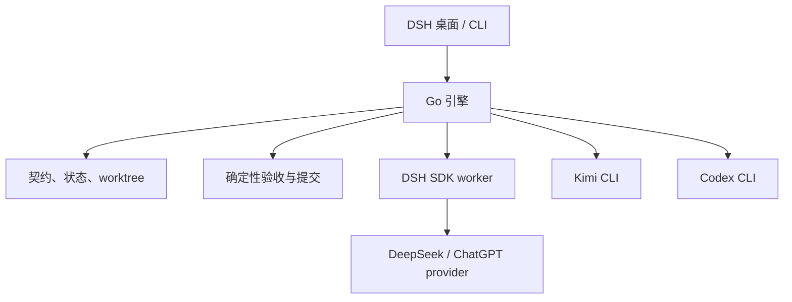

# Flywheel 系统设计 v0.25

2026-11-01 实施稿。当前行为以本文、契约 schema、模板及经过验证的实现为准。v0.24 及更早的选型、实验数据和取舍保存在 [历史设计](design-history-v0.24.md)，不再作为当前默认配置。具体工作和验证结果见 [实施计划](plans/2026-11-01-dsh-integration.md)。

## 1. 目标与范围

Flywheel 把明确需求变为一组有边界、有验收、有失败出口的 coding agent 任务。它负责确保“模型声称完成”与“可检查的交付完成”之间有可靠的验证与持久化过程。

本轮以用户现用的 DSH Mac 桌面为入口，复用 Kimi、ChatGPT 订阅和 DeepSeek API。DeepSeek 只使用 Flash。Kimi 通过原生 CLI 调用，不使用 ACP。GPT 可以在 DSH 原生 agent 中执行，也可以由完整 Codex CLI harness 执行；这两个后端的工具、权限和会话语义不同。

本轮不做大规模并行调度、自动寻找最优模型、具名 profiles，也不修改用户在另一 session 加固的 `ckanner/dsh-subagent-codex-pro`。本仓库的 Codex CLI driver 仍是可独立使用的完整 harness 通路，不能声称已经消费外部 Codex Pro adapter。

## 2. 设计不变量

1. **Go 是确定性编排器**。状态转移、重试、预算、工作区、验证、提交由代码执行；模型只负责边界上的规划、实现、评审和建议。
2. **契约是长期记忆**。Spec、packet、运行状态和复盘比任何模型会话更权威。
3. **一个执行/评审调用使用一个新会话**。Plan 只在明确启用且后端支持时恢复；当前仅 Kimi。
4. **确定性验证先于 LLM 评审**。L1 红灯不允许凭评审通过；verification-gap 必须修订验收后复验。
5. **完成要有同一候选的证据与持久化交付**。只有当前候选通过 L1、独立评审，并确认实际 Git 提交/合并仍是该候选后才 completed；非 Git 演练不能标记完成。
6. **失败不丢产物**。提交、合并、恢复失败时保留工作区。自动清理必须确认分支已合并、工作区干净；不能 force 删除成果。
7. **取消与退出码独立**。超时、取消、信号、截断、清理失败不能因退出码恰好匹配预期而判成功。
8. **参数必须实际生效**。未知 harness、未注册 provider、不支持的权限或模型配置明确失败，不静默换后端、模型或付费渠道。
9. **未知不是零**。usage/cost 缺失保持 unknown；数值汇总只表示已知量下限。
10. **测试是交付的一部分**。允许实现者补充单测和回归；冻结验收显式保护。100% 覆盖率不代表断言正确，更不能代替集成和端到端验证。

## 3. 系统边界



DSH 插件是控制面，提供面板、人工命令和模型工具。它只使用 Go 的 JSON 控制接口，不直接读写 `state.json`，不重新实现任务状态机，不让桌面父智能体保持存活来监督后台任务。

DSH worker 是独立进程，通过正式 SDK 的 stdio JSON-RPC 驱动原生会话。每次调用创建一个 SDK 进程，worker 和 SDK 继承 Go 管理的进程组，不另行 detached。SDK 自己创建的托管命令还须经 SDK 关闭协议排空；无法证明正常关闭就不能报告成功。不依赖 Teams、OAR、Forge，也不把 external subagent 名称当成原生 LLM provider。

## 4. 执行闭环

| 阶段 | 产物或判断 | 结束条件 | 有界失败出口 |
|---|---|---|---|
| Plan | 合法 packet 集或修订 | 整组契约通过 schema/交叉校验 | 校验反馈最多再试 2 次；渠道/预算耗尽升级 |
| Execute | 实现、普通测试、done-report | 报告合法且进程终态可靠，随后 L1 绿 | 尝试上限、空转检测、预算、取消 |
| Review | pass / return / verification-gap | 有证据的合法裁决 | 传输/解析重试上限，退回执行或规划 |
| Verify | L1、L2、L3 命令报告 | 所有期望退出码及物理终态成立 | 超时/取消/命令失败 |
| 完成 | 已验证交付及持久化记录 | L1 与评审绑定当前候选，提交/合并成功 | 保留工作区，人工处理 |

### 4.1 Plan

初始需求由用户确认；运行中 Plan 只能直接修订任务目录内的 `spec.md` 与 `task-packet-*.md`，并保持已批准的需求范围。普通实现测试由 executor 完成，冻结验收的路径必须写入 `boundaries.must-not-touch`，或在配置中用 `protected-test-patterns` 声明。

Plan 不得直接修改实现、任务目录外的冻结 oracle，或 `flywheel.config.json`。引擎比较 Plan 前后非契约候选内容；越界改动保留在磁盘上并报错停止，不能自动提交，也不能用回滚删除现场。外部 oracle 修订需要明确的人工任务；运行配置由用户修改后重启。本轮不实现外部 oracle 的自动修订、提交与 worktree 同步事务。

所有规划入口，包括失败升级后的修订，都走 `planUntilValid`。无效文件的具体校验错误反馈给 planner；不能绕过加载校验直接投入执行。合法契约重新加载后同步现行 packet 集；契约变化必须记录，受影响的 Executor/L1/Review/缺陷注入证据失效，旧证据移入审计历史。

合法契约先作范围受限的提交。即使 planner 或用户已自行提交，仍须按当前权威 HEAD 检查同步，不能因为“本次没有新 commit”跳过。已有 worktree 尝试快进到修订检查点，保留未提交实现；重新锚定 base-ref 前检查期间没有混入实现变更，避免把 executor 改动抹出边界 diff。分支分叉或路径冲突时明确停止，不强制重建或丢弃工作。当前仍是保守的 fast-forward 策略，复杂重基由人处理。

规划检查点提交前后核对候选内容，并检查新 HEAD 的路径范围与已提交契约。Git hook 修改已加载契约、仅修改 index、或混入实现变更时拒绝继续同步；保留工作区，要求重新加载并验证。

Kimi 会话仅在 `resident-session: true` 且 harness/model/channel/cwd/thinking 全部匹配时恢复。其他后端和旧版本缺身份的会话冷启动。恢复失败有一次冷启动路径，再受传输重试和预算约束；会话不是状态真相。

### 4.2 Execute

默认每 packet 一个 worktree。边界检查锚定执行前的 base-ref，executor 自己提交不能把变更从边界 diff 中抹去。重试重用工作区中的成果，但新建模型会话。失败命令、输出、边界违规、评审原因以及进程错误进入 `last-feedback`，放在提示词的易变尾部。

执行者可修改实现、单元测试和回归测试，不得削弱断言或改动受保护验收、Spec、packet、配置。不能通过更改覆盖率阈值来完成任务。提示词的稳定部分包含实际 `must-not-touch` 路径和 `protected-test-patterns`，而不只提规则名称。发现范围或 oracle 错误应向 Plan 返回证据；超出 Plan 可写范围的修订继续交人处理。

执行者在 **worktree 内的任务 reports 目录**写 done-report。引擎确认进程已结束，使用限制在工作区的读取路径验证普通文件、体量及 JSON schema，再收集到主任务目录。因此 DSH/Codex 的 workspace-write 不需要获得主 checkout 的额外写权限。

每次实际调用都删除该调用的旧报告入口，避免传输重试沿用上一次留下的有效 JSON。只有合法新报告才计入当前 executor 证据。

### 4.3 Review

评审在实际候选 worktree 中运行，输入仅为契约、权威 diff、L1 结果和缺陷注入结果，不读 executor transcript。DSH/Codex 使用显式 read-only；没有可靠只读映射的旧 harness 遇显式 read-only 要求时拒绝运行。

评审前后都检查候选身份。即使模型返回 pass，只要候选、契约、验证配置或本 packet 报告发生变化，该裁决就不能推进完成。评审提示要求检查断言质量、覆盖矩阵、范围和设计；100% 覆盖率本身不是充分证据。

`verification-gap` 触发受限 Plan 修订并复验。多 judge 面板仍可配置，但默认关闭；异模型意见也不能代替确定性 oracle。

### 4.4 验证和证据身份

L1 是单元级 build/lint/typecheck/unit tests/coverage；L2/L3 在里程碑级验证集成与用户路径。命令由引擎直接运行，使用白名单环境，凭证只能经显式允许注入。

Gate 通过条件是 **期望退出码匹配且未超时、未取消、未被信号终止、输出未截断、无 spawn/清理错误**。超时被 trap 成 exit 0，或杀死命令后恰好得到 expect exit 1，都失败。L1 额外要求验收命令执行前后的完整身份相同：命令本身或并发编辑改变了候选／契约／验证输入，即使 exit 0 也必须失败并重验。执行前无法读取身份时不启动验收命令；执行后读取失败同样不能产生可复用绿灯。

里程碑 L2/L3 同样记录主 checkout 在命令前后的候选身份，变化或读取失败判整个 gate 失败。正式运行中的 Judge 绑定刚通过的 gate 身份，在模型调用前后复核，仍使用主 checkout 与 read-only 权限；主判或可选第二意见改变了候选都不能关闭里程碑。被拒绝的模型裁决保留作审计，不能继续显示为有效 pass。

L1 与 Review 的 `identity` 绑定：

- 当前候选文件内容和模式，包括二进制、tracked 及未忽略的 untracked；不是 mtime、文件名清单或截断 diff。
- 权威 Spec/packet 内容及运行中的契约对象。
- 验证配置和本 packet 的 canonical done-report。

账本、日志等易变文件不参与候选代码身份；报告仅按上述特例绑定。Git 文件清单读取失败不能悄悄回退为可信绿灯。符号链接只记录链接目标，不读取其目标内容。子模块/特殊文件缺少明确验证策略时拒绝生成可复用身份。真正的非 Git 演练目录使用文件内容快照。

持久化检查对非账本 tracked 文件批量检查 Git 标记与属性；遇到 `assume-unchanged`、`skip-worktree`、实际启用的 clean/process filter 或 `working-tree-encoding` 时明确拒绝完成。持久化比较另外临时启用文件模式和符号链接语义，防止用户的 `core.filemode=false` 或 `core.symlinks=false` 隐藏未保存的差异；只作用于该次只读检查，不修改用户配置，也不把普通 Git diff 声称为独立逐字节 tree 证明。

旧状态中无身份的绿灯不能复用。未完成单元恢复后，代码、契约或检查改变会重验；旧证据只留作审计。已交付单元另外使用持久化契约 fingerprint 判断是否需要重新打开，不能因后续单元的正常代码改动而反复否定所有历史交付。候选身份不是可复现构建的完整环境证明：忽略的依赖目录、外部服务、工具链变化仍需项目自己的锁文件、集成检查与隔离环境。

### 4.5 缺陷注入

按确定性规则抽样，默认每 5 个单元一次，测试文件变更比例可增加抽样。必须先跑健康基线，再注入可逆 patch、确认测试因缺陷正常退出为红，最后恢复。

超时/取消/截断不能冒充测试“发现缺陷”，结果为 inconclusive 并停止交付。恢复在独立、短时限上下文中进行，即使主运行已取消仍尝试恢复；恢复失败保留工作区并升级。缺 patch/test-cmd、不可注入或基线红等已有诊断会进入 inbox；它们不能被展示成抽样通过。

### 4.6 Intake 与 Garden

二者是外挂建议模块，不拥有主任务状态机。Intake 发现候选任务，Garden 提出知识资产改进；建议经人确认后进入正式契约。模块使用相同的进程终态、用量未知和预算纪律，不因“只是文本建议”接受未收尾的成功。

## 5. 状态、持久化和恢复

`state.json` 仅由 `internal/state` 写入：schema 校验、进程间锁、revision CAS、临时文件与原子 rename。任务生命周期另持 `.run.lock`；lease 是并发运行与停止完成的判断依据。运行信息文件原子更新，包含用于关联本次运行的随机 control token；PID 只作展示，不作为停止授权。日志、pid、锁、停止请求及临时控制文件不进入提交。

主要单元状态仍为 pending、executing、executed、l1-passed、l1-failed、review-failed、completed、interrupted、inbox。中断后的产物保留，重启不凭旧报告自动认定完成。新增可选 `last-feedback`、`evidence-history`、`contract-fingerprints`、契约同步状态及 usage/cost 未知计数，旧配置与状态可加载，但旧完成记录不自动取得新证据的可信度。

每个现行 packet 的契约 fingerprint 包含权威 Spec 全文、packet 全文和验证配置，并随状态保存。重启或 Plan 修订后重新比较；不匹配的单元和所属里程碑重新打开，失效证据归档，完成任务也可回到 pending。旧 completed 没有 fingerprint 时保守地重新打开。Spec 或共享验证策略改变可能影响多个单元；后续正常实现代码变化则不会单独改变这个契约 fingerprint。

调度器每次从当前 Spec 重新选择未 closed 的里程碑，不能依赖最初的循环下标跳过后来重新打开的较早里程碑。每次 run 对同一个里程碑最多访问 3 次（首次加 2 次重新打开）；反复修订再次触发时写 inbox 并 escalated，避免跨里程碑修订无限自转。新 packet 也参与当前任务。最终写 completed 前必须同时确认所有现行 Spec 里程碑 closed、所有现行 packet completed；已退出当前契约集合的历史状态保留审计用途，不替代也不阻塞现行集合的完整性检查。

Git 完成顺序：验证身份仍有效 → 在 worktree 只提交实现路径 → 检查实际持久化 Git tree 与当前已验证内容一致 → fast-forward 合并 → 主任务账本提交 → 再确认主 checkout 的持久化 tree、候选内容与证据一致 → 安全清理 → 写 completed。检查覆盖只改 index 的 commit hook，以及主账本提交期间对实现的修改；不能仅凭工作区哈希没变或 git commit exit 0 放行。提交失败不能继续走“没有新提交所以无需合并”的分支。用户已 stage 的其他路径不得被顺带提交。

任务整体写 completed 前还要再次确认主 checkout 的实际持久化 HEAD。这样即使上次 L2/L3 修改了源码并导致升级，重启后幂等验收也不能把遗留的未提交改动算作已交付。

清理失败与交付失败分开记录：如果代码和账本已持久化且最终证据检查通过，工作区清理可延后，允许 completed，但 `cleanup-error` 和 worktree 引用必须保留；不得声称清理已完成。任何持久化或证据检查失败都保留工作区且不 completed。没有代码差异的 Git 单元也必须确认并记录已持久化 HEAD。

非 Git 模式只可用于部分步骤的原地演练；它不能生成可证明的 Git 交付，因此到完成阶段必须失败，不允许 completed。`commit.skipped` 不是持久化成功。生产 coding 任务必须使用 Git，默认采用 worktree。

## 6. 重试、取消和错误

稳定 provider 错误码保持：AUTH、QUOTA、RATE_LIMIT、SERVER、TRANSPORT、TIMEOUT、EMPTY_RESPONSE、INVALID_REQUEST、CONTEXT_WINDOW_EXCEEDED。L1_FAILED、REVIEW_RETURNED、SPIN 属于编排层失败分类。

退避、渠道降级、尝试次数和空转检测仍由配置/状态决定。默认没有跨渠道付费降级。driver 的 settled 与 exit code 是两个独立条件；缺终态、丢尾帧、输出截断不能变成成功。

SIGTERM 先取消运行上下文，再终止本任务登记的进程组。运行栈完成缺陷恢复等清理后返回 interrupted，CLI 退出 143。进程组清理只作用于本次拥有的子进程，不扫描并杀死之后创建的其他任务。显式脱离进程组的外部进程不属于普通 POSIX 进程组保证；DSH worker 必须完成 SDK shutdown／退出确认，SDK 负责排空自身托管命令，外层仍由 Go 看门狗兜底。

`stop` 与 `control stop` 不向 pid 文件中的数字发送信号。它们原子写入带本次随机 control token 的 `.stop-request`；引擎仅接受匹配自己 token 的请求并取消运行上下文。旧请求、坏请求及被复用的 PID 不应停止另一次运行。没有有效 token 的旧运行不能通过自动 PID signalling 假装支持新协议。

停止控制方等待本次引擎退出受管调用栈、释放任务 lease，并取得 lease 后才 CAS 保存 stopped。lease 释放不证明任意逃逸子进程已经清理；管理范围仍是本次拥有的进程组。已观测的 `CleanupError` 保留在 driver/Gate 证据与 metrics 中并阻止交付，需按错误记录人工处理。45 秒内不能确认停止则返回失败、保持状态，不强杀仍在恢复的引擎；GUI 超时应留足 60 秒。只读 status 以运行 lease 判断活动状态，PID 只作为辅助展示。

## 7. 模型与 harness 默认表

| 阶段 | Harness | Provider/渠道 | 模型 | Thinking |
|---|---|---|---|---|
| Plan | Kimi CLI | kimi-subscription | kimi-code/k3.1-pro | high，允许匹配身份后恢复 |
| Execute default | DSH SDK | deepseek-official | deepseek-flash | high |
| Execute frontend | Kimi CLI | kimi-subscription | kimi-code/k3.1-pro | high |
| Execute hard | Codex CLI | chatgpt-subscription | gpt-6.1-sol | high |
| Review | DSH SDK | chatgpt | gpt-6.1-sol | high，只读 |
| Judge | DSH SDK | chatgpt | gpt-6-astra | high，只在里程碑终验 |
| Intake | DSH SDK | deepseek-official | deepseek-flash | low |
| Garden | Kimi CLI | kimi-subscription | kimi-code/k3.1-pro | high |

这些是可编辑的初始绑定，不是模型能力排名或性能保证。使用前核对实际账号/model catalog；不支持时停止并修配置。DSH Mac rc.5 的 Flash effort 是 off/low/high/max，没有 medium。`multimodal` 暂不预绑定：文本请求与 provider 目录不能证明附件已被传递。完整图像/文件输入契约需另验收。

Codex Pro adapter 的启动超时、权限、模型回执、usage 等加固是另一个 session 的任务。它完成后可新增消费者，不改变 Flywheel 的状态/证据/提交所有权；当前 DSH native worker 不假装支持该 external adapter。

## 8. 用量、成本与效率

优先通过明确小任务、缓存稳定前缀、低频规划、故障反馈复用、独立短评审降低重试与上下文膨胀。默认不使用所有模型串行互相复核，也不强制 max/ultra。

每次调用记录角色、模型、harness、渠道、prompt hash、时长、物理终态、会话 ID、usage 和可知成本。订阅调用的美元成本不会因未上报而写成已知 0。没有价格表/真实 cost 时成本为 unknown；Kimi CLI 当前不暴露 usage，按未知处理。

`unknown-usage-calls` 和 `unknown-cost-calls` 与已知总数并存。hard token budget 遇当日未知 usage 停止，因为限额无法证明；soft 默认可继续并明确告警。配置为 off 只关闭熔断，不关闭计量。价格只接受 driver 真实值或用户显式提供的定价，不内置会过期的推测账单。

## 9. 权限与宿主能力

DSH/Codex 执行用 workspace-write，评审用 read-only，交互审批策略 never。DSH worker 检查实际工作目录、模型、effort、权限回执并在发推理请求前验证沙箱；不支持时失败，不静默改成 full access。

Kimi print 模式强制 auto，当前 CLI 无本适配器可宣称的 OS 级 workspace 沙箱。它保留原生 harness 能力，也保留这个权限边界；不能把 worktree 当成安全沙箱。legacy pi/omp/zcode 不在新默认路径；明确 read-only 需求无法实施时 fail closed。

SDK profile 与桌面 profile 是不同运行配置。桌面装有 ChatGPT provider 不代表 SDK 已加载或已授权。worker 只使用用户指定的官方 DSH 可执行入口，不猜 `.app` 内部路径，不复制凭证。

## 10. 验证与发布纪律

Go 的 `make quality-gate` 执行 vet、gofmt 和 **逐函数 100% statement coverage**。这是本项目的用户要求，不声称行业规范要求所有仓库都必须 100%。Go 原生 statement coverage 也不等同于 branch coverage。

测试必须检查公共行为与失败路径：真实 Git hook/merge/index/worktree、真实子进程/取消、协议错帧、身份失效、报告收集、权限失败。I/O 注入缝用于不可稳定制造的故障，不通过删除防御分支或镜像实现来凑覆盖率。插件另跑 Node 测试、真实官方 SDK 的无推理 doctor、Go→Node→SDK fixture。

本环境没有用户 Mac/订阅会话。离线通过不能标为 Mac live 通过；桌面渲染、Seatbelt、本机 CLI 版本与真实账号响应按插件 README 的清单另验。

## 11. 后续增强

具名 profiles 可在现有 loops/routes/channels 上增加引用层；provider、model、harness、账号渠道要保持独立含义。该项不阻塞当前方案。自动难度路由、多 agent 并行、任务团队、附件协议、系统级强隔离可在现有指标和真实任务集支持下逐项加入，不一次叠加。

## 12. CLI 与控制面

现有 run、status、stop、intake、garden、skills、template 接口保留。`--only` 运行指定子环至合法终态或有界停止；`--pause-before review` 保留已验证候选用于下次恢复。

新接口：

```sh
flywheel control start --task-dir /repo/docs/task --cwd /repo
flywheel control status --task-dir /repo/docs/task --cwd /repo
flywheel control stop --task-dir /repo/docs/task --cwd /repo
```

控制接口 stdout 始终是单个 JSON：protocol、ok、running、pid、taskDir、state、可选 error。stderr 只诊断。start 派生独立后台引擎，双流进 orchestrator.log；status 不写状态；stop 不伪造停止。旧命令继续原输出形态。退出码 0=成功，1=用法/运行错误，3=升级/预算/失败步骤，143=已中断。

## 13. 配置和分发

配置按首个完整文件选择，不深度合并：任务目录 → 项目根 → 全局 `~/.config/flywheel/flywheel.config.json`（`FLYWHEEL_CONFIG` 可覆盖全局路径）→ 内嵌模板。升级不自动覆盖已有配置。模型绑定位于 `loops`、`routes`；`drivers` 只选择 mock/real，不是 provider 注册表。

新内嵌表见 [flywheel.config.example.json](../templates/flywheel.config.example.json)。现有用户要采用新方案，先比较并显式迁移全局/项目配置。默认包版本没有在这次本地实现中发布；必须使用本分支构建出的 Go 二进制及 [DSH 插件](../plugins/dsh/README.md)，不能假设 npm 上旧版本已经包含 control/DSH driver。

首次安装与小任务演练见 [入门教程](getting-started.md)。主入口、SDK profile、worker 协议和本机验收步骤见 [插件说明](../plugins/dsh/README.md) 与 [协议](../plugins/dsh/PROTOCOL.md)。历史研究引用保留在 [旧设计附录](design-history-v0.24.md)，其模型/价格/订阅额度只属于当时记录。
