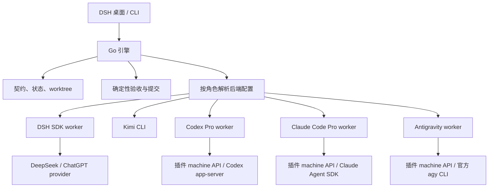
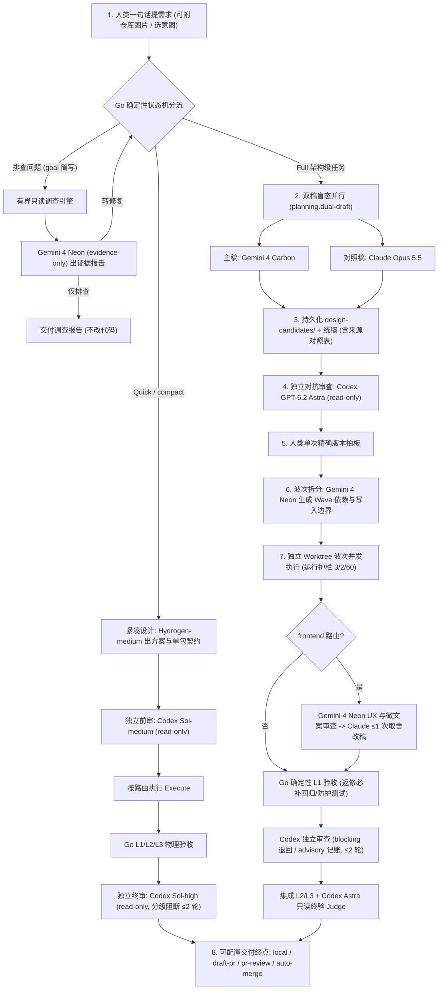
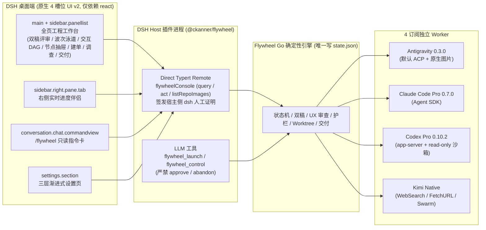

# Flywheel 系统设计

[文档索引](README.md) · [中文使用指南](zh-CN/getting-started.md) · [贡献指南](zh-CN/contributing.md)

本文定义 Flywheel 当前源码的系统边界、执行契约和失败处理规则。字段以
[`templates/`](https://github.com/ckanner/flywheel/tree/main/templates) 中的 schema 为准；实现必须遵守 §2 的设计不变量。
源码实现、开发候选、npm 发行和用户机器验收分别记录，不能相互代替。

阅读使用方式请从指南开始；设计提案保存在 [`plans/`](plans/)，已执行检查及其限制
保存在 [`validation/`](validation/)。v0.24 及更早的选型与实验归入
[历史设计](archive/design-v0.24.md)，不作为当前默认配置。各次实施的依据见 §10。

## 目录

1. [目标与范围](#1-目标与范围)
2. [设计不变量](#2-设计不变量)
3. [系统边界](#3-系统边界)
4. [执行闭环](#4-执行闭环)
5. [状态、持久化和恢复](#5-状态持久化和恢复)
6. [重试、取消和错误](#6-重试取消和错误)
7. [模型与 harness 默认表](#7-模型与-harness-默认表)
8. [用量、成本与效率](#8-用量成本与效率)
9. [权限与宿主能力](#9-权限与宿主能力)
10. [验证与发布纪律](#10-验证与发布纪律)
11. [后续增强](#11-后续增强)
12. [CLI 与控制面](#12-cli-与控制面)
13. [配置和分发](#13-配置和分发)

## 1. 目标与范围

Flywheel 把明确需求变为一组有边界、有验收、有失败出口的 coding agent 任务。它负责确保“模型声称完成”与“可检查的交付完成”之间有可靠的验证与持久化过程。

默认以 DSH Mac 桌面为入口，通过 Antigravity `agy`、Claude Code、Codex 与 Kimi 原生客户端使用四家订阅，不使用 ACP。`subscription-only` 是可达绑定和原生派发的显式约束，默认不含 DeepSeek API／充值账号或付费后备。旧 DSH provider 与 API 配置继续作为无此策略时的显式兼容路径，不能绕过严格订阅准入。账号权益、额度和实际费用不因本地配置通过而被推定。

具名模型 profiles、provider 与账号渠道的独立配置、有效配置查看和无推理安装预检已具备。`codex-pro` harness 直接消费 `dsh-subagent-codex-pro@0.10.2` 公开 machine API，作为默认 hard 路由；原 `codex` CLI driver 仅保留为用户明确选择的兼容路径，不作自动后备。统一准备启动入口、Auto／Quick／Full 和 DSH 会话任务关联减少已明确小任务的重复规划与终验。有界并行按冻结依赖和写入范围调度；桌面控制台提供受管阶段操作、配置编辑、会话接管和明确授权的远端交付。原生能力通过 native-profiles 接入各 loop，支持 DSH Team、Kimi Agent/Swarm/Tower、Codex agents、Claude Workflow 及 Antigravity Orchestrator／子代理／Swarm；各后端实际边界见 §3.3 和 §7.3。开放式自动模型选型仍不属于现有实现；显式允许集合内的首次执行选择及失败调整见 §13。

## 2. 设计不变量

1. **Go 是确定性编排器**。状态转移、重试、预算、工作区、验证、提交由代码执行；模型只负责边界上的规划、实现、评审和建议。
2. **契约是长期记忆**。Spec、packet、运行状态和复盘比任何模型会话更权威。
3. **会话按任务、范围和角色隔离，按运行事实续用或重建**。普通返修可延续原角色上下文；独立评审不得继承执行者上下文。会话连续性不能替代契约、候选证据、预算和终态／清理检查，结果未知时也不能靠新建会话绕过阻断。目标策略与现有能力的差异见[会话方案](plans/2026-11-07-session-lifecycle.md)。
4. **确定性验证先于 LLM 评审**。L1 红灯不允许凭评审通过；Quick 的适用 L2/L3 也必须先在实际候选上通过。verification-gap 必须修订验收后复验。
5. **完成要有同一候选的证据与持久化交付**。只有当前候选通过 L1、独立评审，并确认实际 Git 提交/合并仍是该候选后才 completed；非 Git 演练不能标记完成。
6. **失败不丢产物**。提交、合并、恢复失败时保留工作区。自动清理必须确认分支已合并、工作区干净；不能 force 删除成果。
7. **取消与退出码独立**。超时、取消、信号、截断、清理失败不能因退出码恰好匹配预期而判成功。
8. **参数必须实际生效**。未知 harness、未注册 provider、不支持的权限或模型配置明确失败，不静默换后端、模型或付费渠道。
9. **未知不是零**。usage/cost 缺失保持 unknown；数值汇总只表示已知量下限。
10. **测试是交付的一部分**。允许实现者补充单测和回归；冻结验收显式保护。100% 覆盖率不代表断言正确，更不能代替集成和端到端验证。

## 3. 系统边界



Flywheel 作为外部会话视图，通过公开 slot 注册的 order 排在内置“对话／轨迹／统计”之后；不改写内置条目或宿主 DOM。

DSH 插件是控制面，提供面板、人工命令和模型工具。它只使用 Go 的 JSON 控制接口，不直接读写 `state.json`，不重新实现任务状态机，不让桌面父智能体保持存活来监督后台任务。

引擎将任务目录与执行根统一为绝对物理路径，再计算账本、契约和报告的相对位置。macOS 的 `/var`／`/private/var` 或用户自建符号链接不能改变同一任务的身份；路径无法解析时停止，不能把错误的 `../` 前缀传入 Git 排除规则。

### 3.1 项目归属与执行目录

项目工作区是原仓库的稳定归属；任务集成目录和 packet worktree 是执行位置，不能用它们替代 Provider 的项目归属。Go 为每次角色调用同时记录项目工作区和实际执行目录，在提示词中明确任务、角色、执行位置及禁止修改其他 checkout。验收、候选指纹和任务回执仍绑定实际执行目录。

DSH 使用原仓库作为 Session header 的 cwd，再通过公开工作目录接口切到执行目录。桌面 Host 通过公开 Workspace API 登记匹配项目的 SDK 会话，不由独立 SDK 进程并发改写桌面存储，不为每个 packet worktree 建立新的桌面项目。安装探测使用临时会话持久化目录并在退出后清理，不向用户会话列表留下新的探测会话。

原生 CLI／machine 后端在项目目录启动，提示词要求每次文件、shell、测试与 Git 操作显式使用实际执行目录。当前后端不能分离 `workspace-write` 沙箱根和项目目录时，在派发前拒绝该组合，不扩大权限；完全权限与支持的只读模式保持各自语义。旧会话保留真实历史目录，待消费回执先按原身份核对，不修改历史头部来伪造归属。同项目的兼容历史可按会话策略继续使用。

新建受管会话使用可读标题 `Flywheel · <role[/scope]> · <task>`。task 优先取已加载 spec.title，未有 spec 时取规划 brief.goal，最后使用 task slug；换行、控制符与 Unicode 格式控制被规范化，长度按字符有界且总标题不超过 512 UTF-8 字节。内部 planning invocation ID 不进入展示标题；opaque session ID 与冻结绑定不变。DSH 通过公开 sessionTitle 服务写入并核对标题，Codex Pro 用 thread/name/set，Claude Code Pro 普通调用用 SDK title、交互 Team 用原生 -n；只在新持久历史设置，恢复历史不覆盖用户名称。Kimi native 在公开 session create 写标题，并在 prompt 前核对返回的标题、绑定与工作目录；未确认归属时不向该历史发起会话级清理。Kimi print 绕过 TUI 的自动标题路径且没有命名 CLI flag：使用独立受管的本地公开 API 创建无 prompt 的具名空历史，关闭并确认进程清理后由原 print 命令续用；两步共用原 wall 预算与相同 KIMI_CODE_HOME，不显式覆盖 thinking/profile/environment。设置 auto 权限和 plan_mode:false 仅保持原 fresh print 行为；失败不静默运行匿名任务，也不进行额外模型命名调用。公开 API 的 create/close 会多产生一轮原生 SessionStart/SessionEnd（包括用户配置的 hooks），这是首次具名 print 的明确成本；业务 prompt 仍只发送一次，后续 resume 跳过准备。Agent/Swarm 直接在原创建流程中命名，无额外准备生命周期。旧 codex exec 等未提供已验证命名接口的兼容后端不冒称此能力。

`worktree.enabled` 只控制引擎自动管理执行目录，与并行策略独立。目录选择、外部 worktree 登记和共享目录批次见 §4.8。

### 3.2 Worker 与进程所有权

DSH worker 是独立进程，通过正式 SDK 的 stdio JSON-RPC 驱动原生会话。每次调用创建一个 SDK 进程，worker 和 SDK 继承 Go 管理的进程组，不另行 detached。SDK 自己创建的托管命令还须经 SDK 关闭协议排空；普通路径关闭保留 2 秒用于历史落盘与插件释放；启用 native 时为 15 秒，LCU 路径为 135 秒，Go 外层分别至少 20／145 秒。之后才进行有界 TERM/KILL 收尾。无法证明正常关闭就不能报告成功。可显式启用 SDK 内的 Team，但不能把 external subagent 名称当成原生 LLM provider。

可选 `scheduler.prewarm:true` 提前启动一次性 DSH Review 运行环境：在串行 packet 的 Execute 已确认收尾后，与 L1／适用 Quick 检查重叠执行 SDK 启动与 `initialize`。准备阶段不创建或恢复 Session，不发送 prompt，不使用占位推理。新协议以 `--prewarm` 明确选择，与原 v1／v2 的一次性请求保持兼容；最多一个待用 SDK，60 秒 TTL，stdin EOF 始终触发有界清理。正式 Review 仍先通过全部适用验证、预算和角色调用准入，持久化实际 invocation intent 后才能消费同一运行环境。

预热绑定实际 worker、SDK 配置、环境、Provider、模型、effort、权限、物理执行与项目目录，并由 Go 另外限制任务、Review scope 和账号 channel。绑定变化、检查失败、暂停或不再需要 Review 时先等待关闭；未知清理阻断后续模型调用。正常闲置过期只有在未尝试发送正式请求、原回执明确未派发、SDK 与整个进程组清理确认、调用未取消且仍有剩余期限时，才可在同一个实际 invocation 下执行一次普通冷启动，不增加业务失败或重置超时。预热不跨任务、角色、引擎进程复用，也不在并行执行 lane 或共享候选中积累 SDK。仅有 Execute 的单步操作和明确暂停在 Review 之前的流程不预热。并行组停稳后才在串行 Review 中准备，不声称已经与该组之前的并发 L1 重叠。原生 Codex Pro、Claude Code Pro 和 Kimi 路径保持各自公开生命周期；当前不声称它们支持这项无 prompt 的预启动。DSH 内的 ChatGPT／DeepSeek Provider 使用同一 SDK 能力判定。

Codex Pro worker 是另一种受管进程，直接导入 `dsh-subagent-codex-pro/machine`，不创建 DSH 父模型来再次委派。插件内部启动 Codex app-server，保留其完整 harness 与用户已有 Codex 登录。Go 管理 worker 生命周期；插件拥有 app-server、guardian 和内部取消／清理。正常完成必须同时满足外层 worker 的物理终态及插件完整回执。worker 异常退出不能被解释成插件子进程已清理；取消和未知清理结果均阻止成功。

Claude Code Pro worker 同样直接调用公开 machine API。插件先建立独立 guardian 的
IPC lifeline，再由 guardian 内的官方 Agent SDK 0.3.326 派发配置指定的 Claude
可执行文件并拥有其进程组；SDK 负责正式请求／控制协议，插件保留流完整性、真实
活动、身份、物理退出与清理验证。worker 消失时仍能
收束原生工作。正常结果等待 native 与 guardian 退出。清理与任务结果独立：外层被
强杀导致回执丢失时，不能因为 guardian 清理了进程就推断任务成功或安全重放。

### 3.3 原生能力、任务树和独立任务

`native-profile` 在模型／阶段／路由绑定中引用版本化 `native-profiles`；能力跟随实际 harness，不改变 provider、账号或模型的既有绑定。DSH 复用 `dsh-preset-generator@0.4.0` 的 SDK global PTC overlay，明确不是挂载 named Agent Preset。首个 prompt 前实际执行 canonical JSON、handle、多图、TypeScript 和输出协议 probe；同版本号不代替行为验证。各后代在公开 Agent 生命周期中按真实 registry 和 lineage 准入。

每次 invocation 记录 requested／effective／observed、owned children、usage、completion 和 cleanup；默认值写入 effective，不改写原始 requested。native-event 只是观察，不充当 Pro durable lifecycle ACK。completion 在 root 结束、开始 cleanup 之前冻结；取消残留 child 不能倒推原任务已完成。SDK policy 的 bounded journal 按 requestId／nonce／rootSessionId／连续序号核对，最终 complete/events/bytes 不一致时保持失败与未知清理。

Antigravity 的原生回执是单独的部分观察契约：requested mode／dispatch 与实际子会话
分开，completion.scope 为 cli-invocation，children 和整树用量未公开时保持 unknown。
它不使用完整 Pro 子树收尾证明，也不因 native-profile 非空取消规划前台归集要求。
Orchestrator、subagents 与 Swarm 的准入、观察阈值及受审查协作范围见 §7.3。

LCU 通过公开 managed API 挂载，root 与真实后代共享一个跨进程 `local-desktop` lease并顺序操作 GUI；每次操作核对 caller 与 epoch，未知 owner 不被自动接管。PTC tool 名为 `lcu_cua`，程序对象仍是 `cua`。取消必须区分 MCP 请求、turn cleanup 和 native 物理退出。图片从实际 AttachmentStore 读取并归档至 task 的 reports/native/invocation；capture 与 archive hash 分开，模型送达未验证时如实标注。

Kimi native 路径调用独立 worker，拥有 `kimi web` 的本地 server、registry、PID 与订阅，实际核对模型／effort／mode／permission后再派发。普通 CLI 路径保留。Agent/Swarm 使用角色账本；Tower 创建独立 `.git` 候选，只有 Execute 在完成和清理确认、source HEAD／bytes／modes／外部契约复核及 patch check 后导回。该副本不构成 OS 文件系统沙箱，Server 仅接受显式 full access；未知调用不重放。

Codex 0.10.2 使用 config/read核对原生 agents controls与当前child turn；Claude 0.6.0支持Agent定义／Workflow／Advisor，并区分init工具事实与无法验证的hard cap。Claude 定义中的可选 `effort` 限定为 low/medium/high/xhigh/max，配置加载时检查并原样透传至 SDK `agents`（交互 Team 用 `--agents`），与父绑定的 `thinking` 独立；省略时不注入默认值，tools-only init 不能证明实际子 effort。machine/native protocol 仍为 1，worker、回执与恢复保持精确插件版本身份。Codex原生review不消费角色prompt，因此通过 `flywheel native codex-review`独立入口；Claude `claude-review`、`claude-team`、`claude-recover`和`claude-control`保留远端job／tmux所有权与恢复回执。它们不写Flywheel state、不自动产生Review或Judge verdict，远端本地超时不证明云任务已结束。使用与协议见[原生能力指南](zh-CN/native-capabilities.md)及[完整设计](plans/2026-11-13-native-harness-capabilities.md)。

## 4. 执行闭环

### 4.0 Auto、Quick 与 Full

工作流与模型路由是两项独立选择。Auto 由 Go 根据已校验的实施契约事实选择 Quick 或 Full，不额外固定调用分类模型。新任务的契约由下述设计与独立评审循环生成并激活；旧任务继续读取原有契约。显式 Full 保留完整流程；显式 Quick 仍需满足资格。旧 Spec／旧状态没有工作流字段时按 Full 处理，升级软件不减少既有任务的阶段。

Quick 首版要求一个里程碑、一个可独立验收的 packet，全部需求均有验证说明、必需检查可执行、没有未决设计或完整流程风险。宿主记录代码依据、范围判断、风险与不适用检查的理由；不能仅写“低风险”或按文件数量替代判断。鉴权、权限、支付、迁移、并发、事务、跨模块重构以及资格不明确的任务使用 Full。Go 校验结构与声明的一致性，不声称能从布尔字段证明语义安全；执行和最终评审仍可发现需要升级的证据。

| 生效策略 | 运行期闭环 | Plan／Judge |
|---|---|---|
| Quick | Execute → L1、适用缺陷注入与候选 L2/L3 → 独立最终 Review → 同一候选的 Git 交付 | 合格已持久化契约下不适用，记录原因，不伪造 pass |
| Full | Plan → 逐 packet Execute／L1／Review／交付 → 集成 L2/L3 → Judge | 保留现有阶段 |

正常首次成功的 Quick 有两次阶段 Agent 调用：Execute 与最终 Review。宿主准备、内部工具轮次、失败重试与升级不计入这两个阶段；这是减少固定调用，不是总耗时或费用减半的保证。所有必需测试、覆盖率门禁、预算、进程收尾和 Git 持久化检查继续执行。

以下逐阶段说明以 Full 为基础，Quick 的差异见 §4.7；子环入口不等于完成任务。

| 阶段 | 产物或判断 | 结束条件 | 有界失败出口 |
|---|---|---|---|
| Plan | 合法 packet 集或修订 | 整组契约通过 schema/交叉校验 | 校验反馈最多再试 2 次；渠道/预算耗尽升级 |
| Execute | 实现、普通测试、done-report | 报告合法且进程终态可靠，随后 L1 绿 | 尝试上限、空转检测、预算、取消 |
| Review | pass / return / verification-gap | 有证据的合法裁决 | 传输/解析重试上限，退回执行或规划 |
| Verify | L1、L2、L3 命令报告 | 所有期望退出码及物理终态成立 | 超时/取消/命令失败 |
| 完成 | 已验证交付及持久化记录 | L1 与评审绑定当前候选，提交/合并成功 | 保留工作区，人工处理 |

### 4.1 Plan

新任务使用 `control planning` 登记 `planning.schema.json` 定义的薄 brief，保留原始请求、目标、约束、证据、设计策略与原始实施授权。New 启动真正的整体设计与独立 Design Review；默认 `review-first` 在通过评审后等待人批准精确设计版本。Task 在原始请求已经明确委托实施时，可显式选择 `delegated`，仍须经过独立评审，自动批准的来源是原始委托，记录为 delegated，不能伪装为 human。

**新规划协议**与原来面向实施契约的 Plan 分开记录。以下直接写 Spec/packet 的旧 Plan 行为只用于未迁移的 legacy 任务；新规划角色只读调查并返回结构化提案，由 Go 校验、密封版本和投影。新 Plan 默认做整体方案；`scope:milestone|packet|replan` 明确局部细化或重规划。旧 `run --only plan` 保留里程碑含义；新协议在该入口也经过独立子计划评审。显式 Plan 和 `run --planning-only` 不自动执行，Quick 也不因此被强制升级为 Full。

旧任务的初始需求由用户确认；运行中旧 Plan 只能直接修订任务目录内的 `spec.md` 与 `task-packet-*.md`，并保持已批准的需求范围。普通实现测试由 executor 完成，冻结验收的路径必须写入 `boundaries.must-not-touch`，或在配置中用 `protected-test-patterns` 声明。

Plan 不得直接修改实现、任务目录外的冻结 oracle，或 `flywheel.config.json`。引擎比较 Plan 前后非契约候选内容；越界改动保留在磁盘上并报错停止，不能自动提交，也不能用回滚删除现场。外部 oracle 修订需要明确的人工任务；运行配置由用户修改后重启。当前不实现外部 oracle 的自动修订、提交与 worktree 同步事务。

所有规划入口，包括失败升级后的修订，都走同一有界 Plan 校验循环；普通入口与带决策身份的重规划共享实现。无效文件的具体校验错误反馈给 planner；不能绕过加载校验直接投入执行。合法契约重新加载后同步现行 packet 集；契约变化必须记录，受影响的 Executor/L1/Review/缺陷注入证据失效，旧证据移入审计历史。

合法契约先作范围受限的提交。即使 planner 或用户已自行提交，仍须按当前权威 HEAD 检查同步，不能因为“本次没有新 commit”跳过。已有 worktree 尝试快进到修订检查点，保留未提交实现；重新锚定 base-ref 前检查期间没有混入实现变更，避免把 executor 改动抹出边界 diff。分支分叉或路径冲突时明确停止，不强制重建或丢弃工作。当前仍是保守的 fast-forward 策略，复杂重基由人处理。

规划检查点提交前后核对候选内容，并检查新 HEAD 的路径范围与已提交契约。Git hook 修改已加载契约、仅修改 index、或混入实现变更时拒绝继续同步；保留工作区，要求重新加载并验证。

scoped 下 Plan 按任务／里程碑保存自己的历史，显式 `resident-session:false` 继续关闭
Plan 复用；省略该字段不等于关闭。fresh 仅在未配置 `native-profile` 的旧 Kimi CLI
路径保留旧 Plan resident 行为，但不把它记录为通用作用域可复用句柄。原生 Agent/Swarm
将全局 `fresh` 下的显式 `resident-session:true` 意图映射为 scoped 角色账本，显式 `sessions.roles.plan:"fresh"`
仍优先关闭复用；不导入旧 CLI Session，Tower 始终 fresh。实际绑定、工作目录、权限和运行配置不匹配时不续用旧
历史；未知调用先阻断，不能以冷启动覆盖。会话不是状态真相。

### 4.1.0 设计、讨论、独立评审与批准

整体设计须覆盖需求与非目标、现状依据、备选方案与取舍、接口/数据/状态、失败恢复、兼容迁移、安全与费用约束、里程碑、验证策略。决定区分 fixed/delegated/unresolved；未决必要决定不能凭默认假设通过。每个设计记录不可变 revision/digest、输入版本、仓库基线与真实 planner invocation。

紧凑准备由 brief 的 `design-granularity:compact`、具体理由与仓库依据选择，不由
`mode:quick` 猜测。一次 design-plan 输出根设计与 `compact.version:1` 的完整单 packet
投影；Go 先验证需求、写范围、验收和确定性 Quick 资格，再原子采用设计及计划。
独立 design-review 产生一条 `kind:compact-v1` 联合记录，精确绑定 design target 与
plan ref，分别确认 design-validity、coverage 和 within-envelope；实际字段为
`design-verdict:valid`、`coverage-verdict:complete` 与 `scope-verdict:within-envelope`。
不复制它伪造 Plan Review。资格不充分或联合审查发现范围风险时，同一 request 升级
system 并保留轮次和预算。实际粒度及绑定来源在 request 派发前持久化，真实模型、
effort、权限与会话身份沿原调用账本冻结。

联合通过且授权成立后复用该计划直接激活，不再固定生成一组 milestone Plan/Review。
激活重新核对输入版本、设计与投影摘要、独审身份、依赖候选及委派范围。New 与显式
Plan 保持停止点，批准不等于开始实施；旧有效计划和原类型审查继续复用。全新合格
紧凑任务首次正常完成通常为四次逻辑角色调用，调查、内部工具、重试及返修另计。

`design-plan` 与 `design-review` 是不同的受管根调用，分别拥有会话、用量、终态和清理回执。默认一位 Planner 和一位独立 Reviewer，不固定启用专家面板；按配置使用已有原生 Agent/Team/Workflow/Swarm。一次根调用内部的专家意见是该调用的证据，不能同时算作正式独立评审。Reviewer 检查完整方案，并保留稳定 finding ID、事实、影响与关闭证据；通过须没有未关闭 blocker/major 和未解决必要决定。每个 scope request 默认最多三轮完整设计/评审，传输和格式重试另行累计持久化；重启、重新 Run 或切后端不清空已花费用和轮数。

人工批准绑定当前设计的精确版本、digest、独立通过的 review 和可信控制事件。批准与开始实施分别记录：“批准此版本”只批准，“批准并开始”同时提供开始授权；普通 Run 不能补造缺失的开始授权。新的用户反馈使旧输入的批准失效，旧版本仍保留以供对照。反馈在运行时排队，由拥有运行租约的 Go 引擎先结算并消费原调用，再在安全边界采用；`start:false` 采用后停住，等待明确继续。queued、applied 与 rejected 是不同回执。

控制台只读快照中的规划分区按 JSON 实际编码体积限制为 512 KiB；先保留当前/上一版/最近批准的设计和当前子计划引用，再按需省略历史与重复正文。`planning.projection` 明示显示摘要、省略计数和完整账本入口；这个字段不属于权威状态 schema，摘要不能写回 `state.json`。当前设计或其独立审查不完整时 `approval-complete:false`，UI 禁止批准；CLI 仍可从原状态完整显示设计和审查，由用户在交互终端确认精确 digest。必要身份元数据仍超额时明确失败，不能输出超限帧或静默截断后允许批准。

根设计审批与实施计划的版本分开。子计划复用 `plan`，由独立 `plan-review` 检查相同根设计、当前依赖和累计变化。Go 固定核对原目标、全部需求/里程碑和验收底线、明确写入范围、未受影响/已完成 packet 内容；Reviewer 再给出 within-envelope/material-change/unclear。只有独立通过且 within-envelope 可激活；实质变化必须回整体设计与批准。未来里程碑可声明 `planning: deferred`，不伪造 packet 或恒真验收；开始该里程碑前才生成真实 packet。后续细化不会仅因整个 Spec 的 planning-ref 变化就重新打开已完成且内容未变的 packet。

`loops.design-plan` 默认继承 `loops.plan` 后端；`loops.design-review`、`loops.plan-review` 默认继承 `loops.review` 后端。原生 profile 随实际绑定继承，逻辑角色、会话历史和权限解析仍独立，`config inspect` 展示 binding source。继承不自动复制针对旧角色的权限特例，也不补造新角色的跨渠道付费 fallback 映射；需要时显式配置。DSH PTC/Team、Codex agents、Claude agents/workflow/advisor、Kimi 原生模式继续使用现有公开 adapter 与生命周期，而不是另建一套弱化 worker。独立 reviewer 不继承 planner 私有历史；模型与 effort 仍由各自已解析的根绑定决定。

### 4.1.1 可信 Plan 检查点

Full 的普通恢复先核对 `PlanProgress.checkpoint`，不无条件再次调用规划模型。
检查点 v1 绑定里程碑、当前 Spec／packets、验证与调度／工作流政策、可信规划回执，
并在原有 Git 提交和 worktree 同步检查全部成功后写入持久化 HEAD。仅 passed 文本、
缓存会话或旧状态不能补造证明。当前 HEAD 须是原检查点，或能证明在其后且由编排器
确认交付的 packet HEAD；未知外部提交保守失效。正常未提交返修代码不单独使 Plan
失效。显式 Plan、verification-gap 与契约修订仍运行真实规划；未知调用先对账。

### 4.2 Execute

自动管理开启时，默认为每个 packet 准备 worktree；关闭时使用已选执行目录或经引擎登记的外部 worktree。边界检查锚定执行前的 base-ref，executor 自己提交不能把变更从边界 diff 中抹去。重试重用工作区中的成果；scoped 下同 packet、同角色的普通返修在正常终态和身份资格满足时延续 Executor 历史，fresh 不启用通用历史复用。失败命令、输出、边界违规、评审原因以及进程错误进入 `last-feedback`，放在提示词的易变尾部。

执行者可修改实现、单元测试和回归测试，不得削弱断言或改动受保护验收、Spec、packet、配置。不能通过更改覆盖率阈值来完成任务。提示词的稳定部分包含实际 `must-not-touch` 路径和 `protected-test-patterns`，而不只提规则名称。发现范围或 oracle 错误应向 Plan 返回证据；超出 Plan 可写范围的修订继续交人处理。

执行者在 **worktree 内的任务 reports 目录**写 done-report。引擎确认进程已结束，使用限制在工作区的读取路径验证普通文件、体量及 JSON schema，再收集到主任务目录。报告收集由 Go 完成，不需要向执行者额外开放主 checkout。角色权限仍受 §3.1 的目录分离能力约束；不支持的 `workspace-write` 组合在派发前拒绝。

每次实际调用都删除该调用的旧报告入口，避免传输重试沿用上一次留下的有效 JSON。只有合法新报告才计入当前 executor 证据。

### 4.3 Review

评审在实际候选 worktree 中运行，输入为契约、权威 diff、确定性验收和缺陷注入结果；Quick 最终 Review 还接收适用 L2/L3 与全部需求的完成要求，不读 executor transcript。宿主权限由 `permissions.mode` 决定：role-based 请求 read-only，full-access 请求完全权限；后端不能实施所选权限时拒绝运行。两种模式下评审都只负责判断，不得修改候选代码或验收依据。

Review 始终与 Executor 历史隔离。scoped 下同范围复审可延续 Reviewer 自己的上下文，
但必须重新检查完整当前候选和适用需求，不能只关闭上轮 findings 或沿用旧 pass。
Quick 最终 Review 与 Full 单元 Review 的职责不同，不能互用旧会话或裁决。

评审前后都检查候选身份。即使模型返回 pass，只要候选、契约、验证配置或本 packet 报告发生变化，该裁决就不能推进完成。评审提示要求检查断言质量、覆盖矩阵、范围和设计；100% 覆盖率本身不是充分证据。

`verification-gap` 触发受限 Plan 修订并复验。多 judge 面板仍可配置，但默认关闭；异模型意见也不能代替确定性 oracle。

### 4.4 验证和证据身份

L1 是单元级 build/lint/typecheck/unit tests/coverage；L2/L3 验证集成与用户路径。Full 在里程碑集成后运行 L2/L3；Quick 在最终 Review 前、实际 packet 候选工作区运行这些检查，不能使用尚未包含修改的集成 checkout 取得绿灯。命令由引擎直接运行，使用白名单环境，凭证只能经显式允许注入。

Gate 通过条件是 **期望退出码匹配且未超时、未取消、未被信号终止、输出未截断、无 spawn/清理错误**。超时被 trap 成 exit 0，或杀死命令后恰好得到 expect exit 1，都失败。L1 额外要求验收命令执行前后的完整身份相同：命令本身或并发编辑改变了候选／契约／验证输入，即使 exit 0 也必须失败并重验。执行前无法读取身份时不启动验收命令；执行后读取失败同样不能产生可复用绿灯。

里程碑 L2/L3 同样记录主 checkout 在命令前后的候选身份，变化或读取失败判整个 gate 失败。正式运行中的 Judge 绑定刚通过的 gate 身份，在模型调用前后复核，仍使用主 checkout，权限由显式 permissions.mode 决定；评审职责仍为只读，主判或可选第二意见改变了候选都不能关闭里程碑。被拒绝的模型裁决保留作审计，不能继续显示为有效 pass。

L1 与 Review 的 `identity` 绑定：

- 当前候选文件内容和模式，包括二进制、tracked 及未忽略的 untracked；不是 mtime、文件名清单或截断 diff。
- 权威 Spec/packet 内容及运行中的契约对象。
- 验证配置和本 packet 的 canonical done-report。
- 自适应任务的生效策略、策略版本与完成要求；改变策略不能复用不匹配的绿灯。

账本、日志等易变文件不参与候选代码身份；报告仅按上述特例绑定。Git 文件清单读取失败不能悄悄回退为可信绿灯。符号链接只记录链接目标，不读取其目标内容。子模块/特殊文件缺少明确验证策略时拒绝生成可复用身份。真正的非 Git 演练目录使用文件内容快照。

持久化检查对非账本 tracked 文件批量检查 Git 标记与属性；遇到 `assume-unchanged`、`skip-worktree`、实际启用的 clean/process filter 或 `working-tree-encoding` 时明确拒绝完成。持久化比较另外临时启用文件模式和符号链接语义，防止用户的 `core.filemode=false` 或 `core.symlinks=false` 隐藏未保存的差异；只作用于该次只读检查，不修改用户配置，也不把普通 Git diff 声称为独立逐字节 tree 证明。

旧状态中无身份的绿灯不能复用。未完成单元恢复后，代码、契约或检查改变会重验；旧证据只留作审计。已交付单元另外使用持久化契约 fingerprint 判断是否需要重新打开，不能因后续单元的正常代码改动而反复否定所有历史交付。候选身份不是可复现构建的完整环境证明：忽略的依赖目录、外部服务、工具链变化仍需项目自己的锁文件、集成检查与隔离环境。

### 4.4.1 结构化短反馈与进展

Executor 可先跑与当前修改有关的小检查，随后 Go 在实际候选上执行完整冻结门禁。
不再要求执行者固定重复一次全量验收；最终 L1、适用 L2/L3、独立评审和持久化不减。
Packet 可选 `feedback-checks` 为最多八项已批准短检查，使用 GateEntry 的 cmd／
script 与 expect，另可写最多 160 字符的 `purpose`，但不属于完成 gate。用途说明
作为已批准任务摘要提供给 JEV，不发送命令或原始日志。确认失败后的 JEV 决策
可选择有用途的短检查；缺用途的条目只供执行者参考，也可复查既有失败 L1 检查。
检查参数、验证配置、候选及结果都绑定决策；改变检查集合使旧选择失效。执行继续
使用受管进程、验证超时与环境白名单，不接受 JEV 自行编写命令。
命令结果包含稳定 check ID、物理终态、期望值、完整失败输出摘要、候选／检查集／
环境身份以及 UTF-8 头尾片段。诊断展示截断与物理进程输出截断是不同字段；后者
仍使门禁失败。观察完整只表示命令终态可知，不等于完整测试清单。

空转比较须具备相同候选、检查集、环境及完整失败事实。相同文件名不是无进展证明；
候选已改变而缺可信 oracle 时记 unknown，仍有总尝试上限。反复相同的可信失败才是
stalled；允许集合内的质量升级仍受同一尝试预算约束，不能用换模型重置计数。

### 4.5 缺陷注入

按确定性规则抽样，默认每 5 个单元一次，测试文件变更比例可增加抽样。必须先跑健康基线，再注入可逆 patch、确认测试因缺陷正常退出为红，最后恢复。

超时/取消/截断不能冒充测试“发现缺陷”，结果为 inconclusive 并停止交付。恢复在独立、短时限上下文中进行，即使主运行已取消仍尝试恢复；恢复失败保留工作区并升级。缺 patch/test-cmd、不可注入或基线红等已有诊断会进入 inbox；它们不能被展示成抽样通过。

### 4.6 Intake 与 Garden

二者是外挂建议模块，不拥有主任务状态机。Intake 发现候选任务，Garden 提出知识资产改进；建议经人确认后进入正式契约。模块使用相同的进程终态、用量未知和预算纪律，不因“只是文本建议”接受未收尾的成功。

辅助调用不参与角色历史复用，但仍保留可检查的原生历史：Codex／Claude Pro 每次请求新的
persistent 会话，不回传上一次的 ID；DSH／Kimi 保持原有保存协议。具备已验证命名能力的
四条路径使用模块角色与任务目录生成有界标题，不把建议 prompt 放进标题。重试仍独立新建，
原 unknown／取消／清理与预算守卫不变；Kimi 首次具名 print 承担 §3.1 同样的准备生命周期。

有结构化 Session 事实的适配器若返回未知派发或未知结果，辅助模块在保存可归属计量后
也停止重试／渠道回退。进程清理已确认不能代替业务结果已知；本地确定尚未启动的拒绝
记录 not-dispatched 与零实际消耗，不能误记为已执行的未知任务。

### 4.7 Quick 最终评审与升级

Quick 复用已有执行者、确定性验证、缺陷注入和单元交付。最终 Review 使用与 Executor 隔离的上下文，既评代码质量，也逐项核对 Spec 需求、验收充分性与 Quick 资格；它承担单任务的最终验收职责，不能用执行者自审或只有风格意见的普通评审替代。同范围复审续用不增加首次成功路径的固定模型阶段。

最终 Review 的结构化 verdict 为 `pass|return|verification-gap|upgrade`，另含 `quick-eligible` 和 `requirements:[{id,pass,evidence}]`。全部 Spec 需求必须各列一次，evidence 非空；pass 要求全部需求通过且 Quick 资格仍成立，upgrade 表示资格不再成立。实现缺陷进入已有有界执行重试。新增 packet 可在 `done-report-format` 中声明 `workflow-risks: []`，执行者通过字符串数组报告新风险，由 Go 在最终评审前处理。

验收缺口或新风险先持久化 Quick → Full，再进入受限 Plan／完整闭环。升级保留同一任务身份、预算、代码、工作区与历史，不能靠切换模式重置消耗或无限尝试，也不能凭升级扩大需求与交付授权。

单步 `--only review` 收到 upgrade、verification-gap 或 `quick-eligible:false` 时也立即持久化升级，但不跨环调用 Plan；下一次完整 run 才进入 Full。关闭的里程碑或已完成 Quick 在恢复时仍核对最终证明与当前候选，外部已提交改动不能复用陈旧通过。

最终 Review 前须收齐同一候选的 L1、适用 L2/L3 和抽检证据，评审前后核验身份。后续 commit hook、index、集成或账本提交改变候选时，仍由现有持久化检查拒绝完成。交付失败保留工作区；只有实际 Git HEAD 与已验候选一致才关闭 Quick 里程碑，Plan／Judge 的“不适用”记录不能充当验收证据。

### 4.8 调度与工作区管理

新模板显式选择 `scheduler.mode:parallel`、`max-parallel:2`，`worktree.enabled` 默认开启。已有完整配置省略 scheduler 时仍按 serial 运行，显式 serial 同样保留。`scheduler.dispatch` 缺省为 `batch`，可显式选择 `ready-queue`；`scheduler.prewarm` 缺省为 false。这两个运行时设置独立于 Auto／Quick／Full 和唯一的 `jev.enabled`，安装不改写用户配置，也不因新增能力提高默认并发。

Quick 只有一个 packet；Full 仅对冻结契约中声明 `schedule.after` 和互不重叠 `schedule.writes`、依赖已经交付的就绪 packet 并发执行。旧契约未声明这些范围时保持串行，不把口头“独立”当作调度依据。`batch` 一次选择不超过最大并发的成员，等待整批 Execute／L1 收尾后推进后续阶段。

`ready-queue` 仅适用于 Full、parallel、最大并发大于 1 且自动管理独立 worktree 的路径。协调器在固定契约轮次中扫描全部已就绪、互相独立的 packet，以有界窗口运行；某个 worker 的 Execute／L1 完成后，空位即可接纳下一项，不等待其他长任务。依赖仅在真正交付后满足，不因 Execute 完成就提前接纳依赖者。Review、Plan 修订和 Git 集成继续等待全部已派发 worker 停稳后串行执行；发生契约修订后重新选择，不能把旧队列用于新契约。关闭自动管理时，包括可能登记外部 worktree 的任务，仍使用既有 batch 路径。

自动管理开启时，每个 worker 派发前必须成功准备并持久化其独立 worktree。ready queue 的首个窗口须全部准备成功才开始派发，随后每个补位分别准备并 CAS 保存；准备失败停止新接纳、取消并等待已启动工作，不退回共享目录并发。尚未接纳的队列成员不创建目录、不改 packet 状态、不写模型调用意图。尝试耗尽或空转也停止补位，停稳后仅处理实际已启动成员的恢复或升级。串行执行保留已有 worktree 不可用时的 `in-place` 回退及原因记录。

所有 worker 使用私有状态视图，由一个协调器串行合并本 packet 的状态、session 和用量，再 CAS 保存。全局预算和实际账号渠道并发限制在派发前重新接纳，hard 预算只允许一个模型调用在飞，确认计费后才接纳下一次。取消等待全部已派发 worker 收尾。`state.scheduler` 记录当前运行载入的策略；下次启动可载入更新的调度设置，但原调用、未完成共享批次及未知回执仍须按原身份核对，切换策略不能清除这些责任。

同一轮的 worker 从派发前的会话账本快照开始维护本 packet 的调用，ready queue 补位也使用这份快照，不把当前仍在运行的兄弟任务调用复制成自己的恢复对象。协调器持续保有全部实际调用、计费与跨 packet 历史归属，原有未核对回执仍须在恢复时处理；某个 worker 的真实未知结果或终态回执保存失败，均在协调器合并到阻断事实时立即停止新接纳并取消，不等该 worker 循环返回，不能被快照隔离掩盖。已经取得的可信回执仍完成计费；无法保存的回执保持未确认，不能伪造已记账。

独立 worktree 的并行路径同样遵守 `--pause-before review`。本轮 Execute／L1 全部通过且已启动 worker 停稳后，先保存任务 `paused`，保留 packet 的 `l1-passed`、工作区与候选证据，不进入 Review 或 Git 集成。batch 的本轮是已接纳的有界批次；ready queue 可按原规则补完固定独立候选集，再在第一个 Review 前暂停。未接纳项保持原状态。恢复核对原候选后复用有效 Execute／L1 证据；之后吸收已交付成果改变了候选，仍须复验。

独立 worktree 中 Execute／L1 可并发，Review、集成和最终 gate 保持串行。后完成分支先吸收已验证的集成 HEAD，原 L1／Review 证据失效，在合成候选上重新验证。集成冲突保留 worktree 并停止，不丢弃或强推成果。

显式 `prewarm:true` 允许串行 packet 在 Execute 完成后，与确定性验证重叠准备下一个 DSH Review runtime，每次至多一个。准备只执行 SDK 初始化，不创建或恢复 Session、不提交模型 prompt；真正 Review 仍须等待完整前置验证、预算和候选身份核对。并行 Execute／L1 lane 不预热，独立并行组停稳后的串行 Review 路径才可准备；共享候选批次不预热。主要重叠机会是串行 Execute 后的 L1 与适用 Quick 检查，不能把并行 lane 的全部 L1 时间计作被隐藏的等待。

角色历史与权限保持隔离，准备身份不匹配或未使用的 runtime 必须有界收尾，未知清理仍阻断。实例安全过期且尚未尝试正式 start 时，只有精确未派发回执、SDK 和进程组清理及剩余时限均成立，才可在同一已持久化 invocation 中冷启动一次，不增加业务尝试或重置预算。其他 harness 保持冷启动，session 续用本身不算预热。该流水边界没有让 Review 推理、Plan 或 Git 集成与仍在写入的 worker 重叠。真实速度、资源消耗与是否调整默认值另行验收，见 [P5 实施计划](plans/2026-11-13-p5-ready-queue-prewarm.md)。

关闭自动管理不禁止并行，也不禁止用户或执行者自行选择 worktree。共享同一 checkout 的批次只并发 Execute；Go 持久化批次成员和初始基线，执行回执按声明写入范围绑定候选。全部 worker 收尾后，逐 packet 串行运行确定性检查和独立 Review，证据绑定完整共同候选。共享边界按声明范围投影，同时拒绝批次范围外和禁止路径的改动；这不能归因具体进程，也不是文件隔离保证。

共享批次任一成员返修改变共同候选，都使旧证据失效并要求重验。只有全部成员在同一候选通过后才能统一提交，并在一次 CAS 中完成整组；保存失败不能乐观报告部分完成，也不能逐个提前提交同目录中的未评审改动。混合批次先交付共享目录，再重新验证并集成外部 worktree。手动集成或终验不能绕过批次屏障，需继续完整流程。未知派发、结果或清理始终阻断。

执行者自行选择目录时，先创建或选好同仓库、相同任务基线、干净且未被本流程其他 packet 登记的 worktree；分支不能被多个 worktree 共享。在实现前只返回有界结构化提案：

```json
{"flywheelExecutionDirectory":{"cwd":"/absolute/worktree","branch":"actual-branch"}}
```

Go 校验仓库、基线、分支、候选和独占归属后登记；下一次执行、测试、Review 和交付使用该目录。登记本身不算完成，调用消耗仍计入预算。不能仅在 prompt 声明目录、手改状态或在未登记目录先实现再让引擎猜测。外部 worktree 不由引擎自动删除。

### 4.9 Flywheel Next 闭环增强：双稿对撞、前端 UX 审查、分级审查与交付终点

为进一步提高架构方案质量、前端交互完成度与自动化交付吞吐，同时降低日常入口门槛，引擎在既有确定性状态机之上提供以下默认能力：



1. **Full 架构级双稿对撞与统稿（`planning.dual-draft`）**：当任务为 `Full` 深度且启用 `planning.dual-draft`（默认 `enabled: true`，副稿与统稿默认绑定 `opus-plan`）时，设计阶段盲态并行生成主稿（`Gemini 4 Carbon`）与独立对照稿（`Claude Opus 5.5`），按版本持久化原始草稿至账本目录 `design-candidates/rev-%06d-{primary.md,secondary.md,meta.json}`（纳入 `internal/ledger` 账本区，不触发边界越界）。随后由统稿角色输出单一权威 `design.md` 并附带 `来源对照表`，交由只读 `Codex GPT-6.2 Astra` 独立审查，人类仍只做一次精确版本拍板。副稿失败时显式降级并记录原因；`Quick` / `compact` 模式跳过双稿。
2. **Frontend 路由默认交互与微文案审查（`frontend-ux-review`）**：`frontend` 路由的 packet 在 L1 自动校验通过之后、进入独立 Codex Review 之前，默认由只读 `Gemini 4 Neon` 审查交互状态、空/错态与微文案，持久化结构化报告至 `reports/<id>.ux-review.json`。仅当 verdict 为 `needs_polish` 时允许主执行者（Claude）做至多 1 次取舍改稿并复跑 L1；任何异常或非 `frontend` 路由不阻断核心交付。
3. **分级审查（`blocking` vs `advisory`）与回归测试门禁**：Review 结构化裁决区分 `blocking`（必须修复并退回）与 `advisory`（仅记账与界面展示、不触发返工）。返工轮次受 `guardrails.max-review-rounds`（默认 2）上限约束；当 packet 因 `REVIEW_RETURNED` 重试时，提示词强制要求补齐对应的回归或防护测试。
4. **一句话根因调查简写（`investigate start`）**：`control investigate` 的 `start` 动作支持直接传入 `goal`（及可选 `intent: "investigate"` 与 `read-paths`），由 Go 引擎确定性合成 version-1 只读准备契约，消除用户手写 JSON 契约的门槛。
5. **可配置交付终点（`delivery.endpoint`）**：支持 `local`（默认，停在本地已验提交）、`draft-pr`（显式 `--draft` 创建草稿 PR）、`pr-review` 与 `auto-merge`（严格保留 `--match-head-commit` 与人工显式确认门禁）。

## 5. 状态、持久化和恢复

### 5.1 状态所有权与角色账本

新规划任务在 `state.planning` 分区保存真实薄 brief、不可变设计/子计划/评审、批准、反馈与累计 request 计数。开始设计时可以没有 Spec、packet 或工作流选择；不制造这些对象来复用旧入口。`planning/` 中的 JSON/Markdown 是 Go 导出的可审阅副本，状态分区仍是权威，副本被改写或存在未拥有文件会阻断采用。模型不能写批准、版本或状态。

实施计划激活先持久化完整文件集合、原文件所有权 hash 和 Git 基线的 intent，再投影 `spec.md`/packets、删除已拥有且未被外部修改的退休 packet、提交已核对的契约、同步既有 worktree，最后以 CAS 设置 active refs。恢复在加载实施契约之前处理 pending activation，不能凭部分落盘文件开始 Execute。规划导出和投影统一 Git 可表示的普通文件模式，避免主目录与 worktree 的候选身份不同。所有实施入口，包括普通/单步调用、验证、并行队列补位、共享候选交付和远端 Deliver，使用同一设计/子计划准入；未知调用必须先按原身份对账。

新 Spec 的 `planning-ref` 是实际激活身份与旧读者拒绝标记；规划任务从创建时使用 session ledger v4，即使还没有原生调用，也让旧 stop/intake/garden 读者拒绝写回。迁移旧任务必须显式 `action:migrate`，保存迁移 intent 和原始契约摘要，再加入兼容标记及规划分区；保留原任务目录、用量、调用与实现现场，不伪造过去的评审/批准。不能仅修改 schema-version 或绕过未知调用。

`state.json` 仅由 `internal/state` 写入：schema 校验、进程间锁、revision CAS、临时文件与原子 rename。任务生命周期另持 `.run.lock`；lease 是并发运行与停止完成的判断依据。运行信息文件原子更新，包含用于关联本次运行的随机 control token；PID 只作展示，不作为停止授权。日志、pid、锁、停止请求及临时控制文件不进入提交。

任务根与 `planning/` 下的 `.planning-tmp-*` 是 Go 原子写入保留的普通临时文件。持有任务 lease 的准备或恢复清除这些中断文件，并从权威 state 重建导出；同名前缀若为符号链接、目录或特殊文件则拒绝继续。清理不覆盖普通用户文件。

`state.sessions` 是可选的角色账本。新引擎兼容 v1／v2／v3；普通新增调用或人工接管至少使用 v2，
第一次预热提升为 v3，此后调用、接管和清理均不降级。账本包含运行归属与绑定快照；旧状态缺字段仍可读取，未知版本或损坏结构明确失败。
v2 阻止更早引擎忽略 `handoff`，v3 阻止只认识 v1／v2 的引擎忽略新的预热清理责任。配置的 session
policy-version 仍为 1，worker、lifecycle 和 recovery 协议分别版本化。记录按 Plan／里程碑、Execute／packet、Review／评审职责、
Judge／里程碑和独立第二意见分开，保存实际任务与物理 cwd、绑定／目标／契约身份、
generation、句柄、协议、resume-candidate、action/reason，以及最新调用的
intent／received／consumed／blocked／abandoned、派发／结果／清理和用量事实。
`abandoned` 是规划角色经人工确认后的终结状态，保留原 unknown 事实，见 §6.1。

`state.worker-prewarm` 记录至多一个尚未交接或清理的准备意图，保存随机 ID、Review scope、运行身份和绑定摘要，不保存 prompt、凭证或可复用会话。先 CAS 保存意图，后启动 SDK；正式调用意图持久化后交接清理责任。未消费的终态回执在 `.control/prewarm/<id>/`，通过私有、有界文件与排他发布持久化，确认文件和目录同步，受现有 volatile 规则排除出 Git。恢复仅接受精确 ID／摘要、明确未发送 prompt、SDK 清理确认、外层 worker 及其原进程组均已退出；PID／进程组 ID 只用于检查退出，不能授权终止其他进程。没有可信证据、仍存活或标识被复用都保持阻断；重启不会续用预热实例，关闭优化也不能擦除旧责任。启动前 CAS 失败记录本地确定的 no-process 回执，不能为了补回执启动进程。

Node 发布的预热终态回执与 Go 读取端共用 8192 字节上限，按完整 JSON 的 UTF-8
序列化结果计数，包含转义和末尾换行。过长的 `error` 诊断仅保留带截断标记的前缀，
正常短错误不变；身份、未派发和清理事实保持完整，恢复检查不因诊断被截断而放宽。

调用安全记录与历史复用分别控制。Codex Pro、Claude Code Pro、DSH、Kimi 的主任务调用在 fresh/scoped
下都先保存 intent 再派发。`last.persistent` 记录本次原生持久化请求，供 lifecycle 与只读恢复精确匹配；
它不再单独表示通用角色复用资格。Codex／Claude Pro 的 fresh 调用也请求 persistent，但每次
都不传旧 thread ID；`configuration.sessionMode:fresh` 明确禁止自动与受管人工复用。scoped
仍须可信终态、清理、候选与绑定等证据才可复用。DSH／Kimi 保持原有原生保存方式。
身份匹配的非空原生 ID 在两种模式下都保存作展示；unknown 事实与阻断不因此消失。
旧调用 recovery 使用当时保存的 persistent 值；缺少 configuration 的旧记录保留原兼容语义。
仅未配置
`native-profile` 的旧 Kimi CLI Plan 保留 resident 行为，不冒充跨里程碑的通用会话。
其他适配器与 mock 保留原路径；Intake／Garden 的独立原生历史见 §4.6，仍不进入角色账本。
模式或后端变化不能绕过已保存的未知调用。

每个作用域有一个 `.sessions` 原子回执槽，使用私有目录／文件、限定大小与禁止符号
链接的读取；回执不进入 Git，历史审计事实进入 metrics。只有已保存且身份匹配的调用
意图才能接纳回执。可信回执先落盘，再由 revision CAS 保存阶段结果与计量；崩溃后
可消费相同结果，不重新派发或重复计费。无可信终态／清理证明时保持 blocked，不扫描
历史、不按错误正文猜测安全冷启动，也不声称已具备实时或任意崩溃恢复能力。

单槽只限制 Flywheel 自己的恢复回执，不限制后端的原生历史。后端按自身规则保留
thread／Session 内容；Flywheel 重建角色历史或关闭 worker 时不自动删除旧历史。
运行绑定记录的是实际 home／profile／命令／worker 路径等非秘密引用及凭据变量名，
不是账号主体或文件内容的证明。同一路径下的配置、账号授权或可执行文件被原位替换，
本实现不会仅凭路径身份识别全部变化，也不读取凭据值来核对账号。配置接受与有效权限
仍按各适配器本次能够提供的回执判断。

Plan、Review、Judge 的原始保护证据作为 `guard-before`／`guard-after` 同时持久化
在调用记录和回执中。恢复不能重新采样“调用前”身份，不能以新的 L1、L2/L3 或缺陷
抽检替换待消费回执的原证据。Review／Judge 的 pending 回执还要求精确原契约；Plan
获准修订契约时由完整调用后候选和原始非契约保护证据约束。已经消费的历史可以接收
兼容的验收修订，但下一次调用必须携带当前输入并重新验证。

同目标兼容集合由策略版本 1 机械限定：Spec 的目标、非目标、需求身份，以及 packet
的目标、正文、边界和需求映射保持一致。里程碑角色还绑定里程碑标题与所属 packet
身份及这些目标字段；改变它们会重建相应角色历史。验收命令、gate 和契约版本修订
不单独销毁已消费的同目标历史，但不能绕过当前候选的重新验证。

### 5.2 工作流策略与恢复

Spec 可选 `workflow` 对象的版本为 1，字段为 `version`、`mode`、`reason`、`scope-clear`、`implementation-known`、`verification-complete`、`review-sufficient`、`evidence`、`risks` 与 `not-applicable`。其中只有 version、mode 必填；其余字段不足以证明 §4.0 的资格时走 Full。`not-applicable.L2/L3` 为相应检查缺省时的具体理由；只有短标记或空白不算证据。完整示例见[工作流策略与恢复](zh-CN/configuration.md#工作流策略与恢复)。策略属于任务契约，不在模型配置文件中。

首次启动将策略保存为 `state.workflow`：`version`、`requested`、`effective`、`reason`、`evidence`、`risks`、`selected-at`、`stages.plan/judge` 的 `applicable/reason`，以及 `upgrades` 历史。后续状态迁移、候选身份与恢复均使用该记录。Auto 恢复不重新分类，已有 Full 不降为 Quick；没有 workflow 的旧账本按 Full 恢复，即使后来补写了 Spec 的建议也不隐式缩减阶段。未知版本或损坏的持久化策略明确报错，不能悄悄忽略。

显式 `--mode full` 或运行中发现资格失效时，先持久化单向 Quick → Full 升级，再进入后续阶段。升级保留任务身份、预算计数、工作区、已有候选与证据历史；失效证据按现有身份规则重验。`--mode quick` 不能强制跳过资格，也不能把既有 Full 降级。模式不会改变模型绑定、权限模式或远端交付授权。

Intake／Garden 的预算与清理升级记录若需更新已有主任务状态，必须先取得同一运行 lease，并在持锁期间确认没有主引擎 PID，再执行 Load／CAS Save；不得只靠 PID 文件尚未出现就抢写。主引擎持锁时只保留模块自己的 metrics／inbox 证据，不修改其 state revision。

主要单元状态仍为 pending、executing、executed、l1-passed、l1-failed、review-failed、completed、interrupted、inbox。中断后的产物保留，重启不凭旧报告自动认定完成。新增可选 `last-feedback`、`evidence-history`、`contract-fingerprints`、契约同步状态及 usage/cost 未知计数，旧配置与状态可加载，但旧完成记录不自动取得新证据的可信度。

### 5.3 生命周期检查点与质量策略

`sessions.roles` 可为 `plan`、`execute`、`review`、`judge` 和 `judge-panel`
分别覆盖 `fresh/scoped`；未覆盖的角色继承总模式，角色之间仍隔离。

角色历史、单次调用、候选／保护证据、P3 lifecycle checkpoint 与 P4 quality 观测进入可选 sessions schema。Go 在 ACK 前对 intent、检查点和状态做原子持久化及 fsync；上游独立 supervisor 先保存完整终态再通知。恢复仅查询原调用 journal；terminal 仍须完整身份、清理和原候选证据，pending 不证明进程存活。thread ID 本身不是派发幂等、持久化或清理证明。

同一调用的 unknown→known usage 以可审计 correction 对账，不重复增加调用数，保留原 provider／日期；已过期日桶不复活。metrics 文件与父目录同步后才返回成功。角色质量阈值默认关闭，只在安全终态已消费后影响下一次 create/resume/rebuild；保留原因、预算和工作区，详见[恢复指南](zh-CN/session-recovery.md)。

`sessions.context` 可显式选择 `verified-incremental`，省略／full 保留完整输入。
只有 Execute 的同角色可信续用可省略稳定契约：已消费终态回执重新校验，明确
证明前次 `dispatched` 且 `completed`，提示词版本、契约、当前执行目录中全部
context/cache 文件摘要相同。安全启动拒绝或失败／取消调用即使可续用原线程，
也不能证明本轮新权威内容已送达，下一次完整重发。引用必须为受根
目录约束的普通文件且不超过 1 MiB；缺失、版本／内容变化或回执异常退回全量。
增量带入当前失败、前后候选身份、尝试和引用，记录模式与原因；Review、Judge
每次继续使用完整当前候选与全部适用需求，不读取 Executor 私有历史。

### 5.4 受管会话接管

`state.handoff` 是任务级持久保留标记，普通 run 与单阶段操作必须拒绝绕过它。packet 作用域的已有 Session 只有在原调用已消费、清理确认、绑定与目标匹配时才能接管。人工 prompt 仍经过原 driver、预算、回执与计费路径，并要求精确恢复原 thread，不能冷启动代替。未知或未消费的调用先核对，再决定后续操作。

交回引擎时重新运行 L1、适用 Quick gate 和独立 Review；编排器记录绑定当前候选的 `human-takeover` 来源证据，不伪造模型 done-report。后续交付仍由普通引擎验证和提交；release 只恢复暂停状态，不宣称验收通过。里程碑 Session 当前只提供只读回复；完整 Provider 历史与受管最近回执分别标识。最近回复必须先有 state 确认的 receipt digest；仅凭回执槽中出现文件不予展示。旧 fresh 记录丢失的原生 ID 可从摘要已核验且 requestId 匹配最新 invocation 的回执补充到只读响应，不能回写账本或授权复用。客户端同时核对 session key 和 invocation ID，不显示同一 scope 上一次调用的缓存回复。原生打开命令使用原项目目录（旧记录保留 cwd）、经过校验的 UUID 和 shell 引号；仅在状态已核对、任务停稳且 cleanup 已确认时显示，不自动启动客户端或发送 prompt。原生列表筛选、同一配置目录和 Desktop 平台限制见会话恢复指南。命令请求通过私有控制文件和内容摘要传给子进程，原 prompt 不进入 argv。

### 5.5 契约变更与 Git 持久化

每个现行 packet 的契约 fingerprint 包含权威 Spec 全文、packet 全文和验证配置，并随状态保存。重启或 Plan 修订后重新比较；不匹配的单元和所属里程碑重新打开，失效证据归档，完成任务也可回到 pending。旧 completed 没有 fingerprint 时保守地重新打开。Spec 或共享验证策略改变可能影响多个单元；后续正常实现代码变化则不会单独改变这个契约 fingerprint。

调度器每次从当前 Spec 重新选择未 closed 的里程碑，不能依赖最初的循环下标跳过后来重新打开的较早里程碑。每次 run 对同一个里程碑最多访问 3 次（首次加 2 次重新打开）；反复修订再次触发时写 inbox 并 escalated，避免跨里程碑修订无限自转。新 packet 也参与当前任务。最终写 completed 前必须同时确认所有现行 Spec 里程碑 closed、所有现行 packet completed；已退出当前契约集合的历史状态保留审计用途，不替代也不阻塞现行集合的完整性检查。

Git 完成顺序：验证身份仍有效 → 在 worktree 只提交实现路径 → 检查实际持久化 Git tree 与当前已验证内容一致 → fast-forward 合并 → 主任务账本提交 → 再确认主 checkout 的持久化 tree、候选内容与证据一致 → 安全清理 → 写 completed。检查覆盖只改 index 的 commit hook，以及主账本提交期间对实现的修改；不能仅凭工作区哈希没变或 git commit exit 0 放行。提交失败不能继续走“没有新提交所以无需合并”的分支。用户已 stage 的其他路径不得被顺带提交。

任务整体写 completed 前还要再次确认主 checkout 的实际持久化 HEAD。这样即使上次 L2/L3 修改了源码并导致升级，重启后幂等验收也不能把遗留的未提交改动算作已交付。

清理失败与交付失败分开记录：如果代码和账本已持久化且最终证据检查通过，工作区清理可延后，允许 completed，但 `cleanup-error` 和 worktree 引用必须保留；不得声称清理已完成。任何持久化或证据检查失败都保留工作区且不 completed。没有代码差异的 Git 单元也必须确认并记录已持久化 HEAD。

非 Git 模式只可用于部分步骤的原地演练；它不能生成可证明的 Git 交付，因此到完成阶段必须失败，不允许 completed。`commit.skipped` 不是持久化成功。生产 coding 任务必须使用 Git，默认采用 worktree。

### 5.6 版本化准备与调查

尚无合法 Spec 的调查由 `preparation.schema.json`、`preparation-state.schema.json`
定义，`internal/state` 独占写入。准备保存、动作意图、观察、报告和恢复均使用版本化
CAS 与原子持久化。目标是调查或原范围内调查后修复；Quick／Full 是后续实现策略。

受管动作包含 Go 文件读取、字面量搜索、目录名字读取，以及显式批准的 `run_command`
和 `http_read`。文件动作继续受精确路径、打开 inode、文件／输出字节、总动作数与
当前轮冻结的 deadline 限制；目录读取只授权名字，不递归授权后代内容。

命令冻结 argv、输入文件、环境变量名、超时和预期退出码。引擎复制精确批准的普通
文件到私有副本后执行，不隐式拼接 shell；解释器须明确出现在已批准 argv 中。
`execution-boundary: host-process` 声明真实权限边界：副本不构成 OS 沙箱，不能
保证命令无法读取副本外文件或访问网络。需要强隔离时批准实际容器／沙箱入口。
HTTP 仅 GET／HEAD 精确 URL，HTTPS（loopback 可 HTTP），禁 URL 凭据、fragment、
重定向与环境代理；header 凭据只存环境变量名。方法名称不替代对端操作授权。
单动作超时、响应／输出上限与总 deadline 一起生效，回执记录实际终态、输入身份
和清理；未知执行或清理失败阻断，保留现场，不重放。预期非零退出可作为复现事实，
但不是提前结束调查所需的成功观察；外部数据不能改变权限、预算或规则。

同一 `.run.lock` 与原 token 停止协议拥有后台生命周期，另有准备状态短写锁；宿主／
skill 不执行循环。Go 按唯一 `jev.enabled` 总开关冻结策略；单一合法动作直接执行，
多项语义选择才考虑 JEV。有效观察允许有证据引用的冗余动作跳过或提前转入报告，
这些控制选项由引擎生成，不扩大原动作权限，也不把取证决定当成根因结论。

动作先持久化唯一 invocation，再执行并先保存不可覆盖回执，最后 CAS 消费。未知动作
阻断，不能换任务／会话／模式重放。JEV 的可选未知请求单独只读对账，保留未知用量，
允许合法基线；结束和取消不因待处理建议形成永久死锁。报告引用实际观察并覆盖全部
假设，终态 supported／inconclusive／access-blocked／cancelled 与代码 completed 分开。
Go 检查证据引用结构，不把语义结论当作已由代码独立证明。

配置 `loops.investigate` 后，受管 Run 在 awaiting-report 自动调用证据分析角色。
独立 `analysis-pending` 冻结 round、revision、RunID、contract/evidence hash、实际
binding/subscription 和 evidence-only 请求；固定 Antigravity adapter 必须核验独占
自定义 agent 的空工具／MCP／skills／plugins 策略、禁止 subagent 的配置与原生
init.agent 后才发 prompt，并拒绝实际工具／子代理事件。init.tools 是 CLI 工具目录，
必须存在但允许非空；Go 采用回执时绑定 observed.agent、managedAgent 的名称、owner、
工作区内精确路径、合法内容摘要与已确认清理，恢复沿用同一验证，不重建已删除文件。
摘要不构成 Go 对策略内容的独立证明，也不把工具限制描述成 OS 沙箱。
分析只消费批准的真实观察与旧报告，输出带 version:1 的
报告 JSON；字段、全部假设和成功观察引用通过后，才将 settled receipt 与报告一同
CAS 采用。原始与只读恢复回执分别不可覆盖，原生 lifecycle ACK 先持久化；丢失结果
或未知清理保留 pending，Run 只读核对原 journal，不重发。已知失败/无效输出不自动
再调模型，旧宿主 Finish 保留；无 investigate 绑定的旧配置仍交宿主提交报告。

`control investigate` 的 continue 动作要求当前 revision、同 task ID、原 goal/intent/
implementation-scope 保持不变、明确新依据与
完整下一轮契约，且上轮 report 已结束、无未决调用/原生清理。旧完整状态按 version/number/
digest 追加为不可变快照，最多 32 个历史轮；RunID、revision 和累计预算连续，新的
deadline 从剩余时限建立，不能补回已消耗动作、输出或 JEV calls。后续报告可引用
历轮成功观察，新 action ID 与旧派发身份分开。仅纯调查或未产生设计/实施的薄 brief
可追加，已经采用的实施来源不能被新报告替换。

进入同目录实现须有 supported 报告、已解决的回执和对应修复范围的有效授权。原目标已
授权排查并修复时，薄 brief 继承该范围与委派，不重复索取相同授权；原来只调查、后来
明确要求修复时，保留原报告和 investigate 契约，通过 review-first 薄 brief、精确设计
批准与独立开始记录授予新增修复范围，不能用 Continue 改写旧 intent／implementation-scope。
来源绑定契约／报告摘要、具体轮次、获准写范围、累计动作与耗时，历轮决策和分析用量
按派发日一次记入总账。来源改变或删除阻断恢复；实际实现 diff 仍受该获准范围限制。
准备状态和 `.investigation/` 原始证据是私有
易变账本，自动交付排除；若要发布报告，按目标另写可审阅文档。详见[调查指南](zh-CN/investigation.md)。

## 6. 重试、取消和错误

稳定 provider 错误码保持：AUTH、QUOTA、RATE_LIMIT、SERVER、TRANSPORT、TIMEOUT、EMPTY_RESPONSE、INVALID_REQUEST、CONTEXT_WINDOW_EXCEEDED。L1_FAILED、REVIEW_RETURNED、SPIN 属于编排层失败分类。

DSH 的 `ACCOUNT_SIGN_IN_REQUIRED`、`ACCOUNT_TOKEN_INVALID` 精确映射为 AUTH；账号退出引发的 `turn/end` 仅在 `kind:aborted` 且 hook reason 精确为 `deepseek-account/signed-out` 时也归 AUTH。`ACCOUNT_QUOTA` 保持 QUOTA。保留原始诊断并提示恢复同一账号的登录／额度，不误归 SERVER 后重试。默认账号配置不提供 API Key 后备；用户明确配置的后备链仍按既有策略处理。未知 ACCOUNT 前缀、其他 aborted/hook、通用 JSON-RPC 传输失败保持原有分类；调用方取消仍优先保留 cancelled 语义。依据为 rc.5 的账号 adapter 与账号退出任务取消契约，不增加新的 wire 错误类别。

DSH 结构化 result.error.code 经协议身份、终态与既有码表校验，并确认 error 对应物理退出码 1 后，以独立 ErrorCode 字段穿过 driver、编排、辅助模块和诊断，不再把 AUTH 拼进文本后依赖英文关键词重猜。矛盾的退出码、超时、spawn、signal、截断、取消或未确认清理等进程事实不能被 provider 码掩盖；无结构化码的旧 driver 保留既有文本分类优先级。DSH error 帧的 settled:false 明示 SDK 清理尚未确认；已启动 worker 缺少可信终态回执（包括协议身份损坏、缺失终态或坏尾帧）也不能证明 SDK 已正常关闭。两者均保留 CleanupError 并停止自动重试，而不是推断进程仍在运行；正常启动前失败的 settled:true 不作此判断。SDK 的坏尾帧和 EOF 未换行残帧也必须覆盖先前的 provider 错误；不能在 SDK 协议已损坏后包装出可信的 AUTH/QUOTA 供后备决策。外部取消仍保持 cancelled。

预热初始化的 `warm-result.error.code` 遵守相同规则：完整且身份匹配的输出、原私有未派发清理回执和预期物理退出均成立后，保留已知错误码供原有重试／渠道后备判断。认证、参数或服务错误不能因过滤预热控制帧而统一变成 TRANSPORT，也不能被当作安全过期取得额外冷启动。未知码和矛盾进程事实不取得可信结构化分类；正常 TTL 过期仍遵守原有精确回执与剩余期限条件。

Codex Pro 的结构化 stage/category/HTTP 状态由 driver 映射到这组既有码；空答案使用明确的 `empty response` 诊断并归入 EMPTY_RESPONSE，不增加另一套重试或付费降级策略。

Antigravity 的 collaboration-not-observed、observed-agent-limit 和 native-cutoff
映射为非传输重试的 INVALID_REQUEST，保留原 category／reason。此映射不改变原生
dispatch／outcome／providerWork／cleanup 事实；本地观察限额触发取消时，未观察到的
provider 或子工作仍 unknown，不能因错误码确定而获得自动重放资格。

只有已验证 Antigravity 原生成功回执、settled、正常物理退出、completed 会话与
已确认清理同时成立时，错误分类不再扫描该回执的原始 stdout。订阅元数据中的
extraBilling:"unknown" 或答案引用的 quota/billing 文字不构成 provider 失败。
原始回执仍保留，stderr 检查、结构化错误、取消／超时／截断与清理检查保持有效；
缺少原生成功证明或旧文本 driver 不适用此规则。调查报告和 review 裁决仍独立
验证结构与证据，成功调用中的无效裁决保持 EMPTY_RESPONSE，不误触发额度后备。

退避、渠道降级、尝试次数和空转检测仍由配置/状态决定。默认没有跨渠道付费降级。driver 的 settled 与 exit code 是两个独立条件；缺终态、丢尾帧、输出截断不能变成成功。

DSH 预热承载的正式调用按最近可观察活动刷新 idle deadline。计时回调执行时必须重新核对当前期限与进程状态，已排队的旧回调不能取消期限已经刷新的调用。准备 TTL 在已接收 worker 终态或进程结束后均不得改写过期状态，不能把已确认的初始化失败变成允许冷启动的安全过期；终态已到但进程仍活着时，TTL 后的原关闭宽限继续生效。worker 明确报告的真实过期仍保留原回退条件，真正超时仍执行原有界收尾。

清理是否已确认另于 provider 错误码判断。已启动的 Codex Pro worker 丢失可信清理回执时，外层 worker 的退出不证明独立 guardian／app-server 进程组已经静止；driver 必须记录 `CleanupError`。所有模型阶段在记录回执和计量后遇到该字段即保存升级记录、保留工作区并停止本次运行，禁止传输重试、渠道降级、Plan 冷启动和下一任务。支持的主任务适配器还独立判断 dispatch/outcome：清理已确认也不能使未知派发或未知结果变为可重试。只有可信调用事实允许时才执行既有错误重试策略。恢复前确认遗留进程已停止只解决清理事实；没有可信结果回执仍阻断，固定等待也不能冒充证明。

SIGTERM 先取消运行上下文，再终止本任务登记的进程组。运行栈完成缺陷恢复等清理后返回 interrupted，CLI 退出 143。进程组清理只作用于本次拥有的子进程，不扫描并杀死之后创建的其他任务。显式脱离进程组的外部进程不属于普通 POSIX 进程组保证；DSH worker 必须完成 SDK shutdown／退出确认，SDK 负责排空自身托管命令，外层仍由 Go 看门狗兜底。

缺陷注入的 `git apply -R` 使用独立于已取消运行的补偿 context，且同一还原期限实际传给命令 watchdog：正的测试命令预算限制在 1–10 秒之间，未指定有效预算时保留 10 秒默认。正常 baseline／apply／test 不借用该还原宽限；TERM/KILL 与进程组确认仍使用原清理宽限。超时或取消的测试不能作为检出缺陷的证据，还原未确认时必须停止并保留现场。

全局 kill switch 对每个已登记子进程保留其调用声明的清理宽限，不能用默认 5 秒提前截断 Codex Pro 至少 10 秒的收尾。只升级本次停止快照内的进程，各子进程仍有有限时限并等待退出；后来启动的无关调用不属于该快照。

SIGKILL 后的进程组探测必须确认 `ESRCH` 才算清理成功。探测的 `EPERM` 在原有清理宽限内重试，以容纳 macOS 的退出／回收窗口；到期仍无法确认、其他探测错误，以及初次 SIGKILL 的权限失败均保留清理错误，不能推进成功。

`stop` 与 `control stop` 不向 pid 文件中的数字发送信号。它们原子写入带本次随机 control token 的 `.stop-request`；引擎仅接受匹配自己 token 的请求并取消运行上下文。旧请求、坏请求及被复用的 PID 不应停止另一次运行。没有有效 token 的旧运行不能通过自动 PID signalling 假装支持新协议。

停止控制方等待本次引擎退出受管调用栈、释放任务 lease，并取得 lease 后才 CAS 保存 stopped。lease 释放不证明任意逃逸子进程已经清理；管理范围仍是本次拥有的进程组。已观测的 `CleanupError` 保留在 driver/Gate 证据与 metrics 中并阻止交付，需按错误记录人工处理。45 秒内不能确认停止则返回失败、保持状态，不强杀仍在恢复的引擎；GUI 超时应留足 60 秒。只读 status 以运行 lease 判断活动状态，PID 只作为辅助展示。

### 6.1 规划调用的活性、未知结果与人工退役

watchdog 的 idle 期限只适用于能暴露实际进展的传输。旧 codex exec JSONL 不保证持续暴露思考／工具进度，因此与 Kimi print 一样使用 wall-only；不会借这项兼容策略关闭整体时限或用户取消。Kimi print 只订阅主代理事件，会缓存 assistant delta、不输出 thinking delta，后台子代理进展也不可见；前台研究同样可能正常静默。因此 print driver 不启动输出 idle 计时器，所有角色均保留生效的 wall 期限、用户取消与原进程组清理。模型提示词不能补造活性证据；非 native 前台调查约束仅用于在当前调用内完成并收集结果。Kimi native worker 将实际观察到的主／子代理 item、step 和生命周期事件以元信息转发给 Go，不转发思考或工具正文，不用定时器或 WS ping/pong 伪造进展。

DSH policy 通过公开 agent/assistant-stream 订阅真实根／owned 后代的短暂流式事件，校验 registry/lineage 后走独立元信息通道；SDK 冷启动和预热正式调用执行同一活动协议。外部 Codex/Claude 插件仅在宿主提供可选 `flywheelProviderActivity` 服务时上报，不依赖虚构的 SDK 核心通知 API。Pro 插件公开 activity version 1：根与真实子 turn 的思考／工具／partial 事件与 durable native ledger 去重分离，没有显式 native 配置时也跟踪真实子任务归属。Claude 查询先在同一 wall 预算内无推理检查 CLI 的 --include-partial-messages、--forward-subagent-text 与新会话 --name 能力；不支持时在发送 prompt 前明确失败。

Codex collaboration 子任务认领必须来自当前父线程、当前 turn 和匹配的实际 sender。Claude ambient watcher 不作为业务活性或待完成子任务，后续省略 ambient 的消息沿用相应 task/run 分类；同一 task 的新旧 run 按上游 run_id 时序区分。未知或截断的 child ownership 账本不能证明远端工作已经停止，即使本地进程组已确认清理。

活动不提供完成、配置、清理或 durable ACK 证据，不包含原始思考、工具参数／结果、会话 ID 或 prompt。按真实事件合并并限频，完全不生成定时心跳。单帧和保留结果受限，原始累计流量不当作保留内存；worker 展示进度满额后停止追加正文但继续观察活动并保留终态。Go 的结果捕获层严格核验后合并活动，不让无界活动累计挤掉生命周期与终态；坏帧、重复、身份错配与尾部残帧仍可使调用失败。原始事件回调仍实时接收，最终诊断仅保留有界活动摘要。请求排队、未产生首个 delta、静默的远端工具等不可见阶段仍可能耗尽配置的 idle 预算；这是资源策略，不是模型已死或安全重试的证明。

Codex 的保留预算包含答案、native 归属与 usage 证据。Kimi native 的 64 MiB observation 配额衡量当前保留的 JSON 投影，替换或删除释放旧配额，WS 与 HTTP 对账共用预算；逐 delta 不重复序列化完整历史。合法 worker 观测错误报告与传输损坏分别处理：完整且身份匹配的回执仍可保留独立确认的清理、身份与用量；业务结果保持 unknown，不能获得 resume checkpoint，也不把清理的取消动作当作失败首因。

错误原因与清理动作分开记录：Go 先触发 idle/wall 超时，再要求插件取消，顶层仍为 TIMEOUT 且保留具体超时字段，不变成用户取消；插件原始 cancelled 回执照存。真实父 context 取消保持 Cancelled。DSH 的可信 session ID、派发与清理事实不被外层超时擦除，业务 outcome 仍 unknown、不能自动重放或给出 resumeCandidate。

全局 `watchdog` 仍保留 `idle-timeout-ms`、`wall-timeout-ms` 和 `kill-grace-ms`；`watchdog.roles.<role>` 只覆盖指定角色的 idle/wall。在适用输出 idle 的传输上，规划角色默认 900 秒，执行／评审默认 300 秒；它们是静默策略上限，不是模型已挂起的证明。print 使用相同角色的 wall 覆盖，idle 值不作用于 print。通用 watchdog 与 DSH warm path 都在锁内核对最新活动期限，过期排队回调不能终止已刷新期限的调用。收尾宽限不按角色缩短。

Kimi print 的失败调用没有持久化 dispatch/outcome 回执；被 SIGTERM 后 driver 只能记录 unknown。unknown 不能被换 fresh、换后端、删除账本或重新派发来“修复”，也不能由 status、绑定变更或工作台刷新自动变成已知。为规划角色增加受限的人工退役路径：

- 仅 `design-plan`、`design-review`、`plan`、`plan-review` 的 `blocked` 调用可退役；记录必须已计量、清理已确认，且 dispatch 或 outcome 至少一个仍为 unknown。
- 必须提供受限原因，并由验证过的 DSH 用户命令或控制终端证明这是人的决定；证明绑定 taskDir、key、revision、reason 和准确 invocation，不能跨任务或重复使用。模型工具不暴露该动作；宿主 env 证明会重新核对，不继承父进程伪造值。获得完整 shell 的模型进程已能直接改写账本，不属于本宿主证明边界，不宣称 OS 级防伪。
- 状态变为 `abandoned`，保留原 unknown 事实、原因、时间、来源和旧 thread 证据；旧 thread 不再可恢复。不应用任何阶段结果，不再次派发模型。旧 Kimi resident Plan 的精确关联缓存在同一状态保存中同步退役，其他未知缓存保持阻断；线程和 unknown 事实另写入持久审计，后续代次不能覆盖证据。
- 关联的规划 request 标为 `cancelled`；任务回到 `paused`，下一次显式 Plan 产生新 request/generation。`planningHasPendingReceipt` 把 `abandoned` 视作已终结的边界。
- 不能把退役实现成“成功”或“未派发”；它只结束未知副作用，不伪造结果。

控制信封的 `ok:true` 只表示控制请求被处理；异步 session 动作另返回 `session-control.applied/status/message/invocation`。只有操作前后 invocation 证据完整且匹配才确认本次变更；前态不可读时保留后态并说明效果无法验证，不能把既有终态当作本次成功，也不能推断命令必定未执行。工作台“核对”仍只刷新插件自己的未确认控制动作，不是引擎未知调用的退役入口。

## 7. 模型与 harness 默认表

| 阶段 | Profile | Harness | 完整模型 | Thinking |
| --- | --- | --- | --- | --- |
| loops.design-plan | carbon | antigravity | gemini-4-carbon-high | high |
| loops.design-review | astra | codex-pro | gpt-6.2-astra | high |
| loops.plan | opus-plan | claude-code-pro | claude-opus-5-5 | high |
| loops.plan-review | sol-plan | codex-pro | gpt-6.2-sol | medium |
| loops.review | sol | codex-pro | gpt-6.2-sol | high |
| loops.judge | astra | codex-pro | gpt-6.2-astra | high |
| loops.intake | hydrogen-summary | antigravity | gemini-4-hydrogen-low | low |
| loops.garden | kimi | kimi | kimi-code/k3.1-pro | high |
| loops.investigate | neon | antigravity | gemini-4-neon-high | high |
| routes.default | hydrogen | antigravity | gemini-4-hydrogen-high | high |
| routes.complex | neon | antigravity | gemini-4-neon-high | high |
| routes.frontend | opus-ui | claude-code-pro | claude-opus-5-5 | medium |
| routes.multimodal | opus-ui | claude-code-pro | claude-opus-5-5 | medium |
| routes.backend | sol | codex-pro | gpt-6.2-sol | high |
| routes.batch | kimi | kimi | kimi-code/k3.1-pro | high |
| routes.hard | astra | codex-pro | gpt-6.2-astra | high |
| planning.compact.design-plan | hydrogen-local | antigravity | gemini-4-hydrogen-medium | medium |
| planning.compact.design-review | sol-plan | codex-pro | gpt-6.2-sol | medium |

这些是可编辑的工程起点，不是账号权益、能力排名或性能保证。JEV 默认关闭，subscription backend 引用 hydrogen-local / medium。可选 fable profile 为 claude-fable-5-2 / high，carbon-explore 为 gemini-4-carbon-medium / medium；都不自动后备。multimodal 选择 Claude 路由；packet 的 `input-images:{version:1,images:[{path,sha256,"media-type"}]}` 冻结真实图片引用，Execute 从原任务 checkout 读取并经 worker／公开 machine／SDK 发送原始字节。路径必须仓库相对、无符号链接，摘要、类型与实际解码匹配；最多四张，每张 4 MiB、合计 8 MiB，每边最多 8192 像素且单张最多 1600 万像素。仅支持 PNG/JPEG/GIF/WebP，其他 harness 在派发前明确拒绝图片。调用先对账 pending invocation，再解析新的附件，避免以换图重发绕过未知调用；输入 manifest 随会话冻结，Execute／验收／终态重放均校验原输入。恢复只读原身份，不带 prompt 或新图。默认 Review 仍独立检查代码和验收，不声称看过图片。文本文件名与 DSH 聊天附件不自动导入，详见[图片输入](zh-CN/image-inputs.md)。

Gemini Hydrogen/Neon 接受 low/medium/high/xhigh，Carbon/Argon 接受 low/medium/high；模型后缀须与 thinking 一致。Codex/Claude 的参数接受不证明实际推理强度；Kimi K3.1 Pro 原生档位为 low/high/max。跨 provider 档位不等价，分工尚未完成本项目真实 A/B；依据与限制见[模型策略](zh-CN/model-policy.md)。

两份默认模板采用同一具名 profile 表，四个订阅 channel 均无 env-key/fallback。Kimi 引用 kimi-subscription-agent，显式 mode:agent、agents.enabled:false，strict print 派发前拒绝。可达图包含 loops/routes/compact/judge-panel/execution-policy/fallback，任何 API、通用 DSH 或凭据渠道均阻断严格策略。未使用旧定义可以保留，不成为后备；已有配置只经 subscription-cli 显式迁移采用新表。

### 7.1 Codex Pro 接入契约

`codex-pro` 不是 DSH LLM provider ID。使用 `harness: "codex-pro"`、显式模型、thinking 和账号 channel 选择该路径；不接受被忽略的 provider 或旧 resident-session 选项。主任务 fresh/scoped 均使用外层 worker v3 并显式保存 persistent 原生历史；fresh 每次省略旧 ID，scoped 仅在核验后续用精确 ID。低层兼容 v1/v2 的显式 ephemeral 语义不变。内部仍为插件 0.10.2 的 machine request/receipt protocol 1，另有 lifecycle version 1。权限由显式 `permissions.mode` 决定，不能从桌面全访问设置隐式继承。

worker 精确依赖插件 `0.10.2` 的公开 `runMachine` API，使用其协议 1 请求、进度回调和终态回执。模型／cwd／sandbox／approval 回执不符合请求时失败；接受 `workspace-write`、`read-only` 或明确选择的 `danger-full-access`，审批策略为 `never`。完全权限在公开 machine API 边界映射为 `dangerously-bypass-approvals-and-sandbox`，回执中的 Codex sandbox 为 `danger-full-access`、policy 类型为 `dangerFullAccess`，不能要求不存在的受限模式字段。插件仅能证明 effort 已被配置接受时，保留 `accepted` 与 `effectiveEffort: null`，不得改写成已证明实际推理强度。

权限检查分两个时点：插件检查实际配置，主任务 v3 的 thread-ready 再把完整 sandboxPolicy 送交 Go，在 ACK 前完成完整检查，阻止不符合策略的 turn/start。终态还须重新核对。受限模式不得有工作区外额外 writable roots 或 networkAccess；完全权限明确记录 dangerFullAccess，不宣称 OS 隔离。旧 v1/v2 以及未请求 lifecycle 的辅助调用仍只有终态完整策略检查，不能外推为预执行 guard。doctor 报告静态接口能力，不证明具体账号、历史或实际沙箱可用。

严格订阅模式在同一 official app-server 前设置协议代理，在 thread/turn 派发前通过 account/read（refreshToken:false）与 config/read 核对 ChatGPT 登录和原生 OpenAI 路由，并核对实际 thread provider。API/custom endpoint、配置漂移或缺少准入能力会失败，不使用强制登录设置修改账号。该证据不证明剩余额度或实际费用。

终态审计保留插件原始回执，包括请求／接受／实际配置、thread/turn、usage 完整性、错误、物理进程退出及清理确认。插件为正常收尾主动终止 app-server，可在完整回执证明正常完成与清理后接受其 terminationRequested 事实；用户取消、超时、截断、启动失败和清理失败不适用此例外。无完整回执或外层进程异常时绝不能凭文本答案推进完成。

仅完整且可归属本次调用的 usage 进入可知预算；partial/unknown 明确保留在回执，不能当成完整零用量。订阅调用没有真实美元价格时 cost 保持 unknown。默认安装解析 npm 依赖中的 worker，不悄悄改用 PATH 上的旧 `codex exec`。Codex 可执行程序与账号登录仍是运行前提；安装插件依赖不等同于代办授权。

### 7.2 Claude Code Pro 订阅接入

`harness:"claude-code-pro"` 选择完整 Claude Code 工具循环，`channel` 指账号渠道，
`model` 必填并原样传给 CLI；它不是 DSH SDK 注册的 provider。默认 opus-plan 用于
实施计划，opus-ui 用于 frontend/multimodal，fable 为显式可选 profile。
`thinking` 缺省 high，支持插件允许的 low/medium/high/xhigh/max；CLI、模型与账号仍
可能拒绝某档位，不能把传参成功宣称为实际推理强度已验证。

Flywheel 分发 worker，把插件 0.7.0 声明为精确的 optional peer。未选择它时不用安装
该 peer；选中时 `doctor` 与 worker 核验包名／版本／公开导出，并检查本地 `claude`
命令。桌面安装目录不一定是 worker 的 Node 解析树；必须安装在该 worker 能解析的
同一依赖树或全局 prefix。依赖缺失、接口不符和无效请求在 machine 调用前证明未派发；
一旦进入 machine 调用，异常不能借同一个标记伪装成安全重放。

普通调用采用官方 Agent SDK `query()`，`FLYWHEEL_CLAUDE_BIN` 仍决定实际本地程序，
不静默回退到 SDK 自带程序。help 能力检查之外，同一原生进程 initialize 须报告
稳定的 2.1.325 或更新版本，之后才发送任务。SDK 初始化不是已接受任务或预执行
配置核验，`threadReadyBeforeDispatch` 保持 false；初始化拒绝时保留实际 PID 和
独立清理事实。严格请求带 subscription version 1；同一官方进程通过 accountInfo
与 usage_EXPERIMENTAL_MAY_CHANGE_DO_NOT_RELY_ON_THIS_API_YET（skipBehaviors:true）
确认支持的 first-party 订阅与 extra_usage.is_enabled:false 后才发送提示词。
拒绝 API/gateway/helper/fast mode/模型 fallback 等冲突路径，不接受调用者自报已验证。
这是提示词前快照，不是全过程原子计费锁。成功还需 assistant.message.model 的主模型
证据，累计 modelUsage 不能代替。独立原生 Review/Team 无同等证明，strict mode
在创建/send 前拒绝；原调用 recover/cancel 保留。

首版只映射明确的 `full-access` 为原生 `bypassPermissions`。Claude 的 plan、
acceptEdits 等是原生工具审批策略，不等价于 OS read-only/workspace-write 沙箱，
所以 role-based 在调用前拒绝。完整原始回执保留 CLI init 所观察的 cwd、模型、权限
模式、会话和版本；完整模型 ID 要求一致，sonnet/opus/haiku/fable 别名按同 family 核对。
这是运行后配置接纳检查，与提示词前订阅准入分别记载，不声称 OS 隔离。

主任务 fresh/scoped 外层 v3 均映射 `sessionMode:persistent`，fresh 每次新建独立历史，scoped 的 threadId 映射显式
sessionId resume；新建与恢复不能同时请求。旧 v1/v2 低层入口与显式 ephemeral 保留。主任务仍由 Go 按角色保存句柄，评审不
共享执行者历史。内部 machine v1 与终态回执独立版本化；保留 runId、进程组、独立
dispatch/outcome/cleanup、原始 usage 和错误。CLI 无真实 turnId 时不构造远端 turnId。
缺失／损坏终态、异常退出和未知清理均不能成为续用检查点，且不能自动 fresh 重放。

CLI 的 input_tokens 不含缓存量，已知完整计数按 input+cache-read+cache-create+output
累计；缺失的缓存字段保持 unknown/partial，不补零。`total_cost_usd` 仅保留为
reportedCostUSD（CLI 的 API 等价估算），订阅实际美元成本为 unknown。
用户显式配置价格时，成本估算先从包含缓存的总输入中扣除 cache-read/cache-create，
再对互不相交的桶各计一次；相同口径适用于 DSH 与 Codex Pro。原始 token 账本不改写。

### 7.3 Antigravity CLI 接入契约与 4 订阅默认矩阵

`antigravity` 直接使用随包分发的独立 `@ckanner/dsh-subagent-antigravity@0.3.0` 公开 machine API 与官方 `agy` CLI，**默认采用官方 ACP 传输通道（`transport: "acp"`）**，并在适配器层原生支持多模态图片输入（`images` 经由既有冻结清单与 redacted receipt 传递，状态契约同时接纳 `claude-code-pro` 与 `antigravity`）。`evidence-only` 调用使用独立空临时目录隔离，确保不读取目标仓库外未授权状态。源码在 `dsh-subagent-antigravity`，原生程序与登录由用户环境提供。

严格接纳完整模型/effort、cwd、权限、调用身份与清理。普通执行要求明确 full-access，
映射 accept-edits/always-proceed；调查/JEV 的 read-only 请求必须同时 evidenceOnly，
创建本次独占 agent 并在提示词前核对实际 init 的 agent 身份与空 tools。禁止额外 MCP、
子代理或 command 工具，不把 tool allowlist 解释为 OS 沙箱。

默认 4 订阅模板矩阵（`templates/flywheel.config.example.json`）按模型特长分工：规划/多模态默认 `neon`，常规执行默认 `hydrogen-local`（或按路由分配），复杂任务 `orchestrator-neon`，JEV 决策 `hydrogen-summary`；所有只读审校、裁决与调查角色（`loops.design-review`、`loops.plan-review`、`loops.review`、`loops.judge`、`loops.investigate`、`frontend-ux-review`）在 `permissions.bindings` 中默认锁定 `read-only` 沙箱。Kimi 原生订阅（`kimi-subscription-agent` / `kimi-subscription-swarm`）默认放开订阅自带的 `WebSearch`、`FetchURL`、`Agent` 与 `AgentSwarm` 能力；Codex 订阅代理在非零异常退出时输出经脱敏裁剪的有界 stderr 尾部诊断。

外层 v3 使用 durable lifecycle ACK；内层 machine/lifecycle/activity 均独立 version 1。
非终态 cleanup 必须 false；dispatch-intent 不伪造配置；即使缺少原生终态也先记录本地
terminal 再确认 cleanup，业务 unknown 仍保留。新调用保留独立原生历史，续用仅限
本适配器拥有、精确匹配、终态和清理已确认的 conversation ID；恢复只读原 journal，
不查询 latest、不补发提示词、不把本地 requestId 冒充 provider 幂等键或 turnId。

本地订阅控制拒绝 API/ADC/GCP/custom model，过滤替代路由环境，核对 useG1Credits
关闭与调用前后配置稳定。回执为 verified-local-controls；账号权益、额度、外部工具
费用仍可能 unknown。认证/额度错误不走 credits/API 后备。只接受原生 SUCCESS、
完整配置和正常退出/清理，软权限拒绝、WAITING、坏帧、超时和取消均不算成功。
原始 conversation usage 保留，不累加为 per-call 总量；未知 usage/cost 不补零。

Orchestrator 的三个完整标识为 `gemini-pro-orchestrator-neon`、
`gemini-pro-orchestrator`、`gemini-pro-orchestrator-argon`。对应 Neon／Carbon／Argon
规划复核与 Hydrogen 实施的固定原生配置，`thinking:""` 且不传 `--effort`；非空
effort 拒绝。普通 Gemini 模型仍要求 slug 后缀与 thinking 一致。evidence-only
不接受 Orchestrator 或 native profile，JEV 决策自身不能委派。

Antigravity native-profile options 为 version 1，mode 取 native/subagents/swarm。
native 保留原生自主工具，不宣称禁止 children；subagents 要求委派结果在本次调用内
归集；swarm 由适配器合成固定官方命令，任务内容是转义数据，普通请求继续关闭 slash
展开。可选 maxObservedAgents 约束已观察唯一 child 总数，越限停止自有 invocation，
含 verifier/monitor，明确 hard:false，不等于原生并发硬上限。实际 child 元数据与
协作观察单独记录；未暴露的逐成员终态、模型、用量和远程清理保持 unknown。
非空原生 finished_reason、缺失协作证据、异常退出／超时／清理失败不得算成功。

Flywheel Execute 选择 Swarm 需要已审 packet 的 collaboration version 1：2–8 项
{goal,writes}，每项规范化写入范围互不重叠且属于 schedule.writes；选择 Full，并且
没有原生图片输入。此声明纳入契约身份与 prompt，不能以 route 名称推断可并行。
设计和规划可使用前台归集的只读 subagents，不运行执行型 Swarm；独立 DSH 显式
任务不依赖 Flywheel packet。所有原生自评仍只作证据，独立 Review 和验收不变。

## 8. 用量、成本与效率

优先通过明确小任务、缓存稳定前缀、低频规划、故障反馈复用、独立短评审降低重试与上下文膨胀。默认不使用所有模型串行互相复核，也不强制 max/ultra。

每次调用记录角色、模型、harness、实际 provider、账号 channel、prompt hash、时长、物理终态、会话 ID、usage 和可知成本。provider 来自 driver 可确认的结果，未知时保留 null，不能把渠道别名冒充 adapter 身份。订阅调用的美元成本不会因未上报而写成已知 0。没有价格表/真实 cost 时成本为 unknown；Kimi CLI 当前不暴露 usage，按未知处理。

`unknown-usage-calls` 和 `unknown-cost-calls` 与已知总数并存。订阅优先模式下，**美元预算门禁默认关闭（`budget.enforce: "off"`）**，由轻量确定性的 **运行护栏（`guardrails`）** 防止死循环与调用失控：`max-packet-attempts: 3`、`max-review-rounds: 2`、`max-task-calls: 60`（`state.budget.totals.calls` 持久化单任务累计调用次数）。仅当用户显式开启 `budget.enforce: "soft" | "hard"` 时才启用美元/Token 预算熔断；关闭美元熔断不会关闭计量、失败重试上限、运行时限或未知调用阻断。价格只接受 driver 真实值或用户显式提供的定价，不内置会过期的推测账单。

计量只接纳与当前调用身份一致、可归属的增量。Codex Pro 不把 threadTotal 当作本轮
增量，DSH 恢复后清空旧输出和 usage fold，受跟踪的 Kimi print 调用保持 usage
unknown。身份错配的结果可以保留原始回执作审计，但其 usage/cost 不能进入已知总数。
预算限制新的派发；消费已完成的可信回执不额外发请求或计费，不应因预算已满丢掉该
结果。回执消费后需要的新阶段或重试仍受预算门禁控制。

原生树的用量只有在exclusive归属、去重和本次调用完整性都成立时汇总。DSH本地子Session committed events与Codex子thread delta可在完整时加到root；Claude task snapshots不可直接相加；Kimi从实际step统计，compaction、恢复旧child、Tower或缺失计量保持unknown。scheduler的provider配额限制根调用，不是各harness内部的统一whole-tree硬上限；Claude observed guard明确hard=false，Kimi显式请求不可执行的hard cap时拒绝该组合。hard budget保留对未知调用的阻断，不用root-only数字伪装完整总量。

### 8.1 运行索引与指标比较

运行索引在全局配置旁的 `runs/` 为每次明确的 CLI／控制接口启动独立保存，可用绝对 `FLYWHEEL_RUNS_DIR` 覆盖。索引记录 run ID、契约／配置摘要、启动和结束回执，以及可用的 DSH 会话 ID；只读取最近 100 条登记，不扫描项目或磁盘，也不作为进程仍存活或任务已完成的证明。

指标先按 invocation／receipt 链核对迟到 correction 再汇总，未知费用、用量和耗时保留缺失计数。运行比较展示配置／契约条件、时长、尝试与交付证据；跨配置运行只并列展示，不声称因果收益。调用失败率不等同代码质量，条件一致的真实任务和独立 oracle 才能支撑质量结论。

阶段事件使用 `phase-start`／`phase-end`，与模型调用记录区分。每段先持久化 start，
结束失败或崩溃留下 unknown。timeline 分开显示 knownSpanMs 累计区间与
observedWallMs 已闭合区间并集；后者不是从累计调用时长推算。按 run／phase 汇总，
缺 end、时钟倒退和未能关联的历史调用单列；实际覆盖是 partial-engine-timeline，
Provider 内部排队／推理／工具细分保持 unknown。已测边界包括 engine、Plan、Execute、
Verify、Review、Judge、受管调用、重试等待、持久化和调查。宿主准备对话不可观察的
耗时不填零，也不把离线 fixture 的耗时宣称为真实模型加速。

### 8.2 JEV 唯一总开关

`jev.enabled` 是所有在线 JEV 路径的唯一启用设置，默认 false。开启后，在调查及
首次执行及确认失败后的决策点自动使用采用策略；正常任务没有独立 shadow／advisory／adopt 或分功能
开关。关闭时没有 JEV 请求、自动采集或建议采用，沿用原确定性调查动作与实现流程。
Task／New／Run 共用 Go 创建时的配置解析；宿主提供调查目标与动作，不手写决策模式。

新分发配置固定为 `jev={enabled:false,backend:"subscription",profile:"hydrogen-local"}`。
开启后解析同文件具名 profile，使用 Antigravity CLI 的 Gemini 4 Hydrogen medium；
不因缺登录、额度不足或未知状态自动切到独立付费 API／credits。订阅目标不允许
endpoint/model/key-env 混入，模型与 effort 只取 profile；只有支持经原生初始化
证明受管自定义 agent 与工具目录、且无工具 step 的 Antigravity binding 可用，拒绝 native child profile。每次决策使用
新会话和 evidence-only 权限；原生保留历史不等于 OS sandbox 或零存储。
旧文件未声明 backend 时保留 HTTP 目标／哈希；明确 backend:http 也保留兼容，但
全局 subscription-only 不允许启用该独立计费路径。

旧 `observeShadow`、独立 `internal/shadow` 请求客户端已移除。`jev-shadow` 只在
配置加载时校验并迁移连接信息，绝不把旧本地捕获授权提升为在线采用；明确的 `jev`
对象优先。编辑器保存统一字段并移除旧 key，保留原备份与 CAS。隐藏 `shadow` 命令
只返回迁移错误；历史快照、schema 和验收记录仍可保留。用户指南见 [JEV](zh-CN/jev.md)。

创建每轮调查时冻结后端、有效目标、数据类别、阈值和调用上限。订阅目标冻结完整
profile/harness/channel/model/effort，采用前重新解析比较；仅 profile 名相同不够。
旧 HTTP 目标仍冻结固定模型与凭据变量名。运行中
关闭总开关，在请求派发前、返回后及采用前均阻止后续 JEV 效果；已派发请求仍用原
身份对账，不重发、不清空用量。原本开启的运行重新开启后沿用同一预算；原本关闭的
调查轮次保留无 JEV 的原路径，用户明确授权的新轮次才可在累计剩余额度内冻结新策略。目标不相容或当前权限／
限制收紧时，原运行记录 policy-changed 并回到合法基线，不改写冻结契约。状态中的
jev-status 是最近观察值，界面不能把它当作即时重新读取的配置。

旧 HTTP JEV 配置接受 1–120 位 ASCII 字母、数字和下划线组成的凭据变量名，首位为字母或
下划线；冻结契约保留大小写，不将名称转成大写。准备记录继续接受旧 schema 已允许
的最长 128 位大写名称，保证已有冻结记录可读；这不扩大新配置的 120 位上限。

### 8.3 有限决策与原子采用

`internal/decision` 消费版本化 Snapshot／Policy；运行策略由总开关生成 off 或
adopt，offline／shadow／advisory 保留供旧记录读取和明确评估工具使用，不构成另一个
任务开关。调用方仅开放自己实现了执行与恢复的动作族：调查动作及取证控制、失败
后的局部修复／补充反馈／重规划，以及冻结允许集内的模型／effort。协议枚举不提供
执行权，实际候选由 Go 的前置条件与绑定生成。旧 HTTP 请求配对 applicability Noul
与 action Choice；订阅请求返回 action-id、applicability、choice-confidence 和完整
候选 probabilities。两者都必须覆盖所有候选、概率合法且总和为 1、选择最大概率项。
阈值是配置参数；订阅模型自报概率未经过校准，不是实测正确率。

取证控制只在已有成功、未截断、与假设关联且候选摘要仍匹配的观察满足前提时，
允许选择跳过冗余动作或提前结束收集。效果保存具体 decision、观察引用和动作绑定；
跳过后回到 ready 继续其他动作，提前结束才进入 awaiting-report。结束后重复 Run
不重新开始取证，Finish 仍可提交分析报告。取证结束不标记假设为 supported／
contradicted，不生成根因或代码完成结论；报告及后续验收仍负责其原有语义边界。

执行决策在首轮业务派发前或确认结束的失败边界发生，不替代渠道错误重试，不在每次工具调用前
固定增加选择。首轮先对账原调用，核对权限、预算与完整执行候选，过滤不支持图片和不满足
collaboration／Full 条件的 Swarm；仅多个合法选项且存在选择余地时调用 JEV。首轮
只允许选择完整绑定，沿用 initial 为基线，每 packet 最多一次记录；有持久记录则恢复
原请求而不重新选择。采用消耗原 max-switches，切换不增加 Execute 尝试。
失败后的可选动作包括在原边界继续修复、运行已批准的反馈检查、请求原有
受限规划和选择 execution-policy 中的合法完整绑定。补充检查只增加反馈，最终
完整 L1／适用 L2/L3 与独立评审不减少；Plan 仍遵守次数、范围、契约和持久化要求，
Quick 请求重规划先保存 Full 升级。模型／effort 切换不重置尝试或预算，保持严格
冷启动与权限身份。没有多个合法选项、证据不可靠或实际动作未知时走原基线／阻断。

请求前持久化意图、独占调用额度，unknown 计入上限且不重发。采用前复核任务／run／
revision、契约、候选、观察、当前启用状态和绑定；receipt 消费、decision pending 清理
与动作 invocation 或取证效果必须原子 CAS 后生效。未知动作仍阻断。请求 journal
写入不改变任务 revision，其他事实变化使建议失效。硬 token budget 无可实施的单次
上限时跳过可选请求，不以估算预留或未知为零。JEV 无权扩权限、任意换渠道、提高
预算、取消验收或宣布完成。

订阅 adapter 通过同一驱动的 subscription-only 与 evidence-only 准入，持久化原生
lifecycle checkpoint 后才 ACK。它将原生回执哈希及请求／派发／结果／回收事实写入
决策记录，不填造已知用量或零费用。conversation 累计计数不冒充单次增量。
可能派发且回收不明时，不能借可选建议失败走基线：保留 pending，阻断后续动作。
恢复只查询原 supervisor journal，成功核实回收后追加 `*.reconciled.json`，保留
原 unknown 回执与未知用量，回到基线但不采用迟到答案；原生证据不足仍阻断。
关闭 JEV、Finish 或 Continue 不清除这个进程安全边界。

实现任务维护自己的持久决策账本；调查移交携带历轮已消耗调用和已知／未知用量。任务
所有者协调并行 worker 的预约与消费，共用调用上限，不因 packet、恢复或切换模型
获得新额度。决策采用保存可恢复的动作效果，重复恢复不重复检查、重规划、模型切换
或用量导入。当前总开关关闭或目标／数据／预算政策不相容时不再采用，但仍按冻结
身份核对已派发回执。显式在线 evaluation 使用独立实验账本，不改任务运行策略。

重规划另在派发前保存 `replan-running` 与原 Plan invocation 边界。恢复只在本次
新调用的回执、决策原因、当前 guard 和 Plan checkpoint 均一致时复用结果；仅有
旧的 consumed 标志不构成证明，无法确认时阻断而不重发。反馈动作的 running／
unknown 或候选发生变化同样阻断，不能靠关闭 JEV 绕过未确认的真实动作。
首次选择使用 Snapshot v3；失败决策使用 v2，历史调查 v1 的问题与身份哈希保持兼容。
候选描述显示实际模型、effort、native profile 与协作模式，不能只哈希原生选项却让决策
模型看不到差异。首轮、失败与调查导入共用累计 ledger 和调用预算，默认 8 次，
并行 packet 不各自获得一份新额度。

`decision replay` 保留历史 HTTP 冻结输入与 System One 响应解析，强制 offline，不读密钥、不联网、不写
账本；关闭总开关仍可查看旧记录。`decision evaluate` 服从同一总开关和作用域解析，
从配置取得固定目标；订阅路径不读 API key，旧 HTTP 才使用配置的凭据变量。显式参数必须匹配，数据取交集、阈值取更严格值、次数和
超时不得放宽配置。它使用独立私有 journal，强制 advisory，不执行动作、不改任务。
同一输入／journal 读取原回执；未知不重发。具体操作见双语 JEV 指南。

## 9. 权限与宿主能力

`permissions.mode:full-access` 是新模板的显式授权模式；普通原生执行使用相应完整权限，
Kimi 使用最小 native agent/yolo profile，Codex 审批 never。调查分析单独绑定 read-only
并要求 evidence-only。没有逐工具交互不表示 OS 隔离。旧文件缺省仍为 role-based，
Plan/Execute 为 workspace-write，Review/Judge 为 read-only；subscription-cli 迁移
保留已有权限，不暗中升权。不能支持保留权限的后端必须先拒绝。旧 subscriptions
兼容迁移保持其历史行为。权限进入会话身份、配置展示和 doctor。

`permissions.bindings` 可按 `loops.<role>`、`routes.<route>` 和 `judge-panel` 覆盖宿主权限；未覆盖阶段沿用全局策略。schema 在加载时校验，后端仍须验证支持所选权限，配置变化进入 session 绑定身份。目录分离的受限权限要求见 §3.1。

DSH worker 检查实际工作目录、SDK 接受的模型／effort 配置、审批与权限回执，继续使用官方 sandbox/approval/fs/bash 实现。ready 的 reasoningEffort 是成功 initialize 后的请求回显，不是模型服务独立证明的实际强度。受限模式必须证明实际完整强制；完全权限必须确认公开的 danger-full-access 模式且未被拒绝，如实标明无 OS 沙箱限制，不能伪造 enforcement:full。外部运行时或系统权限仍以真实回执为准，不替换审批服务、不伪造成功、不静默降级。评审、规划和执行的职责与路径边界继续由契约和执行前后候选身份检查约束；完全权限不是允许评审修改验收或让未经验证的修改进入交付。

严格订阅 Kimi 经脱敏官方 provider/config API 核对 managed OAuth，无 API Key；禁用 WebSearch/FetchURL 和子代理，未暴露字段不作证明。严格策略拒绝 print。无该策略的旧 Kimi print 模式强制 auto，当前 CLI 无本适配器可宣称的 OS 级 workspace 沙箱。它保留原生 harness 能力及静态拒绝规则，不能把 worktree 当成安全沙箱。legacy pi/omp/zcode 不在新默认路径；不能映射明确的 read-only 或 full-access 要求时 fail closed。

SDK profile 与桌面 profile 是不同运行配置。桌面装有 ChatGPT provider 不代表 SDK 已加载或已授权。worker 只使用用户指定的官方 DSH 可执行入口，不猜 `.app` 内部路径，不复制凭证。

## 10. 验证与发布纪律

Go 的 `make quality-gate` 执行 vet、gofmt 和 **逐函数 100% statement coverage**。这是本项目的用户要求，不声称行业规范要求所有仓库都必须 100%。Go 原生 statement coverage 也不等同于 branch coverage。

测试必须检查公共行为与失败路径：真实 Git hook/merge/index/worktree、真实子进程/取消、协议错帧、身份失效、报告收集、权限失败。I/O 注入缝用于不可稳定制造的故障，不通过删除防御分支或镜像实现来凑覆盖率。插件另跑 Node 测试、真实官方 SDK 的无推理 doctor、Go→Node→SDK fixture。

每次验收记录应固定源码、候选及环境身份，区分本地测试、远端 CI、真实桌面和账号推理。历史通过不能替代当前改动的验证。0.30.2 和 0.31.0 的正式发行及 Mac 桌面验收见各自记录；这些结果不证明后续源码已发布，也不证明真实模型质量、计费或受限 Seatbelt 行为。

### 10.1 设计来源与验收记录

| 主题 | 决策与设计 | 已执行检查及限制 |
|---|---|---|
| 四家订阅、Antigravity CLI、紧凑准备与连续调查 | [批准方案](plans/2026-11-19-subscription-cli-workflows.md)、[模型策略](zh-CN/model-policy.md)、[图片输入](zh-CN/image-inputs.md) | [实施、独立 review 与验证](validation/2026-11-20-subscription-cli-workflows.md) |
| DSH 基础集成、profiles 和预检 | [集成计划](plans/2026-11-01-dsh-integration.md)、[配置计划](plans/2026-11-01-model-profiles-preflight.md) | [profiles／预检验收](validation/2026-11-01-profiles-preflight.md) |
| npm 安装 | [安装计划](plans/2026-11-01-npm-installation.md) | [安装验收](validation/2026-11-01-npm-installation.md) |
| Codex Pro 默认路由 | [接入计划](plans/2026-11-03-codex-pro-default.md) | [默认路由验收](validation/2026-11-03-codex-pro-default.md) |
| Auto／Quick／Full | [自适应工作流提案](plans/2026-11-06-adaptive-workflow.md) | [自适应工作流验收](validation/2026-11-07-adaptive-workflow.md) |
| 角色历史、恢复和质量策略 | [会话生命周期提案](plans/2026-11-07-session-lifecycle.md) | [P1/P2 验收](validation/2026-11-07-session-lifecycle.md)、[P3/P4 验收](validation/2026-11-08-session-p3-p4.md) |
| 可选 Claude machine API | [Claude 指南](zh-CN/claude-code-pro.md) | [Claude 接入验收](validation/2026-11-07-claude-code-pro.md) |
| 流程控制台、任务发现和工作台 | [控制台方案](plans/2026-11-08-flow-console.md)、[任务发现](plans/2026-11-10-task-discovery.md)、[工作台](plans/2026-11-10-workbench-redesign.md) | [控制台](validation/2026-11-09-flow-console.md)、[任务发现](validation/2026-11-10-task-discovery.md)、[工作台](validation/2026-11-10-workbench-redesign.md) |
| JEV 总开关与取证决策 | [统一 JEV 方案](plans/2026-11-12-unified-jev-decisions.md) | [实现验收](validation/2026-11-12-unified-jev-decisions.md) |
| JEV 执行决策与诊断实验 | [扩展方案](plans/2026-11-13-jev-execution-decisions.md) | [离线工程验证](validation/2026-11-13-jev-execution-decisions.md) |
| P5 就绪队列与一次性 DSH 预热 | [实施计划](plans/2026-11-13-p5-ready-queue-prewarm.md) | [工程验证与收益边界](validation/2026-11-13-p5-ready-queue-prewarm.md) |
| 受审查方案设计、精确批准与渐进规划 | [方案](plans/2026-11-16-reviewed-planning.md)、[操作指南](zh-CN/reviewed-planning.md) | [实现、恢复与 Provider 离线验证](validation/2026-11-16-reviewed-planning.md) |
| 历史影子评估（已退役） | [原 JEV 方案](plans/2026-11-10-jev-shadow.md) | [历史验收](validation/2026-11-10-jev-shadow.md) |
| 0.30.2 发行与安装 | [发行流程](zh-CN/releasing.md) | [发行记录](validation/2026-11-11-release-0.30.2.md) |
| 0.34.0 原生能力与依赖对齐 | [原生能力](zh-CN/native-capabilities.md) | [正式发行与验收](validation/2026-11-14-release-0.34.0.md) |
| 0.33.1 桌面读取与发行 | [发行流程](zh-CN/releasing.md) | [发行与验收记录](validation/2026-11-14-release-0.33.1.md) |
| 0.33.0 单包分发 | [发行流程](zh-CN/releasing.md) | [工程验证](validation/2026-11-14-single-package.md) |
| 0.31.0 发行与安装 | [发行流程](zh-CN/releasing.md) | [发行记录](validation/2026-11-11-release-0.31.0.md) |

提案保留当时的背景和分期，验收记录保留实际结果；现行行为以本文、schema 和当前使用指南为准。新增实现应修改对应章节，发布事实写入 changelog 和验收记录，不在文档开头或结尾追加另一套现行说明。

## 11. 后续增强

Auto／Quick／Full、角色历史、可信回执、Codex／Claude 的持久化 ACK 与只读恢复、有界质量重建和三策略固定任务评估已有源码实现。P4 的真实账号质量、缓存与性能对照仍需可用环境；默认质量阈值关闭，不预设节省比例。上下文压缩采用从权威材料重建，不增加未计量的模型压缩循环。DSH／Kimi 不具有这两个插件相同的 P3 journal API，能力报告和 unknown 阻断保持各自真实边界。

冻结依赖驱动的有界并行已实现，见 §4.8。DSH 原生任务团队、完整附件协议、系统级强隔离，以及基于真实任务指标的进一步自动模型路由仍需独立实施和验收。具名 profiles 只在加载时展开，不增加第二套调度器或自动付费后备路径。

## 12. CLI 与控制面

现有 run、status、stop、intake、garden、skills、template 接口保留。统一宿主 skill `flywheel-task` 负责研究目标、按有效工作区策略选择或复用任务执行目录、准备和持久化契约，实现目标调用一次 `control launch`；调查目标准备有界契约并通过 `control investigate` 启动。Go 控制接口消费已准备契约，不自行从一句目标生成 Spec。`flywheel-new` 保留只准备入口，`flywheel-run` 保留已有任务启动／恢复入口；skills 不写状态、不组织阶段循环。

`control launch` 默认 mode=auto；`control start` 和 `run` 也接受可选 `--mode auto|quick|full`，省略时沿用 Spec 或持久化策略。status、stop、step、config、doctor 不接受模式切换。`--only` 运行指定子环至合法终态或有界停止；`--only execute` 仍为部分 Execute/L1，不是 Quick。Quick 的单步 Review 使用最终评审协议，单步 Verify 包含候选 L2/L3；单步 Plan 需显式升级 Full。`--pause-before review` 保留已验证候选用于下次恢复，不能与 `--only` 并用。

`decision replay|evaluate` 在完成评估后输出单份 JSON，均不执行动作。replay 完全离线，
evaluate 服从统一 JEV 总开关。退出码 0=成功、1=输入／配置错误、3=失败／未知请求、
143=取消；输入或配置解析前失败可不产生报告。旧 `shadow` 入口隐藏并返回迁移错误，
不创建快照或请求。详见 [JEV 指南](zh-CN/jev.md)。

`control investigate` 从有界 JSON stdin 接受 start／run／status／report／cancel。
start 仅保存准备，run 需 observed revision 并在后台派发 `run --investigate`；该 worker
不接受实现模式或单阶段参数。只有准备时 status 返回 preparation，已有实现时返回
state。控制面与 Stop 复用运行 lease、token 和就绪确认；未知派发不得重复启动。
调查 worker blocked 返回 3，取消返回 143；awaiting-report 返回 0 但不代表代码完成。

常用接口：

```sh
flywheel control launch --task-dir /repo/docs/task --cwd /repo --mode auto
flywheel control start --task-dir /repo/docs/task --cwd /repo
flywheel control status --task-dir /repo/docs/task --cwd /repo
flywheel control stop --task-dir /repo/docs/task --cwd /repo
flywheel config inspect --cwd /repo --task-dir /repo/docs/task --json
flywheel doctor --cwd /repo --task-dir /repo/docs/task --json
flywheel doctor --cwd /repo --task-dir /repo/docs/task --probe --json
flywheel control config --cwd /repo
flywheel control doctor --cwd /repo --task-dir /repo/docs/task --probe
```

控制接口可附加 taskTitle：仅来自通过契约校验的 Spec.title，供显示使用；缺失或无效时省略，不阻断状态读取与停止，不用任务标识猜测标题。控制接口 stdout 始终是单个 JSON，保留 protocol=1、ok、running、pid、taskDir、state、可选 error；解析到执行根时附加可选 cwd。有角色记录时增加紧凑 sessions 投影，显示角色／作用域、代次、动作／原因和最新调用的状态、派发、结果、清理、persistent 与 usageStatus，不读取原始回执或会话正文。config 增加 configuration，doctor 增加 diagnostic；两者允许省略 taskDir，省略时返回空字符串。异步 session 动作另返回 session-control（key、action、applied、revision、status、invocation、message），envelope 的 ok 不表示该动作已成功实施。stderr 只诊断。launch／start 校验契约并派生独立后台引擎，双流进 orchestrator.log；status 不写状态；stop 不伪造停止。旧命令继续原输出形态。退出码 0=成功，1=用法/运行错误，3=升级/预算/失败步骤，143=已中断。

配置查看与本地 doctor 不物化全局配置、不写任务状态、不建 worktree、不执行验收命令。doctor 默认仅检查配置、契约和本地命令；显式 probe 才启动 DSH SDK 的无推理握手与权限检查，不发送 session/prompt。检查总预算 40 秒，另留进程清理窗口；相同 cwd/provider/channel/model/effort/权限的探测只做一次，不同账号渠道与读写权限不能合并。

提供任务时，doctor 与引擎共用只读策略解析：新任务读取 Spec 资格，已有任务尊重持久化选择，旧账本保持 Full。Quick 只要求 Review 和实际 packet 执行路由，Plan、Judge、Judge panel 标为 skipped；Full 仍检查这些适用阶段。损坏的持久化策略阻断 SDK 探测，不能借 doctor 重新分类。doctor 不接收稍后 launch/run 的模式覆盖；配置查看仍展示所有绑定，不能把显示等同于将被调用。未提供任务时检查配置中的绑定；无 packet 的准备中任务检查 default 路由并保留警告，实际启动仍需有效 packet。

doctor 的状态为 pass/fail/warn/unknown/skipped，必需检查 fail 才使 ok=false；合法失败报告仍交给桌面逐项展示。DSH adapter 接受配置、完整沙箱和正常关闭可以通过 SDK 探测验证。Codex Pro 本地检查验证 Node、插件公开入口与版本、Codex 可执行程序；不得为探测而调用 `runMachine` 发送模型任务，实际模型和权限回执保持 unknown，交由正式调用验证。账号授权、额度、账号实际模型目录和真实推理能力保持 unknown。环境凭证只检查声明的变量名是否存在，报告不输出凭证值。SDK 探测使用临时会话持久化目录，退出后清理，不向用户会话列表写入探测记录；SDK 仍可能产生其他本地缓存，不能宣称整个文件系统零写入。

诊断 CLI 捕获 SIGTERM/SIGINT 为 context 取消，等待已有进程收尾。看门狗的 TERM 升级、stdio 排空和进程组确认各有 5 秒窗口，保守可叠加 15 秒；桌面正常控制超时为 60 秒。host 主动取消诊断时留 20 秒清理才强杀 Go，避免沿用普通控制命令的 500ms 宽限截断 SDK 清理。取消、超时、清理失败均不能报告为通过。

### 12.1 DSH 会话视图与异常状态

空任务画布允许用户提交工程／修复的简短需求或只报告的有界调查。默认 Auto 和
review-first，Quick／Full 为高级深度选项；delegated 必须明确选择并勾选实施授权。
已有任务的工作台也提供明确的新建入口；新任务创建及其规范位置得到确认前，保留当前任务的
选择和画布。创建结果未知时核对原请求，不重复创建；收起可保留本次草稿与授权选择，
放弃或创建成功后清除，两者不会流入下一份新任务。
工作目录来自当前会话，不提供任意目标路径输入；生成的账本由 Go 在该目录的 docs 下
创建。Host 对 planning prepare／investigate start 只规范化可能尚不存在的路径，
不 mkdir 或写 state。调查表单只能创建用户明确列出的最多八个 read_file 动作，
限制 60 秒、每文件 256 KiB、累计输出 16 KiB、无 implementation-scope；start 的
`run:true` 在 Go 登记并释放短期锁后启动同一任务，所有未知结果仍受原对账屏障约束。

图片选择通过只读 `control images`，复用 imageinput 的仓库路径、无 symlink、真实
解码和字节限制。UI 只显示最长边不超过 160 像素的 PNG 缩略图、原始尺寸／类型／字节／摘要，
不把缩略图传给模型。简报只携带未审路径和摘要；真正的 input-images 仍由 packet
审查、执行前冻结字节验证和支持原图的 Claude SDK 通道决定。聊天附件、文本路径和
交互式 Antigravity 粘贴能力不自动升级为 headless 原图准入；没有图片的任务可正常
使用 Gemini。查看、改路径或切换会话不会静默附加图片。

配置诊断统一解析 execution-policy.initial，原生固定空 effort 不补默认高档。
新运行的 initialBindings 保存完整有效初始值并与旧 bindings/routes 声明分开；显示
下一次已选配置和最近实际调用须各用对应冻结事实，不能把历史会话当下一次配置。
packet 的 execution-policy 在首次创建及真实切换时保存 currentBinding，包含当时的
完整原生选项；旧策略记录不从现配置补填。该字段仅用于展示，不进入旧版失败决策的
repair action 哈希，不改变 Snapshot v1/v2/v3 的恢复身份。控制响应中的 state 与
node.packet 共用既有 64 KiB 展示预算；完整项放不下时显示 currentBindingOmitted，
原生选项正文过大时保留摘要和省略标记。界面从冻结 options 明示 native／subagents／
Swarm 请求方式；缺失、旧记录或省略的方式保留未知，不从 profile 名称猜测。
JEV 的 model-bindings 冻结决策候选的展示身份，receipt.action-id 与实际选择分开，
旧记录缺失的模型或来源保持未知。任务的 source/scope 与编辑文件分开展示，保存后
重读实际有效配置，task 覆盖仍存在或读取失败时不得声称总开关已对任务改变。

新运行决策还保存 `execution.contract-fingerprint`，执行 intent 只能在 packet、
下一 attempt、plan-revisions、当前候选 ID、冻结输入和完整绑定全部匹配时附加
`session.last.decision-id`。owner 在正常 CAS 保存前，从同 ID 的 session 更新有界
调用摘要；并行 worker 先合并自己的准确 session，不覆盖 owner 的决策账本。后续
调用替换 session 槽时，不抹掉旧决策已保留的调用结果。此关联和摘要仅用于展示，
不进入决策 Snapshot/hash，不授权派发、重放或批准。

决策卡使用只读 `execution-view` 显示已选择、未启动、已启动、完成、失败、取消或
未知。旧记录没有显式关联时保持未知；未启动只能由未推进的准确契约/计划/尝试或
明确 not-dispatched 回执证明。原生 `turn-accepted` 事件在准确生命周期回执持久化后
仅设置 `dispatch-observed` 展示事实，不改变 session 的 Dispatch、Outcome 或恢复
权限。引擎终态派发值是 `dispatched`，不能把原生事件的 `accepted` 当作该 wire 值。
完成显示要求已派发、明确结果、cleanup-confirmed 和 received/consumed 回执；
调用完成不等于 packet 验收通过，也不证明 Swarm 子成员全部完成。

协作节点只有在 Go 核对冻结契约指纹及 planning 精确批准后才标已审分工；原生观察
按同 invocation ID 读取，不构造未经观察的完整任务树。AGY Swarm 非 Execute 绑定
在配置加载时拒绝，编辑器禁选并解释；Execute 的实际 Full／分工／图片资格仍由引擎
和 driver 最终校验。常用候选和 native 操作只修改目标私有引用，保留共享权限与会话。

`control node` 同时投影当前 packet 的 `eligibility`、`collaborationEditor` 与
`imageInputEditor`。
资格候选复用实际 executionCandidateConditions：原图传输、native-profile、Full、
2–8 项分工及不重叠写入范围使用同一判断。读取先核对冻结契约指纹、有效配置及已冻结
execution-policy 身份；reviewed task 还核对确切设计批准、计划评审、活动投影和不可变
规划导出。缺失或变化时显示 unknown，不从旧 ID 拼接现配置。候选元数据限制 48 KiB，
编辑快照限制 32 KiB，超限整体省略并给出原因，不截短路径或冒充完整分工。
这些结果说明当前契约的输入资格，不证明账号权益、剩余额度、客户端在线或模型已执行。

已有 packet 的图片入口显示当前完整 plan 中的冻结路径、SHA-256 和 MIME 声明，
不在 node 读取时打开原图，也不把尚未审查的新版本称为活动输入。
`imageInputEditor.status` 用 known／unknown 区分已读声明与未确认输入；读取失败或
最新计划中的 packet 无法解析时返回 unknown、不可编辑及 value:null，不把未知值
显示成无图，也不把旧活动值挂到新 plan 身份。预览与保存统一从会话的实际项目根解析
仓库相对路径，子目录会话不改变输入来源。显式预览通过
`control images`；保存采用 `planning/input-images`，携带 state revision、request-id、
packet 指纹、精确 plan ref 和 `input-images:{packet,contractFingerprint,plan,value}`。
value 必须明确存在：新增或替换使用现有 `input-images` version 1 契约，移除全部图片
只能明确提交 `value:null`，遗漏字段或空图片数组不是删除指令。整个编辑对象最多 32 KiB，
不接受原图字节或 data URL。保存时在同一 run lease 下用 imageinput.Load 重读并核对
源 checkout 的真实字节、类型、摘要、路径及大小，追加完整不可变 plan，进入独立
plan-review；旧活动契约与批准保持不变。清空同样必须审查，不能直接去掉声明绕过输入
资格。图片编辑不要求 collaboration 的 schedule.writes 分工；精确设计批准、活动投影、
不可变导出、未完成 packet 和未决调用屏障仍与分工编辑相同。
新请求记录不可变 `origin:input-images-edit`，producer 为
`control:input-images:<request-id摘要>`；start:true 仅启动 planning-only 独立评审，
不授予实施 Start。重复命令、未知结果对账和已确认拒绝沿同一持久回执机制，拒绝审计
kind 为 `planning-input-images-rejected`。执行时仍再次验证原始输入；保存或评审通过
不证明模型已经接收图片，也不升级未接通原图传输的 harness。

分工编辑仅接受既有 `collaboration:{version:1,tasks:[{goal,writes}]}`，不扩大 packet 的
schedule.writes。保存通过 `planning/collaboration`，绑定 state revision、request-id、
packet 指纹和完整当前 plan ref，在同一 run lease 下重新核对。引擎复制当前完整计划，
仅改选中 packet 的分工，追加不可变 plan 并进入独立 plan-review，旧活动文件、已完成
packet、设计批准和历史评审不被重写。producer 使用 `control:collaboration:<request-id摘要>`，
明确是人工控制修订而非虚构模型调用；原 request ID 仍在规划请求账本中。
保存不授予 Start，不增加执行次数；显式保存并审查只运行 planning-only。相同 request ID
和内容幂等，不同内容拒绝；正在执行、待对账、待激活或旧快照不能覆盖当前计划。
经批准但尚未授权 Start 的活动设计可修订分工，后续实施仍需原有 Start 检查。
新请求记录不可变 `origin:collaboration-edit`，因此状态对账能恢复真实 action，不靠自由
Feedback 文本猜测操作。lease 内确认尚未采用的无效分工，以 request-id、完整命令摘要和
有界原因追加拒绝审计；CAS 成功后返回 rejected，不启动 review 或实施。响应丢失后可查
同 ID 的持久回执；审计保存失败仍保持未知。前端保留绑定当前会话／任务／packet 的草稿和
未决 ID，关闭面板或切页不丢失；只有匹配 action、ID 和终态才能解除未知状态。

原生观察的“已查询但未找到”仅在读取成功且返回无匹配调用时显示；请求中及失败
不构成无记录证据。高级 JSON 的非对象 native profile 定义保留为可修正草稿，阻止保存，
不使图形模型页崩溃或静默改写无效值。

桌面控制面通过 `ctx.slots.inject()` 在 `conversation.view` 列表注册独立的 `flywheel` 条目，排在内置“对话／轨迹／统计”之后。空白新会话首页尚未显示这排视图。插件提供运行画布、全局／项目配置和运行记录；不替换内置条目，不接管输入框、模型选择器或右侧栏，不另建浮动侧栏或底部弹层。

流程／记录／设置页面由 renderer 保留的 view store 保存；配置草稿及栏目归属于同一
实际 store/actions binding。仅隐藏、重新挂载视图时保留，新的 binding 或插件加载
不按 Session ID 继承旧草稿，不落盘恢复临时编辑状态。视图隐藏期间的配置读取／保存
仍由原 control 拥有；重新显示后接收原请求的实际结果。明确确认的范围切换或重新读取
即时替代旧草稿缓存，即使读取未完成也保留目标范围。已确认保存与外部 revision 冲突
分别处理，保存结果未知不因重挂载而解除保护或重复派发。

画布按 Plan／拆分、调度、任务分支、汇总终验、PR 和 Merge 展示流程。节点详情在视图内直接展示结果、操作、本次配置与真实角色会话；进入会话和查看证据使用各自的详情页；任务节点可展开 Execute、L1、Review 和 Git 交付子图。实际位置由助手与引擎提供，项目工作区、实际执行目录、任务资料位置分别只读显示，没有任务／项目路径输入框。窄窗口提供列表与跨分页定位，长路径、字段和错误在内容区换行或局部滚动。

`run.kind` 与 `control.kind` 一致时，工具栏分别说明单阶段结果与整体交付状态。默认展示任务全貌；切到“本次运行”后以紧凑结果列表展示真实回执，Review 为 L1 → Review，不用单个节点撑满空画布。单阶段通过不自动启动后续阶段，不把任务改为 completed，失败、取消和未知结果不能沿用旧绿色裁决。Skill 加载、准备任务和实际启动分别报告。

外部 plain-JS 客户端只运行时导入共享 React，不导入 `ui-primitives`、`client-store` 或其他 Harness Client 包。按钮和输入框由插件自己实现，参照已核对的宿主结构、尺寸和交互，颜色只依赖 `--dsw-alias-*`，字体继承宿主。CSS Modules 在构建时编译，样式由 React 视图拥有；不从业务代码操作全局 DOM，也不新建 iframe、侧栏或窗口级遮罩。视图位于 Conversation 已有标题栏之下，不重复叠加全局页面的 macOS 顶部留白。

插件通过公开 `sessionProjections` 注册 `flywheelTask` 投影，消费本会话的命令／工具／PTC 调用与结果，客户端用 `useProjection('flywheelTask')` 读取。launch、start 及助手通过 `flywheel_control status` 准备任务的关联可在重载后重建；fork 不继承父会话任务。待确认操作保留原目标身份，防止重载后误发重复启动。组件不回写 state.json，也不伪造 worker 事件。

会话视图仅在关联多个任务时显示“本会话任务”导航；零个任务显示准备入口，单个任务直接展示画布，不显示切换控件。只接受当前会话投影的已确认任务和精确匹配 `hostSessionId` 的运行索引，以 taskDir/cwd 对合并同一任务的多次运行；其他会话及无归属记录不可见。显式工具关联优先；没有投影时按开始时间选择最近的本会话任务，再请求 Go 状态。单纯打开页面、刷新或旧版 UI 产生的 `/flywheel status` 日志不能创建新的任务关联。未确认操作始终锁定原目标，fork 不继承关联。 手动切换只读新目标状态，不启动、停止或重写任务关联；普通任务索引轮询不抢回用户选择，新的明确任务关联仍自动跟随。状态读取、变更在途或任务／配置保存结果未知时禁用切换。非当前任务只显示最近登记状态或“点击读取状态”，不冒充实时状态；标题读取失败不显示其他任务的旧画布。记录页仍仅展示当前任务的多次运行。已确认但尚无运行索引的准备任务，也可通过本会话投影历史读取，Host 按精确 taskDir/cwd 校验，不能跨会话或以其他工作目录访问。无关联时显示空状态，独立终端任务需要在目标会话通过 `flywheel_control status` 显式关联，不能按目录猜测或扫描磁盘。

自动发现、轮询、配置读取、节点与指标读取使用公开 Typert `flywheelConsole/read` Remote，宿主解析实际 Agent／Session，按会话过滤运行并核对任务身份；该入口只允许读取，不能启动或修改任务。读取不执行 slash command，不追加会话事件，不把 JSON 刷进聊天。UI 变更和未知结果的显式 status 核对仍走有持久回执的命令，确保重载后可恢复操作锁；人工命令及模型工具保持原 JSON 协议，不删除历史事件。读取通道不可用时显示错误，不回退到刷屏命令。 客户端挂载使用公开 strict codec 工厂校验 Session ID、只读请求和返回 envelope，Agent lookup 的 wire 字段遵循真实宿主的 `agentId`，不以 src-json 充当生成的客户端输入 codec。兼容测试必须让实际打包 descriptor 经过真实 Client `$mount` 和 Host Gateway，不能仅模拟挂载成功。动态挂载完成后，以受父插件拥有的 `ctx.inject` 子作用域消费 `remote.flywheelConsole`，卸载时同时撤销读取 consumer；不得从未声明注入的外层 context 访问它。

DSH 保留会话名称；插件任务标题使用 taskTitle，没有时显示“当前关联任务”，slug 单独标为任务 ID。项目目录、任务记录和分支有值时在顶部只读显示，节点详情另示执行 Worktree；设置页隐藏任务标题但保持会话关联订阅。流程状态与操作只有一条工具栏，画布范围和画布／列表切换位于画布内部。布局使用宿主提供的 --dsh-conversation-viewport-height 与 --dsh-composer-height，在输入区域上方安排内容，旧宿主缺少测量时使用保守回退尺寸。阶段操作、来源、失败证据、会话入口及配置操作使用展开的普通分组；高级任务选项和原始技术证据可显式展开，关键状态、原因及采用结论不可藏入原始 JSON；视图导航与画布子图导航仍保留。已有运行只提供适用的继续／停止操作，准备好的新任务才显示 Auto／Quick／Full 启动选项。主工作区只有流程与记录，设置独立进入。设置使用运行方式、模型与会话、预算与重试、JEV、诊断与配置文件五个连续靠上的分类；重新读取、完整 JSON 和原始回执放在诊断与配置文件，范围及保存／撤销／恢复默认保持固定位置。窄窗口的设置导航行固定 54px、每项 36px；触控指针下按钮为 44px，并使用 5px 上下留白，不与内容分享最小高度。离开设置、切换范围和重新读取保护未保存草稿。

模型与会话表直接编辑模型、推理和角色继承／fresh／scoped；Provider、账号渠道与权限进入设置页内的阶段编辑区，直接修改同一份草稿。返回模型列表不会提交或丢弃修改；底部“保存修改”是唯一写入入口，“撤销”撤销整个当前作用域草稿，不再提供“加入待保存修改”的第二层确认。执行路由共用 Execute 角色策略，但 packet 会话仍独立。Plan 的显式 fresh/scoped 同步兼容旧 Kimi resident-session 开关；继承时保持原字段并展示其实际影响，不能误报新建或复用。已有显式角色策略与旧 Plan 开关冲突时显示同步入口，用户确认编辑并保存后才改变文件。启用的第二意见也独立展示和配置角色策略。节点 Session 动作、ID 和原因来自引擎记录；配置为 scoped 不证明本次已续接。

流程／记录及节点子导航使用独立的紧凑圆角悬停区域和选中下划线；悬停、选中不改变控件尺寸。分段切换按钮垂直居中且限制高度，桌面导航目标为 36px，触控目标为 44px；键盘 focus-visible 保留独立轮廓，禁用按钮不响应悬停。

设置中的 `jev.enabled`、`scheduler.prewarm` 与 `worktree.enabled` 使用插件自有的
原生 checkbox `role=switch`，提供关联标签、可见开关状态、键盘焦点和至少 44px
点击区域；busy 时禁用。`scheduler.dispatch` 保持 batch／ready-queue 枚举选择，
展示当前配置未满足的条件，保留原策略值，不将配置可用冒充任务实际生效。
JEV 只有一个总开关；关闭时仅放弃该组无效字段草稿，保留最后有效值和其他分组
错误。切为 serial 同样移除被隐藏的无效并发数草稿，不能因此清空 Provider 额度。
高级 JSON 中检测出的非法字段不静默重置；关闭后仍给出可见的高级修正入口并阻止
保存，完整配置的 schema 和语义检查继续由 Go 负责。

执行候选表支持创建、复制、编辑和删除；被其他路由引用的候选不能直接删除。每个
候选的后端、模型、thinking、native-profile、permission 与 session-mode 都是显式值。
修改某一路由权限时复制共享候选并更新该路由的 initial／allowed／quality-order／fallback
引用，其他路由保留原权限。质量顺序和渠道后备有结构化控件；后备更新需预览并明确采用
对应 channel chain 与模型映射，共享冲突和循环不静默覆盖。所有控件共用原草稿和 CAS 保存。

模型目录通过显式 `control models` 只读调用独立 metadata worker，不随下拉展开或键入自动
启动。Antigravity 读取官方 `agy models`，Codex Pro 只用 app-server initialize／model/list，
Claude 只读取 SDK initialization.models，禁用 hooks/MCP/plugins、关闭持久化且不发送用户
消息。返回最多 256 项，分别标明来源、原生客户端目录范围、截断和 unavailable／unsupported。
Kimi 和 DSH 暂无已验证的无会话目录通道时明确 unsupported，保留精确模型 ID 输入。
返回必须匹配所查询的 harness/provider/channel；切换任务、作用域或绑定后的旧响应不能
覆盖草稿。目录的原生思考选项还需与 Flywheel 执行绑定规则相交，不能因目录出现某值就
扩大执行协议。目录成员资格不等于账号已授权；失败不更换模型，不登录，也不发推理请求。
自动 Worktree 开关明确是引擎管理策略，不表示关闭后删除目录或禁用外部 Worktree。
JEV 关闭对既有任务的影响在内容区说明，固定保存栏用简短状态，不笼统声称所有修改
都只在下次启动生效。数据许可的显式空数组和合法连接配置不能由 UI 重置。

用量预算使用 off／soft／hard，关闭时隐藏额度且继续计量；阈值按单任务、UTC 日期计算，空额度不设门限。界面读取真实配置，不因展示而改变安装默认值。关闭预算不关闭失败限制、运行时限或未知调用阻断。

普通节点点击直接提交观察到的 revision。失败单元的明确点击记录来源为控制台手动重试，仅追加一次 Execute／L1；不伪造用户对失败原因的解释，不自动追加后续尝试。重开已完成单元仍需输入原因并确认下游证据失效，确认期间 revision 改变则拒绝旧请求。

视图缓存导航状态、请求和已读快照，按宿主会话隔离；缓存生命周期短于可重放的任务关联，重载后不保证保留。确认任务后自动请求一次新 status，展示 requested/effective、选择理由、Plan/Judge 不适用原因和升级记录。打开视图不自动启动任务或诊断；画布可见时活跃任务每 2 秒只读刷新，失败后延长到 10 秒，离开画布停止刷新。

同一会话只允许一个未完成的控制请求。变更请求绑定原任务和 revision；旧目标的迟到响应不能覆盖新选择，未确认操作解决前不能向另一目标重复提交变更。切换视图不取消后台任务，也不把组件卸载当作引擎操作完成。快照带刷新时间，保留的有效旧内容不能冒充已确认的最新状态。

读取失败保留有效内容并给出失败与恢复操作。只有宿主以结构化结果明确证明 Go 控制进程尚未启动的拒绝，才允许作为已知未执行的失败处理，修正会话关联或环境后可重新提交；不解析错误文本来猜测是否执行。启动／停止的响应超时、断连或失效属于结果未确认，保留针对该任务的提示并禁止继续变更，直至成功刷新状态后重新判断。不能自动重试变更、乐观标记 stopped，或推断超时意味着没有启动。诊断阻断项继续展示结构化报告，未验证的账号、额度与模型能力不能显示为通过。

加载和错误共用表单预留的反馈区，避免操作结果挤动任务内容；使用一个居中的加载指示，长路径和展开详情可在区内滚动并通过键盘访问。后续只读查询等待期间仍保留原任务的结果未确认提示和目标，刷新按钮暂时禁用。说明、字段标签与诊断状态文字使用经过亮暗默认色板核对的主要／次要文本色，成功／警告色用于边线等辅助提示。

原生轨迹由 DSH 管理，保留父会话已有命令／工具记录。独立 SDK、Kimi、Codex Pro 和 Claude Code Pro worker 的完整历史不会自动合并到该轨迹，也不向原生团队或后台任务列表登记虚构任务。后续若接入轨迹关联，必须采用宿主公开的身份、事件和生命周期契约。

兼容性依据固定在声明版本为 `0.2.1-rc.5` 的源码 `b830ec950faba0a46dda564be3e2d854afed94f1`：[外部插件实践](https://github.com/deepseek-ai/deepseek-harness/blob/b830ec950faba0a46dda564be3e2d854afed94f1/packages/preset/agent-preset/skills/cordis-plugin-development/references/practices.md)、[UI 规范](https://github.com/deepseek-ai/deepseek-harness/blob/b830ec950faba0a46dda564be3e2d854afed94f1/.agents/skills/dsh-client-ui-ux/SKILL.md)与[布局说明](https://github.com/deepseek-ai/deepseek-harness/blob/b830ec950faba0a46dda564be3e2d854afed94f1/packages/client/ui-layout/README.md)。具体注册与作用域同时核对[会话插槽源码](https://github.com/deepseek-ai/deepseek-harness/blob/b830ec950faba0a46dda564be3e2d854afed94f1/packages/client/ui-conversation/src/client/contract/slots.ts)和[生命周期说明](https://github.com/deepseek-ai/deepseek-harness/blob/b830ec950faba0a46dda564be3e2d854afed94f1/docs/subsystems/slots.md)。`dsh.client.inject` 元数据不能代替运行时 service inject 或槽位声明屏障。390 CSS px、长内容、亮暗主题、焦点、加载、失败和会话切换须检验；组件夹具与源码核对不等于真实 Mac 桌面验收。`0.28.0` 仍是旧弹层，原生会话视图从 `0.28.1` 开始提供；CLI 与桌面插件须同版升级。

### 12.1.1 DSH 原生 4 槽位工作台 v2 与 Direct Typert Remote

Flywheel DSH 前端已彻底移除旧版 `conversation.view` 槽位、`:has([data-composer-seat])` 布局 hack 以及经由聊天框透传 `/flywheel {...}` JSON 的机制，采用 TypeScript + TSX + `esbuild` + `lightningcss` CSS Modules 零债重构，仅依赖外部 `react`（兼容 DSH `0.2.1-rc.5` 与 `0.2.2-rc.3+`），且模块加载期零 `document.head` / `document.body` 副作用。

UI v2 注册 4 个原生 DSH 槽位，并通过 Direct Typert Remote 服务 `flywheelConsole`（`query`、`act`、`listRepoImages`，无需绑定活跃对话 Agent）直连 Go 引擎：



1. **`main` + `sidebar.panellist`**：全页工程工作台，包含可折叠 240px 任务栏、52px 单行顶栏与生命周期动态主按钮（Primary CTA）、**双模型设计评审室**（`统稿方案 | 双稿并排对比 | 原始独立草稿`、Markdown GFM 来源对照表、Astra 独立审查列表与底部悬浮人工拍板条）、**波次泳道（默认）+ 交互式 DAG 画布**（拓扑分层与重心排序、全量节点无 6 节点分页、244×96 语义卡片、贝塞尔有向连线、悬停上下游血缘高亮、缩放平移与缩略图）、**520px 四标签节点详情抽屉**（概览 / 证据与 UX / 时间线与协作 / 契约）、**30 秒三意图建单弹窗**（含可视化仓库图片选择器与一句话只读调查）、**根因调查板**与**交付追踪页**。
2. **`sidebar.right.pane.tab`**：右侧边栏紧凑实时进度卡片，展示任务进度条与活跃节点，可一键跳转主工作台或停止运行。
3. **`conversation.chat.commandview`**：对话内 `/flywheel` 指令的只读摘要卡片，一键跳转主工作台。
4. **`settings.section`**：三层渐进式设置页（配置优先级栏、4 订阅健康条与无推理自检、Tier 1 工作流预设与运行护栏、Tier 2 带只读锁定徽章的角色路由表、Tier 3 可折叠高级/美元预算显式开关与原始 JSON 预览）。

人类审批（`planning.approve`）与未知会话废弃（`session.abandon`）由宿主 `flywheelConsole.act` 签发宿主侧 `dsh` 人工证明；模型工具 `flywheel_launch` 与 `flywheel_control` 始终被严格禁止调用上述人工授权动作。

### 12.2 桌面内置能力与 worker 策略

原生 UI 接入和独立 worker 是不同边界。SDK worker 的临时 `--patch` 仅用于该子进程，不修改桌面 profile，也不卸载桌面的插件、skills、工具或 UI。桌面已加载插件、已登录账号、已选模型，不代表 SDK profile 或其他 harness 已配置相同能力；控制面显示引擎实际配置，不静默继承或迁移桌面设置。

未选择 native-profile 的 worker 保留原有工具组合与关闭自主 goal／schedule、辅助标题和自动压缩的策略。显式 native-profile 可启用同一受管调用内的 agents、Team、Workflow、Web 与 LCU；能力必须实际准入，不能只改提示词。完整权限仍不自动启用任何原生能力。临时 overlay不修改用户的 desktop preset、profile 或提醒存储。

桌面 heavy/daily 与 SDK composition 复用生成器策略，但用户桌面历史不继承到独立 loop。工作台的模型与会话表可选择同 harness 的 native-profile，高级 JSON 编辑定义，配置查看和 doctor 展示实际引用。doctor的本地 manifest通过不等于运行 admission；native DSH不以legacy probe冒充实际PTC/LCU准入。完整设计与验证见[原生能力设计](plans/2026-11-13-native-harness-capabilities.md)和[验收记录](validation/2026-11-14-native-harness-implementation.md)。

### 12.3 受管阶段与远端交付

`control step` 以状态 revision 绑定单阶段请求，在任务 lease 内重核后复用已有单环逻辑。支持 Plan、Execute、Review、Verify、Integrate 和 Final；单节点操作不等同继续整个流程。受管 Execute 可显式给出人工继续原因，先保存审计条目，再追加一次 Execute／L1 尝试；累计失败和预算不重置，未知调用仍须先核对。异步操作保存 running／passed／failed／cancelled 回执，失败不能只留在后台日志。受管 Session 的 claim／send／reconcile／return／release 规则见 §5.4。

普通 run 的本地完成不自动授权远端写入。控制台 PR／Merge 入口需要 GitHub CLI 正常登录、本地任务完成且当前候选证据有效，以及明确的仓库、源 HEAD 和目标分支授权。项目记录与当前远端改变时拒绝交付，fetch／push URL 必须指向同一仓库。

推送使用已批准的 commit 和明确任务分支，不强推，不隐式推送 tags 或 submodules；可选择独立远端分支而不切换本地 checkout。推送后重新查询已有 PR，包括预先创建的 Draft PR，避免重复创建。合并再次核对 PR、源 HEAD、base 和检查状态，并使用 `--match-head-commit`，不使用 admin 绕过，不擅自开启 auto-merge。merge queue 的“请求已接收”与“已合并”分别记录。

已确认操作重跑时先核对原结果；命令失败或回执丢失保留 unknown，不猜测远端成功。PR／Merge 回执与本地完成分开，发布需绑定真实 merge commit 和产物重新验收，不因点击 Merge 自动发布 npm 或部署。线协议见 [PROTOCOL.md](https://github.com/ckanner/flywheel/blob/main/plugins/dsh/PROTOCOL.md)，用户操作见[流程控制台](zh-CN/flow-console.md)。

## 13. 配置和分发

配置按首个完整文件选择，不深度合并：任务目录 → 项目根 → 全局 `~/.config/flywheel/flywheel.config.json`（`FLYWHEEL_CONFIG` 可覆盖全局路径）→ 内嵌模板。升级不自动覆盖已有配置。模型绑定位于 `loops`、`routes`；`drivers` 只选择 mock/real，不是 provider 注册表。

顶层 `jev` 以 `templates/jev-config.schema.json` 为字段信源：新模板 enabled 默认 false，
backend 为 subscription，profile 为 hydrogen-local；旧 HTTP model 固定版本，key-env 只存变量名；timeout-ms、max-calls、
min-applicability、min-choice 和 allowed-data 限定请求。开启配置校验目标与格式，
不探测实际密钥或网络。唯一开关同时约束调查、首次/失败后的执行决策和显式在线评估。旧 `jev-shadow`
仅用 `jev-policy.schema.json` 校验历史字段并做关闭状态迁移，不再是运行配置。

可选的顶层 profiles 定义 harness/model/channel/thinking/provider；loops、routes 和顶层 judge-panel 通过 profile 引用，加载时展开为完整实际绑定。当前 binding 显式出现的字段覆盖 profile，省略才继承；不支持 profile 继承。必需字符串的 null、空白、错拼字段及未知引用在模型启动前失败。thinking 显式空字符串表示当前 harness 的既有默认，不重新继承；resident-session 仍属于阶段，显式 false 保留。judge-panel:null 继续关闭第二意见。旧 inline 配置保留已有缺省语义。

可选 `native-profiles` 的字段信源为 `templates/native-profiles.schema.json`，每个定义明确harness与version 1 options。loops/routes/model profiles/judge-panel/execution-policy bindings的native-profile引用在LOAD时校验存在且harness一致。实际options进入session/history/prewarm和被引用execution-policy冻结身份，durable session configuration与state schema同时保存nativeProfile/nativeOptions；恢复按原请求核对。无关profile不改变已冻结身份，显式空字符串关闭模型profile继承。静态native配置与JEV唯一开关独立。

可选 `execution-policy` 的字段信源为 `templates/execution-policy.schema.json`，
版本 1 接受完整受管绑定、逐 route 允许集合和有界切换，缺省保留原绑定。packet
派发前冻结策略身份。质量升级只在可信重复 L1 空转、剩余尝试与任务预算允许时
前进用户声明的顺序；版本 1 的 after-stalled-attempts 固定为 1。渠道后备同时
要求显式 channel 链、模型映射及允许集合。两类事件分别记录完整前后绑定、原因
和次数，共用 max-switches，均不重置失败或扩大已有 route 权限。配置变化不能
重解释既有记录，unknown 调用先对账。切换强制冷启动，effort 与显式会话模式
进入绑定身份；原始适配器回执保留 requested／accepted／可得 effective 证据，
缺失不填零、不臆造有效档位。

开启 JEV 后，同一允许集为首次/失败后的模型／effort／原生协作选择提供候选，仍消耗原
`max-switches`，记录实际选择及完整绑定。未配置该策略时继续固定路由；JEV 不会
自动生成额外模型、provider、账号或付费渠道许可。渠道后备保留既有错误分类，
不能把 AUTH／QUOTA 当作质量不足。真实模型与 effort 的优劣由后续配对验收决定。

新订阅模板包含七个 route 的有界候选，initial 保持原有分工，quality-order 为空，
max-switches 为 2；因此默认 JEV 关闭时仍固定初始模型。用户显式声明的确定性升级顺序
继续有效。subscription-cli 迁移保留已有 execution-policy；没有时仅为原权限已是
danger-full-access 的路由添加候选，其余路由保留固定绑定并报告，不扩大权限。

顶层 `sessions` 的字段信源为 `templates/session-policy.schema.json`：mode 为
fresh／scoped，policy-version 固定为 1。旧文件省略时保持 fresh；两份新模板显式
scoped，模型迁移保留旧文件的会话策略或其省略。显式不完整、null、未来版本和未知
字段在调用前失败。配置查看与 Doctor 只报告模式、适配器支持和原因，
historyRecoveryTested 始终 false，不为验证历史而发模型请求。

provider 表示 DSH SDK 的模型适配器，channel 表示账号／凭证／后备渠道。实际 provider 按 binding.provider → channels[channel].provider → 旧 DSH channel 名解析；两个显式 provider 不一致时拒绝加载。非 DSH harness 不能声明一个会被静默忽略的 provider。降级到另一个 channel 时重新解析其 provider，不能沿用旧账号的适配器。原始 profile 名只作配置来源，不进入 Kimi 恢复身份；实际绑定改变按原有会话条件冷启动。模型绑定改变影响后续调用，不单凭未使用 profile 的改动使历史代码验收失效。

默认内嵌表见 [flywheel.config.example.json](https://github.com/ckanner/flywheel/blob/main/templates/flywheel.config.example.json)，具名配置完整示例见 [flywheel.profiles.example.json](https://github.com/ckanner/flywheel/blob/main/templates/flywheel.profiles.example.json)，覆盖和预检规则见[配置指南](zh-CN/configuration.md)。现有用户采用新方案使用 `flywheel config migrate --preset subscription-cli` 预览命中文件，
以 `--apply` 显式应用，`--expect-sha256` 可绑定预览身份。命令备份原始字节，合并新
profiles/channels/native-profiles 与 bindings，保留无关定义、注释及原权限/验证/预算/调度。
可达旧付费 panel/执行候选等使候选失败，原文件不变；不会猜测授权或自动升权。
历史 subscriptions 预设使用冻结旧表，不能随新默认漂移。运行中的任务不热加载新模型；
JEV 的有效关闭与更严格授权仍在每次决策边界重核，冻结身份和账本不重置。

DSH 插件按公开 API 的兼容系列声明 `>=0.2.1-rc.5 <0.4.0-0 || ^0.2.2-0 || ^0.2.3-0 || ^0.3.0-0`；DSH 使用包含预发布版本的 SemVer 范围判断。0.2.1-rc.5 至 0.3 系列（含预发布）不再逐个登记版本白名单；这是尽力兼容窗口，若出现不兼容变更则在代码和测试中修复。范围准入与实际能力证明分开：必需 service inject、Remote／会话投影、SDK 权限回执及收尾边界保持原检查，不通过精确版本豁免或伪造宿主版本放行。DSH peer 保持宿主提供的 optional 依赖，npm 范围覆盖 0.2.1／0.2.2 及 0.3 系列，测试依赖则锁定已实测版本。权限事件只在公开 `agent/created` 阶段写入：Session 已完成只读创建公告，Agent 尚未释放首个模型请求。SDK 权限回执在写入显式 `approval/policy` 后，通过公开 `approval.overrideOf(session)` 读取实际覆盖值；不调用私有 `effectivePolicy`。候选必须通过旧 0.2.1-rc.5 与当前锁定 0.2.2-rc.3 真实发布的 renderer 生命周期检查，并在目标宿主验证无推理 SDK 收尾；范围内未来版本准入不等于逐版完成实测。

### 13.1 npm 安装与发行

正式分发以 npm 为入口：`npx -y @ckanner/flywheel@latest install` 显式协调同版本全局 CLI、worker、DSH 桌面插件与内嵌 skills。普通 `npm install` 不通过 postinstall 修改用户配置；安装器不要求源码 checkout 或本机 Go 编译器。从 0.33 起只发布 `@ckanner/flywheel`：一个 tarball 内含 CLI、DSH Host／Client、worker 与四个平台 Go 二进制；skills 与模板继续内嵌在引擎中。`native/manifest.json` 固定版本、平台集合和各二进制摘要，启动器仅选择包内当前平台并核对完整性，不再下载或查找独立平台包。源码中的 `plugins/dsh` 仅为 private 构建／测试区。安装不会替换用户的 DSH 桌面或代办模型账号登录。

桌面从拆包版本升级时，安装器先读取现有依赖，安装并确认新的完整包，再通过官方 DSH CLI 移除旧 `@ckanner/dsh-plugin-flywheel`，最后确认旧名不存在且新版本精确匹配。旧包移除失败时，仅在能确认旧包仍存在且替代包为本次新增的情况下回退；取消不启动新的回退子进程，局部状态在 JSON 报告中保留，重试先重新读取实际状态。自定义 file/git 来源的旧插件不自动迁移。升级前应退出 DSH；当前进程未重载不算新版已生效。全局配置、项目契约和历史调用账本不因包迁移而重写。

npm shim 异步运行原生引擎，收到 TERM/INT/HUP 时转发给 Go 并等待退出；不能把仅 wrapper 退出当成子进程完成。worker 通过安装包公开入口解析绝对路径。桌面入口使用安装记录与绝对启动路径，避免依赖 GUI 恰好继承终端 PATH。用户显式配置优先，安装不覆盖已有 Flywheel 模型配置。

skills 继续从同一 Go 二进制内嵌资源安装。每个受管快照保存内容与权限清单；升级前确认原内容未被用户修改，额外文件、未知标记或陌生目录保留并报冲突。先写完整 staging，再以 rename 切换并保留失败回滚；这是逐 skill 更新，不是全部目录的整体事务。旧文本标记只在目录与当前内嵌快照完全一致时迁移。`install-skills --json` 供安装器取得完整结果，部分失败不能报告整套成功。

发布以精确 HEAD 标签与干净候选为依据。构建一次完整单包候选（candidate format 2），Linux/macOS 安装测试消费同一个 tarball；候选验证同时核对四个平台二进制、公开入口、MIT 许可和内置 adapter。已存在版本必须核对 integrity；先发 candidate 标签，精确版本从 registry 安装验证后才推进 latest，防止倒退。源码 PR CI 通过、npm pack 成功、registry 安装通过与用户 Mac 实机验收是不同证据，分别记录。

历史 0.28.2 使用 DeepSeek API Key 默认，账号默认修复从 0.28.3 开始提供；这些版本差异保留在 changelog 和发行记录，升级仍须显式迁移已有配置，不重写已发布的包。DSH 插件精确依赖上游 `dsh-subagent-codex-pro@0.10.2`；该已审查源码候选按真实 npm tarball 与 integrity 锁定并 bundle 到完整包，来源、许可证和摘要见 [vendor 记录](https://github.com/ckanner/flywheel/blob/main/plugins/dsh/vendor/README.md)。generator 0.4.0的共享PTC composition同样固定并bundle；Claude 0.7.0与LCU 0.5.0维持可选peer。Codex 0.10.2、Antigravity 0.2.1 与 Claude 0.7.0 已于 2026-11-22 核实在官方 npm registry 发行，下载字节与原 vendor 记录相同；[后续发行核验](https://github.com/ckanner/flywheel/blob/main/plugins/dsh/vendor/registry-verification-2026-11-22.json)与原源码构建身份分开保存，原记录中的 registryReleaseVerified:false 不代表当前不可下载。CI 核验真实候选包，每次发行或提升标签仍须重新从 registry 取得 optional Claude 的精确版本并核对同一摘要；Codex 与 Antigravity 内置于完整包，核验实际 bundle 字节。日期记录不替代新的发行准入，也不证明真实账号能力。旧发行失败与重试记录保留在 [npm 验证记录](validation/2026-11-01-npm-installation.md)；源码、候选、CI、registry 和 Mac 实机证据分别记录，不混为一个“测试通过”。

CI、候选构建、双平台验证和发布统一固定为 Node 24.22.1／npm 12.2.1，预检只需同版 Node。发行协议测试通过隔离的本地 registry 调用真实 `npm view`，覆盖 latest、integrity、缺失字段与错误响应。存在的字段必须返回字符串，兼容用单元素数组包裹；多结果拒绝，缺失 latest 单独处理，缺失 integrity 不能当成版本不存在。只有结构化 E404 表示版本不存在，取消、认证或网络错误仍阻止发布。npm 11／12 的 `pack --json` 兼容保持严格包身份检查。

GitHub Actions 的 publish job 使用固定 Node/npm 工具链，仅通过 OIDC trusted publishing 认证；显式使用空 user npmrc 并清空认证占位值，不依赖存储 token 或浏览器逐包确认。只为完整包 `@ckanner/flywheel` 配置对应 `ckanner/flywheel`／`publish.yml` 的 npm Trusted Publisher，同时允许 publish 与 dist-tag。GitHub 登录或 `id-token: write` 本身不授予 npm 包写权限；新连接需实际 CI 发布来完成 npm 的验证。维护者配置和失败恢复见 [发行指南](zh-CN/releasing.md)。

私有仓库的发行同样经过完整门禁。发布 job 在准备 npm 后，由官方 checkout 使用短暂的只读 GitHub 认证重新取得完整 refs，固定到已验证 source，再下载候选并检查精确 tag；后续不执行无凭证的远端 fetch。仓库可见性由 GitHub 事件显式传给 publisher，未知值拒绝发布。public 要求 npm provenance，private 显式关闭 npm 不支持的证明生成；这只记录 registry 的能力边界，不改变仓库可见性，也不取消本项目的 source／artifact integrity 校验。

首次安装与小任务演练见 [入门教程](zh-CN/getting-started.md)。主入口、SDK profile、worker 协议和本机验收步骤见 [插件说明](https://github.com/ckanner/flywheel/blob/main/plugins/dsh/README.md) 与 [协议](https://github.com/ckanner/flywheel/blob/main/plugins/dsh/PROTOCOL.md)。历史研究引用保留在 [旧设计附录](archive/design-v0.24.md)，其模型/价格/订阅额度只属于当时记录。

### 13.2 配置编辑与文档维护

`control config-edit|config-save` 经 stdin 接收有界编辑请求。全局配置不要求任务目录，项目配置写入所选 Git 项目根；新项目文件由当前模板创建完整配置，不作字段级继承。编辑器先读取目标作用域和 revision，保存前显示差异；配置层复用迁移锁、内容与文件身份核对、原始字节备份和原子发布。并发修改时拒绝覆盖，保存结果未确认时重新读取，不能显示为已生效。

控制台自动读取并分组编辑模型绑定、角色会话策略、权限、预算、重试、超时、worktree 和 scheduler，保存按钮与编辑区域相邻，保护未保存草稿。恢复缓存后重新核对文件 revision。界面说明以实际完整文件优先级为准，不把交互提案中的示意图当作已实现的逐字段继承。

默认英文入口为 `README.md`，中文入口为 `README.zh-CN.md`；当前用户指南成对维护在 `docs/en/` 和 `docs/zh-CN/`。本权威设计、历史提案和验收记录可以保留中文，索引应标明语言与用途。修改现行行为时直接修订相应章节；新提案与验收材料分别归档，不在 README 或指南末尾累加无所属的更新。贡献流程见[贡献指南](zh-CN/contributing.md)。Flywheel 使用根目录 [MIT 许可证](../LICENSE)，第三方 notices 与来源记录单独保留。
