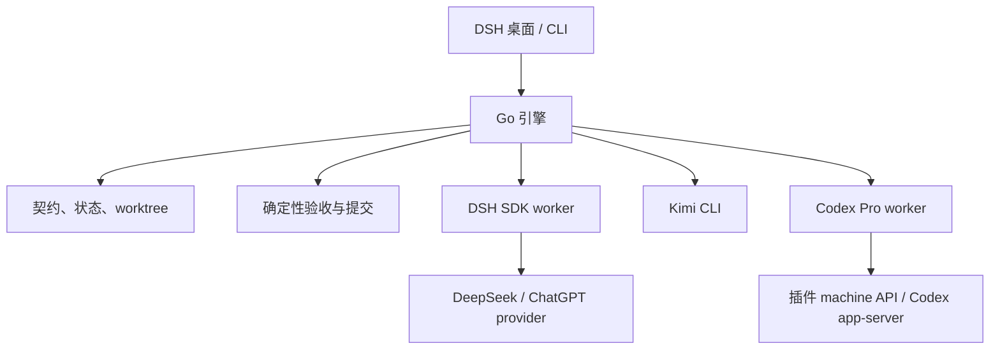

# Flywheel 系统设计 v0.28

2026-11-03 实施稿。当前行为以本文、契约 schema、模板及经过验证的实现为准。v0.24 及更早的选型、实验数据和取舍保存在 [历史设计](design-history-v0.24.md)，不再作为当前默认配置。基础集成见 [原实施计划](plans/2026-11-01-dsh-integration.md)，配置与预检见 [后续计划](plans/2026-11-01-model-profiles-preflight.md)，npm 安装闭环见 [安装计划](plans/2026-11-01-npm-installation.md)，Codex Pro 默认接入见 [本轮计划](plans/2026-11-03-codex-pro-default.md)。

## 1. 目标与范围

Flywheel 把明确需求变为一组有边界、有验收、有失败出口的 coding agent 任务。它负责确保“模型声称完成”与“可检查的交付完成”之间有可靠的验证与持久化过程。

本轮以用户现用的 DSH Mac 桌面为入口，复用 Kimi、ChatGPT 订阅和 DeepSeek API。DeepSeek 只使用 Flash。Kimi 通过原生 CLI 调用，不使用 ACP。GPT 可以在 DSH 原生 agent 中执行，也可以通过 Codex Pro 插件的 machine API 使用完整 Codex harness；这两个后端的工具、权限和会话语义不同。

具名模型 profiles、provider 与账号渠道的独立配置、有效配置查看和无推理安装预检已具备。本轮新增 `codex-pro` harness，直接消费已发布的 `dsh-subagent-codex-pro@0.8.0` 公开 machine API，并将默认 hard 路由切换到它。原 `codex` CLI driver 仅保留为用户明确选择的兼容路径，不作自动后备。大规模并行调度和自动模型选型仍需真实任务数据支持。

## 2. 设计不变量

1. **Go 是确定性编排器**。状态转移、重试、预算、工作区、验证、提交由代码执行；模型只负责边界上的规划、实现、评审和建议。
2. **契约是长期记忆**。Spec、packet、运行状态和复盘比任何模型会话更权威。
3. **一个执行/评审调用使用一个新会话**。Plan 只在明确启用且后端支持时恢复；当前仅 Kimi。
4. **确定性验证先于 LLM 评审**。L1 红灯不允许凭评审通过；verification-gap 必须修订验收后复验。
5. **完成要有同一候选的证据与持久化交付**。只有当前候选通过 L1、独立评审，并确认实际 Git 提交/合并仍是该候选后才 completed；非 Git 演练不能标记完成。
6. **失败不丢产物**。提交、合并、恢复失败时保留工作区。自动清理必须确认分支已合并、工作区干净；不能 force 删除成果。
7. **取消与退出码独立**。超时、取消、信号、截断、清理失败不能因退出码恰好匹配预期而判成功。
8. **参数必须实际生效**。未知 harness、未注册 provider、不支持的权限或模型配置明确失败，不静默换后端、模型或付费渠道。
9. **未知不是零**。usage/cost 缺失保持 unknown；数值汇总只表示已知量下限。
10. **测试是交付的一部分**。允许实现者补充单测和回归；冻结验收显式保护。100% 覆盖率不代表断言正确，更不能代替集成和端到端验证。

## 3. 系统边界



DSH 插件是控制面，提供面板、人工命令和模型工具。它只使用 Go 的 JSON 控制接口，不直接读写 `state.json`，不重新实现任务状态机，不让桌面父智能体保持存活来监督后台任务。

引擎将任务目录与执行根统一为绝对物理路径，再计算账本、契约和报告的相对位置。macOS 的 `/var`／`/private/var` 或用户自建符号链接不能改变同一任务的身份；路径无法解析时停止，不能把错误的 `../` 前缀传入 Git 排除规则。

DSH worker 是独立进程，通过正式 SDK 的 stdio JSON-RPC 驱动原生会话。每次调用创建一个 SDK 进程，worker 和 SDK 继承 Go 管理的进程组，不另行 detached。SDK 自己创建的托管命令还须经 SDK 关闭协议排空；无法证明正常关闭就不能报告成功。不依赖 Teams、OAR、Forge，也不把 external subagent 名称当成原生 LLM provider。

Codex Pro worker 是另一种受管进程，直接导入 `dsh-subagent-codex-pro/machine`，不创建 DSH 父模型来再次委派。插件内部启动 Codex app-server，保留其完整 harness 与用户已有 Codex 登录。Go 管理 worker 生命周期；插件拥有 app-server、guardian 和内部取消／清理。正常完成必须同时满足外层 worker 的物理终态及插件完整回执。worker 异常退出不能被解释成插件子进程已清理；取消和未知清理结果均阻止成功。

## 4. 执行闭环

| 阶段 | 产物或判断 | 结束条件 | 有界失败出口 |
|---|---|---|---|
| Plan | 合法 packet 集或修订 | 整组契约通过 schema/交叉校验 | 校验反馈最多再试 2 次；渠道/预算耗尽升级 |
| Execute | 实现、普通测试、done-report | 报告合法且进程终态可靠，随后 L1 绿 | 尝试上限、空转检测、预算、取消 |
| Review | pass / return / verification-gap | 有证据的合法裁决 | 传输/解析重试上限，退回执行或规划 |
| Verify | L1、L2、L3 命令报告 | 所有期望退出码及物理终态成立 | 超时/取消/命令失败 |
| 完成 | 已验证交付及持久化记录 | L1 与评审绑定当前候选，提交/合并成功 | 保留工作区，人工处理 |

### 4.1 Plan

初始需求由用户确认；运行中 Plan 只能直接修订任务目录内的 `spec.md` 与 `task-packet-*.md`，并保持已批准的需求范围。普通实现测试由 executor 完成，冻结验收的路径必须写入 `boundaries.must-not-touch`，或在配置中用 `protected-test-patterns` 声明。

Plan 不得直接修改实现、任务目录外的冻结 oracle，或 `flywheel.config.json`。引擎比较 Plan 前后非契约候选内容；越界改动保留在磁盘上并报错停止，不能自动提交，也不能用回滚删除现场。外部 oracle 修订需要明确的人工任务；运行配置由用户修改后重启。本轮不实现外部 oracle 的自动修订、提交与 worktree 同步事务。

所有规划入口，包括失败升级后的修订，都走 `planUntilValid`。无效文件的具体校验错误反馈给 planner；不能绕过加载校验直接投入执行。合法契约重新加载后同步现行 packet 集；契约变化必须记录，受影响的 Executor/L1/Review/缺陷注入证据失效，旧证据移入审计历史。

合法契约先作范围受限的提交。即使 planner 或用户已自行提交，仍须按当前权威 HEAD 检查同步，不能因为“本次没有新 commit”跳过。已有 worktree 尝试快进到修订检查点，保留未提交实现；重新锚定 base-ref 前检查期间没有混入实现变更，避免把 executor 改动抹出边界 diff。分支分叉或路径冲突时明确停止，不强制重建或丢弃工作。当前仍是保守的 fast-forward 策略，复杂重基由人处理。

规划检查点提交前后核对候选内容，并检查新 HEAD 的路径范围与已提交契约。Git hook 修改已加载契约、仅修改 index、或混入实现变更时拒绝继续同步；保留工作区，要求重新加载并验证。

Kimi 会话仅在 `resident-session: true` 且 harness/model/channel/cwd/thinking/permission-mode 全部匹配时恢复。其他后端冷启动；旧版本缺少权限身份的会话也先冷启动一次，保存完整身份后才可恢复。恢复失败有一次冷启动路径，再受传输重试和预算约束；会话不是状态真相。

### 4.2 Execute

默认每 packet 一个 worktree。边界检查锚定执行前的 base-ref，executor 自己提交不能把变更从边界 diff 中抹去。重试重用工作区中的成果，但新建模型会话。失败命令、输出、边界违规、评审原因以及进程错误进入 `last-feedback`，放在提示词的易变尾部。

执行者可修改实现、单元测试和回归测试，不得削弱断言或改动受保护验收、Spec、packet、配置。不能通过更改覆盖率阈值来完成任务。提示词的稳定部分包含实际 `must-not-touch` 路径和 `protected-test-patterns`，而不只提规则名称。发现范围或 oracle 错误应向 Plan 返回证据；超出 Plan 可写范围的修订继续交人处理。

执行者在 **worktree 内的任务 reports 目录**写 done-report。引擎确认进程已结束，使用限制在工作区的读取路径验证普通文件、体量及 JSON schema，再收集到主任务目录。因此在 role-based 模式下，DSH/Codex 的 workspace-write 不需要获得主 checkout 的额外写权限。

每次实际调用都删除该调用的旧报告入口，避免传输重试沿用上一次留下的有效 JSON。只有合法新报告才计入当前 executor 证据。

### 4.3 Review

评审在实际候选 worktree 中运行，输入仅为契约、权威 diff、L1 结果和缺陷注入结果，不读 executor transcript。宿主权限由 `permissions.mode` 决定：role-based 请求 read-only，full-access 请求完全权限；后端不能实施所选权限时拒绝运行。两种模式下评审都只负责判断，不得修改候选代码或验收依据。

评审前后都检查候选身份。即使模型返回 pass，只要候选、契约、验证配置或本 packet 报告发生变化，该裁决就不能推进完成。评审提示要求检查断言质量、覆盖矩阵、范围和设计；100% 覆盖率本身不是充分证据。

`verification-gap` 触发受限 Plan 修订并复验。多 judge 面板仍可配置，但默认关闭；异模型意见也不能代替确定性 oracle。

### 4.4 验证和证据身份

L1 是单元级 build/lint/typecheck/unit tests/coverage；L2/L3 在里程碑级验证集成与用户路径。命令由引擎直接运行，使用白名单环境，凭证只能经显式允许注入。

Gate 通过条件是 **期望退出码匹配且未超时、未取消、未被信号终止、输出未截断、无 spawn/清理错误**。超时被 trap 成 exit 0，或杀死命令后恰好得到 expect exit 1，都失败。L1 额外要求验收命令执行前后的完整身份相同：命令本身或并发编辑改变了候选／契约／验证输入，即使 exit 0 也必须失败并重验。执行前无法读取身份时不启动验收命令；执行后读取失败同样不能产生可复用绿灯。

里程碑 L2/L3 同样记录主 checkout 在命令前后的候选身份，变化或读取失败判整个 gate 失败。正式运行中的 Judge 绑定刚通过的 gate 身份，在模型调用前后复核，仍使用主 checkout，权限由显式 permissions.mode 决定；评审职责仍为只读，主判或可选第二意见改变了候选都不能关闭里程碑。被拒绝的模型裁决保留作审计，不能继续显示为有效 pass。

L1 与 Review 的 `identity` 绑定：

- 当前候选文件内容和模式，包括二进制、tracked 及未忽略的 untracked；不是 mtime、文件名清单或截断 diff。
- 权威 Spec/packet 内容及运行中的契约对象。
- 验证配置和本 packet 的 canonical done-report。

账本、日志等易变文件不参与候选代码身份；报告仅按上述特例绑定。Git 文件清单读取失败不能悄悄回退为可信绿灯。符号链接只记录链接目标，不读取其目标内容。子模块/特殊文件缺少明确验证策略时拒绝生成可复用身份。真正的非 Git 演练目录使用文件内容快照。

持久化检查对非账本 tracked 文件批量检查 Git 标记与属性；遇到 `assume-unchanged`、`skip-worktree`、实际启用的 clean/process filter 或 `working-tree-encoding` 时明确拒绝完成。持久化比较另外临时启用文件模式和符号链接语义，防止用户的 `core.filemode=false` 或 `core.symlinks=false` 隐藏未保存的差异；只作用于该次只读检查，不修改用户配置，也不把普通 Git diff 声称为独立逐字节 tree 证明。

旧状态中无身份的绿灯不能复用。未完成单元恢复后，代码、契约或检查改变会重验；旧证据只留作审计。已交付单元另外使用持久化契约 fingerprint 判断是否需要重新打开，不能因后续单元的正常代码改动而反复否定所有历史交付。候选身份不是可复现构建的完整环境证明：忽略的依赖目录、外部服务、工具链变化仍需项目自己的锁文件、集成检查与隔离环境。

### 4.5 缺陷注入

按确定性规则抽样，默认每 5 个单元一次，测试文件变更比例可增加抽样。必须先跑健康基线，再注入可逆 patch、确认测试因缺陷正常退出为红，最后恢复。

超时/取消/截断不能冒充测试“发现缺陷”，结果为 inconclusive 并停止交付。恢复在独立、短时限上下文中进行，即使主运行已取消仍尝试恢复；恢复失败保留工作区并升级。缺 patch/test-cmd、不可注入或基线红等已有诊断会进入 inbox；它们不能被展示成抽样通过。

### 4.6 Intake 与 Garden

二者是外挂建议模块，不拥有主任务状态机。Intake 发现候选任务，Garden 提出知识资产改进；建议经人确认后进入正式契约。模块使用相同的进程终态、用量未知和预算纪律，不因“只是文本建议”接受未收尾的成功。

## 5. 状态、持久化和恢复

`state.json` 仅由 `internal/state` 写入：schema 校验、进程间锁、revision CAS、临时文件与原子 rename。任务生命周期另持 `.run.lock`；lease 是并发运行与停止完成的判断依据。运行信息文件原子更新，包含用于关联本次运行的随机 control token；PID 只作展示，不作为停止授权。日志、pid、锁、停止请求及临时控制文件不进入提交。

Intake／Garden 的预算与清理升级记录若需更新已有主任务状态，必须先取得同一运行 lease，并在持锁期间确认没有主引擎 PID，再执行 Load／CAS Save；不得只靠 PID 文件尚未出现就抢写。主引擎持锁时只保留模块自己的 metrics／inbox 证据，不修改其 state revision。

主要单元状态仍为 pending、executing、executed、l1-passed、l1-failed、review-failed、completed、interrupted、inbox。中断后的产物保留，重启不凭旧报告自动认定完成。新增可选 `last-feedback`、`evidence-history`、`contract-fingerprints`、契约同步状态及 usage/cost 未知计数，旧配置与状态可加载，但旧完成记录不自动取得新证据的可信度。

每个现行 packet 的契约 fingerprint 包含权威 Spec 全文、packet 全文和验证配置，并随状态保存。重启或 Plan 修订后重新比较；不匹配的单元和所属里程碑重新打开，失效证据归档，完成任务也可回到 pending。旧 completed 没有 fingerprint 时保守地重新打开。Spec 或共享验证策略改变可能影响多个单元；后续正常实现代码变化则不会单独改变这个契约 fingerprint。

调度器每次从当前 Spec 重新选择未 closed 的里程碑，不能依赖最初的循环下标跳过后来重新打开的较早里程碑。每次 run 对同一个里程碑最多访问 3 次（首次加 2 次重新打开）；反复修订再次触发时写 inbox 并 escalated，避免跨里程碑修订无限自转。新 packet 也参与当前任务。最终写 completed 前必须同时确认所有现行 Spec 里程碑 closed、所有现行 packet completed；已退出当前契约集合的历史状态保留审计用途，不替代也不阻塞现行集合的完整性检查。

Git 完成顺序：验证身份仍有效 → 在 worktree 只提交实现路径 → 检查实际持久化 Git tree 与当前已验证内容一致 → fast-forward 合并 → 主任务账本提交 → 再确认主 checkout 的持久化 tree、候选内容与证据一致 → 安全清理 → 写 completed。检查覆盖只改 index 的 commit hook，以及主账本提交期间对实现的修改；不能仅凭工作区哈希没变或 git commit exit 0 放行。提交失败不能继续走“没有新提交所以无需合并”的分支。用户已 stage 的其他路径不得被顺带提交。

任务整体写 completed 前还要再次确认主 checkout 的实际持久化 HEAD。这样即使上次 L2/L3 修改了源码并导致升级，重启后幂等验收也不能把遗留的未提交改动算作已交付。

清理失败与交付失败分开记录：如果代码和账本已持久化且最终证据检查通过，工作区清理可延后，允许 completed，但 `cleanup-error` 和 worktree 引用必须保留；不得声称清理已完成。任何持久化或证据检查失败都保留工作区且不 completed。没有代码差异的 Git 单元也必须确认并记录已持久化 HEAD。

非 Git 模式只可用于部分步骤的原地演练；它不能生成可证明的 Git 交付，因此到完成阶段必须失败，不允许 completed。`commit.skipped` 不是持久化成功。生产 coding 任务必须使用 Git，默认采用 worktree。

## 6. 重试、取消和错误

稳定 provider 错误码保持：AUTH、QUOTA、RATE_LIMIT、SERVER、TRANSPORT、TIMEOUT、EMPTY_RESPONSE、INVALID_REQUEST、CONTEXT_WINDOW_EXCEEDED。L1_FAILED、REVIEW_RETURNED、SPIN 属于编排层失败分类。

Codex Pro 的结构化 stage/category/HTTP 状态由 driver 映射到这组既有码；空答案使用明确的 `empty response` 诊断并归入 EMPTY_RESPONSE，不增加另一套重试或付费降级策略。

退避、渠道降级、尝试次数和空转检测仍由配置/状态决定。默认没有跨渠道付费降级。driver 的 settled 与 exit code 是两个独立条件；缺终态、丢尾帧、输出截断不能变成成功。

清理是否已确认另于 provider 错误码判断。已启动的 Codex Pro worker 丢失可信清理回执时，外层 worker 的退出不证明独立 guardian／app-server 进程组已经静止；driver 必须记录 `CleanupError`。所有模型阶段在记录回执和计量后遇到该字段即保存升级记录、保留工作区并停止本次运行，禁止传输重试、渠道降级、Plan 冷启动和下一任务。正常服务错误若已有可信清理确认仍适用原重试策略。恢复前须确认遗留进程已停止；固定等待一段时间不能冒充清理证明。

SIGTERM 先取消运行上下文，再终止本任务登记的进程组。运行栈完成缺陷恢复等清理后返回 interrupted，CLI 退出 143。进程组清理只作用于本次拥有的子进程，不扫描并杀死之后创建的其他任务。显式脱离进程组的外部进程不属于普通 POSIX 进程组保证；DSH worker 必须完成 SDK shutdown／退出确认，SDK 负责排空自身托管命令，外层仍由 Go 看门狗兜底。

全局 kill switch 对每个已登记子进程保留其调用声明的清理宽限，不能用默认 5 秒提前截断 Codex Pro 至少 10 秒的收尾。只升级本次停止快照内的进程，各子进程仍有有限时限并等待退出；后来启动的无关调用不属于该快照。

SIGKILL 后的进程组探测必须确认 `ESRCH` 才算清理成功。探测的 `EPERM` 在原有清理宽限内重试，以容纳 macOS 的退出／回收窗口；到期仍无法确认、其他探测错误，以及初次 SIGKILL 的权限失败均保留清理错误，不能推进成功。

`stop` 与 `control stop` 不向 pid 文件中的数字发送信号。它们原子写入带本次随机 control token 的 `.stop-request`；引擎仅接受匹配自己 token 的请求并取消运行上下文。旧请求、坏请求及被复用的 PID 不应停止另一次运行。没有有效 token 的旧运行不能通过自动 PID signalling 假装支持新协议。

停止控制方等待本次引擎退出受管调用栈、释放任务 lease，并取得 lease 后才 CAS 保存 stopped。lease 释放不证明任意逃逸子进程已经清理；管理范围仍是本次拥有的进程组。已观测的 `CleanupError` 保留在 driver/Gate 证据与 metrics 中并阻止交付，需按错误记录人工处理。45 秒内不能确认停止则返回失败、保持状态，不强杀仍在恢复的引擎；GUI 超时应留足 60 秒。只读 status 以运行 lease 判断活动状态，PID 只作为辅助展示。

## 7. 模型与 harness 默认表

| 阶段 | Harness | Provider/渠道 | 模型 | Thinking |
|---|---|---|---|---|
| Plan | Kimi CLI | kimi-subscription | kimi-code/k3.1-pro | high，允许匹配身份后恢复 |
| Execute default | DSH SDK | deepseek-official | deepseek-flash | high |
| Execute frontend | Kimi CLI | kimi-subscription | kimi-code/k3.1-pro | high |
| Execute hard | Codex Pro machine API | chatgpt-subscription | gpt-6.1-sol | high |
| Review | DSH SDK | chatgpt | gpt-6.1-sol | high |
| Judge | DSH SDK | chatgpt | gpt-6-astra | high，只在里程碑终验 |
| Intake | DSH SDK | deepseek-official | deepseek-flash | low |
| Garden | Kimi CLI | kimi-subscription | kimi-code/k3.1-pro | high |

这些是可编辑的初始绑定，不是模型能力排名或性能保证。使用前核对实际账号/model catalog；不支持时停止并修配置。DSH Mac rc.5 的 Flash effort 是 off/low/high/max，没有 medium。`multimodal` 暂不预绑定：文本请求与 provider 目录不能证明附件已被传递。完整图像/文件输入契约需另验收。

### 7.1 Codex Pro 接入契约

`codex-pro` 不是 DSH LLM provider ID。使用 `harness: "codex-pro"`、显式模型、thinking 和账号 channel 选择该路径；不接受被忽略的 provider 或 resident session。每次调用创建新会话，权限由显式 `permissions.mode` 决定，不能从桌面全访问设置隐式继承。

worker 精确依赖插件 `0.8.0` 的公开 `runMachine` API，使用其协议 1 请求、进度回调和终态回执。模型／cwd／sandbox／approval 回执不符合请求时失败；接受 `workspace-write`、`read-only` 或明确选择的 `danger-full-access`，审批策略为 `never`。完全权限在公开 machine API 边界映射为 `dangerously-bypass-approvals-and-sandbox`，回执中的 Codex sandbox 为 `danger-full-access`、policy 类型为 `dangerFullAccess`，不能要求不存在的受限模式字段。插件仅能证明 effort 已被配置接受时，保留 `accepted` 与 `effectiveEffort: null`，不得改写成已证明实际推理强度。

权限检查分两个时点：插件在 `turn/start` 前检查模型、cwd、approval 与沙箱模式；Flywheel 在完整结果返回后检查完整 sandboxPolicy，决定该结果能否进入后续验收。插件 0.8.0 没有提供运行前完整策略 guard；Codex 用户／项目配置可能扩展 writable roots 或 networkAccess。事后拒绝不能阻止已经发生的访问，doctor 必须提示此边界。要求运行前拒绝任何额外权限的环境，需上游增加公开 pre-turn guard 后再使用；不得通过私有 API 或复制凭证建立另一套运行时。

终态审计保留插件原始回执，包括请求／接受／实际配置、thread/turn、usage 完整性、错误、物理进程退出及清理确认。插件为正常收尾主动终止 app-server，可在完整回执证明正常完成与清理后接受其 terminationRequested 事实；用户取消、超时、截断、启动失败和清理失败不适用此例外。无完整回执或外层进程异常时绝不能凭文本答案推进完成。

仅完整且可归属本次调用的 usage 进入可知预算；partial/unknown 明确保留在回执，不能当成完整零用量。订阅调用没有真实美元价格时 cost 保持 unknown。默认安装解析 npm 依赖中的 worker，不悄悄改用 PATH 上的旧 `codex exec`。Codex 可执行程序与账号登录仍是运行前提；安装插件依赖不等同于代办授权。

## 8. 用量、成本与效率

优先通过明确小任务、缓存稳定前缀、低频规划、故障反馈复用、独立短评审降低重试与上下文膨胀。默认不使用所有模型串行互相复核，也不强制 max/ultra。

每次调用记录角色、模型、harness、实际 provider、账号 channel、prompt hash、时长、物理终态、会话 ID、usage 和可知成本。provider 来自 driver 可确认的结果，未知时保留 null，不能把渠道别名冒充 adapter 身份。订阅调用的美元成本不会因未上报而写成已知 0。没有价格表/真实 cost 时成本为 unknown；Kimi CLI 当前不暴露 usage，按未知处理。

`unknown-usage-calls` 和 `unknown-cost-calls` 与已知总数并存。hard token budget 遇当日未知 usage 停止，因为限额无法证明；soft 默认可继续并明确告警。配置为 off 只关闭熔断，不关闭计量。价格只接受 driver 真实值或用户显式提供的定价，不内置会过期的推测账单。

## 9. 权限与宿主能力

新增显式 `permissions.mode`：`full-access` 为当前订阅方案的授权模式，所有阶段请求 `danger-full-access`，DSH/Codex 交互审批为 `never`，Kimi print 模式保持原生 auto；不逐步要求用户点击允许。`role-based` 保留旧行为：Plan/Execute 为 workspace-write，Review/Judge 为 read-only，辅助模块按 harness 能力解析。为避免升级暗中扩大既有授权，旧文件缺省仍为 role-based；新安装模板及显式 subscriptions 迁移写入 full-access。编排、配置展示与 doctor 共用同一个权限解析器，Plan 会话恢复身份包含该值。

DSH worker 检查实际工作目录、模型、effort、审批与权限回执，继续使用官方 sandbox/approval/fs/bash 实现。受限模式必须证明实际完整强制；完全权限必须确认公开的 danger-full-access 模式且未被拒绝，如实标明无 OS 沙箱限制，不能伪造 enforcement:full。外部运行时或系统权限仍以真实回执为准，不替换审批服务、不伪造成功、不静默降级。评审、规划和执行的职责与路径边界继续由契约和执行前后候选身份检查约束；完全权限不是允许评审修改验收或让未经验证的修改进入交付。

Kimi print 模式强制 auto，当前 CLI 无本适配器可宣称的 OS 级 workspace 沙箱。它保留原生 harness 能力及静态拒绝规则，不能把 worktree 当成安全沙箱。legacy pi/omp/zcode 不在新默认路径；不能映射明确的 read-only 或 full-access 要求时 fail closed。

SDK profile 与桌面 profile 是不同运行配置。桌面装有 ChatGPT provider 不代表 SDK 已加载或已授权。worker 只使用用户指定的官方 DSH 可执行入口，不猜 `.app` 内部路径，不复制凭证。

## 10. 验证与发布纪律

Go 的 `make quality-gate` 执行 vet、gofmt 和 **逐函数 100% statement coverage**。这是本项目的用户要求，不声称行业规范要求所有仓库都必须 100%。Go 原生 statement coverage 也不等同于 branch coverage。

测试必须检查公共行为与失败路径：真实 Git hook/merge/index/worktree、真实子进程/取消、协议错帧、身份失效、报告收集、权限失败。I/O 注入缝用于不可稳定制造的故障，不通过删除防御分支或镜像实现来凑覆盖率。插件另跑 Node 测试、真实官方 SDK 的无推理 doctor、Go→Node→SDK fixture。

本环境没有用户 Mac/订阅会话。离线通过不能标为 Mac live 通过；桌面渲染、Seatbelt、本机 CLI 版本与真实账号响应按插件 README 的清单另验。

## 11. 后续增强

自动难度路由、多 agent 并行、任务团队、附件协议、系统级强隔离可在现有指标和真实任务集支持下逐项加入。具名 profiles 已纳入本轮实现，保持加载期展开，不增加第二套调度器或自动付费后备路径。

## 12. CLI 与控制面

现有 run、status、stop、intake、garden、skills、template 接口保留。`--only` 运行指定子环至合法终态或有界停止；`--pause-before review` 保留已验证候选用于下次恢复。

新接口：

```sh
flywheel control start --task-dir /repo/docs/task --cwd /repo
flywheel control status --task-dir /repo/docs/task --cwd /repo
flywheel control stop --task-dir /repo/docs/task --cwd /repo
flywheel config inspect --cwd /repo --task-dir /repo/docs/task --json
flywheel doctor --cwd /repo --task-dir /repo/docs/task --json
flywheel doctor --cwd /repo --task-dir /repo/docs/task --probe --json
flywheel control config --cwd /repo
flywheel control doctor --cwd /repo --task-dir /repo/docs/task --probe
```

控制接口 stdout 始终是单个 JSON：protocol、ok、running、pid、taskDir、state、可选 error。config 增加 configuration，doctor 增加 diagnostic；两者允许省略 taskDir，省略时返回空字符串。stderr 只诊断。start 派生独立后台引擎，双流进 orchestrator.log；status 不写状态；stop 不伪造停止。旧命令继续原输出形态。退出码 0=成功，1=用法/运行错误，3=升级/预算/失败步骤，143=已中断。

配置查看与本地 doctor 不物化全局配置、不写任务状态、不建 worktree、不执行验收命令。doctor 默认仅检查配置、契约和本地命令；显式 probe 才启动 DSH SDK 的无推理握手与权限检查，不发送 session/prompt。检查总预算 40 秒，另留进程清理窗口；相同 cwd/provider/channel/model/effort/权限的探测只做一次，不同账号渠道与读写权限不能合并。提供任务时，只将 Plan、Review、Judge、启用的第二意见及当前 packet 路由视为必需；无 packet 时检查 default 路由。未使用绑定显示 skipped。

doctor 的状态为 pass/fail/warn/unknown/skipped，必需检查 fail 才使 ok=false；合法失败报告仍交给桌面逐项展示。DSH adapter 接受配置、完整沙箱和正常关闭可以通过 SDK 探测验证。Codex Pro 本地检查验证 Node、插件公开入口与版本、Codex 可执行程序；不得为探测而调用 `runMachine` 发送模型任务，实际模型和权限回执保持 unknown，交由正式调用验证。账号授权、额度、账号实际模型目录和真实推理能力保持 unknown。环境凭证只检查声明的变量名是否存在，报告不输出凭证值。SDK 探测可能产生 SDK 自己的本地会话／缓存，不能宣称整个文件系统零写入。

诊断 CLI 捕获 SIGTERM/SIGINT 为 context 取消，等待已有进程收尾。看门狗的 TERM 升级、stdio 排空和进程组确认各有 5 秒窗口，保守可叠加 15 秒；桌面正常控制超时为 60 秒。host 主动取消诊断时留 20 秒清理才强杀 Go，避免沿用普通控制命令的 500ms 宽限截断 SDK 清理。取消、超时、清理失败均不能报告为通过。

### 12.1 DSH 会话视图与异常状态

桌面控制面通过 `ctx.slots.inject()` 注册 `conversation.view` 列表中的独立 `flywheel` 条目，由 DSH 在“对话／轨迹”旁提供原生视图导航。它用于查看工作单元、人工处理项、有效模型配置和环境诊断，以及显式启动、刷新、停止已有任务。移除旧的 composer dock 大弹层，不替换对话／轨迹的条目，不接管输入框、模型选择器或右侧栏，不另建浮动侧栏。主界面优先呈现任务控制与结果，模型配置和环境检查按需展开；长路径、模型字段和错误在内容区换行或局部滚动。

外部 plain-JS 客户端只运行时导入共享 React，不导入 `ui-primitives`、`client-store` 或其他 Harness Client 包。按钮和输入框由插件自己实现，参照已核对的宿主结构、尺寸和交互，颜色只依赖 `--dsw-alias-*`，字体继承宿主。CSS Modules 在构建时编译，样式由 React 视图拥有；不从业务代码操作全局 DOM，也不新建 iframe、侧栏或窗口级遮罩。视图位于 Conversation 已有标题栏之下，不重复叠加全局页面的 macOS 顶部留白。

插件提供符合公开结构契约的查看状态 store handle，注册后由宿主管理会话绑定、实例缓存和读取 hooks。它只保存路径草稿和诊断区展开状态；请求状态和显示快照由插件 apply 层的控制器及其自有 observable 管理，通过槽位注入供界面读取。控制器以宿主会话绑定的 actions 身份隔离，Go 仍然独占业务状态。组件不自行订阅外部数据，不取得 Cordis ctx，也不回写会话事件。宿主保留该会话绑定期间，切换顶部视图不丢失选择，不把一个会话的结果交给另一个会话。绑定释放、插件重载或桌面重启不承诺保留这些查看数据，任务账本不受影响。打开视图不自动启动、恢复或探测，不扫描任务，也不自动轮询；用户选择实际任务目录并手动刷新。

同一会话只允许一个未完成的控制请求。启动／停止等待期间锁定路径；只读请求允许编辑路径，但直到已有请求结束前不并发提交下一次请求，旧身份的迟到响应不能覆盖新选择。切换视图不取消后台任务，也不把请求的视觉卸载当作引擎操作完成。展示引擎结果时记录刷新时间：保留的有效快照仍是旧快照，不能冒充实时运行状态。

读取失败保留有效内容并给出失败与恢复操作。只有宿主以结构化结果明确证明 Go 控制进程尚未启动的拒绝，才允许作为已知未执行的失败处理，修正目录或环境后可重新提交；不解析错误文本来猜测是否执行。启动／停止的响应超时、断连或失效属于结果未确认，保留针对该任务的提示并禁止继续变更，直至成功刷新状态后重新判断。不能自动重试变更、乐观标记 stopped，或推断超时意味着没有启动。诊断阻断项继续展示结构化报告，未验证的账号、额度与模型能力不能显示为通过。

加载和错误共用表单预留的反馈区，避免操作结果挤动任务内容；使用一个居中的加载指示，长路径和展开详情可在区内滚动并通过键盘访问。后续只读查询等待期间仍保留原任务的结果未确认提示和目标，刷新按钮暂时禁用。说明、字段标签与诊断状态文字使用经过亮暗默认色板核对的主要／次要文本色，成功／警告色用于边线等辅助提示。

原生轨迹由 DSH 管理，保留父会话已有命令／工具记录。独立 SDK、Kimi 和 Codex Pro worker 的完整历史不会自动合并到该轨迹，也不向原生团队或后台任务列表登记虚构任务。后续若接入轨迹关联，必须采用宿主公开的身份、事件和生命周期契约。

兼容性依据固定在声明版本为 `0.2.1-rc.5` 的源码 `b830ec950faba0a46dda564be3e2d854afed94f1`：[外部插件实践](https://github.com/deepseek-ai/deepseek-harness/blob/b830ec950faba0a46dda564be3e2d854afed94f1/packages/preset/agent-preset/skills/cordis-plugin-development/references/practices.md)、[UI 规范](https://github.com/deepseek-ai/deepseek-harness/blob/b830ec950faba0a46dda564be3e2d854afed94f1/.agents/skills/dsh-client-ui-ux/SKILL.md)与[布局说明](https://github.com/deepseek-ai/deepseek-harness/blob/b830ec950faba0a46dda564be3e2d854afed94f1/packages/client/ui-layout/README.md)。具体注册与作用域同时核对[会话插槽源码](https://github.com/deepseek-ai/deepseek-harness/blob/b830ec950faba0a46dda564be3e2d854afed94f1/packages/client/ui-conversation/src/client/contract/slots.ts)和[生命周期说明](https://github.com/deepseek-ai/deepseek-harness/blob/b830ec950faba0a46dda564be3e2d854afed94f1/docs/subsystems/slots.md)。`dsh.client.inject` 元数据不能代替运行时 service inject 或槽位声明屏障。390 CSS px、长内容、亮暗主题、焦点、加载、失败和会话切换须检验；组件夹具与源码核对不等于真实 Mac 桌面验收。`0.28.0` 仍是旧弹层，原生会话视图从 `0.28.1` 开始提供；CLI 与桌面插件须同版升级。

### 12.2 桌面内置能力与 worker 策略

原生 UI 接入和独立 worker 是不同边界。SDK worker 的临时 `--patch` 仅用于该子进程，不修改桌面 profile，也不卸载桌面的插件、skills、工具或 UI。桌面已加载插件、已登录账号、已选模型，不代表 SDK profile 或其他 harness 已配置相同能力；控制面显示引擎实际配置，不静默继承或迁移桌面设置。

现有 worker 策略固定每次调用的目录、权限和审批，限制自主委派及 workflow／goal 驱动，并关闭模型标题和自动模型压缩以免脱离 Go 的计量和生命周期管理。当前也保守禁用整个 `tool-web`，包括搜索与抓取；这不表示所有网页工具都需要辅助模型。官方 [web 工具](https://github.com/deepseek-ai/deepseek-harness/blob/fcc0ad462172522aaf5c93a7b2e01f6b9f0b0159/packages/web/tool-web/README.md)可分别配置两者，模型辅助调用与普通检索需分别核对。本轮完全权限改变宿主访问策略，仍保留这些工具与辅助模型调用限制；恢复检索、压缩或其他扩展属于后续能力工作，须同时验证计量、预算、取消与工作目录边界。

## 13. 配置和分发

配置按首个完整文件选择，不深度合并：任务目录 → 项目根 → 全局 `~/.config/flywheel/flywheel.config.json`（`FLYWHEEL_CONFIG` 可覆盖全局路径）→ 内嵌模板。升级不自动覆盖已有配置。模型绑定位于 `loops`、`routes`；`drivers` 只选择 mock/real，不是 provider 注册表。

可选的顶层 profiles 定义 harness/model/channel/thinking/provider；loops、routes 和顶层 judge-panel 通过 profile 引用，加载时展开为完整实际绑定。当前 binding 显式出现的字段覆盖 profile，省略才继承；不支持 profile 继承。必需字符串的 null、空白、错拼字段及未知引用在模型启动前失败。thinking 显式空字符串表示当前 harness 的既有默认，不重新继承；resident-session 仍属于阶段，显式 false 保留。judge-panel:null 继续关闭第二意见。旧 inline 配置保留已有缺省语义。

provider 表示 DSH SDK 的模型适配器，channel 表示账号／凭证／后备渠道。实际 provider 按 binding.provider → channels[channel].provider → 旧 DSH channel 名解析；两个显式 provider 不一致时拒绝加载。非 DSH harness 不能声明一个会被静默忽略的 provider。降级到另一个 channel 时重新解析其 provider，不能沿用旧账号的适配器。原始 profile 名只作配置来源，不进入 Kimi 恢复身份；实际绑定改变按原有会话条件冷启动。模型绑定改变影响后续调用，不单凭未使用 profile 的改动使历史代码验收失效。

默认内嵌表见 [flywheel.config.example.json](../templates/flywheel.config.example.json)，具名配置完整示例见 [flywheel.profiles.example.json](../templates/flywheel.profiles.example.json)，覆盖和预检规则见[配置指南](configuration.md)。现有用户要采用新方案，使用 `flywheel config migrate --preset subscriptions` 预览实际命中文件的变化，再以 `--apply` 显式应用。命令备份原始字节，保留预算、验证、worktree 和其他非模型设置，更新已约定的阶段模型、thinking、订阅渠道及 full-access 权限；默认关闭旧第二意见并明确停用未经验证的旧多模态路由。额外自定义路由/阶段会阻断迁移并列出，不能猜测替代。可用 `--expect-sha256` 绑定预览身份；应用前检测文件变动，失败不损坏原配置。运行中的任务不热加载新配置，下次启动才使用新方案。

### 13.1 npm 安装与发行

正式分发恢复 npm 优先：`npx -y @ckanner/flywheel@latest install` 显式协调同版本全局 CLI、worker、DSH 桌面插件与内嵌 skills。普通 `npm install` 不通过 postinstall 修改用户配置；安装器不要求源码 checkout 或本机 Go 编译器。四个平台包仍由 optionalDependencies 选择，插件是精确版本依赖，全部六包版本一致。安装不会替换用户的 DSH 桌面或代办模型账号登录。

npm shim 异步运行原生引擎，收到 TERM/INT/HUP 时转发给 Go 并等待退出；不能把仅 wrapper 退出当成子进程完成。worker 通过安装包公开入口解析绝对路径。桌面入口使用安装记录与绝对启动路径，避免依赖 GUI 恰好继承终端 PATH。用户显式配置优先，安装不覆盖已有 Flywheel 模型配置。

skills 继续从同一 Go 二进制内嵌资源安装。每个受管快照保存内容与权限清单；升级前确认原内容未被用户修改，额外文件、未知标记或陌生目录保留并报冲突。先写完整 staging，再以 rename 切换并保留失败回滚；这是逐 skill 更新，不是跨十个目录的事务。旧文本标记只在目录与当前内嵌快照完全一致时迁移。`install-skills --json` 供安装器取得完整结果，部分失败不能报告整套成功。

发布以精确 HEAD 标签与干净候选为依据。构建一次六包候选，Linux/macOS 安装测试消费同一组包；已存在版本必须核对 integrity。平台包与插件先发布、meta 最后发布，精确版本从 registry 安装验证后才推进 latest，防止倒退。源码 PR CI 通过、npm pack 成功、registry 安装通过与用户 Mac 实机验收是不同证据，分别记录。

本轮订阅模型迁移与显式权限的统一 npm 发行目标为 **0.28.2**，以已发布的 0.28.1 为基线。六个 Flywheel 包保持同版，DSH 插件另外精确依赖上游 `dsh-subagent-codex-pro@0.8.0`。旧发行失败与重试记录保留在 [npm 验证记录](validation/2026-11-01-npm-installation.md)；本轮源码、候选、CI、registry 和 Mac 实机证据分别记录，不混为一个“测试通过”。

CI、候选构建、双平台验证和发布统一固定为 Node 24.22.1／npm 12.2.1，预检只需同版 Node。发行协议测试通过隔离的本地 registry 调用真实 `npm view`，覆盖 latest、integrity、缺失字段与错误响应。存在的字段必须返回字符串，兼容用单元素数组包裹；多结果拒绝，缺失 latest 单独处理，缺失 integrity 不能当成版本不存在。只有结构化 E404 表示版本不存在，取消、认证或网络错误仍阻止发布。npm 11／12 的 `pack --json` 兼容保持严格包身份检查。

GitHub Actions 的 publish job 使用固定 Node/npm 发行工具链，支持 OIDC trusted publishing 及已有 `NPM_TOKEN` 后备。无 token 时显式使用空 user npmrc，避免 setup-node 的认证占位配置；不在日志或 GitHub 环境文件中写入凭证。六个包各自的 npm trusted publisher 都必须对应 `ckanner/flywheel` 的 `publish.yml`，并分别允许直接 publish 与 dist-tag；GitHub 登录或 `id-token: write` 本身不授予 npm 包写权限。维护者配置和失败恢复见 [发行指南](releasing.md)。

私有仓库的发行同样经过完整门禁。发布 job 在准备 npm 后，由官方 checkout 使用短暂的只读 GitHub 认证重新取得完整 refs，固定到已验证 source，再下载候选并检查精确 tag；后续不执行无凭证的远端 fetch。仓库可见性由 GitHub 事件显式传给 publisher，未知值拒绝发布。public 要求 npm provenance，private 显式关闭 npm 不支持的证明生成；这只记录 registry 的能力边界，不改变仓库可见性，也不取消本项目的 source／artifact integrity 校验。

首次安装与小任务演练见 [入门教程](getting-started.md)。主入口、SDK profile、worker 协议和本机验收步骤见 [插件说明](../plugins/dsh/README.md) 与 [协议](../plugins/dsh/PROTOCOL.md)。历史研究引用保留在 [旧设计附录](design-history-v0.24.md)，其模型/价格/订阅额度只属于当时记录。
