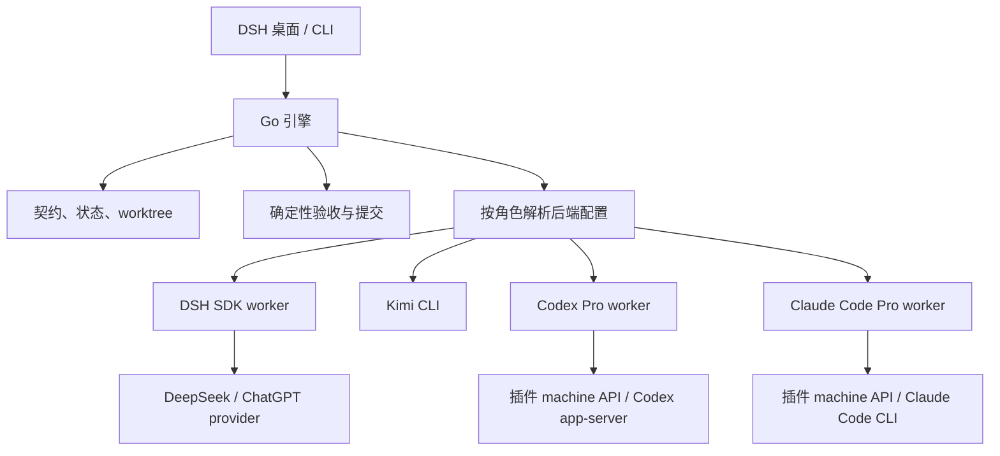

# Flywheel 系统设计

[文档索引](README.md) · [中文使用指南](zh-CN/getting-started.md) · [贡献指南](zh-CN/contributing.md)

本文定义 Flywheel 当前源码的系统边界、执行契约和失败处理规则。字段以
[`templates/`](https://github.com/ckanner/flywheel/tree/main/templates) 中的 schema 为准；实现必须遵守 §2 的设计不变量。
源码实现、开发候选、npm 发行和用户机器验收分别记录，不能相互代替。

阅读使用方式请从指南开始；设计提案保存在 [`plans/`](plans/)，已执行检查及其限制
保存在 [`validation/`](validation/)。v0.24 及更早的选型与实验归入
[历史设计](archive/design-v0.24.md)，不作为当前默认配置。各次实施的依据见 §10。

## 目录

1. [目标与范围](#1-目标与范围)
2. [设计不变量](#2-设计不变量)
3. [系统边界](#3-系统边界)
4. [执行闭环](#4-执行闭环)
5. [状态、持久化和恢复](#5-状态持久化和恢复)
6. [重试、取消和错误](#6-重试取消和错误)
7. [模型与 harness 默认表](#7-模型与-harness-默认表)
8. [用量、成本与效率](#8-用量成本与效率)
9. [权限与宿主能力](#9-权限与宿主能力)
10. [验证与发布纪律](#10-验证与发布纪律)
11. [后续增强](#11-后续增强)
12. [CLI 与控制面](#12-cli-与控制面)
13. [配置和分发](#13-配置和分发)

## 1. 目标与范围

Flywheel 把明确需求变为一组有边界、有验收、有失败出口的 coding agent 任务。它负责确保“模型声称完成”与“可检查的交付完成”之间有可靠的验证与持久化过程。

默认以 DSH Mac 桌面为入口，支持 Kimi、ChatGPT 订阅和 DSH 已登录并充值的 DeepSeek 账号。DeepSeek 只使用 Flash，默认 provider 为 `deepseek-account`；`deepseek-official` API Key 仍是显式可选配置，不自动回退。Kimi 通过原生 CLI 调用，不使用 ACP。GPT 可以在 DSH 原生 agent 中执行，也可以通过 Codex Pro 插件的 machine API 使用完整 Codex harness；这两个后端的工具、权限和会话语义不同。

具名模型 profiles、provider 与账号渠道的独立配置、有效配置查看和无推理安装预检已具备。`codex-pro` harness 直接消费 `dsh-subagent-codex-pro@0.9.0` 公开 machine API，作为默认 hard 路由；原 `codex` CLI driver 仅保留为用户明确选择的兼容路径，不作自动后备。统一准备启动入口、Auto／Quick／Full 和 DSH 会话任务关联减少已明确小任务的重复规划与终验。有界并行按冻结依赖和写入范围调度；桌面控制台提供受管阶段操作、配置编辑、会话接管和明确授权的远端交付。开放式自动模型选型与 DSH 原生 Teams 不属于现有实现；显式允许集合内的有界执行升级见 §13.1。

## 2. 设计不变量

1. **Go 是确定性编排器**。状态转移、重试、预算、工作区、验证、提交由代码执行；模型只负责边界上的规划、实现、评审和建议。
2. **契约是长期记忆**。Spec、packet、运行状态和复盘比任何模型会话更权威。
3. **会话按任务、范围和角色隔离，按运行事实续用或重建**。普通返修可延续原角色上下文；独立评审不得继承执行者上下文。会话连续性不能替代契约、候选证据、预算和终态／清理检查，结果未知时也不能靠新建会话绕过阻断。目标策略与现有能力的差异见[会话方案](plans/2026-11-07-session-lifecycle.md)。
4. **确定性验证先于 LLM 评审**。L1 红灯不允许凭评审通过；Quick 的适用 L2/L3 也必须先在实际候选上通过。verification-gap 必须修订验收后复验。
5. **完成要有同一候选的证据与持久化交付**。只有当前候选通过 L1、独立评审，并确认实际 Git 提交/合并仍是该候选后才 completed；非 Git 演练不能标记完成。
6. **失败不丢产物**。提交、合并、恢复失败时保留工作区。自动清理必须确认分支已合并、工作区干净；不能 force 删除成果。
7. **取消与退出码独立**。超时、取消、信号、截断、清理失败不能因退出码恰好匹配预期而判成功。
8. **参数必须实际生效**。未知 harness、未注册 provider、不支持的权限或模型配置明确失败，不静默换后端、模型或付费渠道。
9. **未知不是零**。usage/cost 缺失保持 unknown；数值汇总只表示已知量下限。
10. **测试是交付的一部分**。允许实现者补充单测和回归；冻结验收显式保护。100% 覆盖率不代表断言正确，更不能代替集成和端到端验证。

## 3. 系统边界



Flywheel 作为外部会话视图，通过公开 slot 注册的 order 排在内置“对话／轨迹／统计”之后；不改写内置条目或宿主 DOM。

DSH 插件是控制面，提供面板、人工命令和模型工具。它只使用 Go 的 JSON 控制接口，不直接读写 `state.json`，不重新实现任务状态机，不让桌面父智能体保持存活来监督后台任务。

引擎将任务目录与执行根统一为绝对物理路径，再计算账本、契约和报告的相对位置。macOS 的 `/var`／`/private/var` 或用户自建符号链接不能改变同一任务的身份；路径无法解析时停止，不能把错误的 `../` 前缀传入 Git 排除规则。

### 3.1 项目归属与执行目录

项目工作区是原仓库的稳定归属；任务集成目录和 packet worktree 是执行位置，不能用它们替代 Provider 的项目归属。Go 为每次角色调用同时记录项目工作区和实际执行目录，在提示词中明确任务、角色、执行位置及禁止修改其他 checkout。验收、候选指纹和任务回执仍绑定实际执行目录。

DSH 使用原仓库作为 Session header 的 cwd，再通过公开工作目录接口切到执行目录。桌面 Host 通过公开 Workspace API 登记匹配项目的 SDK 会话，不由独立 SDK 进程并发改写桌面存储，不为每个 packet worktree 建立新的桌面项目。安装探测使用临时会话持久化目录并在退出后清理，不向用户会话列表留下新的探测会话。

原生 CLI／machine 后端在项目目录启动，提示词要求每次文件、shell、测试与 Git 操作显式使用实际执行目录。当前后端不能分离 `workspace-write` 沙箱根和项目目录时，在派发前拒绝该组合，不扩大权限；完全权限与支持的只读模式保持各自语义。旧会话保留真实历史目录，待消费回执先按原身份核对，不修改历史头部来伪造归属。同项目的兼容历史可按会话策略继续使用。

`worktree.enabled` 只控制引擎自动管理执行目录，与并行策略独立。目录选择、外部 worktree 登记和共享目录批次见 §4.8。

### 3.2 Worker 与进程所有权

DSH worker 是独立进程，通过正式 SDK 的 stdio JSON-RPC 驱动原生会话。每次调用创建一个 SDK 进程，worker 和 SDK 继承 Go 管理的进程组，不另行 detached。SDK 自己创建的托管命令还须经 SDK 关闭协议排空；正常关闭保留 2 秒用于历史落盘与插件释放，再进行有界 TERM/KILL 收尾。无法证明正常关闭就不能报告成功。不依赖 Teams、OAR、Forge，也不把 external subagent 名称当成原生 LLM provider。

Codex Pro worker 是另一种受管进程，直接导入 `dsh-subagent-codex-pro/machine`，不创建 DSH 父模型来再次委派。插件内部启动 Codex app-server，保留其完整 harness 与用户已有 Codex 登录。Go 管理 worker 生命周期；插件拥有 app-server、guardian 和内部取消／清理。正常完成必须同时满足外层 worker 的物理终态及插件完整回执。worker 异常退出不能被解释成插件子进程已清理；取消和未知清理结果均阻止成功。

Claude Code Pro worker 同样直接调用公开 machine API。插件先建立独立 guardian 的
IPC lifeline，再由 guardian 派发 Claude CLI 并拥有其进程组；worker 消失时仍能
收束原生工作。正常结果等待 native 与 guardian 退出。清理与任务结果独立：外层被
强杀导致回执丢失时，不能因为 guardian 清理了进程就推断任务成功或安全重放。

## 4. 执行闭环

### 4.0 Auto、Quick 与 Full

工作流与模型路由是两项独立选择。Auto 由 Go 根据宿主已经研究并保存的契约事实选择 Quick 或 Full，不额外固定调用分类模型。显式 Full 保留完整流程；显式 Quick 仍需满足资格。旧 Spec／旧状态没有工作流字段时按 Full 处理，升级软件不减少既有任务的阶段。

Quick 首版要求一个里程碑、一个可独立验收的 packet，全部需求均有验证说明、必需检查可执行、没有未决设计或完整流程风险。宿主记录代码依据、范围判断、风险与不适用检查的理由；不能仅写“低风险”或按文件数量替代判断。鉴权、权限、支付、迁移、并发、事务、跨模块重构以及资格不明确的任务使用 Full。Go 校验结构与声明的一致性，不声称能从布尔字段证明语义安全；执行和最终评审仍可发现需要升级的证据。

| 生效策略 | 运行期闭环 | Plan／Judge |
|---|---|---|
| Quick | Execute → L1、适用缺陷注入与候选 L2/L3 → 独立最终 Review → 同一候选的 Git 交付 | 合格已持久化契约下不适用，记录原因，不伪造 pass |
| Full | Plan → 逐 packet Execute／L1／Review／交付 → 集成 L2/L3 → Judge | 保留现有阶段 |

正常首次成功的 Quick 有两次阶段 Agent 调用：Execute 与最终 Review。宿主准备、内部工具轮次、失败重试与升级不计入这两个阶段；这是减少固定调用，不是总耗时或费用减半的保证。所有必需测试、覆盖率门禁、预算、进程收尾和 Git 持久化检查继续执行。

以下逐阶段说明以 Full 为基础，Quick 的差异见 §4.7；子环入口不等于完成任务。

| 阶段 | 产物或判断 | 结束条件 | 有界失败出口 |
|---|---|---|---|
| Plan | 合法 packet 集或修订 | 整组契约通过 schema/交叉校验 | 校验反馈最多再试 2 次；渠道/预算耗尽升级 |
| Execute | 实现、普通测试、done-report | 报告合法且进程终态可靠，随后 L1 绿 | 尝试上限、空转检测、预算、取消 |
| Review | pass / return / verification-gap | 有证据的合法裁决 | 传输/解析重试上限，退回执行或规划 |
| Verify | L1、L2、L3 命令报告 | 所有期望退出码及物理终态成立 | 超时/取消/命令失败 |
| 完成 | 已验证交付及持久化记录 | L1 与评审绑定当前候选，提交/合并成功 | 保留工作区，人工处理 |

### 4.1 Plan

初始需求由用户确认；运行中 Plan 只能直接修订任务目录内的 `spec.md` 与 `task-packet-*.md`，并保持已批准的需求范围。普通实现测试由 executor 完成，冻结验收的路径必须写入 `boundaries.must-not-touch`，或在配置中用 `protected-test-patterns` 声明。

Plan 不得直接修改实现、任务目录外的冻结 oracle，或 `flywheel.config.json`。引擎比较 Plan 前后非契约候选内容；越界改动保留在磁盘上并报错停止，不能自动提交，也不能用回滚删除现场。外部 oracle 修订需要明确的人工任务；运行配置由用户修改后重启。当前不实现外部 oracle 的自动修订、提交与 worktree 同步事务。

所有规划入口，包括失败升级后的修订，都走 `planUntilValid`。无效文件的具体校验错误反馈给 planner；不能绕过加载校验直接投入执行。合法契约重新加载后同步现行 packet 集；契约变化必须记录，受影响的 Executor/L1/Review/缺陷注入证据失效，旧证据移入审计历史。

合法契约先作范围受限的提交。即使 planner 或用户已自行提交，仍须按当前权威 HEAD 检查同步，不能因为“本次没有新 commit”跳过。已有 worktree 尝试快进到修订检查点，保留未提交实现；重新锚定 base-ref 前检查期间没有混入实现变更，避免把 executor 改动抹出边界 diff。分支分叉或路径冲突时明确停止，不强制重建或丢弃工作。当前仍是保守的 fast-forward 策略，复杂重基由人处理。

规划检查点提交前后核对候选内容，并检查新 HEAD 的路径范围与已提交契约。Git hook 修改已加载契约、仅修改 index、或混入实现变更时拒绝继续同步；保留工作区，要求重新加载并验证。

scoped 下 Plan 按任务／里程碑保存自己的历史，显式 `resident-session:false` 继续关闭
Plan 复用；省略该字段不等于关闭。fresh 保留既有 Kimi Plan resident 选项，但不把它
记录为通用作用域可复用句柄。实际绑定、工作目录、权限和运行配置不匹配时不续用旧
历史；未知调用先阻断，不能以冷启动覆盖。会话不是状态真相。

### 4.1.1 可信 Plan 检查点

Full 的普通恢复先核对 `PlanProgress.checkpoint`，不无条件再次调用规划模型。
检查点 v1 绑定里程碑、当前 Spec／packets、验证与调度／工作流政策、可信规划回执，
并在原有 Git 提交和 worktree 同步检查全部成功后写入持久化 HEAD。仅 passed 文本、
缓存会话或旧状态不能补造证明。当前 HEAD 须是原检查点，或能证明在其后且由编排器
确认交付的 packet HEAD；未知外部提交保守失效。正常未提交返修代码不单独使 Plan
失效。显式 Plan、verification-gap 与契约修订仍运行真实规划；未知调用先对账。

### 4.2 Execute

自动管理开启时，默认为每个 packet 准备 worktree；关闭时使用已选执行目录或经引擎登记的外部 worktree。边界检查锚定执行前的 base-ref，executor 自己提交不能把变更从边界 diff 中抹去。重试重用工作区中的成果；scoped 下同 packet、同角色的普通返修在正常终态和身份资格满足时延续 Executor 历史，fresh 不启用通用历史复用。失败命令、输出、边界违规、评审原因以及进程错误进入 `last-feedback`，放在提示词的易变尾部。

执行者可修改实现、单元测试和回归测试，不得削弱断言或改动受保护验收、Spec、packet、配置。不能通过更改覆盖率阈值来完成任务。提示词的稳定部分包含实际 `must-not-touch` 路径和 `protected-test-patterns`，而不只提规则名称。发现范围或 oracle 错误应向 Plan 返回证据；超出 Plan 可写范围的修订继续交人处理。

执行者在 **worktree 内的任务 reports 目录**写 done-report。引擎确认进程已结束，使用限制在工作区的读取路径验证普通文件、体量及 JSON schema，再收集到主任务目录。报告收集由 Go 完成，不需要向执行者额外开放主 checkout。角色权限仍受 §3.1 的目录分离能力约束；不支持的 `workspace-write` 组合在派发前拒绝。

每次实际调用都删除该调用的旧报告入口，避免传输重试沿用上一次留下的有效 JSON。只有合法新报告才计入当前 executor 证据。

### 4.3 Review

评审在实际候选 worktree 中运行，输入为契约、权威 diff、确定性验收和缺陷注入结果；Quick 最终 Review 还接收适用 L2/L3 与全部需求的完成要求，不读 executor transcript。宿主权限由 `permissions.mode` 决定：role-based 请求 read-only，full-access 请求完全权限；后端不能实施所选权限时拒绝运行。两种模式下评审都只负责判断，不得修改候选代码或验收依据。

Review 始终与 Executor 历史隔离。scoped 下同范围复审可延续 Reviewer 自己的上下文，
但必须重新检查完整当前候选和适用需求，不能只关闭上轮 findings 或沿用旧 pass。
Quick 最终 Review 与 Full 单元 Review 的职责不同，不能互用旧会话或裁决。

评审前后都检查候选身份。即使模型返回 pass，只要候选、契约、验证配置或本 packet 报告发生变化，该裁决就不能推进完成。评审提示要求检查断言质量、覆盖矩阵、范围和设计；100% 覆盖率本身不是充分证据。

`verification-gap` 触发受限 Plan 修订并复验。多 judge 面板仍可配置，但默认关闭；异模型意见也不能代替确定性 oracle。

### 4.4 验证和证据身份

L1 是单元级 build/lint/typecheck/unit tests/coverage；L2/L3 验证集成与用户路径。Full 在里程碑集成后运行 L2/L3；Quick 在最终 Review 前、实际 packet 候选工作区运行这些检查，不能使用尚未包含修改的集成 checkout 取得绿灯。命令由引擎直接运行，使用白名单环境，凭证只能经显式允许注入。

Gate 通过条件是 **期望退出码匹配且未超时、未取消、未被信号终止、输出未截断、无 spawn/清理错误**。超时被 trap 成 exit 0，或杀死命令后恰好得到 expect exit 1，都失败。L1 额外要求验收命令执行前后的完整身份相同：命令本身或并发编辑改变了候选／契约／验证输入，即使 exit 0 也必须失败并重验。执行前无法读取身份时不启动验收命令；执行后读取失败同样不能产生可复用绿灯。

里程碑 L2/L3 同样记录主 checkout 在命令前后的候选身份，变化或读取失败判整个 gate 失败。正式运行中的 Judge 绑定刚通过的 gate 身份，在模型调用前后复核，仍使用主 checkout，权限由显式 permissions.mode 决定；评审职责仍为只读，主判或可选第二意见改变了候选都不能关闭里程碑。被拒绝的模型裁决保留作审计，不能继续显示为有效 pass。

L1 与 Review 的 `identity` 绑定：

- 当前候选文件内容和模式，包括二进制、tracked 及未忽略的 untracked；不是 mtime、文件名清单或截断 diff。
- 权威 Spec/packet 内容及运行中的契约对象。
- 验证配置和本 packet 的 canonical done-report。
- 自适应任务的生效策略、策略版本与完成要求；改变策略不能复用不匹配的绿灯。

账本、日志等易变文件不参与候选代码身份；报告仅按上述特例绑定。Git 文件清单读取失败不能悄悄回退为可信绿灯。符号链接只记录链接目标，不读取其目标内容。子模块/特殊文件缺少明确验证策略时拒绝生成可复用身份。真正的非 Git 演练目录使用文件内容快照。

持久化检查对非账本 tracked 文件批量检查 Git 标记与属性；遇到 `assume-unchanged`、`skip-worktree`、实际启用的 clean/process filter 或 `working-tree-encoding` 时明确拒绝完成。持久化比较另外临时启用文件模式和符号链接语义，防止用户的 `core.filemode=false` 或 `core.symlinks=false` 隐藏未保存的差异；只作用于该次只读检查，不修改用户配置，也不把普通 Git diff 声称为独立逐字节 tree 证明。

旧状态中无身份的绿灯不能复用。未完成单元恢复后，代码、契约或检查改变会重验；旧证据只留作审计。已交付单元另外使用持久化契约 fingerprint 判断是否需要重新打开，不能因后续单元的正常代码改动而反复否定所有历史交付。候选身份不是可复现构建的完整环境证明：忽略的依赖目录、外部服务、工具链变化仍需项目自己的锁文件、集成检查与隔离环境。

### 4.4.1 结构化短反馈与进展

Executor 可先跑与当前修改有关的小检查，随后 Go 在实际候选上执行完整冻结门禁。
不再要求执行者固定重复一次全量验收；最终 L1、适用 L2/L3、独立评审和持久化不减。
命令结果包含稳定 check ID、物理终态、期望值、完整失败输出摘要、候选／检查集／
环境身份以及 UTF-8 头尾片段。诊断展示截断与物理进程输出截断是不同字段；后者
仍使门禁失败。观察完整只表示命令终态可知，不等于完整测试清单。

空转比较须具备相同候选、检查集、环境及完整失败事实。相同文件名不是无进展证明；
候选已改变而缺可信 oracle 时记 unknown，仍有总尝试上限。反复相同的可信失败才是
stalled；允许集合内的质量升级仍受同一尝试预算约束，不能用换模型重置计数。

### 4.5 缺陷注入

按确定性规则抽样，默认每 5 个单元一次，测试文件变更比例可增加抽样。必须先跑健康基线，再注入可逆 patch、确认测试因缺陷正常退出为红，最后恢复。

超时/取消/截断不能冒充测试“发现缺陷”，结果为 inconclusive 并停止交付。恢复在独立、短时限上下文中进行，即使主运行已取消仍尝试恢复；恢复失败保留工作区并升级。缺 patch/test-cmd、不可注入或基线红等已有诊断会进入 inbox；它们不能被展示成抽样通过。

### 4.6 Intake 与 Garden

二者是外挂建议模块，不拥有主任务状态机。Intake 发现候选任务，Garden 提出知识资产改进；建议经人确认后进入正式契约。模块使用相同的进程终态、用量未知和预算纪律，不因“只是文本建议”接受未收尾的成功。

有结构化 Session 事实的适配器若返回未知派发或未知结果，辅助模块在保存可归属计量后
也停止重试／渠道回退。进程清理已确认不能代替业务结果已知；本地确定尚未启动的拒绝
记录 not-dispatched 与零实际消耗，不能误记为已执行的未知任务。

### 4.7 Quick 最终评审与升级

Quick 复用已有执行者、确定性验证、缺陷注入和单元交付。最终 Review 使用与 Executor 隔离的上下文，既评代码质量，也逐项核对 Spec 需求、验收充分性与 Quick 资格；它承担单任务的最终验收职责，不能用执行者自审或只有风格意见的普通评审替代。同范围复审续用不增加首次成功路径的固定模型阶段。

最终 Review 的结构化 verdict 为 `pass|return|verification-gap|upgrade`，另含 `quick-eligible` 和 `requirements:[{id,pass,evidence}]`。全部 Spec 需求必须各列一次，evidence 非空；pass 要求全部需求通过且 Quick 资格仍成立，upgrade 表示资格不再成立。实现缺陷进入已有有界执行重试。新增 packet 可在 `done-report-format` 中声明 `workflow-risks: []`，执行者通过字符串数组报告新风险，由 Go 在最终评审前处理。

验收缺口或新风险先持久化 Quick → Full，再进入受限 Plan／完整闭环。升级保留同一任务身份、预算、代码、工作区与历史，不能靠切换模式重置消耗或无限尝试，也不能凭升级扩大需求与交付授权。

单步 `--only review` 收到 upgrade、verification-gap 或 `quick-eligible:false` 时也立即持久化升级，但不跨环调用 Plan；下一次完整 run 才进入 Full。关闭的里程碑或已完成 Quick 在恢复时仍核对最终证明与当前候选，外部已提交改动不能复用陈旧通过。

最终 Review 前须收齐同一候选的 L1、适用 L2/L3 和抽检证据，评审前后核验身份。后续 commit hook、index、集成或账本提交改变候选时，仍由现有持久化检查拒绝完成。交付失败保留工作区；只有实际 Git HEAD 与已验候选一致才关闭 Quick 里程碑，Plan／Judge 的“不适用”记录不能充当验收证据。

### 4.8 调度与工作区管理

新模板显式选择 `scheduler.mode:parallel`、`max-parallel:2`，`worktree.enabled` 默认开启。已有完整配置省略 scheduler 时仍按 serial 运行，显式 serial 同样保留。Quick 只有一个 packet；Full 仅对冻结契约中声明 `schedule.after` 和互不重叠 `schedule.writes`、依赖已经交付的就绪 packet 并发执行。旧契约未声明这些范围时保持串行，不把口头“独立”当作调度依据。

自动管理开启的并行批次必须先成功准备并持久化各自的独立 worktree；任何目录创建失败都停止派发，不退回共享目录并发。串行执行保留已有 worktree 不可用时的 `in-place` 回退及原因记录。所有 worker 使用私有状态视图，由一个协调器串行合并本 packet 的状态、session 和用量，再 CAS 保存。全局预算和实际账号渠道并发限制在派发前重新接纳，hard 预算只允许一个模型调用在飞，确认计费后才接纳下一次。取消等待整批已启动 worker 收尾。

独立 worktree 中 Execute／L1 可并发，Review、集成和最终 gate 保持串行。后完成分支先吸收已验证的集成 HEAD，原 L1／Review 证据失效，在合成候选上重新验证。集成冲突保留 worktree 并停止，不丢弃或强推成果。

关闭自动管理不禁止并行，也不禁止用户或执行者自行选择 worktree。共享同一 checkout 的批次只并发 Execute；Go 持久化批次成员和初始基线，执行回执按声明写入范围绑定候选。全部 worker 收尾后，逐 packet 串行运行确定性检查和独立 Review，证据绑定完整共同候选。共享边界按声明范围投影，同时拒绝批次范围外和禁止路径的改动；这不能归因具体进程，也不是文件隔离保证。

共享批次任一成员返修改变共同候选，都使旧证据失效并要求重验。只有全部成员在同一候选通过后才能统一提交，并在一次 CAS 中完成整组；保存失败不能乐观报告部分完成，也不能逐个提前提交同目录中的未评审改动。混合批次先交付共享目录，再重新验证并集成外部 worktree。手动集成或终验不能绕过批次屏障，需继续完整流程。未知派发、结果或清理始终阻断。

执行者自行选择目录时，先创建或选好同仓库、相同任务基线、干净且未被本流程其他 packet 登记的 worktree；分支不能被多个 worktree 共享。在实现前只返回有界结构化提案：

```json
{"flywheelExecutionDirectory":{"cwd":"/absolute/worktree","branch":"actual-branch"}}
```

Go 校验仓库、基线、分支、候选和独占归属后登记；下一次执行、测试、Review 和交付使用该目录。登记本身不算完成，调用消耗仍计入预算。不能仅在 prompt 声明目录、手改状态或在未登记目录先实现再让引擎猜测。外部 worktree 不由引擎自动删除。

## 5. 状态、持久化和恢复

### 5.1 状态所有权与角色账本

`state.json` 仅由 `internal/state` 写入：schema 校验、进程间锁、revision CAS、临时文件与原子 rename。任务生命周期另持 `.run.lock`；lease 是并发运行与停止完成的判断依据。运行信息文件原子更新，包含用于关联本次运行的随机 control token；PID 只作展示，不作为停止授权。日志、pid、锁、停止请求及临时控制文件不进入提交。

`state.sessions` 是可选的角色账本。新引擎兼容旧 v1，新增调用或人工接管写入 v2，
包含运行归属与绑定快照；旧状态缺字段仍可读取，未知版本或损坏结构明确失败。
v2 是旧引擎必须在加载阶段拒绝的栅栏，防止其忽略 `handoff`。配置的 session
policy-version 仍为 1，worker、lifecycle 和 recovery 协议分别版本化。记录按 Plan／里程碑、Execute／packet、Review／评审职责、
Judge／里程碑和独立第二意见分开，保存实际任务与物理 cwd、绑定／目标／契约身份、
generation、句柄、协议、resume-candidate、action/reason，以及最新调用的
intent／received／consumed／blocked、派发／结果／清理和用量事实。

调用安全记录与历史复用分别控制。Codex Pro、Claude Code Pro、DSH、Kimi 的主任务调用在 fresh/scoped
下都先保存 intent 再派发。`last.persistent` 表示是否参与通用角色历史；只有它为 true
的可信结果才保存可复用句柄。fresh 的原始后端会话标识仍可保留在回执中，既有 Kimi
Plan resident 行为不冒充跨里程碑的通用会话。其他适配器、mock 与 Intake／Garden
保留原路径。模式或后端变化不能绕过已保存的未知调用。

每个作用域有一个 `.sessions` 原子回执槽，使用私有目录／文件、限定大小与禁止符号
链接的读取；回执不进入 Git，历史审计事实进入 metrics。只有已保存且身份匹配的调用
意图才能接纳回执。可信回执先落盘，再由 revision CAS 保存阶段结果与计量；崩溃后
可消费相同结果，不重新派发或重复计费。无可信终态／清理证明时保持 blocked，不扫描
历史、不按错误正文猜测安全冷启动，也不声称已具备实时或任意崩溃恢复能力。

单槽只限制 Flywheel 自己的恢复回执，不限制后端的原生历史。后端按自身规则保留
thread／Session 内容；Flywheel 重建角色历史或关闭 worker 时不自动删除旧历史。
运行绑定记录的是实际 home／profile／命令／worker 路径等非秘密引用及凭据变量名，
不是账号主体或文件内容的证明。同一路径下的配置、账号授权或可执行文件被原位替换，
本实现不会仅凭路径身份识别全部变化，也不读取凭据值来核对账号。配置接受与有效权限
仍按各适配器本次能够提供的回执判断。

Plan、Review、Judge 的原始保护证据作为 `guard-before`／`guard-after` 同时持久化
在调用记录和回执中。恢复不能重新采样“调用前”身份，不能以新的 L1、L2/L3 或缺陷
抽检替换待消费回执的原证据。Review／Judge 的 pending 回执还要求精确原契约；Plan
获准修订契约时由完整调用后候选和原始非契约保护证据约束。已经消费的历史可以接收
兼容的验收修订，但下一次调用必须携带当前输入并重新验证。

同目标兼容集合由策略版本 1 机械限定：Spec 的目标、非目标、需求身份，以及 packet
的目标、正文、边界和需求映射保持一致。里程碑角色还绑定里程碑标题与所属 packet
身份及这些目标字段；改变它们会重建相应角色历史。验收命令、gate 和契约版本修订
不单独销毁已消费的同目标历史，但不能绕过当前候选的重新验证。

### 5.2 工作流策略与恢复

Spec 可选 `workflow` 对象的版本为 1，字段为 `version`、`mode`、`reason`、`scope-clear`、`implementation-known`、`verification-complete`、`review-sufficient`、`evidence`、`risks` 与 `not-applicable`。其中只有 version、mode 必填；其余字段不足以证明 §4.0 的资格时走 Full。`not-applicable.L2/L3` 为相应检查缺省时的具体理由；只有短标记或空白不算证据。完整示例见[工作流策略与恢复](zh-CN/configuration.md#工作流策略与恢复)。策略属于任务契约，不在模型配置文件中。

首次启动将策略保存为 `state.workflow`：`version`、`requested`、`effective`、`reason`、`evidence`、`risks`、`selected-at`、`stages.plan/judge` 的 `applicable/reason`，以及 `upgrades` 历史。后续状态迁移、候选身份与恢复均使用该记录。Auto 恢复不重新分类，已有 Full 不降为 Quick；没有 workflow 的旧账本按 Full 恢复，即使后来补写了 Spec 的建议也不隐式缩减阶段。未知版本或损坏的持久化策略明确报错，不能悄悄忽略。

显式 `--mode full` 或运行中发现资格失效时，先持久化单向 Quick → Full 升级，再进入后续阶段。升级保留任务身份、预算计数、工作区、已有候选与证据历史；失效证据按现有身份规则重验。`--mode quick` 不能强制跳过资格，也不能把既有 Full 降级。模式不会改变模型绑定、权限模式或远端交付授权。

Intake／Garden 的预算与清理升级记录若需更新已有主任务状态，必须先取得同一运行 lease，并在持锁期间确认没有主引擎 PID，再执行 Load／CAS Save；不得只靠 PID 文件尚未出现就抢写。主引擎持锁时只保留模块自己的 metrics／inbox 证据，不修改其 state revision。

主要单元状态仍为 pending、executing、executed、l1-passed、l1-failed、review-failed、completed、interrupted、inbox。中断后的产物保留，重启不凭旧报告自动认定完成。新增可选 `last-feedback`、`evidence-history`、`contract-fingerprints`、契约同步状态及 usage/cost 未知计数，旧配置与状态可加载，但旧完成记录不自动取得新证据的可信度。

### 5.3 生命周期检查点与质量策略

`sessions.roles` 可为 `plan`、`execute`、`review`、`judge` 和 `judge-panel`
分别覆盖 `fresh/scoped`；未覆盖的角色继承总模式，角色之间仍隔离。

角色历史、单次调用、候选／保护证据、P3 lifecycle checkpoint 与 P4 quality 观测进入可选 sessions schema。Go 在 ACK 前对 intent、检查点和状态做原子持久化及 fsync；上游独立 supervisor 先保存完整终态再通知。恢复仅查询原调用 journal；terminal 仍须完整身份、清理和原候选证据，pending 不证明进程存活。thread ID 本身不是派发幂等、持久化或清理证明。

同一调用的 unknown→known usage 以可审计 correction 对账，不重复增加调用数，保留原 provider／日期；已过期日桶不复活。metrics 文件与父目录同步后才返回成功。角色质量阈值默认关闭，只在安全终态已消费后影响下一次 create/resume/rebuild；保留原因、预算和工作区，详见[恢复指南](zh-CN/session-recovery.md)。

`sessions.context` 可显式选择 `verified-incremental`，省略／full 保留完整输入。
只有 Execute 的同角色可信续用可省略稳定契约：已消费终态回执重新校验，明确
证明前次 `dispatched` 且 `completed`，提示词版本、契约、当前执行目录中全部
context/cache 文件摘要相同。安全启动拒绝或失败／取消调用即使可续用原线程，
也不能证明本轮新权威内容已送达，下一次完整重发。引用必须为受根
目录约束的普通文件且不超过 1 MiB；缺失、版本／内容变化或回执异常退回全量。
增量带入当前失败、前后候选身份、尝试和引用，记录模式与原因；Review、Judge
每次继续使用完整当前候选与全部适用需求，不读取 Executor 私有历史。

### 5.4 受管会话接管

`state.handoff` 是任务级持久保留标记，普通 run 与单阶段操作必须拒绝绕过它。packet 作用域的已有 Session 只有在原调用已消费、清理确认、绑定与目标匹配时才能接管。人工 prompt 仍经过原 driver、预算、回执与计费路径，并要求精确恢复原 thread，不能冷启动代替。未知或未消费的调用先核对，再决定后续操作。

交回引擎时重新运行 L1、适用 Quick gate 和独立 Review；编排器记录绑定当前候选的 `human-takeover` 来源证据，不伪造模型 done-report。后续交付仍由普通引擎验证和提交；release 只恢复暂停状态，不宣称验收通过。里程碑 Session 当前只提供只读回复；完整 Provider 历史与受管最近回执分别标识。命令请求通过私有控制文件和内容摘要传给子进程，原 prompt 不进入 argv。

### 5.5 契约变更与 Git 持久化

每个现行 packet 的契约 fingerprint 包含权威 Spec 全文、packet 全文和验证配置，并随状态保存。重启或 Plan 修订后重新比较；不匹配的单元和所属里程碑重新打开，失效证据归档，完成任务也可回到 pending。旧 completed 没有 fingerprint 时保守地重新打开。Spec 或共享验证策略改变可能影响多个单元；后续正常实现代码变化则不会单独改变这个契约 fingerprint。

调度器每次从当前 Spec 重新选择未 closed 的里程碑，不能依赖最初的循环下标跳过后来重新打开的较早里程碑。每次 run 对同一个里程碑最多访问 3 次（首次加 2 次重新打开）；反复修订再次触发时写 inbox 并 escalated，避免跨里程碑修订无限自转。新 packet 也参与当前任务。最终写 completed 前必须同时确认所有现行 Spec 里程碑 closed、所有现行 packet completed；已退出当前契约集合的历史状态保留审计用途，不替代也不阻塞现行集合的完整性检查。

Git 完成顺序：验证身份仍有效 → 在 worktree 只提交实现路径 → 检查实际持久化 Git tree 与当前已验证内容一致 → fast-forward 合并 → 主任务账本提交 → 再确认主 checkout 的持久化 tree、候选内容与证据一致 → 安全清理 → 写 completed。检查覆盖只改 index 的 commit hook，以及主账本提交期间对实现的修改；不能仅凭工作区哈希没变或 git commit exit 0 放行。提交失败不能继续走“没有新提交所以无需合并”的分支。用户已 stage 的其他路径不得被顺带提交。

任务整体写 completed 前还要再次确认主 checkout 的实际持久化 HEAD。这样即使上次 L2/L3 修改了源码并导致升级，重启后幂等验收也不能把遗留的未提交改动算作已交付。

清理失败与交付失败分开记录：如果代码和账本已持久化且最终证据检查通过，工作区清理可延后，允许 completed，但 `cleanup-error` 和 worktree 引用必须保留；不得声称清理已完成。任何持久化或证据检查失败都保留工作区且不 completed。没有代码差异的 Git 单元也必须确认并记录已持久化 HEAD。

非 Git 模式只可用于部分步骤的原地演练；它不能生成可证明的 Git 交付，因此到完成阶段必须失败，不允许 completed。`commit.skipped` 不是持久化成功。生产 coding 任务必须使用 Git，默认采用 worktree。

### 5.6 版本化准备与调查

尚无合法 Spec 的调查由 `preparation.schema.json`、`preparation-state.schema.json`
定义，`internal/state` 独占写入。准备保存、动作意图、观察、报告和恢复均使用版本化
CAS 与原子持久化。目标是调查或原范围内调查后修复；Quick／Full 是后续实现策略。

首个受管动作族仅有 Go 文件读取、字面量搜索、目录名字读取，受精确路径、打开 inode、
文件／输出字节、总动作数与首次准备 deadline 限制。无任意 shell 或外部副作用接口。
同一 `.run.lock` 与原 token 停止协议拥有后台生命周期，另有准备状态短写锁；宿主／
skill 不执行循环。Go 按唯一 `jev.enabled` 总开关冻结策略；单一合法动作直接执行，
多项语义选择才考虑 JEV。有效观察允许有证据引用的冗余动作跳过或提前转入报告，
这些控制选项由引擎生成，不扩大原动作权限，也不把取证决定当成根因结论。

动作先持久化唯一 invocation，再执行并先保存不可覆盖回执，最后 CAS 消费。未知动作
阻断，不能换任务／会话／模式重放。JEV 的可选未知请求单独只读对账，保留未知用量，
允许合法基线；结束和取消不因待处理建议形成永久死锁。报告引用实际观察并覆盖全部
假设，终态 supported／inconclusive／access-blocked／cancelled 与代码 completed 分开。
Go 检查证据引用结构，不把语义结论当作已由代码独立证明。

仅原目标授权修复且 supported、回执已解决的调查才能进入同目录实现。来源绑定契约／
报告摘要、原写范围、动作与耗时，决策用量按派发日一次记入总账。来源改变或删除阻断
恢复；实际实现 diff 仍受原写范围限制。准备状态和 `.investigation/` 原始证据是私有
易变账本，自动交付排除；若要发布报告，按目标另写可审阅文档。详见[调查指南](zh-CN/investigation.md)。

## 6. 重试、取消和错误

稳定 provider 错误码保持：AUTH、QUOTA、RATE_LIMIT、SERVER、TRANSPORT、TIMEOUT、EMPTY_RESPONSE、INVALID_REQUEST、CONTEXT_WINDOW_EXCEEDED。L1_FAILED、REVIEW_RETURNED、SPIN 属于编排层失败分类。

DSH 的 `ACCOUNT_SIGN_IN_REQUIRED`、`ACCOUNT_TOKEN_INVALID` 精确映射为 AUTH；账号退出引发的 `turn/end` 仅在 `kind:aborted` 且 hook reason 精确为 `deepseek-account/signed-out` 时也归 AUTH。`ACCOUNT_QUOTA` 保持 QUOTA。保留原始诊断并提示恢复同一账号的登录／额度，不误归 SERVER 后重试。默认账号配置不提供 API Key 后备；用户明确配置的后备链仍按既有策略处理。未知 ACCOUNT 前缀、其他 aborted/hook、通用 JSON-RPC 传输失败保持原有分类；调用方取消仍优先保留 cancelled 语义。依据为 rc.5 的账号 adapter 与账号退出任务取消契约，不增加新的 wire 错误类别。

DSH 结构化 result.error.code 经协议身份、终态与既有码表校验，并确认 error 对应物理退出码 1 后，以独立 ErrorCode 字段穿过 driver、编排、辅助模块和诊断，不再把 AUTH 拼进文本后依赖英文关键词重猜。矛盾的退出码、超时、spawn、signal、截断、取消或未确认清理等进程事实不能被 provider 码掩盖；无结构化码的旧 driver 保留既有文本分类优先级。DSH error 帧的 settled:false 明示 SDK 清理尚未确认；已启动 worker 缺少可信终态回执（包括协议身份损坏、缺失终态或坏尾帧）也不能证明 SDK 已正常关闭。两者均保留 CleanupError 并停止自动重试，而不是推断进程仍在运行；正常启动前失败的 settled:true 不作此判断。SDK 的坏尾帧和 EOF 未换行残帧也必须覆盖先前的 provider 错误；不能在 SDK 协议已损坏后包装出可信的 AUTH/QUOTA 供后备决策。外部取消仍保持 cancelled。

Codex Pro 的结构化 stage/category/HTTP 状态由 driver 映射到这组既有码；空答案使用明确的 `empty response` 诊断并归入 EMPTY_RESPONSE，不增加另一套重试或付费降级策略。

退避、渠道降级、尝试次数和空转检测仍由配置/状态决定。默认没有跨渠道付费降级。driver 的 settled 与 exit code 是两个独立条件；缺终态、丢尾帧、输出截断不能变成成功。

清理是否已确认另于 provider 错误码判断。已启动的 Codex Pro worker 丢失可信清理回执时，外层 worker 的退出不证明独立 guardian／app-server 进程组已经静止；driver 必须记录 `CleanupError`。所有模型阶段在记录回执和计量后遇到该字段即保存升级记录、保留工作区并停止本次运行，禁止传输重试、渠道降级、Plan 冷启动和下一任务。支持的主任务适配器还独立判断 dispatch/outcome：清理已确认也不能使未知派发或未知结果变为可重试。只有可信调用事实允许时才执行既有错误重试策略。恢复前确认遗留进程已停止只解决清理事实；没有可信结果回执仍阻断，固定等待也不能冒充证明。

SIGTERM 先取消运行上下文，再终止本任务登记的进程组。运行栈完成缺陷恢复等清理后返回 interrupted，CLI 退出 143。进程组清理只作用于本次拥有的子进程，不扫描并杀死之后创建的其他任务。显式脱离进程组的外部进程不属于普通 POSIX 进程组保证；DSH worker 必须完成 SDK shutdown／退出确认，SDK 负责排空自身托管命令，外层仍由 Go 看门狗兜底。

全局 kill switch 对每个已登记子进程保留其调用声明的清理宽限，不能用默认 5 秒提前截断 Codex Pro 至少 10 秒的收尾。只升级本次停止快照内的进程，各子进程仍有有限时限并等待退出；后来启动的无关调用不属于该快照。

SIGKILL 后的进程组探测必须确认 `ESRCH` 才算清理成功。探测的 `EPERM` 在原有清理宽限内重试，以容纳 macOS 的退出／回收窗口；到期仍无法确认、其他探测错误，以及初次 SIGKILL 的权限失败均保留清理错误，不能推进成功。

`stop` 与 `control stop` 不向 pid 文件中的数字发送信号。它们原子写入带本次随机 control token 的 `.stop-request`；引擎仅接受匹配自己 token 的请求并取消运行上下文。旧请求、坏请求及被复用的 PID 不应停止另一次运行。没有有效 token 的旧运行不能通过自动 PID signalling 假装支持新协议。

停止控制方等待本次引擎退出受管调用栈、释放任务 lease，并取得 lease 后才 CAS 保存 stopped。lease 释放不证明任意逃逸子进程已经清理；管理范围仍是本次拥有的进程组。已观测的 `CleanupError` 保留在 driver/Gate 证据与 metrics 中并阻止交付，需按错误记录人工处理。45 秒内不能确认停止则返回失败、保持状态，不强杀仍在恢复的引擎；GUI 超时应留足 60 秒。只读 status 以运行 lease 判断活动状态，PID 只作为辅助展示。

## 7. 模型与 harness 默认表

| 阶段 | Harness | Provider/渠道 | 模型 | Thinking |
|---|---|---|---|---|
| Plan | Kimi CLI | kimi-subscription | kimi-code/k3.1-pro | high，允许匹配身份后恢复 |
| Execute default | DSH SDK | deepseek-account | deepseek-flash | high |
| Execute frontend | Kimi CLI | kimi-subscription | kimi-code/k3.1-pro | high |
| Execute hard | Codex Pro machine API | chatgpt-subscription | gpt-6.1-sol | high |
| Review | DSH SDK | chatgpt | gpt-6.1-sol | high |
| Judge | DSH SDK | chatgpt | gpt-6-astra | high，只在里程碑终验 |
| Intake | DSH SDK | deepseek-account | deepseek-flash | low |
| Garden | Kimi CLI | kimi-subscription | kimi-code/k3.1-pro | high |

这些是可编辑的初始绑定，不是模型能力排名或性能保证。使用前核对实际账号/model catalog；不支持时停止并修配置。DSH Mac rc.5 的 Flash effort 是 off/low/high/max，没有 medium。`multimodal` 暂不预绑定：文本请求与 provider 目录不能证明附件已被传递。完整图像/文件输入契约需另验收。

七个 high 与 Intake low 是尚未完成本项目 A/B 的工程基线。GPT Sol/Astra 支持 xhigh/max，Kimi K3.1 Pro 原生是 low/high/max；不因为拼写相似假设不同 provider 的档位等价。hard 与高影响 Judge 可作为优先比较 xhigh 的候选，默认不自动提高档位或新增失败后升级策略。官方能力、链路证据与建议分别记录在[推理等级说明](zh-CN/model-policy.md)。

标准 SDK 叠加 base，已含 DeepSeek account provider 与账号服务；默认凭证存储位于共享的 DSH home，与 desktop/sdk profile 配置目录独立。同一 DSH_HOME 下可以使用已保存的账号授权，不要求复制 token。桌面登录后的默认模型选择不自动决定 SDK initialize，Flywheel 明确发送 deepseek-account/deepseek-flash；不同 home、凭证 store 或自定义 SDK 插件集仍需核对。已有配置和 0.28.2 API 绑定不随升级暗中改写，采用新账号预设需显式迁移。

### 7.1 Codex Pro 接入契约

`codex-pro` 不是 DSH LLM provider ID。使用 `harness: "codex-pro"`、显式模型、thinking 和账号 channel 选择该路径；不接受被忽略的 provider 或旧 resident-session 选项。主任务 fresh/scoped 均使用外层 worker v3，分别显式选择 ephemeral/persistent；低层兼容 v1/v2。内部仍为插件 0.9.0 的 machine request/receipt protocol 1，另有 lifecycle version 1。权限由显式 `permissions.mode` 决定，不能从桌面全访问设置隐式继承。

worker 精确依赖插件 `0.9.0` 的公开 `runMachine` API，使用其协议 1 请求、进度回调和终态回执。模型／cwd／sandbox／approval 回执不符合请求时失败；接受 `workspace-write`、`read-only` 或明确选择的 `danger-full-access`，审批策略为 `never`。完全权限在公开 machine API 边界映射为 `dangerously-bypass-approvals-and-sandbox`，回执中的 Codex sandbox 为 `danger-full-access`、policy 类型为 `dangerFullAccess`，不能要求不存在的受限模式字段。插件仅能证明 effort 已被配置接受时，保留 `accepted` 与 `effectiveEffort: null`，不得改写成已证明实际推理强度。

权限检查分两个时点：插件检查实际配置，主任务 v3 的 thread-ready 再把完整 sandboxPolicy 送交 Go，在 ACK 前完成完整检查，阻止不符合策略的 turn/start。终态还须重新核对。受限模式不得有工作区外额外 writable roots 或 networkAccess；完全权限明确记录 dangerFullAccess，不宣称 OS 隔离。旧 v1/v2 以及未请求 lifecycle 的辅助调用仍只有终态完整策略检查，不能外推为预执行 guard。doctor 报告静态接口能力，不证明具体账号、历史或实际沙箱可用。

终态审计保留插件原始回执，包括请求／接受／实际配置、thread/turn、usage 完整性、错误、物理进程退出及清理确认。插件为正常收尾主动终止 app-server，可在完整回执证明正常完成与清理后接受其 terminationRequested 事实；用户取消、超时、截断、启动失败和清理失败不适用此例外。无完整回执或外层进程异常时绝不能凭文本答案推进完成。

仅完整且可归属本次调用的 usage 进入可知预算；partial/unknown 明确保留在回执，不能当成完整零用量。订阅调用没有真实美元价格时 cost 保持 unknown。默认安装解析 npm 依赖中的 worker，不悄悄改用 PATH 上的旧 `codex exec`。Codex 可执行程序与账号登录仍是运行前提；安装插件依赖不等同于代办授权。

### 7.2 Claude Code Pro 可选接入

`harness:"claude-code-pro"` 选择完整 Claude Code 工具循环，`channel` 指账号渠道，
`model` 必填并原样传给 CLI；它不是 DSH SDK 注册的 provider。具名模板仅添加未绑定
的 `claude-sonnet` profile，由用户以后选择 `loops.*` 或 Execute `routes.*`。
`thinking` 缺省 high，支持插件允许的 low/medium/high/xhigh/max；CLI、模型与账号仍
可能拒绝某档位，不能把传参成功宣称为实际推理强度已验证。

Flywheel 分发 worker，把插件 0.4.0 声明为精确的 optional peer。未选择它时不用安装
该 peer；选中时 `doctor` 与 worker 核验包名／版本／公开导出，并检查本地 `claude`
命令。桌面安装目录不一定是 worker 的 Node 解析树；必须安装在该 worker 能解析的
同一依赖树或全局 prefix。依赖缺失、接口不符和无效请求在 machine 调用前证明未派发；
一旦进入 machine 调用，异常不能借同一个标记伪装成安全重放。

首版只映射明确的 `full-access` 为原生 `bypassPermissions`。Claude 的 plan、
acceptEdits 等是原生工具审批策略，不等价于 OS read-only/workspace-write 沙箱，
所以 role-based 在调用前拒绝。完整原始回执保留 CLI init 所观察的 cwd、模型、权限
模式、会话和版本；完整模型 ID 要求一致，sonnet/opus/haiku 别名按同 family 核对。
这是运行后接纳检查，不声称在首个工具动作前拦截自定义 CLI 配置。

主任务 fresh/scoped 外层 v3 分别映射 `sessionMode:ephemeral/persistent`，threadId 映射显式
sessionId resume；新建与恢复不能同时请求。旧 v1/v2 低层入口保留。主任务仍由 Go 按角色保存句柄，评审不
共享执行者历史。内部 machine v1 与终态回执独立版本化；保留 runId、进程组、独立
dispatch/outcome/cleanup、原始 usage 和错误。CLI 无真实 turnId 时不构造远端 turnId。
缺失／损坏终态、异常退出和未知清理均不能成为续用检查点，且不能自动 fresh 重放。

CLI 的 input_tokens 不含缓存量，已知完整计数按 input+cache-read+cache-create+output
累计；缺失的缓存字段保持 unknown/partial，不补零。`total_cost_usd` 仅保留为
reportedCostUSD（CLI 的 API 等价估算），订阅实际美元成本为 unknown。
用户显式配置价格时，成本估算先从包含缓存的总输入中扣除 cache-read/cache-create，
再对互不相交的桶各计一次；相同口径适用于 DSH 与 Codex Pro。原始 token 账本不改写。

## 8. 用量、成本与效率

优先通过明确小任务、缓存稳定前缀、低频规划、故障反馈复用、独立短评审降低重试与上下文膨胀。默认不使用所有模型串行互相复核，也不强制 max/ultra。

每次调用记录角色、模型、harness、实际 provider、账号 channel、prompt hash、时长、物理终态、会话 ID、usage 和可知成本。provider 来自 driver 可确认的结果，未知时保留 null，不能把渠道别名冒充 adapter 身份。订阅调用的美元成本不会因未上报而写成已知 0。没有价格表/真实 cost 时成本为 unknown；Kimi CLI 当前不暴露 usage，按未知处理。

`unknown-usage-calls` 和 `unknown-cost-calls` 与已知总数并存。hard token budget 遇当日未知 usage 停止，因为限额无法证明；soft 默认可继续并明确告警。配置为 off 只关闭熔断，不关闭计量。价格只接受 driver 真实值或用户显式提供的定价，不内置会过期的推测账单。

计量只接纳与当前调用身份一致、可归属的增量。Codex Pro 不把 threadTotal 当作本轮
增量，DSH 恢复后清空旧输出和 usage fold，受跟踪的 Kimi print 调用保持 usage
unknown。身份错配的结果可以保留原始回执作审计，但其 usage/cost 不能进入已知总数。
预算限制新的派发；消费已完成的可信回执不额外发请求或计费，不应因预算已满丢掉该
结果。回执消费后需要的新阶段或重试仍受预算门禁控制。

### 8.1 运行索引与指标比较

运行索引在全局配置旁的 `runs/` 为每次明确的 CLI／控制接口启动独立保存，可用绝对 `FLYWHEEL_RUNS_DIR` 覆盖。索引记录 run ID、契约／配置摘要、启动和结束回执，以及可用的 DSH 会话 ID；只读取最近 100 条登记，不扫描项目或磁盘，也不作为进程仍存活或任务已完成的证明。

指标先按 invocation／receipt 链核对迟到 correction 再汇总，未知费用、用量和耗时保留缺失计数。运行比较展示配置／契约条件、时长、尝试与交付证据；跨配置运行只并列展示，不声称因果收益。调用失败率不等同代码质量，条件一致的真实任务和独立 oracle 才能支撑质量结论。

阶段事件使用 `phase-start`／`phase-end`，与模型调用记录区分。每段先持久化 start，
结束失败或崩溃留下 unknown。timeline 分开显示 knownSpanMs 累计区间与
observedWallMs 已闭合区间并集；后者不是从累计调用时长推算。按 run／phase 汇总，
缺 end、时钟倒退和未能关联的历史调用单列；实际覆盖是 partial-engine-timeline，
Provider 内部排队／推理／工具细分保持 unknown。已测边界包括 engine、Plan、Execute、
Verify、Review、Judge、受管调用、重试等待、持久化和调查。宿主准备对话不可观察的
耗时不填零，也不把离线 fixture 的耗时宣称为真实模型加速。

### 8.2 JEV 唯一总开关

`jev.enabled` 是所有在线 JEV 路径的唯一启用设置，默认 false。开启后，在已支持的
调查决策点自动使用采用策略；正常任务没有独立 shadow／advisory／adopt 或分功能
开关。关闭时没有 JEV 请求、自动采集或建议采用，沿用原确定性调查动作与实现流程。
Task／New／Run 共用 Go 创建时的配置解析；宿主提供调查目标与动作，不手写决策模式。

旧 `observeShadow`、独立 `internal/shadow` 请求客户端已移除。`jev-shadow` 只在
配置加载时校验并迁移连接信息，绝不把旧本地捕获授权提升为在线采用；明确的 `jev`
对象优先。编辑器保存统一字段并移除旧 key，保留原备份与 CAS。隐藏 `shadow` 命令
只返回迁移错误；历史快照、schema 和验收记录仍可保留。用户指南见 [JEV](zh-CN/jev.md)。

创建调查时冻结有效目标、固定模型、凭据变量名、数据类别、阈值和调用上限。运行中
关闭总开关，在请求派发前、返回后及采用前均阻止后续 JEV 效果；已派发请求仍用原
身份对账，不重发、不清空用量。原本开启的运行重新开启后沿用同一预算；原本关闭的
准备记录保留无 JEV 的原路径，新准备记录才获得新策略。目标不相容或当前权限／
限制收紧时，原运行记录 policy-changed 并回到合法基线，不改写冻结契约。状态中的
jev-status 是最近观察值，界面不能把它当作即时重新读取的配置。

### 8.3 有限决策与原子采用

`internal/decision` 消费版本化 Snapshot／Policy；运行策略由总开关生成 off 或
adopt，offline／shadow／advisory 保留供旧记录读取和明确评估工具使用，不构成另一个
任务开关。当前采用族是 Go 调查动作与引擎生成的取证控制。一个原生请求配对
applicability Noul 与 action Choice，保存完整概率；阈值是配置参数，不是实测正确率。

取证控制只在已有成功、未截断、与假设关联且候选摘要仍匹配的观察满足前提时，
允许选择跳过冗余动作或提前结束收集。效果保存具体 decision、观察引用和动作绑定；
跳过后回到 ready 继续其他动作，提前结束才进入 awaiting-report。结束后重复 Run
不重新开始取证，Finish 仍可提交分析报告。取证结束不标记假设为 supported／
contradicted，不生成根因或代码完成结论；报告及后续验收仍负责其原有语义边界。

请求前持久化意图、独占调用额度，unknown 计入上限且不重发。采用前复核任务／run／
revision、契约、候选、观察、当前启用状态和绑定；receipt 消费、decision pending 清理
与动作 invocation 或取证效果必须原子 CAS 后生效。未知动作仍阻断。请求 journal
写入不改变任务 revision，其他事实变化使建议失效。硬 token budget 无可实施的单次
上限时跳过可选请求，不以估算预留或未知为零。JEV 无权扩权限、任意换渠道、提高
预算、取消验收或宣布完成。

`decision replay` 读取冻结输入与原生响应，强制 offline，不读密钥、不联网、不写
账本；关闭总开关仍可查看旧记录。`decision evaluate` 服从同一总开关和作用域解析，
从配置取得固定目标／凭据；显式参数必须匹配，数据取交集、阈值取更严格值、次数和
超时不得放宽配置。它使用独立私有 journal，强制 advisory，不执行动作、不改任务。
同一输入／journal 读取原回执；未知不重发。具体操作见双语 JEV 指南。

## 9. 权限与宿主能力

新增显式 `permissions.mode`：`full-access` 为当前订阅方案的授权模式，所有阶段请求 `danger-full-access`，DSH/Codex 交互审批为 `never`，Kimi print 模式保持原生 auto；不逐步要求用户点击允许。`role-based` 保留旧行为：Plan/Execute 为 workspace-write，Review/Judge 为 read-only，辅助模块按 harness 能力解析。为避免升级暗中扩大既有授权，旧文件缺省仍为 role-based；新安装模板及显式 subscriptions 迁移写入 full-access。编排、配置展示与 doctor 共用同一个权限解析器，Plan 会话恢复身份包含该值。

`permissions.bindings` 可按 `loops.<role>`、`routes.<route>` 和 `judge-panel` 覆盖宿主权限；未覆盖阶段沿用全局策略。schema 在加载时校验，后端仍须验证支持所选权限，配置变化进入 session 绑定身份。目录分离的受限权限要求见 §3.1。

DSH worker 检查实际工作目录、SDK 接受的模型／effort 配置、审批与权限回执，继续使用官方 sandbox/approval/fs/bash 实现。ready 的 reasoningEffort 是成功 initialize 后的请求回显，不是模型服务独立证明的实际强度。受限模式必须证明实际完整强制；完全权限必须确认公开的 danger-full-access 模式且未被拒绝，如实标明无 OS 沙箱限制，不能伪造 enforcement:full。外部运行时或系统权限仍以真实回执为准，不替换审批服务、不伪造成功、不静默降级。评审、规划和执行的职责与路径边界继续由契约和执行前后候选身份检查约束；完全权限不是允许评审修改验收或让未经验证的修改进入交付。

Kimi print 模式强制 auto，当前 CLI 无本适配器可宣称的 OS 级 workspace 沙箱。它保留原生 harness 能力及静态拒绝规则，不能把 worktree 当成安全沙箱。legacy pi/omp/zcode 不在新默认路径；不能映射明确的 read-only 或 full-access 要求时 fail closed。

SDK profile 与桌面 profile 是不同运行配置。桌面装有 ChatGPT provider 不代表 SDK 已加载或已授权。worker 只使用用户指定的官方 DSH 可执行入口，不猜 `.app` 内部路径，不复制凭证。

## 10. 验证与发布纪律

Go 的 `make quality-gate` 执行 vet、gofmt 和 **逐函数 100% statement coverage**。这是本项目的用户要求，不声称行业规范要求所有仓库都必须 100%。Go 原生 statement coverage 也不等同于 branch coverage。

测试必须检查公共行为与失败路径：真实 Git hook/merge/index/worktree、真实子进程/取消、协议错帧、身份失效、报告收集、权限失败。I/O 注入缝用于不可稳定制造的故障，不通过删除防御分支或镜像实现来凑覆盖率。插件另跑 Node 测试、真实官方 SDK 的无推理 doctor、Go→Node→SDK fixture。

每次验收记录应固定源码、候选及环境身份，区分本地测试、远端 CI、真实桌面和账号推理。历史通过不能替代当前改动的验证。0.30.2 和 0.31.0 的正式发行及 Mac 桌面验收见各自记录；这些结果不证明后续源码已发布，也不证明真实模型质量、计费或受限 Seatbelt 行为。

### 10.1 设计来源与验收记录

| 主题 | 决策与设计 | 已执行检查及限制 |
|---|---|---|
| DSH 基础集成、profiles 和预检 | [集成计划](plans/2026-11-01-dsh-integration.md)、[配置计划](plans/2026-11-01-model-profiles-preflight.md) | [profiles／预检验收](validation/2026-11-01-profiles-preflight.md) |
| npm 安装 | [安装计划](plans/2026-11-01-npm-installation.md) | [安装验收](validation/2026-11-01-npm-installation.md) |
| Codex Pro 默认路由 | [接入计划](plans/2026-11-03-codex-pro-default.md) | [默认路由验收](validation/2026-11-03-codex-pro-default.md) |
| Auto／Quick／Full | [自适应工作流提案](plans/2026-11-06-adaptive-workflow.md) | [自适应工作流验收](validation/2026-11-07-adaptive-workflow.md) |
| 角色历史、恢复和质量策略 | [会话生命周期提案](plans/2026-11-07-session-lifecycle.md) | [P1/P2 验收](validation/2026-11-07-session-lifecycle.md)、[P3/P4 验收](validation/2026-11-08-session-p3-p4.md) |
| 可选 Claude machine API | [Claude 指南](zh-CN/claude-code-pro.md) | [Claude 接入验收](validation/2026-11-07-claude-code-pro.md) |
| 流程控制台、任务发现和工作台 | [控制台方案](plans/2026-11-08-flow-console.md)、[任务发现](plans/2026-11-10-task-discovery.md)、[工作台](plans/2026-11-10-workbench-redesign.md) | [控制台](validation/2026-11-09-flow-console.md)、[任务发现](validation/2026-11-10-task-discovery.md)、[工作台](validation/2026-11-10-workbench-redesign.md) |
| JEV 总开关与取证决策 | [统一 JEV 方案](plans/2026-11-12-unified-jev-decisions.md) | [实现验收](validation/2026-11-12-unified-jev-decisions.md) |
| 历史影子评估（已退役） | [原 JEV 方案](plans/2026-11-10-jev-shadow.md) | [历史验收](validation/2026-11-10-jev-shadow.md) |
| 0.30.2 发行与安装 | [发行流程](zh-CN/releasing.md) | [发行记录](validation/2026-11-11-release-0.30.2.md) |
| 0.31.0 发行与安装 | [发行流程](zh-CN/releasing.md) | [发行记录](validation/2026-11-11-release-0.31.0.md) |

提案保留当时的背景和分期，验收记录保留实际结果；现行行为以本文、schema 和当前使用指南为准。新增实现应修改对应章节，发布事实写入 changelog 和验收记录，不在文档开头或结尾追加另一套现行说明。

## 11. 后续增强

Auto／Quick／Full、角色历史、可信回执、Codex／Claude 的持久化 ACK 与只读恢复、有界质量重建和三策略固定任务评估已有源码实现。P4 的真实账号质量、缓存与性能对照仍需可用环境；默认质量阈值关闭，不预设节省比例。上下文压缩采用从权威材料重建，不增加未计量的模型压缩循环。DSH／Kimi 不具有这两个插件相同的 P3 journal API，能力报告和 unknown 阻断保持各自真实边界。

冻结依赖驱动的有界并行已实现，见 §4.8。DSH 原生任务团队、完整附件协议、系统级强隔离，以及基于真实任务指标的进一步自动模型路由仍需独立实施和验收。具名 profiles 只在加载时展开，不增加第二套调度器或自动付费后备路径。

## 12. CLI 与控制面

现有 run、status、stop、intake、garden、skills、template 接口保留。统一宿主 skill `flywheel-task` 负责研究目标、按有效工作区策略选择或复用任务执行目录、准备和持久化契约，实现目标调用一次 `control launch`；调查目标准备有界契约并通过 `control investigate` 启动。Go 控制接口消费已准备契约，不自行从一句目标生成 Spec。`flywheel-new` 保留只准备入口，`flywheel-run` 保留已有任务启动／恢复入口；skills 不写状态、不组织阶段循环。

`control launch` 默认 mode=auto；`control start` 和 `run` 也接受可选 `--mode auto|quick|full`，省略时沿用 Spec 或持久化策略。status、stop、step、config、doctor 不接受模式切换。`--only` 运行指定子环至合法终态或有界停止；`--only execute` 仍为部分 Execute/L1，不是 Quick。Quick 的单步 Review 使用最终评审协议，单步 Verify 包含候选 L2/L3；单步 Plan 需显式升级 Full。`--pause-before review` 保留已验证候选用于下次恢复，不能与 `--only` 并用。

`decision replay|evaluate` 在完成评估后输出单份 JSON，均不执行动作。replay 完全离线，
evaluate 服从统一 JEV 总开关。退出码 0=成功、1=输入／配置错误、3=失败／未知请求、
143=取消；输入或配置解析前失败可不产生报告。旧 `shadow` 入口隐藏并返回迁移错误，
不创建快照或请求。详见 [JEV 指南](zh-CN/jev.md)。

`control investigate` 从有界 JSON stdin 接受 start／run／status／report／cancel。
start 仅保存准备，run 需 observed revision 并在后台派发 `run --investigate`；该 worker
不接受实现模式或单阶段参数。只有准备时 status 返回 preparation，已有实现时返回
state。控制面与 Stop 复用运行 lease、token 和就绪确认；未知派发不得重复启动。
调查 worker blocked 返回 3，取消返回 143；awaiting-report 返回 0 但不代表代码完成。

常用接口：

```sh
flywheel control launch --task-dir /repo/docs/task --cwd /repo --mode auto
flywheel control start --task-dir /repo/docs/task --cwd /repo
flywheel control status --task-dir /repo/docs/task --cwd /repo
flywheel control stop --task-dir /repo/docs/task --cwd /repo
flywheel config inspect --cwd /repo --task-dir /repo/docs/task --json
flywheel doctor --cwd /repo --task-dir /repo/docs/task --json
flywheel doctor --cwd /repo --task-dir /repo/docs/task --probe --json
flywheel control config --cwd /repo
flywheel control doctor --cwd /repo --task-dir /repo/docs/task --probe
```

控制接口 stdout 始终是单个 JSON，保留 protocol=1、ok、running、pid、taskDir、state、可选 error；解析到执行根时附加可选 cwd。有角色记录时增加紧凑 sessions 投影，显示角色／作用域、代次、动作／原因和最新调用的状态、派发、结果、清理、persistent 与 usageStatus，不读取原始回执或会话正文。config 增加 configuration，doctor 增加 diagnostic；两者允许省略 taskDir，省略时返回空字符串。stderr 只诊断。launch／start 校验契约并派生独立后台引擎，双流进 orchestrator.log；status 不写状态；stop 不伪造停止。旧命令继续原输出形态。退出码 0=成功，1=用法/运行错误，3=升级/预算/失败步骤，143=已中断。

配置查看与本地 doctor 不物化全局配置、不写任务状态、不建 worktree、不执行验收命令。doctor 默认仅检查配置、契约和本地命令；显式 probe 才启动 DSH SDK 的无推理握手与权限检查，不发送 session/prompt。检查总预算 40 秒，另留进程清理窗口；相同 cwd/provider/channel/model/effort/权限的探测只做一次，不同账号渠道与读写权限不能合并。

提供任务时，doctor 与引擎共用只读策略解析：新任务读取 Spec 资格，已有任务尊重持久化选择，旧账本保持 Full。Quick 只要求 Review 和实际 packet 执行路由，Plan、Judge、Judge panel 标为 skipped；Full 仍检查这些适用阶段。损坏的持久化策略阻断 SDK 探测，不能借 doctor 重新分类。doctor 不接收稍后 launch/run 的模式覆盖；配置查看仍展示所有绑定，不能把显示等同于将被调用。未提供任务时检查配置中的绑定；无 packet 的准备中任务检查 default 路由并保留警告，实际启动仍需有效 packet。

doctor 的状态为 pass/fail/warn/unknown/skipped，必需检查 fail 才使 ok=false；合法失败报告仍交给桌面逐项展示。DSH adapter 接受配置、完整沙箱和正常关闭可以通过 SDK 探测验证。Codex Pro 本地检查验证 Node、插件公开入口与版本、Codex 可执行程序；不得为探测而调用 `runMachine` 发送模型任务，实际模型和权限回执保持 unknown，交由正式调用验证。账号授权、额度、账号实际模型目录和真实推理能力保持 unknown。环境凭证只检查声明的变量名是否存在，报告不输出凭证值。SDK 探测使用临时会话持久化目录，退出后清理，不向用户会话列表写入探测记录；SDK 仍可能产生其他本地缓存，不能宣称整个文件系统零写入。

诊断 CLI 捕获 SIGTERM/SIGINT 为 context 取消，等待已有进程收尾。看门狗的 TERM 升级、stdio 排空和进程组确认各有 5 秒窗口，保守可叠加 15 秒；桌面正常控制超时为 60 秒。host 主动取消诊断时留 20 秒清理才强杀 Go，避免沿用普通控制命令的 500ms 宽限截断 SDK 清理。取消、超时、清理失败均不能报告为通过。

### 12.1 DSH 会话视图与异常状态

桌面控制面通过 `ctx.slots.inject()` 在 `conversation.view` 列表注册独立的 `flywheel` 条目，排在内置“对话／轨迹／统计”之后。空白新会话首页尚未显示这排视图。插件提供运行画布、全局／项目配置和运行记录；不替换内置条目，不接管输入框、模型选择器或右侧栏，不另建浮动侧栏或底部弹层。

画布按 Plan／拆分、调度、任务分支、汇总终验、PR 和 Merge 展示流程。节点详情在视图内按进展、会话和本次配置打开；任务节点可展开 Execute、L1、Review 和 Git 交付子图。实际位置由助手与引擎提供，项目工作区、实际执行目录、任务资料位置分别只读显示，没有任务／项目路径输入框。窄窗口提供列表与跨分页定位，长路径、字段和错误在内容区换行或局部滚动。

`run.kind` 与 `control.kind` 一致的单阶段操作优先展示“本次运行”及真实回执。仅 Review 的默认画布为 L1 → Review，明确记录结论并说明整体交付尚未完成；完整流程可显式展开。单阶段通过不自动启动后续阶段，不把任务改为 completed，失败、取消和未知结果不能沿用旧绿色裁决。Skill 加载、准备任务和实际启动分别报告。

外部 plain-JS 客户端只运行时导入共享 React，不导入 `ui-primitives`、`client-store` 或其他 Harness Client 包。按钮和输入框由插件自己实现，参照已核对的宿主结构、尺寸和交互，颜色只依赖 `--dsw-alias-*`，字体继承宿主。CSS Modules 在构建时编译，样式由 React 视图拥有；不从业务代码操作全局 DOM，也不新建 iframe、侧栏或窗口级遮罩。视图位于 Conversation 已有标题栏之下，不重复叠加全局页面的 macOS 顶部留白。

插件通过公开 `sessionProjections` 注册 `flywheelTask` 投影，消费本会话的命令／工具／PTC 调用与结果，客户端用 `useProjection('flywheelTask')` 读取。launch、start、明确选择任务及准备后只读 status 的关联可在重载后重建；fork 不继承父会话任务。待确认操作保留原目标身份，防止重载后误发重复启动。组件不回写 state.json，也不伪造 worker 事件。

发现任务时先读取运行索引和公开 `DSH_SESSION_ID`，再查询 Go 状态；会话 ID 仅用于发现，不授予控制权限。当前会话仅有一个已登记候选时可以自动打开；多个候选或历史无归属记录须选择。列表刷新不启动任务、不自动替换手动选择，也不扫描项目目录或猜测最新 state.json。准备但尚未运行的任务可由助手通过只读 status 关联。

视图缓存展开状态、请求和已读快照，按宿主会话隔离；缓存生命周期短于可重放的任务关联，重载后不保证保留。确认任务后自动请求一次新 status，展示 requested/effective、选择理由、Plan/Judge 不适用原因和升级记录。打开视图不自动启动任务或诊断；画布可见时活跃任务每 2 秒只读刷新，失败后延长到 10 秒，离开画布停止刷新。

同一会话只允许一个未完成的控制请求。变更请求绑定原任务和 revision；旧目标的迟到响应不能覆盖新选择，未确认操作解决前不能向另一目标重复提交变更。切换视图不取消后台任务，也不把组件卸载当作引擎操作完成。快照带刷新时间，保留的有效旧内容不能冒充已确认的最新状态。

读取失败保留有效内容并给出失败与恢复操作。只有宿主以结构化结果明确证明 Go 控制进程尚未启动的拒绝，才允许作为已知未执行的失败处理，修正任务选择或环境后可重新提交；不解析错误文本来猜测是否执行。启动／停止的响应超时、断连或失效属于结果未确认，保留针对该任务的提示并禁止继续变更，直至成功刷新状态后重新判断。不能自动重试变更、乐观标记 stopped，或推断超时意味着没有启动。诊断阻断项继续展示结构化报告，未验证的账号、额度与模型能力不能显示为通过。

加载和错误共用表单预留的反馈区，避免操作结果挤动任务内容；使用一个居中的加载指示，长路径和展开详情可在区内滚动并通过键盘访问。后续只读查询等待期间仍保留原任务的结果未确认提示和目标，刷新按钮暂时禁用。说明、字段标签与诊断状态文字使用经过亮暗默认色板核对的主要／次要文本色，成功／警告色用于边线等辅助提示。

原生轨迹由 DSH 管理，保留父会话已有命令／工具记录。独立 SDK、Kimi、Codex Pro 和 Claude Code Pro worker 的完整历史不会自动合并到该轨迹，也不向原生团队或后台任务列表登记虚构任务。后续若接入轨迹关联，必须采用宿主公开的身份、事件和生命周期契约。

兼容性依据固定在声明版本为 `0.2.1-rc.5` 的源码 `b830ec950faba0a46dda564be3e2d854afed94f1`：[外部插件实践](https://github.com/deepseek-ai/deepseek-harness/blob/b830ec950faba0a46dda564be3e2d854afed94f1/packages/preset/agent-preset/skills/cordis-plugin-development/references/practices.md)、[UI 规范](https://github.com/deepseek-ai/deepseek-harness/blob/b830ec950faba0a46dda564be3e2d854afed94f1/.agents/skills/dsh-client-ui-ux/SKILL.md)与[布局说明](https://github.com/deepseek-ai/deepseek-harness/blob/b830ec950faba0a46dda564be3e2d854afed94f1/packages/client/ui-layout/README.md)。具体注册与作用域同时核对[会话插槽源码](https://github.com/deepseek-ai/deepseek-harness/blob/b830ec950faba0a46dda564be3e2d854afed94f1/packages/client/ui-conversation/src/client/contract/slots.ts)和[生命周期说明](https://github.com/deepseek-ai/deepseek-harness/blob/b830ec950faba0a46dda564be3e2d854afed94f1/docs/subsystems/slots.md)。`dsh.client.inject` 元数据不能代替运行时 service inject 或槽位声明屏障。390 CSS px、长内容、亮暗主题、焦点、加载、失败和会话切换须检验；组件夹具与源码核对不等于真实 Mac 桌面验收。`0.28.0` 仍是旧弹层，原生会话视图从 `0.28.1` 开始提供；CLI 与桌面插件须同版升级。

### 12.2 桌面内置能力与 worker 策略

原生 UI 接入和独立 worker 是不同边界。SDK worker 的临时 `--patch` 仅用于该子进程，不修改桌面 profile，也不卸载桌面的插件、skills、工具或 UI。桌面已加载插件、已登录账号、已选模型，不代表 SDK profile 或其他 harness 已配置相同能力；控制面显示引擎实际配置，不静默继承或迁移桌面设置。

现有 worker 策略固定每次调用的目录、权限和审批，限制自主委派及 workflow／goal 驱动，禁用 `schedule`／`tool-schedule` 的自主提醒输入，并关闭模型标题和自动模型压缩以免脱离 Go 的计量和生命周期管理。临时覆盖不修改用户提醒存储。当前也保守禁用整个 `tool-web`，包括搜索与抓取；这不表示所有网页工具都需要辅助模型。官方 [web 工具](https://github.com/deepseek-ai/deepseek-harness/blob/fcc0ad462172522aaf5c93a7b2e01f6b9f0b0159/packages/web/tool-web/README.md)可分别配置两者，模型辅助调用与普通检索需分别核对。完全权限改变宿主访问策略，仍保留这些工具与辅助模型调用限制；恢复检索、压缩或其他扩展属于后续能力工作，须同时验证计量、预算、取消与工作目录边界。

### 12.3 受管阶段与远端交付

`control step` 以状态 revision 绑定单阶段请求，在任务 lease 内重核后复用已有单环逻辑。支持 Plan、Execute、Review、Verify、Integrate 和 Final；单节点操作不等同继续整个流程。受管 Execute 可显式给出人工继续原因，先保存审计条目，再追加一次 Execute／L1 尝试；累计失败和预算不重置，未知调用仍须先核对。异步操作保存 running／passed／failed／cancelled 回执，失败不能只留在后台日志。受管 Session 的 claim／send／reconcile／return／release 规则见 §5.4。

普通 run 的本地完成不自动授权远端写入。控制台 PR／Merge 入口需要 GitHub CLI 正常登录、本地任务完成且当前候选证据有效，以及明确的仓库、源 HEAD 和目标分支授权。项目记录与当前远端改变时拒绝交付，fetch／push URL 必须指向同一仓库。

推送使用已批准的 commit 和明确任务分支，不强推，不隐式推送 tags 或 submodules；可选择独立远端分支而不切换本地 checkout。推送后重新查询已有 PR，包括预先创建的 Draft PR，避免重复创建。合并再次核对 PR、源 HEAD、base 和检查状态，并使用 `--match-head-commit`，不使用 admin 绕过，不擅自开启 auto-merge。merge queue 的“请求已接收”与“已合并”分别记录。

已确认操作重跑时先核对原结果；命令失败或回执丢失保留 unknown，不猜测远端成功。PR／Merge 回执与本地完成分开，发布需绑定真实 merge commit 和产物重新验收，不因点击 Merge 自动发布 npm 或部署。线协议见 [PROTOCOL.md](https://github.com/ckanner/flywheel/blob/main/plugins/dsh/PROTOCOL.md)，用户操作见[流程控制台](zh-CN/flow-console.md)。

## 13. 配置和分发

配置按首个完整文件选择，不深度合并：任务目录 → 项目根 → 全局 `~/.config/flywheel/flywheel.config.json`（`FLYWHEEL_CONFIG` 可覆盖全局路径）→ 内嵌模板。升级不自动覆盖已有配置。模型绑定位于 `loops`、`routes`；`drivers` 只选择 mock/real，不是 provider 注册表。

顶层 `jev` 以 `templates/jev-config.schema.json` 为字段信源：enabled 默认 false，
endpoint 默认空，model 固定版本，key-env 只存变量名；timeout-ms、max-calls、
min-applicability、min-choice 和 allowed-data 限定请求。开启配置校验目标与格式，
不探测实际密钥或网络。唯一开关同时约束正常调查和显式在线评估。旧 `jev-shadow`
仅用 `jev-policy.schema.json` 校验历史字段并做关闭状态迁移，不再是运行配置。

可选的顶层 profiles 定义 harness/model/channel/thinking/provider；loops、routes 和顶层 judge-panel 通过 profile 引用，加载时展开为完整实际绑定。当前 binding 显式出现的字段覆盖 profile，省略才继承；不支持 profile 继承。必需字符串的 null、空白、错拼字段及未知引用在模型启动前失败。thinking 显式空字符串表示当前 harness 的既有默认，不重新继承；resident-session 仍属于阶段，显式 false 保留。judge-panel:null 继续关闭第二意见。旧 inline 配置保留已有缺省语义。

可选 `execution-policy` 的字段信源为 `templates/execution-policy.schema.json`，
版本 1 接受完整受管绑定、逐 route 允许集合和有界切换，缺省保留原绑定。packet
派发前冻结策略身份。质量升级只在可信重复 L1 空转、剩余尝试与任务预算允许时
前进用户声明的顺序；版本 1 的 after-stalled-attempts 固定为 1。渠道后备同时
要求显式 channel 链、模型映射及允许集合。两类事件分别记录完整前后绑定、原因
和次数，共用 max-switches，均不重置失败或扩大已有 route 权限。配置变化不能
重解释既有记录，unknown 调用先对账。切换强制冷启动，effort 与显式会话模式
进入绑定身份；原始适配器回执保留 requested／accepted／可得 effective 证据，
缺失不填零、不臆造有效档位。

顶层 `sessions` 的字段信源为 `templates/session-policy.schema.json`：mode 为
fresh／scoped，policy-version 固定为 1。旧文件省略时保持 fresh；两份新模板显式
scoped，模型迁移保留旧文件的会话策略或其省略。显式不完整、null、未来版本和未知
字段在调用前失败。配置查看与 Doctor 只报告模式、适配器支持和原因，
historyRecoveryTested 始终 false，不为验证历史而发模型请求。

provider 表示 DSH SDK 的模型适配器，channel 表示账号／凭证／后备渠道。实际 provider 按 binding.provider → channels[channel].provider → 旧 DSH channel 名解析；两个显式 provider 不一致时拒绝加载。非 DSH harness 不能声明一个会被静默忽略的 provider。降级到另一个 channel 时重新解析其 provider，不能沿用旧账号的适配器。原始 profile 名只作配置来源，不进入 Kimi 恢复身份；实际绑定改变按原有会话条件冷启动。模型绑定改变影响后续调用，不单凭未使用 profile 的改动使历史代码验收失效。

默认内嵌表见 [flywheel.config.example.json](https://github.com/ckanner/flywheel/blob/main/templates/flywheel.config.example.json)，具名配置完整示例见 [flywheel.profiles.example.json](https://github.com/ckanner/flywheel/blob/main/templates/flywheel.profiles.example.json)，覆盖和预检规则见[配置指南](zh-CN/configuration.md)。现有用户要采用新方案，使用 `flywheel config migrate --preset subscriptions` 预览实际命中文件的变化，再以 `--apply` 显式应用。命令备份原始字节，保留预算、验证、worktree 和其他非模型设置，更新已约定的阶段模型、thinking、订阅渠道及 full-access 权限；默认关闭旧第二意见并明确停用未经验证的旧多模态路由。额外自定义路由/阶段会阻断迁移并列出，不能猜测替代。可用 `--expect-sha256` 绑定预览身份；应用前检测文件变动，失败不损坏原配置。运行中的实现任务不热加载模型配置，下次启动才使用新方案。JEV 调查的有效关闭和
更严格授权另在每次决策边界重核，不重置已冻结的目标和账本。

DSH 插件的兼容声明只覆盖已核对的 `0.2.1-rc.5`、`0.2.2-rc.1` 与 `0.2.2-rc.2`，不对未知预发布版本放行。权限事件只在公开 `agent/created` 阶段写入：Session 已完成只读创建公告，Agent 尚未释放首个模型请求。SDK 权限回执在写入显式 `approval/policy` 后，通过公开 `approval.overrideOf(session)` 读取实际覆盖值；不调用私有 `effectivePolicy`。候选必须通过两版真实发布的 renderer 生命周期检查，并在目标宿主验证无推理 SDK 收尾。

### 13.1 npm 安装与发行

正式分发以 npm 为入口：`npx -y @ckanner/flywheel@latest install` 显式协调同版本全局 CLI、worker、DSH 桌面插件与内嵌 skills。普通 `npm install` 不通过 postinstall 修改用户配置；安装器不要求源码 checkout 或本机 Go 编译器。四个平台包仍由 optionalDependencies 选择，插件是精确版本依赖，全部六包版本一致。安装不会替换用户的 DSH 桌面或代办模型账号登录。

npm shim 异步运行原生引擎，收到 TERM/INT/HUP 时转发给 Go 并等待退出；不能把仅 wrapper 退出当成子进程完成。worker 通过安装包公开入口解析绝对路径。桌面入口使用安装记录与绝对启动路径，避免依赖 GUI 恰好继承终端 PATH。用户显式配置优先，安装不覆盖已有 Flywheel 模型配置。

skills 继续从同一 Go 二进制内嵌资源安装。每个受管快照保存内容与权限清单；升级前确认原内容未被用户修改，额外文件、未知标记或陌生目录保留并报冲突。先写完整 staging，再以 rename 切换并保留失败回滚；这是逐 skill 更新，不是全部目录的整体事务。旧文本标记只在目录与当前内嵌快照完全一致时迁移。`install-skills --json` 供安装器取得完整结果，部分失败不能报告整套成功。

发布以精确 HEAD 标签与干净候选为依据。构建一次六包候选，Linux/macOS 安装测试消费同一组包；已存在版本必须核对 integrity。平台包与插件先发布、meta 最后发布，精确版本从 registry 安装验证后才推进 latest，防止倒退。源码 PR CI 通过、npm pack 成功、registry 安装通过与用户 Mac 实机验收是不同证据，分别记录。

历史 0.28.2 使用 DeepSeek API Key 默认，账号默认修复从 0.28.3 开始提供；这些版本差异保留在 changelog 和发行记录，升级仍须显式迁移已有配置，不重写已发布的包。DSH 插件精确依赖上游 `dsh-subagent-codex-pro@0.9.0`；该已审查源码候选以真实 npm tarball 锁定并 bundle 到插件，来源、许可证和摘要见 [vendor 记录](https://github.com/ckanner/flywheel/blob/main/plugins/dsh/vendor/README.md)。Claude 0.4.0 维持可选 peer。旧发行失败与重试记录保留在 [npm 验证记录](validation/2026-11-01-npm-installation.md)；源码、候选、CI、registry 和 Mac 实机证据分别记录，不混为一个“测试通过”。

CI、候选构建、双平台验证和发布统一固定为 Node 24.22.1／npm 12.2.1，预检只需同版 Node。发行协议测试通过隔离的本地 registry 调用真实 `npm view`，覆盖 latest、integrity、缺失字段与错误响应。存在的字段必须返回字符串，兼容用单元素数组包裹；多结果拒绝，缺失 latest 单独处理，缺失 integrity 不能当成版本不存在。只有结构化 E404 表示版本不存在，取消、认证或网络错误仍阻止发布。npm 11／12 的 `pack --json` 兼容保持严格包身份检查。

GitHub Actions 的 publish job 使用固定 Node/npm 发行工具链，支持 OIDC trusted publishing 及已有 `NPM_TOKEN` 后备。无 token 时显式使用空 user npmrc，避免 setup-node 的认证占位配置；不在日志或 GitHub 环境文件中写入凭证。六个包各自的 npm trusted publisher 都必须对应 `ckanner/flywheel` 的 `publish.yml`，并分别允许直接 publish 与 dist-tag；GitHub 登录或 `id-token: write` 本身不授予 npm 包写权限。维护者配置和失败恢复见 [发行指南](zh-CN/releasing.md)。

私有仓库的发行同样经过完整门禁。发布 job 在准备 npm 后，由官方 checkout 使用短暂的只读 GitHub 认证重新取得完整 refs，固定到已验证 source，再下载候选并检查精确 tag；后续不执行无凭证的远端 fetch。仓库可见性由 GitHub 事件显式传给 publisher，未知值拒绝发布。public 要求 npm provenance，private 显式关闭 npm 不支持的证明生成；这只记录 registry 的能力边界，不改变仓库可见性，也不取消本项目的 source／artifact integrity 校验。

首次安装与小任务演练见 [入门教程](zh-CN/getting-started.md)。主入口、SDK profile、worker 协议和本机验收步骤见 [插件说明](https://github.com/ckanner/flywheel/blob/main/plugins/dsh/README.md) 与 [协议](https://github.com/ckanner/flywheel/blob/main/plugins/dsh/PROTOCOL.md)。历史研究引用保留在 [旧设计附录](archive/design-v0.24.md)，其模型/价格/订阅额度只属于当时记录。

### 13.2 配置编辑与文档维护

`control config-edit|config-save` 经 stdin 接收有界编辑请求。全局配置不要求任务目录，项目配置写入所选 Git 项目根；新项目文件由当前模板创建完整配置，不作字段级继承。编辑器先读取目标作用域和 revision，保存前显示差异；配置层复用迁移锁、内容与文件身份核对、原始字节备份和原子发布。并发修改时拒绝覆盖，保存结果未确认时重新读取，不能显示为已生效。

控制台自动读取并分组编辑模型绑定、角色会话策略、权限、预算、重试、超时、worktree 和 scheduler，保存按钮与编辑区域相邻，保护未保存草稿。恢复缓存后重新核对文件 revision。界面说明以实际完整文件优先级为准，不把交互提案中的示意图当作已实现的逐字段继承。

默认英文入口为 `README.md`，中文入口为 `README.zh-CN.md`；当前用户指南成对维护在 `docs/en/` 和 `docs/zh-CN/`。本权威设计、历史提案和验收记录可以保留中文，索引应标明语言与用途。修改现行行为时直接修订相应章节；新提案与验收材料分别归档，不在 README 或指南末尾累加无所属的更新。贡献流程见[贡献指南](zh-CN/contributing.md)。Flywheel 使用根目录 [MIT 许可证](../LICENSE)，第三方 notices 与来源记录单独保留。
