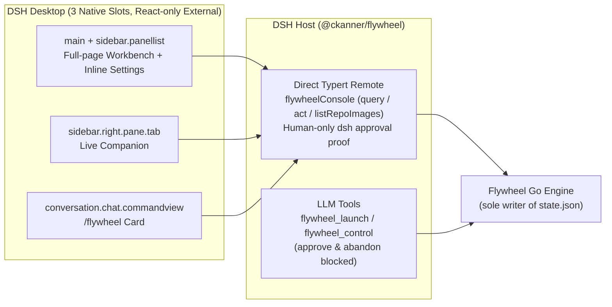

# Workflow console

[Documentation](../README.md) · English · [简体中文](../zh-CN/flow-console.md)

The DSH Flywheel v2 plugin provides a zero-debt native 3-slot engineering workbench
backed by Direct Typert Remote (`flywheelConsole`: `query`, `act`, `listRepoImages`).
It removes the legacy `conversation.view` slot, the duplicate global `settings.section`
entry (Settings lives directly inside the Workbench **Settings** tab), the
`:has([data-composer-seat])` layout hack, and `/flywheel {...}` chat command tunneling.
Keep the CLI, bundled engines, and DSH plugin at the same version. For installation, see
[Getting started](getting-started.md).

## Native 3-slot DSH workbench (v2)



| DSH slot | Surface | Key capabilities |
| --- | --- | --- |
| `main` + `sidebar.panellist` | Full-page Engineering Workbench (with inline **Settings** tab) | Bound to native DSH `--dsw-alias-*` light/dark semantic tokens with a full-bleed single-column layout. Features a 54px header with a searchable **Task Switcher popover**, `+ New Task`, lifecycle Primary CTA, and direct inline **Settings** tab (Scope Precedence Bar, 4-Subscription Health Strip + Doctor + live model catalog refresh, **JEV Bounded Decisions card**, **editable Stage & Route Model Matrix**, **Session Reuse Policy & Run Guardrails**, **Concurrency / Worktree / Watchdog Timeouts / Transport Retries**, one-click Reset, and raw JSON); plus **Dual-Design & Review Studio**, **Wave Swimlanes (default) + Interactive DAG Canvas**, **520px 5-tab Node Inspector** (`Overview`, **`Model Output`**, `Evidence & UX`, `Timeline & Collab`, `Contract`), **Live Traces & Provider Session Resume**, **30s Create Task Modal**, **Investigation Board**, and **Delivery Track** |
| `sidebar.right.pane.tab` | Compact Live Companion | Active task progress bar, running packet badge, one-click jump to Workbench (`layout.selectPanel('flywheel')`), and Stop control |
| `conversation.chat.commandview` | `/flywheel` Command Card | Read-only command result summary with one-click jump to Workbench |

Human-only actions (`planning.approve`, `session.abandon`, `packet`, and `milestone`) mint host-owned `dsh`
proofs directly inside `flywheelConsole.act`; LLM tools (`flywheel_launch` and
`flywheel_control`) remain strictly blocked from invoking them.

In the main chat stream, Stage 1 renders blocked-session banners only for planning roles, while execution/review/judge interruptions, `inbox` packets, and escalated milestone gates/Judge verdicts converge in the persistent bottom-of-stream **Human Triage** card (with one-line error summaries, collapsible technical details, failed L2/L3 stderr tails or Judge reasons, and one-click retry/accept controls). Completed mid-execution plan revisions collapse by default, actively running packet cards (including `l1-passed` packets with an active review trace) display an accent border highlight, and the sub-session telemetry dock displays 1-based live turn counters (`Turn N`) instead of `0t`.

## Find a task without entering paths

The view follows the current conversation automatically, with no editable path fields. A conversation task navigator appears only when more than one task is associated; a single task opens directly. Its explicit tool association takes priority. Without one, the latest registered run with an exact matching host session ID opens. Foreign and ownerless runs are not shown. The index supplies identity only; Go status establishes progress. Unconfirmed operations retain their original target.


The list uses retained conversation associations and recent run registrations; it does not scan directories or provide an unlimited archive. Multiple runs of the same task share one navigation entry. Selecting a task reads its current state without starting, stopping or rebinding it. Ordinary catalog refreshes retain a manual choice; a new explicit task association still follows the conversation. Other tasks show their last recorded status, not a live-running claim. Preparation-only entries say “Select to read status”. Failed reads retain the selected identity and error rather than another task's canvas.

Switching is disabled during pending reads or mutations, unknown task outcomes and unconfirmed configuration saves. Confirmed preparation history remains readable without starting a run. Settings hides task navigation and retains draft protection. History remains the selected task's runs, not all runs in the conversation.

The project, task folder, execution directory and branch appear directly when known. Use `flywheel_control status` in the intended conversation to associate a prepared or standalone terminal task. Old UI-generated status command records do not establish a new association.

### Create another task in this conversation

With a task selected, choose **Create another task** to open the goal form beside
the existing workflow. Opening the form sends no model request and keeps the
current task selected. The same form is available when the conversation has no
task. Choose an engineering task, repair, or report-only investigation; engineering
and repair default to Auto depth and waiting for approval after independent design
review. Implementation after review requires its own explicit authorization.

The entry waits for the conversation's workspace to be confirmed; the selected
task's worktree is not a substitute. A failed lookup shows a reason and **Retry**.
Opening a draft fixes its workspace and displays the task-record directory. Later
catalog refreshes cannot change that directory or erase the draft. Successful
creation or explicit discard releases this choice for the next draft.

Submitting creates a separate task directory through the existing engine intake.
The view selects the new task only after Go confirms its state or investigation
record. A lost response retains the original request target and draft; status
reconciliation does not replay creation. If reconciliation finds an empty
directory, the current task remains selected and an explicit retry uses the same
target. Pending control requests, unknown mutations and unconfirmed configuration
saves block the new-task entry and prevent hiding or discarding an active request.

**Hide and keep draft** retains this conversation's text and authorization
selection. **Discard new task draft** clears both. Another conversation does not
inherit them, and successful creation retires the old draft so the next task starts
with review-first authorization. Image previews must be inspected again after
reopening a retained draft.

### Task locations and conversation commands

DSH keeps the original repository in the Session header and switches the current execution directory through its public API. The desktop Host periodically attaches Flywheel SDK sessions to matching existing projects; task status also ensures the original project is registered. It does not create a desktop workspace for every packet Worktree or rewrite old Session headers. Probes use temporary persistence, leaving no new user sessions. Native Providers start sessions in the project; task prompts name the actual execution directory for every shell/file operation. Backends unable to separate a `workspace-write` sandbox root reject that combination before dispatch instead of widening permissions. Full access and supported read-only modes retain their actual semantics.

Loading a skill does not start the engine. `flywheel-task` prepares a thin brief and invokes `planning prepare` for design/review and authorized implementation; investigation goals retain their bounded investigation control. Existing prepared-contract tasks still use launch/start. A preparation/proposal-only response must explicitly say execution was not started. Single-stage skills query `flywheel_control status` afterward to associate their canvas, or disclose the exact path when that tool is absent rather than claiming association.

| Conversation entry | Does it start the engine? | How the UI finds the task |
|---|---|---|
| `/flywheel-new <goal>` | Starts design and independent review; implementation stops for approval | The planning tool associates the exact task and shows its design phase |
| `/flywheel-run <task directory>` | Starts or resumes an existing task | Start and query the original task path to associate it with the conversation; the view follows the explicit association |
| `/flywheel-task <goal>` | Starts planning; continues according to recorded authority | Use investigation control or planning prepare, then check the original task status |

`new → run` and `task` use the same engine; the canvas is not exclusive to one
skill. Writing task files alone does not register a view, and a failed association
query must not be replaced with launch merely to populate the canvas. Report an
unavailable association tool explicitly. Standalone terminal tasks without a host ID require an explicit association in the intended conversation.

While the canvas is visible, registered-task discovery refreshes every five seconds.
An observed running task refreshes status every two seconds, backing off to ten
seconds after an unsuccessful response. Hidden documents skip those requests.
Refresh uses a read-only Remote instead of a slash command, so it does not append chat events or JSON. Explicit mutations and uncertain-result reconciliation retain durable command receipts. Old chat records are preserved. Session identity and read requests use strict Remote codecs; an unavailable or malformed read remains a visible error rather than falling back to chat commands.

Task titles are separate from DSH conversation names. The title comes from validated Spec `title`; otherwise the heading says “Associated task”, with the slug separately labeled “Task ID”. Project and task-record paths appear automatically in the header; node details show execution Worktrees. Settings hides the task header while retaining association updates. Its five navigation items remain together at the top, with the form beside them and the save bar above the DSH composer.

Navigation uses compact rounded hover targets with a separate selected underline. Hover and selection do not resize the controls; keyboard focus remains visible and touch targets are larger.

## Models, choices and observed collaboration

Node configuration separates the **initial run binding**, **binding selected for
the next execution**, and **latest recorded invocation**. A model switch retains
the selected model, effort, permissions, session policy and native options before
the next invocation starts. Changing settings does not rewrite those facts. Old
records without a complete snapshot remain unknown; display limits are stated
explicitly and do not replace the full task ledger.

Each model decision card also shows its **linked execution status**: selected
before dispatch, confirmed not started, started with an unconfirmed outcome,
completed, failed, cancelled or unknown. New invocations explicitly name the
decision they follow after matching the exact packet, attempt and frozen binding;
the card keeps its call ID when a later invocation replaces the current session.
A durable native acceptance event can show that a call started while its terminal
receipt is still pending. Completion requires a confirmed terminal receipt and
cleanup. Older decisions without this link remain unknown. These statuses describe
the model call; packet acceptance and observed Swarm children have their own results.

For Antigravity, the selected binding names the requested **native**, **subagents**
or **Swarm** mode when that fact was retained. A profile name alone does not prove
the mode. These requested settings do not establish that children ran: approved
collaboration tasks and write scopes appear separately from observations matched
to the actual invocation. Reading observations distinguishes a pending request,
a failed request, and a successful query with no matching record. None of those
states proves that an unobserved child completed.

### Check a packet's execution eligibility

Open a packet node and select **Check execution eligibility**. Go reads the exact
packet and evaluates its execution candidates with the same input and native
collaboration checks used before dispatch. The view shows each candidate's model,
effort, channel and native profile, with the conditions that passed or failed.
It identifies whether the check used the run's frozen configuration or the current
effective configuration. Reading this report does not invoke a model or verify
account entitlement.

For Antigravity Swarm, the report identifies missing Full execution depth,
an undeclared independent task split, invalid write scopes, or an incompatible
image input transport. Ordinary code packets can use Antigravity without images;
a Full packet with a reviewed independent split can use Swarm without images.
Repository PNGs, icons and other assets do not by themselves declare model image
input. A packet that explicitly requires the original image must use a verified
image transport; removing its declaration does not satisfy that requirement.

Pending reads, failed reads, unknown contract identity and a confirmed report with
no candidates have separate messages. A changed task revision makes an old check
stale. Saving configuration or changing planning also clears the previous node
check, so a previous eligible result is not presented as a new decision. Read the
node again before using the updated information. Eligibility does not claim that
a candidate has been selected, dispatched or completed.

### Edit a collaboration draft and review the new plan

**Edit collaboration draft** reads a revision-bound snapshot beside the approved
task split. Enter **2–8** task goals and one relative write scope per line for each
task. Goals are limited to 512 Unicode characters, each task to 1–64 write
scopes, and the complete edit to 32 KiB. The parent packet's approved `schedule.writes` remains visible. Go checks
that child paths are normalized, stay inside that parent scope, and do not overlap
another task; the form does not expand the parent's scope.

**Save draft for review** submits the original state revision, contract fingerprint
and exact plan revision/digest together with the edited split. The engine creates
a new immutable plan revision and requests independent plan review. This action
does not start implementation or edit an active contract in place. The previous
plan review does not cover the new revision. Root design approval remains usable
only while the design and its approved scope are unchanged; changes to goals or
scope belong in **Design feedback**. Execution remains gated by the new plan's
review and the normal activation checks.

Running tasks, unresolved invocations, a human handoff, a stale contract, or a
planning phase that cannot accept the edit disable saving and explain why. An
unchanged split also does not start another review. Local text survives a failed
read, rejected edit or unknown save result. Closing the node, changing tabs or
tasks, and reopening the view retain drafts and pending request identities within
the same live conversation binding. Recreating the plugin or its host Session
binding starts with a new in-memory cache. **Refresh revision and keep draft** can
adopt a newer audit revision only when the contract fingerprint, exact plan,
parent scopes and original split are unchanged. **Reread and replace draft**
explicitly replaces unsaved edits with a new snapshot. If the save result is unknown,
use **Refresh task and reconcile outcome** to read that exact request's receipt;
the form does not replay the mutation. A confirmed pre-dispatch failure leaves
the draft editable without requiring a nonexistent receipt. A queued receipt remains unconfirmed until
adopted. Approved assignments and observed native children continue to be shown
as separate facts.


### Edit an existing packet's image inputs

Open a packet or Execute node and select **Edit image inputs**. The current plan's
paths, MIME types and SHA-256 references are read separately from the actual
invocation's image manifest. Reading these references does not load originals or
claim that an unreviewed plan is active.
An unreadable declaration remains **unconfirmed**, with its reason, rather than
being shown as empty. Legacy packet references without a plan are labelled as
contract references and remain read-only.

Add, replace or remove repository-relative image paths, then explicitly choose
**Inspect and preview image draft**. The preview shows original format, dimensions,
bytes and digest; editing a path invalidates it. The last image is removed through
**Explicitly clear all image references** and a separate confirmation that the
step no longer requires the originals. An empty field never silently removes a
declared input or bypasses the transport requirement.

**Save image draft for review** submits the exact state revision, packet
fingerprint and plan reference. Go revalidates the original bytes and records a
new immutable plan for independent review. Saving preserves the active contract
until normal activation and does not grant implementation start authority.
Read the packet's execution eligibility again after the reviewed revision is
active; original-image execution requires the supported Claude SDK transport.

Paths, reference metadata and unresolved request IDs survive navigation within
the live conversation binding. Previews remain local to the mounted editor and
must be explicitly reread after reopening. Rejected drafts can refresh an audit
revision while their contract, plan and original references remain unchanged.
Unknown or queued saves reconcile the exact action and request ID without
repeating the mutation. See [Image inputs](image-inputs.md#edit-images-on-an-existing-packet)
for the full editing and recovery behavior.

## Design and approval in the same view

A task with planning v1 displays **Design and review** before its implementation
canvas. Read the current document, exact revision/digest, requirements, decisions
and independent review findings; expand the previous version for comparison.
Approved root designs and current child plans appear separately, including their
reviews, contract files and activation state. Missing projected history is labelled
as unavailable in this snapshot, rather than invented or treated as empty evidence.

**Approve this version** records approval only. **Approve this version and start**
adds implementation authority in the same user action; after approval-only the
button becomes **Start approved design**. The request binds the observed state
revision and displayed design digest. Stale, unreviewed, changed-input, pending
activation or running states cannot be approved. Refreshing or remounting does not
approve or start work. Ordinary Continue preserves the approval/start boundary.

Submit feedback with a design reference. The request receipt distinguishes queued,
applied and rejected input; only adopted feedback appears in the applied list.
Use **Run Plan** to request overall design, replan, milestone or packet scope.
Explicit Plan runs planning/review only and stops. Scope IDs use the actual task's
milestone or packet identifiers. See [Reviewed planning](reviewed-planning.md).

When a planning role has a `blocked` unknown invocation, the panel shows the
unresolved call, its exact invocation and reason, and an abandonment form. A reason
and an explicit confirmation (no result applied, no replay, old thread not resumed)
are required; the action is a real user command and is revalidated against the
current state. Model tools do not expose it. Abandonment ends only this effect
boundary; an explicit Run Plan is still required to produce a new version.
“Refresh control state” reconciles only the plugin’s unconfirmed control action; it
cannot turn an engine session’s unknown into a known result and is not a substitute
for abandonment.


## This stage versus the full workflow

The task overview is shown by default so that subsequent steps remain visible. When `run.kind` and `control.kind` identify the same single-stage operation, the toolbar distinguishes its result from overall delivery. This run shows a compact result list; review-only results include **L1 → Review**, with verdict and score available in node details. Passing one stage does not mean the task is delivered.

Continue workflow is directly visible when applicable. New-task launch options appear only before an engine state exists. A passed stage does not start subsequent stages or mark the task completed. Failed, cancelled and unknown operations cannot inherit an older green verdict. Run ID, HEAD and digests are directly visible in node details.

## Investigation before implementation

A preparation record opens the investigation panel before implementation state
exists. It shows budgets, observations, excerpts, physical action results, analysis
and decision receipts, and the evidence report. Run submits the observed revision;
a pending call offers read-only reconciliation. Unknown control results require
status reconciliation before another mutation. Stop waits for the owner and never
turns a missing receipt into confirmed cancellation.

After collection, the configured `loops.investigate` role analyzes frozen evidence.
At `awaiting-report`, **Analyze investigation evidence** resumes that stage;
`analysis-pending` reconciles the original invocation. Legacy configurations without
an analyst retain manual report submission. A report is not code-task completion.
An authorized supported repair registers a thin brief in the same task and carries
its evidence, scope and usage into planning.

Once a report is settled and all calls/cleanup are known, **Add evidence and continue**
opens a new-round contract draft with the remaining allowance. Supply actual new
`known-evidence` and actions within the original goal/intent/repair scope. Submitting
uses the revision captured when the draft opened; a refreshed newer version disables
that stale submission. Invalid JSON sends no request. Prior rounds remain visible
with their immutable digest. No new task, budget reset or hidden retry is created.
See [Investigation](investigation.md) for the engine contract.

## Configuration

In an existing DSH conversation view, Flywheel remains after Statistics; the blank new-session landing page does not yet show these conversation views. Its primary navigation is Workflow and History; Settings opens a separate workspace. Global settings require no task directory. Project settings target the selected Git root. Discovery still selects one complete file in task → project → global → embedded order; it does not deep-merge files.

Opening Settings automatically reads the selected scope. Execution, Models and sessions, Budget and retries, JEV, and Diagnostics and config have separate sections. Save, Discard and Restore defaults stay in a fixed footer; Save is disabled without changes. Saving takes one click, including the single JEV master switch; the form explains supported decisions and the configured data scope. Serial mode omits concurrency controls. Minutes and seconds are converted precisely to engine millisecond fields.

Reload, complete JSON editing, diagnostics and raw responses live in Diagnostics and config. The narrow navigation row is fixed at 54px with 36px buttons (44px for coarse pointers); shorter content cannot stretch it. Leaving Settings, scope changes or reloads first disclose unsaved drafts; restoring defaults loads a pending full replacement before saving. Stage assignments edit the same draft inside Settings. Back to model list keeps edits; Save changes at the bottom is the only write action. Discard removes all unsaved changes in the current scope. Failures retain the draft and an uncertain save requires reconciliation. Go checks file identity, backs up the original and publishes atomically. Implementation runs retain their configuration snapshot. JEV additionally rechecks current activation and tighter permissions at decision boundaries; see [JEV recovery](jev.md#data-budgets-and-recovery). The displayed source is file-level: task → project → global → installed defaults selects one file, not a per-field overlay. New files start from the installed template.

Switching to Chat or another conversation and returning to the same retained
view restores the Workflow, History or Settings page, the selected settings
section and any unsaved draft. These drafts live only in that view's memory;
reloading the plugin or rebuilding the conversation view starts fresh, even for
the same Session ID. Save changes before those operations if you need to keep them.

Hiding the view does not cancel an in-flight configuration read or save. Returning
shows its actual result: a confirmed save becomes the current saved configuration,
while an unknown save still requires reconciliation. An explicitly accepted scope
change or reload continues loading the chosen file without reviving the discarded
draft. File revision conflicts still prevent a stale save.

Strict subscription settings offer Antigravity, Claude Code Pro, Codex Pro and Kimi native resources. DSH ChatGPT and DeepSeek remain available in legacy configurations without this policy. Gemini suffix and effort move together; Kimi selection creates a minimal native profile only if absent. Compact preparation has two profile selectors, and subscription JEV selects a profile instead of HTTP credentials. These changes share the existing draft, revision and Save boundary; resource selection does not log in or alter an account.

Native profiles with a non-object definition, such as `null`, disable Save in an
advanced JSON draft and remain available for correction. Switching back to the
model form preserves that draft without crashing or silently replacing its values.

`permissions.bindings` overrides `loops.<role>`, `routes.<route>` or `judge-panel`. Unspecified bindings use the global policy. History overrides are role-based: execution routes share the execute policy while each packet keeps its own session. Scoped continuation requires the same task, role, goal and eligible binding; fresh also retains invocation-safety records.

[JEV decisions](jev.md) use one default-off master switch. Enabling it activates
supported investigation, initial-execution and failure-action decisions automatically, including approved
execution-model choices. Configuration inspection is read
only; it is not another switch. The investigation view shows the last observed JEV
state, adopted versus baseline actions, and evidence-referenced deferral or early
report effects. A stored state label is not a live re-read of configuration. These
collection effects never mean the root cause is proven or implementation completed.

### Switches and scheduling choices

Settings uses one JEV master switch. Automatic task Worktree management and early
DSH Review runtime preparation have their own switches in Execution. Each switch
has an associated label, a visible On/Off state, and native checkbox keyboard
behavior. Toggling edits the draft; Save changes writes the selected scope. No
second JEV confirmation or task-specific enable switch is required.

Parallel dispatch remains a two-option policy selector: Batch waits for the
current batch, while Ready queue refills an available Execute/L1 slot with another
eligible independent packet. The form preserves the selected policy and explains
unmet configuration conditions; it cannot establish whether a future task will
use Full or have independent work. Ready queue requires Full, parallel scheduling,
a maximum above one and automatic Worktrees. Early runtime preparation is
independent of JEV and only initializes a supported DSH Review SDK; no Session or
model prompt is created before normal admission. Defaults remain Batch and
preparation Off. See [runtime scheduling](configuration.md#scheduling-and-worktrees).

Automatic Worktree management controls engine-owned directories. Turning it off
does not delete existing directories or prohibit externally managed Worktrees.
The JEV section explains the allowed data boundary and current-task disable
semantics beside the fields. Disabling JEV or switching to serial discards the
invalid input drafts hidden by that change and retains the last valid values;
unrelated errors still require correction. Detected invalid fields entered through advanced JSON remain editable there and
block Save until corrected; Go still validates the complete configuration.
A valid connection, provider quota, explicit empty allowed-data list, role policy
or budget is not reset by an unrelated switch. Invalid drafts and stale/unknown
saves retain the existing protections.

### Session defaults and stage overrides

Execution sets the default fresh/scoped policy. Models and sessions lets each role inherit or override it. Execute routes share a role policy while packets retain independent histories. An explicit Plan choice reconciles the legacy Kimi history switch; inheritance preserves it. Nodes show actual session IDs, actions and reasons, not a resume inferred from configuration.

### Optional usage budget

Choose Off, Warn only, or Stop at limit. Off hides the threshold while retaining accounting. Warn only does not stop execution; a hard budget blocks new calls at the limit or when usage is unknown. Thresholds apply per task and UTC day; blank means no limit. Timeouts and transport retries remain independent, as do Provider quotas. The form reads actual settings and never silently changes an existing soft budget to off.

## Canvas and operations

The left-to-right overview groups Plan/decomposition, scheduling, task branches, integration/final checks and PR/Merge. Selecting a node directly shows its outcome, actions, configuration snapshot and actual role-session facts. Evidence and managed session interaction have separate explicit destinations. Open task workflow drills into Execute, L1, Review and Git delivery; integration can be inspected separately, while PR and Merge are separate nodes. Colors have text labels. Identity, project/worktree, branch, HEAD, run ID, bindings and evidence come from actual receipts.

The canvas uses the available plugin width, with two-axis panning, zoom, fit width, current-step location, paging and a list alternative. New snapshots preserve the viewport and selection; location can switch to the running packet's page. Large tasks use bounded excerpts. Read full node evidence loads one packet with a matching fresh revision; it never changes the ledger.

Focus canvas expands the view in a plugin-owned native dialog. Exit or Escape returns without starting or stopping the task. It does not change the DSH global layout or composer. Unknown operation outcomes exit focus mode so the original-invocation reconciliation action remains visible.

Ordinary node operations dispatch once with the observed revision. Repair and retry records the explicit console action and adds one Execute/L1 attempt, without inventing an explanation for the failure. Reopening a completed packet still requires a reason and confirmation of downstream evidence invalidation; a changed revision invalidates that confirmation. Review cannot run with a red current L1. Unqueried remote state, closed PR and merged PR remain distinct.

- Run stage submits the observed revision for lease-bound admission.
- Repair and retry records the explicit console action and adds one Execute/L1 attempt without resetting failures or billing.
- Reopening a completed packet archives old evidence and invalidates downstream acceptance.
- Git delivery requires current L1 and independent Review evidence.
- Final acceptance runs milestone gates and Judge without starting Plan or unfinished execution units.
- Continue workflow resumes the persisted Full or ultraWork/Quick policy.
- Stop waits for managed work to settle; closing a view is not a stop.

Explicitly independent packets with satisfied dependencies can be run ahead in their registered execution directories, subject to the selected worktree policy. Integration changes invalidate old acceptance. Each asynchronous node operation records running/passed/failed/cancelled and its reason. Quick retains deterministic checks and independent final Review; omitted Plan/Judge stages are not presented as passes.

## Parallel execution

### Eligibility and limits

Read `flywheel template scheduler-policy.schema.json` for the current fields and bounds. For example:

```json
{"scheduler":{"mode":"parallel","max-parallel":2,"providers":{"deepseek-account":1},"dispatch":"batch","prewarm":false}}
```

Provider-limit keys are actual configuration channel names. The example uses the inline template's `deepseek-account`; a binding using `deepseek-account-sdk` needs that key instead. Eligibility comes from frozen packet contracts:

```yaml
schedule:
  after: [M01-T01]
  writes: [src/search/, tests/search/]
```

Dependencies reference earlier known packet IDs. Writes are normalized relative paths or directory prefixes, without globs or escapes. Include ordinary tests/configuration and account for shared test resources. Undeclared independence, overlapping scopes and live-credential units remain serial.

### Dispatch and runtime preparation

The configuration editor also offers `scheduler.dispatch` and `scheduler.prewarm`.
The defaults are `batch` and false. Selecting `ready-queue` fills a free Execute/L1
slot from the remaining independent Full packets when automatic Worktree management
is enabled and the parallel limit exceeds one. Review, replanning and integration
retain the all-workers-settled barrier. Shared-checkout runs keep batch dispatch.

Prewarming initializes one DSH Review runtime while a serial packet performs its
post-Execute deterministic checks. It sends no model prompt until normal Review
admission. Parallel Execute/L1 lanes and shared candidates do not prewarm; an
independent cohort must settle before its serial Review path may prepare a runtime.
Other harnesses use the cold path. Unused runtimes must finish bounded cleanup.
Neither setting changes JEV activation, task qualification or completion gates.
Saving takes effect on the next start. See [Configuration](configuration.md#ready-queues-and-runtime-preparation)
for eligibility, recovery and the separate live-performance evaluation.

### Execution directories

Configuration → Workflow policy → Automatically manage task Worktrees is on by default (`worktree.enabled`). It controls automatic directory creation/management independently from parallel scheduling. The installation default allows parallel execution with a limit of two; existing complete files without `scheduler` remain serial, as do explicit serial settings. Parallel automatic management requires isolated worktrees and stops if creation fails; the legacy serial path can record an in-place fallback. With automatic management off, tasks may run concurrently in the task checkout or choose their own Worktrees. Shared directories do not provide file isolation: write-scope conflicts, candidate drift and failed acceptance still stop progress.

To select another execution Worktree, the executor first prepares a clean checkout of the same repository and task baseline, unclaimed by another unit in this workflow and with a branch not shared by multiple Worktrees, then returns only `{"flywheelExecutionDirectory":{"cwd":"/absolute/worktree","branch":"actual-branch"}}` before implementation. Go validates and records it; the next invocation, tests, Review and delivery follow that directory. Registration is not task completion and its model usage is still billed. External Worktrees are retained. A prompt-only directory claim or edited state file cannot replace this registration.

Independent Worktrees permit concurrent Execute/L1. Shared checkouts run Execute concurrently, then verify and review serially after all workers finish. One Go coordinator serializes CAS writes and accounting. Hard budgets admit only one model call at a time, retaining its slot through durable accounting. Other modes enforce total and channel concurrency. Cancellation awaits every started worker.

Review, integration and milestone gates remain serial. A combined candidate is revalidated after incorporating earlier work. Bounded execution failures retain their escalation policy. Integration conflicts and failed gates preserve the worktree and evidence. Write scopes are orchestration/acceptance contracts; full access is not an OS sandbox.

### Shared-checkout batches

When a batch shares one checkout, all executor calls finish before L1 and independent Review validate the complete combined candidate. Changes are projected onto declared scopes; undeclared and forbidden paths still fail. This does not attribute filesystem writes to individual processes. Repairs invalidate earlier proofs. Only after every peer passes can code be committed and all completions published in one state CAS; failed publication never optimistically completes a subset. Mixed batches deliver the shared checkout first, then revalidate and integrate external Worktrees. Manual integration/final checks cannot bypass the batch barrier; resume the complete workflow. The canvas shows the cohort and previous error.

## Controlled Provider session interaction

Read latest response opens the exact digest-bound receipt, not an invented native history path or a claim of complete provider history.

A settled, consumed, eligible packet session can be claimed. The persisted handoff prevents automatic run/step from continuing. Both the desktop prompt form and managed terminal restore that exact thread through its adapter and keep budgets/accounting. Missing history, changed bindings or a required rebuild cannot silently become a cold start.

```sh
cd -- '/absolute/task-worktree'
flywheel session '/absolute/task-worktree/docs/task-slug' --key 'execute/M01-T01'
```

Each terminal line is a prompt. `/history` reads the latest response; `/reconcile` checks the original invocation; `/return` validates and returns; `/release` releases human control while staying paused; `/quit` retains the handoff. The desktop form supports multiline prompts.

Returning runs L1, applicable Quick gates and independent Review. Human text is not a passing verdict. Candidate-bound human-takeover evidence allows normal subsequent delivery. Release does not claim verification and cannot bypass unknown effects or cleanup. Milestone sessions currently expose read-only responses; interactive handoff is packet-scoped.

This return path requires an existing eligible managed session. It does not import
an arbitrary patch prepared before the task, and running Verify followed by Review
does not create that provenance. A general existing-candidate admission interface
remains separate work.

The engine accepts session ledger storage versions 1, 2 and 3. Human handoff
requires at least v2; the first runtime prewarm records v3 so older engines reject
cleanup responsibilities they cannot interpret. Later handoffs retain v3.
Session policy-version remains 1; worker/lifecycle versions are independent.
[Recovery](session-recovery.md#dsh-runtime-preparation-after-a-restart) explains the
original cleanup receipt required after an interrupted preparation.

## Discovery and comparison

CLI and desktop starts register run IDs. A conversation retains multiple confirmed task associations. The index lives in `runs/` beside the global configuration, optionally overridden by absolute `FLYWHEEL_RUNS_DIR`. It shows the latest 100 registrations and never scans the disk. Query Go again for liveness.

Run history is limited to the currently associated task and uses a selection list with adjacent details for operation kind, branch, HEAD, contract/configuration conditions, elapsed time and newly observed attempts, failures and deliveries. Selecting a record does not launch it; opening its canvas refreshes current Go state. Metrics scope chooses the selected run or all calls for its task, including legacy observations. The reference compares conditions without changing the metrics target. Invocation/receipt reconciliation precedes aggregation; late receipts keep their original attribution and are not double-billed. A group with entirely missing cost shows Not reported, not $0.

Usage, cost and duration are known amounts, with missing/partial observations retained. Costs may include estimates from configured prices. Call failure rate is not code quality. Different conditions permit descriptive comparison only; quality conclusions require acceptance evidence and an independent oracle.

## PR and Merge

Inspect the project and remote first. Writes require normal GitHub CLI authentication, completed local acceptance, a still-valid candidate, and explicit repository/HEAD/base authorization. A changed registered repository identity is rejected. Fetch and push URLs must identify the same repository.

Push uses the approved commit and named task branch, without force, implicit tags or recursive submodule pushes. A separate remote task branch does not require switching the local checkout. Requery after push so an earlier Draft PR is updated instead of duplicated.

Merge rechecks the PR, head, base and checks, using `--match-head-commit`. It never uses admin bypass or enables auto-merge on its own. Merge-queue acceptance and actual MERGED state remain distinct; see the [GitHub CLI contract](https://cli.github.com/manual/gh_pr_merge).

Retries reconcile existing PR/merge results before mutations. Missing receipts remain unknown. Remote state is separate from local engine completion. Publication must bind the actual merge commit and artifacts for its own validation; Merge does not automatically publish npm packages or deploy.

## Related guides

- [Configuration](configuration.md): complete files, model bindings, permissions, and scheduling.
- [Workflow](workflow.md): preparation, execution, and PR review checkpoints.
- [Investigation](investigation.md): bounded evidence collection, reports, and optional JEV decisions.
- [Recovery](session-recovery.md): durable receipts and unresolved invocation handling.
