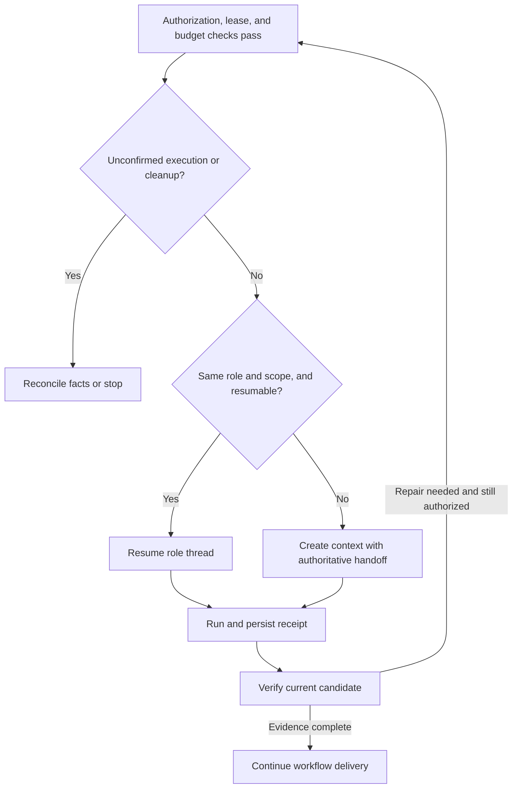

# Session lifecycles based on task, role, and runtime evidence

2026-11-07. Status: **Design proposal for review. This PR changes documentation only;
it does not implement runtime support.** It replaces the design rule that every
Execute or Review invocation must start a fresh session. The current source still
uses the existing invocation behavior; editing this document does not enable resume.
中文：[按任务、角色与运行事实管理会话](../../plans/2026-11-07-session-lifecycle.md).

## 1. Decision

**Each session belongs to an explicit task, scope of work, and role. Ordinary repairs
should normally continue that role's context. Compatibility, recoverability,
context quality, and runtime evidence determine when to rebuild it.**

- A packet's Executor normally continues its own thread for L1 failures, Review returns, and additional work within the same scope.
- Reviewer context remains separate from Executor context. A review of repairs within the same scope may continue the Reviewer's own thread, while checking the entire current candidate again.
- Plan maintains continuity within the same planning goal; Judge does so within the same milestone. An explicit second opinion has its own independent context.
- New tasks, unrelated packets, and different roles do not share threads. Unrecoverable history, incompatible scope, or degraded context calls for rebuilding from authoritative material.
- Go chooses create, resume, rebuild, or wait from versioned policy and verifiable facts. This does not introduce a parent model to schedule work.
- Session history, individual invocations, and worker processes have separate lifecycles. Continuing history does not require a resident process or change cleanup, budget, verification, or delivery requirements.

This is an engineering choice whose benefits need evaluation, not a claim that
continuation always outperforms a fresh start. Historical documents retain the
earlier freshness rule as background; it is no longer an architectural invariant.

## 2. Current implementation and evidence

The inspected baselines are Flywheel [`80deeed4`][fw-base], after PR #29 merged,
and `dsh-subagent-codex-pro@0.8.0` at [`04ecdb67`][plugin-base]. The following
facts describe those versions. Implementation work must recheck dependencies
and public interfaces.

| Area | Baseline behavior | Implication for this proposal |
|---|---|---|
| Scheduling | Go runs packets serially. Execute and Review start fresh sessions; retries retain workspaces and feedback. | A resident parent Agent does not schedule native Teams. Session changes do not implicitly add parallel scheduling. |
| Kimi Plan | History can resume when `resident-session` is explicitly enabled and the identity matches. | Process termination and history continuity can coexist; this does not establish support for every stage. |
| Codex Pro plugin | The machine API supports `ephemeral`, `persistent`, and an explicit `threadId`. | A public foundation exists for continuation after normal completion. There is no need to return to the old Codex CLI driver. |
| Flywheel bridge and driver | The bridge hardcodes ephemeral mode. The driver rejects a nonempty SessionID, requires no requested thread ID in the receipt, and accepts configuration evidence only from `thread/start`. | Requests, state, receipt validation, and call sites must change together. Changing one switch is insufficient. |
| DSH worker | Flywheel has not connected history restoration. | Default Flash Execute and GPT Review remain important implementation work. |
| Early machine events | Public options expose only signal, env, and text onProgress. Structured run identifiers arrive in the final receipt. | The first implementation cannot promise to recover a newly created thread after a crash at any point. |

Sources: [Flywheel design and current behavior][fw-design], [bridge][fw-bridge],
[driver][fw-driver], [plugin machine API][plugin-machine], and
[machine implementation][plugin-machine-src].

### Why retain machine

`machine` is the plugin's programmatic interface for deterministic orchestrators.
It is neither a temporary computer nor a session type. Flywheel can request a
Codex harness run directly and receive configuration, outcome, cleanup, and usage
receipts. It does not need to create a DSH parent model and ask that model to call
`subagent_codex` first ([the tool registered by the plugin][plugin-readme]).

The original decision was based on the inspected DSH rc.5 SDK and plugin
interface constraints; it is not a claim about every future DSH version. See the
[original integration plan](../../plans/2026-11-03-codex-pro-default.md) and
[validation record](../../validation/2026-11-03-codex-pro-default.md).

| Dimension | Choice | Meaning |
|---|---|---|
| Invocation interface | machine API | Go calls the plugin and consumes machine-verifiable receipts. |
| Context | New thread or resume a specified thread | Whether this invocation inherits that role's previous interaction history. |
| History persistence | ephemeral or persistent | Whether the plugin requests recoverable Codex history; this does not imply zero filesystem writes. |
| Process lifetime | Start and clean up for each invocation, or remain running | How long processes live, independently of history persistence. |

A new worker and app-server can therefore run for each invocation and finish with
confirmed cleanup, while persistent history and an explicit thread ID preserve
context. A completely new, independent Reviewer thread can also retain history
for later reviews of repairs. The official [App Server documentation][oa-app-server]
and [Codex SDK documentation][oa-sdk] expose creation and continuation as explicit
operations. They describe capabilities; they do not choose Flywheel's policy.

## 3. Context ownership and default policy

The following is the target policy. The first invocation creates context for its
own scope. Subsequent invocations must pass the eligibility checks in §4. A backend
without implemented support retains its currently available behavior with a
recorded reason; the engine does not silently change models or channels.

| Role | Session scope | Normally continue for | Normally rebuild or create separately for |
|---|---|---|---|
| Plan | A continuous planning goal within one task | Contract format corrections, revisions to the same goal, planning feedback from a verification gap | A new goal, incompatible key assumptions, or unavailable context |
| Execute | task + packet + executor | L1 repairs, Review returns, ordinary tests or reports, implementation iterations within the same scope | Unrelated packets, a materially different goal, uncontrolled context growth, or unrecoverable history |
| Review | Packet review in Full; final review of the entire single-packet requirement in Quick | Reviewing repairs within the same scope or correcting verdict format | A new review scope, a deliberate independent second opinion, contamination by Executor history, or unauthorized candidate changes |
| Judge | milestone + judge role; second opinions have separate ownership | Re-evaluating the same milestone after repairs | A new milestone, an explicit second opinion, or incompatible judgment scope |
| Verify | No model session | Running deterministic checks again | Not applicable |
| Intake / Garden | One explicit advisory task | Additions or revisions to that advice | Unrelated tasks; outside the first implementation phase |

Reviewer and Judge must not inherit the Executor's conversation, private reasoning,
or tool trajectory as a substitute for independent inspection. They consume current
contracts, the authoritative diff, valid reports, applicable verification evidence,
and their own previous findings. Every review of repairs checks the full current
scope, newly introduced problems, and whether earlier findings should close or
reopen. Every Quick final Review covers all requirements; it cannot merely tick
off the few issues raised previously.

Another independent opinion remains an explicit workflow requirement or an optional
evaluation technique. Session continuity does not add one automatically. A Quick
run that succeeds on its first attempt still has **two stage invocations: Execute
and independent final Review**. Full retains its existing integration verification
and Judge stages. Session policy does not determine Quick or Full eligibility.

## 4. How Go chooses the next invocation

Before choosing a session action, Go checks stop intent, the run lease, budgets,
and attempt limits. A thread that still exists does not restart work after a user
stop. Session eligibility is reconsidered only after an explicit recovery entry
starts the task. Changing sessions, upgrading Quick to Full, or replacing a process
does not reset counters.

### 4.1 Eligibility to resume

Ordinary resume requires all of the following:

1. The thread belongs to the correct task, packet or milestone, and role. No other turn is active, and no conflicting writer owns the workspace.
2. Dispatch, terminal outcome, and cleanup facts from the previous invocation are sufficiently established. No execution result or side effect remains unresolved.
3. Persistent history and an explicit thread ID are available, and the backend's public restoration capability has been adapted and verified.
4. Workspace provenance, contract revisions, and effective runtime bindings satisfy the versioned compatibility policy. Each invocation still receives current authoritative material.
5. No context or stagnation limit, or explicit reset, has been triggered. The original task still has budget and attempt allowance.

Unavailable history does not require discarding the workspace. A new context may
be created once the previous execution and cleanup are confirmed safe. Unknown
outcomes or cleanup require reconciliation first. **A fresh session cannot bypass
that block either.**

The diagram shows session selection and repair continuity. The existing state
machine still controls Plan, Review, Judge, budgets, and completion gates.

### 4.2 Compatibility does not require every field to remain unchanged

Three identities must remain distinct: **session ownership**, **this attempt**,
and **the candidate and contracts being verified**. Repairs change the candidate;
that is a normal use of continuation. Candidate changes invalidate relevant old
evidence without automatically destroying the conversation. A revision within the
same goal can also continue with an authoritative contract diff. A changed Spec
hash does not by itself require a fresh context.

| Change | Handling principle |
|---|---|
| Task, role, or unrelated packet or milestone | Create context for the new scope; do not claim another scope's thread. |
| Candidate implementation, tests, or done-report | Record identities before and after the invocation, invalidate evidence under existing rules, and repeat relevant verification. Context may continue. |
| Contract revision | Record old and new fingerprints and structured revision grounds. Compatible revisions to the same goal may continue; unknown compatibility or a materially changed goal requires rebuilding or replanning. |
| cwd | Resolve the absolute physical path first. A path alias is not a new task. A real workspace move requires explicit checks of ownership and content before continuation. |
| Provider, account channel, or role permission boundary | Check effective bindings and existing authorization. Resume cannot mix accounts, expand permissions without authorization, or introduce an unauthorized paid fallback. |
| Model, effort, effective tools, or permission configuration | Evaluate supported per-turn or resume overrides and their evidence. Neither unconditional freshness nor unconditional continuation is valid. Initially, unverified combinations conservatively rebuild or fail. |
| Plugin, protocol, or harness version | Use a verified capability table. An upgrade does not automatically establish compatibility with stored history. |

Go does not make a semantic decision from free text saying that something “looks
like the same goal.” Revisions proposed by Plan or the user still undergo existing
authorization and contract validation. Implementation must define a versioned set
of mechanically checkable compatible changes. Changes that cannot be checked take
an explicit rebuild path or the existing planning or human escalation path.
Backend evidence that a request was accepted remains distinct from confirmation
that a configuration took effect; the engine must not overstate the evidence.

### 4.3 Choose an action from the actual failure

| Event | Session action | Required constraint |
|---|---|---|
| L1 finds an implementation defect after a valid execution receipt and confirmed cleanup | Send failure evidence to the original Executor for repair. | Verify the new candidate; retain total attempts and budget. |
| Review returns work | The original Executor repairs it; the independent Reviewer reviews again. | Review the full current scope; an old pass cannot carry forward. |
| Report or verdict format is invalid, but the underlying run reliably ended | Continue the same role to correct its output. | Distinguish report errors from an untrustworthy runtime receipt; preserve existing retry limits. |
| verification-gap | Enter the existing Plan revision path, then assess compatibility for each role. | Persist Quick's upgrade first; invalidate affected evidence. |
| AUTH, QUOTA, or RATE_LIMIT | Pause, back off, or resume after authorization as prescribed by existing error policy. | A different thread does not fix credentials or quota; do not automatically switch to a paid channel. |
| Startup fails and non-dispatch is confirmed | Retry the known intent when allowed. | Record the attempt; unknown dispatch cannot be treated as non-dispatch. |
| History is missing or has no rollout, with confirmation that no new turn was sent and cleanup completed | Rebuild explicitly with a handoff. | No silent cold start; original task counters remain. |
| Context exceeds limits, becomes contaminated, or repeated failures make no progress | Use bounded compaction, rebuilding, or an existing escalation exit. | Use only public, verified capabilities; repeatedly replacing threads must not evade stopping rules. |
| Connection drops, a terminal receipt is lost, or cleanup is unconfirmed | Wait, reconcile, or stop. | Neither immediate resume nor replay through a fresh writer is allowed. |
| A person or external task changes the workspace | Reconcile provenance and candidate identity; invalidate relevant evidence. | Preserve files; a new thread does not resolve conflicts. |

Context length, consecutive repairs, and stagnation need bounded, configurable,
recorded policies. The first implementation uses existing attempt, no-progress,
and budget limits rather than claiming a universally optimal number or percentage.
Backend compaction does not establish that Flywheel can request, control, or
verify compaction itself.

## 5. Target state and protocol contracts

The following are **proposed data responsibilities**, not current schema fields
or configuration that can be copied into a running installation. Implementation
must first update `templates/state.schema.json` and related configuration and
protocol definitions. `internal/state` then owns compatible loading and CAS writes.
Workers, models, skills, and the desktop UI do not write state directly.

| Record | Facts to retain |
|---|---|
| Session ownership | Task, packet or milestone, role, canonical worktree, generation, and policy version. |
| Resume binding | Harness and protocol versions, provider and channel, nonsecret account configuration reference, model, requested effort, effective permission and tool configuration, and compatibility policy version. |
| History handle | Backend opaque thread ID, persistence property, evidence of resumability, latest confirmed checkpoint, and retirement or rebuild reason. |
| Individual invocation | Engine invocation ID, requestId, backend runId and turnId, attempt, dispatch intent and timestamps, terminal receipt reference and digest. |
| Runtime facts | What is known about dispatch and outcome, cleanup confirmation, and lease or active invocation ownership. These cannot collapse into one success Boolean. |
| Candidate and contracts | Identities before and after the invocation, contract version, revision grounds, and associated verification or verdict evidence; old evidence is archived under existing rules. |
| Usage accounting | Attributable increment for this run, complete/partial/unknown status, and the identity of the accounted receipt to prevent replay from counting twice. |

Account identity stores only nonsecret references, never credentials. The backend
thread ID is an opaque handle; its format must not be parsed to infer task ownership.
`requestId` is a correlation identifier. The current plugin does not promise
idempotence or deduplication. A PID does not establish ownership or cleanup either.

Record the requested history persistence mode, what the adapter can confirm, and
the actual restoration result separately. A thread ID alone proves neither
persistence nor recoverability. The terminal receipt in `0.8.0` does not directly
echo `threadMode` or `resumable:true`; the engine must not invent these as
backend-confirmed values. The first implementation selects resume candidates from
the original request, verification of the pinned adapter, and terminal facts.
Actual restoration still requires acceptance by `thread/resume`.

Go persists dispatch intent before starting a worker. After validating and atomically
persisting a complete receipt, it updates state and accounting through CAS. A receipt
file is invocation evidence, not a second state machine. Only Go, while holding the
lease, may reconcile state from a matching invocation, content digest, and version.
An accounted receipt cannot be charged again. A done-report on disk does not prove
that the underlying run ended. Workers transport versioned requests and receipts;
they do not choose reuse, model changes, or retries.

At most one turn may be active in a thread, and at most one writer may be active
in a writable workspace. The existing task run lease remains in force. Future
parallelism requires explicit packet workspace and thread ownership. A busy thread
does not authorize creating another thread to write to the same workspace concurrently.

## 6. Deliver ordinary continuation and crash recovery separately

### 6.1 What the first implementation can guarantee

The first Codex Pro invocation requests persistent history. After its complete
terminal receipt arrives normally and is durably saved, the next eligible repair
passes that role's thread ID explicitly. Each invocation can still start separate
processes and complete their cleanup. Plugin `0.8.0` already exposes this normal
path; Flywheel must connect it. See the [plugin interface][plugin-machine-src].

The first implementation uses **normal invocations with reliably persisted receipts**
as resumable checkpoints. A crash after thread creation but before the terminal
receipt may leave no saved thread ID. Even a known ID may lack a recoverable rollout.
The plugin source records that an empty thread could not resume in its tested
version. Successful creation must not be treated as completed, resumable history.
See the [thread start and resume implementation][plugin-wire].

Text `onProgress` is not a recovery protocol. It lacks versioned structure and a
durability acknowledgement, callback errors do not reliably prevent execution,
and thread text appears before complete configuration validation. Parsing an ID
from logs does not close the crash window.

### 6.2 Public APIs required for interruption recovery

Reliable reconciliation after interruption needs new public, versioned typed
lifecycle and recovery contracts in the plugin. They must cover at least:

1. `thread-ready` after configuration validation, with explicit request/run/thread correlation, persistence properties, and evidence.
2. A programmatic acknowledgement that Go has persisted the checkpoint before sending a new turn. This is protocol coordination, not an additional user approval.
3. Separate facts for turn dispatch intent, a request that may have been sent, backend acceptance, and terminal outcome. Terminal events still include independent cleanup facts.
4. A read-only reconciliation entry for known runs, stating which turn, process, and result facts can be re-established and which remain unknown.

These are proposed interfaces, not APIs already available in `0.8.0`. Even an early
checkpoint leaves a possible uncertainty window between sending a request and
persisting acknowledgement. Without a backend idempotent execution contract, the
system cannot promise exactly-once execution. It must reconcile facts, preserve
unknowns, and prevent blind replay.

| Interruption point | Recovery requirement |
|---|---|
| The first thread was created, but its final receipt is not durable | Preserve the workspace. Reconcile processes and results first; do not promise to recover an unknown thread. |
| A new turn on a known thread was sent before disconnecting | Knowing the thread ID does not authorize dispatching again. Establish the previous turn's facts first. |
| A complete receipt is durable, but state or accounting is incomplete | Apply the confirmed receipt idempotently; do not invoke the model again. |
| A report file exists, but the final receipt is lost | The report does not prove terminal outcome, cleanup, configuration, or usage. Keep these unknown until reconciled. |
| Resume is explicitly rejected before a new turn, with cleanup confirmed | Rebuild with a handoff under bounded policy; preserve the failure reason and original counters. |
| The guardian may clean up later, but confirmation is currently missing | The current invocation cannot report success or start a conflicting writer. Wait for verifiable evidence. |

Preserve and extend the existing [stop rule for unconfirmed cleanup][fw-cleanup].
Recovery on another machine also depends on history storage and environment
availability. Saving a thread ID in the task directory does not copy Codex history
from another machine.

## 7. Repair inputs, rebuild handoffs, and accounting

A resumed invocation still receives concise, current authoritative input: goal and
constraint references, contract revisions, the candidate and diff, new verification
failures and review findings, confirmed progress, and this invocation's delivery
requirements. History cannot override those facts. A bare “continue” is insufficient.
Stable contracts remain separate from changing feedback; there is no reason to
repeat an entire transcript unnecessarily.

Rebuilding uses the Spec, packet, work on disk, valid reports, verification results,
and structured feedback. The handoff records the replaced thread or attempt and
the reason for rebuilding. It does not copy Executor private reasoning to Reviewer.
Summaries help navigation; authoritative code and verification still need inspection.
Preserve existing work and do not repeat external actions already confirmed complete.

Usage is accounted from the attributable increment for this run. A resumed thread's
cumulative total cannot be treated as new consumption on every invocation. Without
a trustworthy baseline or sufficient detail, retain unknown or partial status.
Unreported dollar cost remains unknown; subscription calls are not recorded as free.
Budgets include all prior attempts, failures, rebuilds, and upgrades under existing
soft and hard budget semantics. The plugin's existing run delta and thread totals
also require validation through the bridge protocol. See [usage receipts][plugin-machine].

Observability should show at least the role and scope, create/resume/rebuild/wait
decision, its reason, the latest invocation state, and usage completeness. The
task association in the DSH parent conversation remains a control surface; it
does not mean worker transcripts automatically merge into that conversation.
History persistence, archival, retention, and process cleanup are separate policies.
Process termination does not delete the workspace, deliveries, or audit material.
Implementation must specify retention rather than silently preserving every task
history forever, and it must not promise automatic visibility in a desktop list.

## 8. Implementation phases

| Phase | Deliverable | Completion boundary |
|---|---|---|
| P0: this PR | Revised design principle, current and target behavior, links in both languages, and validation plan | Design review only; no source, schema, package version, or release changes. |
| P1: ordinary Codex Pro continuation | Go session records and policy, versioned worker requests, persistent/threadId support, start/resume receipt validation, normal repair and cancellation tests | Scoped continuation for enabled Codex Pro roles; only durable normal terminal receipts become checkpoints. |
| P2: other backends and role coverage | Verify and implement default DSH Execute and Review, plus Kimi Execute and scoped continuity for Plan and Judge | Verify each capability separately. Supporting hard does not complete the default Flash path. |
| P3: interruption reconciliation | Integrate public typed lifecycle, durability acknowledgement, and recovery contracts with the plugin | Fault injection demonstrates no blind replay. Parsing logs for IDs is insufficient. |
| P4: context quality and measured tuning | Verified compaction or rebuild policies, controlled evaluation on real tasks, and observable reasons | Adjust from quality and measured results, without assuming cache rates or savings. |

P2 and P3 can proceed separately after P1's contracts stabilize. P1 initially covers
the existing Codex Pro hard Execute route. If a user has already configured Review
or Judge explicitly for Codex Pro, the same adapter should use separate handles
for those roles. Demonstrating review continuity must not automatically switch the
default DSH GPT Review to Codex Pro.

P1 touches at least these responsibilities. Exact fields and protocol versions
belong in the implementation PR:

- `internal/state/` and `templates/state.schema.json`: session and attempt identity, receipt reconciliation, and migration of old state.
- `internal/machine/steps_execute.go`, `steps_verdict.go`, and `steps_plan.go`: shared eligibility selection, feedback, stopping, and budgets; no separate retry engine copied into each stage.
- `internal/drivers/`: transport thread/run/turn identities in requests and results, and validate the actual evidence for start and resume separately.
- `plugins/dsh/src/codex-pro-bridge.js` and the worker protocol: allow explicit persistence and restoration fields, validate ownership, and preserve cleanup and usage completeness.
- Configuration schema, inspect, doctor, and documentation in both languages: expose backend capabilities and effective policy. Preflight must not call a model to establish history recoverability.
- Controls and skills: document state and recovery entries once implemented. Skills still call Go; they do not pick threads or run repair loops themselves.

The production goal is ordinary scoped continuation for new tasks on verified
backends, with fresh context retained as a valid choice and explicit fallback.
Validate through a capability allowlist and explicit trials before updating
defaults. Every enabled capability needs versioned state and checkable evidence.
Existing tasks without handles start a new thread on the first invocation; the
engine does not scan user history or guess the “latest thread.” Existing budgets,
attempts, stop intent, and workflow semantics remain. Unknown policy versions or
corrupt records fail loading explicitly.

Do not reinterpret the existing Plan `resident-session` Boolean as a universal
switch for every stage, or change the user's explicit existing settings. New
policy configuration must distinguish context selection from history persistence.
This proposal provides no CLI flags or configuration examples that cannot yet run.
Unsupported backends keep their current fresh behavior with a capability reason,
without presenting that as a successful resume.

## 9. Acceptance and evaluation

### Behavioral acceptance

| Scenario | Required evidence |
|---|---|
| Quick succeeds on its first attempt | Exactly two stage invocations remain: Execute and independent final Review. All existing verification and delivery gates run. |
| Execute → Review return → Execute repair → Review | Both Executor invocations use the same Executor thread; Reviewer may continue its separate independent thread. All four invocations have their own attempt/run/turn, and old evidence is not reused automatically. |
| L1 failure or malformed output | Send precise feedback to the correct role. Existing attempt and budget limits remain. Do not confuse invalid reports with untrustworthy runtime receipts. |
| Reviewer checks repairs | Cover the entire current scope and new regressions, close or reopen prior findings, and produce a new decision for every Quick requirement. |
| Revision within the same goal or a materially different goal | The first may continue under checkable compatibility policy; the second rebuilds. Both invalidate and re-run affected verification. |
| New packet, role, or second opinion | Do not reuse context from another scope or introduce Executor transcripts into independent review. |
| Configuration or path changes | Test supported and unsupported overrides, normalize paths, and distinguish request acceptance from evidence of effective settings. |
| Missing or busy thread, or no rollout | Bounded rebuilding requires confirmed non-dispatch and cleanup. A busy thread must not start a second writer. |
| Interruption, invalid frames, or unknown cleanup | Block both resume and replay in a fresh session. Preserve the workspace and actual unknown state. |
| Durable receipt with interrupted CAS or accounting | Reconcile it once without another model call or recounting cumulative usage. |
| Cancellation or explicit stop | Complete cleanup. Opening a view or having recoverable history does not restart work. |
| Legacy tasks or unsupported backends | Load compatibly, preserve budgets and work, record reasons for new context, and do not scan history to claim a thread. |

Implementation PRs must run the applicable repository Go quality and coverage
gates, Node checks, and bridge checks across processes. Validate actual subprocesses,
Git candidates, fault windows, and public protocol behavior rather than writing
tests that mirror the implementation. Record offline checks separately from real
Codex, Kimi, and DSH account tests and Mac lifecycle acceptance. This design PR
checks documents, relative links, sources, the boundary between current and proposed
behavior, and independent review. It does not claim those implementation tests ran.

### Effectiveness evaluation

For matched tasks, models, effort, permissions, contracts, and independent acceptance,
compare at least:

1. The current policy of starting fresh every time.
2. Executor continuation within the packet, with a new independent Reviewer context each time.
3. Executor and Reviewer each continuing within their own scope.

Include first-attempt success, L1 repair, Review returns, long context, stop and
recovery, and configuration changes. Use repeated paired trials to record quality,
missed issues and regressions, repair rounds, repeated findings, elapsed time,
input/output/cache usage, rebuild reasons, and recovery failures. Unknown usage
remains unknown. Preserve original conditions and results without claiming a
percentage improvement in advance. Independent acceptance quality and runtime
correctness come before conclusions about less repeated investigation or lower cost.
Extra checks used for evaluation are part of the experiment; they do not become an
additional default model stage in Quick.

## 10. References

- Flywheel: [fixed source baseline][fw-base], [design][fw-design], [bridge][fw-bridge], [driver][fw-driver], and [cleanup rules][fw-cleanup].
- Codex Pro: [fixed source baseline][plugin-base], [machine documentation][plugin-machine], [machine implementation][plugin-machine-src], and [thread implementation][plugin-wire].
- OpenAI: [App Server][oa-app-server] and [Codex SDK][oa-sdk]. These pages evolve. Implementation must validate the pinned plugin and actual Codex version; newer documentation does not establish capabilities in older interfaces.

[fw-base]: https://github.com/ckanner/flywheel/commit/80deeed4b62682585f82073e7bf9ce831728d6f7
[fw-design]: https://github.com/ckanner/flywheel/blob/80deeed4b62682585f82073e7bf9ce831728d6f7/docs/design.md
[fw-bridge]: https://github.com/ckanner/flywheel/blob/80deeed4b62682585f82073e7bf9ce831728d6f7/plugins/dsh/src/codex-pro-bridge.js
[fw-driver]: https://github.com/ckanner/flywheel/blob/80deeed4b62682585f82073e7bf9ce831728d6f7/internal/drivers/codex_pro.go
[fw-cleanup]: https://github.com/ckanner/flywheel/blob/80deeed4b62682585f82073e7bf9ce831728d6f7/internal/machine/cleanup.go
[plugin-base]: https://github.com/ckanner/dsh-subagent-codex-pro/commit/04ecdb677735d84f3a0f5dba01a9d9b28c324c0e
[plugin-readme]: https://github.com/ckanner/dsh-subagent-codex-pro/blob/04ecdb677735d84f3a0f5dba01a9d9b28c324c0e/README.md
[plugin-machine]: https://github.com/ckanner/dsh-subagent-codex-pro/blob/04ecdb677735d84f3a0f5dba01a9d9b28c324c0e/docs/machine.md
[plugin-machine-src]: https://github.com/ckanner/dsh-subagent-codex-pro/blob/04ecdb677735d84f3a0f5dba01a9d9b28c324c0e/src/machine.ts
[plugin-wire]: https://github.com/ckanner/dsh-subagent-codex-pro/blob/04ecdb677735d84f3a0f5dba01a9d9b28c324c0e/src/wire.ts
[oa-app-server]: https://learn.chatgpt.com/docs/app-server
[oa-sdk]: https://learn.chatgpt.com/docs/codex-sdk
