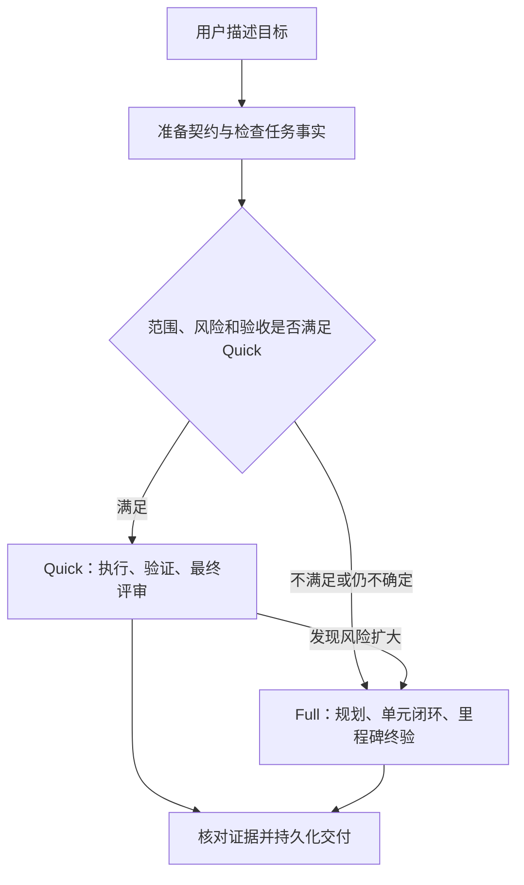

# Flywheel 自适应工作流方案：Auto、Quick 与 Full

日期：2026-11-06。状态：**第一阶段随 PR #29 实现；保留原始方案与后续分期**。

最初的文档提交只记录设计；同一 PR 的后续实现加入了统一 `flywheel-task` 宿主入口、
`control launch`、Auto／Quick／Full、单向升级，以及 DSH 会话的具体任务关联。
这表示源码已实现第一阶段，不表示 npm 已发布或用户 Mac 已完成实机验收。
现行行为、字段与可复制命令以 [系统设计](../design.md)、[工作流指南](../workflow.md)、
[配置与恢复规则](../configuration.md#工作流策略与恢复) 和实际 schema 为准。
本文下方保留提案时的背景、草案表达与验收目标；后续团队、并行和附件能力仍按分期推进。
第一阶段已执行的检查及未验范围见 [2026-11-07 验收记录](../validation/2026-11-07-adaptive-workflow.md)。

## 1. 背景与目标

当前流程适合需要明确边界、分单元实施和里程碑验收的任务，但对范围清楚的小修改，
准备、阶段切换与重复评审的固定开销偏大。目标是让用户描述一次目标后，工具自动
准备任务并选择适当的流程；简单任务减少重复规划与终验，复杂任务保留完整闭环。

核对基线：

| 项目 | 固定版本 | 用途 |
|---|---|---|
| Flywheel `main` | [`f6272907a5e9fdc891bec0394a593636a5bb8214`](https://github.com/ckanner/flywheel/commit/f6272907a5e9fdc891bec0394a593636a5bb8214) | 本方案的代码基线，源码版本目标为 0.28.5 |
| oh-my-openagent `dev` 调研快照 | [`2f49a4c3a6b0c4f4eb3b2ed9965fd7744ce60ea3`](https://github.com/code-yeongyu/oh-my-openagent/commit/2f49a4c3a6b0c4f4eb3b2ed9965fd7744ce60ea3) | 对照自动推进与按任务调整流程的设计 |

源码版本不等同于 npm 已发布版本或用户 Mac 上的安装版本。调研快照只说明该提交的行为。

本方案的核心决策：

1. 产品提供 **Auto（自动）、Quick（快速）、Full（完整）** 三个选择；Auto 只选择策略，
   引擎主要维护 Quick 与 Full 两条执行路径。
2. Quick 保留确定性验收、独立最终评审、同一候选的持久化证明与恢复能力。
3. Full 延续现有 Plan、逐 packet 执行和评审、里程碑验证及 Judge。
4. 统一准备与启动入口，并将已创建的任务自动关联到当前 DSH 会话的 Flywheel 视图。
5. 模型、权限与远端交付授权独立配置，不能由流程名称暗中改变。

## 2. 当前流程与固定开销

当前工作分为宿主准备与引擎运行两段：

| 环节 | 当前行为 |
|---|---|
| 宿主准备 | 当前 DSH 对话研究代码，准备任务集成 worktree、Spec、packets 与验收，试跑检查并审阅契约 |
| 启动 | 通过现有 Skill、CLI 或视图启动已准备任务 |
| 运行期 Plan | 每个里程碑调用 Plan，校验并持久化契约 |
| 单元闭环 | Execute → L1 → 命中时的缺陷注入 → 独立 Review → 本地 Git 交付 |
| 里程碑终验 | 适用的 L2/L3 → Judge → 关闭里程碑 |
| 远端交付 | 获授权的宿主或用户负责 push、PR、远端检查、合并与发布 |

因此，一个里程碑、一个 packet、首次即成功的正常路径，仍至少包含 **Plan、Execute、
Review、Judge 四次阶段 Agent 调用**。宿主准备不计入这四次；一次 Agent 调用内部
可能包含多轮模型与工具交互。现有 `default / frontend / hard` 只是执行模型路由，
不改变流程长度。Intake、Garden 是可选外围模块，不应算作每个任务的必经环节。

现有 `--only execute` 只完成执行与 L1 子环，不包含完整评审和交付，不能作为 Quick
的替代入口。依据见 [当前主循环](../../internal/machine/run.go)、
[Plan 与里程碑验证](../../internal/machine/steps_plan.go) 及 [工作流指南](../workflow.md)。

## 3. oh-my-openagent 的借鉴点

该调研快照同时提供直接描述小任务、`ultrawork` 自动推进，以及
`/ulw-plan` 后接 `/ulw-execute` 的正式规划执行入口。Native `ultrawork` 区分
LIGHT / HEAVY；沿用既有模式且没有待决设计的小改动可以减少规划开销，涉及新抽象、
鉴权、迁移、并发等情况时增加流程强度。执行前先研究代码，再判断是否需要独立 Planner。

评审规则必须按入口区分：裸 `ultrawork` 通常记录自审；已有本项工作的正式计划且为
HEAVY，或用户明确要求严格评审，才触发其独立 gate reviewer。`/ulw-execute` 自己的
终验契约则要求在勾选每个计划项前独立验证，覆盖裸指令的 gate。不能把 LIGHT
概括为所有入口都免除独立评审，也不能认为裸 `ulw` 只要 HEAVY 就必然独立评审。

Flywheel 借鉴的是自动启动、按风险调整流程及持久恢复。Quick 仍保留一次独立的
最终 Review；状态转换、预算、取消与完成条件继续由 Go 代码控制，不转移到提示词中。

固定参考：[编排指南](https://github.com/code-yeongyu/oh-my-openagent/blob/2f49a4c3a6b0c4f4eb3b2ed9965fd7744ce60ea3/docs/guide/orchestration.md)、
[Native ultrawork](https://github.com/code-yeongyu/oh-my-openagent/blob/2f49a4c3a6b0c4f4eb3b2ed9965fd7744ce60ea3/packages/omo-senpi/skills/ultrawork/SKILL.md)。

## 4. 产品入口与选择规则

| 方式 | 适用情况 | 行为 |
|---|---|---|
| 当前 DSH 对话直接处理 | 即时查询、解释或无需后台任务记录的极小修改 | 保持宿主自然能力，不强制纳入 Flywheel |
| Auto | 用户希望工具自主判断流程 | 先查看代码、范围与验收条件，再确定 Quick 或 Full |
| Quick | 单个目标、实现模式已知、边界和成功标准明确 | 紧凑契约 → 执行 → 必要验证 → 独立最终评审 → 持久化交付 |
| Full | 设计未定、影响较大或需要多个依赖工作单元 | 保留完整规划、执行评审和里程碑终验 |

新统一入口默认 Auto。已有准备入口继续支持“先给我方案供审阅”，已有运行与恢复入口
继续可用。旧任务缺少新策略字段时维持 Full；不能因升级安装而静默省略阶段。

### 4.1 Quick 资格

第一版采用保守、可核验的结构条件：一个里程碑、一个可独立验收的 packet。
这约束任务的拆分结构，不设置任意文件数量上限；改一行鉴权逻辑也可能必须 Full。

Quick 同时要求：

- 需求范围、修改边界和成功标准明确，没有未决产品或架构取舍。
- 已检查相关代码，有既有实现模式或明确修复路径。
- 紧凑契约通过 schema 与交叉校验，必需验证可执行且覆盖成功标准。
- 没有需要完整流程处理的风险信号；用户也未明确要求先做完整方案。
- 独立最终评审能够在一次调用中检查代码质量、全部需求与验收证据。

模型提供结构化建议、理由和代码依据；Go 校验契约、工作单元结构、明确声明的风险、
所需检查与策略一致性。Go 不能仅凭文件数或一个模型的“低风险”标签证明语义安全；
证据不足时采用 Full，执行与评审仍可报告新风险。

### 4.2 显式选择与说明

用户选 Full 就执行 Full。用户选 Quick 时仍须满足资格；发现条件不满足，记录原因并
升级 Full。升级不扩大原有需求授权，真正需要用户决定的新范围或产品取舍应明确提出。
已有范围与交付授权继续沿用，不把模式切换变成重复审批。

选择结果应简短可见，例如：“按快速流程处理：问题已定位，沿用既有实现模式，
已有回归测试入口，完成后做一次独立最终评审。”

## 5. Quick 的完整闭环

### 5.1 自动准备紧凑契约

宿主入口读取当前项目及已有指令，在任务集成工作区中创建或复用任务记录，保存目标、
边界、成功标准、必需检查、执行路由、流程选择理由和已有交付授权。复用现有 Spec、
packet 与账本体系，用户不必手工填写任务资料目录。

准备阶段沿用当前宿主对话模型；它与运行期 `loops.plan` 是不同调用。Auto 不必为
每个小任务固定再启动一个分类 Agent 或 Planner。契约合格并持久化后，Quick 可省去
重复的运行期 Plan；无法形成合格契约时转 Full 或提出确需用户决定的问题。

### 5.2 执行与必要验证

选择一个合适的执行者完成定位、修改及必要测试。失败反馈进入现有有界重试与空转
检测；不为小任务默认启动完整团队。确定性验证由引擎执行，保留现有物理终态、
超时、取消、输出截断和清理错误检查。

Quick 必须执行仓库要求的门禁与本任务必需的检查，包括适用的 L2/L3、真实接口或
UI 用户路径。100% 覆盖率若为仓库要求就继续执行；本仓库仍要求逐函数 100%
statement coverage。缺陷注入仍按适用策略执行；缺少有效验证不能被包装成通过。
没有某级检查时应有可审阅的不适用理由，不能仅因为选择 Quick 就删掉验收要求。

Quick 的全部必需验证必须针对最终 Review 所读取的同一候选。继续使用 packet
worktree 时，L2/L3 的执行位置与证据采集须显式绑定该候选，不能直接复用尚未包含
本次修改的任务集成工作区结果。当前 `milestoneGateStep` 使用 `c.Cwd`，实施时必须
处理这一差异；无法在 Quick 闭环内形成有效集成或用户路径证据时，应转 Full。

### 5.3 一次独立最终 Review

最终 Review 使用新上下文，读取契约、权威差异、所有必需验证和适用抽检证据，
不依赖 executor transcript 或实现者的完成声明。它同时回答：

1. 实现是否正确，是否存在阻断交付的回归或边界问题？
2. 用户要求是否全部完成，成功标准是否逐项有证据？
3. 验收方式与断言是否足够，是否遗漏集成或用户路径？
4. Quick 资格是否仍成立，是否需要升级 Full？

Quick 的这次裁决承担当前 Review 与单任务 Judge 的职责，因此可省独立 Judge。
仅有代码风格评审或执行者自审不满足条件。裁决至少区分通过、实现退回、验收缺口
及需要升级；具体输出 schema 在实施时确定，不能把自由文本当作状态转换依据。

普通实现缺陷退回 Execute；验收缺口要求修订契约并使受影响证据失效，第一版可进入
Full 的受限 Plan 流程。Full 的 planner 可写范围、冻结验收保护和失败出口保持有效。

### 5.4 同一候选的持久化交付

验证、最终 Review 与提交必须绑定同一份候选代码、契约及验证配置。Quick 新增的
完成要求和流程策略也必须进入可验证的证据身份，不能改了流程却复用不匹配的通过记录。

评审前后检查身份；评审即使拥有完全权限，修改候选代码或验收依据也不能产生有效
通过。评审后又修改代码，须重验受影响部分并重新评审最终候选。验收命令、Git hook、
index 或本地集成改变了候选时，也不能沿用旧绿灯。

复用现有提交、集成、持久化 HEAD 核验与安全清理规则。提交或集成失败保留工作区，
不写 completed；无代码差异也须确认实际持久化的 HEAD。Quick 只有在全部成功标准、
必需验证、独立最终评审和 Git 持久化都满足后才能完成。

### 5.5 工作区与调用开销

第一版可以复用现有任务集成 worktree 与 packet worktree；减少阶段调用不依赖先改造
工作区机制。单 packet 直接使用一个专属任务 worktree 是后续可评估的优化，须先证明
它保持候选隔离、契约保护、验证执行位置、Git 交付与失败恢复语义。

| 项目 | 当前最小完整路径 | Quick 正常成功路径 |
|---|---|---|
| 任务准备 | 宿主准备后交接启动 | 同一入口准备、选择并启动 |
| 运行期 Plan | 固定调用 | 已有合格紧凑契约时不适用 |
| Execute | 保留 | 保留 |
| 必需验证 | L1、适用抽检与 L2/L3 | 全部保留，在最终 Review 前收齐证据 |
| Review | 单元独立评审 | 独立最终评审，兼顾完整任务验收 |
| Judge | 独立里程碑终验 | 满足 Quick 契约时不适用 |
| 阶段 Agent 调用 | 至少 4 次 | 理想正常路径 2 次 |

两次指 Execute 与最终 Review，不包含宿主准备、失败重试或模型内部工具轮次。
这是固定流程减少，不是耗时减半承诺；冷启动、必要测试与实际修改仍须测量。

## 6. 升级 Full、持久状态与恢复

### 6.1 升级条件

| 新发现 | 处理方式 |
|---|---|
| 存在未解决的架构或产品取舍 | 转 Full，明确方案与验收 |
| 需要多个有依赖的工作单元 | 转 Full，拆分 packet 并确定顺序 |
| 涉及鉴权、权限、支付、迁移、并发或事务风险 | 使用完整失败场景与里程碑验收 |
| 局部修改扩大为跨模块重构 | 重审范围、修订契约并失效旧证据 |
| 无法证明成功标准或出现验收缺口 | 补齐契约和检查，再执行验证 |
| 多次修复无进展或暴露结构问题 | 在现有尝试和预算界限内转规划；不能重置预算无限重试 |
| 用户要求完整方案或更严格审查 | 显式使用 Full |

Quick → Full 保留任务身份、代码、工作区、已消耗预算、历史反馈与仍有效证据。
升级事件记录原因、触发证据和策略版本，契约修订沿用现有受限机制。新契约下旧的
最终 Review 不能自动充当 Full 的 Judge；有效性按候选、契约和阶段要求重新判断。

### 6.2 状态语义

拟增加以下持久化语义，最终字段位置与命名以实施时更新的 schema 为准：

| 语义 | 必须表达的内容 |
|---|---|
| 请求模式 | 用户请求的 Auto、Quick 或 Full |
| 生效策略 | 实际采用的 Quick 或 Full |
| 选择依据 | 资格判断、风险信号及选择原因 |
| 策略版本 | 恢复时使用的规则版本及完成要求 |
| 阶段适用性 | Plan/Judge 不适用时的原因，不伪造 pass |
| 升级记录 | 时间、旧策略、新策略、触发依据与契约修订关系 |
| 完成证据 | 候选身份、验证、最终评审及实际 Git 交付 |

所有状态写入仍由 `internal/state` 经锁、revision CAS 与原子替换完成。模型、Skill
与 DSH 插件不能直接写 `state.json`。恢复沿用已经确定的生效策略；新风险只能通过
显式升级事件处理，不能每次重启重新分类或隐式从 Full 降回 Quick。

旧任务没有策略字段时按 Full 解释；旧证据沿用现有身份校验规则，不能凭字段补齐
获得新的信任。未知或不支持的策略版本明确报错，不猜测执行。升级转换须有可恢复
检查点，覆盖转换前后崩溃、契约写入失败、并发启动与交付中断。

## 7. 模型、会话、权限与交付边界

### 7.1 复用现有模型与会话纪律

流程策略决定调用哪些阶段；现有 profiles、loops、routes 决定具体后端与模型。
Quick 的最终 Review 默认使用现有 Review 绑定，只扩展评审输入与裁决职责。

| 用途 | 当前默认资源 |
|---|---|
| 普通执行 | DSH `deepseek-account` / DeepSeek Flash |
| 前端执行 | Kimi CLI / Kimi K3.1 Pro |
| 较难执行 | Codex Pro machine API / ChatGPT 订阅 |
| 独立最终 Review | DSH `chatgpt` / 现有 GPT Review 路由 |
| Full Plan、Judge | 沿用各自已配置绑定 |

这是复用现有配置的方案，不代表某个账号已经可用；不新增智谱/Z.AI 订阅、不自动
跨渠道付费降级，也不在本期改变 `high` 等推理等级。依据见 [模型策略](../model-policy.md)
和 [默认模板](../../templates/flywheel.config.example.json)。

Go 是编排主体，DSH 当前对话是准备与控制入口；无需一个长时间存活的父模型会话
监督全部任务。Execute 与 Review 每次使用新会话，重试保留磁盘产物但不复用执行者
会话；Plan 仅在现有后端支持且身份匹配时恢复。第一版延续串行 packet 调度，
多 Agent 并行、依赖图调度和团队通信另行设计。

### 7.2 权限与交付授权独立

Quick 与 Full 均继承实际生效的权限设置，包括已明确选择的 `full-access`。
不因 Full 增加逐步确认，也不因 Quick 扩大权限。完整访问能力与评审职责分开，
候选身份保护继续执行；已有环境凭证注入规则和宿主的真实拒绝也须照实处理。

交付目标按已有授权记录，例如完成验证、提交并开 PR、检查后合并或进一步发布。
采用 Quick 本身不提供合并与发布授权，也不取消既定仓库门禁。当前远端 PR 生命周期
仍由获授权的宿主负责；第一版不把 GitHub 自动交付服务列为引擎新增能力。

## 8. DSH 视图与统一入口

用户描述目标后，入口准备任务并返回真实项目目录、任务资料目录与策略理由，随后
将这个具体任务绑定到当前会话的 Flywheel 视图。常规使用无需复制路径；手动打开
已有任务与高级目录输入继续保留。

视图展示请求模式、生效策略、阶段、检查结果与升级原因。不适用的 Plan/Judge 应
显示理由，不能显示绿色“已通过”。沿用原生 Flywheel 页签及按需展开的配置和排障。

实现约束：

- 关联的是任务路径与身份，不扫描并猜测哪个目录属于当前需求。
- 插件只调用 Go 的控制协议，保存会话关联和显示数据，不成为第二个状态机。
- 切换会话不串任务；迟到响应不能覆盖新的绑定，重复启动不能产生第二个运行实例。
- 启动或停止结果未确认时，先查询同一任务恢复事实，不自动重复变更。
- 关闭视图或结束准备对话不停止后台引擎；停止继续使用现有取消与清理协议。
- 不向 DSH 原生轨迹、团队或后台列表写入虚构 worker 记录；更多关联必须使用公开接口。

## 9. 实施顺序与第一期范围

第一期目标是 **统一准备启动入口 + Quick 精简闭环 + 自动关联任务视图**。

| 工作包 | 主要落点 | 交付内容 |
|---|---|---|
| 1. 契约与策略 | `templates/*.schema.json`、`internal/contract`、`internal/state`、系统设计 | 模式、资格、阶段适用性、完成证据、升级与旧任务兼容 |
| 2. Go 闭环 | `internal/machine`、`internal/prompts`、`internal/verify` | Quick 正常及失败路径、最终 Review、候选一致性、Full 升级和恢复 |
| 3. 统一入口 | CLI／控制协议与宿主 Skill | 自动准备并启动，明确返回任务身份、模式与理由；Skill 保持薄入口 |
| 4. DSH 关联 | `plugins/dsh/src` | 自动选择新任务、模式及原因展示、会话隔离和未确认结果恢复 |
| 5. 文档与交付 | 中文及英文用户文档、相关测试与验证记录 | 操作示例、兼容性说明、同一候选的验证记录和后续发行 |

先更新权威设计与 schema，再实现状态机及协议；CLI 与视图复用同一套策略解析。
不得把业务重试、风险升级或完成判定写成 Skill 或 React 组件中的独立循环。

本期不包含大规模并行调度、Teams、通用 DAG 引擎、自动跨模型升级、全面推理等级
benchmark 或 GitHub 发布服务。单工作区优化和后端冷启动优化可在数据表明有收益后
单独推进；不让这些工作阻塞最小 Quick 闭环。

## 10. 实施验收与收益评估

### 10.1 行为验收

| 场景 | 必须观察到的结果 |
|---|---|
| 合格小任务，首次执行成功 | 自动准备关联；引擎正常路径仅 Execute 与最终 Review；全部必需验证通过并持久化 |
| 明确 Full 或旧任务缺少新字段 | 保留现有完整流程，不静默跳过 Plan/Judge |
| Quick 中声明 L2/L3 或仓库完整门禁 | 必须执行并进入最终评审；失败不交付 |
| packet 候选与任务集成工作区内容不同 | L2/L3 验证实际候选；旧集成工作区的绿灯不能推进最终 Review |
| Review 发现实现缺陷、验收缺口或新风险 | 分别退回执行、修订验收或升级 Full，不以 pass 掩盖 |
| 验证、评审或 Git hook 改变候选 | 旧证据失效；没有最终候选的新验证与评审不能完成 |
| 提交、集成、持久化或清理失败 | 按既有语义保留产物与错误；不伪造交付或清理成功 |
| 升级中断、取消、重启或并发启动 | 策略与任务身份可恢复；预算不重置；运行 lease 和清理纪律有效 |
| UI 切换任务、会话或收到迟到响应 | 不串任务；重复请求不重复启动；未确认结果可通过查询恢复 |
| 缺失模型权限、账号响应或用量信息 | 如实失败或保持 unknown，不静默替换渠道或记为零 |

测试覆盖公共行为和失败路径，不只检查“少调用了两个函数”。Go 改动通过
`make quality-gate`；涉及 DSH 时执行插件与跨进程桥接检查，安装发行变化才增加
对应六包构建和安装门禁。真实账号推理与 Mac 桌面流程另留实测证据，离线桩不代替它们。

### 10.2 真实任务对照

选择文案／局部 UI 修复、已定位的 bug、普通接口功能，以及生命周期或权限改动。
后三类是否进入 Quick 由真实范围与风险决定，不能为了数据强行归类；生命周期类
样本还应证明 Auto 会正确选择或升级 Full。

保持可比较的需求、模型、权限、仓库门禁和运行环境，记录：

- 从描述目标到准备完毕、执行完成与最终交付的分段时间和总时间。
- 各阶段 Agent 调用数、人工交互次数及必要测试时间。
- 评审退回、返工、验收缺口、Quick 升级 Full 的数量和原因。
- 已知 usage／cost，以及无法确认的调用数；订阅未知成本不得计为零。
- 任务最终是否真正完成，必要验证是否齐全，是否出现漏验或回归。

可在积累足够样本后比较中位耗时与较慢任务分位数；第一版不预设速度提升百分比。
优先证明减少了重复阶段和用户交接，同时保持同一候选的验证、独立评审与持久化交付。

## 11. 实施前需定稿的接口细节

产品方向和上述质量约束已经记录；以下事项在对应工作包中以 schema、公开宿主契约
和测试定稿，不应通过臆造当前已支持的参数提前承诺：

- 统一启动的 Skill／CLI 命名、参数形态及准备完成到启动的幂等交接。
- 工作流策略在 Spec、运行配置和 state 中的准确归属、版本协商与显式切换方式。
- 最终 Review 的结构化裁决格式、逐项验收映射及证据指纹扩展。
- Quick → Full 转换检查点、工作区同步与恢复的具体状态迁移。
- DSH 会话到任务的公开关联接口，以及插件重载／桌面重启后的关联恢复范围。

这些细节不得改变两个基本要求：Quick 完成仍有可靠证据；旧 Full 任务与已有用户
授权保持可理解、可恢复的语义。

