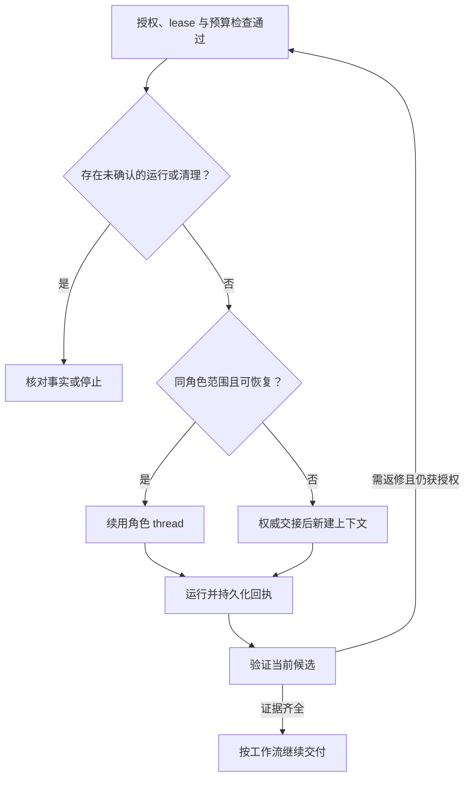

# 按任务、角色与运行事实管理会话

2026-11-07。原始设计方案（PR #30 仅修改文档），取代“每次 Execute／Review 调用
必须全新会话”的设计原则。本文保留提出方案时的基线分析和完整分期。
**实施补注：**P1/P2 正常终态续接与已保存回执恢复已实现；P3 配套公开 lifecycle v1、durable ACK、supervisor journal 与精确只读恢复已接通；P4 具备角色策略、有界质量重建与固定源码／独立 oracle 的三组对照工具。当前字段、调用安全与能力差异以[设计](../design.md)、[配置](../zh-CN/configuration.md)及[恢复指南](../zh-CN/session-recovery.md)为准。真实账号质量、缓存及性能实验仍未取得有效结果，离线通过不替代该证据。下文保留原提案的版本基线与分期分析。
English: [Session lifecycle proposal](2026-11-07-session-lifecycle.en.md)。

## 1. 决策

**会话归属于明确的任务、工作范围和角色；普通返修优先延续该角色的上下文，
重新建立上下文由实际兼容性、可恢复性、上下文质量和运行事实决定。**

- 一个 packet 的 Executor 通常延续自己的 thread，处理 L1 失败、Review 退回和同范围的补充工作。
- Reviewer 使用与 Executor 隔离的上下文。同范围复审可以延续 Reviewer 自己的 thread，仍重新检查完整当前候选。
- Plan 按同一规划目标、Judge 按同一里程碑管理连续性；明确第二意见使用独立上下文。
- 新任务、无关 packet、不同角色不共用 thread。历史不可恢复、范围不兼容或上下文质量恶化时，用权威材料重建。
- Go 根据版本化策略和可核对事实决定 create／resume／rebuild／wait，不增加一个负责调度的父模型。
- 会话历史、单次调用、worker 进程是不同生命周期。延续历史不要求进程常驻，也不改变清理、预算、验收和交付要求。

这是一项有待验证收益的工程选择，不是“续用总比新建好”的性能结论。
历史 fresh 规则保留在历史文档中作背景，不再作为当前架构不变量。

## 2. 当前实现与依据

检查基线为 Flywheel [`80deeed4`][fw-base]（PR #29 合并后），以及
`dsh-subagent-codex-pro@0.8.0` 的 [`04ecdb67`][plugin-base]。
下表描述该固定版本；后续实施必须重新核对依赖和公开接口。

| 项目 | 基线事实 | 对方案的约束 |
|---|---|---|
| 调度 | Go 顺序运行 packet；每次 Execute／Review 新会话，重试保留工作区与反馈 | 现有任务不是由一个常驻父 Agent 调度原生 Teams；会话改造不顺带引入并行调度 |
| Kimi Plan | 明确启用 `resident-session` 且身份匹配时可恢复 | 已证明进程可每次结束而历史继续；不能把该能力外推成所有阶段已支持 |
| Codex Pro 插件 | machine API 支持 `ephemeral`、`persistent` 和显式 `threadId` | 普通完成后的续用已有公开基础，不必换回旧 Codex CLI |
| Flywheel bridge／driver | 写死 ephemeral；拒绝非空 SessionID；回执要求无请求 thread ID 且配置来源为 `thread/start` | 必须同时修改请求、状态、回执校验和调用路径，只改一个开关不成立 |
| DSH worker | 当前 Flywheel 没有接通历史恢复 | 默认 Flash Execute／GPT Review 仍是重要的后续实施范围 |
| machine 早期事件 | 公开选项只有 signal、env 和文本 onProgress，结构化运行标识在最终回执交付 | 第一阶段不能承诺任意时点崩溃后都能找回新建 thread |

来源：[Flywheel 设计与现状][fw-design]、[bridge][fw-bridge]、[driver][fw-driver]、
[插件 machine API][plugin-machine]、[machine 实现][plugin-machine-src]。

### 为什么继续使用 machine

`machine` 是插件供确定性编排器调用的程序接口，不是一台临时机器，也不是一种会话类型。
Flywheel 可以直接请求一次 Codex harness 运行并取得配置、结果、清理与用量回执。
它不要求先创建 DSH 父模型再让模型调用 `subagent_codex`（[插件实际注册的工具名][plugin-readme]）。
当初的选择依据是已核对的 DSH rc.5 SDK 与插件接口限制；这不是对未来所有 DSH 版本的断言。
见[原接入计划](2026-11-03-codex-pro-default.md)与[验证记录](../validation/2026-11-03-codex-pro-default.md)。

| 维度 | 选择 | 含义 |
|---|---|---|
| 调用接口 | machine API | Go 调用插件、消费机器可校验回执 |
| 上下文 | 新 thread／resume 指定 thread | 本次是否继承该角色以前的交互历史 |
| 历史保存 | ephemeral／persistent | 插件是否请求保留可恢复的 Codex 历史；不等于整个文件系统零写入 |
| 进程 | 每次启动并收尾／长期运行 | 进程存活时间，独立于历史保存 |

因此可以每次运行都新建 worker/app-server、完成后确认清理，同时通过 persistent history
和显式 thread ID 延续上下文。也可以建立一个全新的独立 Reviewer thread，并保存其历史供复审。
官方 [App Server 文档][oa-app-server]与 [Codex SDK 文档][oa-sdk]均将新建和继续已有 thread
作为显式操作；它们说明能力，不决定 Flywheel 的调度策略。

## 3. 上下文的归属与默认策略

以下为目标策略。首个调用建立该范围自己的上下文，后续调用必须先通过 §4 的资格检查。
后端未实现相应能力时，继续使用现有可用方式并记录原因，不静默换模型或渠道。

| 角色 | 会话范围 | 通常续用 | 通常重建或另开 |
|---|---|---|---|
| Plan | 同一任务内连续的规划目标 | 契约格式修正、同目标修订、verification-gap 的规划反馈 | 新目标、关键前提不兼容、原上下文不可用 |
| Execute | task + packet + executor | L1 修复、Review return、补普通测试／报告、同范围实现迭代 | 无关 packet、目标实质改变、上下文失控或无法恢复 |
| Review | Full 的 packet 评审；Quick 的完整单 packet 需求最终评审 | 同范围修复后的复审、verdict 格式修正 | 新评审范围、刻意独立第二意见、执行者历史污染、越权修改候选 |
| Judge | milestone + judge role；第二意见单独归属 | 同里程碑修复后的再次终验 | 新里程碑、明确第二意见、判断范围不兼容 |
| Verify | 无模型会话 | 重新运行确定性检查 | 不适用 |
| Intake／Garden | 一次明确的建议任务 | 该建议的补充与修订 | 不相关任务；不属于第一阶段实施 |

Reviewer／Judge 不能继承 Executor 的对话、私有推理或工具轨迹来代替独立检查。
它们消费当前契约、权威 diff、合法报告、适用验证证据及自己此前的 findings。
每次复审都要检查全部当前范围、修复引入的新问题、既有问题的关闭或重开；
Quick 最终 Review 每次都覆盖所有需求，不能只勾销上次提出的几个问题。

“另请一个独立意见”是可选评估或明确工作流要求，不因会话续用自动新增。
Quick 首次成功路径仍为 **Execute + 独立最终 Review 两次阶段调用**；
Full 的集成验证和 Judge 仍按现行工作流执行。会话策略不决定 Quick／Full 资格。

## 4. Go 如何决定下一次调用

决策前先检查停止意图、运行 lease、预算和尝试上限。用户 stop 后不会因 thread 仍存在而自动续跑；
只有明确恢复入口启动后才重新判断。会话变化、Quick → Full、换进程均不重置计数。

### 4.1 续用资格

正常 resume 同时要求：

1. thread 的任务、packet／milestone 和角色归属正确；没有另一活动 turn 或冲突的工作区写入者。
2. 上次调用的派发、终态与清理事实足够明确；没有尚待核对的执行结果或副作用。
3. 持久历史与明确 thread ID 可用，当前后端的公开恢复能力已被适配并验证。
4. 工作区来源、契约修订、有效运行绑定符合版本化兼容策略；每次仍重新提供当前权威材料。
5. 未触发上下文／停滞阈值或显式重置；仍有原任务的预算和尝试额度。

无法满足历史条件不必废弃工作区。若前次运行及清理已确认安全，可建立新上下文；
若结果或清理未知，则必须先核对，**fresh 也不能绕过这个阻断**。

图只表示会话选择与返修关系；工作流的 Plan、Review、Judge、预算和完成门禁仍由现有状态机控制。

### 4.2 兼容性不等于所有字段永远不变

必须区分三个身份：**会话归属**、**本次 attempt**、**被验证的候选与契约**。
修复代码会改变候选，这是续用的正常用途。候选变化使相应旧证据失效，不自动销毁会话。
同目标契约修订也可以带着权威差异延续上下文；不能把 Spec hash 改变直接等同于必须 fresh。

| 变化 | 处理原则 |
|---|---|
| task、角色、无关 packet／milestone | 新建相应范围的上下文，不能认领别人的 thread |
| 候选实现、测试、done-report | 记录调用前后身份，按现行规则失效并重做相关验证；可以续用上下文 |
| 契约修订 | 记录旧／新 fingerprint 和结构化修订依据；同目标的兼容修订可续用，未知或实质换目标则重建／重规划 |
| cwd | 先解析绝对物理路径；路径别名不是新任务。真实工作区迁移须明确核对归属与内容，不自动沿用 |
| provider、账号渠道或角色权限边界 | 核对有效绑定与既有授权；不允许借 resume 混用账号、未经授权扩大权限或增加付费后备 |
| model、effort、有效工具／权限配置 | 按后端支持的逐 turn／resume override 和证据判断，不能一概 fresh 或无条件续用；首版未验证的组合保守重建或拒绝 |
| 插件、协议、harness 版本 | 用已验证能力表判断；升级不默认证明历史兼容 |

Go 不靠自由文本“看起来还是同一目标”做语义裁决。Plan／用户提供的修订必须沿用现有授权与契约校验，
实施时定义可机械核对的兼容变化集合和版本；无法核对的变化明确走重建或现有规划／人工路径。
从后端得到的“请求已接受”与“实际配置已确认”也要分开记录，不能提高证据强度。

### 4.3 按失败类型选择动作

| 事件 | 会话动作 | 必须保留的约束 |
|---|---|---|
| L1 发现实现错误，执行回执和清理正常 | 向原 Executor 发送失败证据继续修复 | 新候选重新验收，沿用总尝试和预算 |
| Review return | 原 Executor 修复，独立 Reviewer 复审 | 复审覆盖完整当前范围，不能沿用旧 pass |
| 报告／verdict 格式错误，底层运行已可靠结束 | 同角色续用修正输出 | 区分报告错误与不可信的底层回执；仍受原重试上限约束 |
| verification-gap | 进入现有 Plan 修订路径，再判定各角色兼容性 | Quick 先持久化升级；受影响证据失效 |
| AUTH、QUOTA、RATE_LIMIT | 按既有错误策略暂停／退避／授权后恢复 | 换 thread 不解决认证或额度，不自动换付费渠道 |
| 明确未派发的启动失败 | 可重试已知意图 | 记录本次尝试；不能把未知派发伪装成未派发 |
| 历史不存在／no-rollout，且确认新 turn 未发送、清理完成 | 显式重建并交接 | 不静默冷启动；原任务计数不重置 |
| 上下文超限、污染或重复失败无进展 | 有界压缩、重建或现有升级出口 | 只使用已公开并验证的能力；不无限刷新 thread 逃避停止 |
| 中途断连、终态回执丢失、cleanup 未确认 | wait／reconcile／停止 | 不能直接 resume，也不能新开写入者重放 |
| 人工或外部任务修改工作区 | 核对来源与候选，失效相关证据 | 保留文件；新 thread 不能代替冲突处理 |

上下文长度、连续返修数和停滞检测使用有界、可配置且可记录的策略。
第一阶段复用现有尝试／空转／预算上限，不宣称某个轮数或百分比普遍最优。
后端内部压缩不等于 Flywheel 已能请求、控制或证明压缩结果。

## 5. 状态与协议的目标契约

以下是**拟议的数据职责**，不是当前 schema 或可直接复制的配置字段。
实施先更新 `templates/state.schema.json` 及相关配置／协议定义，再由 `internal/state`
完成兼容加载和 CAS 写入。worker、模型、skills、桌面 UI 均不直接写 state。

| 记录 | 需要保存的事实 |
|---|---|
| 会话归属 | task、packet／milestone、role、canonical worktree、生成代次、策略版本 |
| 恢复绑定 | harness／协议版本、provider／channel、非秘密账号配置引用、model、请求 effort、有效权限／工具配置、兼容策略版本 |
| 历史句柄 | 后端 opaque thread ID、persistent 属性、可恢复性证据、最近确认检查点、retired/rebuild 原因 |
| 单次调用 | 引擎 invocation ID、requestId、后端 runId／turnId、attempt、派发意图和时间、终态回执引用及摘要 |
| 运行事实 | 派发已知程度、结果已知程度、cleanup 确认、lease／活动调用所有者；这些事实不能合成一个 success 布尔值 |
| 候选与契约 | 调用前后身份、契约版本、修订依据、对应验证／裁决证据；旧证据按原规则归档 |
| 用量入账 | 本次可归属增量、complete/partial/unknown、已入账回执标识，防止重放重计 |

账号标识只保存非秘密引用，不能存凭证。后端 thread ID 作为 opaque handle，不解析其格式推断任务归属。
`requestId` 是关联标识，当前插件不承诺幂等或去重；PID 也不是所有权或清理证明。

分别记录请求的历史保存模式、适配器能够确认的事实和实际恢复结果。thread ID 本身不证明持久化或可恢复；
`0.8.0` 终态回执没有直接回显 `threadMode` 或 `resumable:true`，不能自行补成后端确认值。
第一阶段依据原始请求、锁定适配器的核对和终态事实选择恢复候选，实际恢复仍须 `thread/resume` 接受。

Go 先保存派发意图，再启动 worker；完整回执通过校验并原子保存后，CAS 更新状态和入账。
回执文件是调用证据，不是第二套状态机：只有 Go 可以在持有 lease 时根据匹配的 invocation、
内容摘要和版本补记状态。已经入账的回执不能重复计量；不能仅凭磁盘存在 done-report 推断运行结束。
worker 只承载版本化请求／回执，不负责决定复用、换模型或重试。

同一 thread 同一时刻最多一个活动 turn；同一可写工作区也只能有一个活动写入者。
当前任务 run lease 仍有效。未来并行必须增加明确的 packet 工作区和 thread 所有权，
不能把“thread 忙”解释为另开 thread 后继续同时写同一工作区。

## 6. 正常续用与崩溃恢复分开交付

### 6.1 第一阶段能保证什么

Codex Pro 首次调用请求 persistent history；正常取得并持久化完整终态回执后，
下一次符合资格的返修显式传该角色的 thread ID。仍可每次启动独立进程并完整收尾。
插件 `0.8.0` 已提供这条正常路径，Flywheel 需要接通它。[插件接口][plugin-machine-src]

第一阶段只把**已可靠持久化回执的正常调用**作为可续用检查点。
新建 thread 后、终态回执前崩溃，可能尚未保存 thread ID；即使 ID 已知，也可能没有可恢复 rollout。
插件源码记录了其验证版本中“空 thread 不能恢复”的情况，不能将创建成功当成可恢复完成。
见[thread start/resume 实现][plugin-wire]。

文本 `onProgress` 不能充当恢复协议：它没有版本化结构和持久化确认，回调异常也不会可靠阻止执行，
thread 文本出现的时机还早于完整配置核对。不要从日志解析 ID 后声称解决了崩溃窗口。

### 6.2 中断核对所需的公开能力

完整的中断核对需要插件新增公开、版本化的 typed lifecycle／recovery 契约，至少涵盖：

1. 配置核对后的 `thread-ready`：明确 request/run/thread 关联、持久属性与证据。
2. 发送新 turn 前等待 Go 保存检查点的程序确认；这是协议确认，不是新增用户审批。
3. 区分 turn 派发意图、请求可能已发送、后端已接受和 terminal；终态仍带独立 cleanup 事实。
4. 对已知运行的只读核对入口，说明哪些 turn／进程／结果事实能被重新确认、哪些仍未知。

这些是拟议接口，不是 `0.8.0` 已有 API。即使有 early checkpoint，发送请求与持久化确认之间
仍可能有不确定窗口；没有后端幂等执行契约就不承诺 exactly-once。
正确行为是核对事实、保留 unknown、阻止盲目重放。

| 中断位置 | 恢复要求 |
|---|---|
| 首轮已创建 thread，最终回执尚未持久化 | 保留工作区；先核对进程与结果，不承诺找回未知 thread |
| 已知 thread 的新 turn 发出后断连 | 不能因知道 thread ID 就重复派发；先确认前一 turn 的事实 |
| 完整回执已落盘，state／计量未完成 | 幂等补记已确认回执，不重新调用模型 |
| 只有报告文件，最终回执丢失 | 报告不证明终态、清理、配置或使用量；核对前保持未知 |
| resume 在新 turn 前明确拒绝且清理已确认 | 按有界策略重建并交接，保存失败原因与原计数 |
| guardian 以后可能清理，当前尚无确认 | 当前调用不能报告成功或开始冲突写入；等待可核对证据 |

沿用并扩展现有[未知清理停止规则][fw-cleanup]。跨机器恢复还依赖历史存储和环境可用性；
只把 thread ID 写到任务目录，不会自动复制另一台机器上的 Codex 历史。

## 7. 返修输入、重建交接与计量

续用时仍发送简洁的本轮权威输入：目标与约束引用、契约修订、当前候选／diff、
新的验证失败和评审 findings、已确认进展及本轮交付要求。历史不能覆盖这些事实，
不能只写“接着做”并假定模型记得当前状态。稳定契约与易变反馈继续分离，避免无意义地重复整段历史。

重建从 Spec、packet、磁盘成果、合法报告、验证结果和结构化反馈恢复。
交接记录包含被替代 thread／attempt 的引用与重建原因，不复制 Executor 私有推理给 Reviewer。
总结是导航材料，权威代码和验证仍需读取；不回滚已有成果，不重复已确认完成的外部动作。

usage 按可归属的本次 run 增量入账，不能把 resume 返回的 thread 累计值每次当成新消耗。
缺少可信基线或明细时保留 unknown/partial；美元成本未上报仍为 unknown，订阅调用不记成免费。
预算包含所有历史 attempts、失败、重建和升级，遵守现有 soft／hard budget 语义。
插件已有的 run delta／thread totals 字段也必须经过桥接协议校验。[用量回执][plugin-machine]

运行观察至少展示角色／范围、create/resume/rebuild/wait、原因、最近调用状态和用量完整度。
DSH 父会话的任务视图关联仍只代表该任务的控制面，不表示 worker transcript 已自动合并进父会话。
历史保存、归档、保留期限与进程清理分别处理；关闭进程不删除工作区、交付或审计材料。
具体历史保留策略应在实现时明确，不能默认将所有任务历史无限保存，也不承诺自动出现在某个桌面列表。

## 8. 实施拆分

| 阶段 | 可交付范围 | 完成边界 |
|---|---|---|
| P0：本 PR | 修改设计原则、记录现状与目标、双语指南链接、验证计划 | 仅设计评审；无源码、schema、包版本或发行变化 |
| P1：Codex Pro 正常续用 | Go 会话记录／策略、版本化 worker 请求、persistent/threadId、start/resume 回执校验、正常返修与取消测试 | 在已启用的 Codex Pro 角色上按范围续用；只有已持久化的正常终态可作检查点 |
| P2：其他后端与角色覆盖 | 核对并实现 DSH 默认 Execute／Review，以及 Kimi Execute、Plan／Judge 的范围连续性 | 能力逐项验证；接通 hard 不代表默认 Flash 路径已经完成 |
| P3：中断核对 | 与插件公开 typed lifecycle、持久化确认与 recovery 契约配套 | 故障注入证明不盲目重放；不能只解析日志补 ID |
| P4：上下文质量与效果调优 | 验证过的压缩／重建策略、真实任务对照评估、可观察原因 | 按质量与实测结果调整，不预设缓存率或节省比例 |

P2、P3 可在 P1 契约稳定后分别推进。P1 先覆盖现有 Codex Pro hard Execute；
若用户已经把 Review／Judge 显式配置为 Codex Pro，同一适配器应按独立角色句柄处理。
不会为展示复审续用而自动把默认 DSH GPT Review 改为 Codex Pro。

P1 至少涉及下列代码职责；具体字段和协议版本在实施 PR 中定稿：

- `internal/state/`、`templates/state.schema.json`：会话／attempt 身份、回执补记、旧状态迁移。
- `internal/machine/steps_execute.go`、`steps_verdict.go`、`steps_plan.go`：统一资格选择、反馈、停止与预算；不在各阶段复制另一套重试器。
- `internal/drivers/`：请求与结果承载 thread/run/turn，分别校验 start/resume 的实际证据。
- `plugins/dsh/src/codex-pro-bridge.js` 及 worker 协议：放行明确的持久／恢复字段，校验归属，保留清理和用量完整度。
- 配置 schema／inspect／doctor／双语文档：明确后端能力与有效策略；预检不能通过调用模型证明历史可恢复。
- 控制面和 skills：实施后说明状态和恢复入口；skills 仍只调用 Go，不自己挑 thread 或循环返修。

生产目标是：已验证后端的新任务按上述范围策略正常续用，fresh 保留为合理选择和明确后备。
先在能力白名单和显式试用中验证，再更新默认；每次启用都要有版本化状态和可核对的能力。
既有任务缺少句柄时首次新建，不扫描用户历史、不猜“最近一次 thread”；
旧任务的预算、attempt、停止与工作流语义继续保留。未知策略版本或损坏记录明确拒绝加载。

不把现有 Plan `resident-session` 布尔值直接改成所有阶段的通用开关，也不改变用户显式的旧设置。
新策略配置必须说明上下文选择与历史保存的区别；本设计不提供尚不能运行的 CLI 参数或配置示例。
暂未支持的后端继续当前 fresh 行为，记录能力原因，不能伪装成成功 resume。

## 9. 验收与效果评估

### 行为验收

| 场景 | 应能证明的结果 |
|---|---|
| Quick 首次通过 | 仍只有 Execute、独立最终 Review 两次阶段调用；全部原验证和交付门禁执行 |
| Execute → return → repair → Review | Executor 两次使用同一角色 thread，Reviewer 可使用另一独立 thread；四次调用有各自 attempt/run/turn，旧证据不直接沿用 |
| L1 红灯／格式错误 | 向正确角色回传明确反馈，既有尝试和预算仍有界；不混淆报告错误与回执不可信 |
| Reviewer 复审 | 覆盖全部当前范围和新回归；关闭／重开旧 findings；Quick 所有需求重新形成裁决 |
| 同目标契约修订／实质换目标 | 前者可按可核对兼容策略续用，后者重建；两者都失效并重验受影响证据 |
| 新 packet／角色／第二意见 | 不复用错误范围的上下文；无执行者 transcript 泄入独立评审 |
| 配置／路径变化 | 验证支持与不支持的 override；规范化路径；请求接受与实际生效证据不混淆 |
| thread 不存在／忙／未有 rollout | 未派发且清理确认才允许有界重建；忙时不启动第二写入者 |
| 中断／坏帧／清理未知 | 阻断 resume 和 fresh replay；保留工作区与真实未知状态 |
| 回执已持久化但 CAS／入账中断 | 补记一次且仅一次，不再调用模型、不重复计算累计 usage |
| 取消与显式 stop | 完整收尾；打开视图或 thread 可恢复不自动续跑 |
| 旧任务与不支持的后端 | 兼容读取、保留预算与成果、明确新建原因，不扫描认领历史 |

实施 PR 按仓库规则运行对应 Go 质量／覆盖率门禁、Node 与跨进程 bridge 检查；
验证真实子进程、Git 候选、故障窗口和公开协议行为，不用测试镜像实现。
离线检查与真实 Codex／Kimi／DSH 账号和 Mac 生命周期验收分开记录。
本设计 PR 只核对文档、相对链接、来源、现状／提案边界和独立审阅，不声称上述实现测试已执行。

### 效果评估

对相同任务、模型、effort、权限、契约和独立验收，至少比较：

1. 当前每次 fresh。
2. Executor 同 packet 续用，Reviewer 每次新建独立上下文。
3. Executor 与 Reviewer 各自在自己的范围内续用。

覆盖首次成功、L1 修复、Review 退回、长上下文、停止恢复和配置变化；
用多次配对试验记录质量／遗漏与回归、修复轮数、重复发现、耗时、input/output/cache 用量、
重建原因和恢复失败率。未知用量保持未知；保存原始条件与结果，不预先宣称提升百分比。
优先保证独立验收质量与运行正确性，再判断是否减少重复研究和成本。
评估所需额外检查属于实验，不变成 Quick 默认多一个模型阶段。

## 10. 参考资料

- Flywheel [固定源码基线][fw-base]、[设计][fw-design]、[bridge][fw-bridge]、[driver][fw-driver]、[清理规则][fw-cleanup]。
- Codex Pro [固定源码基线][plugin-base]、[machine 文档][plugin-machine]、[machine 实现][plugin-machine-src]、[thread 实现][plugin-wire]。
- OpenAI [App Server][oa-app-server]、[Codex SDK][oa-sdk]。官方页面会继续更新；实现必须以锁定插件和实际 Codex 版本验证，不能拿新文档证明旧接口已经具备能力。

[fw-base]: https://github.com/ckanner/flywheel/commit/80deeed4b62682585f82073e7bf9ce831728d6f7
[fw-design]: https://github.com/ckanner/flywheel/blob/80deeed4b62682585f82073e7bf9ce831728d6f7/docs/design.md
[fw-bridge]: https://github.com/ckanner/flywheel/blob/80deeed4b62682585f82073e7bf9ce831728d6f7/plugins/dsh/src/codex-pro-bridge.js
[fw-driver]: https://github.com/ckanner/flywheel/blob/80deeed4b62682585f82073e7bf9ce831728d6f7/internal/drivers/codex_pro.go
[fw-cleanup]: https://github.com/ckanner/flywheel/blob/80deeed4b62682585f82073e7bf9ce831728d6f7/internal/machine/cleanup.go
[plugin-base]: https://github.com/ckanner/dsh-subagent-codex-pro/commit/04ecdb677735d84f3a0f5dba01a9d9b28c324c0e
[plugin-readme]: https://github.com/ckanner/dsh-subagent-codex-pro/blob/04ecdb677735d84f3a0f5dba01a9d9b28c324c0e/README.md
[plugin-machine]: https://github.com/ckanner/dsh-subagent-codex-pro/blob/04ecdb677735d84f3a0f5dba01a9d9b28c324c0e/docs/machine.md
[plugin-machine-src]: https://github.com/ckanner/dsh-subagent-codex-pro/blob/04ecdb677735d84f3a0f5dba01a9d9b28c324c0e/src/machine.ts
[plugin-wire]: https://github.com/ckanner/dsh-subagent-codex-pro/blob/04ecdb677735d84f3a0f5dba01a9d9b28c324c0e/src/wire.ts
[oa-app-server]: https://learn.chatgpt.com/docs/app-server
[oa-sdk]: https://learn.chatgpt.com/docs/codex-sdk
