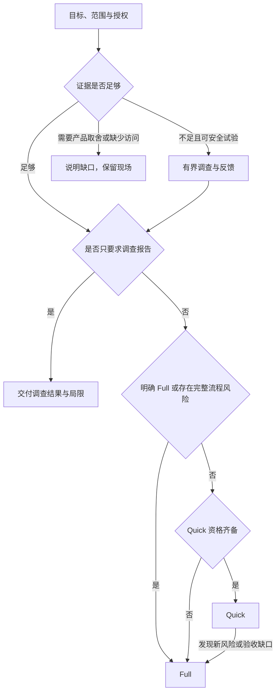

# Flywheel 反馈驱动工作流与 JEV 决策方案

[方案索引](README.md) · [中文文档](../README.zh-CN.md) · [Documentation](../README.md) · [当前系统设计](../design.md)

**状态：提议，待 PR 审阅；本文不代表所述能力已经实现。**

**基线：**2026-11-12 审阅的 `main`，commit `22156861a84cb834797ba23b07d3f0a651fd7b36`，源码版本 `0.31.0`。本文区分当前实现、建议设计与待验证假设。当前生效行为仍以源码、schema 和[系统设计](../design.md)为准。本 PR 只提交方案和导航，不修改运行时、模型默认值、用户配置或已保存任务。

**阅读导航：**[模式架构](#4-整体架构任务目标完成流程与执行策略分离) · [日常场景](#7-三类日常任务如何使用) · [模型策略](#9-provider模型和推理投入) · [JEV 设计](#10-jev用于有价值的语义分支) · [评估](#13-评估方法与采用标准) · [实施路线](#14-分批实施与可审阅的-pr-边界)。

## 1. 结论与决策摘要

建议将 Flywheel 发展为：**用明确目标和可检查的验收约束任务，在成本可控的环境中快速获取反馈，按证据决定继续、调整策略或升级，最终交付经过独立验证的同一候选。**

Quick／Full 的拆分合理，保留；Auto 是选择它们的策略。需要完善的是准备、调查、短周期执行和动态决策，而不是增加更多面向用户的模式。

| 问题 | 建议决策 | 理由 |
| --- | --- | --- |
| 日常从哪个入口开始？ | 统一使用 `/flywheel-task <目标>` | 由宿主识别调查、准备、实施或恢复路径；New／Run 保留为可选快捷入口。 |
| 是否保留 Quick／Full？ | 保留两种完成流程 | 单一可验收修复与跨单元复杂任务需要不同的规划、集成和最终审查结构。 |
| Auto 是不是第三套流程？ | 不是；它选择 Quick 或 Full | 避免维护三套状态机，也避免用户把 Auto 理解为无限制自动试错。 |
| 故障排查放在哪里？ | 增加受 Go 管理的、有界调查能力，可独立结束，也可为修复准备证据 | “查清原因”与“修改并交付代码”是不同目标；未知根因不应被包装成已知实现。 |
| 快速、明确的修复怎么做？ | 紧凑契约 → Quick → 必需验证 → 独立最终 Review → Git 交付 | 减少重复规划和重复终验角色，保留完成证据。 |
| 复杂任务怎么做？ | Full，先明确需求与方案，再拆包实现、评审、集成验证和 Judge | 全流程内部同样采用快速反馈，不把每轮返修变成重新规划。 |
| 快模型能否代替 Plan？ | 可以减少一部分预先推演；不能取消目标、边界、验收和必要的设计取舍 | 快速验证可以回答事实问题，不能替用户决定需求，也不能消除不可逆试错的成本。 |
| JEV 的主要位置？ | 在合法动作已明确的决策点，帮助选择下一步诊断或返修动作 | 语义判断交给模型，动作资格、预算、执行和状态转移仍由 Go 决定。 |
| 模型和 effort 怎么优化？ | 按任务与阶段建立显式候选集，用真实配对实验选择 | Quick 不等于低 effort；Full 不等于每个步骤都使用最强模型。 |
| 先实施什么？ | 全链路计量、有效反馈、进展判断、Plan 复用，再做调查能力与 JEV 小范围试点 | 先缩短已有闭环，才能判断新增决策是否值得付出延迟。 |

本文的“快速”指更短的**达到验收条件的总时间**。首个回答更快、单次 token/s 更高、Agent 阶段更少，都不是充分条件。

## 2. 从文章提炼设计原则

文章《天下武功，唯快不破》提出：当模型能力足够满足任务、行动反馈迅速且容易恢复时，多次短尝试可以替代一部分漫长的预先推演；足够低的延迟还会改变交互方式。本文基于用户提供的全文分析这些思想，不将其中的型号、厂商速度或机器人推论当作 Flywheel 已验证的性能事实。[A1]

### 2.1 用反馈经济性决定思考方式

| 条件 | 推荐方式 | 对 Flywheel 的含义 |
| --- | --- | --- |
| 范围清楚，反馈快，修改可恢复 | 做一个小改动，尽快验证 | 优先 Quick；减少准备阶段重复研究。 |
| 有事实未知，但便宜实验能消除 | 先做有界调查，再选择实现流程 | 不让“尚未读到配置／尚未复现”自动触发长篇架构规划。 |
| 设计取舍未定，涉及多个模块或长期约束 | 先形成方案和验收，再实施 | Full；强模型处理战略问题，执行阶段继续短反馈。 |
| 反馈慢、外部副作用大或不可恢复 | 增加预先分析，优先隔离验证 | Full 也不能凭模式名称获得生产变更授权。 |

高风险覆盖上述快捷偏好。权限、支付、迁移、事务、并发等任务即使只有一行修改，也不能仅凭“改得快”进入 Quick。相反，一个略长但范围清楚、能独立验收的修改，不应仅按行数判断难度。

### 2.2 分开衡量时间、用量与质量

对串行路径，可以把完成时间分为：

```text
准备与调查 + 必要规划 + Σ(排队／启动 + 模型与工具 + 反馈检查 + 恢复)
           + 最终验收 + 独立评审 + 集成与持久化
```

并行任务应计算关键路径与实际墙钟时间，不能将并发阶段耗时相加后称为用户等待时间。更快生成可能伴随更多尝试、更多上下文重读和更多 token；测试、外部服务或进程启动也可能成为新的瓶颈。

优化目标是：在冻结的质量和授权约束下，减少达到验收所需的时间、资源和人工介入。只有预算内成功率、漏检、返工与总成本一起测量，才能判断“试五次”是否优于“想清楚后做一次”。

### 2.3 将规划放在能改变决策的位置

需要保留三种不同活动：

1. **目标规划：**要解决什么、不能改变什么、怎样算完成。每个任务都需要，Quick 可以非常紧凑。
2. **方案规划：**架构、依赖、接口、迁移和验收设计。复杂任务需要明确产物，Full 承担这项职责。
3. **执行决策：**下一项检查是什么、是否继续当前修复、是否需要更多证据。适合短周期反馈，部分场景可由 JEV 辅助。

一份已经有效的方案不需要因普通恢复而重新生成；一次有信息量的失败也不应直接触发完整重规划。另一方面，降低模型延迟也会降低规划成本，不能从“模型很快”单独推出“Plan 没有价值”。

## 3. 当前基础与实际缺口

以下是基线源码事实或由源码得出的待验证风险；没有将静态审阅推断当作生产事故或收益测量。

| 当前基础／发现 | 对方案的影响 | 依据 |
| --- | --- | --- |
| Auto 已由 Go 校验契约资格并选 Quick／Full；旧契约默认 Full；显式 Quick 也可能因不合格落到 Full | 保留策略与流程的分离，不再固定增加一个模型做入口分类 | [S1] |
| Quick 正常首次成功只有 Execute 和最终 Review 两次阶段 Agent 调用；准备与内部模型／工具轮次另计 | 不能把“两次阶段调用”当作总延迟或用量结论 | [S2] |
| Full 已有 Plan、packet 验证与评审、集成 L2/L3、Judge；支持有界并行 | 不重造另一套复杂任务引擎 | [S2]、[S3] |
| 任务准备由宿主当前模型完成，运行期 `loops.plan` 不决定准备模型 | 计量必须从用户请求开始，避免把成本挪到准备阶段后宣称节省 | [S4] |
| 默认绑定已覆盖 DeepSeek、Kimi、DSH ChatGPT 与 Codex Pro；模式不自动改变绑定 | 工作流优化与模型选择分别实验 | [S5]、[S6] |
| 失败签名主要看错误码、失败命令与变更文件集合 | 同一文件、同一测试命令下逐步修复，存在被过早判断为空转的静态风险 | [S7] |
| Execute 提示要求自行运行验收，Go 在返回后再次权威验证 | 可先减少执行者的重复全量检查；不能删除 Go 最终门禁 | [S8]、[S9] |
| 普通 Full 恢复仍可能进入 `planUntilValid`；现有跳过分支针对特定待消费回执 | 需要可信 Plan 检查点和明确失效条件 | [S10] |
| scoped 会话已存在；effort 属于绑定身份，改变 effort 会影响续用资格 | 自适应 effort 必须计入冷启动，不可假定能原地升级 | [S11] |
| 失败输出摘要当前截取前 2000 字节；已有单命令耗时记录 | 提升失败反馈的信息密度，并扩展全链路计量 | [S12] |
| JEV 当前是默认关闭的工作流影子观察；开启后自动观察同步发生在运行入口 | 新决策用途需独立评估；观察不应占据执行关键路径 | [S13]、[S14] |
| 历史 JEV 记录只有 6 个回溯 provisional 案例，结果为 3 Full、3 abstain、0 Quick | 不能据此证明 Quick 放行安全、生产加速或新决策策略有效 | [S15] |

新模板已有 scoped、full-access、parallel（上限 2）与 worktree；旧配置缺省行为不同，配置发现也不是跨文件合并。实施时先读取实际 `config inspect`，不根据版本号猜测用户配置，更不为实验自动覆盖已有配置。[S5]、[S6]

## 4. 整体架构：任务目标、完成流程与执行策略分离

### 4.1 用户面对的三个选择保持不变

日常统一使用 `/flywheel-task <目标>`，未指定模式时采用 Auto。用户无需先选择 New／Run，也无需判断任务属于 Quick 还是 Full；下面三个选项是可选的流程偏好，不是开始任务前必须填写的表单。Task 的宿主负责识别意图和任务归属，准备合法契约；Go 负责实现流程的资格判断和运行状态，skill 不承担内部执行循环。

| 选择 | 含义 | 不应承诺的含义 |
| --- | --- | --- |
| **Auto，默认** | 依据当前证据选择足够的完成流程；必要时先进行有界调查 | 每次运行都让分类模型重新投票，或随时降级保障 |
| **Quick** | 请求紧凑流程；资格成立后省去独立运行期 Plan 和 Judge | 跳过验收、缩小 Review 职责、无限重试或必然使用弱模型 |
| **Full** | 明确要求方案、拆包、执行评审、集成验证与最终判断 | 每一步都长思考、每次返修都重新 Plan、必须串行 |

有效实现模式仍只有 `quick`、`full`。保留当前公开值和兼容语义，不引入 `debug`、`hero`、`turbo` 等并列模式。建议界面统一使用 **Quick／快速**，逐步消除 `ultraWork` 对流程和 effort 的歧义；已有接口标识的兼容处理在实施 PR 中单独定义。

“排查故障”属于任务目标和准备能力。调查可以独立交付报告；进入代码修改后，再适用 Quick／Full 的完成规则。调查完成不能伪装成实现已验证并已 Git 交付。

### 4.2 引擎中的分工

| 层 | 负责内容 | 权威 |
| --- | --- | --- |
| 目标与授权 | 要回答的问题、可改范围、可执行环境、交付终点、预算 | 用户要求与持久化契约 |
| 准备与调查 | 复现、收集事实、排除假设、形成可执行验收 | Go 管理生命周期；模型提出分析和实验候选 |
| 完成流程 | Quick／Full 选择与单向升级、阶段适用性 | Go 策略与版本化规则 |
| 执行策略 | 合法下一步、重试、候选模型／effort、并行调度 | Go 校验；JEV 可在受限决策点给建议 |
| 交付证明 | 当前候选的验证、独立评审、持久化及恢复 | Go、测试结果、Git 事实与可信回执 |

无需为每个任务调用“战略模型＋执行模型＋JEV”三遍。明确的小修复直接准备紧凑契约；出现真正影响路径的不确定性，才增加调查或策略判断。

### 4.3 Auto 的选择过程



图中的调查结果可能是已定位、部分排除或证据不足。调查后仍未知时，不得为了走 Quick 补写“实现已知”；如果缺失的是用户目标、授权或关键访问，Full 也不能解决该缺口，应给出具体阻塞原因。其他可在授权范围内解决的设计问题进入 Full。

选择依据至少包括：目标清晰度、实现已知程度、风险类型、可验证性、反馈时延、操作可恢复性、依赖关系和剩余预算。反馈时延与可恢复性影响是否值得先试验，不替代既有风险门禁。

Auto 的选择由证据生成、规则校验和状态记录组成。模型可以指出“这里可能涉及并发语义”，但不能仅输出一个 `quick=true` 就决定执行流程。

### 4.4 转移和恢复规则

| 事件 | 建议行为 |
| --- | --- |
| 明确请求 Full | 始终 Full；可以包含调查，但不自动降成 Quick。 |
| 请求 Quick，准备后不合格 | 展示具体原因并使用 Full；若用户明确限定“只允许 Quick／不要继续完整流程”，在该约束处停止。 |
| Quick 的普通编译错误、可定位测试失败 | 在原边界内进行有预算的短返修；失败一次不等于必须升级。 |
| Quick 在原授权内发现完整流程复杂性、冻结验收缺口或高风险设计 | 先持久化 Quick → Full，再进入 Plan；保留产物、累计费用与尝试历史，使不匹配的旧绿灯失效。 |
| 发现真正新增的需求、权限或外部动作 | 形成具体待决事项；核对原会话授权是否覆盖，未覆盖时取得所需授权后才能修订目标。流程升级本身不扩大授权。 |
| Full 的普通返修或正常恢复 | 保持 Full，复用仍有效的 Plan；不重新生成整份方案。 |
| 已进入 Full 后发现很简单 | 本任务不自动降级；后续独立任务可重新选择，避免不同完成要求下的证据混用。 |
| 重复无进展、预算耗尽或取消 | 按固定策略停止／升级策略并记录证据，不由模型自我批准追加无限预算。 |
| Executor／工具动作结果或清理未知 | 先对账；不得通过 fresh、换模型、切模式或 JEV 建议自动重放。 |

## 5. 有界调查：把故障排查做成可交付的能力

### 5.1 调查契约

建议由 `/flywheel-task` 统一接收“只排查”“排查后在范围内修复”“直接实现”等目标，识别交付终点，并为需要调查的任务生成紧凑的调查契约；不是让用户手工填写另一套大表单。统一入口不意味着所有请求都要启动代码实施，只有调查要求时可以在报告交付后结束。

必要信息包括：现象与期望、环境与时间窗口、已知证据、允许读取的资源、允许执行的实验、禁止的副作用、时间／动作／用量上限，以及目标是报告还是修复。缺失的仓库事实自行读取，只有无法从环境获得的产品取舍、目标身份或新增授权才需要用户回答。

“读取”不自动意味着低成本或没有副作用。对生产库的重查询、访问外部付费服务、重启进程、清缓存和数据回填，都要按实际权限与操作影响判断。已有 full-access 执行权限不扩大任务目标授权。

### 5.2 调查循环

1. 保存当前事实，形成少量可证伪假设。例如“默认值回退错误”“配置覆盖错误”“部署环境不同”。
2. 为下一步提出具体实验，注明预计区分哪些假设、成本、环境和停止条件。
3. Go 过滤不在授权或预算内的动作。只剩一个合法动作时直接执行；存在语义选择时才考虑 JEV。
4. 执行后收集实际观察，更新证据。失败检查也可以是有效信息，不能把未通过测试本身当作无进展。
5. 得到足够证据后结束；有修复授权则形成修复契约；预算不足或仍不可辨识则交付局限和下一步建议。

调查动作可以复用执行后端，但使用独立的 investigator 角色／作用域；不与正式 Executor、Reviewer 会话混用。默认在允许的隔离目录复现；实验代码与临时补丁需记录归属和清理状态，不静默进入正式候选。模型不得自行修改冻结验收来证明某个假设。

首个 JEV 自动采用试点限于 Go 受管的具体诊断入口及参数，或能实际执行所需约束的后端。给 full-access Agent 一个“只读”角色或提示不能证明没有副作用，worktree 也不是安全沙箱。需要一般 Agent 自由操作时，按其真实能力、已有授权和行为证据记录；不把角色标签或事后检查宣称为执行层隔离。

建议首版只支持仓库内复现、已有日志／测试分析、显式允许的只读外部查询，以及可隔离的诊断实验。不将生产运维控制、自动回滚、自动数据修复塞入首版范围。

### 5.3 调查完成的证据

调查报告至少包含：

- 观察到的现象、复现条件与证据引用；区分事实、假设和推断。
- 已验证／已排除的假设，以及仍可能解释现象的因素。
- 根因结论的支持与反例检查；只有相关性时明确说明，不能写成因果已证实。
- 推荐修复、影响范围、可执行回归检查与回退条件；或者具体的剩余缺口。
- 实际动作、耗时、已知／未知用量和外部状态变化。

建议调查记录使用独立终态，例如“证据支持结论”“未定论”“缺少访问”“已取消”；这些是待实现的数据语义，不是当前 CLI 的返回值。报告由 Go 管理的账本持久化，必要的复现检查绑定相应环境快照。高影响诊断可增加独立核查，但不为每个只读调查强行运行代码交付用 Judge。

只有用户要求并授权修复时，才把调查证据交给实现流程。若原请求已是“排查并修好”，在原范围、预算和风险政策内继续，无需重复征求同一授权；新出现的需求取舍或越界动作单独说明。

## 6. Quick 与 Full 的目标流程

### 6.1 Quick：紧凑准备，完整完成证据

Quick 保留一个里程碑、一个可独立验收 packet 的首版约束。紧凑契约至少说明目标、原因、修改边界、需求到检查的映射、L1、适用 L2/L3 或不适用理由，以及为什么一次独立最终 Review 足以覆盖任务。

运行过程为：

```text
紧凑契约 → Execute／局部反馈与有界返修 → Go 必需验收
         → 独立最终 Review → 同一候选的 Git 交付
```

局部反馈用于尽早暴露问题；进入最终 Review 前，所有必需门禁仍须在真实候选通过。Quick 的 Reviewer 同时检查实现正确性、需求覆盖、验收充分性和持续资格，职责不能缩成“读一下 diff”。Plan／Judge 记录不适用原因，不伪造通过。

“英雄式修复”可理解为熟悉系统的人已经明确定位、知道具体修改且希望快速交付。采用这种流程的依据应是持久化证据，不是操作者自信或故障紧急程度。一行鉴权绕过、临时禁用断言、直接改生产数据，都不能因此获得 Quick 资格。

### 6.2 Full：全程保证，局部快速

Full 的完整流程为：

```text
需求／目标与必要调查 → 设计方案与验收 → Plan 检查点
→ 按依赖执行 packet：短反馈、L1、独立 Review、交付
→ 集成 L2/L3 → Judge → 同一集成候选的完成证明
```

方案需要阐明问题、目标与非目标、当前实现、备选方案及选择理由、接口／数据／兼容性、风险与恢复、packet 依赖、验证矩阵和交付阶段。用户要求“先方案 PR”时，在方案交付点结束；用户已授权实施时，计划完成且可执行就继续，不插入默认的人审等待。

已接受的方案 PR 是准备与 Plan 的共同输入。宿主或提议中的准备协调器先生成可加载的初始 Spec 和 packet，再启动 Full，由运行期 Plan 检查、补全或修订合法契约，而不是再写一份无关方案。当前 `flywheel-run` 不能直接消费一份方案 prose。需要重新 Plan 的情况包括：已授权的目标／接口／依赖改变、验收缺口、原方案被证据推翻、显式重规划，以及原检查点无法验证。

Full 内的每个 packet 同样采用快速局部验证；模型可以在一个边界内多次修正。只在跨 packet 依赖、全局验收或设计失效处返回规划，避免“Full = 慢”成为固定产品行为。

### 6.3 计划有效性的证明

建议增加版本化 Plan 检查点，绑定已确认 Plan 回执、任务／里程碑、目标和契约摘要、依赖拓扑、相关基线事实、验证设计与策略版本。`needsPlan()` 由 Go 计算，并记录必须重规划或可复用的原因。

正常 Executor 修改实现是计划预期内的变化，不能把“任何候选 hash 改变”都作为 Plan 失效条件。使用与规划有关的输入及明确失效事件；外部基线变化无法判定影响时保守重核。已有普通 `passed` 字段、未经核对的模型文本或旧会话本身均不是复用证明。未知 Plan 调用先对账，不能通过检查点逻辑跳过。

## 7. 三类日常任务如何使用

### 7.0 日常统一使用 Task

**日常只需要 `/flywheel-task <目标>`。** 用户描述要排查、修复、先出方案或继续已有工作；宿主识别目标和停止边界，在内部选择准备、启动或恢复路径。实施任务缺省使用 Auto，由 Go 根据实际契约与证据选择 Quick／Full。

| 入口 | 定位 | 是否需要用户预先选择 |
| --- | --- | --- |
| `/flywheel-task` | 日常统一入口，接收目标并推进到用户指定的交付终点 | 默认使用它即可。 |
| `/flywheel-new` | 明确“只准备方案／契约”的快捷入口 | 可选；Task 收到同样要求时可内部转入准备路径。 |
| `/flywheel-run` | 明确启动／恢复指定已有任务的快捷入口 | 可选；Task 能在核对任务归属后内部转入该路径。 |

自动选择流程不改变用户目标：“只排查”交付调查结论；“排查并修好”在原授权内继续修复；“先方案，审过再实施”交付方案后停止。用户不需要通过选择不同命令来表达这些边界，也不需要日常填写 `mode`；显式 Quick／Full 留作需要时的覆盖。

**现状与待实现能力：**当前 Task 技能已经规定先方案时转 New、已有任务时转 Run，并对新实施任务使用 Auto。只调查时，目前由宿主在已授权范围内读取、复现和分析；如需形成后续实施契约，可复用 New 的准备能力。受 Go 管理的调查循环、独立调查预算及报告终态仍是本方案拟补齐的能力，不能把宿主调查说成已经运行了该引擎流程。[S4]

以下示例均使用 Task，现有入口说明见[工作流指南](../zh-CN/workflow.md)。本文不增加虚构的 `diagnose`、`repair` 命令；`doctor` 仍是安装／配置／协议预检，不是业务故障诊断入口。

### 7.1 “先排查这个故障，告诉我为什么”

**示例目标：**某配置项在重启后丢失，先找原因，不修改产品代码。

直接使用 Task，并在目标中明确只排查：

```text
/flywheel-task 排查配置项重启后丢失的原因，给出证据、结论和修复建议；这次只排查，不修改产品代码或生产状态。
```

Task 将其识别为调查目标，推进到报告交付；不因为入口叫 Task 就自动改代码。受管调查能力落地后，内部创建调查任务，控制台显示假设、实验、证据、剩余预算和报告终态，无需提前伪造一个实现已知的 packet，也无需用户再手动调用 New。

预期过程：先查配置读写路径和已有日志，构造隔离复现；若“没有持久化”与“读取时覆盖”都可能，比较能区分两者的实验；报告中给出具体证据。未能复现则交付环境差异和已排除因素，不输出“已修好”。

如果本来就希望排查后修好，可以一次说明：

```text
/flywheel-task 排查配置项重启后丢失的问题，并在原功能范围内修好，补齐回归测试和验证。
```

目标流程是“调查 → 形成修复契约 → Auto 选择 Quick／Full → 实现与验收”。范围明确且合格走 Quick；发现并发覆盖或存储迁移，走 Full。已有修复授权不重复询问；新增目标或越界动作另行处理。

如果先交付调查、随后用户再说“按定位结果修好”，Task 复用调查证据形成关联的实现契约。重新核对证据所对应的代码和环境，避免把旧诊断直接套到新 HEAD。

### 7.2 “这个地方已经定位，快速修好并交付”

**示例目标：**默认值回退分支把合法的 `0` 当成缺省；原因和预期行为明确，有现成单测模式。

```text
/flywheel-task 修复配置回退分支错误处理合法值 0 的问题，补缺省、0 和非零值回归；只调整该行为，完成验证并提交本地变更。
```

无需先填写 `mode=quick`：宿主核对代码并准备紧凑契约，Go 在 Auto 下校验并选择合格流程。若希望明确请求 Quick，可以附加 `mode=quick`，但仍不能绕过资格。Execute 先写最小改动，运行相关测试获得反馈，再完成必需验收；独立 Reviewer 核对需求覆盖和缺省语义。若中途发现跨模块兼容要求，先保存升级原因再进入 Full。

紧急修复应明确止损目标与长期治理的边界。可独立验收的短期修复完成后，长期重构另建关联任务；不能把未解决风险从最终报告中删掉。用户另外要求 PR 时，沿用该授权交付 PR；本地完成、PR、合并和部署仍是不同终点。

对于人或宿主已经修好的一版补丁，后续可增加“接纳已有候选”的受管入口，避免强制 Executor 重写。该能力需绑定原基线、真实修改来源和完整候选，再执行全部必需验证、独立 Review 和持久化；不伪造 Executor 报告，也不能用两次单步命令冒充任务完成。任意补丁导入是新增设计，不是当前已提供的快捷方式。

### 7.3 “先出完整方案，我们审阅后再实现”

**示例目标：**增加跨模块任务调度或修改会话恢复协议。

```text
/flywheel-task 为跨模块任务调度先出完整方案：明确需求、非目标、状态与兼容性、候选方案、packet 依赖和验证矩阵。先提交方案 PR，我们审阅后再实施；本次不启动实现。
```

Task 根据停止边界在内部走准备路径，交付方案 PR 后结束；直接调用 New 是可选快捷方式，不是必须的一步。复杂性和明确的完整方案要求写入契约，后续实施走 Full。

方案 PR 是本次交付，不以创建草案文件替代实际 PR。审阅接受后，仍可通过 Task 继续：

```text
/flywheel-task 继续刚刚已审阅通过的跨模块任务调度方案，按完整流程实现并完成验证。
```

宿主先核对原任务身份、已接受方案、合法 Spec／packet 和实际目录，再内部启动或恢复 Full；不另建同名任务，不重置预算。多个任务无法唯一对应时只澄清任务身份。需要明确指定路径时，也可以选择快捷入口：

```text
/flywheel-run /absolute/path/to/repo/docs/task-name mode=full
```

路径是占位符，使用准备结果中的真实绝对路径。运行期保持 Full：Plan 固化合法契约，独立 packet 可在声明的依赖和写入范围内并行，逐包 L1 与 Review 后集成，最终 L2/L3 与 Judge 覆盖整个需求。按本方案补齐 Plan 检查点后，计划仍有效时普通恢复不重做方案。

若起初已经明确“按完整流程设计并实现”，Task 在原授权内连续执行；无需为了形式再暂停索取同一授权。也可以附加 `mode=full` 明确固定完整流程，这不改变统一入口。

### 7.4 “修复走到一半卡住了”

仍可向 Task 描述“继续这个任务，查清卡住原因并处理”；宿主核对身份后内部恢复同一个任务、worktree 和累计预算，先核对待消费回执及当前候选。本方案的目标行为是：正常终态的失败进入下一步判断，还有可验证进展则短返修；缺证据则调查；方案不成立则 Plan；候选模型能力不足且存在已授权备选时可切换；预算耗尽则停。受管调查和按能力自动切换模型仍需按实施路线补齐。

不要通过重新创建任务或切换模式清零失败历史；JEV 也不能把未知外部动作猜成失败后再做一遍。

## 8. 让短反馈真正有效的工程改造

### 8.1 区分反馈检查与完成门禁

执行中先运行能快速区分问题的检查，例如单个复现测试、受影响包测试或类型检查。最终门禁仍执行契约要求的完整 L1、覆盖率与适用 L2/L3。

首阶段优化提示词与检查顺序：明确哪些是早期反馈，哪些由 Go 权威执行，减少 Executor 为证明完成而重复跑整套验收。不能把 Executor 的一句“测试通过”当作可复用回执。

若后续实现验证缓存，缓存键必须覆盖候选、契约、命令、检查配置和可证明的环境身份；命令前后检查候选未改变。外部依赖、动态环境或身份不完整时不复用。跨 packet 集成改变了候选，应重新做对应验证，不能沿用分支上的绿灯。

### 8.2 用可比较的事实识别进展

建议新增 `ProgressEvidence` 概念，包含候选身份、固定检查下的失败 ID 集合、通过／失败变化、行为复现结果、已有发现的解决情况和预算消耗。该名称是设计概念，具体 schema 随实施确定。

| 观察 | 可否直接判为进展 |
| --- | --- |
| 文件变了、diff 更长、模型说接近完成 | 不可以。 |
| 同一套检查中失败从 10 项缩到 1 项，且没有新的更严重失败 | 支持进展，但仍未通过；还需剩余预算。 |
| 未改候选，却通过一次实验排除了一个关键假设 | 支持调查进展，不能计作实现完成。 |
| 删除测试、弱化断言、减少检查集后失败变少 | 不可以；触发验收／边界违规。 |
| 同候选、同环境与同失败重复发生 | 支持无进展判断；先区分允许的瞬时故障重试。 |
| 同一命令交替失败、环境不稳定 | 标为不可比较／环境问题；有界收集证据，不无限豁免空转上限。 |

相同检查命令和相同文件集合不足以判断空转。使用语义进展不代表交给 JEV 认定成功：JEV 可推荐接下来收集什么信息，Go 根据可信报告计算进展，固定预算最终收束。

从编译失败推进到可以运行测试，即使暴露出更多失败项，也可能是有效进展；应记录可达阶段，不能把失败数量简单当作唯一分数。

失败的严重性与阶段顺序来自预先定义的检查分类和规则，无法可靠比较时保留 unknown；不能临时让模型用一个乐观分数取消停止条件。

保留尝试数、墙钟时间和用量等多维上限。不能因每次出现一个新失败就无限延长任务；不同检查集的结果也不能直接比较失败数量。

### 8.3 改善失败反馈

反馈需要回答“什么失败、在哪里、和上次相比怎样、下一轮需要补什么证据”。建议保留规范化失败 ID、命令与退出／取消状态、关键错误片段、首尾摘要、完整日志引用和输出是否被截断。

有足够格式支持时解析测试报告；无法解析时明确退回普通日志，不制造测试 ID。日志摘要与完整受控日志分开，避免只保留长输出的前 2000 字节。不得把超时、信号、清理失败解释成符合预期的失败退出码。

### 8.4 会话续用与上下文增量

首轮或重建时提供完整权威上下文；可信的同角色续用时，发送新失败、候选变化、修订契约与新证据的结构化增量。被引用的文件必须能在当前执行目录读取；版本不匹配或关键上下文缺失时补全。

Reviewer 继续独立于 Executor，只读 Executor 公开产物和权威事实，不读执行者私有推理。复审必须重新检查完整当前候选和全部适用需求，不能只读差异增量后沿用旧 pass。

### 8.5 并行和运行时启动

先测量，再处理批次尾部等待、可就绪 packet 排队和 worker 冷启动。当前有界并行是基础，不建议第一步直接提高并发数。[S3]

后续可评估 ready queue，使一个 packet 准备好就进入允许的独立处理；集成仍按候选身份、依赖和冲突策略串行收束，共同候选仍需复验。预热或常驻 worker 仅在启动时间占比显著且生命周期约束可保持时实施。DSH 的有界关闭时间不能被当作每次固定损失，取消、回执和清理证明也不能为节省时间删除。

## 9. Provider、模型和推理投入

### 9.1 保留已有账号与后端分工作为比较基线

下表描述审阅基线中的模板，不证明用户当前配置或实时服务可用，也不是新的推荐默认值。[S5]、[S6]

| 阶段／路由 | Harness | Provider／账号渠道 | 模型 | 当前 effort |
| --- | --- | --- | --- | --- |
| Plan | `kimi` | `kimi-subscription`，原生 CLI | `kimi-code/k3.1-pro` | `high` |
| Execute／default | `dsh` | `deepseek-account` | `deepseek-flash` | `high` |
| Execute／frontend | `kimi` | `kimi-subscription`，原生 CLI | `kimi-code/k3.1-pro` | `high` |
| Execute／hard | `codex-pro` | `chatgpt-subscription`，machine API | `gpt-6.1-sol` | `high` |
| Review | `dsh` | `chatgpt`，DSH 原生 Agent | `gpt-6.1-sol` | `high` |
| Judge | `dsh` | `chatgpt`，DSH 原生 Agent | `gpt-6-astra` | `high` |
| Intake | `dsh` | `deepseek-account` | `deepseek-flash` | `low` |
| Garden | `kimi` | `kimi-subscription`，原生 CLI | `kimi-code/k3.1-pro` | `high` |

Claude Code Pro 保持显式可选后端，不因本方案自动分配阶段。DSH `chatgpt` 与 Codex Pro 的 harness、会话和工具语义不同，不能只按模型名视为同一种配置。DeepSeek 继续使用已配置的账号渠道；认证或额度问题不自动切到另一个付费 API。

### 9.2 推荐的实验顺序

| 工作 | 优先比较 | 何时需要更高投入 |
| --- | --- | --- |
| 有明确验收的局部修复 | 当前 Flash `high` 与 `low` 的相同任务配对 | 多轮没有可验证进展，或暴露更复杂依赖 |
| 只读调查／复现 | 低延迟配置与当前质量基线 | 需要新假设、跨模块因果分析或昂贵实验设计 |
| Kimi 前端执行／常规整理 | 同一后端下 `low` 与 `high` | 多状态交互、跨组件一致性与复杂设计 |
| Full 方案 | 保留当前 Plan 基线；按困难任务比较更强配置 | 方案错误代价高，且实验无法低成本消除不确定性 |
| hard 执行 | 保留 Sol 基线，按困难子集比较更高支持档位 | 实际验证显示能力成为瓶颈 |
| 独立 Review／Judge | 先保持质量基线；另设审查实验 | 不随 Execute 降档自动降档，也不因一次失败固定拉满 |

这些是待测假设。后端同名 effort 不是同一计算量；按仓库已核对的兼容性，Flash 支持 `off/low/high/max`，Kimi 为 `low/high/max`，对应 GPT 集成为 `low/medium/high/xhigh/max`。实施前仍要核对实际适配器及模型，不能向 Flash 填 `medium/xhigh`，也不能从 API 接纳推导实际效果。[S6]

### 9.3 允许集合与确定性采用

建议增加独立于 workflow 的执行策略：固定现有绑定作为兼容默认，实验任务显式声明允许的配置 ID、初始候选、能力升级条件、最大切换次数及预算。配置 ID 应解析为完整的 harness、provider、channel、model、effort、权限和会话能力，而不是允许模型自由填写字符串。

使用更强能力、升级 Quick → Full、渠道故障后备、需要用户决策，是四类不同事件，分别记录。模型更强不能补齐授权；Full 也不自动授权改变账号或模型集合。AUTH、QUOTA、协议错误与代码质量失败继续使用各自的处理路径。

当前 effort 进入 session binding hash。先使用现有严格重建语义，计入重读、冷启动和额外用量；只有公开后端能力及回执证明支持单轮 effort 变化时，才设计兼容续用。不能简单从指纹中删除 effort，更不能放宽账号、权限、目录和未知终态检查。[S11]

记录 `requested`、接口 `accepted` 和实际可观察的 `effective` 值；无法独立确认实际档位则保留 unknown。Kimi 缺少公开 usage 时不填零；订阅成本也不按零计算。没有可比数据，不宣布某个模型“最省 token”或某个档位“质量相同”。[S6]

## 10. JEV：用于有价值的语义分支

### 10.1 从职责出发设计

JEV 适合接收一段有界状态和类型化问题，返回有限选项、分数或真假概率；它不是编码、对话和工具执行模型。[J1]

建议采用以下分工：复杂或新颖问题由策略模型提出方向；执行模型负责实现与工具操作；JEV 在已定义候选间辅助选择；Go 决定候选是否合法、建议是否采用、动作如何执行及如何证明完成。

并不是每个任务都需要先调用强模型生成候选。已有确定性候选可直接使用；简单动作由当前执行者处理也可能更快。只有“做哪一步”本身值得单独决策，才引入 JEV。

### 10.2 决策点优先级

| 优先级 | 决策点 | 输入与可选动作 | 成功标准 |
| --- | --- | --- | --- |
| 首批 | 已确定结束的失败后选下一步 | 失败事实、已尝试路径、合法的局部修复／补证据／请求重规划 | 减少无效尝试和不必要的昂贵规划，最终质量不下降 |
| 首批 | 调查中选择下一项实验 | 假设、观察、已允许的实验及预计成本 | 更快取得能区分假设的证据 |
| 后续 | 发现可能的范围或设计风险 | 契约、真实变化、缺失事实 | 提醒追加核查；不能反向取消硬风险 |
| 后续 | 已批准模型／effort 集合内的选择 | 任务类型、进展、预算和配置能力 | 计入切换成本后仍有端到端收益 |
| 后续 | 已定义反馈检查的顺序 | 检查成本、失败关联和依赖 | 更早发现有效问题；最终检查集合不减少 |
| 低优先级 | 每次入口重新判断 Quick／Full | 已经可由 Go 校验的契约 | 只有能发现额外语义风险且收益成立才值得使用 |

建议首个在线采用试点只开放**选择一个已批准的诊断动作**。失败后的下一步可先覆盖更宽的离线数据集，但重规划、能力切换等动作族应分别通过评估后启用，避免一个开关同时放开所有决策。

### 10.3 何时调用，何时直接继续

Go 在调用前检查：至少有两个合法选项；存在实际语义不确定性；输入具备该问题所需证据；剩余决策预算足够；该动作族已获准进入相应实验或采用阶段。

只有一个合法动作、简单机械规则足够、用户要求停止、恢复状态未知、预算不足或候选与证据不完整时不调用。测试本身可能只需几百毫秒时，先跑测试通常比额外远程决策更合算；这一判断仍应以实际时延记录为依据。

在 packet／调查动作完成等明确状态边界调用，不要求在每个文件读取、每次工具调用后经过 JEV。Flywheel 不应为接入 JEV 改写或绕过各 harness 自己的内部工具循环。

### 10.4 统一决策快照与回执

建议由 Go 定义版本化 `DecisionContext` 与 `DecisionReceipt`，语义适用于规则、JEV 和其他策略提供者；JEV 特有的概率作为扩展证据保存。以下是**概念示例，不是可复制到现行配置的 JSON，也不是 JEV API 的 wire schema**：

```text
决策：failure-next-action
身份：task / run / decision-id / state-revision
输入：contract-hash / candidate-hash / observation-hash / action-set-hash
事实：固定回归仍有一个失败；两轮输出已确认；没有未知外部动作
缺口：尚未区分配置写入错误与读取覆盖
允许动作：
  inspect-effective-config  读取已授权的有效配置，验证配置来源
  run-isolated-reproducer   在隔离目录复现，区分两个假设
  request-strategy-review   在原目标内请求策略核查
约束：每项动作自己的前置条件、环境、写范围、超时和预算
回答：候选适用性 Noul + 选项 Choice 的完整概率
采用：Go 复核身份、规则和预算后，采用一个 action-id 或 abstain
```

输入使用真实失败、检查结果、有限日志片段、假设与成本，不发送完整仓库或全部私有 transcript。新决策族单独声明可发送字段和脱敏政策，经显式 opt-in 生效；旧 `jev-shadow` 开关不授权新增的源码、diff、日志或运行证据发送。允许范围不足时跳过建议或退回基线。代码、日志和模型产物均作为数据，不能当作修改系统规则的指令。缺失事实单独标为 unknown；摘要不足时补证据或弃权，不能用概率补造事实。

回执记录精确模型版本、问题／策略／数据版本、完整概率、输入与候选集合摘要、超时或错误、已知／未知用量、Go 采用或拒绝的原因，以及动作实际结果。不要求 JEV 生成自由文本解释；人类可读原因由确定性策略和证据引用形成。

### 10.5 正确使用 Choice、Noul 和弃权

Choice 在没有合适选项时仍会选择。因此，一个请求中同时询问“候选里是否存在适用动作”的 Noul 与“应选哪个”的 Choice；先检查适用性，再按对应动作的经验证政策决定采用或弃权。[J2]

`confidence` 衡量概率分布集中程度，不是本项目部署后的正确率；固定选项数时，它与最高概率也不是两份独立证据。完整概率用于分析，但阈值必须按具体决策族和数据校准。当前工作流实验的 `0.8/0.2` 不直接移植为下一步选择的生产标准。[J3]

弃权是正常结果。多个动作都合理时，标签可以是“可接受动作集合”，不强行制造唯一答案；一个动作在一般语义上合理，也仍可能因当前预算或权限不可执行。硬资格由 Go 检查，不由概率冲抵。

### 10.6 建议采用与恢复协议

1. Go 在真实决策时保存输入和允许动作集合，先持久化调用意图。
2. 发出有总时限、输入大小和调用预算的请求；已派发请求默认不自动重试，未知终态不重发。允许的重新请求是显式新决策，占用新预算并满足恢复条件。
3. 保存可信结果、失败或 unknown，不把 HTTP 成功当作建议正确。
4. 采用前重新核对 task、run、state revision、契约、候选、观察及动作集合身份；过期结果只存审计，不参与新状态。
5. 重新计算动作的前置条件、授权和剩余预算，用 CAS 保存采用决定及原因；采用记录绑定唯一的 `action-invocation-id`，在派发前持久化。
6. 交给既有受管执行器运行该动作，正常收集回执和真实反馈。恢复时复用该绑定、消费已有回执，不重新选择或重派已处理动作；派发或结果未知时进入既有对账流程，不承诺网络层的 exactly-once。

实施时明确保存调用意图后的期望 revision，以及回执存储位置，避免请求自身的记账造成建议自失效；其他相关运行事实改变仍须拒绝旧建议。

JEV 不能执行任意 shell、修改状态文件、扩大写入范围／权限／费用渠道、提高预算、取消验收、替代独立 Review、宣布完成或判断未知外部操作的结果。

JEV 超时、不可用、版本不匹配或弃权时回到预先确定的基线；这个基线可能是一个安全实验、当前有界返修、必要的 Plan 或明确停止，不能定义成无条件继续。**可选 JEV 请求结果未知与 Executor 结果未知分开处理：**前者不自动重发、用量保持 unknown，但原任务可走未采用建议的基线；后者可能涉及真实副作用，必须先对账才能继续。

实际采用路径上的 JEV 用量计入任务决策预算及任务总账。硬预算派发前预留可证明的单次消耗上限，用量未知时保留预留，不返还为零；接口无法实施该上限或剩余预算无法确认时跳过可选决策，沿用符合预算规则的基线。影子研究使用独立、明确的实验预算，仍报告它对用户等待、服务负载和费用的全部影响。

### 10.7 逐步采用，不将影子结果直接变成控制逻辑

| 阶段 | 行为 | 能证明什么 |
| --- | --- | --- |
| Off | 不调用、不要求密钥；核心任务独立运行 | JEV 是可移除依赖 |
| 离线回放 | 用已授权的决策时快照评估，不改任务 | 问题设计、建议覆盖、标签质量和成本 |
| 影子观察 | 记录决策快照，由受管队列或后续命令评估 | 在线输入分布与建议表现；不能证明未采用建议的加速收益 |
| 建议展示 | 供调试或人工分析，不自动改变执行 | 可解释性和对实际使用者的帮助 |
| 有限采用 | 只开放已验证的可恢复动作族；逐次复核 | 通过配对任务测实际完成时间、质量和额外成本 |

影子观察移出任务关键路径。优先保存快照后离线处理；在线队列必须有独立所有者、容量、取消和关停策略，不能以无人管理的 goroutine 偷偷继续调用。用户关闭观察后不再派发新请求，已派发请求按真实终态记账。

固定实际模型版本，并把模型、问题、候选生成规则或阈值升级视为新实验；官方浮动别名不作为已校准策略的稳定身份。[J4] 当前 endpoint 与账号保持显式配置，不自动切换至官方服务；官方价格与延迟不能代替实际代理渠道测量。

现有客户端、固定版本检查、输入摘要、持久化意图和 unknown 处理可以复用；工作流问题、6 个历史样本和旧阈值不构成新用途的通过证据。默认仍关闭，不为“已经接入”寻找每个任务都必须调用的理由。

## 11. 数据契约、版本与兼容性

本节是实施边界，不直接向现有 Spec／config 添加未实现字段。每个实现 PR 同步 schema、解析器、状态恢复、设计、协议、测试和对应双语指南。

| 新概念 | 必须持久化的内容 | 与现有机制的关系 |
| --- | --- | --- |
| 调查契约与报告 | 目标、授权、假设、实验、预算、证据及报告终态 | 使用 Go 管理的准备／调查记录；实现契约仍须通过现有资格校验 |
| 反馈与进展记录 | 候选／检查／环境身份、可比较性、失败变化、unknown | 补充现有 gate 与失败记录，不覆盖原始证据 |
| Plan 检查点 | 可信 Plan 终态、契约与依赖、失效条件、复用理由 | 替代无条件重跑的策略，不绕过未确认回执 |
| 决策请求与回执 | 决策时快照、允许集合、概率、采用 CAS、实际动作结果 | 可选建议，不给模型状态写权限 |
| 执行策略 | 允许的完整绑定、预算与切换政策、实际能力回执 | 与 Auto／Quick／Full 独立；默认保持固定绑定 |
| 分阶段时间线 | 事件身份、父子调用、开始／结束、等待和覆盖情况 | 扩展 metrics；缺失不填零，不能重复累加并发时间 |

调查尚未形成合法 Spec 时，先使用独立的版本化准备记录；由 Go 拥有写入和恢复，不能让宿主或 skill 提前编辑 `state.json`。进入实现任务后保存来源关系，把已消耗的调查时间、用量与授权边界带入总账。若调查是单独已交付任务，关联后续修复而不重复记账。

兼容原则：旧任务保留冻结流程和原恢复语义；新字段缺失走明确的保守路径；不自动补造旧任务的调查事实或可信 Plan 检查点。既有 `jev-shadow` 继续表示观察，新采用策略应独立命名和版本化，不能把用户已有的观察开关升级成控制权授权。

新配置仍经完整文件发现／校验，不假设可以写一个局部 override 文件与全局合并。新增策略采用 opt-in，迁移展示具体变化；未支持的新版本明确拒绝。配置变更与未知调用对账的顺序不能因新策略而改变。

## 12. 产品交互与可解释性

任务入口统一为 `/flywheel-task <自然语言目标>`，New／Run 保留为可选快捷入口。用户最需要看到的是：当前在调查、修复还是集成；选择 Quick／Full 的具体理由；最近获得的证据；什么已通过、什么还未知；当前结果距交付还差什么。

控制台建议提供：

- **任务意图与终点：**只出报告、先方案、实施到本地交付，或已授权的 PR 等。
- **请求与生效流程：**例如“请求 Auto；当前 Quick；单一修复且验收已覆盖”。
- **调查区：**假设、实验结果、待确认事实、剩余预算；无调查时不强制占据主流程。
- **返修区：**已修复问题、新失败、无进展原因和当前下一步。
- **升级说明：**区分流程升级、能力切换、环境阻断与需要用户决定的问题。
- **JEV 记录：**按需展开建议、是否采用及原因；默认界面不展示概率洪流。
- **交付证据：**最终候选、必需检查、独立评审和实际 Git／远端状态。

计划文件、schema 和 worker 内部身份属于可展开的技术详情；日常用户不需要先理解这些才能排查或修复。文章关于动态 UI 的启发可用于按任务显示相关证据视图；核心状态、操作和授权不能依赖临时生成 UI 自己判断，也不需要首期实现任意界面生成器。

## 13. 评估方法与采用标准

### 13.1 先补全计量边界

建议记录准备／调查、选择、调度等待、Provider 等待、worker 启动、session ready、可观察的模型与工具活动、cleanup、局部反馈、完整 gate、Review／Judge、集成和持久化。

宿主准备时间无法自动获得时，标明缺失或使用实验外层计时；后端未提供模型／工具细分事件时，只记录实际可测的整体区间，不从总时长猜测内部耗时。

主要指标：

| 指标 | 解释要求 |
| --- | --- |
| 预算内成功率 | 所有启动的任务均进入分母，使用同一冻结外部 oracle；JEV 弃权后由基线完成仍算成功，决策弃权与任务未完成分别报告 |
| 首个有效证据时间 | 有用反馈或已验证假设，不是首 token 或模型说“开始处理” |
| 到最终验收／报告的总时间 | 分任务类型；注明是否包含准备、排队与人工等待 |
| 质量与恢复 | 漏检、回归、越界、无依据根因、unknown 重放、清理失败 |
| 已知用量／成本与覆盖率 | 输入、输出、缓存、reasoning、决策调用分别记录；unknown 单列 |
| 无效工作 | 无进展尝试、重复 Plan、重复全量检查、上下文重读与会话重建 |
| JEV 净贡献 | 全部请求延迟和超时、采用／拒绝／弃权，以及实际下游结果 |

成功任务的 p50／p95 与总体成功率一起看；不能靠更快失败改善数字。小样本列逐项配对结果及分布，不能用 6 条成功请求的分位数宣称稳定尾延迟。

### 13.2 三组基线，逐次归因

| 组 | 配置 | 回答的问题 |
| --- | --- | --- |
| A | 当前固定工作流与模型基线 | 今天的实际表现是什么？ |
| B | 短反馈、进展判断、Plan 复用等改进，JEV 关闭 | 核心工程改进能带来多少收益？ |
| C | 与 B 相同，仅增加一个 JEV 决策族 | JEV 的增量收益是否超过调用和误选成本？ |

模型／effort 再做独立配对实验，避免一次同时换模型、上下文策略、提示词和验收，把收益全部归因于 JEV。必要时增加“强模型决定同一分支”的参照组，验证 JEV 是否真正替代了昂贵决策。

复用现有隔离 trial、冻结 oracle 与 session 评估工具。相同任务从相同初始快照开始，明确冷／热会话、缓存、并发、权限、版本和预算，随机或交叉安排顺序，重复易波动案例。真实实验单独获得运行资源；本方案 PR 不调用付费模型或修改真实账号。

### 13.3 任务与故障矩阵

| 类别 | 必须验证的结果 |
| --- | --- |
| 明确局部修复 | Quick 正常路径无新增固定模型阶段，完整门禁与独立 Review 保留 |
| 同文件、同命令逐步修复 | 真实进展不被粗糙签名误判；进展耗尽后仍有停止上限 |
| 真正空转／反复换错误 | 不因 diff 或新错误名而无限延长 |
| 关键错误在日志末尾 | 下一轮获得真实根因线索与完整引用 |
| 未知原因调查 | 能区分假设；未证实则正确交付未定论 |
| Quick 隐藏并发／协议风险 | 先保存升级，保留成果和预算，重新取得所需证据 |
| Full 暂停与恢复 | 有效 Plan 复用；需求、验收或依赖变化必须失效 |
| 验收缺口／弱化测试 | 不沿用旧绿灯，不接受删断言制造的进展 |
| effort／模型切换 | 兼容性与冷启动计量正确，角色和账号边界保留 |
| 传输失败与未知终态 | 依既有分类处理，不将 unknown 自动当作可重试失败 |
| 并行集成冲突 | 分支各自通过仍不能替代共同候选验证 |
| JEV 超时、坏格式、全部不适用 | 基线可用；unknown 不自动重发，实际消耗可审计 |
| JEV 迟到／状态并发变化 | 旧建议无法作用于新 revision、候选或允许集合 |
| 已有补丁接纳（后续） | 来源真实、边界检查完整，不伪造执行记录或跳过门禁 |

离线测试证明协议、状态和计量正确；它们不证明模型准确率、缓存节省或真实速度。真实任务中，诊断标签来自当时证据和独立核查，不从已经完成的任务反推“当时当然知道”。回溯 provisional、合成样本、决策时 confirmed 数据分开报告，训练／调阈值／保留评估集按任务家族隔离。

### 13.4 采用门槛

实施前为每项实验冻结主要指标、预算、允许偏差与停止条件。建议把正确交付和现有不变量作为首要门槛：不能为了平均更快接受已知的验证或恢复倒退。

JEV 在线采用至少满足：独立保留集上的动作适用性和误选表现可接受；相同预算内的任务成功率没有可接受范围之外的下降；总时间或资源有实质改善；尾延迟和失败任务消耗可控；超时、弃权和关闭时基线仍正确。

样本不足时结论是“继续限定实验”，不是“零事故所以全面上线”。性能目标与统计判断应在具体任务集和基线明确后预先写入评估方案，不在本文捏造一个普适延迟阈值。

## 14. 分批实施与可审阅的 PR 边界

本提案通过后，按以下顺序拆分实现，每批都能独立验证。JEV 离线问题设计可以提前并行，但在线采用依赖可靠的反馈、合法动作和回执基础。

| 批次 | 内容与主要落点 | 完成条件 |
| --- | --- | --- |
| **P0：可观测基线** | `internal/metrics`、driver／worker 可观察事件、准备计时、评估脚本与报告 | 对实际可观察区间分段，缺失明确标记；unknown 与并行时间处理正确；形成可重跑基线 |
| **P1：缩短现有闭环** | `internal/verify`、`prompts`、`circuitbreaker`、`machine`；结构化失败、进展、减少重复全量检查、可信 Plan 复用 | 真进展与真空转区分；恢复／失效矩阵通过；Quick 无固定新增调用；最终门禁不减 |
| **P2：受管调查** | 版本化准备契约、调查单元／报告、统一入口与控制台、模式选择前的有界试验 | 三条日常路径完整；只调查不越界实现；预算累计、取消、未知恢复和证据交接可靠 |
| **P3：执行策略与上下文** | `config`、`fallback`／新策略边界、`sessions`、`prompts`；允许绑定集、切换记录、可信增量上下文 | 默认固定绑定兼容；不混淆渠道后备与质量升级；切换计入冷启动；角色隔离与真实配对结果成立 |
| **P4：JEV 有限决策** | 复用 `shadow` 客户端与回执，新增决策上下文／合法动作采用；影子移出关键路径 | 离线→影子→单动作族采用；过期、弃权、超时和关闭不破坏主流程；有端到端净收益证据 |
| **P5：调度与运行时** | `parallel`、worker 生命周期；按测量决定 ready queue、流水化或预热；评估已有候选接纳入口 | 关键路径改善；共同候选复验、预算、取消与持久化不退化；收益不成立则不实施 |

P1 可以再拆成反馈／进展和 Plan 检查点两个小 PR；P2 的调查记录与用户入口也可分开。每个 PR 要有完整垂直行为，避免先暴露一个尚无恢复能力的开关。已有候选接纳可以独立排期，不阻塞上述核心闭环。

工程验证遵守仓库要求：Go 改动执行 `make quality-gate`，保持逐被计量函数 100% statement coverage 和有意义的行为断言；worker／插件改动执行对应 Node 与跨进程检查；发行改动才需要同一批六包候选及安装验证。测试必须覆盖失败与恢复行为，不用降低阈值换取“速度提升”。[S16]

每批落地后更新当前 `docs/design.md`、相应 schema／协议和成对的中英文 owning guides；带日期的本文保留提案身份，以实施与验证记录链接说明进度。上线与默认配置迁移依据真实验证单独决定，不以文档合并替代。

## 15. 本次建议审阅的取舍

建议本 PR 先确认以下架构决定；实验参数和具体 schema 留在相应实施 PR 冻结。

1. **Task 统一入口；保留 Quick／Full，Auto 负责选择。**New／Run 为可选快捷入口，不增加并列 Debug／Hero 模式；调查具有独立交付语义。
2. **Quick 保留完整完成证据，Full 内采用短反馈。**目标、边界、验收和独立审查不因快模型取消。
3. **先改善既有闭环，再把 JEV 引入控制路径。**入口 Quick／Full 分类不是 JEV 的首要投入点。
4. **JEV 只选合法动作，可随时弃权或关闭。**优先诊断动作选择；各动作族单独评估与采用。
5. **模型、effort 与完成流程解耦。**默认账号和绑定保持，真实配对结果决定是否调整。
6. **旧任务不自动变更保障，未知状态不能被推测抹去。**新策略通过版本化 opt-in 和明确迁移引入。
7. **首要结果是更快达到可信验收。**报告时间、质量、失败消耗与用量覆盖，不以单次推理速度作为交付结论。

未采用的方向包括：直接删除 Full／Plan；所有任务先调用 JEV；所有模型统一调 low 或 max；用文件数量判断 Quick；仅凭同一个 Git SHA 缓存所有验证；让 JEV 批准验收或重放未知操作；在没有计量前扩大并发或引入常驻 worker。

## 16. 依据与阅读顺序

建议先读本文 §1、§4、§7、§10、§14；实现时再核对以下固定基线与官方资料。源码事实只对应注明 commit，后续实施须重新核对 HEAD。

### 文章与当前操作说明

- [A1] [《天下武功，唯快不破：最近关于 AI 的一些观察》](https://mp.weixin.qq.com/s/UgAB4JZzLRDatwc34Lud1A)：思想分析采用用户在讨论中提供的全文，未将厂商数字当作本项目测试结果。
- [当前工作流](../zh-CN/workflow.md)、[配置](../zh-CN/configuration.md)、[模型策略](../zh-CN/model-policy.md)、[会话恢复](../zh-CN/session-recovery.md)、[JEV 影子实验](../zh-CN/jev-shadow.md)。

### 固定源码基线

- [S1] [工作流选择与 Quick 资格](https://github.com/ckanner/flywheel/blob/22156861a84cb834797ba23b07d3f0a651fd7b36/internal/contract/workflow.go)。
- [S2] [当前系统设计](https://github.com/ckanner/flywheel/blob/22156861a84cb834797ba23b07d3f0a651fd7b36/docs/design.md)及[运行期升级与 Quick](https://github.com/ckanner/flywheel/blob/22156861a84cb834797ba23b07d3f0a651fd7b36/internal/machine/workflow.go)。
- [S3] [有界并行与集成](https://github.com/ckanner/flywheel/blob/22156861a84cb834797ba23b07d3f0a651fd7b36/internal/machine/parallel.go)。
- [S4] [统一任务入口](https://github.com/ckanner/flywheel/blob/22156861a84cb834797ba23b07d3f0a651fd7b36/skills/flywheel-task/SKILL.md)及[准备与运行指南](https://github.com/ckanner/flywheel/blob/22156861a84cb834797ba23b07d3f0a651fd7b36/docs/zh-CN/workflow.md)。
- [S5] [默认配置模板](https://github.com/ckanner/flywheel/blob/22156861a84cb834797ba23b07d3f0a651fd7b36/templates/flywheel.config.example.json)。
- [S6] [模型、账号与 effort 兼容性记录](https://github.com/ckanner/flywheel/blob/22156861a84cb834797ba23b07d3f0a651fd7b36/docs/zh-CN/model-policy.md)。
- [S7] [失败签名与空转判断](https://github.com/ckanner/flywheel/blob/22156861a84cb834797ba23b07d3f0a651fd7b36/internal/circuitbreaker/circuitbreaker.go)。
- [S8] [执行提示词](https://github.com/ckanner/flywheel/blob/22156861a84cb834797ba23b07d3f0a651fd7b36/internal/prompts/prompts.go)。
- [S9] [单元失败与 L1](https://github.com/ckanner/flywheel/blob/22156861a84cb834797ba23b07d3f0a651fd7b36/internal/machine/units.go)。
- [S10] [运行入口与 Plan 调用](https://github.com/ckanner/flywheel/blob/22156861a84cb834797ba23b07d3f0a651fd7b36/internal/machine/run.go)及[Plan 记录](https://github.com/ckanner/flywheel/blob/22156861a84cb834797ba23b07d3f0a651fd7b36/internal/machine/steps_plan.go)。
- [S11] [会话身份与续用](https://github.com/ckanner/flywheel/blob/22156861a84cb834797ba23b07d3f0a651fd7b36/internal/machine/sessions.go)。
- [S12] [验证执行与失败摘要](https://github.com/ckanner/flywheel/blob/22156861a84cb834797ba23b07d3f0a651fd7b36/internal/verify/verify.go)。
- [S13] [JEV 自动观察](https://github.com/ckanner/flywheel/blob/22156861a84cb834797ba23b07d3f0a651fd7b36/internal/machine/shadow.go)。
- [S14] [JEV 实验设计](https://github.com/ckanner/flywheel/blob/22156861a84cb834797ba23b07d3f0a651fd7b36/docs/plans/2026-11-10-jev-shadow.md)。
- [S15] [历史 6 案例结果](https://github.com/ckanner/flywheel/blob/22156861a84cb834797ba23b07d3f0a651fd7b36/docs/evaluation/jev-historical-result-2026-11-10.json)。
- [S16] [仓库约定与验证要求](https://github.com/ckanner/flywheel/blob/22156861a84cb834797ba23b07d3f0a651fd7b36/AGENTS.md)。

### JEV 官方资料

- [J1] [Jev with coding agents](https://docs.typesafe.ai/introduction/coding-agents)：结构化决策与编码 Agent 的职责区别。
- [J2] [Companion Noul](https://docs.typesafe.ai/patterns/companion-noul)：候选适用性与 Choice 联合使用。
- [J3] [Confidence](https://docs.typesafe.ai/confidence)：分布集中度、概率和阈值的区别。
- [J4] [Models](https://docs.typesafe.ai/models)：固定版本与浮动别名。上述官方页面于 2026-11-12 核对，实施时再次检查兼容性。

[A1]: https://mp.weixin.qq.com/s/UgAB4JZzLRDatwc34Lud1A
[S1]: https://github.com/ckanner/flywheel/blob/22156861a84cb834797ba23b07d3f0a651fd7b36/internal/contract/workflow.go
[S2]: https://github.com/ckanner/flywheel/blob/22156861a84cb834797ba23b07d3f0a651fd7b36/docs/design.md
[S3]: https://github.com/ckanner/flywheel/blob/22156861a84cb834797ba23b07d3f0a651fd7b36/internal/machine/parallel.go
[S4]: https://github.com/ckanner/flywheel/blob/22156861a84cb834797ba23b07d3f0a651fd7b36/docs/zh-CN/workflow.md
[S5]: https://github.com/ckanner/flywheel/blob/22156861a84cb834797ba23b07d3f0a651fd7b36/templates/flywheel.config.example.json
[S6]: https://github.com/ckanner/flywheel/blob/22156861a84cb834797ba23b07d3f0a651fd7b36/docs/zh-CN/model-policy.md
[S7]: https://github.com/ckanner/flywheel/blob/22156861a84cb834797ba23b07d3f0a651fd7b36/internal/circuitbreaker/circuitbreaker.go
[S8]: https://github.com/ckanner/flywheel/blob/22156861a84cb834797ba23b07d3f0a651fd7b36/internal/prompts/prompts.go
[S9]: https://github.com/ckanner/flywheel/blob/22156861a84cb834797ba23b07d3f0a651fd7b36/internal/machine/units.go
[S10]: https://github.com/ckanner/flywheel/blob/22156861a84cb834797ba23b07d3f0a651fd7b36/internal/machine/run.go
[S11]: https://github.com/ckanner/flywheel/blob/22156861a84cb834797ba23b07d3f0a651fd7b36/internal/machine/sessions.go
[S12]: https://github.com/ckanner/flywheel/blob/22156861a84cb834797ba23b07d3f0a651fd7b36/internal/verify/verify.go
[S13]: https://github.com/ckanner/flywheel/blob/22156861a84cb834797ba23b07d3f0a651fd7b36/internal/machine/shadow.go
[S14]: https://github.com/ckanner/flywheel/blob/22156861a84cb834797ba23b07d3f0a651fd7b36/docs/plans/2026-11-10-jev-shadow.md
[S15]: https://github.com/ckanner/flywheel/blob/22156861a84cb834797ba23b07d3f0a651fd7b36/docs/evaluation/jev-historical-result-2026-11-10.json
[S16]: https://github.com/ckanner/flywheel/blob/22156861a84cb834797ba23b07d3f0a651fd7b36/AGENTS.md
[J1]: https://docs.typesafe.ai/introduction/coding-agents
[J2]: https://docs.typesafe.ai/patterns/companion-noul
[J3]: https://docs.typesafe.ai/confidence
[J4]: https://docs.typesafe.ai/models
