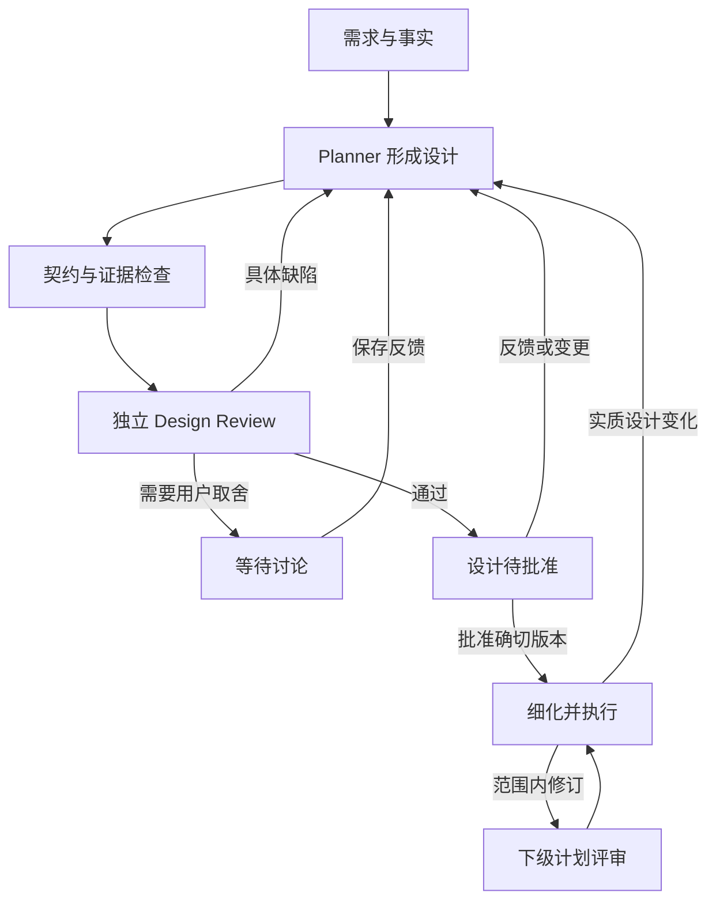

# 方案：真实设计、独立评审与分层规划

[方案索引](README.md) · [中文文档](../README.zh-CN.md) · [Documentation](../README.md)

- 状态：**待审阅，尚未实现**。本 PR 只提交方案与索引，不改变命令、运行状态、模型配置或插件行为。
- 日期：2026-11-16。
- 核对基线：Flywheel [`c5cc9930ea60f63cd28488025e84c078f712f992`][baseline]。下文“现有”指该源码的实现，不代表用户本机安装或真实账号已验收。
- 关联设计：[当前架构][architecture]、[原生 Harness / PTC / LCU 设计][native-design]、[当前原生能力指南][native-guide]、[使用手册][handbook]。

## 1. 建议审阅的结论

把 **Plan 作为真正的方案设计入口**，让它完成研究、设计、讨论、独立评审和有界修订。AI 评审收敛后，用户能够看完整方案和评审记录；采用“先审方案”策略的任务必须停在这个位置，批准确切版本后才进入实现。

建议采用以下分工：

| 入口 | 建议行为 | 正常停止点 |
| --- | --- | --- |
| New | 创建任务、保存原始需求与约束，自动进入同一套 Plan / Design Review 流程 | 形成可审阅方案，等待用户；不必手动再调用一次 Plan |
| Plan | 为已有任务设计或修订方案；也支持细化里程碑、细化 packet 和运行中重规划 | 得到当前范围的评审结论；需要人的决策时停止 |
| Task | 从目标推进到交付，按任务的设计批准策略组合上述流程 | “先审方案”任务停在批准点；已有适用授权的任务继续 |
| Run | 执行或恢复已批准设计下的有效实施计划 | 正常交付、原有失败出口，或发现需要重新批准的设计变化 |

整体方案、下级实施计划和代码评审分别保留自己的版本与证据。**用户批准一次整体方案后，范围内的任务细化、普通返修和验收补充可以自动推进**；需要改变需求、公共契约、安全约束或授权边界时，再提交设计差异供用户审阅。

复用已有的 DSH Team / Workflow、Kimi Agent / Swarm、Codex agents、Claude Agent / Workflow / Advisor。PTC 继续承担 DSH 内工具组合；原生协作由实际 harness 执行；Go 保持任务状态、调度、预算、结果采用与批准的唯一控制权。

本方案建议默认一个 Planner 加一个独立 Design Reviewer。领域专家按具体问题加入，不要求每个小任务固定启动完整团队或固定跑满多轮。

## 2. 为什么需要改变

### 2.1 现有行为与缺口

| 当前实现 | 已经解决的问题 | 本方案要补的部分 |
| --- | --- | --- |
| [New][new-skill] / [Task][task-skill] 由宿主模型研究并生成完整 Spec、packets | 合法契约、任务工作区、一次启动 | 把完整方案设计交给配置好的规划后端，避免宿主先设计一遍、引擎再设计一遍 |
| [Plan][plan-skill] 对已有 Full 任务调用 `run --only plan` | 对当前里程碑的 packet 做确认、修订与结构校验 | 从 brief 开始的整体设计、方案产物、独立语义评审与讨论 |
| [Plan Loop][plan-step] 初次调用后最多做两次契约校验反馈重试 | 防止无界的格式纠错；保证契约合法 | 合法 JSON / Markdown 不等于方案合理，需单独的 Design Review |
| [CreateContext][context] 先加载 Spec、packets；Plan 要求当前里程碑已有 packet | 严格的实现入口 | brief-only 任务尚无完整 Spec 时的规划入口 |
| [Plan checkpoint][checkpoint] 绑定契约、验证策略、回执与 Git 基线 | 正常恢复无需重复有效 Plan | 它不是独立设计评审，也不是用户批准记录 |
| [Review][verdict-step] 需要当前实现的 L1 证据 | 对代码候选的独立审查 | 不能直接用它审查尚未实现的架构方案 |
| [`--pause-before review`][units] 在 Execute 和 L1 后暂停；普通暂停可由 [Run][run] 恢复 | 实现后的人工观察点 | 实现前、不可被普通 Run 绕过的设计批准点 |
| [native profiles 与 worker 回执][native-guide] 已接入多个 harness | 原生协作、任务树、配置快照、清理与恢复 | 为新规划角色接上相同能力，并把输出绑定到确切设计版本 |

当前 Plan 可以进行必要的设计推理；缺少的是明确的整体设计职责、专门产物、独立评审和持久化批准协议，不能把现有代码描述成完全没有规划能力。

### 2.2 目标与边界

目标是让复杂任务有可靠的设计闭环，同时减少不必要的串行等待和重复研究。设计评审要能发现具体遗漏；用户审阅要面对完整、可比较的结果；实现阶段要保留自适应细化能力。

本次设计不改动既有模型默认表、付费渠道、权限模式或发布策略，不把所有任务强制变为 Full，不要求每个 packet 都让用户签字，也不另建一个由长期父模型维护的调度器。原有代码验收、独立 Review、Judge、候选一致性与 Git 交付仍然有效。[当前不变量][architecture]

## 3. 入口与授权语义

### 3.1 New：建任务后自动进入设计

New 的宿主阶段只负责确认目标仓库和任务工作区，保存用户原话、已知事实、约束、授权与已有资料引用。能够通过代码或文档查明的技术事实交给规划后端研究；不要求用户先补齐系统设计，也不把聊天摘要冒充原始需求。

随后一次调用 Go 的准备／规划入口，自动开始初稿和独立评审。New 默认采用 `review-first`，到“待批准设计”停止。用户关闭 DSH 对话后，任务与评审记录仍然存在；再次打开从同一任务继续。

如果用户只要求登记想法，不要求研究设计，保存 brief 即停止，界面明确显示“尚未规划”。这是显式意图，不通过伪造空 Spec 或占位 packet 实现。

### 3.2 Plan：继续已有任务，明确规划范围

对采用新规划协议的任务，Plan 的用户默认含义是“继续讨论或修订整体方案”。引擎内部区分以下 scope；自动细化可以由引擎触发，用户不必掌握额外命令。旧任务与脚本的兼容映射见第 11.3 节。

| Scope（拟新增语义） | 输入 | 输出 |
| --- | --- | --- |
| design | brief、代码事实、约束、用户反馈 | 整体设计版本、需求覆盖、决策和里程碑 |
| milestone | 已批准整体设计、已交付成果、当前里程碑 | 当前里程碑的实施计划与近期 packets |
| packet | 当前有效里程碑计划、依赖产物、具体难点 | 足够执行的实现步骤、写入范围与验收 |
| replan | 验证失败、Review 反馈、新事实或用户变更 | 范围判断、修订后的下级计划或整体设计差异 |

输入、基线与相关策略仍有效时，普通 Run 复用可信 checkpoint。用户显式 Plan、计划失效、验证缺口，以及获准的受管重规划都可触发相应范围的重新评估；重新评估不自动扩大设计授权。修改用户反馈产生新输入版本，不能只继续旧会话而沿用旧“已通过”标签。

### 3.3 Task / Run：批准与启动分别记录

设计批准策略与 Auto / Quick / Full 分开保存：

| 策略（提案名称） | 适用意图 | 引擎行为 |
| --- | --- | --- |
| `review-first` | “先出方案，我看完再做” | AI 评审通过后等待用户批准；普通 Run 不能代替批准 |
| `delegated` | 用户已授权在明确范围内自行设计并实施 | 记录原授权来源与可自主决定的范围，独立评审通过且未越界后可继续；不伪造人工批准 |

New 默认前者。Task 尊重本次明确意图和已保存的任务策略；普通、范围明确的 issue 可以使用已有的设计与实施授权。用户后来明确要求“先审方案”时，该要求控制后续工作；历史上一句笼统的“都做完”不能覆盖新的停止点。

记录“批准设计”和“授权开始执行”两种事实。用户可以只批准方案，也可以使用一次 **“批准 v3 并开始”** 完成两者；已经表达清楚的授权不再追加一次确认。Run 对已有适用批准直接继续；没有批准时说明缺什么，并定位到待审版本。

无论哪种策略，push、提 PR、合并、发布和新增费用渠道继续服从原授权，设计批准不自行扩展这些权限。

## 4. 真正的设计与评审 Loop

### 4.1 流程



图中展示 `review-first`。`delegated` 在相同评审后由引擎核对已记录的设计授权范围，不走伪造的人类按钮事件。

### 4.2 Planner 的产物

整体设计至少包含：

1. 原始需求、稳定的需求 ID、目标、非目标和成功标准；记录尚待用户决定的事项。
2. 仓库现状与证据引用，包括已有接口、数据结构、测试门禁、约束及不确定性。
3. 推荐方案与有意义的备选方案，说明取舍依据；不为了凑数量生成明显不成立的备选。
4. 模块职责、接口和状态／数据流，相关兼容、迁移、失败恢复和可观测性安排。
5. 固定决策、明确授权下放的实现选择、不能自行决定的边界。
6. 里程碑、依赖、风险、验证策略，以及下一步足够执行的实施计划。
7. 需求到设计、里程碑和验收证据的对应表，防止拆任务时漏掉总体目标。

内容按任务复杂度展开。一个小修复可以是一份简短方案；跨系统项目需要充分讨论契约、演进和故障模式。规划阶段先完成适用的结构校验、代码引用核对和可行性检查，不要求尚未实现的功能测试提前通过。

### 4.3 独立 Design Reviewer

增加专门的设计评审输入和输出协议，不复用 Code Review 的 diff + L1 前提。Reviewer 获得用户需求、确切设计版本、代码依据、验证计划与历次发现；不继承 Planner 的私有会话，也不让 Planner 自己的子 Agent 回执成为最终独立裁决。

Reviewer 可使用自己的原生子 Agent、Team 或 Workflow 调查不同问题，最后由独立 root 返回结构化结果。使用不同模型可以增加视角，但独立性首先由角色、会话、输入和责任隔离保证，不要求所有任务付出跨 Provider 的额外成本。

建议结果集合：

| Verdict | 含义 | 下一步 |
| --- | --- | --- |
| `pass` | 当前确切版本满足评审标准，无未解决的阻断发现 | 进入授权判断 |
| `revise` | 有可由技术研究或设计修订解决的明确缺陷 | 回给 Planner |
| `needs-user-decision` | 缺失的是需求取舍或超出已有授权的决定 | 提供具体选项和建议后等待用户 |
| `blocked` | 关键证据／能力不可用，或无法形成可信结论 | 保存原因与恢复条件，不自动判通过 |

发现记录包含稳定 ID、严重性、对应需求／设计位置、具体反例或依据、影响、建议修正和关闭证据。风格偏好或另一种同样合理的实现不能无理由阻断。

Planner 修订后，Reviewer 检查发现的解决情况，也重新检查**完整当前方案**的需求覆盖和内部一致性。不能只看到旧问题全部勾选就通过新版本，也不能把模型返回的 `pass` 直接当作机器状态。

### 4.4 收敛、讨论与开销

推荐每次明确的设计请求默认最多 **3 轮完整的 Planner → Review**，允许首轮通过即结束。格式修复、网络重试、原生子调用和专家补充分别记账，并共同消耗任务预算；不能通过把一次修订改名为新请求不断获得三轮。

轮数只是一个上限，同时使用任务级累计 token／费用信息、模型调用限制和有效运行时限。等待用户不占用模型进程，等待时间与实际计算时间分开计量；真实运行超时和原生清理时限仍生效。预算增加必须记录其授权或现有预算策略，不能靠新建会话清零。

达到上限仍有阻断项时，输出已完成方案、分歧、具体风险和推荐取舍，状态保持“待讨论”或“预算停止”。不得自动放行、无界互相批评，或把人的长期不回复解释为同意。

用户可以在第一版后介入，也可以让 AI 先评审收敛后再看。技术问题优先研究；真正影响目标或授权的选择集中提问。反馈在下一次安全的调用边界成为新输入，原调用按原身份收尾，对旧输入产生的结果只保留为历史。

运行中的反馈通过 Go 控制入口持久化为带请求 ID、目标版本与真实来源的控制请求，由当前持有 run lease 的 Go owner 在下次派发前读取并以 CAS 采用。回执区分“已接收”“已应用”“冲突／拒绝”，界面不能把 queued 当作生效。变更批准策略也走该路径，owner 采用后禁止按旧策略派发；不得由外部进程抢锁直接覆盖 state。已经派发的调用按原身份收尾，用户要求立即停止则走现有取消／清理协议。引擎未运行时由取得同一 lease 的 Go 控制动作应用请求；恢复先处理未决请求，再派发新工作。

## 5. 整体设计与滚动细化

### 5.1 两类版本，不把所有细节塞进人工批准

| 对象 | 固定内容 | 允许怎样变化 |
| --- | --- | --- |
| 整体设计 `designRevision` | 需求、目标／非目标、关键架构决策、公共行为与接口、数据／安全约束、验收底线、预算和授权范围 | 新版本需重新评审；`review-first` 下重新获得适用批准 |
| 下级计划 `executionPlanRevision` | 所属整体设计版本、里程碑／packet、依赖快照、写入范围、具体步骤和适用验收 | 在整体设计授权范围内，可自动细化和评审后激活 |

名称是拟新增协议概念，当前 schema 尚不接受这些字段。根设计的批准身份不包含所有未来 packet 的可变内容；否则任何合理细化都会无端要求用户再次批准。反过来，packet 必须引用确切整体设计版本，不能只写“遵循最新方案”。

整体设计明确区分“已定”“可自主选择”“待决定”。未定事项不自动成为无限授权。所有需求在整体设计中有去向，未来里程碑可以暂不展开为 packets，但不能从覆盖表消失。

### 5.2 执行前细化到足够可执行

完成整体设计时，展开第一个可推进的里程碑；后续里程碑保留目标、交付边界、依赖与验收底线，在接近执行时再细化。复杂 packet 可以先做局部方案和小范围评审，再进入 Execute。

下级计划评审可复用同一设计评审框架，绑定独立 scope 和版本。简单、已有充分细节的 packet 直接复用其有效计划，不固定再增加一次模型调用。一次评审可以同时覆盖根设计与首个实施计划，但必须分别记录两份内容的身份和结论。

用户也可以先批准已充分设计的整体架构，再由 Run 细化当前里程碑。根批准不要求所有下级计划都已存在；“批准设计”和“激活某一组可执行契约”分别记录。首个 Execute 仍要等待当前所需下级计划评审、激活完成，不能把旧 child 或在飞回执改绑到刚批准的根版本。

需要同步调整 Spec / packet schema 和完成判断：未来里程碑“尚未细化”是明确状态；当前可执行单元仍必须有完整、可加载的契约。不得生成空壳 packet、`true` 验收或虚构 dry-run 来满足旧 loader。最终交付检查全部根需求和里程碑，不能以“当前生成的 packets 都完成了”判整体完成。

### 5.3 什么变化可以自动处理

| 变化 | 建议处置 |
| --- | --- |
| 在已批准接口内调整内部实现、拆分 packet、改变不影响契约的依赖顺序 | 自动细化并做适用评审；不重问整体方案 |
| 修复代码评审发现的 bug，补充不削弱验收的测试，处理已预期的失败分支 | 保留原授权，进入现有返修／验证闭环 |
| 发现原计划不可行，但替代实现仍满足全部已批准约束 | 记录备选比较和范围判断，独立复核后激活下级计划 |
| 改变用户可见行为／公共 API、租户隔离、数据一致性、安全模型、需求范围 | 生成整体设计差异，评审后按设计批准策略处理 |
| 增加未授权服务或费用渠道、超过授权预算、降低／替换验收底线 | 不能当作普通细化，需要明确决定与适用授权 |
| 无法判断是否越出范围，或多次小变化累计改变架构 | 标记 `unclear`，提供证据与差异，交由讨论解决 |

范围判断由结构检查和独立的语义审查共同提供证据，结果为 `within-envelope`、`material-change` 或 `unclear`。Go 校验输入身份、合法结果、权限和预算，再决定状态；不声称 schema 可以证明所有语义上的等价。

每次判断都对照**已批准整体设计和累计变化**，不能只对照上一个 packet，避免小改动逐次漂移。用户可以指定某个高风险里程碑必须再次检查，默认不为每个里程碑新增人工门槛。

## 6. 任务状态、批准与激活

### 6.1 从 brief 启动，仍由一个 Go 引擎负责

建议在版本化 `state.json` 中增加 planning 分区和任务 phase，新增不要求完整 Spec 的规划 Context。它复用任务身份、运行锁、调用账本、工作区归属、预算与取消协议；实现 Context 继续严格要求合法的已激活 Spec / packets。

需要把依赖 `Spec`、`Workflow.Effective` 或 packet 的会话身份、run record 和调用守卫拆分为适用阶段。不能只放宽 `CreateContext` 的文件检查后，继续调用会直接解引用实现字段的路径。[Context][context]、[会话][sessions]、[运行记录][catalog]

当前 `preparation.json` 是有界调查契约和状态，保留其专门语义。通用设计规划不伪装成故障调查；调查与设计通过同一任务身份、来源记录和一次性预算交接连接，见第 11 节。

建议 planning 状态包括 `drafting`、`reviewing`、`awaiting-input`、`awaiting-design-approval`、`approved`、`activating`，以及明确的失败、取消和预算停止结果。它们与整体任务运行／停止状态分开表达。普通暂停和“等待设计批准”不能共用一个可被普通 Run 解除的标志。

### 6.2 不可变设计与真实批准记录

建议在任务账本中维护 brief、不可变设计版本、下级计划版本、评审结果、反馈和批准事件。具体目录与 schema 在实施 PR 中定义；设计正文和机器清单必须共同进入版本摘要，不能只对标题或摘要做 hash。

文件分类至少分为“不可变权威版本与批准／激活记录”“本轮 Planner 的受管暂存输出”“可变运行回执”。三类的写权、摘要、候选检查和提交规则分别定义，并在主 checkout、packet worktree、恢复和同步中一致使用。不能把整个 planning 目录都视为可忽略账本，也不能都开放给 Planner 修改。

| 记录 | 至少绑定的事实 |
| --- | --- |
| 设计版本 | task ID、revision、brief／需求输入、设计正文与决策清单、研究基线和证据摘要 |
| 下级计划版本 | 根设计 revision + digest、scope、依赖与已交付成果快照、packet／验收契约摘要 |
| 评审回执 | 评审对象全部 digest、评审策略、独立角色 invocation、模型／native 配置快照、verdict、发现与解决记录 |
| 人工批准事件 | 确切设计身份、适用评审回执、真实用户操作来源、时间、请求 ID、预期状态 revision、是否同时授权开始 |
| 委托授权采用 | 原始授权来源、明确边界、当前设计符合该范围的依据；类型明确区别于人工批准 |
| 激活记录 | 已批准根版本、已评审下级版本、投影契约摘要、Git／worktree 同步依据与事务状态 |

批准只能由用户控制面操作或有明确用户指令来源的受管入口产生。模型输出“用户已同意”、Team 消息、计划文档里的勾选框和任意插件回执都不构成批准。通用模型工具不能凭模型自报的 `actor:user` 写入批准；在 DSH 对话中表达批准时，需通过宿主可验证的用户消息来源绑定确切版本，无法提供该来源时使用面板按钮完成。

UI 提交确切版本、digest 和预期 revision。用户看的是 v3，后台已产生 v4 时，批准 v3 的旧请求不能变成批准 v4。重复提交同一请求幂等；并发变更返回冲突与当前差异，不静默批准“最新”。

只批准方案时不派发 Execute。批准并启动作为一次用户意图记录，启动仍经过共同准入；批准已持久化而启动失败时，重试复用该批准与请求，不要求用户再次确认。

### 6.3 所有执行入口使用同一准入

对采用新规划协议的任务，任何业务实现调用或成果采用前均要求：

1. 当前整体设计的独立评审可信，且具备本任务策略要求的确切批准／委托授权。
2. 当前实施计划已评审，引用该整体设计，并通过累计范围检查；依赖和验收快照仍有效。
3. 契约激活完成，任务身份、工作区、候选与配置一致，所需 Git 持久化和同步成功。
4. 原调用不存在未对账的结果、活跃后代或未知清理；权限、预算、调度等原有门禁全部成立。

覆盖 Run、Task、DSH launch/start、Quick、`--only execute`、手动 step、交互接管、并行 packet、重试，以及可把原生产物导回的路径。手动 Verify / Review / Integrate / Final 也不能借旧证据把未批准或过期计划标成完成；与实现无关的读取、讨论和状态查询照常可用。

独立 `flywheel native ...` 作业继续有独立身份，不自动修改正式任务状态；只有走受管采用流程的结果才可能成为任务证据，不能用独立作业绕过任务准入。

### 6.4 激活与恢复必须在加载实施契约之前对账

采用新版本时，先持久化 activation intent，保存待激活的确切版本与原 active refs；再完成兼容 Spec / packets 的投影、内容校验、Git 提交和所需 worktree 同步；最后一次 CAS 切换 active refs。过程中禁止执行读取半套新旧契约。

Intent 还需包含完整投影文件集、旧／新内容摘要、基线与各步骤的确认结果。当前 packet loader 扫描全部 `task-packet-*.md`，新计划删除或改名后不能把退役文件留在扫描范围内。[Loader][contract-loader] 仅当旧文件摘要仍匹配受管投影时才可移走，历史留在不匹配该 glob 的版本目录；遇到外部修改、未知同名文件或 Git hook 改写，保留现场并阻断。

当前 `CreateContext` 在读 state 之前就加载 Spec / packets。[源码][context] 因此新的公共启动前置层必须先取得同一运行 lease、读取 phase 与 activation intent、核对原调用并恢复激活，再进入严格的实现 Context。不能把恢复放在 loader 之后，否则半落盘契约会使恢复入口本身不可达。

任一步失败保留 intent、设计和工作区；旧 active refs 不表示可在半落盘文件上继续运行。CAS 冲突、Git 失败、同步失败都保持阻断，通过原事务核对继续，不启动新模型来掩盖问题，也不自动回滚删除用户成果。契约落盘与激活采用幂等步骤，不声称跨文件／Git／状态存在单次原子写入。

新版本的 status / stop 保留损坏情况下的诊断与停止能力：尽可能展示原身份、未决事实和停止结果，不为读取状态自动修复契约或启动模型；无法确认进程所有权时也不能随意接管或杀掉其他任务。

等待用户时释放 worker 与原生运行环境，保留账本。重启后返回同一等待点。允许复用同角色的兼容历史，但未知调用仍先按原 request ID／journal 对账；换模型、fresh 会话、换 native profile 或改任务路径都不能解除未知状态。

## 7. 如何复用 Provider 的原生能力

### 7.1 保留三层职责

“模型 Provider”和“运行 harness”分别记录。DSH 里的 ChatGPT 模型运行 DSH 工具循环；`codex-pro` 则运行 Codex app-server。一个模型名字相同，不意味着可调用的原生能力相同。[原生指南][native-guide]

| 层 | 负责什么 | 在本方案中的用途 |
| --- | --- | --- |
| Go | 持久化状态、角色和 scope、预算、调度、批准、结果采用 | 管理设计 loop、独立 Review、等待与恢复 |
| Native harness | 单次受管调用内的 Agent / Team / Workflow / Swarm | 并行调查、领域分析、方案反例和局部细化 |
| DSH PTC | 在 DSH 内组合工具和传递结构化结果 | 沿用共享 SDK composition、实际 probe 与后代准入 |

这允许使用已接入并通过准入的原生工具与协作能力，同时保持 Flywheel 对任务结果的责任。规划阶段限制的是当前阶段的写入与采用范围：研究和输出设计可以充分使用已授权能力，业务实现由后续阶段执行。`full-access` 本身不等于文件系统沙箱，计划边界也不能冒充操作系统强制隔离。

### 7.2 当前能力与规划中的用途

| 路径 | 已有能力 | 建议用于设计／评审 | 必须保留的边界 |
| --- | --- | --- | --- |
| DSH + `native-profile` | PTC、子 Agent、Team、Workflow、显式 Web、可选 LCU | Team 分担代码调查、接口／数据／测试分析；Workflow 组织一次角色调用中的有界步骤 | 当前受该 worker 准入管理的本地 DSH Agent 树继承 root 的 provider / model / effort，不能宣称 Team 内任意混用多个模型；最终独立评审由 Go 另起角色 |
| Kimi Agent / Swarm | 原生 Server worker、任务树、角色账本 | 多模块研究、备选方案比较、里程碑细化 | Server 需要显式 full-access；实际准入核对模型／effort／mode；不支持已证明的整树并发硬上限 |
| Kimi Tower | 独立 Git 候选与受控 Execute 导回 | 有明确授权时做隔离的可行性样机，或保留候选供分析 | 当前只有 Execute 导回；Plan / Design Review 不能假定设计文件会自动回到源目录；Tower 始终 fresh，副本不是 OS 沙箱 |
| `codex-pro` | 完整 machine API、原生 agents / 子线程和配置观测 | Planner 或独立 Reviewer 内分配代码与接口调查 | 沿用冻结 native 配置、权限回执和子线程观测；DSH 插件动态默认值不影响 Flywheel 的直接 machine 调用 |
| `claude-code-pro` | Agent 定义、Workflow、Advisor 与受管生命周期 | 领域专家、规划内的步骤组合、对关键假设的 Advisor 建议 | 当前 Flywheel bridge 要求显式 full-access；原生 plan mode 不是 OS 只读沙箱。Agent model / effort 与父角色 thinking 分开；init 不证明实际子 effort 或并发硬上限 |
| 独立 Codex / Claude Review | 独立 native 作业入口与恢复记录 | 可提供特定代码问题或候选的补充审查证据 | Codex 原生 review 不消费 Flywheel 角色 prompt；Claude remote review 也不是既有 Design Review 协议，均不能直接当整体方案 pass |
| Claude interactive Team | 独立 tmux Team、控制和恢复接口 | 用户明确希望参与原生交互团队时的可选协作 | 与普通 Agent / Workflow 路径不同；不把交互 Team 作为无人值守设计 loop 的默认依赖 |
| LCU + ChatGPT 图像路径 | 受管 GUI lease、截图归档、模型投影能力 | 必要时研究现有界面、复现和补充视觉证据 | GUI 在共享桌面 lease 下顺序操作；归档图片存在不证明模型已收到；不把 GUI 纳入每次规划的必需依赖 |

上述能力依据当前 [native guide][native-guide]、[DSH overlay][native-policy]、[DSH bridge][dsh-bridge]、[Kimi runtime][kimi-runtime]、[Pro worker][pro-driver] 和 [vendor 记录][vendor]。版本身份、实际安装、观测到的能力和真实账号验收继续分别报告。

开启能力只表示允许调用，不证明模型已经派出对应专家、实际执行了 Workflow 或使用了 Advisor。审阅记录应依据实际 children／事件／回执说明采用了什么能力，不把 profile 名称当作执行证据。

### 7.3 DSH Team 的具体例子

复杂订单系统的 Planner 使用 DSH Team：一个成员研究旧订单与库存边界，一个研究幂等和失败恢复，一个核对现有测试；root 汇总备选方案、决策和需求覆盖。成员使用该 root 的模型与 effort，Team task board 用于这次原生协作。

Go 随后调用独立 Design Reviewer，例如已配置的另一个 DSH 模型或 Codex / Claude 后端。Reviewer 可以创建自己的专家组，重点构造重复请求、部分失败、迁移中的不一致等反例。独立 root 提交设计 verdict；Go 采用的是与确切设计绑定、通过校验的回执。

Team 内“reviewer”成员的意见可以改进初稿，但不能因此省掉独立 Design Reviewer。原生 task 标记 completed，也不能直接把 Flywheel 标为已评审、已批准或已完成。

### 7.4 能力选择与失败处理

复用现有 `native-profiles` 定义与阶段引用。新增规划角色使用相同 resolver、options 校验、配置 hash 与 worker admission，不另建一套能力开关，不读取另一份 DSH profile 的动态插件默认值，也不从桌面 heavy preset 推断独立 SDK worker 已具备相同能力。

现有 DSH worker 使用 `dsh-preset-generator` 的共享 SDK PTC composition，并在真实运行中验证；保留该路径。[实现][native-policy] 用户显式要求 Team / Swarm 的角色，能力不满足时应返回具体缺失项。只有预先配置且已授权的 fallback 可采用；不能静默换为普通调用却继续标记“Team 评审完成”。

新角色需要扩充当前 Plan 的产物 allowlist、契约指纹、提交与 worktree 同步规则。现有守卫主要认 Spec / packets；把设计随意放进被排除的 `reports/` 并不自动获得保护。[契约修订][contract-revision]、[证据指纹][evidence]、[账本分类][ledger]

同时注册角色 schema、session policy、权限解析和会话 guard。当前未知 role 不会自动获得普通 Review 的只读语义和候选守卫。[会话实现][sessions]、[权限实现][permissions-source] 新 Reviewer 明确禁止修改被评审内容，仍服从用户已选权限和后端能力；不能只增加配置名就声称获得 OS 只读隔离。要求硬只读而后端不支持时，应在派发前说明能力冲突。

建议 Planner 只写指定的设计草稿／实施计划暂存产物，由 Go 校验并生成不可变版本；Reviewer 返回结构化结果，由 Go 写审计记录。Executor 不得修改权威设计、评审或批准。所有设计文件被纳入专门的身份与越界检查，不能因位于账本目录就从完整性验证中消失。

专用 native jobs 如需纳入受管设计流程，还要新增 Go 层的作业派发、归属、计费、恢复和证据采用桥接。Codex 独立 review 支持 `custom.instructions`，可以针对设计文档提供补充意见，但它使用 `review/start` 而非普通角色 prompt；当前正式循环明确拒绝 `native.review`，不能靠改 profile 偷换调用。[Pro 校验][pro-driver] Claude remote review 的请求没有普通角色的 model / effort / prompt 字段；interactive Team 的 `businessOutcome` 保持 unknown。现有 Node 接口可以运行这些作业，不等于 Go 设计 loop 已能调度并采用它们。[独立作业][native-jobs]、[Claude Go driver][claude-driver]、[Claude bridge][claude-bridge]

### 7.5 Native 终态、清理、用量和预算

设计 pass 必须同时满足结构化结论合法、版本匹配、独立角色身份正确，以及现有 worker 的真实成功条件。DSH 在 root 返回后、cleanup 前检查原生树 completion；Go 再验证 requested / effective / completion / cleanup。[Bridge][dsh-bridge]、[回执校验][native-driver]

root 结束但后代仍活跃，不能靠随后强制关闭把本次评审补成成功。Claude remote job 的本地超时或本地 journal 终态也不能证明远端完成；未知结果不重发。[现有恢复语义][native-guide]

外层 scheduler 限制根调用，不能直接当作整个 native 树的并发上限。DSH / Codex 使用各自能够核对的能力；Claude requested limits 保留 observed guard 与 `hard:false` 的事实，Kimi Server 不接受没有实现证明的 `agents.maxConcurrent`。若任务要求当前后端无法保证的硬限制，应在派发前拒绝该能力组合或使用已授权且满足要求的路径。

用量采用 root 与后代回执，保留 unknown 与归属限制，不重复累计同一回执。无法计量的 Advisor、compaction、远端工作或 Tower 消耗不能计为零；hard budget 在无法证明剩余额度时不能假装受控。设计修订、子计划细化和 native 专家共同消耗任务账本，恢复或切换后端不重置。

## 8. 角色、模型与思考等级

本方案建议把“主对话选哪个模型”和“后端规划用哪个模型”解耦。New 的宿主只做薄准备，完整设计由显式配置的 Planner 执行；用户不再因为宿主先承担完整设计而必须在点 New 之前切换到最强模型。

新增逻辑角色建议为 `design-plan` / `design-review`，下级计划使用 `plan` / `plan-review`；它们拥有独立角色与 scope 的会话身份。为减少迁移负担，可让**未显式配置的新规划绑定**解析到现有 Plan 绑定，新设计评审绑定解析到现有 Review 绑定，但只复用后端配置，不复用代码评审协议或会话历史。实施时须在 `config inspect` 显示解析来源、请求的模型／effort、native profile 和静态能力检查；运行时是否实际生效，以同一配置快照的 invocation 回执为准。只读 inspect 不启动 Team 或模型，缺少真实证据时显示 unknown；最近一次运行证据须附身份和时间，不能冒充本次准入。

当前模板的 Plan 是 Kimi K3.1 Pro high，Review 是 DSH ChatGPT Sol high，Judge 是 Astra high；默认模板未给这些阶段绑定 native profile。[当前模板][config-template] 这些是现有默认，不是本方案宣称的跨任务最优值。本 PR 不修改它们。

建议先沿用用户实际绑定，提供可选的“复杂设计”配置示例：更强的 Planner、独立 Reviewer、必要的领域专家，并通过固定代表任务比较质量、调用轮次与时间，再决定是否更改默认。不能因为模型可用就每轮同时使用所有 Provider，也不能在当前角色额度不足时未经授权换付费渠道。

父角色 thinking 和 native 子 Agent effort 分开显示与记录。Claude 定义的可选 effort 保持当前支持集合和原样透传；Codex 使用自己的 agents 默认／子线程观测；DSH Team 沿用 root 值。[现有 Agent 配置][native-guide] 不通过统一的“高思考”标签假设各 Provider 的档位或实际计算量等价。

## 9. DSH 的交互和用户审阅包

沿用现有 Flywheel 会话视图，不另造浮层或要求主对话长期驻留监督。建议在同一任务中呈现：

| 位置 | 用户能看到或执行什么 |
| --- | --- |
| 任务头部 | 当前阶段、草稿版本、已批准版本、当前实施计划；区分“AI 已通过”“待你批准”“可执行” |
| 方案页 | 一页摘要、完整设计、关键取舍、需求覆盖和近期任务，支持与上次版本比较 |
| 评审页 | 轮次、独立 reviewer、具体发现、处理结果、遗留问题、实际成本／unknown |
| 讨论区 | 补充约束、对某项决策反馈、明确需要回答的选项；反馈附到确切版本 |
| 操作区 | “反馈并修订”“批准该版本”“批准该版本并开始”；过期按钮返回冲突 |
| 执行视图 | 当前 packet 所依据的设计／子计划版本、自动细化理由、需要重新批准的差异 |

用户最终收到的审阅包包含推荐方案、关键代价、重要备选、评审发现及解决证据、尚待决定的问题、近期实施步骤和验收安排。AI 没能解决的问题必须显眼呈现，不能只给一句“方案已 review 完”。

等待讨论、等待批准和预算停止各自显示可恢复条件。批准不需要保持原模型上下文；系统以磁盘契约和批准记录为准。

### 拟议控制协议的表达方式

CLI / DSH 的实际参数和 JSON schema 在实现时一并新增；以下是**协议草案，不是当前可执行命令或工具参数**：

```json
{
  "action": "approve-design",
  "taskId": "orders-v2",
  "designRevision": 3,
  "designDigest": "sha256:<exact-reviewed-manifest>",
  "expectedRevision": 17,
  "requestId": "<stable-user-action-id>",
  "startAfterApproval": false
}
```

示例不包含可由模型自报的用户身份。调用来源、用户授权与数据内容分别验证。现有 `control` stdout JSON envelope、stderr 诊断和失败分类必须保持明确；客户端通过能力／协议版本识别新操作，旧客户端不能靠猜测字段启动任务。

## 10. 执行中重规划与并发

完整设计可以稳定，具体任务计划随新事实演进。Execute、验证和 Code Review 产生的结构化反馈都可以请求局部 Plan；Go 决定是否需要新的计划版本，以及原证据是否仍适用。原来有效且未受影响的计划、已交付成果和独立评审不全部推倒重来。

现有 JEV 选出的 `replan` 也走同一变更分类、预算与激活流程。JEV 保留现有总开关和允许动作范围；其适用／选择概率不是设计质量证明，也不能生成设计批准。本方案不依赖开启 JEV，不为规划另设一个绕过原策略的决策循环。

第一阶段保留当前保守并发边界：发现需要重规划时停止派发受影响的新调用，ready queue 补位同样核对版本；已启动的 worker 按原契约收尾、取消或对账，所有有关执行达到可信终态后才激活新契约。不得让运行中的 worker 突然读到另一份根设计或 packet，也不能用旧 worker 的状态副本覆盖新的 planning 分区。

可以提前保存设计草稿，但草稿不改变 active refs。发现原设计可能不安全时，把受影响执行标为 blocked，不能仅因旧批准仍存在就继续。无关单元是否能继续，仍取决于当前调度与依赖隔离能力；首版不增加“热切换契约同时继续共享工作区执行”的新承诺。

新根版本激活后，旧证据保留历史身份。只有经过明确依赖／内容核对的成果可以被采用到新版本；不能把旧 Review 的 pass 改绑到新 digest。对确切候选的 L1、Code Review、最终验证与 Git 交付要求保持不变。

## 11. Quick、调查与旧任务

### 11.1 Quick / Full 与设计批准正交

Quick 保留“合格的小任务、完整验收、独立最终 Code Review”的短路径。简短设计已充分明确且存在适用授权时，不必再启动重量级整体架构流程；用户明确要求先看方案时，即使最终执行适合 Quick，也要在实现前停下来。[当前 Quick 资格][workflow]

Full 本身不代表必须重复询问人工批准，Quick 也不代表可以跳过已要求的批准。新增 design scope 适用于两类任务；当前 `--only plan` 仅支持 Full 的行为，需要在新入口与兼容映射中明确处理，不能让改完 New 后 Quick 在 Plan 处意外报错。

需要明确成本取舍：新规划协议下，首次建立设计通常增加准备／设计评审调用；Quick 的 Execute + 最终 Code Review 两个阶段不等于总共只调用两次模型。小任务缩短设计产物与评审范围，已审过的有效设计不重复审查，但不能把“快速”当作跳过本方案共同准入的理由。旧任务原模式继续保留，默认模型与策略是否进一步调整应由实测决定。

### 11.2 调查 → 修复设计

保留现有有界调查及 `investigate` / `investigate-and-fix` 意图。根因未明确时先取证，不生成假 Spec 来假装已进入实现。报告支持修复后，再把已验证事实、原始需求和修复授权交给设计阶段。[调查指南][investigation-guide]

当前调查入口把任何 `state.json` 存在视为实现已存在，`control status` 也优先返回 state；新增 planning phase 后必须改为按实际阶段判断，并同时返回必要的调查状态。[调查实现][investigation-source]、[控制接口][control]

只要求调查报告的任务不会因生成或批准一份设计而自动得到实施授权。`investigate-and-fix` 已有授权继续使用，用户又要求先审设计时保留该停止点。调查来源与预算只导入一次，设计、修订或重复 launch 不能重置调查成本或绕过未知动作恢复。

原本 report-only 的任务，用户后来明确“批准该方案并开始修复”时，新增绑定原调查报告、确切根设计与实施范围的修复授权事件；不改写原 investigation intent 或历史报告。交接仍在同一任务中，复用已有费用和证据，单独核对支持修复的调查结果与未知动作。需要扩展当前 `attachPreparation` 的授权来源判断；新授权不能把 inconclusive 报告改成 supported。“仅批准方案”仍不等于这项后续实施授权。

### 11.3 旧任务与旧二进制

旧任务继续使用原有模式和已有授权，不因为安装新版本就全部重新询问。旧 Plan passed / checkpoint 不能补写成“独立设计审查通过”或“用户批准”；界面标明 legacy 状态。

用户对旧任务明确启动新的设计流程时，执行一次显式迁移：先核对并停稳原调用，保留成果、账本和预算，生成已有契约的设计基线，再走适用的审阅策略。迁移不能复制新 task ID、清空历史或降低 Full 为 Quick。

入口按任务协议明确区分：

| 任务／入口 | 首版建议 |
| --- | --- |
| 新规划协议任务的 Plan skill／新规划控制入口 | 默认 `design`；明确 scope 时处理下级计划 |
| legacy 任务的原 Plan skill／已有 `run --only plan` 脚本 | 保持原 milestone packet 规划语义，普通重跑不触发迁移 |
| legacy 任务明确要求新的整体设计流程 | 展示具体迁移影响，按已有明确意图受管迁移；缺少这项意图时不猜测 |
| 新任务中的旧低层 `run --only plan` | 保留 milestone 规划用途并执行新协议的子计划评审与准入；不把脚本静默改成整体设计入口 |

新的 design scope 通过新增控制协议调用，Skill 根据任务协议选择路径，CLI help 与回执明确 scope。原有 Full-only 单步入口不会成为 New 的准备入口；Quick 的前置设计和细化通过新规划路径处理，避免为一次设计操作无意义地升级工作流。

**单纯提高版本号不能阻止当前旧引擎误运行。** 当前状态加载并非拒绝所有较高版本，Spec / packet 版本也只有 minimum 检查。[State][state-source]、[Spec schema][spec-schema]、[Packet schema][packet-schema] 新规划任务需要旧 parser 确实会拒绝的契约标记，例如新的必需 `planning-ref` 字段：当前 Spec schema 的 `additionalProperties:false` 会拒绝它。名称仍是提案，实施必须用旧 loader／旧实际二进制证明阻断。

Spec 标记仍不足以保护状态：旧 stop、Intake / Garden 记账等可不经 LoadSpec 就 Load → Save，可能丢掉新 planning 分区。建议新设计角色、输入版本与调用身份采用新 session ledger 契约版本，planning state 从创建起就持有该版本的账本，即使尚无调用。当前旧 loader 对 session ledger 版本有明确枚举，可借真实的会话契约升级拒绝不支持的状态；实施须验证 `Load` 和 `Save` 的全部写入口。[会话账本][session-ledger] 不能仅提高无语义变化的数字冒充兼容协议，也不能承诺未测试的所有历史版本都安全。

新任务首份 Spec 带契约标记，首份 state 带旧 loader 拒绝的会话契约；brief-only 阶段没有可被旧引擎执行的合法 Spec。迁移旧任务时，在共同锁下先建立阻止旧运行入口的契约边界，再原子持久化包含旧 loader 拒绝条件与新 planning 分区的状态；全程保留迁移 intent 和每个断点的恢复依据。不能只写一个旧程序根本不读取的 sidecar 标记。兼容矩阵内的旧实际二进制须对 run / stop / intake / garden 等分别证明拒绝或不写入；旧 desktop / CLI 遇到不支持任务明确要求升级，不自动删除标记。

## 12. 典型使用场景

以下描述的是实施本方案后的交互，现行用法仍以[使用手册][handbook]为准。

### 场景 A：复杂系统，先充分讨论

用户在 DSH 中说：“做一个多租户订单系统，先设计，我看完再实现。”调用 New 后，宿主记录目标与权限，后台 Planner 研究现有系统；Team / Swarm 可以并行查模块。独立 Reviewer 检查隔离、重复消息、迁移和验收，发现问题后返修。

需要确定“订单取消后是否允许再次支付”时，系统带着方案选项询问。得到答案后继续评审，最后展示 v3 的完整审阅包并等待。用户说“批准 v3 并开始”或点击对应按钮，一次表达同时完成批准与启动。

执行第一个里程碑时细化 API 和状态机；范围内选择数据库索引自动推进。如果后来发现需要改变对外幂等语义，则输出设计 v4 与 v3 的差异，经过评审后再次等待，而不是直接改掉接口。

### 场景 B：普通 issue，已有实施授权

用户说：“修复这个明确的空指针 issue，补回归测试并提 PR。”Task 记录已有授权，研究后形成简短、可执行契约。采用新规划协议时仍做独立设计评审，可一次覆盖初始设计和首个 child；不固定组建专家团队，也不固定多轮，首轮通过即进入已授权执行。满足 Quick 资格时实施阶段沿用短路径。遇到实际上涉及跨租户数据语义的证据时，升级规划范围，保留原成果和预算。

### 场景 C：排查线上故障

用户说：“先查原因，给我修复方案。”按调查契约做有界取证，报告证据与不确定性；随后生成修复设计并评审，停在用户决定处。若原要求是“查清并修好”，保留原修复权；不因跨过调查、设计两个阶段重复要求同一授权。

### 场景 D：复杂任务执行到一半

整体设计 v2 已批准，M2 的初始计划因新发现需要拆成三个 packets。Plan 读取当前代码和 M1 交付结果，生成 M2 修订计划，确认仍在 v2 的接口、数据与验收边界内，独立评审后激活。用户看到变更理由和进展，不必再次批准 v2，也不重新运行已有效的 M1。

## 13. 实施拆分与受影响仓库

每一步单独可审查，用户可见语义必须等入口与准入闭合后一起启用；不能先改 Skill 文案就宣称新流程已生效。

| 阶段 | 主要改动 | 完成标准 |
| --- | --- | --- |
| P1：契约、状态与恢复基础 | 新 brief／设计／评审／批准 schema；planning phase；前置恢复；激活事务；旧版本阻断；统一准入 | brief-only 可持久化；任何实现入口都不能绕过待批准状态；中断后无重复采用／预算重置 |
| P2：设计 loop | 新角色与 prompts、独立评审、发现账本、有界迭代、讨论与授权采用；扩展产物守卫 | 一份确切设计经过真实独立审查；阻断／未知／预算耗尽不假通过 |
| P3：native 与渐进实施计划 | 复用 resolver / worker；新角色 admission；层级版本、范围判断、checkpoint；并发激活屏障 | DSH Team 等能力保留真实语义；范围内细化自动推进；跨边界变化阻断 |
| P4：DSH / CLI / Skill 与文档 | 面板审阅包、真实批准来源、新控制操作、New / Plan / Task / Run 语义和兼容路径 | 用户从 New 得到方案并审阅，批准后 Run；入口行为一致，当前双语手册完整 |

Flywheel 主要涉及 `templates/`、`internal/contract`、`internal/state`、`internal/machine`、`internal/prompts`、`internal/cli`、DSH 控制面／worker 及 button skills。当前 Plan allowlist、ledger 分类、Git 提交／worktree 同步、history／catalog、Quick 资格和调查状态判断都列为必改检查项；不是只改一个 prompt。

| 仓库／集成 | 建议责任 |
| --- | --- |
| `ckanner/flywheel` | 主要实现，拥有上述状态、设计协议、原生角色桥接、界面与使用文档 |
| `ckanner/dsh-preset-generator` | 复用已有共享 PTC composition；若新角色暴露具体 admission 缺口，单独修复并同步验证，不另复制 preset |
| `ckanner/dsh-subagent-codex-pro` | 复用公开 machine/native API；只有证据表明缺少必要的子调用观测或协议能力时提交配套变更 |
| `ckanner/dsh-subagent-claude-code-pro` | 复用 Agent / Workflow / Advisor 与生命周期；不把独立远端 Review 或 interactive Team 假装成新的设计 verdict |
| `ckanner/dsh-plugin-lcu` | 复用 managed API、lease、截图与取消语义；新角色需要 GUI 时纳入相同验收 |
| `ckanner/dsh-plugin-chatgpt` | 复用模型调用和媒体投影；规划专属状态留在 Flywheel，不下沉到 Provider |

本方案不预设必须修改全部插件，也不据此宣称所有插件无需修改。实施先基于实际公开 API 集成并验证；出现真实缺口再为对应仓库提配套 PR。任何新增 Provider API 必须同时给出兼容、回执、失败与恢复协议。

## 14. 验证与验收矩阵

以下是未来实现的验收要求，**本方案 PR 未运行或宣称通过这些功能测试**。

| 场景 | 必须证明的行为 |
| --- | --- |
| 只有 brief 的 New | 不要求先造完整 Spec；只运行规划与评审；形成审阅包后停止 |
| 两轮设计返修 | 稳定发现 ID、修复证据、完整当前版本复审；未解决 blocker 不通过 |
| 用户中途讨论 | queued / applied 分开；同一 owner 在派发边界采用反馈和新策略；新输入绑定版本；旧调用结果不能批准新设计；状态可恢复 |
| 独立性 | Reviewer 不复用 Planner／Executor 会话；Team 内意见不能替代正式设计裁决 |
| 旧标签与伪造批准 | Plan checkpoint、文档 pass、模型自报用户同意、工具参数 actor 均不能产生人工批准 |
| 重复／过期按钮 | 同请求幂等；v3 按钮不能批准 v4；只批准不派发实现；批准后启动失败可恢复 |
| 全入口一致 | Run、launch/start、Quick、step、`--only execute`、交互接管、并行与原生产物采用都受共同门禁约束 |
| 根与子版本 | 范围内细化不重问根批准；子计划过期不执行；累计漂移触发实质变化处理 |
| 滚动计划完整性 | 未来里程碑可未细化，但全需求仍可追踪；当前 packets 完成不等于整个任务完成 |
| 激活中断 | 在 intent、新文件投影、退役文件移除、提交、同步、CAS 每个边界注入失败；先恢复再 LoadSpec，不混用版本、不重发模型；旧 packet 不留在扫描集 |
| 并发与外部编辑 | 旧 worker 停稳后才激活；外部修改设计／契约能被检测；旧证据不改绑新候选 |
| Native 真实边界 | DSH shared PTC 与后代准入；DSH root 模型继承；Kimi 非 Execute 不导回；Codex／Claude 配置与实际回执一致 |
| Native 失败 | root 返回而 child 未完成、journal 不完整、取消／未知 cleanup、remote unknown 均不采纳 pass，不静默重放 |
| 预算与恢复 | 原生子成本保留 unknown；恢复、换角色、反复 Plan、调查交接不清零；硬限制不伪装成 observed guard |
| Quick / Full | 设计批准策略与工作流独立；普通小任务不强制重量级设计；Quick 的最终验证不减少 |
| 调查与修复权 | planning state 不误挡调查；仅报告／仅批准不获得修复权；后续明确修复授权另记事件，不改历史 intent；已有修复权保留；原始预算只导入一次 |
| 兼容与降级 | 旧任务不伪造审批；迁移中断可恢复；旧实际二进制的 run / stop / intake / garden 不运行或重写新任务，而非仅检查版本数字 |
| 用户路径 | 在真实 DSH 中完成 New → 讨论 → 评审 → 关闭重开 → 批准 → 执行细化；报告真实模型／桌面证据边界 |

实现 PR 按实际变更运行仓库的 Go、Node、桥接与安装门禁，并保持原覆盖率要求。离线 fixture 负责协议、状态、所有权与恢复；真实模型评测负责设计质量、收敛、耗时与成本；真实 DSH 验收负责界面与用户批准来源，三类证据不相互替代。

## 15. 建议本轮确认的设计选择

| 选择 | 本文建议 | 理由 |
| --- | --- | --- |
| New 是否自动进入 Plan | 是，默认得到评审后的方案再停 | 用户不必理解内部阶段才能拿到完整方案 |
| 独立设计评审是否保留 | 是，默认 1 Planner + 1 Reviewer | 讨论可以并行，最终责任清晰；额外专家按风险启用 |
| 人工批准粒度 | 整体设计确切版本；下级计划按边界自动推进 | 保留用户决定重大方向的机会，同时避免每个 packet 打断 |
| 默认设计修订上限 | 3 轮，并受累计预算约束 | 有机会解决反馈，也有明确的讨论出口；不宣称是实验最优值 |
| Native 选择 | 沿用显式 profile 与实际 admission；按任务启用 | 使用已经实现的能力，避免“装了插件就等于已生效” |
| Tower / 独立 native Review | 作为明确的补充路径，不直接替代正式设计协议 | 当前采用、角色 prompt 和恢复语义不同 |
| 旧任务 | 保留旧行为；使用新流程时显式迁移 | 不伪造过去的审批，也不突然打断正在运行的授权任务 |

若这些方向通过，后续实施 PR 应先落地状态与准入，再接入设计 loop 和用户入口；本方案合并本身不表示功能已经上线。

## 16. 源码依据

文中源码链接固定到核对基线；当前指南链接用于定位操作说明。历史原生方案用于解释设计背景，实际支持范围以该基线的源码、schema 和 worker 协议为准。

[baseline]: https://github.com/ckanner/flywheel/commit/c5cc9930ea60f63cd28488025e84c078f712f992
[architecture]: ../design.md
[native-design]: 2026-11-13-native-harness-capabilities.md
[native-guide]: ../zh-CN/native-capabilities.md
[handbook]: ../zh-CN/usage-handbook.md
[workflow]: ../zh-CN/workflow.md
[investigation-guide]: ../zh-CN/investigation.md
[new-skill]: https://github.com/ckanner/flywheel/blob/c5cc9930ea60f63cd28488025e84c078f712f992/skills/flywheel-new/SKILL.md
[task-skill]: https://github.com/ckanner/flywheel/blob/c5cc9930ea60f63cd28488025e84c078f712f992/skills/flywheel-task/SKILL.md
[plan-skill]: https://github.com/ckanner/flywheel/blob/c5cc9930ea60f63cd28488025e84c078f712f992/skills/flywheel-plan/SKILL.md
[plan-step]: https://github.com/ckanner/flywheel/blob/c5cc9930ea60f63cd28488025e84c078f712f992/internal/machine/steps_plan.go
[context]: https://github.com/ckanner/flywheel/blob/c5cc9930ea60f63cd28488025e84c078f712f992/internal/machine/context.go
[checkpoint]: https://github.com/ckanner/flywheel/blob/c5cc9930ea60f63cd28488025e84c078f712f992/internal/machine/plan_checkpoint.go
[verdict-step]: https://github.com/ckanner/flywheel/blob/c5cc9930ea60f63cd28488025e84c078f712f992/internal/machine/steps_verdict.go
[units]: https://github.com/ckanner/flywheel/blob/c5cc9930ea60f63cd28488025e84c078f712f992/internal/machine/units.go
[run]: https://github.com/ckanner/flywheel/blob/c5cc9930ea60f63cd28488025e84c078f712f992/internal/machine/run.go
[sessions]: https://github.com/ckanner/flywheel/blob/c5cc9930ea60f63cd28488025e84c078f712f992/internal/machine/sessions.go
[catalog]: https://github.com/ckanner/flywheel/blob/c5cc9930ea60f63cd28488025e84c078f712f992/internal/machine/catalog.go
[native-policy]: https://github.com/ckanner/flywheel/blob/c5cc9930ea60f63cd28488025e84c078f712f992/plugins/dsh/src/native-policy.js
[dsh-bridge]: https://github.com/ckanner/flywheel/blob/c5cc9930ea60f63cd28488025e84c078f712f992/plugins/dsh/src/bridge.js
[kimi-runtime]: https://github.com/ckanner/flywheel/blob/c5cc9930ea60f63cd28488025e84c078f712f992/plugins/dsh/src/kimi-native-runtime.js
[pro-driver]: https://github.com/ckanner/flywheel/blob/c5cc9930ea60f63cd28488025e84c078f712f992/internal/drivers/pro_native.go
[vendor]: https://github.com/ckanner/flywheel/blob/c5cc9930ea60f63cd28488025e84c078f712f992/plugins/dsh/vendor/README.md
[contract-revision]: https://github.com/ckanner/flywheel/blob/c5cc9930ea60f63cd28488025e84c078f712f992/internal/machine/contract_revision.go
[evidence]: https://github.com/ckanner/flywheel/blob/c5cc9930ea60f63cd28488025e84c078f712f992/internal/machine/evidence.go
[ledger]: https://github.com/ckanner/flywheel/blob/c5cc9930ea60f63cd28488025e84c078f712f992/internal/ledger/ledger.go
[native-driver]: https://github.com/ckanner/flywheel/blob/c5cc9930ea60f63cd28488025e84c078f712f992/internal/drivers/native.go
[config-template]: https://github.com/ckanner/flywheel/blob/c5cc9930ea60f63cd28488025e84c078f712f992/templates/flywheel.config.example.json
[investigation-source]: https://github.com/ckanner/flywheel/blob/c5cc9930ea60f63cd28488025e84c078f712f992/internal/investigation/investigation.go
[control]: https://github.com/ckanner/flywheel/blob/c5cc9930ea60f63cd28488025e84c078f712f992/internal/cli/control.go
[state-source]: https://github.com/ckanner/flywheel/blob/c5cc9930ea60f63cd28488025e84c078f712f992/internal/state/state.go
[spec-schema]: https://github.com/ckanner/flywheel/blob/c5cc9930ea60f63cd28488025e84c078f712f992/templates/spec.schema.json
[packet-schema]: https://github.com/ckanner/flywheel/blob/c5cc9930ea60f63cd28488025e84c078f712f992/templates/task-packet.schema.json
[contract-loader]: https://github.com/ckanner/flywheel/blob/c5cc9930ea60f63cd28488025e84c078f712f992/internal/contract/contract.go
[permissions-source]: https://github.com/ckanner/flywheel/blob/c5cc9930ea60f63cd28488025e84c078f712f992/internal/config/permissions.go
[native-jobs]: https://github.com/ckanner/flywheel/blob/c5cc9930ea60f63cd28488025e84c078f712f992/plugins/dsh/src/native-jobs.js
[claude-driver]: https://github.com/ckanner/flywheel/blob/c5cc9930ea60f63cd28488025e84c078f712f992/internal/drivers/claude_code_pro.go
[claude-bridge]: https://github.com/ckanner/flywheel/blob/c5cc9930ea60f63cd28488025e84c078f712f992/plugins/dsh/src/claude-code-pro-bridge.js
[session-ledger]: https://github.com/ckanner/flywheel/blob/c5cc9930ea60f63cd28488025e84c078f712f992/internal/state/sessions.go
