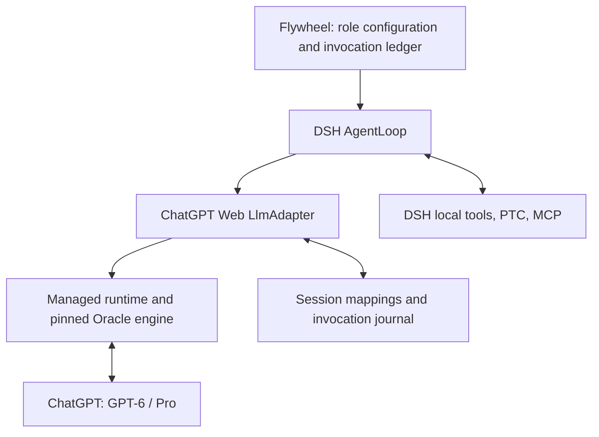
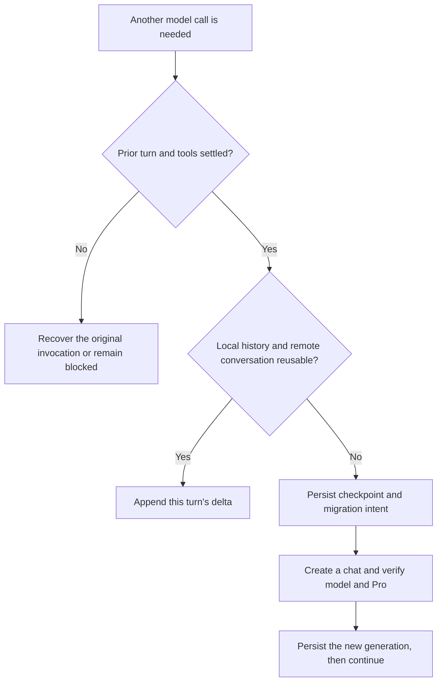

# ChatGPT Web Pro: complete design for a configurable model provider

English · [简体中文](2026-11-17-chatgpt-web-provider.md) · [Plan index](README.md) · [Current architecture](../design.md)

**Status: proposal for design review. This PR contains a design only; it does not claim that the feature is implemented or released.** Date: 2026-11-17. Flywheel baseline: `0.37.0` / `db6b93e6b2f74b8bcc6563c54bcafbd0813ccd0c`.

## 1. Decision and goals

Add an isolated **`chatgpt-web` provider** to the existing `ckanner/dsh-plugin-chatgpt` package, registering the **`gpt-6-pro` model** through DSH's `LlmAdapter`. Preserve the existing `chatgpt` SIWC provider's authentication, model catalog, and call path. Load the web components only when explicitly configured; ordinary SIWC use must neither launch a browser nor require a ready web account.

Flywheel uses this model through **`harness: "dsh"` + `provider: "chatgpt-web"`**. It can serve design, planning, **execution**, review, final acceptance judgment, Intake, Garden, and authorized DSH subagents. Planning and review are typical uses, not limits on the product's capabilities.

GPT-6 Pro supplies model reasoning; DSH supplies the agent loop, local tools, and permissions; Flywheel supplies deterministic orchestration, frozen contracts, verification, and Git delivery. Giving the web model local tools requires a complete bridge from a text protocol to DSH tool calls. Code generated in a web answer does not itself modify the local repository.

The completion criterion is that a user can select this provider in configuration and the UI, bind it to Execute, and complete a task using real local tools, tests, and independent Review. Long-running work must correctly resume, compact, and move between web conversations. Recovery must not redispatch requests with unknown outcomes or repeat confirmed tool side effects.

### 1.1 Invariants to preserve

- Go remains the only writer of Flywheel state. Web answers, provider logs, and DSH native events cannot directly advance `state.json`.
- Existing role and scope isolation remains intact. Independent Review must not inherit the Executor's web conversation or account/Project context that can be isolated.
- Honor the user's fresh/scoped policy. Tool rounds within one agent invocation may reuse a web conversation; this does not permit history reuse across fresh role invocations.
- Preserve the actual cwd, permissions, frozen acceptance criteria, verification of the same candidate, budgets, cancellation, recovery, and cleanup conditions. Selecting Pro grants no additional tool permissions.
- Never silently fall back to another model, account, provider, or billing channel. Pro is not an alias for high/max/ultra.
- Record Dispatch, Activity, Outcome, Cleanup, and Usage separately. Opening a new chat cannot bypass an unknown outcome, and estimates must not masquerade as actual server metering.
- Full capability is the final goal. Implementation may proceed through acceptance milestones, but an intermediate version that only answers questions is not a complete Execute provider.

## 2. Verified baseline and gaps

| Project | Inspected baseline | Existing capabilities and gaps addressed by this design |
| --- | --- | --- |
| Flywheel | `db6b93e6`, 0.37.0 | Supports DSH providers, profiles, loops, execution routes, role sessions, and recovery; has no chatgpt-web provider |
| ChatGPT plugin | `40d8f885`, 0.1.20 | Uses SIWC through DSH's LlmAdapter; has no web model transport |
| DSH | Official `master`: `39163dd3`, 0.2.2-rc.3 | Has LlmAdapter, a tool loop, session persistence, and CompactionEngine; the plugin must implement the web protocol and identity across processes |
| Oracle | `0a064e7b`, 0.23.1, Node >=24 | Has browser submission, complete internal answer objects, conversation continuation, and result recovery; lacks a complete model-provider contract |

These findings come from pinned source and documentation; see section 15. No live-account inference, web conversation exhaustion experiment, or Mac browser acceptance was performed.

The following gaps determine the architecture and cannot be hidden by installation settings:

1. **Oracle MCP is not a dynamic model interface.** `consult` has no input for a dynamic follow-up to an existing conversation/session; `browserFollowUps` contains strings supplied in advance. The `output` from `consult` / `wait` is a bounded log tail, not the complete last model answer. Cancelling an MCP waiter does not cancel the background task.
2. **Oracle CLI continuation provides insufficient selection evidence.** `--followup` inherits the parent's model and browser configuration; the resume path skips model-version selection. Pro effort has a verification path, but this does not establish a fresh confirmation of the GPT-6 version.
3. **Oracle does not compact long conversations or rotate them.** Switching from inline text to attachments at roughly 60k characters is an input-delivery strategy. Its token estimate excludes existing web history, and the browser path does not run the API's `--max-input` check.
4. **The web model has no native DSH tool API.** Converting a complete answer into a DSH `tool-call` requires our own versioned protocol with identity and schema validation. Command-like text in Markdown must not be executed.
5. **Flywheel currently fills in high.** `dsh.go` replaces empty thinking with high. Start/prewarm serialization, prewarm validation, Execute policy, and the UI must all preserve a genuinely absent effort.
6. **Flywheel currently disables DSH's default compaction.** Its SDK overlay disables `compaction-basic` and `command-compact`; a new provider cannot be described as automatically inheriting desktop compaction.
7. **A successful response's replayState cannot recover an unknown invocation on its own.** DSH persists `finish.replayState` with the successful assistant message. A crash after submission but before an answer exists still requires an independent write-ahead journal.
8. **Browser logs do not prove activity.** Oracle prints periodic status even when the UI has not changed. These logs cannot refresh actual work progress or prove that remote generation stopped.

## 3. Architecture and alternatives



| Layer | Responsibilities | Outside its responsibility |
| --- | --- | --- |
| Flywheel Go | Stages and routes, admission, budgets, state, acceptance, candidates, delivery, and recovery decisions | Browser DOM interaction or arbitrary execution of actions in model output |
| DSH AgentLoop / tools | Receive model blocks; execute tools under the actual tool catalog, permissions, and cwd; persist results | Treat web text as an accepted Flywheel judgment |
| New web adapter | Model catalog, message projection, tool protocol, session synchronization, compaction coordination, and response conversion | A second shell/file executor |
| Managed runtime | Bind the web account and tab; submit; capture the current answer; report real activity; stop; recover without resubmitting | Flywheel's state machine or automatic retries through another channel |
| Oracle engine | Reuse reviewed browser interaction and content-capture code | Be assumed to provide a stable official SDK or complete recovery protocol |

### 3.1 Why use a DSH provider

- **DSH provider — selected:** reuses the existing local tool loop and permissions, supports configuration for each model role, and adds the web-specific contracts at the provider boundary.
- **MCP consultation tool only — retained as an optional entry:** useful when an existing agent occasionally consults Pro, but it does not make Pro that agent's primary model and does not meet this design's full goal.
- **New Flywheel-specific harness — not selected here:** would require another implementation or embedding of the tool loop, permissions, sessions, and SDK behavior. Review this separately if a concrete requirement exceeds what DSH can support.
- **Existing SIWC/API provider changes — a separate channel:** official API models, modes, and compaction are not equivalent to the web subscription route. Similar names do not make authentication, quotas, or behavior interchangeable.

`harness: "codex-pro", provider: "chatgpt-web"` is not a valid integration. This DSH configuration cannot replace the primary model inside native Codex or Claude. Those agents can use an additional consultation tool; that differs from configuring a Flywheel Execute route to use DSH + Web Pro.

### 3.2 Oracle dependency boundary

Wrap a pinned Oracle engine in a **versioned machine interface owned by the plugin**. Oracle currently exposes CLI/MCP entry points, not a promised stable browser SDK. Do not scatter imports of its internal paths throughout the main provider or parse human logs as responses.

Prefer adding a reusable upstream entry point. Until an upstream release provides it, maintain a reviewed source snapshot or patch set, recording the commit, build provenance, package integrity, patches, and MIT notice. Contain it within one transport module so the engine can later be replaced. Do not reuse an unmodified upstream version number to imply that a patch was published upstream, and do not download latest on each invocation.

The minimum extensions are dynamic single-turn continuation, model and effort verification on every turn, isolated Project creation and admission, the complete last answer and its identity, structured activity, explicit cancellation, receipts separating local resources from remote state, and read-only recovery. Wrapping the existing `oracle-mcp consult` alone is insufficient.

## 4. User configuration and model semantics

### 4.1 Provider and model identity

Proposed registration:

- Provider ID: `chatgpt-web`; display name: `ChatGPT Web`.
- Model ID: `gpt-6-pro`; display name: `GPT-6 Pro · ChatGPT Web`.
- Target web selection: GPT-6 + Pro. This model ID is our provider's stable routing identifier, not a claim that an API slug with the same name exists.
- `resolveModel` exposes no separate reasoning-effort levels. Requests must genuinely omit `reasoningEffort`; non-empty values such as high/max/pro are explicitly rejected for this fixed-mode model.
- Initially declare only the verified text input capability. Add images, PTC, Teams, and other capabilities after the acceptance described in section 11. Any window number must be labelled as a local effective input budget, not the official web context window.
- Drive `providerInfo`, `listModels`, `resolveModel`, `prepareCall`, and `stream` from the same capability table. The settings namespace registered with DSH must match the actual schema.
- Obtain fresh UI selection evidence before every dispatch. Stop if the target model or Pro cannot be confirmed. UI evidence does not attest to the cloud service's internal weights or computation.

### 4.2 Flywheel configuration example

**This is a proposed configuration fragment that becomes runnable only after this design is implemented. It is not supported by current 0.37.0.** Incorporate the fragment into the complete configuration that actually takes effect; Flywheel does not deep-merge separate configuration files.

```json
{
  "profiles": {
    "web-pro": {
      "harness": "dsh",
      "provider": "chatgpt-web",
      "model": "gpt-6-pro",
      "channel": "chatgpt-web-subscription",
      "thinking": ""
    }
  },
  "loops": {
    "design-plan": { "profile": "web-pro" },
    "review": { "profile": "web-pro" }
  },
  "routes": {
    "hard": { "profile": "web-pro" }
  },
  "channels": {
    "chatgpt-web-subscription": {
      "harness": "dsh",
      "provider": "chatgpt-web",
      "env-key": null
    }
  },
  "sessions": {
    "mode": "scoped",
    "policy-version": 1
  }
}
```

This example explicitly assigns Pro to the hard execution route, design-plan, and review. Unless separately overridden, design-review and plan-review inherit review and therefore also use Pro; other role-model bindings remain unchanged. The global scoped policy affects every applicable role without its own override. Use the existing `sessions.roles` configuration when only selected roles should reuse sessions. This is not a forced migration of existing tasks. A channel is a configuration alias; the plugin's named connection selects the web account. Changing a channel name alone must not imply an account switch.

| Use | Configuration entry | Semantics to preserve |
| --- | --- | --- |
| Initial design | `loops.design-plan` | Inherits the plan backend when unset, while retaining a separate role |
| Independent design review | `loops.design-review` | Inherits the review backend when unset |
| Planning / milestone planning | `loops.plan` | Preserve the actual planning contract and scope |
| Plan review | `loops.plan-review` | Inherits the review backend when unset |
| **Execution** | **`routes.default/frontend/hard/multimodal`** | Selected by the packet route; there is no loops.execute |
| Code review / final acceptance judgment | `loops.review`, `loops.judge` | Preserve separate history and structured decisions |
| Second opinion | Top-level `judge-panel` | Remains subject to enablement and independence requirements |
| Intake / Garden | `loops.intake`, `loops.garden` | Replace only the model work within those flows |
| Bounded execution-model switching | `execution-policy.bindings` and each route's allowed set | Select only explicitly allowed bindings that pass capability checks |

Verify commands, state transitions, approval, and Git delivery do not become model roles. JEV currently uses a separate `/v1/systemone` HTTP contract and cannot be replaced through this configuration; changing its model requires a separate design.

### 4.3 Preserve absent effort end to end

Implementation must cover all of the following:

1. Configuration parsing, profile expansion, and effective-configuration display: preserve the explicit override semantics of `thinking: ""`.
2. DSH driver: omit effort for the web provider's supported fixed mode; retain compatibility defaults for other providers rather than removing defaults globally.
3. Start/prepare JSON, ready validation, worker arguments, and SDK initialize: absence means no independent effort. Do not send an empty string to the SDK.
4. Prewarm requests, binding summaries, warm-start matching, and recovery: distinguish absent from non-empty effort without filling in high again.
5. Execute policy schema and validation: conditionally allow empty thinking for this provider; continue validating other models against their actual capabilities.
6. UI: show the fixed Pro mode and hide inapplicable effort options. Saving must not remove the explicit empty override and cause high to be inherited again.
7. SDK resume: reject reuse of an unsupported effort left in an old header, or rebuild after confirming that doing so is safe. Omitting a new value does not necessarily clear an old one.

The provider's model contract expresses the Pro selection. Logs retain both `reasoningEffort: absent` and `observedWebEffort: Pro`; do not invent high to make the display uniform.

## 5. Complete tool loop for Execute

### 5.1 Input and reply protocol

Each input includes the effective instructions, normalized ordered messages, tool schemas, required attachments, invocation identity, and the current turn's protocol requirements. System/developer labels inside a web message are text role markers; they do not provide the priority guarantees of native API system messages.

The proposed reply permits one complete JSON object, distinguishing a final answer from tool requests. For example:

```json
{
  "protocol": "dsh-chatgpt-web/1",
  "requestId": "webcall-example-1",
  "generation": 2,
  "kind": "tool_calls",
  "calls": [
    {
      "id": "tool-example-1",
      "name": "read_file",
      "arguments": { "path": "src/example.ts" }
    }
  ]
}
```

`read_file` is only an illustrative protocol name. Actual tool names and arguments must come from the current DSH request; do not hard-code invented tools. The final-answer form is:

```json
{
  "protocol": "dsh-chatgpt-web/1",
  "requestId": "webcall-example-2",
  "generation": 2,
  "kind": "final",
  "text": "The final answer for this turn, or structured artifact text required by the host"
}
```

The provider converts tool objects into DSH `ToolCallBlock` values (`type/id/name/arguments`, with arguments serialized as JSON) and final answers into text blocks. Flywheel separately validates Plan, done-report, Review, Judge, and other artifact contracts. A valid web protocol reply is not automatically a valid business decision.

### 5.2 Execution order and validation

1. Validate the current session, effective tool catalog, permissions, input budget, and remaining invocation deadline.
2. Persist dispatch intent and the input digest before submitting the web turn.
3. Capture only **the matching, explicitly completed final assistant message for this turn**, including its complete raw content and digest. A log tail, old answer, prompt echo, quotation, or unfinished fragment cannot substitute for it.
4. Strictly validate the whole JSON object: matching protocol/requestId/generation, rejection of unknown fields, tool names, argument schemas, unique IDs, size, depth, and call count.
5. Emit executable tool-call blocks to DSH only after the entire batch passes. DSH's existing tool executor controls execution and approval; the runtime does not execute shell commands.
6. Persist tool results by call ID and return them to the provider. Normal continuation appends only the new results to the web conversation and continues the loop.
7. DSH persists the final text and passes it to Flywheel's normal result handling. L1, applicable checks, and independent Review are still required.

Write the complete result to a private artifact before transport. The protocol may carry only its path, byte length, and digest. The caller reads only regular files within the bound directory, rejecting path escapes, links, and truncation. Do not leak tool requests to the executor as incremental tool-call events before final validation. Keep display activity separate from executable content.

Protocol-repair requests have a separate small limit and consume the original invocation's time and usage budget. No unvalidated action may execute before repair. Fail explicitly when the repair allowance is exhausted. Request IDs and schemas establish format and association, not correctness of model intent; permissions, acceptance, and independent Review retain their roles.

### 5.3 Tool side effects and crash windows

DSH already has a session checkpoint policy that flushes around model requests, top-level tool execution, and the next step. The new provider must not bypass these barriers.

Add receipt associations for `requestId + toolCallId + argumentDigest + intent/resultDigest`. Recovery of a completed tool call uses its saved result rather than executing it again. A crash after a side effect but before its result is durable leaves the result unknown and stops the execution scope for reconciliation. Generic shell operations cannot be described as exactly-once.

In current DSH tools, start writes tool/call, and commit writes tool/result with its source association. The checkpoint policy on the public tools/execute waterfall flushes before a top-level tool body executes. A tools/result notification is not itself an acknowledgment that the result has been synchronized to disk; reconciliation must use durable events.

DSH recovery also repairs a started call without a result by adding `TOOL_OUTCOME_UNKNOWN`. That error result repairs the record but does not mechanically block further work. The new host policy must recognize trusted repair/source records and establish a durable **unknown admission fence** for the execution scope. It blocks new model dispatches and new tools with side effects, including attempts to repeat the unresolved action with a new call ID, provider, or generation. Only a host-defined set of read-only recovery/reconciliation operations is allowed; the model cannot establish read-only status by assertion. Deterministic evidence or an explicit human resolve can lift the fence. Do not rely on advice in an error message to avoid retries, or compact the repaired error away as an ordinary failure. Go receives the blocking fact; the provider does not write Flywheel state directly.

The host persists an `executionDomainId` associated with the task, role/scope, and original invocation; the current requestId is not a substitute. This domain covers the root and all admitted child agents/nested PTC execution, regardless of whether they use the web provider. Fresh/resumed invocations, fallback, and new invocations created by replanning inherit any unresolved fence. An unknown child invocation propagates to the root and freezes admission of new sibling work. Cancel/drain work already in flight and reconcile each invocation separately; do not retroactively claim it never executed. In ordinary DSH desktop use, host policy persists the execution domain. In Flywheel, Go must also durably retain the blocking fact across workers.

## 6. Managed machine interface and durable invocation state

### 6.1 Interface

Provide a proposed `/web-machine` entry in the plugin package. The browser runs in a managed child process, with version negotiation for:

| Operation | Semantics |
| --- | --- |
| `capabilities / prepare` | Verify versions, configuration, browser, and account binding without a model request |
| `startTurn` | Start one managed model turn for the specified logical session/generation |
| `observe` | Return ordered activity, state, and complete-result references while retaining the original invocation identity |
| `recover` | Read and reconcile the original request and web turn; do not send a new business prompt |
| `cancel` | Stop managed local work and, where possible, the specified web generation; return separate evidence for each |
| `close` | Release the control resources and leases owned by this invocation; do not close unrelated user Chrome sessions |

Distinguish local readiness, acceptance of the web prompt, completion of the answer, and delivery of the result. The interface must not offer an automatic restart while the original request's state is unknown.

### 6.2 Four layers of identity and the journal

Record at least:

- Flywheel task / role / scope / invocation, or an independent invocation owner for ordinary DSH use;
- DSH session ID, branch/surface revision, and purpose;
- Runtime invocation, Oracle session, and browser connection/account scope;
- ChatGPT project ID, conversation generation, URL, user/assistant message IDs, the chat's parent Project, and parent-message relationships.

DSH `GenerateOptions` has no Flywheel requestId. Obtain the binding from the admitted agent through a **proposed managed host service** instead of slipping unknown fields into the SDK. On the ordinary desktop, the plugin generates the owner. For Flywheel, a policy service binds Go's actual invocation, session, and nonce. The complete binding includes the actual project and execution directory, model, permissions, tool catalog, protocol/runtime versions, and non-secret browser connection identity.

Classify eligibility for the main invocation in the public `llm/stream` pre-projection hook. Only an admitted request recognized by `isAgentLoopRequest()`, with a sessionId and no auxiliary purpose, may join the main conversation. Any explicit purpose, non-AgentLoop one-shot, missing sessionId, or unknown purpose must not fall into the main conversation key. Allocate separate invocations for supported auxiliary purposes and explicitly reject unsupported ones. Each summarization call gets a different invocation; sessionId plus purpose is not sufficient for reuse. The proposed host service passes classification and binding to the adapter through a controlled call context. Do not assume that the projected object retains the original WeakSet identity or look up the current request solely by a shared sessionId.

The call context binds at least an independent call ID, call kind, purpose, host owner, executionDomainId, agent lifecycle, session/surface revision, binding/source-request digests, and signal. The adapter rechecks validity before dispatch; terminal completion or disposal revokes the context. Only validated scalars cross process boundaries, not host objects or secrets. The plugin must reuse the host's same DSH LLM module instance; bundling another copy creates a separate WeakSet and breaks classification. If AsyncLocalStorage is used, it must cover creation of the lazy AsyncIterable and the full next/return/throw lifecycle, not only the function that returns the iterator. Concurrently interleaved main and auxiliary requests must demonstrate that identities cannot cross.

The provider uses a private, versioned write-ahead journal, advancing through these facts:

| Order | Durable fact |
| --- | --- |
| 1 | `prepared`: invocation and admission bindings are ready |
| 2 | `submit-intent`: intent to submit is saved |
| 3 | `submitted-confirmed`: web acceptance of the prompt is verified |
| 4 | `response-captured`: complete answer and digest are saved |
| 5 | `response-validated`: answer passes protocol and identity validation |
| 6 | `delivered-to-dsh`: delivered to DSH, but not yet proof of a durable commit |
| 7 | `host-commit-confirmed`: DSH's durable record and associations are verified |

Persist and synchronize every step atomically; processing may stop at any step. `submit-intent` does not prove dispatch, and absence of the next step does not prove non-dispatch. A successful `finish.replayState` carries only safe ledger references, generation, message identity, and digests; it cannot replace the independent journal. Keep the provider response ID separate from the DSH assistant MessageId: AgentLoop generates the latter, and the current StreamChunk contract does not let an adapter choose it.

Flywheel must negotiate a new DSH worker extension version carrying provider runtime identity, invocation facts, receipts, and recovery capabilities. Existing v1/v2 retain their semantics. If an older worker cannot understand the new capabilities, reject the web provider before dispatch; do not send extension fields and then ignore validation. Allocate the exact outer version during implementation against the protocol current at that time. This design's inner protocol is `dsh-chatgpt-web/1`; the two versions are distinct.

### 6.3 Recovery and repeated delivery

- Confirmed non-dispatch with confirmed local cleanup: allow retry under the existing policy.
- Unknown submission outcome: lock the conversation and first read the original turn, page, and journal; do not resubmit.
- Answer captured but not committed to DSH: save it by digest as a pending result for adoption by a host recovery transaction, retaining the same provider response/tool-call identity. Do not simply yield old actions again in the next ordinary model request.
- DSH has already persisted the assistant/tool results: reconcile and acknowledge delivery without creating another tool call.
- Incomplete capture, conflicting identity, or manual modification of the original page: preserve evidence and block; do not present an old answer as a new one.
- Indeterminate remote request or local tool state: retain unknown, preserving the task, workspace, and known cleanup facts.

Host commit acknowledgment must follow the DSH session flush. Reconcile durable session events during recovery; an AsyncIterable returning is not a durable ACK. Current DSH resume first repairs and closes an interrupted step/turn, so an ordinary adapter stream cannot pretend to continue the original step. A new public **adopt-recovered-response** integration point is required. It verifies the original request, surface revision, and host step state; confirms that the original assistant was not committed, its tools did not execute, and no unknown fence exists; then adopts the result once in a new recovery transaction owned by the host, records the original step/provider-response association, and flushes. If the original assistant already exists, it only reconciles and acknowledges. Until this integration point is implemented, captured results may be displayed read-only, but automatic redelivery of executable tools remains blocked. This is a delivery dependency for complete recovery.

The adoption transaction uses executionDomainId plus DSH sessionId, originalRequestId, and providerResponseId as its durable idempotency key. Repeated requests return the saved host commit identity without creating a second assistant message or tool batch. Current tool definitions, permissions, and binding must also remain compatible with the original result. If permissions were revoked or a tool was replaced during recovery, a correct old-response digest does not authorize automatic execution.

## 7. Session reuse, compaction, and automatic conversation rotation

### 7.1 Normal reuse

DSH requests generally contain the full history. For each logical session, the provider stores a normalized **content-prefix** digest and a confirmed synchronization cursor. It must not repeatedly send the full history to an existing web chat.

Reuse for an ordinary append requires the same owner/account/provider/model/purpose, unchanged tool and instruction contracts, a matching content prefix, a settled prior turn, no unconfirmed tool results, and a valid lease. Normally send only new user/tool messages. Record submission confirmation and answer persistence separately; message count alone must not advance the cursor.

The protocol object generated in the web conversation differs from the tool-call/text blocks projected into DSH. Preserve the mapping and digests in both directions for each conversion. Compare prefixes using normalized semantics and confirmed conversions, not raw byte equality between web JSON and DSH blocks.

One DSH session may map to several web generations. Each web conversation has only one writer across processes for the entire turn. Tasks, roles, subagents, and auxiliary purposes do not share conversations. Separate chats alone do not guarantee isolation from account-level memory; they must also pass the hosted-context admission requirements in section 9.2.

### 7.2 Two budgets and two kinds of reconstruction

Manage both:

1. **Local model-request budget:** effective instructions, tool schemas, protocol wrapping, history, attachment projection, and output reserve.
2. **Cumulative remote-conversation budget:** a conservative estimate of submitted/captured content and turn count, not the actual remaining web context window.

Budgets come from user connection configuration and measured policy. Do not hard-code an unconfirmed GPT-6 Pro web window. If `resolveModel.context` requires a number, expose only an effective limit explicitly identified as local policy. Preserve uncertainty for attachments that cannot be estimated reliably; do not count them as zero. Large raw tool results first follow DSH's evidence-preserving truncation/pagination contract.

- If cumulative remote history is too large but the current local derived history is small enough, bootstrap a new generation from that authoritative history without an extra summarization call.
- If the local input is also too large, run controlled local compaction, persist a checkpoint, and bootstrap a new generation from the actual compacted derived history.
- Changes to model, account, permissions, tool catalog, instructions, history rewind/fork, pruning, or manual web edits require a compatibility check. Rebuild an incompatible conversation only after the old invocation can be safely settled.
- If the new chat's bootstrap still exceeds budget, reduce the material further or decompose the task and fail explicitly. Do not loop indefinitely over opening new chats and retrying.

### 7.3 DSH compaction integration

Ordinary DSH desktop use retains the existing public CompactionEngine. A summarization request with `purpose: "compaction"` must use a separate auxiliary invocation/conversation, with tool execution disabled, even when its sessionId matches. The same applies to title and other auxiliary purposes. Do not send summarization instructions into the main execution chat or keep appending unrelated summarization tasks to one auxiliary chat.

Flywheel uses a **controlled overlay limited to admitted chatgpt-web root and child sessions**:

- Install `BasicCompactionEngine(auto:false)` or a dedicated backend implementing the public CompactionEngine contract. Do not globally re-enable autonomous compaction or extra model calls for other providers.
- Inspect the current request through public agent hooks, the token meter, balanced tool ranges, and compaction interfaces.
- Do not modify the frozen Spec/packet/acceptance. Preserve current constraints, unresolved questions, references to trusted evidence, and a fully paired tool-history tail. Pending tool calls must not disappear across a compaction boundary.
- A checkpoint records source ranges, source/output digests, model/purpose, invocation usage, and preserved facts. Retain the original events.
- After replacing the surface, call `sessions.flush` and confirm the new derived history before authorizing a web generation change.
- Account for model summarization calls within the same outer budget, retaining unknown usage where necessary. Use an explicitly configured summary policy; never silently switch to a paid API or another account.
- Stop if valid compaction cannot finish within budget; do not introduce an unmetered, unbounded summarization retry loop.

Public `compactIfNeeded` reads the old request header, while Basic's pressure calculation for a proposed header is private. A complete implementation must use public `tokenMeter.measure(session, proposedHeader)` and balanced ranges for preflight checks against the intended purpose/model, or first add a public DSH integration point. Do not call private methods or imply that the intended-purpose model capacity check already exists.

### 7.4 Rotation transaction and hard-limit recovery



Migration intent records the old/new mapping, checkpoint, bootstrap digest, and reason. Also journal isolated Project creation intent, the actual project ID, and policy-verification state before proceeding. If a crash occurs after creation but before journal confirmation, first locate the original owned container through read-only recovery. Block if its identity cannot be confirmed instead of repeatedly creating containers. Preserve old evidence if creating the new chat fails. After a crash following bootstrap submission, recover that new invocation instead of creating yet another chat. Update the active generation only after the new mapping is durable and the turn identity is established.

An explicit web context/conversation-limit rejection enters the same recovery path. Network timeouts, rate limits, and generic errors must not be relabelled as context overflow. Once the old chat rejects messages, rely on local records rather than asking it to accept another summary request. Rotation also remains blocked when an already submitted request has an unknown outcome.

Summaries are lossy. They cannot promise preservation of the web model's hidden reasoning or unlimited context. Opening a new chat does not reset subscription quota.

## 8. Activity, deadlines, cancellation, and cleanup

### 8.1 Activity

Executable content cannot reach DSH before full protocol validation, so provide a separate channel for activity independent of content. Extend the existing `flywheelProviderActivity` source allowlist and Go validation, binding events to the actual agent, invocation, generation, sequence number, and event type.

Distinguish:

- Process/transport heartbeat: diagnostic only;
- UI generation-state snapshot: an observation of state, not proof of new progress;
- New assistant content or confirmed progress changes: real activity;
- Prompt acceptance, terminal state, durable result, and cleanup: separate facts.

Use a declared opaque/wall policy for web Pro reasoning phases without observable changes. Do not inherit an assumption that silent stdout means a hang, or let periodic logs keep a task alive indefinitely. The role invocation's wall deadline, existing user cancellation, and cleanup deadline remain effective. Protocol repair, reconnection, compaction, and rotation all consume the same remaining budget.

### 8.2 Record local resources and remote generation separately

The proposed terminal receipt contains at least:

| Fact | Required representation |
| --- | --- |
| dispatch | not-dispatched / confirmed / unknown, with supporting evidence |
| outcome | completed / failed / cancelled / unknown, preserving the original stop reason |
| local cleanup | Whether owned workers, control channels, tab leases, and local tools are quiescent or released |
| remote generation | Observed completed, observed stopped, not dispatched, or unknown |
| usage | complete / partial / unknown; local estimates listed separately |
| selection | Requested and currently observed model/effort, observation time, and verification state |

Cancellation must prevent new local tools or model turns, attempt to stop generation on the exact owned page, drain owned DSH tools, terminate managed child processes, and persist a receipt. Closing a tab, disconnecting CDP, killing a CLI, or cancelling an MCP waiter cannot alone prove that cloud generation stopped.

If remote state remains unknown, retain quarantine and block automatic replay/reuse even after local resources are cleaned up. Success does not require destroying shared Chrome; it requires settling this invocation's owned work and releasing its control resources. Never close unrelated user tabs or the user's entire everyday browser.

Flywheel must incorporate provider remote state into the new receipt and recovery checks, rather than inferring all cleanup from DSH SDK process exit. Preserve existing contracts for older providers. Separate the outer timeout from the inner cancellation mechanism and retain TIMEOUT as the original cause.

### 8.3 Error classification

Reuse Flywheel's existing error codes, with bounded web-specific reasons:

- AUTH: signed out, account-binding mismatch, or login challenge;
- QUOTA / RATE_LIMIT: explicit quota or rate limits;
- CONTEXT_WINDOW_EXCEEDED: a context rejection with page provenance and identity;
- INVALID_REQUEST: unsupported configuration/capability or input that violates local policy;
- TRANSPORT / SERVER / TIMEOUT / EMPTY_RESPONSE: classify from the observed facts.

Tool-protocol format failures retain a separate reason, raw-answer digest, and bounded repair count. They must not be reported as executed actions. Read errors only from actual UI error controls; an answer discussing error text must not trigger classification. Source inspection and offline fixtures cannot establish recognition across every language or web version.

DSH automatically retries requests for several generic error codes. The web adapter's `providerRetryPolicy()` must therefore return a complete `ResolvedRetryPolicy` with `maxRetries` set to 0. It can use public `resolveRetryPolicy({ mode: "normal", maxRetries: 0 }, "chatgpt-web.retry")` to construct it, rather than returning a partial object with missing fields. The managed runtime may retry only confirmed non-dispatches, within bounds. Uncertainty after `submit-intent` must first establish a durable dispatch fence, then return a result that retains the original cause and cannot be retried automatically. Even if the user configures more aggressive retries, the fence must reject the next admission. Flywheel's outer retry, fallback, replanning, and new-session paths must honor the same fact. Protocol repair is a new child invocation after the previous turn has conclusively ended; it is not implemented through generic retry.

## 9. Installation, authentication, SDK, and session visibility

### 9.1 Connection selection and deployment

Manage web connections through plugin settings: named connection, dedicated browser profile, explicit browser path, runtime version, state directory, concurrency, and context policy. In the first version, each DSH profile explicitly selects one `activeConnection`. Desktop and SDK configurations must point to the same managed connection or explicitly use different ones. Include that selection, normalized paths, and non-secret account identity in the effective binding. A Flywheel channel does not select a connection. The first version does not support switching web accounts within one worker profile merely by changing channels.

The proposed settings namespace is `chatgpt-web`. `enabled` defaults to false, and `activeConnection` is required when enabled. `connections.<id>` defines the browser profile, browser/runtime executables, private stateDir, `maxConcurrentTurns` (initially 1), hosted-context policy, and context policy. The context policy must specify finite input/output reserves, a cumulative remote budget, turn limits, repair/compaction/migration counts, and rules for inheriting the wall budget. Finalize production thresholds through P1's measured policy manifest and record policyVersion. Without a validated policy, do not mark the capability ready or use an API window size as a purported web limit. Include every policy change in the runtime digest and expose policies for inspection and explicit override in the UI. They are not an implicit pass-through of arbitrary modelOptions.

- Sign in manually once in a dedicated browser profile and reuse it. Do not copy everyday Chrome cookies by default or read user credentials into a task.
- Load browser dependencies lazily. The web runtime requires Node >=24; installation diagnostics must check the appropriate executable without breaking non-web routes that require only Node 22.
- Install and update through the existing npm workflow and explicit setup, pinning dependencies and provenance. Do not depend on temporary source directories, manual ZIP installation, or postinstall changes to accounts/profiles.
- Flywheel's separate SDK profile must also load this provider and its controlled companion policy. Having the desktop plugin does not mean the SDK enabled it. Do not set `FLYWHEEL_DSH_PROFILE` to desktop.
- Doctor performs no inference by default. Check modules, versions, profiles, model contracts, and absent effort. Active browser-login/model-menu inspection is an explicit user operation; it sends no test prompt. A static pass must not be presented as verified account quota or live inference.
- Doctor/prewarm prepare only the local runtime and admission: no paid prompt, task Project, placeholder chat, or LLM naming call. An actual start creates its owned container. Shut down unused runtimes within a bounded period.

### 9.2 Hosted-context admission

A Chrome profile isolates only local browser data. Memory, Reference chat history, custom instructions, Projects, and connected apps on the same account may add model context or capabilities. A new chat is not inherently equivalent to model input containing only the DSH request. Production Flywheel calls must verify and freeze an observable hosted-context policy; they must not automatically change the user's global account preferences.

The preferred persistent mode is a **new private project-only Project for every generation of each logical session, containing only that generation's single main chat and explicitly admitted material**. This invocation's protocol controls the project instructions and records their digest. The Project has no external collaborators or connected sources; auxiliary summary calls use their own isolated containers. Different roles, subagents, and generations do not share Projects, preventing memory across project chats from reintroducing execution history or old compacted content. Creation, setting readback, source inventory, and checks before each call are proposed runtime additions. Oracle's existing project-URL support does not supply these checks. The managed path must not fall back to the ordinary home page if a Project fails to load. New chats, continuations, and migrations all recheck the target project ID and admission evidence before sending; failure remains not-dispatched.

Official documentation describes project-only memory as limiting references across Projects, with project instructions overriding global custom instructions. These settings still depend on account/workspace conditions, and changing an existing Project's settings may take time to take effect. A just-modified old Project is therefore not proof of immediate isolation. Admit only a new container confirmed to satisfy the policy; fail before dispatch if it cannot be verified. A user may explicitly select and verify another persistent configuration without cross-chat memory, but a dedicated browser profile or channel name alone cannot satisfy admission.

Actual admission verifies the account's project-memory prerequisites, creates a private project-only Project, reads back memory/instructions/sources/sharing, saves the project ID, confirms GPT-6 + Pro inside that Project, and verifies the main chat's parent Project, in that order. Pro availability on the home page does not establish availability inside a Project. If prerequisites are not met, report unavailable accurately rather than silently enabling global Memory. Both Projects and chats use readable task/role/generation names to avoid unidentifiable containers.

`Unpersonalized Temporary Chat` may be evaluated as another explicit mode, but history visibility, a revisitable URL, and recovery require separate acceptance. It is not the default persistent mode, and saving it as an ordinary chat does not preserve a claim of the original unpersonalized guarantees. If no connection meets isolation and recovery requirements, independent Review/Judge remain unavailable. Do not record an ordinary-chat result as a passed independent review.

Record the policy, project/source/instruction digests, and observation time on every turn. Manually moving a chat into another Project, changing settings, or adding sources requires readmission or blocking. This guarantee covers public configuration and owned containers; it does not claim control over ChatGPT's hidden platform instructions. Built-in web apps and write actions require separate admission under section 10.

### 9.3 History, titles, and data

The DSH desktop shows the logical session and tool trace; ChatGPT history shows conversation generations inside their corresponding isolated Projects. Preserve revisitable history through the persistent mode in section 9.2. Explicitly override Oracle's default archiving of successful single-call chats to retain them. The local UI shows the current link, previous generations, original task, and role without inventing a single shared web ID.

Use readable task/role titles, adding the generation when rotating. DSH titles use the existing public service. Set and read back web titles through verified UI operations, modifying only chats created by this invocation. On failure, expose title status and a readable local label. Do not spend an extra Pro call on naming or overwrite a user's manual changes to an old title.

Include browser connection, paths, non-secret account fingerprint, and runtime digest in session/prewarm identity. Account switching, profile changes, or changed runtime capabilities require readmission. Cookies, tokens, full email addresses, and sensitive content must not enter PRs, general logs, or replayState.

## 10. Concurrency, permissions, and cost

- Hold a cross-process conversation lease from before dispatch until terminal or blocked state. Separate tabs must not write concurrently to the same chat.
- Use independent chats for different tasks, roles, and children. A connection-level queue limits model turns in flight. The proposed default is 1, with explicit increases permitted; Oracle's tab limit does not guarantee server-allowed concurrency.
- Queue waits remain not-dispatched, consume the original invocation's remaining wall time, are cancellable, and emit no fabricated progress. A permit acquired after cancellation/timeout must not lead to submission. A connection permit covers only the current web model turn and is released before waiting for local tools/subagents, preventing a parent from holding it while waiting for a child that needs it. Retain capacity responsibility for unknown remote turns; ending a local wait must not release that capacity for unbounded oversubscription.
- Reconcile leases using owner/epoch and the durable journal. PID liveness or a fixed timeout alone is insufficient to take over from a previous owner with unknown state.
- DSH local file/shell tools strictly retain their sandbox, permissions, and actual cwd. PTC may invoke only tools admitted for this call. A local OS sandbox does not constrain write actions in remote MCP tools or web apps; these need their own allowlist, authorization, and side-effect classification. Read-only Review/Judge may expose only verified read-only external tools, never capabilities with unknown permissions. Hosted web apps/write actions are disabled by default in the first version. Reject the corresponding call if their disabled state cannot be verified; prompts do not substitute for permission guarantees. Sending model requests, uploading admitted context, and naming chats on owned ChatGPT pages are limited transport actions, not grants of arbitrary external or LCU access to the model.
- Transport operations requiring GUI focus share desktop coordination with LCU. Do not hold a GUI lease throughout model reasoning and deadlock a later LCU tool. Web transport and model-directed GUI actions must not manipulate the same owned tab simultaneously.
- Local token estimates serve capacity and policy only; they are not exact server usage. Without authoritative metering, web and summarization usage/cost remain unknown.
- Preserve existing soft/hard/off budget semantics. A hard token budget cannot use web estimates as a fabricated verifiable bill. The current hard daily-token-limit stops further model dispatch after unknown usage is recorded; the web provider must honor that rule when authoritative usage is unavailable. Installation and the UI must explain compatibility, and complete-task acceptance must not silently switch to soft/off.
- Count reconnection, repair, compaction, rotation, and auxiliary calls toward call/time limits. Rebuilding must not reset task, packet, failure, or account budgets.

Web tool loops generally add interactions and waits. Do not assume they are faster or cheaper than API calls. Evaluation should record latency per turn, queue time, tool rounds, reconstruction reasons, protocol-repair rate, task completion rate, and human takeover rate. Use those observations to decide where Pro is useful.

## 11. Capability matrix and acceptance boundaries

Being configurable for any model role does not automatically transfer every capability from another harness. Report a proposed capability as unavailable until its acceptance is complete; do not silently switch backends.

| Capability | Target implementation | Required verification |
| --- | --- | --- |
| Conversation, design, Review | Complete text and structured artifacts | Current-turn identity, complete output, business schema |
| **Execute** | DSH file/search/shell/test tool loop | At least two tool rounds, real cwd modifications, verification, and independent Review |
| PTC | Use the actual single run_code tool and schema | TypeScript, handles, deferred output, and error return |
| DSH subagents / Teams / Workflows | Use existing native profiles and real child agents | Separate sessions, lineage, concurrency, activity, budgets, and cancellation |
| Image input / multimodal routes | Project actual DSH AttachmentStore bytes into web attachments | MIME, ordering, hash, upload completion, and model visibility; a path alone is insufficient |
| LCU | Existing PTC/LCU tool calls and returned screenshots | Explicit permissions, GUI lease, image projection, and complete cancellation |
| ChatGPT's built-in web tools | Register explicitly allowed, observable capabilities separately | Writable apps disabled by default; verify read-only permissions and hosted-context policy; do not describe web-internal work as local modifications |
| Native Codex agents / Claude Workflows | Remain capabilities of the original harness | Selecting the web provider does not automatically port them |
| JEV / deterministic Verify | Retain their existing dedicated interfaces | Outside the model-provider substitutions in this design |

Version capability declarations separately for transport, tool bridge, media, and native composition. DSH currently converts file blocks into path text and image blocks for text-only models into placeholders before calling the adapter. An adapter finding no image therefore cannot prove that no image was lost. Install a guard specific to chatgpt-web on the **pre-projection** side of public `llm/stream`, rejecting unsupported original images. Once images are enabled, declare image support and read actual bytes through AttachmentStore. Cover user input, tool screenshots, auxiliary purposes, and recovered history.

Ordinary files are supplied through DSH's local read/search tools by default. A path in model output is not an authorized web attachment. Native file uploads require an explicit public projection/admission integration point that preserves provenance, MIME, hash, byte count, and this upload's identity. Before media acceptance, reject LCU or image requests before dispatch; never silently drop images and return success. Full project acceptance must cover the PTC/subagent paths in the user's actual heavy-work preset, not just a simplified conversation without tools.

## 12. Implementation scope and sequence

### 12.1 Repository responsibilities

| Repository | Scope |
| --- | --- |
| `ckanner/dsh-plugin-chatgpt` | Web adapter registration/settings, fixed model catalog, typed runtime, tool protocol, message projection, journal, context/media, desktop UI, and existing SIWC regression coverage |
| `ckanner/flywheel` | Absent effort end to end, SDK composition, admission/identity, provider activity/receipts, recovery/timeouts, execution policy, doctor, installation, UI, documentation, and cross-process tests |
| `ckanner/dsh-preset-generator` | Align web capability admission only when required by actual public composition; do not duplicate the provider implementation |
| `ckanner/dsh-plugin-lcu` | Add integration points only if shared GUI coordination or media contracts expose a gap |
| DSH / Oracle upstream or reviewed snapshots | Add public transport, pressure, or lifecycle integration points; pin source and behavioral evidence instead of inferring compatibility from version strings |
| Codex Pro / Claude Code Pro | The main path in this design does not replace their model backends; define any optional consultation entry separately |

### 12.2 Implementation milestones

| Phase | Deliverable | Condition for advancing |
| --- | --- | --- |
| P0 Contracts | Provider/model/connection, web reply, machine receipt, session and compaction schemas | Bilingual contract review, clear current/proposed distinction, no runtime release |
| P1 Transport and journal | Pinned Oracle runtime, isolated Project lifecycle, fresh/resume, complete results, selection verification, cancel/recover/lease | Failure fixtures and minimal live-account browser acceptance; finalized isolation/capacity policy manifest; no home-page fallback or log tail presented as a result |
| P2 DSH model and Execute | LlmAdapter, invocation classification, tool loop, persistence barriers, unknown admission fences, settings, and SDK loading | Real DSH tool loop modifying files and running tests; invalid, duplicate, or unknown actions do not execute |
| P3 Continuity | Incremental projection, desktop/Flywheel compaction, generation migration, and a dedicated host transaction for adopting recovered responses | Prefix changes, full chats, crashes, and auxiliary summary calls neither contaminate state nor trigger replay |
| P4 All Flywheel roles | loops/routes/panel/policy, absent effort, prewarm, budgets, activity, UI, doctor | Cross-process acceptance for all roles and cold/warm paths; regression coverage for existing providers |
| P5 Full capabilities and release | PTC/subagents/media/LCU acceptance, pinned provenance, bilingual guides, npm candidate | Real Mac end-to-end task plus independent Review; installation verification of the exact candidate |

These phases define implementation order; Execute, recovery, and long-context behavior are not unspecified future work. Announce full integration only after every phase and the user's selected capabilities pass acceptance. Publication and default-model changes require separate delivery decisions.

During implementation, update the owning sections of `docs/design.md`, `plugins/dsh/PROTOCOL.md`, relevant schemas, bilingual configuration/recovery/native/installation guides, and the changelog. This design PR does not rewrite current guides to describe unimplemented behavior; proposed examples remain in this proposal.

## 13. Regression and acceptance matrix

| ID | Scenario | Required observation |
| --- | --- | --- |
| T01 | Existing SIWC without web configuration | Works normally, launches no Chrome, adds no authentication requirement |
| T02 | DSH desktop / separate SDK | Correct registration of the same provider; missing SDK components fail explicitly |
| T03 | Fresh / resumed web turn | Confirm GPT-6 and Pro on every turn; do not submit on version/effort mismatch |
| T04 | Absent effort on cold start, prewarm, resume | Actually omitted on the wire; no high fallback; conflicting old headers rejected |
| T05 | Profiles, all loops, routes, panel, execution-policy, UI | Consistent effective configuration; Execute uses routes; explicit empty overrides survive save/load |
| T06 | Complete result exceeds the MCP log-tail length | Obtain the entire raw result; never use the log tail as model output |
| T07 | Invalid JSON, truncation, old response, quoted JSON, wrong ID, unknown tool | Reject the whole batch with no local side effects |
| T08 | Multiple Read/Search/Write/Test rounds | DSH executes tools and returns results under the correct cwd and permissions |
| T09 | Replay/crash after tool execution | Reuse confirmed results; stop to reconcile unknown side effects |
| T10 | DSH supplies full messages on every call | Web receives only deltas; protocol-object/block mappings are verifiable |
| T11 | Compaction, prune, rewind, fork, changed instructions/tool catalog | Do not append on prefix mismatch; safely switch generation |
| T12 | Compaction/title/unknown purpose, missing sessionId, non-AgentLoop one-shot | Classify before projection; isolate each auxiliary invocation or explicitly reject it without contaminating the main chat |
| T13 | Local budget / web conversation limit | Checkpoint proactively or migrate after a confirmed rejection; fail boundedly if the new bootstrap still exceeds budget |
| T14 | Unpaired tools, essential constraints, trusted verification evidence | Compaction preserves necessary facts and original sources |
| T15 | Crash before/after submission, after capture, before/after DSH flush | Recover from the corresponding journal state without repeated submission or duplicate tool delivery |
| T16 | Two workers on one conversation / recovery across processes | One writer for the entire turn; no blind takeover from an unknown owner |
| T17 | Only subagent activity / prolonged web reasoning without visible progress | Correct identity; ordinary idle does not kill opaque work; periodic logs do not fabricate progress |
| T18 | User cancellation / wall timeout / parent exit | Preserve the original cause; settle owned tools and runtime; record unknown remote state separately |
| T19 | Explicit context rejection / quota / login / connection error | Correct classification; quoted error text does not misclassify; no silent fallback |
| T20 | Missing usage/cost; summary and repair calls | Unknown does not become zero; reconstruction/retry does not reset budgets |
| T21 | Execute / Review / parent and child agents | Separate roles, readable titles, generation links, and no expanded permissions |
| T22 | PTC, Teams, media, LCU | Each meets its actual section 11 contract; capability booleans alone are insufficient |
| T23 | Unsupported Node / missing Chrome / plugin installed only on desktop | Accurate doctor guidance, no paid probe, no damage to other providers |
| T24 | Exact npm candidate and real Mac | Installation paths, SDK profile, login, selection, real Execute, and independent Review pass end to end |
| T25 | DSH generic retry, user always-retry, Flywheel fallback | An unknown fence after submit-intent prevents every redispatch; budgets do not reset |
| T26 | DSH repaired TOOL_OUTCOME_UNKNOWN; new call ID/model/chat | Execution scope remains blocked until deterministic reconciliation or explicit resolve |
| T27 | Captured response after DSH repaired/closed the old step | Dedicated host adoption transaction reconciles once; the next ordinary stream cannot replay old tools |
| T28 | Memory/history enabled, changed Project sources/instructions, failed Project load, generation changes | Hosted-context admission works; no home-page fallback; independent Review and compaction do not reabsorb old execution history |
| T29 | Original images, tool screenshots, auxiliary purposes, recovered projection | Pre-projection guard rejects unsupported media; placeholders cannot conceal it |
| T30 | Connection-queue cancellation race, parent waiting for child agent, writable external MCP/app | No late submission, deadlock, or oversubscription; local read-only is not mistaken for remote read-only |
| T31 | Crash after Project creation, no Pro inside the Project, wrong parent Project / added chat or collaborator | Creation/recovery first reconcile the owned container; verify Pro in that same isolated Project; unmet conditions fail before dispatch rather than opening a new container to bypass them |

Record verification in four layers: protocol/projection unit tests; real DSH and worker offline cross-process fixtures; pinned Oracle DOM/recovery fixtures; and live-account end-to-end acceptance on the user's Mac. Offline passes do not substitute for web UI or model-behavior acceptance, and one live question/answer does not establish failure recovery.

For implementation changes involving Go, run `make quality-gate` and preserve 100% statement coverage for every measured function. For DSH worker changes, run plugin checks and the relevant cross-process bridge checks. Release changes use installation verification of the same exact npm candidate. For this design document, check links, fences, example syntax, bilingual consistency, and diffs only; do not claim runtime regression tests passed.

## 14. Decisions for this design review

1. **Capability scope:** agree on a separate chatgpt-web provider and fixed gpt-6-pro model that reuse DSH's tool loop, beyond a consultation-only tool.
2. **Code ownership:** prefer isolated modules within the existing ChatGPT plugin package. Split the package only when size or maintenance evidence warrants it.
3. **Execution:** accept the strict text-tool protocol approach and its verification cost. The web model has no native API tool contract, so real Execute acceptance is required.
4. **Continuity:** reuse normally, deciding when to rotate from authoritative history and prefix checks. Compaction, auxiliary invocations, and recovery of unknown outcomes must be implemented together.
5. **Delivery sequence:** implement in stages toward full role support and recovery while retaining current defaults. Any decision to make Pro the default for a stage depends on measured quality, latency, and quota behavior.

These are decisions for joint review. This PR requires no installation or login, and merging the design does not mean the feature has shipped.

## 15. Pinned source and references

### Flywheel and our plugins

- [Flywheel architecture and invariants](https://github.com/ckanner/flywheel/blob/db6b93e6b2f74b8bcc6563c54bcafbd0813ccd0c/docs/design.md)
- [Profile fields](https://github.com/ckanner/flywheel/blob/db6b93e6b2f74b8bcc6563c54bcafbd0813ccd0c/internal/config/profiles.go) · [Planning-role inheritance](https://github.com/ckanner/flywheel/blob/db6b93e6b2f74b8bcc6563c54bcafbd0813ccd0c/internal/config/planning_roles.go)
- [DSH driver and effort default](https://github.com/ckanner/flywheel/blob/db6b93e6b2f74b8bcc6563c54bcafbd0813ccd0c/internal/drivers/dsh.go) · [Go prewarm](https://github.com/ckanner/flywheel/blob/db6b93e6b2f74b8bcc6563c54bcafbd0813ccd0c/internal/drivers/dsh_prewarm.go)
- [Worker protocol](https://github.com/ckanner/flywheel/blob/db6b93e6b2f74b8bcc6563c54bcafbd0813ccd0c/plugins/dsh/PROTOCOL.md)
- [Worker overlay / SDK](https://github.com/ckanner/flywheel/blob/db6b93e6b2f74b8bcc6563c54bcafbd0813ccd0c/plugins/dsh/src/bridge.js) · [Prewarm validation](https://github.com/ckanner/flywheel/blob/db6b93e6b2f74b8bcc6563c54bcafbd0813ccd0c/plugins/dsh/src/prewarm.js)
- [Execution-policy schema](https://github.com/ckanner/flywheel/blob/db6b93e6b2f74b8bcc6563c54bcafbd0813ccd0c/templates/execution-policy.schema.json) · [Execution-policy validation](https://github.com/ckanner/flywheel/blob/db6b93e6b2f74b8bcc6563c54bcafbd0813ccd0c/internal/config/execution_policy.go)
- [Session runtime identity](https://github.com/ckanner/flywheel/blob/db6b93e6b2f74b8bcc6563c54bcafbd0813ccd0c/internal/machine/session_runtime.go) · [DSH activity](https://github.com/ckanner/flywheel/blob/db6b93e6b2f74b8bcc6563c54bcafbd0813ccd0c/plugins/dsh/src/dsh-activity.js)
- [Dedicated JEV configuration](https://github.com/ckanner/flywheel/blob/db6b93e6b2f74b8bcc6563c54bcafbd0813ccd0c/internal/config/jev.go)
- [Existing ChatGPT plugin entry](https://github.com/ckanner/dsh-plugin-chatgpt/blob/40d8f885e7a386af5f441b356b9c68496a47b0e3/src/index.ts)

### DSH public interfaces

- [LlmAdapter / LlmRuntime](https://github.com/deepseek-ai/deepseek-harness/blob/39163dd30f703a79079e2d2446545cff3c453738/packages/llm/llm/src/index.ts) · [Request/stream types](https://github.com/deepseek-ai/deepseek-harness/blob/39163dd30f703a79079e2d2446545cff3c453738/packages/llm/llm/src/types.ts) · [Messages / replayState](https://github.com/deepseek-ai/deepseek-harness/blob/39163dd30f703a79079e2d2446545cff3c453738/packages/llm/llm/src/message.ts)
- [Agent tool loop](https://github.com/deepseek-ai/deepseek-harness/blob/39163dd30f703a79079e2d2446545cff3c453738/packages/core/agent-loop/src/agent.ts) · [Checkpoint policy](https://github.com/deepseek-ai/deepseek-harness/blob/39163dd30f703a79079e2d2446545cff3c453738/packages/session/session-checkpoint-policy/src/index.ts)
- [Tool persistence](https://github.com/deepseek-ai/deepseek-harness/blob/39163dd30f703a79079e2d2446545cff3c453738/packages/core/tools/src/batch.ts) · [Public tool events](https://github.com/deepseek-ai/deepseek-harness/blob/39163dd30f703a79079e2d2446545cff3c453738/packages/core/tools/src/events.ts) · [Interrupted-session repair](https://github.com/deepseek-ai/deepseek-harness/blob/39163dd30f703a79079e2d2446545cff3c453738/packages/core/session/src/repair.ts)
- [LLM retry policy](https://github.com/deepseek-ai/deepseek-harness/blob/39163dd30f703a79079e2d2446545cff3c453738/packages/llm/llm/src/retry-policy.ts) · [Remote MCP tools](https://github.com/deepseek-ai/deepseek-harness/blob/39163dd30f703a79079e2d2446545cff3c453738/packages/mcp/mcp-client/src/tools.ts)
- [CompactionEngine](https://github.com/deepseek-ai/deepseek-harness/blob/39163dd30f703a79079e2d2446545cff3c453738/packages/compaction/compaction/src/index.ts) · [Basic engine](https://github.com/deepseek-ai/deepseek-harness/blob/39163dd30f703a79079e2d2446545cff3c453738/packages/compaction/compaction-basic/src/index.ts) · [Summarizer](https://github.com/deepseek-ai/deepseek-harness/blob/39163dd30f703a79079e2d2446545cff3c453738/packages/compaction/compaction-basic/src/summarizer.ts)
- [SDK profile](https://github.com/deepseek-ai/deepseek-harness/blob/39163dd30f703a79079e2d2446545cff3c453738/packages/bundle/sdk-app/README.md) · [SDK server](https://github.com/deepseek-ai/deepseek-harness/blob/39163dd30f703a79079e2d2446545cff3c453738/packages/sdk/server/src/server.ts)

### Oracle / OpenAI

- [Oracle 0.23.1](https://github.com/steipete/oracle/releases/tag/v0.23.1) · [MIT license](https://github.com/steipete/oracle/blob/0a064e7b604df933f84e64f0b5a69f1b178dee78/LICENSE)
- [Internal browser contracts](https://github.com/steipete/oracle/blob/0a064e7b604df933f84e64f0b5a69f1b178dee78/src/browser/types.ts) · [Browser execution / continuation](https://github.com/steipete/oracle/blob/0a064e7b604df933f84e64f0b5a69f1b178dee78/src/browser/index.ts)
- [MCP inputs](https://github.com/steipete/oracle/blob/0a064e7b604df933f84e64f0b5a69f1b178dee78/src/mcp/types.ts) · [Consult result](https://github.com/steipete/oracle/blob/0a064e7b604df933f84e64f0b5a69f1b178dee78/src/mcp/tools/consult.ts) · [Wait](https://github.com/steipete/oracle/blob/0a064e7b604df933f84e64f0b5a69f1b178dee78/src/mcp/tools/wait.ts)
- [Input estimates and attachments](https://github.com/steipete/oracle/blob/0a064e7b604df933f84e64f0b5a69f1b178dee78/src/browser/prompt.ts) · [UI errors](https://github.com/steipete/oracle/blob/0a064e7b604df933f84e64f0b5a69f1b178dee78/src/browser/uiWarnings.ts) · [Periodic thinking logs](https://github.com/steipete/oracle/blob/0a064e7b604df933f84e64f0b5a69f1b178dee78/src/browser/actions/thinkingStatus.ts)
- [Official ChatGPT GPT-6 documentation](https://help.openai.com/en/articles/20001354-gpt-6-and-other-models-in-chatgpt) · [Responses API compaction](https://developers.openai.com/api/docs/guides/compaction): the latter is an API contract, not a capability automatically available through Oracle's browser engine.
- [Memory](https://help.openai.com/en/articles/8590148-memory-in-chatgpt) · [Projects and project-only memory](https://help.openai.com/en/articles/10169521-projects-in-chatgpt) · [Temporary Chat personalization and saving](https://help.openai.com/en/articles/8914046-temporary-chat-in-chatgpt): sources for the publicly observable context admission in section 9.2, not a claim of control over hidden platform context.
