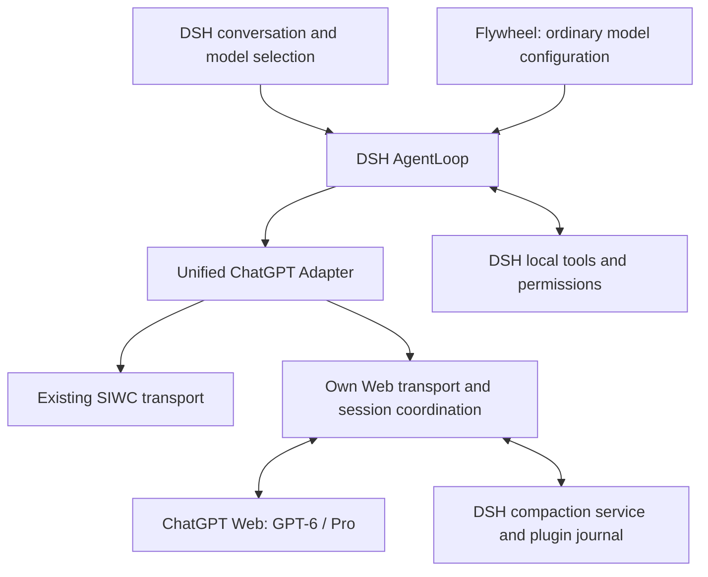
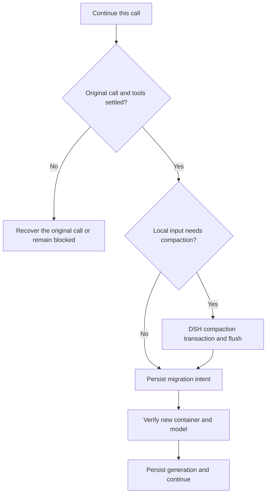

# ChatGPT DSH Plugin: Web GPT-6 Pro and Complete Session Support

English · [简体中文](2026-11-17-chatgpt-web-provider.md) · [Proposal index](README.md) · [Current Flywheel architecture](../design.md)

**Status: revision 2 has an implementation candidate; not merged or released.** The 2026-11-17 plugin-first design replaces the initial PR #57 proposal. Original source baselines remain in sections 3 and 15. Actual code, cross-review, offline results and unfinished capabilities are recorded in the [implementation validation record](../validation/2026-11-17-chatgpt-web-implementation.en.md). This is not a claim that T01–T36 all passed.

## 1. User goals and the actual interaction

The primary deliverable is a **native DSH model capability**. A user who installs and configures only the existing `ckanner/dsh-plugin-chatgpt` can use ChatGPT Web GPT-6 / Pro from the DSH conversation interface, including conversation, design, file and Shell tools, code execution, Review, and continued work in long sessions. Flywheel is one consumer of this capability.

The intended interaction is:

1. Enable "Web models" in the existing ChatGPT Provider settings card, choose a dedicated browser connection, and manually complete the initial ChatGPT sign-in.
2. Return to the DSH conversation interface and select **GPT-6 Pro · Web** from the **ChatGPT** group in the existing model selector.
3. The native reasoning-effort selector displays **Pro** and selects it by default. The first release exposes only the Pro effort that has passed actual web-selection verification.
4. Send a task directly in DSH. The plugin controls the web model, while DSH executes local tools; the user does not need to install Oracle, start another CLI, or create a Flywheel task.
5. As work approaches the context budget, the plugin coordinates compaction and web-conversation migration. DSH retains the logical Session and displays compaction/resumption status and links to the corresponding web conversations.
6. When orchestration is needed, choose the same Provider, model, and Pro effort in a Flywheel Loop or execution route.

**Core delivery criterion: without Flywheel, the plugin independently supports native DSH conversation, real tool loops, controlled compaction, continuing sessions, and failure recovery. Flywheel integration reuses that same implementation.**

### 1.1 Native interaction principles

- Reuse DSH's model and reasoning-effort selectors instead of introducing a separate "Pro task console."
- Distinguish the existing account connection from the web connection within the same ChatGPT Provider settings card. A successful connection in one channel does not make the other ready.
- Use the model name and badge to identify the Web channel. Show account/connection status, the actual model and effort, the current conversation, compaction status, and actionable failures.
- Selecting a model must not trigger sign-in, browser startup, or inference. Explicit connection actions and actual calls own the corresponding resources.
- Serve both DSH desktop and independent SDK profiles. Installation on the desktop does not automatically install or configure the SDK profile.

## 2. Core decisions and changes from the first proposal

| Topic | Decision in this revision |
| --- | --- |
| Code ownership | The existing `ckanner/dsh-plugin-chatgpt` package provides the complete web-model capability |
| User-visible Provider | Reuse `chatgpt` and honor the plugin's existing custom Provider route configuration |
| New model ID | `gpt-6-pro-web`; display name `GPT-6 Pro · Web` |
| Native reasoning effort | `pro`, displayed as `Pro`; the model's default effort is also `pro` |
| Internal channel | A unified model entry dispatches exact model IDs to the existing SIWC transport or the plugin's own Web transport |
| Browser implementation | The plugin implements managed browser control itself; Oracle is an engineering reference only |
| Long sessions | The plugin owns budgets, synchronization, and migration; DSH's public CompactionEngine owns authoritative history-compaction transactions |
| Flywheel | Select the model through ordinary DSH Provider/model/effort configuration, with general capability admission and recovery integration |

This revision replaces three decisions in the first proposal: "add a user-visible `chatgpt-web` Provider," "Pro must omit effort," and "run a pinned Oracle engine." It does not retain two contradictory recommended configurations. The old proposal identifiers were never released, so no runtime compatibility aliases are needed.

**Source correction: DSH reasoning effort is an opaque ID owned by the Adapter; a model may declare `pro`.** The native selector reads that model's efforts and defaultEffort. The first proposal unnecessarily required effort omission and did not fully use the existing interface. This revision uses an actual Pro effort.

The following engineering invariants remain:

- Model, effort, account, transport, and billing channel are never silently substituted. Pro does not map to high/max/ultra.
- DSH owns AgentLoop, tool execution, permissions, and authoritative session records. The web worker does not execute arbitrary local Shell commands.
- Unknown dispatch or tool outcomes require recovery/reconciliation first; changing conversations, models, or plans cannot bypass them.
- Record Dispatch, Activity, Outcome, Cleanup, and Usage independently. Estimated usage must not become claimed server-side usage.
- Flywheel's Go orchestrator remains the sole writer of its state. The plugin cannot write Flywheel state or decide that acceptance has passed.

## 3. Verified baselines and actual gaps

| Component | Pinned baseline | Facts relevant to this revision |
| --- | --- | --- |
| ChatGPT plugin | `40d8f885`, 0.1.20 | Registers native ChatGPT models and a settings card; all current model calls enter the SIWC adapter |
| Official DSH master | `39163dd3`, 0.2.2-rc.3 | Supports model-defined efforts, native model selection, tool loops, persistent sessions, and the public CompactionEngine |
| Flywheel | `db6b93e6`, 0.37.0 | Already has DSH model configuration; execution-policy and some UI effort allowlists do not include pro |
| Oracle, reference material | `0a064e7b`, 0.23.1 | Supplies reference implementations and failure fixtures for browser interaction, model/effort selection, continuation, and capture |

Source inspection confirms:

1. The plugin's `HarnessAdapter.stream()` unconditionally enters the existing request conversion and SIWC adapter. Adding a catalog entry alone does not create a web call.
2. The SIWC catalog is empty when SIWC is not signed in, and catalog errors can affect outer listing. The Web subcatalog must be independent so that lack of SIWC authentication does not hide it.
3. The current wrapper projects only provider/id/name. It must retain valid description, modalities, badge, and other metadata so the native selector can identify Web accurately.
4. Native DSH ModelSelect reads efforts/defaultEffort and supports Pro. A separate selector is unnecessary.
5. DSH `providerRetryPolicy(provider)` is a Provider-level policy, with no model-level override in the current prepared call. A unified ChatGPT Provider must not disable SIWC retries globally to accommodate Web.
6. Basic compaction in DSH prefers the last answered model when choosing its default summarization route. Switching to Web does not prove that summarization will also use Web. Its default headroom is not a measured web-context limit.
7. Flywheel's SDK overlay currently disables the default compaction-basic implementation. Installing the plugin alone does not establish that this profile has an appropriate compaction backend.
8. Oracle's log-tail output, periodic status, and existing follow-up behavior do not meet the entire contract in this design. This revision implements the capabilities itself instead of presenting a CLI/MCP wrapper as a complete model interface.

Section 15 pins the design-time sources. Implementation uses the newer DSH `ca33fd6843b205e279c7ccb6cb73a472c78f5760` / `0.2.2-rc.4` with an explicitly maintained compatibility patch. Real host, tool and JSONL offline results are in the separate validation record. Actual account, Mac browser and website full-context acceptance remain incomplete.

## 4. Model and effort contracts within one Provider

### 4.1 Native model registration

The following is the proposed exact-model metadata shape for resolveModel/prepareCall. Implementation must use DSH's branded-type constructors and actual types; this is not directly executable plugin code. listModels supplies discovery fields, after which DSH resolves the exact model's reasoning metadata. Adding a Pro field only to listing does not complete this integration:

```json
{
  "provider": "chatgpt",
  "id": "gpt-6-pro-web",
  "name": "GPT-6 Pro · Web",
  "reasoning": {
    "efforts": [
      { "id": "pro", "name": "Pro" }
    ],
    "defaultEffort": "pro"
  }
}
```

`gpt-6-pro-web` is a reserved model ID in this plugin, identifying the web GPT-6 + Pro route; it is not claimed to be an official API model slug. `pro` is a native `reasoningEffort` carried through DSH's normal request field. Internally, the plugin records the target web model version and effort; a Pro label alone cannot establish the complete model identity.

`providerInfo`, `listModels`, `resolveModel`, `prepareCall`, and `stream` use one exact routing table. Honor the Provider name actually configured in the plugin. Its default is chatgpt, but internal checks must not hardcode that name everywhere.

The first version declares and accepts only pro for this model. When DSH omits effort, use the declared defaultEffort; explicitly supplied high/max/ultra and other values are rejected. Switching back to an SIWC model reads that model's own efforts rather than retaining Pro from the previous model.

### 4.2 Catalog, authentication, and routing isolation

The unified Adapter composes two internal transports without registering the same Provider twice:

- SIWC models retain existing authentication, catalog, protocol, attachment conversion, and retry behavior.
- Route Web models by exact ID before SIWC metadata fallback, authentication, and `requestOf(options)`.
- Do not strip `-web` and forward the request to SIWC. Web failure must not silently switch to SIWC/API.
- Reserved model-ID conflicts must be reported. If an upstream catalog later returns the same ID, it cannot silently overwrite the Web route.
- With Web enabled, merge its static catalog independently of the SIWC catalog. Missing SIWC authentication or an SIWC listing error must not hide Web. Web being disabled or unready must not break existing models.
- Express model visibility, static capability, and actual admission for the current account separately. A visible catalog entry does not prove subscription quota or successful real-web verification.
- Refresh catalog/connection changes through `llm/adapters-updated`. Catalog queries and resolve do not open browsers or send prompts.

Interpret the existing ContextWindowLimit and per-model overrides by exact route. Web may expose only the conservative input limit that the plugin actually enforces, labeled as local policy. It cannot present the SIWC/API catalog's window as the web window.

### 4.3 Binding after selection

A formal call freezes provider, model, effort, transport, connection, non-secret account identity, actual directories, tools, permissions, and policy version. Selector metadata does not replace per-turn web verification.

Switching from SIWC to Web changes the channel even within the same Provider. That change must be part of session, prewarm, and recovery identity. Matching provider alone is insufficient to reuse a runtime. If the model/account of an unsettled call changes, settle the original call before admitting the new binding.

## 5. Plugin architecture and its own browser implementation



### 5.1 Module responsibilities

| Plugin module | Responsibility |
| --- | --- |
| Model registry / Composite adapter | Catalog composition, model/effort metadata, exact transport selection, and existing SIWC compatibility |
| Web connection manager | Dedicated profiles, account bindings, browser/CDP connections, owned resources, and cross-process leases |
| Page adapter | Web layouts, model/Pro selection, project/conversation ownership, composer, attachments, terminal states, errors, and stopping |
| Turn coordinator | Admission, submission, observation, complete result, stopping, and read-only recovery for one model call |
| WebSessionCoordinator | DSH session mapping, incremental synchronization, capacity budgets, public compaction-service calls, and generation migration |
| Tool/media bridge | Complete-response protocol validation, DSH block conversion, actual attachment bytes, and receipts |
| Journal / recovery service | Write-ahead journal, complete-result artifacts, durable host associations, unknown fences, and recovery adoption |
| Plugin UI / diagnostics | Existing settings card, native model metadata, connection/failure status, session links, and compaction/recovery controls |

These are internal plugin boundaries, not a requirement for new public npm packages or additional user installation steps. A managed background worker may isolate browser control; typed IPC remains an implementation detail, not a new Flywheel harness.

DSH desktop and SDK may use the same connection concurrently. The connection manager must coordinate the dedicated profile, Chrome ownership, queue, and call leases through private IPC/a cross-process broker. Two workers must not independently launch the same profile. One host exiting cancels only the work it owns; it must not kill another host's admitted calls. Internal interfaces and provenance must be versioned and verified through local identity and directory permissions.

Broker/lease keys use the canonical actual browser-profile path and OS user identity. Different connection names or stateDir values pointing to the same profile still refer to one shared resource. A shared broker/Chrome process must not belong to a process group that the first SDK request can kill wholesale. A client exit revokes only its own owner leases. Even when no clients remain, unresolved cloud calls must be reconciled before bounded shutdown of local shared resources.

### 5.2 Oracle as a reference

Implement page adaptation and the call state machine in the plugin, using verified general-purpose CDP libraries if appropriate. Consult pinned Oracle source for model menus, the Pro slider, attachments, stable preambles, cancellation races, page recovery, and profile ownership.

**Oracle CLI, MCP, internal module imports, source snapshots, and background services are not required runtime dependencies.** Users do not install Oracle separately. Do not parse log tails as answers, copy the existing resume behavior that skips model verification, or substitute reverse-engineered private ChatGPT HTTP interfaces.

Candidate general-purpose libraries can be informed by Oracle's chrome-remote-interface and chrome-launcher dependencies, but the plugin pins its own exact versions, integrity, and compatibility tests. Oracle's Node >=24 requirement does not automatically apply to this plugin. Prefer the current DSH/plugin Node baseline and decide through actual dependency and packaging acceptance.

If specific source is copied, retain its MIT attribution and notice. Record a pinned version when borrowing behaviors and test ideas as well. Centralize page-adapter code so selectors do not spread into tools, compaction, and Flywheel.

### 5.3 One web-model turn

Fresh calls, resumed calls, and the first call after migration use the same pre-submit checks:

1. The host call remains valid, the signal is not cancelled, the execution domain has no unresolved fence, and sufficient budget remains.
2. Acquire the connection permit, conversation write lease, and registered owned page; wait for history hydration to finish.
3. Verify the account, project, conversation, hosted-context policy, and current tool permissions.
4. Observe model version and effort separately, then jointly confirm GPT-6 + Pro. Stop before submission for an unknown layout or mismatch.
5. Validate this turn's incremental input, attachments, input budget, and request digest, then persist submit-intent.
6. Submit only once and obtain acceptance evidence matching the current prompt.
7. Observe this answer. Capture, validate, and persist the complete result before delivering it to DSH.
8. Once the remote turn is confirmed terminal and the complete result is persisted, end the stream so DSH can commit. Reconcile durable ACK through a separate callback/transaction without waiting inside the unfinished stream. Implementation review further requires retaining both connection capacity and conversation pending-delivery until ACK, before another web turn may start. ACK precedes local tools/subagents, avoiding parent/child deadlock.

The Page adapter returns structured observations by compatibility version, locale, and fixture, and records the selection-evidence time. It does not guess unknown buttons. If the page becomes unobservable after submission, retain unknown for the original request instead of changing it to "not sent."

**Stable text or temporary absence of the Stop button does not prove completion.** Pro may produce a preamble and then continue thinking. Completion must combine the current turn/message identity, accepted prompt, positive terminal UI evidence, and complete-content digest. Intermediate preambles, notices, quotations, prompt echoes, and old answers must not enter executable-tool parsing.

## 6. DSH tool loops and complete capabilities

### 6.1 Input and response protocol

The web interface does not supply a native DSH tool API that this plugin can directly reuse. The plugin supplies effective instructions, ordered history, actual tool schemas, call identity, and the response format in the turn's messages. Textual system/developer markers do not carry native API system-message priority, and prompts cannot be treated as permission boundaries.

Proposed tool response:

```json
{
  "protocol": "dsh-chatgpt-web/1",
  "requestId": "webcall-example-1",
  "generation": 2,
  "kind": "tool_calls",
  "calls": [
    {
      "id": "tool-example-1",
      "name": "read_file",
      "arguments": { "path": "src/example.ts" }
    }
  ]
}
```

`read_file` is illustrative only; actual names and arguments come from the current DSH tool catalog. A final response is:

```json
{
  "protocol": "dsh-chatgpt-web/1",
  "requestId": "webcall-example-2",
  "generation": 2,
  "kind": "final",
  "text": "The final answer for this turn or the structured artifact text required by the host"
}
```

Validate the entire single JSON object: protocol, requestId, generation, unknown fields, tool names, argument schemas, unique IDs, size, depth, and call count. No executable deltas may reach DSH before the whole batch passes. Do not infer Shell commands from Markdown.

Convert tool objects to DSH ToolCallBlock values, with arguments serialized as JSON. DSH executes tools and persists their results; the plugin appends the corresponding tool results on the next call. Final text enters ordinary session and host-artifact handling. Flywheel's Plan/Review/Judge and other business schemas remain independently validated.

Format correction begins only after the original answer has definitively ended, with bounded attempts, time, and usage. It is not a transport retry, and no unvalidated action executes beforehand. Complete source text may be stored in a private artifact referenced by path, byte count, and digest. Reads must stay within the bound directory and reject path escape, links, and truncation.

### 6.2 Tools, media, and subagents

| Capability | Plugin target | Admission requirements |
| --- | --- | --- |
| Ordinary conversation, design, Review | Complete text and structured output | Current turn, complete result, and business schema |
| Local execution | DSH Read/Search/Write/Shell/Test tool loop | Actual cwd, permissions, at least two tool rounds, and persisted results |
| PTC | Use the real run_code tool and schema | Handles, deferred output, errors, and nested calls return correctly |
| Agent/Team/Workflow | Reuse native DSH capabilities | Lineage, independent invocations, activity, budgets, cancellation, and domain recovery |
| Image input and screenshots | Upload actual bytes from AttachmentStore | MIME, order, hash, upload completion, and model visibility |
| LCU | Invoke through existing tools and image handling | Explicit permission, shared GUI coordination, and complete cancellation |
| Hosted web tools/apps | Declare and admit independently | Writable actions disabled by default; host permissions cannot be bypassed |

Before reaching the adapter, DSH currently converts file blocks into path text and images for models without image support into placeholders. Original media must therefore be checked on the pre-projection side of the public `llm/stream` hook, covering user input, tool screenshots, auxiliary purposes, and recovered history. Explicitly reject images before image capability passes acceptance; once enabled, declare image support and obtain actual bytes. Checking only the projected object is insufficient.

Ordinary files should first be exposed through local read/search tools. Arbitrary path text is not upload authorization. Native file upload needs an explicit public projection/admission integration point and attachment-provenance records. Capabilities that have not passed acceptance remain unavailable; do not silently drop images or switch backends.

## 7. Long-session management owned by the plugin

### 7.1 One authoritative history, two capacity budgets

DSH's durable events, derived history, and compaction checkpoints are authoritative. The plugin stores only web synchronization cursors, mappings, input projections, and recovery evidence. It must not secretly compact a second history that DSH cannot see.

WebSessionCoordinator checks both:

- **Current model-input budget:** effective instructions, tool schemas, protocol, messages, attachment projections, and output reserve.
- **Cumulative web-history budget:** conservative estimates of sent/captured content, turn count, and observable limits.

Input, output reserve, cumulative history, per-turn size, turn count, and compaction/correction/migration attempts must all have finite values fixed by an empirically validated policy manifest and policyVersion. Do not mark the model ready without an accepted policy. Neither an API window nor Basic's default headroom is a measured GPT-6 Pro web limit. Uncertain attachment estimates must not count as zero.

### 7.2 Incremental continuation and migration decisions

Store normalized content prefixes, confirmed synchronization cursors, and the bidirectional association between web protocol objects and DSH blocks. Although DSH supplies full messages on each call, append only new content to the web conversation instead of repeatedly resending the entire history.

Appending requires the same owner, model/effort, transport, account, hosted-context policy, and tool/instruction contracts; a matching prefix; and a settled previous turn and tool work. Message count cannot replace content digests. Raw web JSON cannot be compared byte-for-byte with DSH blocks.

- If the local request remains small but remote history is large, create a new generation directly from current authoritative history.
- If local input is also too large, reduce it through a DSH compaction transaction and flush before migration.
- For history rewind/fork/prune or changes to permissions, model, tools, or instructions, recheck compatibility. Migrate incompatible state only after the original call can be settled.
- An explicit web context-length rejection enters bounded migration. Timeout, network failure, and rate limiting are not context overflow.
- If the new bootstrap is still over budget, reduce the compactable range further or stop explicitly. Do not create conversations indefinitely.

### 7.3 Reuse DSH compaction transactions

Each DSH context can have only one CompactionEngine. Reuse Basic when the desktop already has it. If the SDK lacks an engine, load one compatible backend through public composition. The ChatGPT plugin and default compaction must not register two global services.

The plugin supplies Web-specific policies: input budget, output reserve, summarization target, preserved facts, migration conditions, and invocation accounting. Compaction runs through public `compactIfNeeded`, `compactNow`, `compactRegion`, or a reviewed public extension. Automatic and manual compaction share the same transaction and migration coordination.

**The default summarization route is the current Web target model + Pro, using an independent auxiliary call.** Users may explicitly configure another summarization route, but its actual channel, account, and budget must be shown and admitted by the host. Basic's preference for the "last answered model" must not silently invoke old SIWC/a paid API when switching to Web.

The current public interfaces cannot fully carry the proposed target and summarization-route policy. This design explicitly depends on a public DSH extension: before constructing and measuring the final GenerateOptions, pass the agent, proposed target, purpose, and effective budget to the summarization-route policy. The actual provider/model/effort in durable records must match the real request. Do not secretly change routes at the adapter endpoint or invoke Basic's private compactPressure/selectCompactableRange methods.

Use the public tokenMeter's proposed-header measurement and complete tool-pair ranges to select the compaction region. The summarization input itself must fit. A large history may require multiple bounded, independently accounted compaction transactions; do not record several model calls as one. If a single indivisible unit remains over budget, fail explicitly.

Summaries preserve task constraints, frozen acceptance, unresolved issues, trusted evidence references, and paired tool tails. Retain original events and source ranges, and persist the checkpoint before approving web migration. Basic may log a warning and continue after compaction failure, so the final Web input-admission guard always remains in place; a known over-budget request must not be sent.

### 7.4 Auxiliary-call isolation

Classify main-call eligibility in the pre-projection hook using `isAgentLoopRequest()`, the real Agent, sessionId, purpose, and admitted binding. Only the main loop without an auxiliary purpose joins the main conversation.

Each explicit purpose such as compaction or title receives a separate invocation. Even with the same sessionId, it must not reuse the main conversation or a previous summarization conversation. Non-AgentLoop one-shots, missing sessionId, and unknown purposes use an explicitly supported independent path or are rejected; they must not enter an anonymous shared session. Auxiliary requests do not own local-tool execution capability.

The plugin reuses the host's same DSH LLM module instead of bundling a second WeakSet. A controlled call context stores independent ID, kind, purpose, owner, executionDomainId, Agent lifecycle, session/surface revision, binding and request digests, and signal. If AsyncLocalStorage is used, it must cover creation and the next/return/throw lifecycle of the lazy AsyncIterable, and be revoked on termination to prevent identity crossover between concurrent auxiliary calls.

### 7.5 Migration transaction



The migration journal records old/new mappings, source checkpoint, bootstrap digest, reason, project-creation intent, and actual ID. If a crash occurs after creation but before journal confirmation, first locate the owned container read-only. If identity cannot be established, block instead of repeatedly creating containers. After bootstrap submission, recover under the original invocation; do not resubmit.

When the old conversation is full, rely on DSH records rather than requiring it to accept another summarization instruction. Compaction is lossy and does not promise preservation of hidden reasoning or unlimited context. Conversation rotation does not reset subscription quota.

## 8. Sessions, hosted context, and readable names

### 8.1 Logical sessions and web generations

One DSH Session maps to a chain of web generations, recording project/conversation identities, parent-message relationships, summaries, and the active generation. Ordinary tool loops reuse the current generation; migration after safety checks retains the chain.

DSH desktop shows the complete logical Session, tool trace, current web link, and historical generations. Web conversations in the normal persistent mode remain in ChatGPT history instead of being automatically archived as hard-to-find one-shot calls. Do not claim history visibility has passed without verifying that the account can revisit it.

Web projects and conversations use readable task, role, and generation names. When none exists, derive a bounded local label from the initial request. Set and read back titles through the UI, modifying only owned objects from this invocation and preserving user-edited titles. Web naming does not invoke Pro again. An enabled DSH LLM-title service is a separate auxiliary call and must be accounted independently.

### 8.2 Isolated working sessions and personalized conversations

A Chrome profile isolates only local data. Memory, history, custom instructions, project sources, and apps on the same account may enter the effective context. The plugin explicitly manages hosted-context policy; a new conversation ID alone does not prove isolation, and the plugin must not automatically change global user preferences.

The default managed working mode uses **a new private project-only project for every generation of every logical session**, containing only the corresponding main conversation and admitted materials. Project instructions are controlled by the current contract, with source/instruction/sharing digests recorded. Roles, subagents, auxiliary calls, and generations do not share projects, preventing old history from reentering through project memory.

Admission verifies account prerequisites, project memory settings, sources, collaborators, GPT-6 + Pro inside the project, and the conversation's parent project. Pro being selectable on the home page does not prove availability within a project. New and changed settings may take effect differently, so "just changed an old project" is not verification. A project failure must not fall back to the home page and continue sending.

Ordinary desktop conversations may explicitly choose a personalized policy that follows the user's account preferences. The UI identifies that their context may originate outside DSH. This mode does not provide strict isolation, cannot serve Review/Judge roles requiring independence, and cannot promise that old memory will never reenter after migration. Do not automatically switch to personalized mode when managed mode is unavailable.

Unpersonalized Temporary Chat may be evaluated separately as a future mode, but it is not this revision's persistent default. Saving it as a regular conversation does not preserve the original isolation semantics.

Recheck the current container, sources, and policy on every turn. Manually moving a conversation or adding sources/collaborators invalidates prior admission. Guarantees cover publicly observable settings, not the platform's hidden instructions.

## 9. Durable state, recovery, and preventing duplicate execution

### 9.1 Invocation facts and the write-ahead journal

The plugin's internal Web worker offers versioned prepare/start/observe/recover/cancel/close semantics. Recover is read-only; the host performs adoption separately. Users do not operate a machine API.

Durable identity includes at least the host owner/execution domain, DSH session/surface, provider/model/effort/transport, connection/account fingerprint, project/conversation generation, web message identity, and complete-result digest. Bind Flywheel identity through a managed host service instead of injecting unknown SDK fields. Ordinary desktop use does not depend on a Flywheel ID.

| Order | Durable fact |
| --- | --- |
| 1 | prepared: call binding, policy, and budget are ready |
| 2 | submit-intent: submission intent and prompt digest are synchronized |
| 3 | submitted-confirmed: acceptance evidence for the current prompt is saved |
| 4 | response-captured: complete-result artifact is saved |
| 5 | response-validated: protocol and identity validation are complete |
| 6 | delivered-to-dsh: delivered, but not yet proof of durable host commit |
| 7 | host-commit-confirmed: DSH's durable record and associations are verified |

Persist and synchronize every step atomically. Submit-intent does not prove dispatch; absence of the next step does not prove non-dispatch. DSH's `finish.replayState` saves association references only with a successful message and cannot replace the pre-submit journal. Record the Provider response ID separately from the assistant MessageId generated by DSH.

Associate host ACKs by call kind. Main calls reconcile assistant/tool events and flush; compaction reconciles its compactionId, summary/checkpoint transaction, and flush rather than waiting for a nonexistent assistant message. Title/one-shot calls must declare their corresponding host operation and durable or non-durable delivery semantics, without pretending to commit an assistant message. The adapter first persists its result and ends the iterator; after committing, the host uses a separate ACK channel. The next model/tool admission barrier rechecks that commit, preventing the stream and commit from waiting on each other.

### 9.2 Adopting a captured response during recovery

- Confirmed non-dispatch and confirmed local cleanup: allow retry within budget.
- Unknown submission outcome: lock the original conversation and read its original turn and journal; do not resend.
- Complete answer captured but not committed to DSH: save it as a pending result for a dedicated host transaction.
- Assistant/tool results already durable: reconcile existing records and only acknowledge delivery, without a second invocation.
- Identity conflict, manual web edits, or incomplete result: retain evidence and block.

Current DSH resume repairs and closes interrupted steps/turns first, so an ordinary adapter cannot continue the old step. This design depends on a new public `adopt-recovered-response` transaction. Under host admission and a session write lease, it verifies the original request/surface, that tools have not executed, compatibility with current permissions/tool implementations, and absence of an unknown fence; it then adopts once in a new host recovery transaction and flushes.

The idempotency key is executionDomainId plus DSH sessionId, originalRequestId, and providerResponseId, recorded in the host's durable log. Repeated adoption returns the original commit identity. Before this integration point exists, a result may be shown read-only, but old tool responses must not be replayed through the next ordinary stream and called successful recovery.

Auxiliary-result recovery includes call kind and host operation/compaction ID in its association and idempotency key. Determine whether the summarization transaction already committed, then let the same authoritative CompactionEngine adopt or reject the result. Do not create an ordinary assistant message or bypass checkpoints to alter history. Without the corresponding recovery integration point, retain the result read-only and block automatic redispatch. Main-call adoption cannot simply be applied to summaries or titles.

### 9.3 Blocking an execution domain after an unknown tool side effect

DSH already has tool/call, tool/result, and checkpoints. A tools/result notification is not a durable ACK. After a crash, a call that started but lacks a durable result is repaired as `TOOL_OUTCOME_UNKNOWN`. This records a fact; it does not inherently prohibit later side effects.

The plugin's general host policy must establish a durable executionDomainId and unknown fence covering the original root, admitted subagents, PTC nested execution, and corresponding workspace responsibilities. Unresolved fences continue across Providers, fresh/resume, fallback, new conversations, and replanning. The current requestId cannot replace a durable execution domain.

Unknown child outcomes propagate to the domain coordinator and freeze new sibling admission. Cancel/drain already-running work and reconcile each outcome independently. Only host-defined read-only recovery operations are allowed; the model cannot designate itself read-only. Deterministic evidence or explicit human resolution is required to clear the fence. A model's "completed" statement is not evidence.

In ordinary desktop use, the plugin host policy persists the execution domain. Flywheel additionally persists the blocking fact across workers in Go. Do not promise exactly-once semantics for arbitrary Shell commands, or discard unknown as an ordinary failure during compaction.

### 9.4 Retry contract within the unified Provider

Preserve existing SIWC Provider-level retry behavior. **Do not globally return a zero-retry policy from the unified chatgpt Adapter to handle Web.**

Web retry decisions must use the call's frozen transport and journal. The managed runtime retries only confirmed non-submission, within bounds. Uncertainty after submission first creates a dispatch fence, then returns while preserving the original TIMEOUT/TRANSPORT cause.

The current `llm-retry` always mode may continue retrying after a downstream rejection, so an ordinary request-error listener cannot reliably impose a hard veto. This design explicitly requires a **public per-call replay-veto/stop outcome** in DSH. Before normal/always retry executes, consult the actual policy of the prepared call. A no-replay decision terminates the request and propagates blocked/unknown; more aggressive user retry settings cannot override the fact.

This mechanism applies to Web's non-replayable facts and execution domains still blocked by their fences, including recovery or fallback to SIWC/other models within those domains. Unrelated, ordinary SIWC calls retain their existing policy. The veto reads both the prepared route and the durable domain fence. New admission still checks the fence to prevent outer replanning from bypassing it. The design must also prevent an always-retry loop from spinning indefinitely on fence rejections. Do not invent error codes to solve retry behavior. Until this public integration point is complete, full recovery capability is not delivered.

## 10. Activity, cancellation, permissions, concurrency, and cost

### 10.1 Activity and deadlines

Executable deltas cannot be emitted before content validation, so the plugin's general activity events are independent of answer text. Events carry the real owner, call ID, generation, sequence, and bounded type. DSH desktop can display them; Flywheel consumes them through an adapter.

Distinguish process heartbeats, UI-state snapshots, actual new content/progress, prompt acceptance, terminal states, and cleanup. Repeated unchanged logs are not activity. Pro's unobservable reasoning phases use an explicit opaque/wall policy; stdout silence cannot prove a hang.

The original call's wall deadline, cancellation, correction, compaction, migration, and queuing share a budget. Disconnects and new conversations do not reset it. Declare observability while retaining failure detection; heartbeats cannot keep a call alive indefinitely.

Apply separate bounded policies to single frames, complete-answer artifacts, retained buffers, cumulative protocol traffic, and activity events. Coalesce high-frequency activity according to actual arrivals, preserving delivery capacity for terminal and cleanup receipts. Rich activity must not be counted against a tiny final-answer limit. Errors retain the host's AUTH/QUOTA/RATE_LIMIT/CONTEXT_WINDOW_EXCEEDED/INVALID_REQUEST/TRANSPORT/SERVER/TIMEOUT/EMPTY_RESPONSE taxonomy with bounded Web reasons. Web quota or context errors must originate from identity-matched UI controls, not error text quoted inside an answer.

### 10.2 Local cleanup and cloud state

Receipts separately preserve dispatch, outcome, stop reason, local cleanup, remote generation, usage, and current model/effort evidence.

Cancellation first blocks new calls and tools, attempts to stop the exact owned page, and drains owned local tools and control resources under an independent finite cleanup budget. Async resources arriving after cancellation must still be released. A stopped call cannot later create a tab or submit a delayed prompt.

Closing a tab, disconnecting CDP, killing a worker, or releasing a waiter does not prove cloud generation stopped. An unknown remote call retains isolation and capacity responsibility even when local cleanup is complete; it cannot be automatically replayed. A shared browser need not be destroyed after each successful call. Release only that call's resources without closing unrelated user tabs or another host's work.

### 10.3 Concurrency and tool permissions

- One writer owns each conversation across processes for the whole turn. Lease takeover verifies owner/epoch and the journal, not just PID existence or a fixed timeout.
- Connection concurrency defaults to 1. A permit covers one web-model turn and is released before waiting for local tools or subagents, avoiding parent/child deadlock.
- Queued calls remain not-dispatched, use the remaining wall budget, and can be cancelled. Recheck cancellation and binding after receiving a permit to prevent late submission.
- A remote unknown turn cannot become unlimited oversellable capacity merely because its local process exited.
- DSH local tools retain their existing cwd, sandbox, and permissions. Remote MCP and web apps need separate allowlists/side-effect classifications; a local OS sandbox does not constrain remote writes.
- Read-only Review/Judge exposes only verified read-only external tools. Writable hosted apps are disabled in the first version; reject calls when that state cannot be verified.
- CDP is the primary transport. If GUI focus is required, coordinate with LCU rather than occupying the whole desktop during long reasoning or allowing two controllers to manipulate the same tab.

### 10.4 Accounting

If authoritative usage/cost is unavailable, preserve unknown. Local token estimates serve capacity policy only. Account for summarization, format correction, reconnects, and migration separately; do not invent zero usage or free calls.

The plugin does not weaken Flywheel's existing hard/soft/off budgets. For example, an unknown usage record under a hard daily-token-limit blocks subsequent calls. Diagnostics must explain compatibility rather than silently changing budgets to pass acceptance. Ordinary DSH also records the facts that are actually known and the account's rate-limit/quota state.

Measure task completion, tool rounds, latency, queuing, correction rate, compaction/migration count, and manual recovery before choosing suitable tasks and defaults. Do not assume Web is faster or cheaper than other channels.

## 11. How Flywheel consumes the same model

### 11.1 Target configuration

The following is a configuration fragment for the completed implementation. **Current 0.37.0 cannot use the new model from this configuration yet.** Incorporate it into the effective complete configuration; Flywheel does not deep-merge files.

```json
{
  "profiles": {
    "web-pro": {
      "harness": "dsh",
      "provider": "chatgpt",
      "model": "gpt-6-pro-web",
      "thinking": "pro",
      "channel": "chatgpt-web-subscription"
    }
  },
  "loops": {
    "design-plan": { "profile": "web-pro" },
    "review": { "profile": "web-pro" }
  },
  "routes": {
    "hard": { "profile": "web-pro" }
  },
  "channels": {
    "chatgpt-web-subscription": {
      "harness": "dsh",
      "provider": "chatgpt",
      "env-key": null
    }
  }
}
```

This example selects Web Pro for design-plan, review, and the hard execution route. Unoverridden design-review/plan-review inherit review. Existing fresh/scoped configuration still controls session reuse; the fragment does not change the global sessions policy.

The channel is a named Flywheel configuration and budget attribution, not a browser-account selector. The plugin's activeConnection selects the web connection, with one selected per DSH profile in the first version. Two different channel names do not imply two different accounts.

| Model work | Configuration entry |
| --- | --- |
| Initial design and independent design review | loops.design-plan / loops.design-review |
| Planning and plan review | loops.plan / loops.plan-review |
| Execution | routes.default / frontend / hard / multimodal |
| Code review and final judgment | loops.review / loops.judge |
| Second opinion | Top-level judge-panel |
| Intake / Garden | loops.intake / loops.garden |
| Bounded execution-model switching | execution-policy.bindings and route allowed sets |

There is no loops.execute. JEV's dedicated HTTP contract, deterministic Verify, Git delivery, and state transitions do not become part of this model configuration. Native Codex/Claude harnesses do not have their main models replaced by it either.

### 11.2 Required Flywheel integration

1. **Model/effort:** explicitly send `thinking: "pro"`. Existing DSH wire and prewarm accept non-empty strings, so the first proposal's empty-effort exception is unnecessary. Do not change Pro to high.
2. **Execution policy:** schema and Go validation allow DSH adapter-owned effort and verify it against exact model capabilities before a formal call. Other harnesses retain their existing allowlists, and configured allowed bindings remain strictly enforced.
3. **UI:** consume this DSH model's valid efforts/defaultEffort and display Pro natively. Revalidate effort when the model changes rather than inferring quality from a generic high/max ordering.
4. **SDK composition:** load the same ChatGPT plugin's Web component and general host policy, and configure a real connection for the independent SDK profile. Do not substitute the desktop profile for the SDK profile.
5. **Compaction:** connect Web root/child calls to the same plugin policy and sole CompactionEngine, passing frozen contracts, remaining budgets, and call accounting. Go and the worker do not implement another summarizer or DOM layer.
6. **Identity and recovery:** expose transport/connection, runtime version, execution domain, Web-call facts, and recovery capabilities. Model/effort/account changes cannot reuse old bindings.
7. **Activity and cleanup:** map general plugin events to existing activity/receipt validation and negotiate a new worker extension version. If older v1/v2 workers cannot understand the capability, reject before dispatch rather than ignoring fields and continuing.
8. **Installation/doctor:** verify SDK plugins, general dependencies, policies, and versions. Static checks are not real-account or quota checks.

Configuration loading can verify field shapes and allowed bindings. The model's metadata defines the actual meaning of DSH effort, and execution/prewarm admission must validate it. Relaxing a schema does not make an unknown effort valid. The initial configuration explicitly supplies pro. If Flywheel later permits omission to use model defaults, separately address the old driver's high fallback; this example must not silently depend on it.

Flywheel-specific constraints enter only through a general host-policy extension. Desktop plugin functionality must not import or depend on Flywheel packages, file layouts, or state machines.

## 12. Settings, installation, and data lifecycle

Add proposed `web` settings under the existing ChatGPT namespace, without a new user-visible Provider. When Web is enabled:

| Setting | Rule |
| --- | --- |
| enabled | Defaults to false; does not start a browser or change existing SIWC defaults |
| activeConnection | Explicitly select one named connection when enabling |
| connections | Dedicated profile, browser path, private state directory, account binding, and connection policy |
| maxConcurrentTurns | Initially 1; explicitly adjustable within measured and account-supported bounds |
| hosted-context policy | Managed isolation by default; personalization requires explicit selection and cannot serve independent Review |
| budget policy | Validated local input/output, cumulative history, turn, correction/compaction/migration limits, and version |
| summarization route | Defaults to this call's Web model/Pro; explicit overrides require admission, display, and accounting |

The user completes the first browser sign-in in the dedicated profile. Do not copy everyday Chrome cookies by default. Connection, model selection, and diagnostics have independent states. Catalog failures must not trigger inference or read other accounts' credentials.

Installation follows the existing npm workflow. Browser modules load lazily, and one candidate validates pinned dependencies, build contents, and SDK loading paths. There are no postinstall account-setting changes, per-call latest downloads, or implicit Oracle dependencies.

Doctor/prewarm do not send prompts or create business projects or placeholder chats. An explicit connection check may inspect sign-in and menus. Record "statically loadable," "account connected," "target model selectable," and "real inference passed" separately.

Store web state, journals, and complete results in private directories rather than target code repositories or general logs. Cookies, tokens, full email addresses, and sensitive text do not enter replayState/PRs. Cross-process synchronization sends only necessary validated scalars.

Retention/cleanup affects only plugin-owned objects and respects unresolved calls and the user's retention policy. Never delete recovery evidence for an unknown call. Deleting web projects/conversations or local logs requires an explicit user action; package upgrades must not automatically clear history.

## 13. Implementation scope, public integration points, and delivery order

### 13.1 Repository responsibilities

| Repository | Responsibility |
| --- | --- |
| ckanner/dsh-plugin-chatgpt | Main implementation: unified model entry, Pro metadata, own browser transport, session/compaction coordination, tool/media bridge, durable recovery, connection management, and UI |
| DSH upstream or an explicitly maintained compatibility patch | Public per-call replay-veto, summarization-route/proposed-target policy, recovery-response adoption, and related integration points; pinned compatible version |
| ckanner/flywheel | Ordinary model configuration and Pro validation, SDK composition, host policy, identity/activity/receipts, budgets, installation, and UI |
| ckanner/dsh-preset-generator | Update Web-model capability and PTC/subagent admission for actual composition; do not duplicate Provider implementation |
| ckanner/dsh-plugin-lcu | Add only necessary GUI-coordination/media contracts |
| Oracle | Pinned-source reference and provenance record; no runtime dependency |

### 13.2 Public contracts that must be settled first

- **Per-call replay-veto:** takes the actual prepared transport/call, durable dispatch facts, and domain fence; returns retryability or a non-replayable stop outcome. Normal/always cannot override it, blocking remains effective across models, and unrelated SIWC is not affected.
- **Compaction policy:** takes the real Agent, proposed target, purpose, and remaining budget; returns the actual summarization route/effort and acceptable range before GenerateOptions is formed, usage recorded, and checkpoints created. The sole CompactionEngine owns history mutation.
- **Recovery adoption:** under the corresponding host-operation/session write lease, reconcile the original result with current permissions and adopt once by call kind and durable idempotency key. Main calls and compaction transactions have separate ACKs; existing commits return their original identity.
- **Host call context and tool guard:** determine main/auxiliary eligibility before projection, bind the execution domain, cover subagents/PTC, and revoke on lifecycle end.

These public extensions are delivered as an exact-source compatibility patch, not as a claim of stock SDK support. The patch preserves upstream version identifiers and separately records its base, hash and capabilities. It does not call DSH private methods or describe plugin-internal functions as official SDK APIs.

### 13.3 Milestones

| Phase | Deliverable | Acceptance gate |
| --- | --- | --- |
| P0 Contracts and experience | Unified Provider, model/Pro, connection/host contracts, bilingual interaction design | Review this proposal; make interface dependencies and independent desktop goals explicit |
| P1 Own browser foundation | Connection broker, page adapter, isolated-project admission/lifecycle, selection verification, complete results, journal, cancel/recover | Minimal real-account call without Oracle/Flywheel installed; Pro verification within the same project and failure fixtures |
| P2 Native DSH model and execution | Native catalog/effort, independent authentication state, tool protocol, replay-veto/unknown blocking, permissions, and media guard | DSH model selection to file modification and tests, with real multi-round tools; SIWC regression |
| P3 Long sessions and recovery | Sole compaction backend, Web summarization policy, incremental history, generation migration, adoption | Native DSH long tasks, full conversations, model switching, and crash recovery; pure Q&A is insufficient |
| P4 Flywheel consumption | loops/routes/policy/UI, SDK, budgets, prewarm, activity, and receipts | Model roles and cold/warm/resume cross-process acceptance using the same plugin implementation |
| P5 Complete capabilities and release | PTC/subagents/media/LCU, real Mac tasks, installation candidate, and bilingual guides | Real acceptance for selected capabilities; one exact npm candidate installs successfully, with a clear maintenance path |

This is implementation order, not an indefinite deferral of long context, Execute, or recovery. Full acceptance uses the user's actual heavy-work Preset and real tasks. A capability that has not passed cannot be released based only on a boolean declaration.

Implementation updates plugin contracts/settings, Flywheel architecture/protocol, schemas, bilingual installation/recovery guides and changelogs. This PR contains the Flywheel consumer; its companion plugin PR contains the implementation and compatibility patch. The 2026-11-18 continuation implements bounded image upload, format-only correction and explicit rejected-response retirement with offline regression evidence. The [validation record](../validation/2026-11-17-chatgpt-web-implementation.en.md) preserves the earlier snapshot and the remaining ambiguous-project, real-account, and complete heavy-task acceptance requirements. Offline image upload does not prove that the model actually used an image, and offline results do not waive live acceptance.

## 14. Regression and acceptance matrix

| ID | Scenario | Required observation |
| --- | --- | --- |
| T01 | Only ChatGPT plugin installed, without Flywheel/Oracle | Web model + Pro are selectable natively in DSH and support a real conversation |
| T02 | Web enabled/disabled, only one authentication present, one-sided listing failure | Transport states remain independent; usable models are not hidden and browsers are not launched |
| T03 | Native model/effort switching and custom Provider route | Correct metadata/default Pro; SIWC uses its own efforts, with no hardcoded ID |
| T04 | Web ID through resolve/prepare/stream/direct call | No SIWC conversion/authentication/request path; conflicting IDs are not overwritten |
| T05 | fresh/resume/migration, menu and locale variations, Pro label alone | Joint GPT-6 + Pro verification; unknown layout or mismatch prevents submission |
| T06 | Stable preamble followed by more thinking, temporarily absent Stop, old answer/echo | No premature completion; capture only this turn's positive terminal state |
| T07 | Large answer, artifact truncation/path escape | Verify complete result and digest; no log-tail result or out-of-scope read |
| T08 | Invalid JSON, unknown fields/tools, wrong ID, duplicate call, truncation | Reject the entire batch without local side effects |
| T09 | Multiple Read/Search/Write/Test rounds | DSH executes with correct cwd/permissions, returns results, and persists them |
| T10 | Replaying an executed tool, TOOL_OUTCOME_UNKNOWN, new call/Provider | Reuse confirmed results; durable domain blocking prevents side-effect replay |
| T11 | Full messages on every call, conversion between web JSON and DSH blocks | Append only actual new content; prefixes and mappings can be reconciled |
| T12 | prune/rewind/fork and changes to tools/instructions/model/account | Readmit/migrate after safe settlement; do not reuse the old binding |
| T13 | Main, compaction/title, unknown purpose, no session, concurrent interleaving | Classify before projection; isolate or reject auxiliary calls; call contexts never cross |
| T14 | Native DSH automatic/manual compaction, SDK without an engine | Use the sole authoritative engine; missing contracts fail explicitly, without a private second history |
| T15 | SIWC-to-Web model switch, explicit summarization route, default headroom | Actual summarization model/effort matches records; no implicit cross-channel call |
| T16 | Oversized summarization input, multi-part tool pairs, one oversized indivisible unit | Account for multiple bounded independent transactions; explicitly stop when reduction is impossible |
| T17 | Local/remote capacity, explicit web context rejection, oversized bootstrap | Checkpoint or migrate safely; no infinite summarization/conversation creation |
| T18 | Crashes after main/auxiliary delivery but before their host commits, and ACK ordering | Recover by call kind without resending unknown calls; stream termination and durable ACK do not wait on each other |
| T19 | Captured response after old step repair, repeated adoption, revoked permissions | Idempotent host transaction and current-permission checks; no ordinary-stream replay |
| T20 | Normal SIWC retry, Web normal/always, unknown-domain fallback to SIWC/other models | Preserve unrelated SIWC semantics; blocked domains neither duplicate submission nor spin forever |
| T21 | Two workers/desktop and SDK, aliases for one profile, launching owner exits | Coordinate by actual profile; a single request cannot kill shared processes or launch duplicate Chrome |
| T22 | Queue cancellation, parent waiting for child Agent, remote unknown | No late send, deadlock, or oversubscription; remaining wall budget is preserved |
| T23 | Real main/child activity, unchanged heartbeat, unobservable long reasoning | Activity is identified; opaque policy works; periodic logs do not invent progress |
| T24 | User cancellation/wall/host exit and late resources | Preserve the first cause and drain local work; record cloud unknown separately |
| T25 | project-only prerequisites, no Pro inside project, navigation failure/wrong project | Combined admission within the same project; no home-page fallback or silent mode switch |
| T26 | Project-creation crash, cross-generation work, new sources/collaborators | Locate original containers read-only; old memory cannot bypass isolation/compaction |
| T27 | Personalized conversation used for independent Review, manual web edits | Reject unsupported independence claims; diagnose invalidated bindings |
| T28 | DSH/Web titles, persistent history, migration links | Readable names and real revisit-able links, without extra Pro naming calls |
| T29 | Original images, tool screenshots, auxiliary/recovered history | Reject unsupported media before projection; upload actual bytes when enabled |
| T30 | PTC/Team/LCU and remote MCP/apps | Real native tools, lineage, GUI coordination, and external permissions |
| T31 | Flywheel profiles/loops/routes/panel/execution-policy | Same chatgpt model + pro; Execute uses routes, and unsupported harnesses do not accept pro |
| T32 | SDK profile, cold start/prewarm/resume, old high binding | Same plugin with complete identity; Pro is not replaced by high or matched to an old binding |
| T33 | Unknown usage, compaction/correction accounting, hard budgets | Unknown is not zero; budgets are not reset or silently weakened |
| T34 | Missing Chrome/dependency/capability, doctor/setup, package upgrade | Accurate diagnostics; no paid probes, placeholder chats, or automatic history deletion |
| T35 | Existing SIWC installation, models, images, tools, and retries without Web configuration | Existing functionality and default choices pass regression |
| T36 | Exact npm candidate, real tasks in native DSH and Flywheel on the user's Mac | Complete standalone DSH first, then orchestrated execution + independent Review; record evidence separately |

Validation layers are pure protocol/budget tests; real DSH/SDK offline fixtures; DOM/failure fixtures for the plugin's own page adapter; and real-account end-to-end tests on the user's Mac. Offline results do not replace UI/model acceptance, and single-turn Q&A does not replace long-session/recovery tests.

Production implementation follows each repository's gates. Flywheel Go changes retain make quality-gate's 100% per-function coverage; worker changes require Node and cross-process bridge checks; release validation uses the same exact candidate. Link, example, and bilingual checks for this document do not claim those runtime tests have passed.

## 15. Pinned source and reference material

### ChatGPT plugin and native DSH models

- [Plugin entry, model registration, and settings](https://github.com/ckanner/dsh-plugin-chatgpt/blob/40d8f885e7a386af5f441b356b9c68496a47b0e3/src/index.ts) · [SIWC adapter, catalog, and metadata fallback](https://github.com/ckanner/dsh-plugin-chatgpt/blob/40d8f885e7a386af5f441b356b9c68496a47b0e3/src/adapter.ts) · [SIWC request conversion](https://github.com/ckanner/dsh-plugin-chatgpt/blob/40d8f885e7a386af5f441b356b9c68496a47b0e3/src/convert/request.ts)
- [Native DSH ModelSelect](https://github.com/deepseek-ai/deepseek-harness/blob/39163dd30f703a79079e2d2446545cff3c453738/packages/client/ui-model-selection/src/client/ModelSelect.tsx) · [Model/effort metadata](https://github.com/deepseek-ai/deepseek-harness/blob/39163dd30f703a79079e2d2446545cff3c453738/packages/llm/llm/src/types.ts) · [ReasoningEffortId](https://github.com/deepseek-ai/deepseek-harness/blob/39163dd30f703a79079e2d2446545cff3c453738/packages/llm/llm/src/brand.ts)
- [LlmAdapter, prepareCall, and public stream](https://github.com/deepseek-ai/deepseek-harness/blob/39163dd30f703a79079e2d2446545cff3c453738/packages/llm/llm/src/index.ts) · [Main-call marker](https://github.com/deepseek-ai/deepseek-harness/blob/39163dd30f703a79079e2d2446545cff3c453738/packages/llm/llm/src/call-config.ts) · [Retry executor](https://github.com/deepseek-ai/deepseek-harness/blob/39163dd30f703a79079e2d2446545cff3c453738/packages/llm/llm-retry/src/index.ts)

### DSH sessions, tools, and compaction

- [AgentLoop](https://github.com/deepseek-ai/deepseek-harness/blob/39163dd30f703a79079e2d2446545cff3c453738/packages/core/agent-loop/src/agent.ts) · [Session repair](https://github.com/deepseek-ai/deepseek-harness/blob/39163dd30f703a79079e2d2446545cff3c453738/packages/core/session/src/repair.ts)
- [Tool persistence](https://github.com/deepseek-ai/deepseek-harness/blob/39163dd30f703a79079e2d2446545cff3c453738/packages/core/tools/src/batch.ts) · [Public tool events](https://github.com/deepseek-ai/deepseek-harness/blob/39163dd30f703a79079e2d2446545cff3c453738/packages/core/tools/src/events.ts) · [Checkpoint policy](https://github.com/deepseek-ai/deepseek-harness/blob/39163dd30f703a79079e2d2446545cff3c453738/packages/session/session-checkpoint-policy/src/index.ts)
- [CompactionEngine](https://github.com/deepseek-ai/deepseek-harness/blob/39163dd30f703a79079e2d2446545cff3c453738/packages/compaction/compaction/src/index.ts) · [Basic engine](https://github.com/deepseek-ai/deepseek-harness/blob/39163dd30f703a79079e2d2446545cff3c453738/packages/compaction/compaction-basic/src/index.ts) · [Summarizer](https://github.com/deepseek-ai/deepseek-harness/blob/39163dd30f703a79079e2d2446545cff3c453738/packages/compaction/compaction-basic/src/summarizer.ts) · [TokenMeter and proposed header](https://github.com/deepseek-ai/deepseek-harness/blob/39163dd30f703a79079e2d2446545cff3c453738/packages/llm/token-meter/src/index.ts)
- [SDK profile](https://github.com/deepseek-ai/deepseek-harness/blob/39163dd30f703a79079e2d2446545cff3c453738/packages/bundle/sdk-app/README.md) · [SDK server](https://github.com/deepseek-ai/deepseek-harness/blob/39163dd30f703a79079e2d2446545cff3c453738/packages/sdk/server/src/server.ts)

### Flywheel consumer interfaces

- [Current architecture and invariants](https://github.com/ckanner/flywheel/blob/db6b93e6b2f74b8bcc6563c54bcafbd0813ccd0c/docs/design.md) · [Profiles](https://github.com/ckanner/flywheel/blob/db6b93e6b2f74b8bcc6563c54bcafbd0813ccd0c/internal/config/profiles.go) · [Role inheritance](https://github.com/ckanner/flywheel/blob/db6b93e6b2f74b8bcc6563c54bcafbd0813ccd0c/internal/config/planning_roles.go)
- [DSH driver](https://github.com/ckanner/flywheel/blob/db6b93e6b2f74b8bcc6563c54bcafbd0813ccd0c/internal/drivers/dsh.go) · [Prewarm](https://github.com/ckanner/flywheel/blob/db6b93e6b2f74b8bcc6563c54bcafbd0813ccd0c/internal/drivers/dsh_prewarm.go) · [Worker protocol](https://github.com/ckanner/flywheel/blob/db6b93e6b2f74b8bcc6563c54bcafbd0813ccd0c/plugins/dsh/PROTOCOL.md)
- [SDK composition](https://github.com/ckanner/flywheel/blob/db6b93e6b2f74b8bcc6563c54bcafbd0813ccd0c/plugins/dsh/src/bridge.js) · [Worker prewarm](https://github.com/ckanner/flywheel/blob/db6b93e6b2f74b8bcc6563c54bcafbd0813ccd0c/plugins/dsh/src/prewarm.js) · [Configuration UI](https://github.com/ckanner/flywheel/blob/db6b93e6b2f74b8bcc6563c54bcafbd0813ccd0c/plugins/dsh/src/client-config.js)
- [Execution-policy schema](https://github.com/ckanner/flywheel/blob/db6b93e6b2f74b8bcc6563c54bcafbd0813ccd0c/templates/execution-policy.schema.json) · [Go execution-policy validation](https://github.com/ckanner/flywheel/blob/db6b93e6b2f74b8bcc6563c54bcafbd0813ccd0c/internal/config/execution_policy.go) · [Session identity](https://github.com/ckanner/flywheel/blob/db6b93e6b2f74b8bcc6563c54bcafbd0813ccd0c/internal/machine/session_runtime.go)

### Oracle engineering references and OpenAI product material

- [Pinned Oracle version and MIT license](https://github.com/steipete/oracle/blob/0a064e7b604df933f84e64f0b5a69f1b178dee78/LICENSE) · [General-purpose CDP dependencies](https://github.com/steipete/oracle/blob/0a064e7b604df933f84e64f0b5a69f1b178dee78/package.json)
- [Browser call flow](https://github.com/steipete/oracle/blob/0a064e7b604df933f84e64f0b5a69f1b178dee78/src/browser/index.ts) · [Model selection](https://github.com/steipete/oracle/blob/0a064e7b604df933f84e64f0b5a69f1b178dee78/src/browser/actions/modelSelection.ts) · [Effort fixture](https://github.com/steipete/oracle/blob/0a064e7b604df933f84e64f0b5a69f1b178dee78/tests/browser/thinkingTime.test.ts)
- [Preambles and final answers](https://github.com/steipete/oracle/blob/0a064e7b604df933f84e64f0b5a69f1b178dee78/src/browser/actions/assistantResponse.ts) · [Turn identity](https://github.com/steipete/oracle/blob/0a064e7b604df933f84e64f0b5a69f1b178dee78/src/browser/conversationTurns.ts) · [Cancellation races](https://github.com/steipete/oracle/blob/0a064e7b604df933f84e64f0b5a69f1b178dee78/src/browser/cancellation.ts)
- [ChatGPT GPT-6](https://help.openai.com/en/articles/20001354-gpt-6-and-other-models-in-chatgpt) · [Memory](https://help.openai.com/en/articles/8590148-memory-in-chatgpt) · [Projects](https://help.openai.com/en/articles/10169521-projects-in-chatgpt) · [Temporary Chat](https://help.openai.com/en/articles/8914046-temporary-chat-in-chatgpt)
