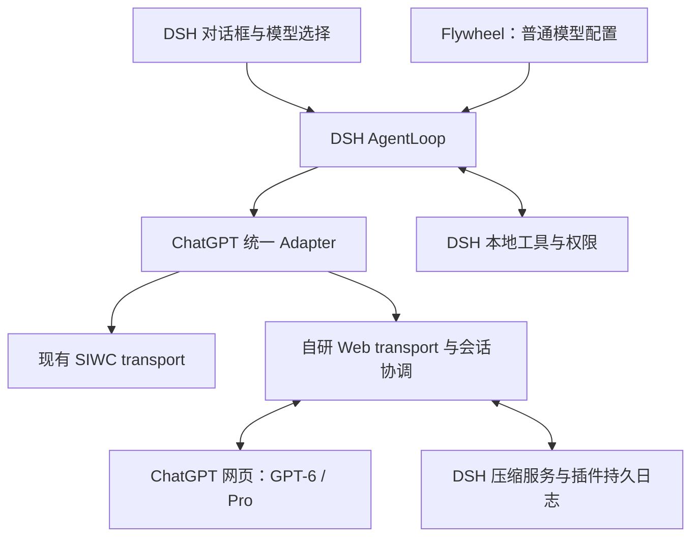
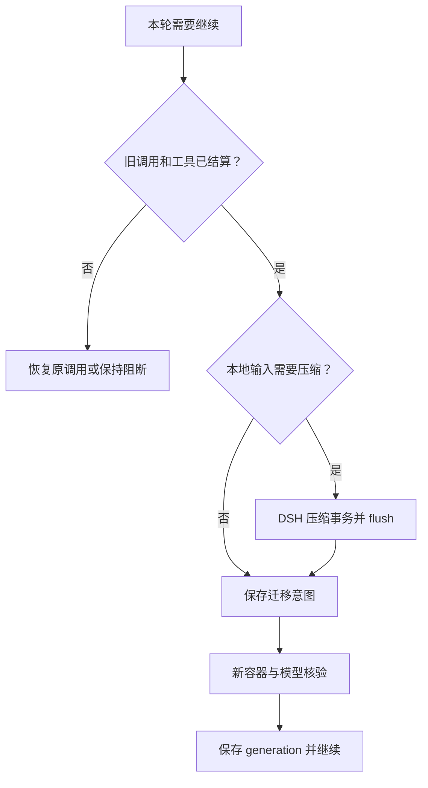

# ChatGPT DSH 插件：网页 GPT-6 Pro 模型与完整会话能力

简体中文 · [English](2026-11-17-chatgpt-web-provider.en.md) · [方案索引](README.md) · [当前 Flywheel 架构](../design.md)

**状态：第二版方案已进入实现候选，尚未合并或发布。** 2026-11-17 按“先在现有 ChatGPT 插件中提供原生模型能力，再由 Flywheel 配置使用”重写，替代 PR #57 首稿。原设计基线见第 3、15 节；实际代码、交叉复审、离线通过项与未完成能力见[实现验证记录](../validation/2026-11-17-chatgpt-web-implementation.md)。这不是 T01–T36 全部验收通过的声明。

## 1. 用户目标与实际交互

本项目首先交付一个 **DSH 原生模型能力**。用户只安装、配置现有 `ckanner/dsh-plugin-chatgpt`，就能在 DSH 对话框使用 ChatGPT 网页的 GPT-6 / Pro，包括对话、方案设计、文件与 Shell 工具、代码执行、Review，以及长会话继续工作。Flywheel 是该能力的一个使用者。

目标操作流程：

1. 在现有 ChatGPT Provider 设置卡中启用“网页模型”，选择专用浏览器连接，手动完成首次 ChatGPT 登录。
2. 回到 DSH 对话框，在现有模型选择器的 **ChatGPT** 分组选择 **GPT-6 Pro · Web**。
3. 原生思考档位显示并默认选择 **Pro**。第一版只发布实际完成网页核验的 Pro 档位。
4. 在 DSH 中直接发送任务。插件控制网页模型，DSH 执行本地工具；用户不必安装 Oracle、启动额外 CLI 或创建 Flywheel 任务。
5. 工作接近上下文预算时，插件协调压缩和网页会话迁移。DSH 保留逻辑 Session，显示压缩／续接状态及可回访的网页聊天链接。
6. 需要编排任务时，在 Flywheel 的 Loop 或执行 route 中选择同一 Provider、模型和 Pro 档位。

**核心交付标准：离开 Flywheel，插件也能独立完成原生 DSH 对话、真实工具循环、受控压缩、持续会话和故障恢复；接入 Flywheel 后复用同一实现。**

### 1.1 原生交互原则

- 复用 DSH 的模型与思考档位选择器，不另造一个“Pro 任务控制台”。
- 在同一 ChatGPT Provider 设置卡中区分“现有账号连接”和“网页连接”；一个连接成功不能代表另一个连接已就绪。
- 模型名和 badge 明确标识 Web 渠道；显示账号／连接状态、实际模型与档位、当前聊天、压缩状态和需要处理的故障。
- 用户选择模型不应触发登录、浏览器启动或模型推理。显式连接操作与实际调用才拥有相应资源。
- 同一能力同时服务 DSH 桌面和独立 SDK profile；安装在桌面不自动意味着 SDK 已安装和配置。

## 2. 核心决策与首稿修订

| 事项 | 本版决定 |
| --- | --- |
| 代码归属 | 现有 `ckanner/dsh-plugin-chatgpt` 包，提供完整网页模型能力 |
| 用户可见 Provider | 复用现有 `chatgpt`，遵守插件已有自定义 Provider route 配置 |
| 新模型 ID | `gpt-6-pro-web`；显示名 `GPT-6 Pro · Web` |
| 原生思考档位 | `pro`，显示名 `Pro`，模型默认档位也是 `pro` |
| 内部调用渠道 | 统一模型入口，按精确模型 ID 分到现有 SIWC transport 或自研 Web transport |
| 浏览器实现 | 插件自行实现受管浏览器控制；Oracle 仅为工程参考 |
| 长会话 | 插件负责预算、同步与迁移；DSH 的公开 CompactionEngine 负责权威历史压缩事务 |
| Flywheel | 通过普通 DSH Provider/model/effort 配置使用，补通用能力准入和恢复适配 |

首稿中“新增用户可见 `chatgpt-web` Provider”“Pro 必须省略 effort”“运行固定 Oracle 引擎”三项决定由本版替换，不提供两套相互矛盾的推荐配置。旧提案标识尚未发布，无需建立运行时兼容别名。

**源码纠正：DSH 的 reasoning effort 是 Adapter 拥有的 opaque ID，模型可以声明 `pro`。** 原生选择器会读取该模型的 efforts 与 defaultEffort。首稿将省略 effort 作为必要条件，没有充分利用现有接口；本版使用真实 Pro 档位。

保留的工程不变量：

- 模型、档位、账号、transport 和计费渠道不静默替换；Pro 不映射为 high/max/ultra。
- DSH 拥有 AgentLoop、工具执行、权限与权威会话记录；网页 worker 不执行任意本地 Shell。
- 未知派发或工具结果先恢复／对账，不能通过换聊天、换模型或重规划绕过。
- Dispatch、Activity、Outcome、Cleanup、Usage 分别记录；估算用量不变成服务端实际用量。
- Flywheel 的 Go 编排器仍是其状态唯一写入者；插件不能写 Flywheel state 或决定验收通过。

## 3. 已核查基线与实际缺口

| 项目 | 固定基线 | 与本版有关的事实 |
| --- | --- | --- |
| ChatGPT 插件 | `40d8f885`，0.1.20 | 已注册原生 ChatGPT 模型与设置卡；当前全部模型调用进入 SIWC adapter |
| DSH 官方 master | `39163dd3`，0.2.2-rc.3 | 支持模型自定义 effort、原生模型选择、工具循环、持久会话及公开 CompactionEngine |
| Flywheel | `db6b93e6`，0.37.0 | 已有 DSH 模型配置；执行策略和部分 UI 的档位白名单不包含 pro |
| Oracle，参考材料 | `0a064e7b`，0.23.1 | 提供浏览器交互、模型／档位选择、续聊、捕获和故障 fixture 的参考实现 |

源码核查确认：

1. 插件 `HarnessAdapter.stream()` 无条件进入现有请求转换与 SIWC adapter；只增加一个模型目录条目不会变成网页调用。
2. SIWC 未登录时，其模型目录返回空；目录错误也会影响外层 listing。Web 子目录必须独立，不因没有 SIWC 登录而消失。
3. 当前包装层只投影 provider/id/name，需要保留合法 description、modalities 和 badge 等元数据，原生选择器才能准确展示 Web 身份。
4. DSH 原生 ModelSelect 读取模型 efforts/defaultEffort，支持 Pro，无需改造成另一套选择器。
5. DSH `providerRetryPolicy(provider)` 是 Provider 级策略，当前 prepared call 无模型级覆盖；统一 ChatGPT Provider 后不能用全局零重试影响 SIWC。
6. DSH Basic 压缩的默认摘要路由优先参考最后已回答模型；切换到 Web 不证明摘要也会走 Web。其默认 headroom 不能当成网页上下文实测值。
7. Flywheel SDK overlay 当前禁用默认 compaction-basic；新模型不能仅靠安装插件就假定该 profile 已有合适的压缩后端。
8. Oracle 的日志尾输出、定时状态和已有 follow-up 行为不满足本设计全部契约；本版自行实现这些能力，不绕一层 CLI/MCP 冒充完整模型接口。

第 15 节给出设计时的固定来源。实现使用较新的 DSH `ca33fd6843b205e279c7ccb6cb73a472c78f5760` / `0.2.2-rc.4` 加明确维护的兼容补丁；真实宿主、工具和 JSONL 的离线结果记录在独立验证文档。真实账号、Mac 浏览器和网页满窗验收仍未完成。

## 4. 一个 Provider 下的模型与档位契约

### 4.1 原生模型注册

下列是拟议的 resolveModel／prepareCall 精确模型元数据形态，实施时使用 DSH 的品牌类型构造器和实际类型，不把示例当成可直接执行的插件代码。listModels 提供发现字段，DSH 再解析精确模型的 reasoning；只在 listing 中加一个 Pro 字段不算完成：

```json
{
  "provider": "chatgpt",
  "id": "gpt-6-pro-web",
  "name": "GPT-6 Pro · Web",
  "reasoning": {
    "efforts": [
      { "id": "pro", "name": "Pro" }
    ],
    "defaultEffort": "pro"
  }
}
```

`gpt-6-pro-web` 是本插件保留的模型 ID，表示网页 GPT-6＋Pro 路由，不宣称它是官方 API model slug。`pro` 是原生 `reasoningEffort`，通过 DSH 的正常请求字段传递；插件内部记录目标网页模型版本与网页档位，不能从一个 Pro 标签推断完整模型身份。

`providerInfo`、`listModels`、`resolveModel`、`prepareCall`、`stream` 使用同一精确路由表。遵守插件实际配置的 Provider 名；默认是 chatgpt，不能在所有内部判断中硬编码它。

第一版对该模型声明且只接受 pro。DSH 省略 effort 时使用其已声明的 defaultEffort；显式 high/max/ultra 等值明确拒绝。切回 SIWC 模型时读取该模型自己的 efforts，不能沿用上一个模型的 Pro。

### 4.2 目录、认证和路由隔离

统一 Adapter 组合两个内部 transport，不重复注册同一个 Provider：

- SIWC 模型继续使用既有认证、目录、协议、附件转换与重试行为。
- Web 模型在 SIWC metadata fallback、认证和 `requestOf(options)` 之前按精确 ID 分流。
- 不能删除 `-web` 后交给 SIWC，也不能因网页失败自动改走 SIWC/API。
- 保留模型 ID 冲突必须明确报告；上游目录未来返回同名 ID 时不能静默覆盖 Web 路由。
- 启用 Web 后，其静态目录与 SIWC 目录独立合并；无 SIWC 账号、SIWC listing 错误不隐藏 Web。Web disabled／未就绪也不破坏原模型。
- 模型可见性、静态能力和本次账号实际准入分别表达。目录可见不代表有订阅额度或真实网页验证已通过。
- 目录／连接变化沿用 `llm/adapters-updated` 刷新。目录查询和 resolve 不打开浏览器、不发送 prompt。

现有 ContextWindowLimit 及 per-model 覆盖需按精确路由解释。Web 只能暴露插件实际执行的保守输入上限，并标明是本地策略；不能拿 SIWC/API 目录窗口冒充网页窗口。

### 4.3 选择后的调用绑定

正式调用冻结 provider、model、effort、transport、connection、账号非秘密身份、实际目录、工具表、权限及策略版本。选择器元数据不能代替网页每轮核验。

同一 Provider 也可能发生 SIWC 与 Web 的渠道切换；该切换必须进入会话、预热和恢复身份。仅比较 provider 相同不足以复用旧运行时。变更未结算调用的模型／账号时，先处理原调用，再准入新绑定。

## 5. 插件内部架构与自研浏览器实现



### 5.1 模块责任

| 插件模块 | 责任 |
| --- | --- |
| Model registry / Composite adapter | 目录合并、模型／effort 元数据、精确 transport 选择、原 SIWC 兼容 |
| Web connection manager | 专用 profile、账号绑定、浏览器/CDP 连接、owned 资源和跨进程租约 |
| Page adapter | 网页布局、模型／Pro 选择、项目／聊天归属、composer、附件、终态、错误与停止 |
| Turn coordinator | 一次模型调用的准入、提交、观察、完整结果、停止与只读恢复 |
| WebSessionCoordinator | DSH 会话映射、增量同步、容量预算、调用公开压缩服务与 generation 迁移 |
| Tool/media bridge | 完整回答协议校验、DSH blocks 转换、真实附件 bytes 与回执 |
| Journal / recovery service | 提交前日志、完整结果 artifact、宿主持久关联、unknown 阻断与恢复采用 |
| Plugin UI / diagnostics | 现有设置卡、原生模型元数据、连接与故障状态、会话链接、压缩与恢复入口 |

这些是插件内部边界，不要求拆成新的公开 npm 包或多个用户安装步骤。可用受管后台 worker 隔离浏览器控制，typed IPC 是插件实现细节，不成为新的 Flywheel harness。

DSH 桌面与 SDK 可能同时使用同一连接。连接管理器必须以私有 IPC／跨进程 broker 协调专用 profile、Chrome 所有权、队列和调用租约；不能让两个 worker 各自启动同一个 profile。一个宿主退出只取消自己拥有的工作，不杀掉另一个宿主的已准入调用。内部接口及来源必须版本化、经过本地身份和目录权限校验。

broker／lease 键使用规范化的实际 browser-profile 路径与 OS 用户身份；不同 connection 名或 stateDir 指向同一 profile 时仍是同一个共享资源。共享 broker／Chrome 不属于首个 SDK 请求可整体 kill 的进程组，客户端退出只撤销自己的 owner 租约；无人使用时也须先核对未决云端调用，才能有界退出本地共享资源。

### 5.2 Oracle 的参考边界

自行实现页面适配与调用状态机，可使用经验证的通用 CDP 库。参考 Oracle 固定源码中的模型菜单、Pro slider、附件、稳定前言、取消竞争、页面恢复和 profile 所有权案例。

**不将 Oracle CLI、MCP、内部模块导入、源码快照或其后台服务作为必需运行时依赖。** 不要求用户另装 Oracle，不通过日志尾解析答案，不复制现有 resume 跳过模型核验的行为，也不实现 ChatGPT 私有 HTTP 接口的逆向替代。

候选通用栈可参考 Oracle 使用的 chrome-remote-interface 与 chrome-launcher，但插件锁定自己的精确版本、integrity 和兼容测试。Oracle 自身 Node >=24 的要求不自动成为本插件要求；优先保持当前 DSH／插件 Node 基线，经实际依赖和打包验收决定。

若复制具体源码，保留其 MIT 来源和 notice；参考行为与测试思想也记录固定版本。页面适配代码集中维护，避免 selector 散落在工具、压缩和 Flywheel 中。

### 5.3 一次网页模型回合

fresh、resume 和迁移后的首轮使用同一发送前检查：

1. 宿主调用仍有效，signal 未取消，执行域无未解除 fence，剩余预算足够。
2. 获取连接许可、conversation 写租约和已登记的 owned 页面；等待历史加载完成。
3. 核对账号、项目、聊天、上下文策略和本次工具权限。
4. 分别观察模型版本和 effort，联合确认 GPT-6＋Pro；未知布局或错配在提交前停止。
5. 校验本次增量、附件、输入预算及 request digest，持久化 submit-intent。
6. 只提交一次，取得匹配当前 prompt 的接受证据。
7. 观察本次回答；完整捕获、校验并持久化结果，再交付 DSH。
8. 远端已确认终态且完整结果已安全持久化后结束 stream，供 DSH 提交；宿主持久 ACK 由独立回调／事务对账，不能在尚未结束的 stream 内等待自身消息提交。实施复审进一步要求：连接许可与聊天 pending-delivery 都保留到宿主 ACK，随后才允许另一个网页回合；ACK 在本地工具／子代理开始前完成，因此不会让父子工具互等。

Page adapter 按兼容版本、locale 和 fixture 返回结构化观察，记录 selection evidence 时间；不猜测未知按钮。发送后页面失去可观察性时保留原请求 unknown，不改成“未发送”。

**文本稳定或 Stop 按钮暂时消失不足以证明完成。** Pro 可能先输出前言再继续思考；完成判断必须结合本次 turn/message 身份、已接受 prompt、正向终态 UI 证据和完整内容 digest。中间前言、提示、引用、prompt echo 和旧回答不进入可执行工具解析。

## 6. DSH 工具循环与完整能力

### 6.1 输入和回答协议

网页没有本插件可直接复用的 DSH 原生 tool API。插件向本轮消息提供有效指令、有序历史、实际工具 schemas、调用身份和返回格式。文本中的 system/developer 标记不具备 API 原生系统消息优先级，不能把提示词当权限边界。

拟议工具回答：

```json
{
  "protocol": "dsh-chatgpt-web/1",
  "requestId": "webcall-example-1",
  "generation": 2,
  "kind": "tool_calls",
  "calls": [
    {
      "id": "tool-example-1",
      "name": "read_file",
      "arguments": { "path": "src/example.ts" }
    }
  ]
}
```

`read_file` 仅是示意名，实际名称与参数来自当前 DSH 工具表。最终回答为：

```json
{
  "protocol": "dsh-chatgpt-web/1",
  "requestId": "webcall-example-2",
  "generation": 2,
  "kind": "final",
  "text": "本轮最终回答或宿主要求的结构化产物文本"
}
```

必须完整校验单个 JSON 对象的协议、requestId、generation、未知字段、工具名称、参数 schema、ID 唯一性、大小、深度和调用数。整批通过前不向 DSH 泄露可执行增量；不从 Markdown 中猜测 Shell 命令。

工具对象转换为 DSH ToolCallBlock，arguments 为序列化 JSON。DSH 执行工具并持久化结果，插件下一轮追加对应 tool results；最终 text 进入正常会话和宿主产物处理。Flywheel 的 Plan／Review／Judge 等业务 schema 仍单独验证。

格式修正仅在原回答明确结束后发起，次数、时间和用量有界；不借 transport 重试实现，修正前不执行未验证动作。完整原文可保存到私有 artifact，用路径、字节数与 digest 引用；读取须限制在绑定目录内，拒绝路径逃逸、链接和截断。

### 6.2 工具、媒体与子代理

| 能力 | 插件目标 | 准入要求 |
| --- | --- | --- |
| 普通对话、设计、Review | 完整文本与结构化输出 | 当前回合、完整结果与业务 schema |
| 本地执行 | DSH Read/Search/Write/Shell/Test 工具循环 | 真实 cwd、权限、至少两轮工具调用和已持久结果 |
| PTC | 使用真实 run_code 与 schema | handle、deferred output、错误和嵌套调用正常返回 |
| Agent/Team/Workflow | 复用 DSH 原生能力 | lineage、独立调用、活动、预算、取消和域内恢复 |
| 图像输入与截图 | AttachmentStore 的真实 bytes 上传 | MIME、顺序、hash、上传完成与模型可见性 |
| LCU | 经现有工具和图像链路调用 | 明确权限、共享 GUI 协调及完整取消 |
| 网页 hosted tools/apps | 单独声明和准入 | 可写动作默认关闭，不能绕过宿主权限 |

DSH 当前会在 adapter 前把 file block 转成路径文本，把不支持图片的模型的 image 转成 placeholder。因此必须在公开 `llm/stream` 的 pre-projection 侧检查原始媒体，覆盖用户输入、工具截图、辅助用途和恢复历史。未验收图片时明确拒绝；启用后声明 image 并取得真实 bytes，不能只检查投影后对象。

普通文件优先通过本地 read/search 工具提供内容。任意路径文本不是上传授权；原生文件上传需要明确的公共投影／准入接缝和附件来源记录。未验收能力标为 unavailable，不静默丢图或切换后端。

## 7. 插件拥有的长会话管理

### 7.1 一份权威历史，两类容量预算

DSH 持久事件、derived history 和 compaction checkpoint 是权威。插件只保存网页同步游标、映射、输入投影与恢复证据；不能私下压缩出一份 DSH 看不到的“第二历史”。

WebSessionCoordinator 同时检查：

- **本次模型输入预算：** 有效指令、工具 schemas、协议、消息、附件投影与输出预留。
- **网页历史累计预算：** 已发送／捕获内容、回合数和可观察限制的保守估计。

输入、输出预留、累计预算、单轮大小、回合数、压缩／修正／迁移次数均需有限值，由实测策略清单和 policyVersion 固定。缺少已验收策略不标 ready；不能把 API 窗口或 Basic 默认 headroom 当成 GPT-6 Pro 网页实测上限。附件估算不确定性不能当作零。

### 7.2 增量续聊与换聊判断

保存规范化内容前缀、已确认同步游标、网页协议对象与 DSH blocks 的双向关联。DSH 每轮带完整 messages，网页只接收新增内容，不能反复发送整份历史。

只有 owner、模型／effort、transport、账号、上下文策略、工具／指令契约相同，前缀一致，旧回合及工具已结算，才允许追加。消息数量不能代替内容摘要；网页原始 JSON 与 DSH blocks 不能直接按字节比较。

- 本地请求仍小而远端历史偏大：直接以当前权威历史创建新 generation。
- 本地输入也过大：先通过 DSH 压缩事务缩小并 flush，再迁移。
- history rewind/fork/prune、权限／模型／工具／指令变化：重新核验兼容性；不兼容时仅在原调用可结算后迁移。
- 网页明确拒绝上下文长度：进入有界迁移路径；超时、网络故障和限流不是 context overflow。
- 新 bootstrap 仍超预算：继续缩小可压缩范围或明确停止，不能无限新建聊天。

### 7.3 复用 DSH 压缩事务

DSH 每个 context 只能有一个 CompactionEngine。桌面已有 Basic 时复用它；SDK 缺失时通过公开 composition 加载一个兼容后端。不能让 ChatGPT 插件与默认压缩同时注册第二个全局服务。

插件提供 Web 专属策略：输入预算、输出预留、摘要目标、保留事实、迁移条件与调用计量。压缩由公开 `compactIfNeeded`、`compactNow`、`compactRegion` 或经评审的公共扩展执行。自动压缩与手动压缩共享同一事务及迁移协调。

**默认摘要路由是本次 Web 目标模型＋Pro，使用独立辅助调用。** 用户可显式配置其他摘要路由，但需要显示实际渠道、账号和预算，并通过宿主准入。不能因 Basic 优先选择“最后已回答模型”而在切换到 Web 时隐式调用旧 SIWC／付费 API。

当前公开接口不足以完整传递 proposed target 和摘要路由策略。本设计明确依赖 DSH 补公共接缝：在最终 GenerateOptions 构造及计量前，将 agent、proposed target、purpose、有效预算交给摘要路由策略；持久记录的实际 provider/model/effort 必须与真正发送一致。不得在 adapter 末端偷偷换路由，或调用 Basic 私有 compactPressure/selectCompactableRange。

使用公开 tokenMeter 的 proposed-header 测量和完整工具配对范围选择压缩区间。摘要输入本身也必须放得下；大历史需要多个有界、独立记账的压缩事务，不能把多次模型调用伪记为一次。单个不可拆分单元仍超预算则明确失败。

摘要保留任务约束、冻结验收、未决问题、可信证据引用与配对工具尾部。原始事件和来源范围保留，checkpoint 先持久化，再批准网页迁移。Basic 压缩失败可能记 warning 后继续，因此最终 Web 输入准入 guard 始终保留，不能直接发送已知超预算请求。

### 7.4 辅助调用隔离

主调用资格在 pre-projection hook 通过 `isAgentLoopRequest()`、真实 Agent、sessionId、purpose 和已准入 binding 判断。只有无辅助 purpose 的主循环进入主 conversation。

compaction、title 等明确 purpose，每次分配独立 invocation；即使 sessionId 相同，也不复用主聊天或前一次摘要聊天。非 AgentLoop one-shot、无 sessionId、未知 purpose 采用明确支持的独立路径或拒绝，不落入匿名共享会话。辅助请求不拥有本地工具执行能力。

插件复用宿主同一份 DSH LLM 模块，避免打包另一份 WeakSet。受控 call context 保存独立 ID、类型、purpose、owner、executionDomainId、Agent lifecycle、session/surface revision、binding 与请求摘要、signal。若使用 AsyncLocalStorage，必须覆盖 lazy AsyncIterable 的创建和 next/return/throw 生命周期，终态撤销，防止并发辅助调用串身份。

### 7.5 迁移事务



迁移日志保存旧／新映射、来源 checkpoint、bootstrap digest、原因、项目创建意图和实际 ID。创建后日志确认前崩溃，先只读定位 owned 容器；无法确认则阻断，不连续新建。bootstrap 提交后按原 invocation 恢复，不能重发。

旧聊天已满时依赖 DSH 记录，不要求它再接受一条总结指令。压缩有损，不承诺保留隐藏推理或无限上下文；换聊不会重置订阅额度。

## 8. 会话、网页上下文与可读名称

### 8.1 逻辑会话与网页 generations

一个 DSH Session 对应一串网页 generations，记录 project/conversation、消息父子关系、摘要及当前 active generation。普通工具循环复用当前 generation；按安全检查迁移时保留链路。

DSH 桌面显示完整逻辑 Session、工具轨迹、当前网页链接及历史代次。正常持久模式的网页聊天保留在 ChatGPT 历史中，不自动归档成用户找不到的单次调用。没有账户可回访验证时不宣称历史可见性已通过。

网页项目／聊天标题复用可读任务、角色与代次，缺失时由首条请求生成有界本地标签；通过 UI 设置并回读，仅修改本次 owned 对象，不覆盖用户手改标题。网页命名不额外调用 Pro；DSH 已启用的 LLM 标题服务属于单独 auxiliary 调用，须独立计量。

### 8.2 隔离工作会话与个性化聊天

Chrome profile 只隔离本地数据；同账号的 Memory、history、自定义指令、项目来源和 apps 可能进入有效上下文。插件显式管理 hosted-context policy，不能仅凭新 conversation ID 宣称隔离，也不自动改用户全局偏好。

默认受管工作模式采用**每个 logical session 的每个 generation 一个新的私有 project-only 项目**，只包含对应主聊天和准入材料。项目指令受本次契约控制，记录来源／指令／sharing 摘要；不同角色、子代理、辅助调用和 generation 不共享项目，避免旧历史经项目记忆重新进入。

准入核验账号前置条件、项目 memory 设置、来源、协作者、项目内 GPT-6＋Pro 和聊天 parent project。主页可选 Pro 不证明项目内可选；新旧设置可能有生效差异，不能用“刚改了旧项目”替代验证。项目失败不得退回首页继续发送。

普通桌面对话可显式选择个性化策略，沿用用户账号偏好；UI 标明其上下文可能来自 DSH 之外。该模式不具备严格隔离保证，不能用于要求独立性的 Review/Judge，也不能宣称迁移后旧记忆绝不重入。不得在受管模式不可用时自动改成个性化。

Unpersonalized Temporary Chat 可作为另一个未来模式单独验收，但不作为本版持久默认；保存为普通聊天不等于保留原隔离语义。

每轮复核当前容器、来源和策略；手工移动聊天、追加来源或协作者使旧准入失效。保证限于可公开观察配置，不宣称控制平台隐藏指令。

## 9. 持久状态、恢复与防重复执行

### 9.1 调用事实和预写日志

插件内部 Web worker 提供版本化 prepare/start/observe/recover/cancel/close 语义。recover 只读，恢复采用由宿主单独执行；用户不需要操作 machine API。

持久身份至少包含宿主 owner／调用域、DSH session/surface、provider/model/effort/transport、连接／账号指纹、project/conversation generation、网页消息身份和完整结果 digest。Flywheel 身份经受管 host service 绑定，不能偷塞未知 SDK 字段；普通桌面不依赖 Flywheel ID。

| 顺序 | 持久事实 |
| --- | --- |
| 1 | prepared：调用绑定、策略与预算已准备 |
| 2 | submit-intent：提交意图及 prompt digest 已同步 |
| 3 | submitted-confirmed：当前 prompt 的接受证据已保存 |
| 4 | response-captured：完整结果 artifact 已保存 |
| 5 | response-validated：协议与身份校验完成 |
| 6 | delivered-to-dsh：已交付，尚不等于宿主持久提交 |
| 7 | host-commit-confirmed：DSH 持久记录与关联已核验 |

每步原子保存并同步。submit-intent 不是已派发证明，缺少下一步也不是未派发证明。DSH 的 `finish.replayState` 只随成功消息保存关联引用，不能替代发送前日志。Provider response ID 与由 DSH 生成的 assistant MessageId 分开记录。

宿主 ACK 按 call kind 关联：主调用核对 assistant／工具事件及 flush；compaction 核对其 compactionId、summary／checkpoint 事务及 flush，不能等待不存在的 assistant 消息。title／one-shot 必须声明对应宿主操作及持久或非持久交付语义，不冒充 assistant 提交。adapter 先完成结果持久化并结束迭代器，宿主提交后走独立 ACK 通道；下一模型／工具准入屏障再核对提交，不让 stream 与提交互等。

### 9.2 已捕获响应的恢复采用

- 确定未派发且本地清理确认：允许预算内重试。
- 提交结果未知：锁住原聊天，读取原回合与日志；不重发。
- 完整回答已捕获但未提交 DSH：保存为 pending result，由专门宿主事务采用。
- assistant／工具结果已持久：核对已有记录，仅确认交付，不创建第二次调用。
- 身份冲突、手工改网页、结果不完整：保留证据并阻断。

当前 DSH resume 会先修复和关闭中断 step/turn，普通 adapter 不能继续原 step。本设计依赖新增公开 `adopt-recovered-response` 事务：持有宿主准入与会话写租约，核对原 request、surface、工具未执行、当前权限／工具实现兼容及无 unknown fence，在新的宿主恢复事务中接收一次并 flush。

幂等键为 executionDomainId＋DSH sessionId＋originalRequestId＋providerResponseId，进入宿主持久日志；重复采用返回原提交身份。接缝未实现前可以只读展示结果，不能在下一普通 stream 中重放旧工具响应并宣称恢复完成。

辅助结果恢复使用其 call kind 和宿主 operation／compaction ID 作为关联与幂等键的一部分，确认摘要事务是否已提交，再由同一权威 CompactionEngine 采用或拒绝；不创建普通 assistant，不绕过 checkpoint 修改历史。没有对应恢复接缝时只读保留结果并阻断自动重派；不能将主调用 adoption 直接套在摘要或标题上。

### 9.3 工具副作用未知时的执行域阻断

DSH 已有 tool/call、tool/result 及 checkpoint；tools/result 通知不是 durable ACK。崩溃后已开始而无持久结果的调用会修复成 `TOOL_OUTCOME_UNKNOWN`，这只记录事实，不天然禁止后续副作用。

插件通用 host policy 必须建立持久 executionDomainId 和 unknown fence：覆盖原根、已准入子 Agent、PTC 嵌套执行及对应工作区责任；跨 Provider、fresh/resume、fallback、换聊天或重新规划仍继承未解除的阻断。不能用当前 requestId 代替持久执行域。

子调用未知向域协调者传播，冻结兄弟的新准入；已在飞工作取消／排空并分别对账。只允许宿主限定的只读恢复操作，不能靠模型自称只读。确定性证据或明确人工 resolve 才解除；模型的“已完成”声明不构成证据。

普通桌面由插件宿主策略保存执行域；Flywheel 还由 Go 保留跨 worker 的阻断事实。不能承诺通用 Shell exactly-once，也不能在压缩中把 unknown 当普通失败丢掉。

### 9.4 统一 Provider 下的重试契约

保持现有 SIWC Provider 级重试行为。**不得在统一 chatgpt Adapter 上全局返回零重试来处理 Web。**

Web 的重试决定必须基于本次冻结的 transport 与 journal。受管 runtime 只对确定未提交的情况做有界重试；提交后不确定性先写 dispatch fence，再保留原始 TIMEOUT／TRANSPORT 首因返回。

当前 `llm-retry` 的 always 模式可能继续执行下游拒绝后的重试，普通 request-error listener 不能稳定提供硬否决。本设计明确要求 DSH 增加**公开的单次调用 replay-veto／停止结果**：在执行通用 normal/always 重试前询问已准备调用的真实策略，禁止重放时终止本次请求并传播 blocked／unknown，用户更积极的重试选项不能覆盖该事实。

该机制作用于 Web 的不可重放事实及仍被其 fence 阻断的执行域，包括该域改走 SIWC／其他模型的恢复或 fallback；无关、正常 SIWC 调用保留原策略。veto 同时读取 prepared route 和持久 domain fence。新准入仍检查 fence，防止外层重规划绕过；也必须避免“被 fence 拒绝后 always 无限空转”。不得伪造错误码解决重试问题。未完成这个公共接缝前，不宣称完整恢复能力已交付。

## 10. 活性、取消、权限、并发和成本

### 10.1 活性与期限

内容校验前不能发可执行增量，因此插件通用活动事件独立于回答文本。事件携带真实 owner、调用 ID、generation、序号和有界类型；DSH 桌面可显示，Flywheel 通过适配消费。

区分进程 heartbeat、UI 状态快照、真实新增内容／进展、prompt acceptance、终态与 cleanup。无变化的定时日志不是活动。Pro 的不可观察推理阶段采用明确的 opaque/wall 策略，不能按 stdout 静默推断挂死。

原调用 wall deadline、取消、修正、压缩、迁移和排队共享预算；连接断开或换聊天不重置期限。声明观测能力并保留故障检测，不能用 heartbeat 无限续命。

单帧、完整回答 artifact、保留缓冲、累计协议流量和活动事件分别设有界策略；高频活动按实际到达合并，终态与清理回执保留传输能力，不能把丰富活动直接计成很小的最终答案上限。错误沿用宿主 AUTH／QUOTA／RATE_LIMIT／CONTEXT_WINDOW_EXCEEDED／INVALID_REQUEST／TRANSPORT／SERVER／TIMEOUT／EMPTY_RESPONSE 分类，并附有界 Web reason；网页限额或上下文错误须来自身份匹配的真实 UI 控件，不能从答案引用的错误文字推断。

### 10.2 本地清理与云端状态

回执分别保存 dispatch、outcome、stop reason、local cleanup、remote generation、usage 和本轮 model/effort evidence。

取消先阻止新调用和工具，向准确 owned 页面尝试停止，排空本地 owned 工具与控制资源，使用独立有限清理预算。异步资源在取消后才到达时仍需释放；不能停止后又创建 tab 或迟到提交。

关 tab、断 CDP、杀 worker、释放等待者不能证明云端停止。远端 unknown 保持隔离和占用责任，即使本地已清理，也不得自动重放。共享浏览器不需随一次成功调用销毁，只释放该调用资源，不关闭无关用户 tab 或其他宿主的工作。

### 10.3 并发与工具权限

- 同 conversation 全回合跨进程单写入者；租约接管核对 owner/epoch 和日志，不只看 PID 或固定超时。
- 连接并发默认 1，许可覆盖单个网页模型回合；进入本地工具／子 Agent 等待前释放，避免父子死锁。
- 排队保持 not-dispatched，使用剩余 wall，可取消；取得许可后再次核验取消和绑定，防止迟到发送。
- unknown 远端回合不能因本地退出而释放成可无限超售的新容量。
- DSH 本地工具继续使用原 cwd、sandbox 和权限。远端 MCP 与网页 apps 另有 allowlist／副作用分类，本地 OS sandbox 不会约束远端写操作。
- Read-only Review/Judge 只暴露已核验的只读外部工具；可写 hosted apps 首版关闭，无法核验关闭时拒绝调用。
- CDP 为主要传输路径；确需 GUI 焦点时与 LCU 共用协调，不能在长推理期间霸占整个桌面或让两个控制者操作同一 tab。

### 10.4 计量

网页若无权威 usage/cost，则保留 unknown；本地 token 估算只用于容量策略。摘要、格式修正、重连和迁移单独记账，不伪造免费或零用量。

Flywheel 既有 hard/soft/off 预算不被插件放松；例如 hard daily-token-limit 遇到未知用量会阻止后续调用，应在诊断中明确兼容性，不能暗中改预算来让验收通过。普通 DSH 同样记录真实可知事实及账号限流／额度状态。

评估任务完成率、工具轮数、延迟、排队、修正率、压缩／迁移次数和人工恢复率，再决定适用任务与默认选择，不预设 Web 比其他渠道快或便宜。

## 11. Flywheel 如何消费同一个模型

### 11.1 目标配置

以下为实施后的配置片段，**当前 0.37.0 尚不能据此使用新模型**。将其纳入实际生效的完整配置；Flywheel 不跨文件深合并。

```json
{
  "profiles": {
    "web-pro": {
      "harness": "dsh",
      "provider": "chatgpt",
      "model": "gpt-6-pro-web",
      "thinking": "pro",
      "channel": "chatgpt-web-subscription"
    }
  },
  "loops": {
    "design-plan": { "profile": "web-pro" },
    "review": { "profile": "web-pro" }
  },
  "routes": {
    "hard": { "profile": "web-pro" }
  },
  "channels": {
    "chatgpt-web-subscription": {
      "harness": "dsh",
      "provider": "chatgpt",
      "env-key": null
    }
  }
}
```

此例将 design-plan、review 和 hard 执行路由设为 Web Pro；未覆盖的 design-review／plan-review 会继承 review。会话复用继续由现有 fresh/scoped 配置决定；本片段不改全局 sessions 策略。

channel 是 Flywheel 的命名配置和预算归属，不选择网页账号。网页连接由插件 activeConnection 决定，首版每个 DSH profile 选择一个；不能靠两个不同 channel 名声称切换两个账号。

| 模型工作 | 配置入口 |
| --- | --- |
| 初始方案与独立方案审查 | loops.design-plan / loops.design-review |
| 规划与计划审查 | loops.plan / loops.plan-review |
| 执行 | routes.default / frontend / hard / multimodal |
| 代码审查与终验判断 | loops.review / loops.judge |
| 第二意见 | 顶层 judge-panel |
| Intake / Garden | loops.intake / loops.garden |
| 有界执行模型切换 | execution-policy.bindings 与 route allowed 集合 |

没有 loops.execute。JEV 的专用 HTTP 契约、确定性 Verify、Git 交付和状态转移不变成这个模型配置的一部分。原生 Codex/Claude harness 的主模型也不会由此被替换。

### 11.2 Flywheel 必需适配

1. **模型／档位：** 明确传 `thinking: "pro"`。现有 DSH wire 和 prewarm 接受非空字符串，无需首稿的空 effort 特例；不把 Pro 改成 high。
2. **执行策略：** schema 和 Go 校验允许 DSH 的 adapter-owned effort，并在正式调用前按精确模型能力验证；其他 harness 保持已有白名单，配置的 allowed bindings 仍严格执行。
3. **UI：** 消费该 DSH 模型的合法 efforts/defaultEffort，原生显示 Pro；切换模型重新检查档位，不按通用 high/max 排序推断质量。
4. **SDK composition：** 加载同一 ChatGPT 插件的 Web 组件和通用 host policy，并配置独立 SDK profile 的真实连接；不得把 SDK profile 偷换成 desktop。
5. **压缩：** 为 Web 根／子调用接入同一插件策略与唯一 CompactionEngine，传入冻结契约、剩余预算和调用计量；不在 Go 或 worker 里再实现摘要和 DOM。
6. **身份与恢复：** 暴露 transport/connection、runtime 版本、execution domain、Web 调用事实和恢复能力；模型／effort／账号变更不复用旧绑定。
7. **活动与清理：** 将插件通用事件映射到现有 activity／回执校验，协商新的 worker 扩展版本。旧 v1/v2 不理解能力时派发前拒绝，不忽略字段继续。
8. **安装／doctor：** 核对 SDK 插件、通用依赖、策略和版本；静态检查不等于真实账号或额度检查。

配置加载可验证字段形状和允许绑定；DSH effort 的真实语义由该模型元数据决定，必须在执行及预热准入中验证。未知 effort 不因 schema 放宽就自动合法。首版配置明确 pro；若将来让 Flywheel 省略 effort 使用模型默认，需另行处理旧 driver 的 high 回填，不能在此示例中偷偷依赖它。

Flywheel 专属约束只通过通用 host policy 扩展传入；插件桌面功能不得 import 或依赖 Flywheel 包、文件布局和状态机。

## 12. 设置、安装与数据生命周期

现有 ChatGPT namespace 下增加拟议 `web` 设置，不新增用户可见 Provider。启用 Web 时：

| 设置 | 规则 |
| --- | --- |
| enabled | 默认 false；不启动浏览器，不改变已有 SIWC 默认 |
| activeConnection | 启用时明确选择一个具名连接 |
| connections | 专用 profile、浏览器路径、私有状态目录、账号绑定及连接策略 |
| maxConcurrentTurns | 初始 1，可在实测和账号允许范围内显式调整 |
| hosted-context policy | 默认受管隔离；个性化需明确选择且不用于独立 Review |
| budget policy | 经验证的本地输入／输出、累计历史、回合、修正／压缩／迁移上限及版本 |
| summarization route | 默认本次 Web 模型／Pro；显式覆盖须准入、展示并计量 |

浏览器第一次登录由用户在专用 profile 完成，不默认复制日常 Chrome cookies。连接、模型选择和诊断有独立状态；列表获取失败不能触发模型调用或读取其他账号凭据。

安装沿用现有 npm 工作流。浏览器模块惰性加载；依赖锁定、构建内容和 SDK 加载路径由同一候选验收。没有 postinstall 账号设置变更，没有每轮下载 latest，没有隐式 Oracle 依赖。

doctor／预热不发 prompt，不创建业务项目或占位聊天。显式连接检查可以核验登录和菜单；“静态可加载”“账号已连接”“目标模型可选”“真实推理通过”分别记录。

网页状态、journal 和完整结果存于私有目录，不写进目标代码仓库或通用日志。Cookie、token、完整邮箱与敏感正文不进 replayState／PR；同步跨进程仅发送必要、已校验标量。

retention／清理只操作插件 owned 对象并尊重未决调用和用户保留策略。不得清理仍处于 unknown 的恢复证据；删除网页项目／聊天与本地日志需要明确用户操作，不能随包升级自动清空历史。

## 13. 实施范围、公开接缝与交付顺序

### 13.1 仓库责任

| 仓库 | 责任 |
| --- | --- |
| ckanner/dsh-plugin-chatgpt | 主体实现：统一模型入口、Pro 元数据、自研浏览器、会话／压缩协调、工具媒体桥、持久恢复、连接与 UI |
| DSH 上游或明确维护的兼容补丁 | 单次调用 replay-veto、摘要路由／proposed-target 策略、恢复响应采用等公共接缝；固定兼容版本 |
| ckanner/flywheel | 普通模型配置与 Pro 校验、SDK composition、host policy、身份／活动／回执、预算、安装与 UI |
| ckanner/dsh-preset-generator | 按实际 composition 同步 Web 模型能力与 PTC／子代理准入，不复制 Provider 实现 |
| ckanner/dsh-plugin-lcu | 仅补实际需要的 GUI 协调／媒体契约 |
| Oracle | 固定源码参考与来源记录，无运行时依赖 |

### 13.2 必须先定清楚的公共契约

- **单次调用 replay-veto：** 输入实际 prepared transport/call、持久派发事实及 domain fence；输出可重试或不可重放的停止结果；normal/always 不可越过，跨模型阻断有效，无关 SIWC 不受误伤。
- **压缩策略：** 输入真实 Agent、proposed target、purpose 和剩余预算；输出真实摘要 route/effort 与可接受范围，再形成 GenerateOptions、记录用量及 checkpoint。唯一 CompactionEngine 拥有历史修改。
- **恢复采用：** 在对应宿主操作／会话写租约内核对原结果和当前权限，按 call kind 及持久幂等键接收一次；主调用与压缩事务各自 ACK，已有提交返回原身份。
- **宿主调用上下文与工具 guard：** 在投影前确定主／辅助资格，绑定 execution domain，覆盖子 Agent/PTC；生命周期结束即撤销。

这些公共扩展现已作为精确源码兼容补丁交付，仍不能写成原版 SDK 已支持。补丁保留原上游版本号，单独记录基线、hash 和 capability；不调用 DSH private 方法，不将插件内部函数宣称为官方 SDK API。

### 13.3 里程碑

| 阶段 | 交付 | 验收门槛 |
| --- | --- | --- |
| P0 契约与体验 | 统一 Provider、模型/Pro、连接／宿主契约、双语交互设计 | 本文评审；明确接口依赖与独立桌面目标 |
| P1 自研浏览器基础 | 连接 broker、page adapter、隔离项目准入／生命周期、选择核验、完整结果、日志、cancel/recover | 不装 Oracle/Flywheel 的真实账号最小调用；同项目内 Pro 核验与故障 fixture |
| P2 原生 DSH 模型与执行 | 原生目录/effort、独立认证状态、工具协议、replay-veto／unknown 阻断、权限和媒体 guard | DSH 模型选择→文件修改→测试，多轮真实工具；SIWC 回归 |
| P3 长会话与恢复 | 唯一压缩后端、Web 摘要策略、增量历史、generation 迁移、adoption | 原生 DSH 长任务、满窗、切模型及崩溃恢复；不能只做问答 |
| P4 Flywheel 消费 | loops/routes/policy/UI、SDK、预算、预热、活动与回执 | 各模型角色、冷／热/resume 跨进程验收，同一插件实现 |
| P5 完整能力与发行 | PTC/子代理/媒体/LCU、Mac真实任务、安装候选与双语指南 | 所选能力真实验收；一个精确 npm 候选可安装，维护路径清晰 |

这是实施顺序，不把长上下文、Execute 或恢复降为无期限的附加项。完整验收以用户实际重活 Preset 和真实任务为准；未通过能力不能只靠布尔声明发布。

实现已同步插件契约／设置、Flywheel 架构与协议、schemas、双语安装／恢复指南和变更日志。本 PR 包含 Flywheel 消费端，配套插件 PR 包含主体实现及兼容补丁。[验证记录](../validation/2026-11-17-chatgpt-web-implementation.md) 明确保留未完成的媒体、格式修正、模糊项目创建恢复及真实环境门槛，不能用离线通过替代这些要求。

## 14. 回归与验收矩阵

| 编号 | 场景 | 必须观察到的结果 |
| --- | --- | --- |
| T01 | 仅安装 ChatGPT 插件，无 Flywheel/Oracle | DSH 原生可选 Web 模型＋Pro，能真实对话 |
| T02 | Web enabled/disabled、仅一种认证存在、单侧 listing 失败 | 两种 transport 状态独立，不隐藏可用模型或启动浏览器 |
| T03 | 原生模型/effort 切换、自定义 Provider route | metadata/default Pro 正确；SIWC 使用自身档位，ID 不硬编码 |
| T04 | Web ID 经 resolve/prepare/stream/direct call | 不进入 SIWC 转换／认证／请求；冲突 ID 不被覆盖 |
| T05 | fresh/resume/迁移、不同菜单和locale、只有Pro标签 | 联合核验 GPT-6＋Pro；未知布局或错配不发送 |
| T06 | 稳定前言后继续思考、Stop暂时缺失、旧回答/echo | 不提前完成；只捕获本次正向终态 |
| T07 | 大回答、artifact截断／路径逃逸 | 完整结果和digest核对，不取日志尾，不越界读取 |
| T08 | 非法JSON、未知字段／工具、错ID、重复call、截断 | 整批拒绝；没有本地副作用 |
| T09 | 多轮Read/Search/Write/Test | DSH在正确cwd和权限执行，结果回传并持久 |
| T10 | 已执行工具重放、TOOL_OUTCOME_UNKNOWN、新call/Provider | 已确认结果复用；持久域阻断，不能重放副作用 |
| T11 | 每轮完整messages、网页JSON与DSH block转换 | 仅追加真实增量，前缀和映射可核对 |
| T12 | prune/rewind/fork、改工具/指令/模型/账号 | 安全结算后重新准入／迁移，旧绑定不复用 |
| T13 | 主请求、compaction/title、未知purpose、无session、并发交错 | 投影前分类，辅助独立或拒绝，call context不串线 |
| T14 | 原生DSH自动／手动压缩，SDK缺engine | 使用唯一权威engine；缺契约明确失败，不私存第二历史 |
| T15 | SIWC→Web模型切换、显式摘要route、默认headroom | 实际摘要模型/effort与记录一致，无隐式跨渠道调用 |
| T16 | 摘要输入也超预算、多段工具配对、单个超大单元 | 多个有界独立事务计量；无法缩小明确停止 |
| T17 | 本地/远端容量、明确网页context拒绝、bootstrap仍过大 | checkpoint或安全迁移；不无限摘要／新建 |
| T18 | 主／辅助交付后、各自宿主commit前崩溃及ACK顺序 | 按call kind恢复，未知不重发；stream结束与持久ACK不互等 |
| T19 | 已捕获响应＋旧step已修复、重复adoption、权限撤销 | 宿主事务幂等，当前权限核验，不能普通stream重放 |
| T20 | 正常SIWC retry、Web normal/always、unknown域fallback到SIWC/其他模型 | 无关SIWC语义不变；阻断域既不重复提交也不无限空转 |
| T21 | 两worker/桌面+SDK、别名指向同profile、启动者退出 | 按实际profile协调；共享进程不被单请求kill，不重复Chrome |
| T22 | queue取消、父等子Agent、远端unknown | 不迟到发送、死锁或超售，保持剩余wall |
| T23 | 主/子真实活动、无变化heartbeat、不可见长推理 | 活动有身份；opaque策略有效，定时日志不伪造进展 |
| T24 | 用户取消/wall/宿主退出、迟到资源 | 首因保留，本地排空；云端未知独立记录 |
| T25 | project-only前置条件、项目内无Pro、导航失败/错项目 | 同项目组合准入，失败不退首页或静默换模式 |
| T26 | 项目创建崩溃、跨generation、新增来源／协作者 | 只读定位原容器；旧记忆不绕过隔离与压缩边界 |
| T27 | 个性化聊天用于独立Review、手工改网页 | 正确拒绝独立性声明，绑定失效可诊断 |
| T28 | DSH/Web标题、持久历史、迁移链接 | 可读名称、真实可回访链路，不额外调用Pro命名 |
| T29 | 原始图片、工具截图、辅助／恢复历史 | pre-projection拒绝未支持媒体，启用后真实bytes上传 |
| T30 | PTC/Team/LCU及远端MCP/apps | 真实原生工具能力、lineage、GUI协调和外部权限 |
| T31 | Flywheel profiles/loops/routes/panel/execution-policy | 同一chatgpt模型＋pro；Execute用routes，无非法harness接受pro |
| T32 | SDK profile、冷启动/prewarm/resume、旧high绑定 | 同一插件且身份完整，Pro不回填high，不误复用 |
| T33 | usage unknown、压缩／修正计量、hard预算 | unknown不变零；预算不重置、不暗中降级 |
| T34 | 缺Chrome/依赖/能力、doctor/setup、包升级 | 准确诊断，无付费探测／占位聊天／自动删历史 |
| T35 | 无Web配置的现有SIWC安装、模型、图像、工具、重试 | 既有功能和默认选择回归通过 |
| T36 | 精确npm候选、用户Mac原生DSH及Flywheel真实任务 | 先独立DSH完成，再编排执行＋独立Review，证据分别记录 |

验证分层：纯协议与预算单测；真实 DSH/SDK 离线 fixture；自研页面适配器 DOM／故障 fixture；用户 Mac 真实账号端到端。离线不替代 UI／模型验收，单轮问答不替代长会话与恢复。

生产实现按各仓库门禁执行；Flywheel Go 改动保持 make quality-gate 的逐函数 100% 覆盖，worker 改动做 Node 与跨进程桥接；发行验证同一个精确候选。本文的链接、示例和双语检查不能声称这些运行时测试已通过。

## 15. 固定源码与参考资料

### ChatGPT 插件与 DSH 原生模型

- [插件入口、模型注册和设置](https://github.com/ckanner/dsh-plugin-chatgpt/blob/40d8f885e7a386af5f441b356b9c68496a47b0e3/src/index.ts) · [SIWC adapter、目录与metadata fallback](https://github.com/ckanner/dsh-plugin-chatgpt/blob/40d8f885e7a386af5f441b356b9c68496a47b0e3/src/adapter.ts) · [SIWC请求转换](https://github.com/ckanner/dsh-plugin-chatgpt/blob/40d8f885e7a386af5f441b356b9c68496a47b0e3/src/convert/request.ts)
- [DSH原生ModelSelect](https://github.com/deepseek-ai/deepseek-harness/blob/39163dd30f703a79079e2d2446545cff3c453738/packages/client/ui-model-selection/src/client/ModelSelect.tsx) · [模型／档位元数据](https://github.com/deepseek-ai/deepseek-harness/blob/39163dd30f703a79079e2d2446545cff3c453738/packages/llm/llm/src/types.ts) · [ReasoningEffortId](https://github.com/deepseek-ai/deepseek-harness/blob/39163dd30f703a79079e2d2446545cff3c453738/packages/llm/llm/src/brand.ts)
- [LlmAdapter、prepareCall和公开stream](https://github.com/deepseek-ai/deepseek-harness/blob/39163dd30f703a79079e2d2446545cff3c453738/packages/llm/llm/src/index.ts) · [主调用标记](https://github.com/deepseek-ai/deepseek-harness/blob/39163dd30f703a79079e2d2446545cff3c453738/packages/llm/llm/src/call-config.ts) · [retry executor](https://github.com/deepseek-ai/deepseek-harness/blob/39163dd30f703a79079e2d2446545cff3c453738/packages/llm/llm-retry/src/index.ts)

### DSH 会话、工具与压缩

- [AgentLoop](https://github.com/deepseek-ai/deepseek-harness/blob/39163dd30f703a79079e2d2446545cff3c453738/packages/core/agent-loop/src/agent.ts) · [session修复](https://github.com/deepseek-ai/deepseek-harness/blob/39163dd30f703a79079e2d2446545cff3c453738/packages/core/session/src/repair.ts)
- [工具持久化](https://github.com/deepseek-ai/deepseek-harness/blob/39163dd30f703a79079e2d2446545cff3c453738/packages/core/tools/src/batch.ts) · [公共工具事件](https://github.com/deepseek-ai/deepseek-harness/blob/39163dd30f703a79079e2d2446545cff3c453738/packages/core/tools/src/events.ts) · [checkpoint policy](https://github.com/deepseek-ai/deepseek-harness/blob/39163dd30f703a79079e2d2446545cff3c453738/packages/session/session-checkpoint-policy/src/index.ts)
- [CompactionEngine](https://github.com/deepseek-ai/deepseek-harness/blob/39163dd30f703a79079e2d2446545cff3c453738/packages/compaction/compaction/src/index.ts) · [Basic engine](https://github.com/deepseek-ai/deepseek-harness/blob/39163dd30f703a79079e2d2446545cff3c453738/packages/compaction/compaction-basic/src/index.ts) · [summarizer](https://github.com/deepseek-ai/deepseek-harness/blob/39163dd30f703a79079e2d2446545cff3c453738/packages/compaction/compaction-basic/src/summarizer.ts) · [TokenMeter与proposed header](https://github.com/deepseek-ai/deepseek-harness/blob/39163dd30f703a79079e2d2446545cff3c453738/packages/llm/token-meter/src/index.ts)
- [SDK profile](https://github.com/deepseek-ai/deepseek-harness/blob/39163dd30f703a79079e2d2446545cff3c453738/packages/bundle/sdk-app/README.md) · [SDK server](https://github.com/deepseek-ai/deepseek-harness/blob/39163dd30f703a79079e2d2446545cff3c453738/packages/sdk/server/src/server.ts)

### Flywheel 消费接口

- [当前架构与不变量](https://github.com/ckanner/flywheel/blob/db6b93e6b2f74b8bcc6563c54bcafbd0813ccd0c/docs/design.md) · [profiles](https://github.com/ckanner/flywheel/blob/db6b93e6b2f74b8bcc6563c54bcafbd0813ccd0c/internal/config/profiles.go) · [角色继承](https://github.com/ckanner/flywheel/blob/db6b93e6b2f74b8bcc6563c54bcafbd0813ccd0c/internal/config/planning_roles.go)
- [DSH driver](https://github.com/ckanner/flywheel/blob/db6b93e6b2f74b8bcc6563c54bcafbd0813ccd0c/internal/drivers/dsh.go) · [prewarm](https://github.com/ckanner/flywheel/blob/db6b93e6b2f74b8bcc6563c54bcafbd0813ccd0c/internal/drivers/dsh_prewarm.go) · [worker protocol](https://github.com/ckanner/flywheel/blob/db6b93e6b2f74b8bcc6563c54bcafbd0813ccd0c/plugins/dsh/PROTOCOL.md)
- [SDK composition](https://github.com/ckanner/flywheel/blob/db6b93e6b2f74b8bcc6563c54bcafbd0813ccd0c/plugins/dsh/src/bridge.js) · [worker prewarm](https://github.com/ckanner/flywheel/blob/db6b93e6b2f74b8bcc6563c54bcafbd0813ccd0c/plugins/dsh/src/prewarm.js) · [配置UI](https://github.com/ckanner/flywheel/blob/db6b93e6b2f74b8bcc6563c54bcafbd0813ccd0c/plugins/dsh/src/client-config.js)
- [执行策略schema](https://github.com/ckanner/flywheel/blob/db6b93e6b2f74b8bcc6563c54bcafbd0813ccd0c/templates/execution-policy.schema.json) · [执行策略Go校验](https://github.com/ckanner/flywheel/blob/db6b93e6b2f74b8bcc6563c54bcafbd0813ccd0c/internal/config/execution_policy.go) · [session identity](https://github.com/ckanner/flywheel/blob/db6b93e6b2f74b8bcc6563c54bcafbd0813ccd0c/internal/machine/session_runtime.go)

### Oracle 工程参考与 OpenAI 产品资料

- [Oracle固定版本及MIT许可](https://github.com/steipete/oracle/blob/0a064e7b604df933f84e64f0b5a69f1b178dee78/LICENSE) · [通用CDP依赖](https://github.com/steipete/oracle/blob/0a064e7b604df933f84e64f0b5a69f1b178dee78/package.json)
- [浏览器调用流程](https://github.com/steipete/oracle/blob/0a064e7b604df933f84e64f0b5a69f1b178dee78/src/browser/index.ts) · [模型选择](https://github.com/steipete/oracle/blob/0a064e7b604df933f84e64f0b5a69f1b178dee78/src/browser/actions/modelSelection.ts) · [effort fixture](https://github.com/steipete/oracle/blob/0a064e7b604df933f84e64f0b5a69f1b178dee78/tests/browser/thinkingTime.test.ts)
- [前言与最终回答](https://github.com/steipete/oracle/blob/0a064e7b604df933f84e64f0b5a69f1b178dee78/src/browser/actions/assistantResponse.ts) · [turn identity](https://github.com/steipete/oracle/blob/0a064e7b604df933f84e64f0b5a69f1b178dee78/src/browser/conversationTurns.ts) · [取消竞争](https://github.com/steipete/oracle/blob/0a064e7b604df933f84e64f0b5a69f1b178dee78/src/browser/cancellation.ts)
- [ChatGPT GPT-6](https://help.openai.com/en/articles/20001354-gpt-6-and-other-models-in-chatgpt) · [Memory](https://help.openai.com/en/articles/8590148-memory-in-chatgpt) · [Projects](https://help.openai.com/en/articles/10169521-projects-in-chatgpt) · [Temporary Chat](https://help.openai.com/en/articles/8914046-temporary-chat-in-chatgpt)
