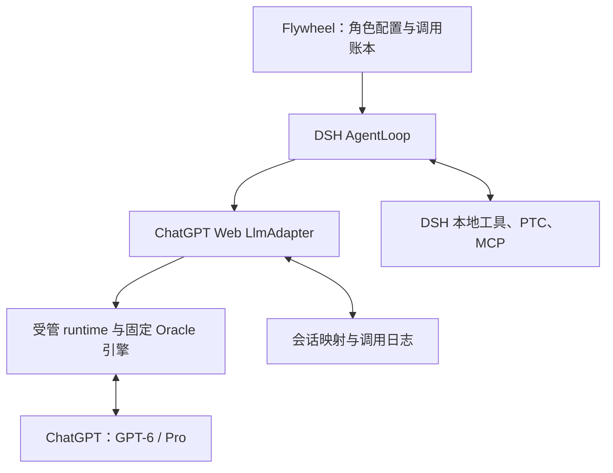
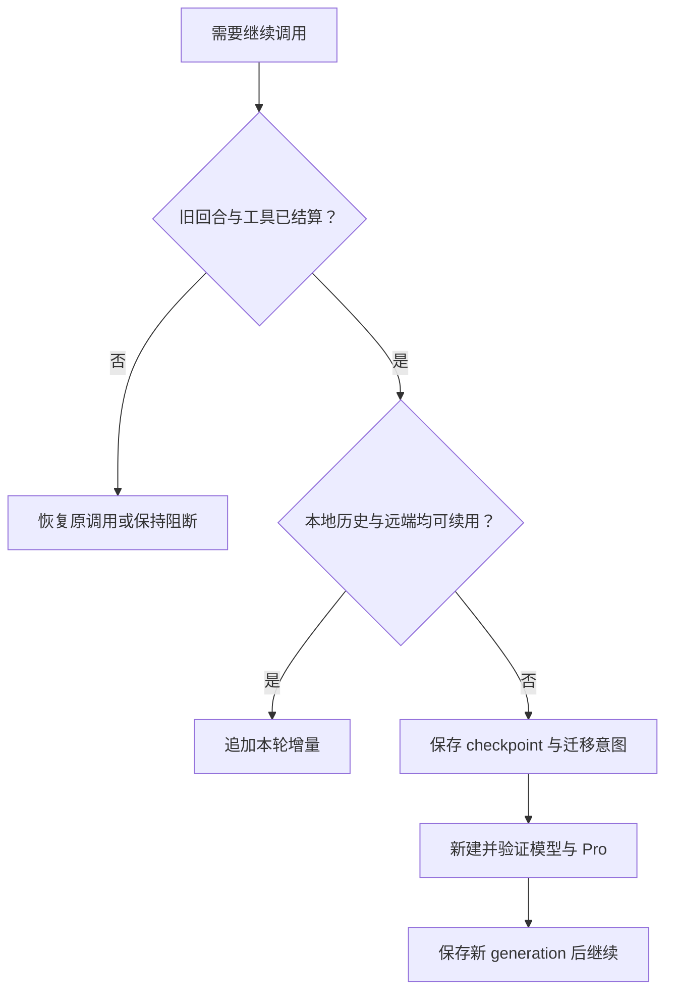

# ChatGPT Web Pro：可配置模型 Provider 完整设计

简体中文 · [English](2026-11-17-chatgpt-web-provider.en.md) · [方案索引](README.md) · [当前架构](../design.md)

**状态：提案，供设计评审；本 PR 只提交设计，不表示功能已经实现或发布。** 日期：2026-11-17。Flywheel 基线为 `0.37.0` / `db6b93e6b2f74b8bcc6563c54bcafbd0813ccd0c`。

## 1. 决策与目标

在现有 `ckanner/dsh-plugin-chatgpt` 包中增加隔离的 **`chatgpt-web` Provider**，通过 DSH 的 `LlmAdapter` 注册 **`gpt-6-pro` 模型**。保留现有 `chatgpt` SIWC Provider 的认证、模型目录和调用链。网页组件按显式配置加载；普通 SIWC 使用不启动浏览器，也不依赖网页账号就绪。

Flywheel 通过 **`harness: "dsh"` + `provider: "chatgpt-web"`** 使用该模型。它可以参与设计、规划、**执行**、审查、终验判断、Intake、Garden，以及获准的 DSH 子代理。规划和 review 是典型使用场景，不是产品能力边界。

GPT-6 Pro 提供模型推理；DSH 提供 Agent loop、本地工具和权限；Flywheel 提供确定性编排、冻结契约、验证和 Git 交付。网页模型要能使用本地工具，必须实现文本协议到 DSH 工具调用的适配闭环；模型在网页里生成一段代码，不等于本地仓库已经修改。

本设计的完成标准是：用户能在配置和 UI 选择该 Provider，将其绑定 Execute，完成有真实本地工具、测试和独立 Review 的任务；长期工作能正确续接、压缩和更换网页会话；故障恢复不重复派发未知请求或已确认的工具副作用。

### 1.1 必须保持的不变量

- Go 仍是 Flywheel 状态的唯一写入者；网页回答、Provider 日志和 DSH native 事件不能直接推进 `state.json`。
- 原有角色／scope 隔离保持，独立 Review 不继承 Executor 的网页聊天或可隔离的账号／项目上下文。
- 遵守用户配置的 fresh/scoped 策略；同一 Agent 调用内的工具回环可复用网页会话，但不因此跨 fresh 角色调用复用历史。
- 保留实际 cwd、权限、冻结验收、同一候选验证、预算、取消、恢复和清理条件。选用 Pro 不增加工具权限。
- 模型、账号、Provider 或计费渠道不静默降级；不将 Pro 解释成 high/max/ultra 的别名。
- Dispatch、Activity、Outcome、Cleanup、Usage 分别记录。未知结果不能靠新建聊天绕过，估算不能伪装成服务端实际计量。
- 完整能力是最终目标；实施顺序允许分阶段验收，不把“能问答”的中间版本宣布为完整 Execute Provider。

## 2. 已核查的现状和缺口

| 项目 | 核查基线 | 已有能力及本设计要补的内容 |
| --- | --- | --- |
| Flywheel | `db6b93e6`，0.37.0 | 支持 DSH Provider、profiles、loops、执行 routes、角色会话及恢复；尚无 chatgpt-web |
| ChatGPT 插件 | `40d8f885`，0.1.20 | 通过 DSH LlmAdapter 使用 SIWC；没有网页模型传输 |
| DSH | 官方 `master`：`39163dd3`，0.2.2-rc.3 | 有 LlmAdapter、工具循环、会话持久化及 CompactionEngine；网页协议与跨进程身份需要插件实现 |
| Oracle | `0a064e7b`，0.23.1，Node >=24 | 有浏览器发送、完整内部回答对象、续聊及结果恢复；没有完整模型 Provider 契约 |

核查依据为固定源码和文档，见第 15 节。没有运行真实账号推理、把网页聊天跑满或完成 Mac 浏览器验收。

以下缺口影响架构选择，不能用安装配置掩盖：

1. **Oracle MCP 不能直接当动态模型接口。** `consult` 没有已有 conversation/session 的动态 follow-up 输入；`browserFollowUps` 是预先给定的字符串。`consult` / `wait` 的 `output` 为有界日志尾部，不是完整最后一轮模型答案。MCP waiter 取消不取消后台任务。
2. **Oracle CLI 的续聊证据不够。** `--followup` 继承父模型／浏览器配置；恢复路径跳过模型版本选择。Pro effort 有校验路径，但不能据此声称已重新确认 GPT-6 版本。
3. **Oracle 没有长会话压缩和换聊。** 约 60k 字符的内联转附件是输入传输策略；当前 token 估算不包含旧网页历史。浏览器路径不执行 API 的 `--max-input` 检查。
4. **网页模型没有 DSH 原生 tool API。** 要把完整回答转成 DSH `tool-call`，必须自建有版本、身份和 schema 校验的协议；不能执行 Markdown 中看起来像命令的文字。
5. **Flywheel 当前会回填 high。** `dsh.go` 将空 thinking 改成 high；start/prewarm 序列化、预热校验、Execute 策略和 UI 都需要同步处理真正的“未传 effort”。
6. **Flywheel 当前禁用 DSH 默认压缩。** SDK overlay 禁用 `compaction-basic` 和 `command-compact`，不能宣称新增 Provider 会自动继承桌面压缩。
7. **成功响应的 replayState 不足以恢复未知调用。** DSH 的 `finish.replayState` 随成功 assistant message 持久化；发送后、回答形成前的崩溃仍需独立预写日志。
8. **浏览器日志不是活性证明。** Oracle 会在 UI 无变化时打印定时状态；这些日志不能刷新真实工作进度，也不能证明远端终止。

## 3. 分层架构与方案取舍



| 层 | 责任 | 不拥有的责任 |
| --- | --- | --- |
| Flywheel Go | 阶段与路由、调用准入、预算、状态、验收、候选、交付和恢复决策 | 浏览器 DOM、模型输出里的任意动作执行 |
| DSH AgentLoop / tools | 接收模型 blocks，按实际工具表、权限和 cwd 执行工具并持久化结果 | 把网页文本当已通过的 Flywheel 裁决 |
| 新 Web adapter | 模型目录、消息投影、工具协议、会话同步、压缩协调、模型响应转换 | 第二套 Shell／文件执行器 |
| 受管 runtime | 网页账号／tab 绑定、提交、当前回答捕获、真实活动、停止和只读恢复 | Flywheel 状态机与自动跨渠道重试 |
| Oracle 引擎 | 复用已审查的网页交互和内容捕获实现 | 被假定为稳定官方 SDK 或完整恢复协议 |

### 3.1 为什么选择 DSH Provider

- **DSH Provider（采用）：** 能复用现有本地工具循环与权限，可在各模型角色配置；Provider 侧补齐网页特有契约。
- **仅提供 MCP 顾问工具（保留为可选入口）：** 适合已有 Agent 临时咨询 Pro，但不会把该 Agent 的主模型变成 Pro，不满足本设计的完整目标。
- **新增 Flywheel 专用 harness（本轮不采用）：** 需要重新实现或嵌入工具循环、权限、会话和 SDK 行为，增加维护成本。出现 DSH 无法承载的实际需求时再单独评审。
- **改现有 SIWC／API Provider（独立渠道）：** 官方 API 的模型／mode 和压缩能力不等于网页版订阅路由。不能因为名字相近就互换认证、额度或行为。

`harness: "codex-pro", provider: "chatgpt-web"` 不是合法接入方式。原生 Codex/Claude 的主模型不能通过这份 DSH 配置被替换；它们可使用额外咨询工具，但与 Flywheel 将某个 Execute route 设为 DSH + Web Pro 是两种能力。

### 3.2 Oracle 的依赖边界

采用**插件拥有的、版本化机器接口**封装固定 Oracle 引擎。Oracle 当前公开入口是 CLI/MCP，没有承诺稳定的浏览器 SDK；不在主 Provider 中散布内部路径导入，也不解析人类日志作为响应。

实现优先向上游补充可复用入口。若上游发行尚未提供，维护经审查的固定源码快照／补丁，记录 commit、构建来源、包 integrity、补丁清单和 MIT notice；封装在单一 transport 模块，后续可替换引擎。不得冒用原版版本号声称补丁已由上游发布，不在每轮调用时下载 latest。

最少扩展包括：动态单轮续接、每轮模型与 effort 核验、隔离项目创建与准入、完整最后一轮回答及身份、结构化活动、明确取消、资源与远端状态分离的回执、只读恢复。只包一个现有 `oracle-mcp consult` 不算完成。

## 4. 用户配置与模型语义

### 4.1 Provider 和模型身份

拟议注册：

- Provider ID：`chatgpt-web`；显示名：`ChatGPT Web`。
- Model ID：`gpt-6-pro`；显示名：`GPT-6 Pro · ChatGPT Web`。
- 目标网页选择：GPT-6 + Pro。该模型 ID 是我们 Provider 的稳定路由标识，不宣称同名 API slug。
- `resolveModel` 不发布独立 reasoning 努力档。请求必须真正省略 `reasoningEffort`；非空 high/max/pro 等值在该固定模型上均明确拒绝。
- 当前已验证输入先按 text 声明；图片、PTC、Team 等按第 11 节验收后扩展能力。窗口数字只能标注为本地有效输入预算，不能冒充官方网页窗口。
- `providerInfo`、`listModels`、`resolveModel`、`prepareCall` 和 `stream` 由同一能力表驱动；DSH 配置注册的 settings namespace 与实际 schema 一致。
- 每轮派发前取得新的 UI 选择证据；无法确认目标模型或 Pro 时停止。UI 证据不等于云端内部权重／计算量证明。

### 4.2 Flywheel 配置示例

**以下是拟议配置片段，依赖本设计实施后才可运行；不是当前 0.37.0 的可用配置。** 应将片段纳入实际生效的完整配置，Flywheel 不会跨配置文件深合并。

```json
{
  "profiles": {
    "web-pro": {
      "harness": "dsh",
      "provider": "chatgpt-web",
      "model": "gpt-6-pro",
      "channel": "chatgpt-web-subscription",
      "thinking": ""
    }
  },
  "loops": {
    "design-plan": { "profile": "web-pro" },
    "review": { "profile": "web-pro" }
  },
  "routes": {
    "hard": { "profile": "web-pro" }
  },
  "channels": {
    "chatgpt-web-subscription": {
      "harness": "dsh",
      "provider": "chatgpt-web",
      "env-key": null
    }
  },
  "sessions": {
    "mode": "scoped",
    "policy-version": 1
  }
}
```

此例显式将 hard 执行路由、design-plan 和 review 设为 Pro。未显式覆盖的 design-review／plan-review 会继承 review，因此也使用 Pro；其他角色的模型绑定不变。全局 scoped 策略影响所有未单独覆盖的适用角色；仅需部分角色复用时使用既有 `sessions.roles`。这不是强制迁移现有任务。channel 是配置别名，网页账号由插件中的具名连接选择，不能仅改 channel 名就假装换了账号。

| 场景 | 配置入口 | 必须保留的语义 |
| --- | --- | --- |
| 初始设计 | `loops.design-plan` | 未配置时继承 plan 后端，角色仍独立 |
| 独立设计审查 | `loops.design-review` | 未配置时继承 review 后端 |
| 计划／里程碑规划 | `loops.plan` | 保留实际计划契约与 scope |
| 计划审查 | `loops.plan-review` | 未配置时继承 review 后端 |
| **执行** | **`routes.default/frontend/hard/multimodal`** | 由 packet route 选择；没有 loops.execute |
| 代码审查／终验判断 | `loops.review`、`loops.judge` | 保留独立历史与结构化裁决 |
| 第二意见 | 顶层 `judge-panel` | 仍受启用条件与独立性约束 |
| Intake／Garden | `loops.intake`、`loops.garden` | 只替换其中的模型工作 |
| 有界执行模型切换 | `execution-policy.bindings` 和各 route 的 allowed 集合 | 只能选择显式允许且通过能力检查的绑定 |

Verify 命令、状态转移、批准和 Git 交付不变成模型角色。当前 JEV 使用独立 `/v1/systemone` HTTP 契约，不能通过上述配置直接替换；若要更换 JEV 模型，另立设计。

### 4.3 空 effort 必须端到端一致

实施必须同时覆盖：

1. 配置解析、profile 展开和有效配置展示：保留 `thinking: ""` 的显式覆盖语义。
2. DSH driver：对已支持固定模式的 Web Provider 省略 effort；保留其他 Provider 原有兼容默认，不能全局删掉默认造成回归。
3. start／prepare 的 JSON、ready 校验、worker 参数和 SDK initialize：缺省代表无独立 effort；禁止把空字符串发送到 SDK。
4. 预热请求、绑定摘要、warm-start 匹配和恢复：缺省／非空必须能区分，不重新回填 high。
5. Execute policy schema 与校验：条件允许该 Provider 的空 thinking；其他模型继续按真实能力校验。
6. UI：显示固定的 Pro 模式，隐藏不适用的 effort 选项；保存时不能删除显式空覆盖而重新继承 high。
7. SDK resume：旧 header 中残留的不支持 effort 必须拒绝复用或在确认安全后重建；不能依赖“省略新值”自动清除旧值。

Pro 选择由 Provider 的模型契约表达，日志同时保留 `reasoningEffort: absent` 与 `observedWebEffort: Pro`，不能为了显示统一伪造 high。

## 5. Execute 的完整工具闭环

### 5.1 输入与返回协议

每轮输入包含：当前有效指令、规范化的有序消息、工具 schemas、必要附件、调用标识和本轮协议要求。网页消息里的 system/developer 标签只是文本角色标记，不具有 API 原生系统消息的优先级保证。

拟议返回只允许一个完整的 JSON 对象，区分最终回答与工具请求。例如：

```json
{
  "protocol": "dsh-chatgpt-web/1",
  "requestId": "webcall-example-1",
  "generation": 2,
  "kind": "tool_calls",
  "calls": [
    {
      "id": "tool-example-1",
      "name": "read_file",
      "arguments": { "path": "src/example.ts" }
    }
  ]
}
```

`read_file` 仅为协议示意名；实际工具名和参数必须来自当前 DSH 请求，不能硬编码假工具。最终回答形态：

```json
{
  "protocol": "dsh-chatgpt-web/1",
  "requestId": "webcall-example-2",
  "generation": 2,
  "kind": "final",
  "text": "本轮最终回答或宿主要求的结构化产物文本"
}
```

Provider 将工具对象转换为 DSH `ToolCallBlock`（`type/id/name/arguments`，arguments 为序列化 JSON），把 final 转为 text blocks；Flywheel 仍独立验证 Plan、done-report、Review、Judge 等产物契约。网页协议合法不等于业务裁决合法。

### 5.2 执行顺序和校验

1. 验证当前会话、有效工具表、权限、输入预算和剩余调用期限。
2. 保存派发意图及输入摘要，再提交当前网页回合。
3. 只捕获**本次匹配的、明确结束的最后一轮 assistant 消息**；获取完整原文和内容摘要。日志尾部、旧回答、prompt echo、引用和未完成片段不能替代。
4. 对整个 JSON 对象严格校验：协议／requestId／generation 匹配、未知字段、工具名、参数 schema、ID 唯一性、大小、深度、调用数。
5. 整批通过后才向 DSH 发出可执行 tool-call blocks。DSH 原有 tools executor 决定执行和审批，runtime 不执行 shell。
6. 工具结果按 call ID 持久化并返回 Provider；正常续接仅向网页追加本次新增结果，继续循环。
7. 最终文本通过 DSH 持久化进入 Flywheel 普通结果处理，随后仍须执行 L1／适用检查与独立 Review。

完整结果在传输前写入私有 artifact，协议可只携带路径、字节数和 digest；调用方只读取已绑定目录内的普通文件，拒绝路径逃逸、链接和截断。工具请求不得在最终校验前以增量 tool-call 的方式漏给执行器。可展示的活动与待执行内容分离。

格式修正请求有独立小上限，并消耗原 invocation 的时间与用量预算；修正前不得执行任何未验证动作。没有格式修正额度时明确失败。请求标识和 schema 只证明格式与关联，不能证明模型意图正确；权限、验收与独立 Review 继续承担其职责。

### 5.3 工具副作用和崩溃窗口

DSH 已有会话 checkpoint policy，在模型请求、顶层工具执行及下一步前 flush。新 Provider 不绕过这些屏障。

新增工具回执关联应保存 `requestId + toolCallId + argumentDigest + intent/resultDigest`。同一已完成工具调用恢复时采用已保存结果，不能再次执行。若在副作用发生后、结果持久化前崩溃，该工具结果保持 unknown，执行域停下来对账；通用 Shell 操作不能被宣称具有 exactly-once。

当前 DSH tools 的 start 会写入 tool/call，commit 写入带来源关联的 tool/result；公开 tools/execute waterfall 的 checkpoint policy 在顶层工具 body 前 flush。tools/result 通知本身不是结果已同步到磁盘的 ACK，必须以持久事件对账。

DSH 恢复还会把“已开始但无结果”的调用补为 `TOOL_OUTCOME_UNKNOWN`；这个错误结果只是事实修复，不是机械阻断。新 host policy 必须识别可信的 repair/source 记录，为该执行域建立持久的 **unknown admission fence**：禁止新模型派发和新副作用工具，包括换 call ID、换 Provider、换 generation 后的同一未解决动作。只允许宿主限定的只读恢复／对账操作集合，不能靠模型自称只读；确定性证据或明确的人工 resolve 才可解除。不能依赖错误文本中的“不要重试”建议，也不能把 repaired error 在压缩后当普通失败丢掉。Go 接收该阻断事实，Provider 不直接写 Flywheel state。

宿主持久 `executionDomainId` 关联 task、role/scope 和原 invocation，不能拿当前 requestId 代替。该域覆盖根和全部已准入子 Agent／PTC 嵌套执行，不限定为 Web Provider 来源；fresh/resume、fallback、重新规划的新 invocation 仍继承未解除的 fence。子调用未知向根传播并冻结兄弟的新准入；已在飞工作取消／排空并分别对账，不能追溯声称其未执行。普通 DSH 桌面由 host policy 保存对应的执行域，Flywheel 中还必须由 Go 持久保留跨 worker 的阻断事实。

## 6. 受管机器接口与持久调用状态

### 6.1 接口

在插件包中提供拟议 `/web-machine` 入口；浏览器运行于受管子进程，按版本协商提供：

| 操作 | 语义 |
| --- | --- |
| `capabilities / prepare` | 验证版本、配置、浏览器与账号绑定，不发模型请求 |
| `startTurn` | 对指定 logical session/generation 发起一个受管模型回合 |
| `observe` | 返回有序活动、状态与完整结果引用，保持原 invocation 身份 |
| `recover` | 只读核对原请求和原网页回合；不发送新的业务 prompt |
| `cancel` | 停止本地受管工作，并尽可能停止指定网页生成；返回分开的证据 |
| `close` | 释放本次拥有的控制资源与租约，不关闭用户无关 Chrome |

必须区别本地 ready、网页 prompt 已接受、回答完成和结果已交付。接口不提供“原请求状态不明时自动 restart”。

### 6.2 四层身份与日志

至少记录：

- Flywheel task / role / scope / invocation，或普通 DSH 的独立调用 owner；
- DSH session ID、branch/surface revision、purpose；
- runtime invocation、Oracle session、浏览器 connection/account scope；
- ChatGPT project ID、conversation generation、URL、user/assistant message ID、聊天所属项目及父消息关系。

DSH `GenerateOptions` 没有 Flywheel requestId；通过**拟议受管 host service**从已准入 Agent 获取绑定，而不是给 SDK 偷塞未知字段。普通桌面由插件生成 owner；Flywheel 由 policy 服务绑定 Go 的真实 invocation、session 和 nonce。完整绑定包含实际项目与执行目录、模型、权限、工具表、协议／runtime 版本及非秘密浏览器连接身份。

主调用资格在公开 `llm/stream` 的 pre-projection hook 分类：只有 `isAgentLoopRequest()` 可识别、拥有 sessionId 且已准入的无辅助 purpose 请求，才能加入主 conversation。任何明确 purpose、非 AgentLoop one-shot、无 sessionId 或未知 purpose 都不能落入主会话键；支持的辅助用途分配独立 invocation，未支持用途明确拒绝。每次摘要调用也有不同的 invocation，不能仅按 sessionId＋purpose 复用。拟议 host service 将分类与绑定通过受控调用上下文传递到 adapter，不能假定投影后对象保留原 WeakSet 身份，或仅按共享 sessionId 查找当前请求。

调用上下文至少绑定独立 call ID、call kind、purpose、宿主 owner、executionDomainId、Agent lifecycle、session/surface revision、binding／原请求摘要和 signal。adapter 派发前重新核对它仍有效，终态或 dispose 后撤销；跨进程只传已校验标量，不传宿主对象或秘密。插件必须复用宿主同一份 DSH LLM 模块，避免打包另一份 WeakSet 导致分类失效。若使用 AsyncLocalStorage，须覆盖 lazy AsyncIterable 的创建及 next/return/throw 整个生命周期；不能只包住返回 iterator 的函数。并发交错主请求与辅助请求必须验证不会串身份。

Provider 使用私有、版本化的预写日志，按以下事实推进：

| 顺序 | 持久事实 |
| --- | --- |
| 1 | `prepared`：调用和准入绑定已准备 |
| 2 | `submit-intent`：即将提交的意图已保存 |
| 3 | `submitted-confirmed`：网页接受 prompt 已核验 |
| 4 | `response-captured`：完整回答与 digest 已保存 |
| 5 | `response-validated`：回答通过协议和身份校验 |
| 6 | `delivered-to-dsh`：已交给 DSH，尚不等于持久提交 |
| 7 | `host-commit-confirmed`：DSH 持久记录及关联已核验 |

每一步原子保存并同步；状态可能停止在任意一步。`submit-intent` 不是已派发证明；缺少下一步也不是未派发证明。成功 `finish.replayState` 只携带安全的 ledger 引用、generation、message identity 和摘要，不能替代独立日志。Provider response ID 与 DSH assistant MessageId 分开：后者由 AgentLoop 生成，当前 StreamChunk 不允许 adapter 指定它。

Flywheel 需要协商新的 DSH worker 扩展版本，传递 Provider runtime identity、调用事实、回执与恢复能力；旧 v1/v2 保持原语义。旧 worker 不理解新能力时派发前拒绝 Web Provider，不能发送扩展字段后忽略校验。具体外层版本号在实施时按当时协议分配，本设计内层协议固定为 `dsh-chatgpt-web/1`，二者不是同一个版本。

### 6.3 恢复和重复交付

- 提交前确定未派发且本地清理确认：允许按原有策略重试。
- 提交结果未知：锁住该 conversation，先读取原回合、页面和 journal，不重发。
- 回答已捕获未提交 DSH：按 digest 保存为 pending result，交由宿主恢复事务采用，保持同一 Provider response/tool-call identity；不得在下一普通模型请求里直接重新 yield 旧动作。
- DSH 已保存 assistant/tool results：对账后确认交付，不再次创建工具调用。
- 捕获内容不完整、身份冲突、原网页被手工修改：保留证据并阻断，不能用旧 answer 充当新 answer。
- 无法确定远端请求／本地工具的状态：维持 unknown；保留原任务、工作区与已知清理事实。

宿主提交确认需要在 DSH 会话 flush 后完成；恢复通过 durable session 事件核对，不将一次 AsyncIterable 返回当成 durable ACK。DSH 当前 resume 会先修复并关闭中断的 step/turn，普通 adapter stream 不能伪装成原 step 的继续。需要新增公开的 **adopt-recovered-response** 接缝：核对原 request、surface revision、host step 状态，确认原 assistant 未入账、工具未执行且无 unknown fence，再在宿主拥有的新恢复事务中接收一次、记录原 step/Provider response 关联并 flush。若原 assistant 已存在则只做对账 ACK。该接缝完成前，捕获结果可以只读展示，但自动重新交付可执行工具保持 blocked；此项是完整恢复的交付依赖。

采用事务以 executionDomainId＋DSH sessionId＋originalRequestId＋providerResponseId 为持久幂等键；重复请求返回已保存的宿主提交身份，不创建第二个 assistant 或工具批次。还需核对当前工具表、权限和 binding 与原结果兼容；恢复期间撤销权限或替换工具后，旧响应 digest 正确也不构成自动执行授权。

## 7. 会话复用、压缩和自动换聊

### 7.1 正常复用

DSH 请求通常包含完整历史。Provider 为每个 logical session 保存规范化的**内容前缀**摘要与已确认同步游标，不能每次把完整历史重复发送到已有网页聊天。

普通追加满足以下条件才复用：相同 owner/account/provider/model/purpose、相同工具与指令契约、前缀内容一致、旧回合已结算、无未确认工具结果、租约有效。正常只发新增 user/tool 消息；提交确认与回答持久化分别记录，不能仅按消息数量推进游标。

模型自己在网页生成的协议对象与 DSH 投影后的 tool-call/text block 表示不同，需要保存这一次转换的双向对应及摘要。前缀比较使用规范化语义和已确认转换，不能拿原始网页 JSON 与 DSH blocks 直接比字节。

同一 DSH session 可以对应多个网页 generations；同一网页 conversation 全回合只能有一个跨进程写入者。跨任务、角色、子代理、辅助 purpose 不共享聊天。不同聊天本身不保证账号级记忆隔离；还必须通过第 9.2 节的网页宿主上下文准入。

### 7.2 两种预算与两种重建

必须同时管理：

1. **本地模型请求预算：** 有效指令、工具 schemas、协议包装、历史、附件投影及输出预留。
2. **远端聊天累计预算：** 已发送／捕获内容和回合数量的保守估计；这不是网页真实剩余窗口。

预算来自用户连接配置和实测策略，不硬编码一个未经官方确认的 GPT-6 Pro 网页窗口。`resolveModel.context` 若需要数字，只暴露声明为本地策略的有效上限。对无法可靠估算的附件保留不确定性，不能算作零；超大原始工具结果先按 DSH 的有证据裁剪／分页契约处理。

- 远端累计历史偏大，而当前本地 derived history 已足够小：直接用该权威历史开启新 generation，不必额外调用摘要模型。
- 本地输入也过大：先执行受控本地压缩，持久化 checkpoint，再用压缩后的真实 derived history 开启新 generation。
- 模型／账号／权限／工具表变化、history rewind/fork、prune、指令变化或手工改网页：重新做兼容检查；不兼容时仅在旧调用可安全结算后重建。
- 新聊天的 bootstrap 仍超预算：进一步缩小材料或分解任务，明确失败；禁止无限“新建聊天再试”。

### 7.3 DSH 压缩接入

普通 DSH 桌面沿用已有公开 CompactionEngine。摘要请求带 `purpose: "compaction"`，即使 sessionId 相同，也必须使用独立的辅助 invocation/conversation，禁用工具执行；title 等辅助用途同理。不能把摘要指令发进主执行聊天，也不能让不同摘要任务持续追加到同一辅助聊天。

Flywheel 使用**只适用于已准入 chatgpt-web 根／子会话的受控 overlay**：

- 安装 `BasicCompactionEngine(auto:false)` 或符合公开 CompactionEngine 的专用后端；不全局重新开启其他 Provider 的自主压缩或额外模型调用。
- 通过公开 agent hooks、token meter、balanced tool ranges 与 compaction 接口检查当前请求。
- 不修改冻结 Spec/packet/acceptance；必须保留当前约束、待解决问题、可信证据引用和完整配对的工具尾部。未决工具调用不跨压缩边界丢失。
- checkpoint 记录来源范围、原始摘要、输出摘要、模型／目的、调用用量及 preserved facts；原始事件保留。
- surface 替换后先 `sessions.flush`，确认新的 derived history，再批准网页 generation 转换。
- 模型摘要调用单独计入同一外层预算，保留 unknown usage；默认使用显式配置的摘要策略，不能偷偷换到付费 API 或另一个账号。
- 预算内无法完成有效压缩时停止，不添加未计量、无限重试的摘要循环。

公开 `compactIfNeeded` 读取旧 request header；Basic 的 proposed-header 压力函数是 private。完整实现必须基于公开 `tokenMeter.measure(session, proposedHeader)` 和 balanced ranges 实现目的路由预检，或先推动 DSH 增加公开接缝。不得调用 private 方法或假装已有目的模型容量检查。

### 7.4 换聊事务与硬上限恢复



迁移意图保存旧／新映射、checkpoint、bootstrap digest 和原因。隔离项目创建意图、实际 project ID 与策略核验状态同样先记账；创建后日志确认前崩溃时先只读定位原 owned 容器，身份无法确认则阻断，不不断新建。新聊天建立失败时保留旧证据；bootstrap 提交后崩溃按新 invocation 恢复，不再重复创建聊天。仅新映射已持久化且本轮身份明确后更新 active generation。

网页明确提示 context/conversation limit 时，进入同一恢复路径；网络超时、限流或通用错误不能冒充上下文溢出。旧聊天已拒绝消息时，依赖本地记录，不要求它再接受一条总结指令。已提交但结果未知时，换聊流程同样阻断。

摘要有损，不能承诺保留网页内部隐含推理或获得无限上下文。新聊天不重置订阅额度。

## 8. 活性、期限、取消与清理

### 8.1 活性

完整协议输出校验前不能向 DSH 发可执行内容，因此另设内容无关的活动通道。扩展现有 `flywheelProviderActivity` 来源白名单和 Go 校验，绑定真实 Agent、invocation、generation、序号与事件类型。

区分：

- 进程／传输 heartbeat：仅供诊断；
- UI 生成状态快照：说明观察状态，不代表有新进展；
- 新 assistant 内容、可确认的进度变化：真实活动；
- prompt acceptance、终态、结果持久化与 cleanup：各自独立事实。

网页 Pro 无可观察变化的推理阶段使用声明的 opaque/wall 策略；不能沿用“stdout 静默即挂死”，也不能用定时日志无限续命。整个角色调用的 wall deadline、原有用户取消和清理期限继续有效；格式修正、重连、压缩、换聊都从同一剩余预算扣除。

### 8.2 本地资源与远端生成分别记录

拟议终态回执至少包含：

| 事实 | 必需表达 |
| --- | --- |
| dispatch | not-dispatched / confirmed / unknown，附对应证据 |
| outcome | completed / failed / cancelled / unknown，保留最初 stop reason |
| local cleanup | owned worker、控制通道、tab lease、本地工具是否已静止／释放 |
| remote generation | 已观察完成、已观察停止、未派发或 unknown |
| usage | complete / partial / unknown；本地估算另列 |
| selection | requested 与本轮 observed model/effort，时间和验证状态 |

取消必须阻止新的本地工具／模型回合，向准确 owned 页面尝试停止生成，排空 owned DSH 工具，退出受管子进程并保存回执。关闭 tab、断开 CDP、杀 CLI、取消 MCP waiter 都不能单独证明云端停止。

远端仍未知时，即使本地资源已清理，也保留隔离标记并阻断自动重放／复用。成功不要求销毁共享 Chrome；只要求本轮拥有的工作已结算、控制资源已释放。不得关闭用户无关 tab 或整个日常浏览器。

Flywheel 需把 Provider 远端状态纳入新的回执与恢复检查，不能仅以 DSH SDK 进程退出推导全部 cleanup；对旧 Provider 保持原有契约。外层 timeout 与内层取消手段分开，保留 TIMEOUT 首因。

### 8.3 错误分类

复用 Flywheel 现有错误码，附 Web 专属有界 reason：

- AUTH：账号未登录、绑定不符或登录挑战；
- QUOTA / RATE_LIMIT：明确的额度／频率限制；
- CONTEXT_WINDOW_EXCEEDED：有页面来源和身份的上下文拒绝；
- INVALID_REQUEST：不支持的配置／能力或输入不满足本地政策；
- TRANSPORT / SERVER / TIMEOUT / EMPTY_RESPONSE：按真实事实分类。

工具协议格式失败保留独立 reason、原始答复 digest 和有限修正次数，不能把它当已执行动作。只读取真实 UI 错误控件；答案里讨论错误文案不能触发错误分类。源代码和离线 fixture 不能证明所有语言／网页版本已识别。

DSH 对若干通用码自带请求重试，因此 Web adapter 的 `providerRetryPolicy()` 必须返回完整的 `ResolvedRetryPolicy`，其中 `maxRetries` 为 0；可使用公开 `resolveRetryPolicy({ mode: "normal", maxRetries: 0 }, "chatgpt-web.retry")` 构造，而非返回缺字段的局部对象。由受管 runtime 仅对“已确认未派发”的情况做有界重试。`submit-intent` 后的不确定性必须先建立持久 dispatch fence，再向宿主返回保留首因的不可自动重试结果。即使用户配置更积极的 retry，下一次准入也必须被 fence 拦住。Flywheel 的外层重试、fallback、重规划和新会话同样遵守该事实；格式修正是旧回合已确认结束后的新子调用，不借通用重试实现。

## 9. 安装、认证、SDK 和会话可见性

### 9.1 连接选择与部署

网页连接由插件设置管理：具名 connection、专用浏览器 profile、明确浏览器路径、runtime 版本、状态目录、并发和上下文策略。首版每个 DSH profile 明确选择一个 `activeConnection`；desktop 与 SDK 要指向同一受管连接，或明确使用不同连接。该选择、规范化路径和非秘密账号身份进入实际 binding。Flywheel channel 不选择连接，首版不支持仅靠不同 channel 在同一个 worker profile 下切换网页账号。

拟议设置命名空间为 `chatgpt-web`；`enabled` 默认 false，`activeConnection` 在启用时必填；`connections.<id>` 定义 browser profile、browser/runtime 可执行文件、私有 stateDir、`maxConcurrentTurns`（初始 1）、hosted-context policy 和 context policy。context policy 必须有有限的输入／输出预留、远端累计预算、回合上限、修正／压缩／迁移次数及 wall 预算继承规则。具体生产阈值由 P1 的实测策略清单定版，记录 policyVersion；缺少已验证策略时不将能力标为 ready，不借用 API 窗口数冒充网页上限。所有策略变化都进入 runtime digest，UI 可查看和明确覆盖；不是任意 modelOptions 的隐式透传。

- 初次使用在专用浏览器 profile 手动登录，复用该 profile；不默认复制日常 Chrome cookies，不读取用户凭据并写入任务。
- 浏览器相关依赖惰性加载。Web runtime 要求 Node >=24；安装诊断明确检查对应可执行文件，不能拖坏原来仅需 Node 22 的非 Web 路由。
- 安装和更新通过现有 npm 工作流及显式 setup，锁定依赖和来源；不依赖临时源码目录、手工 ZIP 或 postinstall 修改账号／profile。
- Flywheel 的独立 SDK profile 也必须加载该 Provider 和受控 companion policy。桌面插件存在不代表 SDK 已启用；不能把 `FLYWHEEL_DSH_PROFILE` 设成 desktop。
- doctor 默认无推理；检查模块、版本、profile、模型契约和缺省 effort。主动浏览器登录／模型菜单检查作为明确用户操作，不发送测试 prompt，不把静态 pass 写成账号额度或真实推理已通过。
- doctor／预热只准备本地运行时与准入，无 paid prompt、无业务项目／占位聊天、无 LLM 命名；正式 start 才创建其 owned 容器，未使用的 runtime 必须有界关闭。

### 9.2 网页宿主上下文准入

Chrome profile 只隔离本地浏览器数据；同账号的 Memory、Reference chat history、自定义指令、Projects 和已连接 apps 可能增加模型上下文或能力。新 Chat 不天然等价于只含 DSH 请求的模型输入。正式 Flywheel 调用必须核验并冻结可公开观察的 hosted-context policy；不能自动修改用户账号全局偏好。

首选持久模式为 **新建的私有 project-only 项目，每个 logical session 的每个 generation 一个项目，只含该 generation 的一个主聊天和明确准入的材料**。项目指令由本次协议控制并记录摘要，项目无外部协作者／连接来源；辅助摘要调用使用自己的隔离容器。不同角色、子代理和 generation 不共享项目，防止项目内聊天记忆把执行历史或已压缩的旧内容重新带回。创建、设置回读、来源清单与调用前复核是拟议 runtime 的新增能力，Oracle 当前的 project URL 支持不能替代这些检查。受管路径禁止从项目加载失败回退到普通首页；新建、续聊和迁移都在发送前复核目标 project ID 与准入证据，失败保持 not-dispatched。

官方说明 project-only memory 限制跨项目引用，项目指令覆盖全局自定义指令；这些设置仍受账号／工作区条件影响，已有项目改设置可能延迟生效。因此不把“刚改了一个旧项目设置”当立即隔离证明；只接纳已确认满足策略的新容器，无法核验时在派发前失败。可由用户显式选择并核验另一种无跨聊天记忆的持久配置，但不能仅凭专用 profile 或 channel 名称通过准入。

真实准入依次核验账号具备项目记忆前置条件、创建私有 project-only 项目、回读 memory/instructions/sources/sharing、保存 project ID、在项目内确认 GPT-6＋Pro，并验证主聊天的 parent project。主页可选 Pro 不证明项目内也可选；不具备条件时准确报告 unavailable，不静默开启全局 Memory。项目及聊天都采用可读任务／角色／代次名称，避免产生无法辨识的容器。

`Unpersonalized Temporary Chat` 可作为另一个明确模式评估，但其历史可见性、可回访 URL 和恢复能力需单独验收；它不是默认持久模式，保存为普通聊天后也不能继续声称具有原来的非个性化保证。若没有满足隔离与恢复条件的连接，独立 Review/Judge 能力保持 unavailable，不能把普通聊天的结果记为独立审查通过。

每轮记录 policy、project/source/instruction 摘要和观察时间；手工移入其他项目、改变设置或追加来源导致重新准入或阻断。此保证限于公开配置与 owned 容器，不宣称控制 ChatGPT 隐藏的平台指令。网页自带 apps／可写动作另按第 10 节准入。

### 9.3 历史、标题和数据

DSH 桌面展示逻辑 Session 和工具轨迹；ChatGPT 历史展示相应隔离项目中的 conversation generations。通过第 9.2 节的持久模式保持可回访历史；Oracle 成功单次调用的默认归档策略需要显式改为保留。本地 UI 展示当前链接、历史 generations、原任务与角色，不伪造同一个网页 ID。

标题使用可读任务／角色名，换聊附代次；DSH 标题走既有公开服务。网页标题通过可验证 UI 操作设置并回读，只改本次创建的聊天；失败显示 title 状态与本地可读标签，不用额外 Pro 调用命名，不覆盖用户手改的旧标题。

浏览器连接、路径、账号非秘密指纹和 runtime 摘要加入 session/prewarm identity。账号切换、profile 修改或运行时能力变化需要重新准入；Cookie、token、完整邮箱和敏感正文不进入 PR、通用日志或 replayState。

## 10. 并发、权限与成本

- 同一 conversation 从派发前到终态／阻断持有跨进程 lease；不同 tab 不能并发写同一个聊天。
- 不同 task/role/child 使用独立聊天；连接级队列限制同时在飞的模型回合。默认建议 1，可显式提高；Oracle 的 tab 上限不是服务端允许并发的保证。
- 队列等待保持 not-dispatched，使用原 invocation 剩余 wall 时间并可取消，不发伪进度；取消／超时后即使取得 permit 也不得提交。连接 permit 只覆盖当前网页模型回合，在本地工具／子代理等待前释放，避免父 Agent 持 permit 等待子 Agent 的死锁。unknown 远端回合保留占用责任，不能因本地等待退出就释放成可无界超售的额度。
- 租约使用 owner/epoch 和持久日志核对，PID 存活或固定超时不足以接管未知旧 owner。
- DSH 本地文件／Shell 严格沿用原 sandbox、权限和实际 cwd；PTC 只能调用本次已准入工具。本地 OS sandbox 不约束远端 MCP 或网页 app 的写操作：这些能力需要独立 allowlist、授权和副作用分类。Read-only Review/Judge 只允许已核验的只读外部工具，不明能力不暴露。网页 hosted apps／可写动作首版默认关闭；无法核验关闭状态时拒绝对应调用，不靠提示词代替权限保证。transport 对 owned ChatGPT 页面发送模型请求、上传准入上下文和命名，是有限传输动作，不赋予模型任意外部权限或 LCU 权限。
- 需要 GUI 焦点的 transport 操作与 LCU 使用共享桌面协调；不能持有 GUI lease 等待整个模型推理并让后续 LCU 工具死锁。网页传输与模型控制的 GUI 操作不可同时操纵同一 owned tab。
- 本地估算 token 仅用于容量和策略，不进入“精确服务端 usage”。网页调用及摘要若无权威计量，usage/cost 保持 unknown。
- 现有 soft/hard/off 预算语义不放松；hard token budget 不能依赖网页估算伪造可核实账单。当前 hard daily-token-limit 在记录 unknown usage 后停止后续模型派发，Web Provider 无权威用量时也遵守；安装和 UI 明确显示兼容性，完整任务验收不得暗中切到 soft/off。
- 重连、修正、压缩、换聊及辅助调用都计入调用次数／时间；不能重置 task、packet、失败和账号预算。

网页工具回环通常增加交互和等待次数；不预设比 API 更快或更便宜。实际评估记录每轮延迟、排队、工具轮数、重建原因、协议修正率、任务完成率和人工接管率，用这些数据决定哪些场景值得选用 Pro。

## 11. 能力矩阵与验收边界

“可配置到任何模型角色”与“自动拥有其他 harness 的所有能力”分开。拟议能力在对应验收完成前报告 unavailable，不自动换后端。

| 能力 | 目标实现 | 必须验证 |
| --- | --- | --- |
| 普通对话、设计、Review | 完整文本与结构化产物 | 当前回合身份、完整输出、业务 schema |
| **Execute** | DSH 文件／搜索／Shell／测试工具循环 | 至少两轮工具调用、真实 cwd 修改、验证与独立 Review |
| PTC | 使用实际单一 run_code 工具和 schema | TypeScript、handle、deferred output 和错误回传 |
| DSH 子代理／Team／Workflow | 用已有 native profile 和真实子 Agent 运行 | 独立会话、lineage、并发、活动、预算和取消 |
| 图像输入／多模态路由 | DSH AttachmentStore 的真实 bytes 投影到网页附件 | MIME、顺序、hash、上传完成、模型可见性；不能只传路径 |
| LCU | 经现有 PTC/LCU 工具调用与截图回传 | 明确权限、GUI lease、图像投影及完整取消 |
| ChatGPT 网页自带工具 | 按显式允许集合及可观察能力单独登记 | 可写 apps 默认禁用；验证只读权限和 hosted-context policy，不把网页内部工作声称为本地修改 |
| 原生 Codex agents／Claude Workflow | 继续属于原 harness | 选择 Web Provider 不自动移植这些能力 |
| JEV／确定性 Verify | 保持已有专用接口 | 不是本次模型 Provider 配置的替换对象 |

能力声明按 transport、tool bridge、media、native composition 分项版本化。DSH 当前会在调用 adapter 前把 file block 转成路径文本，把 text-only 模型的 image block 转成 placeholder，因此“adapter 内检查没有图片”不能证明没有丢图。必须在公开 `llm/stream` 的 **pre-projection** 侧安装仅针对 chatgpt-web 的 guard，看到未支持的原始 image 即拒绝；启用图片后声明 image 并按 AttachmentStore 读取真实 bytes。覆盖用户输入、工具截图、辅助 purpose 和恢复后的历史。

普通文件默认通过 DSH 本地 read/search 工具提供内容，不把模型输出里的路径当成已授权网页附件。要支持原生文件上传，必须增加明确的公共投影／准入接缝，保存来源、MIME、hash、字节数和本次上传身份。未验收媒体时，LCU 或图像请求在派发前拒绝；不能静默丢图后返回成功。完整项目验收覆盖用户实际重活 Preset 的 PTC/子代理路径，不能只在简化的无工具对话里验证。

## 12. 实施范围与顺序

### 12.1 仓库责任

| 仓库 | 改动范围 |
| --- | --- |
| `ckanner/dsh-plugin-chatgpt` | Web adapter 注册／设置、固定模型目录、typed runtime、工具协议、消息投影、journal、上下文与媒体、桌面 UI；现有 SIWC 回归 |
| `ckanner/flywheel` | 空 effort 端到端、SDK composition、准入与身份、Provider 活性／回执、恢复与超时、执行策略、doctor、安装、UI、文档及跨进程测试 |
| `ckanner/dsh-preset-generator` | 仅在实际公共 composition 需要时同步 Web capability 准入；不复制 Provider 实现 |
| `ckanner/dsh-plugin-lcu` | 仅在共享 GUI 协调或媒体契约发现缺口时补接缝 |
| DSH／Oracle 上游或受审查快照 | 补公共 transport、pressure 或生命周期接缝；固定源码与行为证据，不依赖版本字符串猜兼容 |
| Codex Pro／Claude Code Pro | 本设计主路径无需更换其模型后端；可选咨询入口另行明确 |

### 12.2 实施里程碑

| 阶段 | 交付 | 进入下一阶段的条件 |
| --- | --- | --- |
| P0 契约 | Provider/model/connection、Web reply、machine receipt、会话与压缩 schema | 双语契约审查；当前／拟议清晰；无 runtime 发布 |
| P1 transport 与日志 | 固定 Oracle runtime、隔离项目生命周期、fresh/resume、完整结果、选择验证、cancel/recover/lease | 故障 fixture 与真实浏览器最小账号验收；隔离／容量策略清单定版；无首页降级或日志尾部冒充结果 |
| P2 DSH 模型与 Execute | LlmAdapter、调用分类、工具闭环、持久化屏障、unknown 准入阻断、设置和 SDK 加载 | 文件修改＋测试的真实 DSH 工具循环；非法／重复／未知动作不执行 |
| P3 连续性 | 增量投影、桌面/Flywheel 压缩、generation 迁移、专用宿主恢复采用事务 | 前缀变化、已满聊天、崩溃、摘要辅助调用均不污染／重放 |
| P4 Flywheel 全角色 | loops/routes/panel/policy、空 effort、prewarm、预算、activity、UI、doctor | 全角色与冷／热路径跨进程验收；现有 Provider 回归 |
| P5 完整能力与发行 | PTC/子代理/媒体/LCU 逐项验收、来源锁定、双语文档、npm 候选 | 真实 Mac 端到端任务＋独立 Review；精确候选安装验证 |

阶段是实施顺序，不把 Execute、恢复或长上下文留为未定义的“以后再说”。所有阶段完成并满足用户所选能力后才宣布完整集成；线上发布和默认模型调整需单独的交付决策。

实现时按归属更新 `docs/design.md`、`plugins/dsh/PROTOCOL.md`、相关 schemas、双语配置／恢复／native／安装指南和变更日志。本设计 PR 不修改当前指南，把尚未实现的示例放在本提案中。

## 13. 回归与验收矩阵

| 编号 | 场景 | 必须观察到的结果 |
| --- | --- | --- |
| T01 | 无网页配置的现有 SIWC | 正常工作，不启动 Chrome，不新增认证要求 |
| T02 | DSH desktop / 独立 SDK | 同一 Provider 正确注册；SDK 缺组件明确失败 |
| T03 | fresh / resumed 网页回合 | 每轮确认 GPT-6 和 Pro；版本／effort 错配不发送 |
| T04 | 空 effort 冷启动、预热、resume | wire 真正省略；不回填 high；旧 header 冲突拒绝 |
| T05 | profiles、全部 loops、routes、panel、execution-policy、UI | 有效配置一致；Execute 使用 route；显式空覆盖可往返保存 |
| T06 | 完整结果超过 MCP 日志尾长度 | 获取全部原文；不读取日志尾作模型输出 |
| T07 | 非法 JSON、截断、旧响应、引用 JSON、错误 ID、未知工具 | 整批拒绝；没有任何本地副作用 |
| T08 | 多轮 Read/Search/Write/Test | 工具由 DSH 执行；结果回传；cwd 和权限正确 |
| T09 | 工具执行完成后重放／崩溃 | 已确认结果复用；未知副作用停下对账 |
| T10 | DSH 每轮提供完整 messages | 网页只接收增量；协议对象与 blocks 的映射可核对 |
| T11 | compaction、prune、rewind、fork、改指令／工具表 | 前缀不匹配不追加；安全切换 generation |
| T12 | compaction/title／未知 purpose、无 sessionId、非 AgentLoop one-shot | pre-projection 分类；每次辅助 invocation 独立或明确拒绝，不污染主聊天 |
| T13 | 本地预算／网页对话上限 | 提前 checkpoint 或确认拒绝后迁移；新 bootstrap 仍超限则有界失败 |
| T14 | 未配对工具／关键约束／可信验证证据 | 压缩不丢失必要事实；保留原始来源 |
| T15 | 提交前后、捕获后、DSH flush 前后崩溃 | 按相应 journal 恢复，不重复提交或重复交付工具 |
| T16 | 同 conversation 两 worker／跨进程恢复 | 全回合单写入者；未知 owner 不被盲目抢占 |
| T17 | 只有子代理活动／网页长时间不可见推理 | 身份正确；opaque 不被普通 idle 误杀；定时日志不伪造进展 |
| T18 | 用户取消／wall timeout／父进程退出 | 首因保留；owned 本地工具与 runtime 收尾；远端未知独立记录 |
| T19 | 显式上下文拒绝／额度／登录／连接错误 | 正确分类；答案引用错误文案不误判；无静默 fallback |
| T20 | usage/cost 缺失、摘要及修正调用 | unknown 不变零；预算不被重建或重试重置 |
| T21 | 执行／Review／父子 Agent | 角色独立、可读标题与 generations 链接、权限不扩大 |
| T22 | PTC、Team、媒体、LCU | 每项符合第 11 节真实契约，不只靠能力布尔值 |
| T23 | 不支持 Node／缺 Chrome／插件只装 desktop | 准确 doctor 提示；不做付费探测，不破坏其他 Provider |
| T24 | npm 精确候选与真实 Mac | 安装路径、SDK profile、登录、模型选择、真实 Execute＋独立 Review 全链路通过 |
| T25 | DSH 通用 retry、用户 always-retry、Flywheel fallback | submit-intent 后 unknown fence 阻止任何重新派发；不重置预算 |
| T26 | DSH repaired TOOL_OUTCOME_UNKNOWN、换新 call ID／模型／聊天 | 执行域保持 blocked，确定性对账或明确 resolve 后才解除 |
| T27 | 已捕获响应＋DSH 已修复／关闭旧 step | 专用宿主采用事务对账一次；不能用下一普通 stream 重放旧工具 |
| T28 | Memory/history 开启、项目来源／指令变更、项目加载失败、跨 generation | hosted-context 准入有效；不回退首页，独立 Review 和压缩不重新吸收旧执行历史 |
| T29 | 原始 image、工具截图、辅助用途、恢复投影 | pre-projection guard 拦截未支持媒体；不能被 placeholder 掩盖 |
| T30 | 连接队列取消竞争、父等待子 Agent、外部可写 MCP/app | 不迟到派发／死锁／超售；本地只读不被误认为远端只读 |
| T31 | Project 创建后崩溃、项目内无 Pro、错误父项目／新增聊天或协作者 | 创建与恢复先核对 owned 容器；在同一隔离项目验收 Pro，条件不足则派发前失败，不新建绕过 |

验证分四层记录：纯协议／投影单测；真实 DSH 与 worker 离线跨进程 fixture；固定版本 Oracle DOM／恢复 fixture；用户 Mac 上真实账号端到端。离线通过不能代替网页 UI 或模型行为验收，真实单次问答不能代替故障恢复。

实施涉及 Go 时运行 `make quality-gate`，保持逐函数 100% 语句覆盖；涉及 DSH worker 时运行插件检查及相应跨进程桥接；发行变更使用同一精确 npm 候选安装验证。只为本设计文档做链接、围栏、示例语法、双语一致性和差异检查，不声称运行时回归已通过。

## 14. 本次设计评审重点

1. **能力定位：** 同意独立 chatgpt-web Provider＋固定 gpt-6-pro 模型，复用 DSH 工具循环，而非仅顾问工具。
2. **代码归属：** 优先在现有 ChatGPT 插件包中隔离模块；只有体积／维护证据要求时再拆包。
3. **执行能力：** 接受严格文本工具协议的工程路线及其验证成本；网页没有原生 API 工具契约，需真实 Execute 验收。
4. **连续性：** 正常复用，按权威历史和前缀判断换聊；压缩、辅助调用和 unknown 恢复必须一起实现。
5. **落地顺序：** 以完整角色与恢复为目标分阶段实现，保留现有默认模型；是否把 Pro 设为某阶段默认，依据实际质量、延迟和额度表现另定。

这些是共同评审的决策点，不要求在本 PR 中先安装或登录，也不将合并设计等同于已经发布功能。

## 15. 固定源码与资料

### Flywheel / 自有插件

- [Flywheel 当前架构与不变量](https://github.com/ckanner/flywheel/blob/db6b93e6b2f74b8bcc6563c54bcafbd0813ccd0c/docs/design.md)
- [profiles 字段](https://github.com/ckanner/flywheel/blob/db6b93e6b2f74b8bcc6563c54bcafbd0813ccd0c/internal/config/profiles.go) · [规划角色继承](https://github.com/ckanner/flywheel/blob/db6b93e6b2f74b8bcc6563c54bcafbd0813ccd0c/internal/config/planning_roles.go)
- [DSH driver 与 effort 默认](https://github.com/ckanner/flywheel/blob/db6b93e6b2f74b8bcc6563c54bcafbd0813ccd0c/internal/drivers/dsh.go) · [Go prewarm](https://github.com/ckanner/flywheel/blob/db6b93e6b2f74b8bcc6563c54bcafbd0813ccd0c/internal/drivers/dsh_prewarm.go)
- [worker protocol](https://github.com/ckanner/flywheel/blob/db6b93e6b2f74b8bcc6563c54bcafbd0813ccd0c/plugins/dsh/PROTOCOL.md)
- [worker overlay／SDK](https://github.com/ckanner/flywheel/blob/db6b93e6b2f74b8bcc6563c54bcafbd0813ccd0c/plugins/dsh/src/bridge.js) · [prewarm 校验](https://github.com/ckanner/flywheel/blob/db6b93e6b2f74b8bcc6563c54bcafbd0813ccd0c/plugins/dsh/src/prewarm.js)
- [执行策略 schema](https://github.com/ckanner/flywheel/blob/db6b93e6b2f74b8bcc6563c54bcafbd0813ccd0c/templates/execution-policy.schema.json) · [执行策略校验](https://github.com/ckanner/flywheel/blob/db6b93e6b2f74b8bcc6563c54bcafbd0813ccd0c/internal/config/execution_policy.go)
- [会话 runtime identity](https://github.com/ckanner/flywheel/blob/db6b93e6b2f74b8bcc6563c54bcafbd0813ccd0c/internal/machine/session_runtime.go) · [DSH activity](https://github.com/ckanner/flywheel/blob/db6b93e6b2f74b8bcc6563c54bcafbd0813ccd0c/plugins/dsh/src/dsh-activity.js)
- [JEV 专用配置](https://github.com/ckanner/flywheel/blob/db6b93e6b2f74b8bcc6563c54bcafbd0813ccd0c/internal/config/jev.go)
- [现有 ChatGPT 插件入口](https://github.com/ckanner/dsh-plugin-chatgpt/blob/40d8f885e7a386af5f441b356b9c68496a47b0e3/src/index.ts)

### DSH 公共接口

- [LlmAdapter / LlmRuntime](https://github.com/deepseek-ai/deepseek-harness/blob/39163dd30f703a79079e2d2446545cff3c453738/packages/llm/llm/src/index.ts) · [请求／流类型](https://github.com/deepseek-ai/deepseek-harness/blob/39163dd30f703a79079e2d2446545cff3c453738/packages/llm/llm/src/types.ts) · [messages / replayState](https://github.com/deepseek-ai/deepseek-harness/blob/39163dd30f703a79079e2d2446545cff3c453738/packages/llm/llm/src/message.ts)
- [Agent 工具循环](https://github.com/deepseek-ai/deepseek-harness/blob/39163dd30f703a79079e2d2446545cff3c453738/packages/core/agent-loop/src/agent.ts) · [checkpoint policy](https://github.com/deepseek-ai/deepseek-harness/blob/39163dd30f703a79079e2d2446545cff3c453738/packages/session/session-checkpoint-policy/src/index.ts)
- [工具持久化](https://github.com/deepseek-ai/deepseek-harness/blob/39163dd30f703a79079e2d2446545cff3c453738/packages/core/tools/src/batch.ts) · [工具公共事件](https://github.com/deepseek-ai/deepseek-harness/blob/39163dd30f703a79079e2d2446545cff3c453738/packages/core/tools/src/events.ts) · [中断修复](https://github.com/deepseek-ai/deepseek-harness/blob/39163dd30f703a79079e2d2446545cff3c453738/packages/core/session/src/repair.ts)
- [LLM 重试策略](https://github.com/deepseek-ai/deepseek-harness/blob/39163dd30f703a79079e2d2446545cff3c453738/packages/llm/llm/src/retry-policy.ts) · [MCP 远端工具](https://github.com/deepseek-ai/deepseek-harness/blob/39163dd30f703a79079e2d2446545cff3c453738/packages/mcp/mcp-client/src/tools.ts)
- [CompactionEngine](https://github.com/deepseek-ai/deepseek-harness/blob/39163dd30f703a79079e2d2446545cff3c453738/packages/compaction/compaction/src/index.ts) · [Basic engine](https://github.com/deepseek-ai/deepseek-harness/blob/39163dd30f703a79079e2d2446545cff3c453738/packages/compaction/compaction-basic/src/index.ts) · [summarizer](https://github.com/deepseek-ai/deepseek-harness/blob/39163dd30f703a79079e2d2446545cff3c453738/packages/compaction/compaction-basic/src/summarizer.ts)
- [SDK profile](https://github.com/deepseek-ai/deepseek-harness/blob/39163dd30f703a79079e2d2446545cff3c453738/packages/bundle/sdk-app/README.md) · [SDK server](https://github.com/deepseek-ai/deepseek-harness/blob/39163dd30f703a79079e2d2446545cff3c453738/packages/sdk/server/src/server.ts)

### Oracle / OpenAI

- [Oracle 0.23.1](https://github.com/steipete/oracle/releases/tag/v0.23.1) · [MIT license](https://github.com/steipete/oracle/blob/0a064e7b604df933f84e64f0b5a69f1b178dee78/LICENSE)
- [Browser 内部契约](https://github.com/steipete/oracle/blob/0a064e7b604df933f84e64f0b5a69f1b178dee78/src/browser/types.ts) · [浏览器执行／续接](https://github.com/steipete/oracle/blob/0a064e7b604df933f84e64f0b5a69f1b178dee78/src/browser/index.ts)
- [MCP 输入](https://github.com/steipete/oracle/blob/0a064e7b604df933f84e64f0b5a69f1b178dee78/src/mcp/types.ts) · [consult 结果](https://github.com/steipete/oracle/blob/0a064e7b604df933f84e64f0b5a69f1b178dee78/src/mcp/tools/consult.ts) · [wait](https://github.com/steipete/oracle/blob/0a064e7b604df933f84e64f0b5a69f1b178dee78/src/mcp/tools/wait.ts)
- [输入估算与附件](https://github.com/steipete/oracle/blob/0a064e7b604df933f84e64f0b5a69f1b178dee78/src/browser/prompt.ts) · [UI 错误](https://github.com/steipete/oracle/blob/0a064e7b604df933f84e64f0b5a69f1b178dee78/src/browser/uiWarnings.ts) · [定时 thinking 日志](https://github.com/steipete/oracle/blob/0a064e7b604df933f84e64f0b5a69f1b178dee78/src/browser/actions/thinkingStatus.ts)
- [ChatGPT GPT-6 官方说明](https://help.openai.com/en/articles/20001354-gpt-6-and-other-models-in-chatgpt) · [Responses API compaction](https://developers.openai.com/api/docs/guides/compaction)：后者是 API 契约，不是 Oracle browser 自动具有的能力。
- [Memory](https://help.openai.com/en/articles/8590148-memory-in-chatgpt) · [Projects 与 project-only memory](https://help.openai.com/en/articles/10169521-projects-in-chatgpt) · [Temporary Chat 个性化与保存](https://help.openai.com/en/articles/8914046-temporary-chat-in-chatgpt)：用于第 9.2 节可公开观察的上下文准入，不等于控制平台隐藏上下文。
