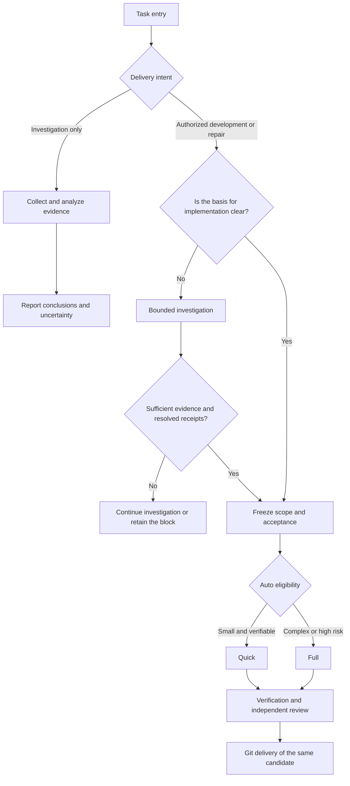

# Subscription-first model configuration, CLI plugins, and development workflows

English · [简体中文](2026-11-19-subscription-cli-workflows.md) · [Design proposals](README.md) · [Current architecture](../design.md)

**Date: 2026-11-19. Status: Proposed; documentation PR; not implemented.** This document specifies the goals, interfaces, migration, and acceptance criteria for subsequent work. It does not change runtime code, released versions, user configuration, or account settings. New presets, fields, packages, and commands described here are proposed interfaces and cannot be loaded by the current release. Implementation must update the maintained architecture, schemas, protocols, and paired user guides, then record source, package, and real-account validation separately.

## 1. Agreed goals and scope

The user has established the following constraints. This proposal follows those decisions rather than reopening the choice of integration:

1. Use the existing Kimi, ChatGPT, Claude, and Google subscriptions. Remove DeepSeek prepaid balances and all additional paid APIs from this default configuration.
2. **Invoke the official Antigravity `agy` CLI directly, without ACP.** Add an independent `dsh-subagent-antigravity` plugin for DSH Desktop, with a public machine interface for Flywheel.
3. Use Claude through the personal subscription only. Preserve the existing official Agent SDK → local, unmodified Claude Code path. The SDK is the library controlling the CLI; the CLI requirement does not call for rewriting the existing runner.
4. Keep Kimi on its native CLI and Codex on the official Codex CLI/app-server controlled by the existing plugin. Preserve structured protocols, sessions, recovery, and native capabilities.
5. Configure model, access channel, reasoning effort, permissions, and session independently. Start ordinary tasks with an economical combination and escalate difficult tasks within an explicit allowlist. Do not default every model to `max`.
6. Retain Task, New, Plan, Run, and Auto / Quick / Full. Troubleshooting, issue fixes, and complex development share verification and delivery rules instead of duplicating three state machines.
7. Deliver the complete proposal PR in this iteration. Creating the plugin repository, implementation, merging, publishing, and migrating local configuration belong to later delivery phases.

### 1.1 Reference subscriptions and cost accounting

These are planning inputs supplied by the user, not permanent vendor prices or account quota guarantees: a high-tier Kimi subscription already paid annually, with a monthly list price of approximately ¥699; ChatGPT Pro at $200, with a planned downgrade to $100 next month; Claude Pro at $20; and Google AI Ultra 5x at approximately $99.99. Actual prices, taxes, regions, and entitlements depend on the accounts.

Kimi's annual payment has already been made. Its monthly list price must not be counted again as new monthly cash spending, and prepayment does not remove quota limits. Using the user's quoted prices, the other three subscriptions total approximately $319.99 per month now and $219.99 after the downgrade, excluding amortization of the Kimi annual payment. The actual annual amount is unknown, so this proposal does not present a precise combined monthly dollar cost. The goal is effective delivery within existing subscriptions, without adding top-ups, automatically purchasing credits, or trying to exhaust every plan.

## 2. Verification baseline and current gaps

### 2.1 Source snapshots

| Component | Source examined | Notes |
| --- | --- | --- |
| Flywheel | [`f016015a`](https://github.com/ckanner/flywheel/tree/f016015a884351d081e066a4031a6814299f25e5), source version 0.37.3 | Current templates, configuration discovery, workflows, and DSH control plane |
| Claude plugin | [`98818edb`](https://github.com/ckanner/dsh-subagent-claude-code-pro/tree/98818edbee75614718dc445f2abcf15c529fc2cb), source version 0.6.1 | Agent SDK controlling the configured local `claude` |
| Codex plugin | [`69e180ad`](https://github.com/ckanner/dsh-subagent-codex-pro/tree/69e180ad74adff80a270c7f1ca44030ca6f33246), source version 0.10.2 | Official CLI/app-server, DSH tools, and public machine API |
| Binary reference | [`7991fdce`](https://github.com/deadblue22/binary/tree/7991fdce737347d161c1162356f9c75ae4ab640a) | GUI → official Agent SDK → official Claude Code; uses the SDK-bundled binary by default and can select a local path |
| Web Pro work | [Flywheel #57](https://github.com/ckanner/flywheel/pull/57), [ChatGPT plugin #9](https://github.com/ckanner/dsh-plugin-chatgpt/pull/9) | Separate, unmerged candidates; not default backends already available on main |

A source version does not establish that a package has been published to npm, installed in Desktop, or validated with an account. The inspected head of #57 is `30c1edae16bd5bef4648c8937a9ca6075e917e3c`; historical SHAs in the PR body do not replace the current ref. This document is submitted independently from main and does not change that work's implementation, vendored code, host patches, or recovery protocol.

### 2.2 Existing capabilities and proposed work

| Area | Current fact | Work in this proposal |
| --- | --- | --- |
| Default Execute and Intake | Still use DSH `deepseek-account` / DeepSeek Flash | Remove from the target preset and every reachable fallback |
| Plan / Review / Judge | Kimi K3.1 Pro / DSH GPT-6.1 Sol / DSH GPT-6 Astra | Adopt the new stage matrix and verify the actual runtime model catalog |
| Design roles | `design-plan` inherits Plan; both planning Review roles inherit Review | Define every role explicitly and preserve separate histories |
| Claude runner | Already supports the Agent SDK launching a local CLI | Preserve it; adjust the native login channel, model matching, and doctor |
| Claude UI preset | `claude-api` automatically declares `ANTHROPIC_API_KEY` | Add a clear personal-subscription entry to avoid incorrect rejection before launch |
| Kimi arguments | Already use the correct model, print, and stream-json arguments | Preserve them; do not relist the fixed argument issue as a defect |
| Antigravity | No such harness or DSH plugin on main | New package, machine API, worker, Go driver, configuration, and UI |
| Investigation analysis | The host submits reports; no `loops.investigate` exists | Add a configurable analysis role while retaining the investigation and evidence state machine |
| JEV | Master switch is off by default; the decision backend still uses an external endpoint/key | Keep the baseline off; implement a subscription harness decision backend separately |
| Migration | Existing `subscriptions` still copies a template containing DeepSeek | Add versioned `subscription-cli` migration semantics |

Sources for current behavior: [default template](../../templates/flywheel.config.example.json), [model guide](../en/model-policy.md), [investigation guide](../en/investigation.md), and [configuration migration implementation](https://github.com/ckanner/flywheel/blob/f016015a884351d081e066a4031a6814299f25e5/internal/config/migrate.go).

## 3. The complete subscription-only contract

### 3.1 Record access, entitlement, and billing separately

An absent API key, successful OAuth login, selectable model, or successful invocation does not establish that usage draws only on the monthly plan's included allowance. The target configuration must represent each of the following separately:

- **Execution path:** the official CLI, plugin, working directory, and runtime configuration used.
- **Authentication path:** native personal-account login, without copying, refreshing, or proxying subscription tokens.
- **Model eligibility:** the models and parameters available to the account.
- **Billing eligibility:** whether the selection can use the plan's included allowance and whether additional credits or prepaid balances can act as a fallback.
- **Supported use:** for example, Google's distinction between direct scripts and orchestration by a third-party agent.

Implementation will add versioned subscription-policy metadata. These are concepts to be designed into the schema, not existing configuration fields. Evidence must distinguish `verified`, `user-declared`, and `unknown`, with a source, timestamp, and CLI/config fingerprint. A user declaration must not be relabeled as vendor confirmation. Preflight must not read or output raw keys, tokens, or private account data.

### 3.2 Audit every reachable invocation

Admission checks for the target preset must cover loops, routes, named profiles, fallbacks, execution-policy, judge-panel, JEV, model overrides in native subagents, and the parent DSH conversation. `env-key:null` does not establish subscription billing: the current DeepSeek account channel also uses null while spending a prepaid balance.

Subscription mode must not automatically switch to an API, cloud ADC, third-party gateway, prepaid account, or additional credits. When quota is exhausted, it may wait for a reset or select another declared binding that still satisfies the subscription policy. Account, model, and billing-channel changes must be visible. A model change must create a new binding snapshot and must not reuse the previous Provider's session identity.

The parent DSH agent also consumes its own model allowance. Using an Antigravity or Claude subagent tool does not automatically make the parent a subscription model. Provide two explicit entry points:

1. The existing DSH ChatGPT subscription Provider handles ordinary conversations and uses native tools within their supported scope. Check the actual Desktop/SDK profile and authentication.
2. The user starts a CLI task directly from the plugin panel or a command, without an additional parent-model call in DSH.

Keep DSH as the host and deterministic control plane when removing paid DeepSeek inference.

### 3.3 Limits of the no-additional-spending guarantee

Conflicts that can be established from local CLI configuration must block dispatch. If an official interface cannot reliably expose account-level extra usage or purchased-credit settings, show them as unverified; do not report zero charges. Strict automatic execution requires valid evidence that account-level extra spending is disabled, or an equivalent vendor-provided constraint. A successful call, model catalog, or estimated dollar amount cannot substitute for that evidence.

Settings inspection and account configuration use the user's native account flow. Installers, doctor, and migration must not toggle billing options automatically. If login is needed again, return an actionable diagnostic without requesting credential contents. Recheck expired evidence and changed configuration; one inspection is not a permanent spending guarantee.

Credits included with a plan must also be distinguished from credits purchased separately. Included credits may enter an explicit allowlist only when an official interface can identify their source and reliably prevent a switch to a paid balance. The first baseline disables credit fallback after quota exhaustion and does not automatically spend balances of unknown origin. Google's `useG1Credits` is one actual setting to inspect; see the [CLI credits documentation](https://antigravity.google/docs/cli/credits/).

## 4. Model capabilities and selection principles

The following table is an engineering baseline based on the subscription mix and task responsibilities. **It is not a completed Flywheel model ranking or a measured optimum.** Model marketing, community comments, and API benchmarks do not directly establish a local CLI's context, quota, or task success rate. Comments on X and elsewhere inform hypotheses for evaluation; this proposal does not invent consensus, monthly token allowances, or savings percentages.

| Model candidate | Suggested responsibilities | Rationale and limits |
| --- | --- | --- |
| Kimi Code K3.1 Pro | Routine implementation, frontend work, subplans, and organization | Makes use of the annual primary subscription; the native CLI is already integrated. Annual payment does not imply unlimited quota |
| GPT-6.2 Sol | Independent Review and clearly scoped quick fixes | Officially positioned for daily coding and review; the regular Codex choice |
| GPT-6.2 Astra | Complex overall design, root causes spanning modules, and Full Judge | Officially positioned for complex engineering; not required for every small task |
| Claude Sonnet / Opus available to the account | A second opinion from another model family, targeted design review, and difficult-case review | Reserve Pro quota for stages with a clear benefit; do not review every packet twice by default |
| Fable 5.2 | A candidate when deep analysis is explicitly needed | Verify model access and included-plan billing separately; not a universally included Pro default |
| Gemini 4 Neon and other models available to the account | Broad codebase understanding, specialized analysis, and standalone CLI tasks | Verify model, context, and effort at runtime; see §7 for supported automated orchestration |
| ChatGPT Web Pro | An alternative for particularly difficult design or adjudication | Depends on #57/#9 and actual host/account validation; Pro mode is not the highest effort setting |

GPT-6.2 Sol/Astra entered Codex/Work on November 17. The [official release notes](https://learn.chatgpt.com/docs/whats-new/gpt-62-astra-sol) support including them as new targets, subject to confirmation in the account's model catalog. Older 6.1/6 models may be explicit compatibility candidates, but must not silently replace a requested model. Recheck model and speed entitlements after a plan change. The target uses Standard throughout; Fast/Ultrafast are not default quota-saving measures.

Record the context window available through the actual harness rather than deriving it from the underlying model's API limit. Verify image inputs, tools, compaction, and native subagent capabilities through the real execution path. A model with the same name in a web product does not establish CLI interface parity.

## 5. Proposed default stage matrix

### 5.1 Baseline: primary subscription preset

The following is the target for the future `subscription-cli` preset. Resolve and freeze exact models from the native catalog during installation, and fail clearly on invalid bindings. Claude and Google remain configurable options, without adding fixed calls merely to assign every subscription a stage.

| Stage / route | Target backend and model | Initial effort | Evidence-based escalation or replacement |
| --- | --- | --- | --- |
| `design-plan` | Codex / GPT-6.2 Astra | high | Explicit xhigh for high-risk design; Sol high is an option for lighter tasks |
| `design-review` | Codex / GPT-6.2 Sol, separate session | high | Targeted Claude second opinion, or Astra xhigh |
| `plan` | Kimi / K3.1 Pro | high | Kimi max or Astra high for difficult dependency or acceptance planning |
| `plan-review` | Codex / GPT-6.2 Sol, separate session | high | Explicit xhigh for cross-module, migration, or concurrency risks |
| Execute `default` | Kimi / K3.1 Pro | high | Explicit switch to Sol high / Astra high after repeated lack of progress |
| Execute `frontend` | Kimi / K3.1 Pro | high | Decide whether to switch models using actual UI and interaction acceptance results |
| Execute `hard` | Codex / GPT-6.2 Astra | high | xhigh for difficult cases; max only as a bounded manual choice or evaluation candidate |
| `review` | Codex / GPT-6.2 Sol | high | xhigh for high-impact candidates; Claude as an explicit replacement or second opinion |
| `judge` (Full) | Codex / GPT-6.2 Astra | high | xhigh for complex disputes; Web Pro only after separate admission checks |
| `intake` | Kimi / K3.1 Pro | low | high when ambiguity is substantial |
| `garden` | Kimi / K3.1 Pro | low | high when synthesis across tasks requires substantive reasoning |
| Investigation analysis (proposed role) | Kimi high; Astra high for difficult root causes | Per binding | Analyze actual evidence only; this role does not grant unauthorized repair permissions |
| JEV decisions (proposed backend) | Codex / GPT-6.2 Sol | medium | Master switch remains off by default; high when bounded decisions need it |
| `judge-panel` | Off by default | — | Enable one second opinion from another model family only for high-risk or disputed tasks |

`loops.investigate` is not an existing field. The analysis role's name, schema, scope, and permissions must be implemented together. Until then, the host configured with a subscription model submits reports. The new JEV backend is likewise a proposed capability, not an existing default.

### 5.2 Quick and deep configurations

The first implementation will provide three complete target configurations that users can preview:

- **Balanced:** the matrix above, with Kimi handling routine throughput and Codex handling independent review and complex reasoning.
- **Quick coding:** Execute uses Sol medium for clear, small fixes; compact design uses Sol medium/high; final independent Review remains high. All other roles remain fully defined so the workflow can escalate to Full.
- **Deep engineering:** complex design, hard Execute, and key Review/Judge stages use Astra high/xhigh. Targeted Claude review is explicitly enabled.

These are user-selected configuration presets. They do not silently turn Auto/Quick/Full into a model router. Auto currently selects the workflow, and the first implementation will preserve that meaning. Any future automatic selection of bindings by mode requires a versioned policy, UI preview, and frozen record; names must not imply hidden rules.

Effort names are not a common scale across vendors. Kimi uses its supported low/high/max levels; Codex and Claude depend on the specific model's capabilities; Antigravity is checked against its model catalog. Do not display max for every model, add `ultra` to the current execution-policy schema, or translate web Pro mode into xhigh/max.

Escalation proceeds in this order: obtain missing evidence → narrow the task → improve context quality → raise effort or change models within the allowlist. A new attempt may start only after a failed invocation has confirmed terminal and cleanup states. AUTH, QUOTA, configuration errors, and unknown outcomes are not resolved by more reasoning. Escalation retains the total attempt, time, and usage budgets and allows no more switches than the frozen policy permits.

## 6. Specific changes to the Claude subscription path

### 6.1 Preserve the runner and correct the channel

The current [SDK runner](https://github.com/ckanner/dsh-subagent-claude-code-pro/blob/98818edbee75614718dc445f2abcf15c529fc2cb/lib/sdk-run.js) explicitly passes `pathToClaudeCodeExecutable`. Preserve that runner and the existing guardian, session, permission, recovery, and multimodal contracts. Selection between the SDK-bundled executable and a local executable must not change silently.

Add a `claude-native` channel with `env-key:null`, using the user's native CLI login. Update the Flywheel UI, profile examples, and doctor together so selecting a subscription no longer automatically creates an API-key requirement. Existing explicit API configuration remains compatible for other users but is unreachable from this subscription preset.

Official documentation distinguishes third parties collecting or proxying credentials from users signing into unmodified Claude Code themselves. This proposal uses the latter flow. The plugin does not implement subscription OAuth, export tokens, or automatically start login. References: [Claude Code authentication and usage rules](https://code.claude.com/docs/en/legal-and-compliance), [Agent SDK overview](https://code.claude.com/docs/en/agent-sdk/overview), and [Binary](https://github.com/deadblue22/binary/blob/7991fdce737347d161c1162356f9c75ae4ab640a/README.md).

### 6.2 Authentication and billing preflight

Doctor and actual execution must use the same command, cwd, HOME, CLAUDE_CONFIG_DIR, and filtered child-process environment. `loggedIn:true` alone is insufficient: report the observable authentication source, configuration conflicts, and subscription status, leaving unknown fields unknown. Sensitive environment variables are passed only through explicit configuration, not accidentally inherited from the parent DSH session. The subscription preset rejects explicit API/cloud/gateway paths.

Native settings, model fallbacks, and subagent configuration may also change actual requests, so checking environment variables alone is insufficient. Do not use `--bare`, which bypasses native subscription login. Disable extra usage credits through the account settings associated with the official CLI and verify that state. Intercepting a payment-consent dialog is not a zero-extra-spending control, because non-interactive calls may not show one.

### 6.3 Fable and alias corrections

Public documentation for standard Pro permits Fable access but normally bills it through usage credits. The November 9–16 launch offer temporarily included some weekly allowance. The user reports that their account includes Fable 5.2. Retain this as account-specific information awaiting verification; keep the model among their candidates without describing it as a permanently included entitlement for all Pro accounts. References: [plan entitlements](https://support.claude.com/en/articles/15424964-claude-fable-models-on-your-plan) and [launch offers](https://support.claude.com/en/articles/17506494-claude-fable-5-2-launch-offers).

The existing `modelMatches` recognizes only sonnet/opus/haiku aliases. Add verified alias-to-canonical-ID resolution and freeze the target so `fable` and its full native ID are not incorrectly treated as different models. Until then, use the full ID from the actual catalog without guessing date suffixes. Record the requested model, resolved target, and native report. A native switch to another model must not be reported as fulfillment of the original request.

Also check `CLAUDE_CODE_EFFORT_LEVEL`, native settings, and subagent effort overrides. A native environment variable can take precedence over startup arguments, so passing an argument does not establish the effective setting. Evidence for the model used across a whole turn must include available observations such as `modelUsage` in actual results, in addition to initialization, and expose any fallback during the turn. Leave missing observations unknown; a model match at startup is not a guarantee for the entire turn.

Non-interactive Fable calls may directly consume credits, as [model-config](https://code.claude.com/docs/en/model-config) explicitly documents. Dollar figures in `/usage` or results are calculated accounting values, not proof of an additional bill. `--max-budget-usd` is not a zero-dollar extra-charge control. References: [usage-credit settings](https://support.claude.com/en/articles/12429409-manage-usage-credits-for-paid-claude-plans) and [cost accounting](https://code.claude.com/docs/en/costs).

## 7. Antigravity CLI plugin and supported subscription use

**The integration path is the CLI. This proposal does not provide an ACP implementation. A different protocol or plugin name does not change the nature of the use.**

Google's official headless documentation provides programmatic invocation, structured output, and multi-turn input. Its FAQ also distinguishes supported direct scripts/CI on consumer plans from wrapping `agy` in a third-party coding agent or application, which it does not support. Record technical integration capability separately from supported use under a particular subscription. References: [headless](https://antigravity.google/docs/cli/headless/) and [FAQ](https://antigravity.google/docs/faq).

| Scenario | Treatment in this proposal |
| --- | --- |
| User directly runs the official CLI or their own direct script | Implement and validate the official native path |
| User directly starts one CLI task from a DSH panel | Design the complete UI and runner; eligibility for this third-party GUI still requires confirmation. A user click and the absence of a parent model do not establish that it qualifies as a supported direct script |
| A DSH agent automatically calls `subagent_antigravity` | Include the technical interface in the design; a consumer subscription does not establish default eligibility for automatic delegation |
| Flywheel combines Kimi/Codex/Claude and Antigravity in a pipeline | The driver and stage bindings can be implemented, but Ultra stays out of baseline automatic routing and fallbacks; supported eligibility for this use must be resolved separately |

A November 17 [forum discussion](https://discuss.ai.google.dev/t/tos-clarification-human-initiated-python-workflow-using-official-agy-cli/201524) directly addresses a personal GUI, deterministic Python, and stages using multiple models. Replies distinguish direct scripts from multi-vendor pipelines, while a follow-up about human confirmation at every stage remains unanswered clearly. The speakers' identities have not been independently verified, and forum interpretations do not replace formal documentation. Neither an added confirmation button nor a successful call establishes vendor authorization.

The confirmed native baseline is the official CLI and supported direct scripts. Technical implementation of both the manual DSH panel and automatic delegation can proceed offline, with real consumer-subscription eligibility recorded separately for each. **Do not expose automatic delegation to an autonomous agent's default preset or automatically select Antigravity for a Flywheel stage.** Retain the complete machine/tool integration design and capability flags. Enabling a use depends on its supported eligibility; an ignore-restrictions switch cannot replace it. Purchasing API access is not the default resolution in this proposal.

## 8. Product and package structure for the new DSH plugin

### 8.1 One runner, three entry points

Propose a new `ckanner/dsh-subagent-antigravity` repository and `dsh-subagent-antigravity` npm package. These names are proposals, not claims that either resource already exists.

| Entry point | Responsibility |
| --- | --- |
| DSH Desktop plugin panel / direct command | Let the user select working directory, model, effort, permissions, and task, then start the CLI directly without an implicit parent-model call |
| `subagent_antigravity` tool | Integrate DSH Agent/PTC and jobs for supported uses; registration follows §7 and is not enabled by default in autonomous consumer presets |
| `dsh-subagent-antigravity/machine` | Public ESM API for deterministic callers such as Flywheel, without creating a parent DSH agent |

The package will expose the root plugin, `./machine`, and `./client`, plus an independent `antigravity-machine` wrapper command. `--capabilities`, `--doctor`, and `--json` are proposed wrapper arguments, not claims that `agy` already has those flags.

Follow the existing plugins' `dsh.bundle.patch`, `cordis.patch.yml`, client/settings integration, explicit preset tool registration, and DSH jobs. The ordinary model selector chooses the parent DSH model; Antigravity model selection belongs in tool/native-task settings. Do not register it as a conventional LLM provider and make DSH repeat the agent tool loop that `agy` already owns.

The manual DSH entry and agent tool share one execution service. If the current Desktop lacks a panel-action interface, implementation must add a public plugin action with version checks. The button must not silently ask the parent agent to invoke a tool. DSH acceptance includes this entry point without a parent-model call.

Bind manual tasks to the initiating Desktop workspace/user session and invocation ID. Queries, cancellation, and recovery must verify the same ownership. First check whether DSH jobs support an owner that is not an agent. If they do not, provide explicitly versioned start/status/cancel/result plugin actions without fabricating a parent agent. The panel displays results and cancels tasks directly, without relying on a model to call a tool. Agent-initiated tasks continue to use their real Agent/session owner.

### 8.2 Settings and UI

Settings include the official `agy` command or absolute path, default project directory, account routing status, model, effort, native execution permissions, timeout, allowed presets, session policy, and subscription policy. Saved changes affect the next invocation; running tasks retain a frozen snapshot.

The UI shows the task name, native conversation ID, project/worktree, requested and observed models, effort, progress, approval blocks, cancellation, final result, and unknown states. Keep model settings together and give clear reasons for a missing CLI, missing login, unsupported model, or exhausted quota. Reuse DSH settings, task, and log components without replacing built-in panels.

Background execution reuses DSH job IDs and `job_output` / `job_kill`. Tool returns must follow the host's permitted shape. Save complete machine evidence separately instead of inserting an unbounded event stream into the parent conversation. Normal returns contain a stage summary, artifact paths, and evidence references. The native CLI remains responsible for its own context compaction.

### 8.3 Installation and dependencies

The target is one clear npm/DSH bundle installation flow. The package must include public entry points, types, runner, guardian, Desktop client, and bundle patch. Validate installation with the current host's real installation command before documenting it. This proposal does not invent an installation command that is already usable.

The user must install and log into the official CLI beforehand. The plugin must not silently download, replace, or update it, or put account login in postinstall. Flywheel integrates through an exact version and the public machine API; the plugin does not depend on Flywheel, avoiding a dependency cycle. Determine Node and Desktop/SDK peer ranges from actual versions and capability checks. Source version numbers do not substitute for compatibility tests.

## 9. CLI runner and machine interface

### 9.1 Initial process model

The first implementation will use **one invocation, one CLI process, and one user turn**. Normal revisions resume the exact conversation ID; a persistent CLI pool is not required. This preserves conversation continuity while reducing the complexity of concurrent stdin writes, cumulative counters, and cleanup ownership.

Use an argument array, `shell:false`, and an explicit `cwd`. Prefer sending one text user message through the official stream-json stdin interface, then close stdin. Do not assemble large prompts into shell commands or treat arbitrary strings as commands. Closing stdin only means no further input is coming; the turn must still reach a real terminal state.

Construct model, effort, schema, session, and timeout arguments using the [CLI reference](https://antigravity.google/docs/cli/reference/) and version checks. Do not copy Claude control messages or the Codex app-server protocol. Parse official stdout events line by line and retain redacted diagnostics from stderr. Keep the wrapper's single JSON receipt separate from the event channel; logs must not contaminate formal results.

### 9.2 Proposed machine contract

Public exports must include at least protocol/lifecycle versions, capability descriptions, request validation, execution, and read-only recovery. The following is a **proposed field inventory**, not the current schema:

| Request information | Requirement |
| --- | --- |
| identity | protocol, requestId, and caller run/task/stage/role identifiers |
| input | prompt, explicit cwd, and optional structured-output schema |
| binding | native model, effort, execution mode, subscription policy, and configuration fingerprint |
| session | `new` or `resume` with an exact ID; never a global most-recent session |
| lifecycle | overall deadline, cancellation signal, event callback, and recovery journal location |
| label | Human-readable task name, separate from confirmation of the native title |

Results must represent requested/observed binding, native conversation ID, dispatch state, terminal state, text/structured output, artifacts, usage, errors, local cleanup, provider-work state, and a read-only recovery reference separately. Echoing a request is not an observation. Observed effort remains unknown when the native runtime supplies no evidence. Configuration acceptance distinguishes an observed match, an observed conflict, and an unobservable value. Identity/directory/model evidence that the protocol exposes and the stage declares mandatory must be present. For effort that is not echoed, record the request and CLI acceptance without inventing an effective value or failing every invocation. A stage requiring stronger evidence must reject an insufficient combination at admission.

Stage success requires at least a complete native terminal result, a successful status, matching configuration and identity, valid structured output, and cleanup that satisfies the contract. CLI exit 0 does not replace stage acceptance. Flywheel still owns tests, candidates, review, and Git delivery. `WAITING`, `RUNNING`, partial text, missing terminal results, and truncated output are not success.

### 9.3 Model, permission, and input boundaries

Build a catalog with source attribution from actual `agy models` output and CLI capabilities. It is not evidence of remaining quota or supported-use eligibility. Expose effort per model; do not force a separate effort setting onto a native Orchestrator with fixed configuration. Separate UI labels from CLI slugs, and fail clearly on conflicts or unsupported values. See the [model documentation](https://antigravity.google/docs/models).

Headless mode cannot receive interactive approval-control messages. Use native permission settings approved in advance by the user, and do not expand permissions after a tool denial. Record native execution mode, tool-approval policy, and sandbox state separately. Flywheel full-access is a normalized policy whose corresponding combination must be constructed from verified capabilities. `--dangerously-skip-permissions` means skipping tool approval as defined by the official CLI; it does not establish that the sandbox is disabled or arbitrary paths are writable. Reject permission combinations that cannot be expressed exactly before dispatch. When an approved action cannot run, return observable blocking or partial-execution evidence. Do not temporarily loosen global settings. cwd, plan mode, and prompts do not provide OS isolation.

The first text-stream implementation does not promise native image/PDF attachments. Passing a readable file path and attaching native multimodal input are different capabilities; reject unusable inputs before dispatch. Image/screenshot artifact return is supported only after obtaining real artifact metadata and passing path checks.

## 10. Sessions, naming, liveness, and cancellation

### 10.1 Identity and history

Scope sessions by task, role, packet, binding, execution directory, and native configuration. Normal Executor revisions may reuse a session. Design, subplan, Review, and Judge have separate identities. Review does not inherit the Executor's private history, and native Team/Swarm self-review does not replace independent Review.

For Antigravity, store the returned `conversation_id` and resume that exact ID. Do not use `--continue` to guess the latest conversation. new means new context; it does not promise that native history will not be persisted. An invalid ID must not silently create a conversation, and the same conversation must not resume concurrently. Changing model, effort, permissions, or directory requires a new binding and role session while preserving the old evidence.

Use readable task/role names for local labels. Native `/title` concerns the terminal window title and must not be presented as conversation naming. Validate native rename support against the version and real CLI. If no naming API exists, confirm only the local display name and leave native-title status unknown. Do not directly rewrite the history database or change existing user titles.

### 10.2 Real liveness and timeouts

The startup timeout bounds startup/handshake; the first text token is not the sole measure of a successful start. Actual text, tool, and status events are liveness evidence. Do not fabricate heartbeats when no output exists. Quiet reasoning must not be killed solely because stdout has been silent briefly.

The overall deadline covers startup, execution, and exit. Record native timeouts and external supervision separately. For long streams, set separate limits for each NDJSON frame, the incomplete-frame buffer, retained results, and diagnostics written to disk. Consumed progress events do not accumulate against the final-result limit; a large total event volume must not kill an otherwise valid task. When a particular limit is exceeded, record the error/truncation explicitly and do not mark truncated results successful. Persistent-process and warm-up support require separate capability tests; session resume is not warm-up.

### 10.3 Cancellation and recovery

Terminate only the process group owned by the invocation: interrupt, allow a bounded grace period, escalate termination if necessary, then drain pipes and confirm local processes are gone. Never kill all `agy` processes by name. Desktop shutdown, job kill, Flywheel SIGTERM, and parent-process death use the same supervision contract.

A local process exiting does not prove that a shared daemon, remote task, or native child work has stopped. Record local cleanup and provider-work state separately. Missing native terminal evidence remains unknown. An invocation that may have been dispatched but has an unknown outcome must not be replayed automatically. A new conversation, model change, restart, or preset switch must not bypass that block.

Read-only recover reads persisted journals/receipts without starting a model, automatically resuming, or sending another prompt. Cross-process persistence records invocation and dispatch facts before accepting terminal evidence. Treat any window that cannot reliably distinguish not-sent from possibly-sent as possibly-sent. A local network disconnect does not establish that remote execution never happened.

## 11. Subscription preflight, errors, and accounting

Antigravity native login uses existing official credentials. Inspect the effective provider, filtered child-process environment, ADC switches, custom endpoints, and credit configuration. Do not dispatch when the selected API/ADC/extra-spending path conflicts with this mode, and do not rewrite the user's global configuration. Variables such as `GEMINI_API_KEY` that are present but will not be used by the current CLI may be filtered or reported; their presence does not establish API consumption. Official authentication and configuration references: [Authenticate](https://antigravity.google/docs/install/) and [CLI reference](https://antigravity.google/docs/cli/reference/).

The plugin may have detailed error categories, but its Flywheel mapping must preserve the existing wire contract:

| Plugin fact | Flywheel handling |
| --- | --- |
| Expired or missing login | AUTH; no switch to an API |
| Confirmed quota exhaustion | QUOTA; wait or select another subscription within the allowlist |
| Confirmed rate limit | RATE_LIMIT; respect retry budgets and reset guidance |
| Unsupported model/effort, conflicting billing mode, or inadequate permission configuration | INVALID_REQUEST; fix configuration instead of retrying blindly |
| Transport/server error | Use TRANSPORT/SERVER only when supported by evidence; assess dispatch and terminal state first |
| deadline | TIMEOUT; retain cancellation and cleanup evidence separately |
| Unknown terminal state or unconfirmed cleanup | Persist the block; generic retries do not resolve it |

If a new global error code is required, the implementation PR must first update architecture §6, the protocol, and tests. Do not add a private code inside a driver. Ambiguous responses such as HTTP 403 must not be classified as quota exhaustion without evidence.

Record observable input/output/thinking/cache tokens, elapsed time, and retries; missing values remain unknown. Identify the accounting scope as turn/conversation/unknown. Compute differences between cumulative counters only when their source and lifecycle match; do not guess after a reset or when the source is unknown. Recovery must not double-count usage. Represent consumption of included allowance, list-price estimates, and actual extra charges separately. Do not turn `costUSD:null` into 0 or convert token counts into an exact remaining plan allowance.

## 12. Development and troubleshooting workflows

### 12.1 Entry points and authorization

| Entry point | Preserved behavior |
| --- | --- |
| Task | Start from the task goal; retain the given scope and implementation authorization, and continue within that scope |
| New | Register the brief, perform real design and independent Design Review, then wait for approval of the exact version |
| Plan | Plan only and stop afterward; historical implementation authorization does not automatically start execution |
| Run | Continue the same task, budget, and evidence without bypassing unknown-state blocks |

Auto determines Quick/Full eligibility. Models may advise on boundaries, while Go remains the deterministic state owner. Planning approval binds to a specific design version. Reuse valid approvals and checkpoints instead of repeatedly asking the user to approve the same scope. Handle new risks and material scope changes under the existing contract.

### 12.2 Investigation is a preceding stage

`investigate` ends after evidence collection, analysis, and a report. `investigate-and-fix` enters Auto when evidence is sufficient, the original scope is authorized, and all invocation states are resolved. An unknown root cause must not trigger repeated speculative code changes. Production mitigation, deletion, and data repair require explicit authorization in the original task; troubleshooting alone does not grant new permissions for external actions.

Reuse preparation's read/search/list/command/http evidence and structured hypotheses. Do not create a separate issue state machine disconnected from tests and Review. The new analysis role consumes approved evidence and proposes testable hypotheses and candidate next steps. Go determines legal evidence-collection actions and validates evidence references. A valid structured report does not prove a root cause.

### 12.3 Quick and Full

**Quick:** compact design and Design Review → Execute → L1 and applicable L2/L3 → independent task-final Review → Git delivery. A normal first-pass success in the implementation phase uses two agent calls, Execute and Review. A new task also has preceding design work, so the whole task must not be advertised as requiring only two model calls. Plan/Judge are N/A. New risk or a verification gap causes a durable, one-way escalation to Full while retaining cumulative budgets and artifacts.

**Full:** overall design and independent review → subplan and Plan Review for the current milestone → packet Execute/L1/Review → integration → L2/L3 → Judge → delivery. Reuse valid Plan checkpoints, and replan when contracts change or evidence is missing. Small tasks do not need to repeat the entire design process.

Shared rules: deterministic verification precedes LLM Review. A fix must include an applicable regression check that catches the original defect. Review examines the same candidate, identifies issues independently, and returns revisions to the original Executor. Correct verification-configuration gaps and verify again; a written Judge conclusion cannot waive them. Final delivery checks the actual commit/merge identity. A CLI saying it is finished does not establish successful delivery.

## 13. JEV, native capabilities, and scheduling

### 13.1 One JEV master switch

The baseline is `jev.enabled=false`, with no call to the current external paid decision endpoint. Add a subscription harness backend consistent with stage bindings in later implementation, using the existing complete candidate allowlist, structured output, time/call/usage budgets, and atomic adoption rules. Keeping JEV off must not remove implemented functionality. Do not restore shadow reads or introduce a second enable switch.

When enabled, validate the decision backend against the subscription policy. If an old configuration contains only an external endpoint with a key, report the configuration issue before running. On decision failure, use the existing deterministic baseline of legal actions or retain the block; do not silently call a paid API. Decision requests with unknown outcomes also require lifecycle reconciliation. The current five-second external-request timeout cannot be reused unchanged as a CLI reasoning deadline. Configure and validate it against the new backend's startup and execution contract.

### 13.2 Bound native capabilities by role

DSH Team/PTC/LCU, Kimi Swarm/Tower, and Claude/Codex native subagents continue to use the implemented native-profile contract. Complex plans may use native parallel analysis; routine small fixes should start with one agent. Each Flywheel worker must not expand into an unlimited native team.

The current scheduler controls root-call concurrency; it does not impose a hard limit on the entire native agent tree. Attribute subagent, Advisor, compaction, and Tower usage only when real receipts support it. Otherwise, the tree's total usage remains unknown. Existing Claude observed guards and Kimi capabilities must not be presented as hard budgets for the whole tree. If a task requires such a hard limit and the backend cannot prove it enforces one, disable the corresponding native expansion for that task or reject the combination. Account quotas are generally not allocated separately to each plugin instance. Audit all native model overrides, external tools, and billing paths under the subscription policy. Validate native-task completion, GUI lease return, child-work cleanup, and parent-process exit separately, preserving existing unknown-state constraints. See the [native-capabilities guide](../en/native-capabilities.md) for current behavior.

### 13.3 Keep scheduling explainable

Retain the baseline `max-parallel=2`, `dispatch=batch`, and `prewarm=false`. Independent packets run in isolated worktrees; conflicting scopes, integration, review, and final delivery retain dependency barriers. Ready queues and warm-up are existing optional capabilities. A model migration must not silently enable them or claim a measured speedup.

Do not resume the same official CLI conversation concurrently. CLI warm-up requires evidence that the runtime is ready and no task has been dispatched; process existence, restored history, or a paid probe is not warm-up. For small tasks, nearly exhausted Claude Pro quota, or a constrained provider, reduce concurrency and repeated context before adding retries.

## 14. Configuration migration and UI

### 14.1 A new preset with explicit migration

Add a versioned `subscription-cli` preset with preview/apply behavior. Specific CLI arguments must enter the parser, schema, and tests during implementation. **The existing `config migrate --preset subscriptions` does not complete this proposal:** it still includes DeepSeek, migrates permissions, and clears judge-panel.

Migration first identifies the effective configuration file. Current task → project → global → embedded discovery selects the first complete file; it does not merge across files. A two-line task configuration cannot be presented as overrides inheriting from global configuration.

The preview shows the effective path, original digest, new preset version, all role changes, reachable paid paths, unsupported model choices, preserved settings, and reasons for blocking. Before apply, verify the original digest and retain a recoverable backup; refuse to overwrite concurrent edits. Migration must not expand permissions or unnecessarily clear second opinions, verification, scheduling, and user-defined channels. Unreferenced API profiles may remain for other uses, but the subscription configuration graph must not reach them.

Handle explicit `design-plan/design-review/plan-review`, route fallbacks, execution-policy, native child models, and JEV. When moving a resident Kimi Plan to another harness, remove unsupported `resident-session:true` and express history reuse through role-scoped sessions. Running tasks keep their old snapshots; only new starts use the new configuration. Reconcile unresolved invocations first.

### 14.2 Configuration UI

Generate Provider/model choices from an independent capability catalog, rather than showing a provider only when a current stage happens to use it. Otherwise, removing the DeepSeek default or changing Review can unintentionally change resource selectors.

For every stage, show the harness, actual Provider where applicable, channel, model, effort, configuration source, subscription eligibility, and real-validation status. Clearly distinguish inherited rows from explicit overrides. Creating or changing a selection affects only its selected scope. Claude gets a native subscription-login entry; Antigravity shows the official CLI and currently supported uses, with no ACP option.

Environment inspection and model invocation are separate actions. A doctor that performs no inference consumes no model tokens and cannot establish task quality or remaining allowance. A real smoke test is an explicit, separate action that records the model and observed usage. Installation, opening settings, and model enumeration must not silently send inference requests by default.

## 15. Implementation phases and documentation ownership

| Phase | Repository / scope | Completion criteria |
| --- | --- | --- |
| P0 | This Flywheel documentation PR | Chinese and English proposals, indexes, sources, and self-review; no runtime behavior changes |
| P1 | Claude plugin + Flywheel | Native subscription channel, Fable ID/alias handling, doctor in the execution environment, and no paid fallback; public API remains compatible |
| P2 | New Antigravity plugin | CLI runner, public machine API, guardian, read-only recovery, directory/model/permission/billing checks, and independent package tests |
| P3 | New plugin's Desktop integration | Native task panel, direct launch, DSH tools/PTC/jobs, version checks, package and host validation; enabled uses follow §7 |
| P4 | Flywheel integration | Go driver, Node bridge, schema/protocol, all role configurations, preset migration, and UI; automatic subscription defaults exclude unresolved Google orchestration uses |
| P5 | Investigation analysis and JEV | Configurable subscription analysis role, JEV subscription backend, one master switch, and the legal-action baseline |
| P6 | Real evaluation and release | Tasks on the actual Mac/accounts, baseline comparisons, candidate tarball installation, CI, exact-version release, and final explicit migration |

P1 and P2 can proceed independently; P3 depends on P2. P4 can first deliver a complete subscription baseline without Google automatic routing. P5 does not block the baseline whose optional functions remain off, but it must not be omitted from a claim that the overall objective is complete. #57/#9 retain independent implementation and validation; merging them is not a prerequisite for the baseline in this proposal.

Implementation must update the owning documentation: execution, error, model, usage, permission, and configuration sections of `docs/design.md`; schemas in `templates`; DSH `PROTOCOL.md`; paired configuration/model-policy/Claude/native/recovery/workflow/investigation/JEV guides; and the new plugin's Chinese/English README, machine documentation, installation, and release procedures. Only implemented behavior enters CHANGELOG. A dated proposal does not replace the current user guides.

Leave unrelated LCU/preset/ChatGPT code unchanged. If the new tool needs explicit preset registration, make the smallest compatible change in `dsh-preset-generator` and validate it independently. Replacing a version string is not a complete compatibility test.

## 16. Acceptance and evaluation matrix

| Layer | Required validation | What it does not establish |
| --- | --- | --- |
| Documentation | Links/anchors, code fences, language parity, distinction between current facts and proposals, final diff | Implementation or release |
| Offline protocol | init/events/result, partial JSON, duplicate/missing terminal results, incorrect configuration, soft denial, schema, and long streams | Account availability, model quality, or actual billing |
| Sessions | Exact resume, isolation of two parallel tasks, invalid IDs, changed bindings, recovery without replay | Guaranteed absence of persisted native history |
| Lifecycle | Cancellation, outer timeout, CLI timeout, parent death, process groups, remaining descendants, and unknown provider work | Local exit being equivalent to remote completion |
| Subscription policy | Exclusion of every reachable paid path, no automatic API/credit fallback, configuration drift, and handling of unknowns | A zero-extra-spending guarantee based only on OAuth or a catalog |
| Installable package | Public exports/types/client/patch/guardian from an actual tarball, installed outside the source directory | A package name or source version proving npm publication |
| DSH Desktop | Direct invocation without a parent model, tool registration and preset switching, PTC, jobs, settings, cancellation | An offline host fixture being equivalent to the user's Mac |
| Flywheel | Go → real Node → fake CLI; all roles, worktrees, Quick/Full/investigation, migration, JEV switch | Argument-only tests proving end-to-end delivery |
| Real account | Subscription authentication, billing settings, model/effort, a normal task, revision, cancellation, and quota boundaries | One successful call proving long-term quota or supported-use eligibility |

Future Go changes must run the repository quality gate, retaining the existing requirement of 100% statement coverage per function. DSH/plugin changes require build, offline-host, cross-process, and installation-candidate checks. Tests assert observable outcomes and failure boundaries. This documentation-only PR does not require unrelated full engineering suites.

Model evaluation fixes real tasks, acceptance oracles, the code baseline, permissions, context, and workspace. Compare first-pass acceptance, total elapsed time including revisions, omissions/false positives, human intervention, quota, and known/unknown usage. Samples include a small issue, frontend states, a cross-module fault, regression tests, concurrency/data-consistency review, and a complex plan. Compare the actual benefit of medium/high/xhigh/max. A single benchmark or positive community feedback does not establish the optimal default.

## 17. Explicit items still requiring verification before implementation

- Each account's actual model catalog, entitlements after the planned downgrade, and extra-spending settings; account-specific billing eligibility for Fable 5.2.
- The minimum supported official `agy` version, machine-readable catalog/authentication capabilities, native titles, and task state after shutdown. Promise only verified behavior.
- The current DSH Desktop's direct panel actions, PTC/jobs, and plugin peer capabilities. No implicit parent-model invocation.
- Supported eligibility for using Google consumer subscriptions in automatic DSH tool delegation and Flywheel pipelines spanning providers. A successful CLI call does not remove this limitation.
- Independent host, plugin, page, and real-account validation for ChatGPT Web Pro, continuing under #57/#9.

These items do not block this proposal PR or offline implementation work. They determine which configurations can be enabled and when real subscription use across the complete workflow can be reported as validated. Record subsequent findings as new acceptance evidence; do not rewrite this proposal's open work as checks that had already passed.
