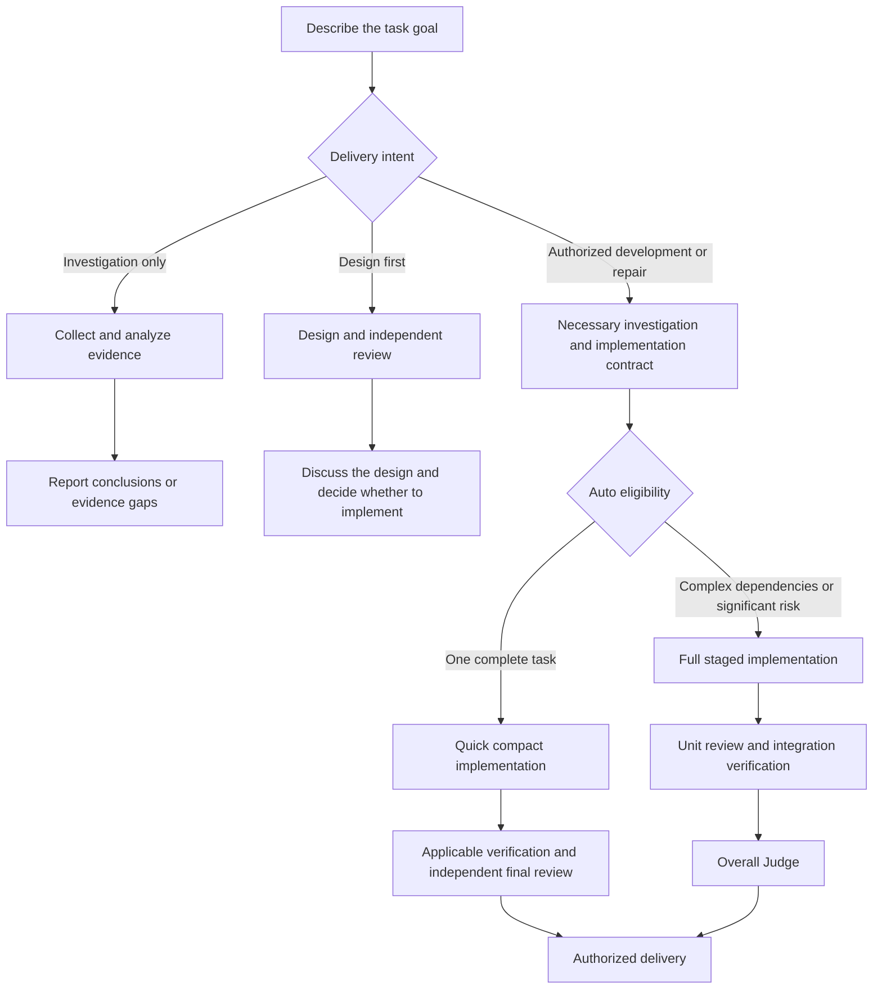

# Subscription-first model configuration, CLI plugins, and development workflows

English · [简体中文](2026-11-19-subscription-cli-workflows.md) · [Design proposals](README.md) · [Current architecture](../design.md)

**Created: 2026-11-19; original proposal revised: 2026-11-20; implementation status updated: 2026-11-20. Approved and being implemented through [PR #60](https://github.com/ckanner/flywheel/pull/60).** The text below preserves the documentation phase's goals, proposed interfaces, phases and acceptance requirements. Its original documentation-only scope does not limit the subsequently authorized implementation. The maintained [architecture](../design.md), schemas, protocol and paired guides define current behavior. The [implementation validation record](../validation/2026-11-20-subscription-cli-workflows.md) records results, departures from the proposal and limits. Source implementation, candidate-package validation, live-account acceptance and npm publication remain separate; this PR does not imply publication or user-configuration migration.

**Design premise: complete the Antigravity DSH plugin first, then deliver one default configuration that includes Gemini.** §4–5 combine the original shared research with Google's official model-selection guide to define the final responsibilities and thinking levels across the four subscriptions.

## 1. Agreed goals and scope

The user has established the following constraints. This proposal follows those decisions rather than reopening the choice of integration:

1. Use the existing Kimi, ChatGPT, Claude, and Google subscriptions. Remove DeepSeek prepaid balances and all additional paid APIs from this default configuration.
2. **Invoke the official Antigravity `agy` CLI directly, without ACP.** First complete the independent `dsh-subagent-antigravity` plugin for use in DSH Desktop, then integrate it with Flywheel through its public machine interface and deliver the unified model configuration.
3. Use Claude through the personal subscription only. Preserve the existing official Agent SDK → local, unmodified Claude Code path. The SDK is the library controlling the CLI; the CLI requirement does not call for rewriting the existing runner.
4. Keep Kimi on its native CLI and Codex on the official Codex CLI/app-server controlled by the existing plugin. Preserve structured protocols, sessions, recovery, and native capabilities.
5. Configure model, access channel, reasoning effort, permissions, and session independently. Start ordinary tasks with an economical combination and escalate difficult tasks within an explicit allowlist. Do not default every model to `max`.
6. Retain Task, New, Plan, and Run. Auto selects between the Quick and Full implementation depths by default. Investigation-only tasks deliver reports, planning-only tasks deliver designs, and troubleshooting fixes and complex development share verification and delivery rules.
7. Deliver the complete proposal PR in this iteration. Creating the plugin repository, implementation, merging, publishing, and migrating local configuration belong to later delivery phases.

### 1.1 Reference subscriptions and cost accounting

These are planning inputs supplied by the user, not permanent vendor prices or account quota guarantees: a high-tier Kimi subscription already paid annually, with a monthly list price of approximately ¥699; ChatGPT Pro at $200, with a planned downgrade to $100 next month; Claude Pro at $20; and Google AI Ultra 5x at approximately $99.99. Actual prices, taxes, regions, and entitlements depend on the accounts.

Kimi's annual payment has already been made. Its monthly list price must not be counted again as new monthly cash spending, and prepayment does not remove quota limits. Using the user's quoted prices, the other three subscriptions total approximately $319.99 per month now and $219.99 after the downgrade, excluding amortization of the Kimi annual payment. The actual annual amount is unknown, so this proposal does not present a precise combined monthly dollar cost. The goal is effective delivery within existing subscriptions, without adding top-ups, automatically purchasing credits, or trying to exhaust every plan.

## 2. Verification baseline and current gaps

### 2.1 Source snapshots

| Component | Source examined | Notes |
| --- | --- | --- |
| Flywheel | [`f016015a`](https://github.com/ckanner/flywheel/tree/f016015a884351d081e066a4031a6814299f25e5), source version 0.37.3 | Current templates, configuration discovery, workflows, and DSH control plane |
| Claude plugin | [`98818edb`](https://github.com/ckanner/dsh-subagent-claude-code-pro/tree/98818edbee75614718dc445f2abcf15c529fc2cb), source version 0.6.1 | Agent SDK controlling the configured local `claude` |
| Codex plugin | [`69e180ad`](https://github.com/ckanner/dsh-subagent-codex-pro/tree/69e180ad74adff80a270c7f1ca44030ca6f33246), source version 0.10.2 | Official CLI/app-server, DSH tools, and public machine API |
| Binary reference | [`7991fdce`](https://github.com/deadblue22/binary/tree/7991fdce737347d161c1162356f9c75ae4ab640a) | GUI → official Agent SDK → official Claude Code; uses the SDK-bundled binary by default and can select a local path |
| Web Pro work | [Flywheel #57](https://github.com/ckanner/flywheel/pull/57), [ChatGPT plugin #9](https://github.com/ckanner/dsh-plugin-chatgpt/pull/9) | Separate, unmerged candidates; not default backends already available on main |

A source version does not establish that a package has been published to npm, installed in Desktop, or validated with an account. The inspected head of #57 is `30c1edae16bd5bef4648c8937a9ca6075e917e3c`; historical SHAs in the PR body do not replace the current ref. This document is submitted independently from main and does not change that work's implementation, vendored code, host patches, or recovery protocol.

### 2.2 Existing capabilities and proposed work

| Area | Current fact | Work in this proposal |
| --- | --- | --- |
| Default Execute and Intake | Still use DSH `deepseek-account` / DeepSeek Flash | Remove from the target preset and every reachable fallback |
| Plan / Review / Judge | Kimi K3.1 Pro / DSH GPT-6.1 Sol / DSH GPT-6 Astra | Configure the final stage assignment across the four subscriptions and verify the actual model catalog |
| Design roles | `design-plan` inherits Plan; both planning Review roles inherit Review | Define every role explicitly and preserve separate histories |
| Claude runner | Already supports the Agent SDK launching a local CLI | Preserve it; adjust the native login channel, model matching, and doctor |
| Claude UI preset | `claude-api` automatically declares `ANTHROPIC_API_KEY` | Add a clear personal-subscription entry to avoid incorrect rejection before launch |
| Kimi arguments | Already use the correct model, print, and stream-json arguments | Preserve them; do not relist the fixed argument issue as a defect |
| Antigravity | No such harness or DSH plugin on main | New package, machine API, worker, Go driver, configuration, and UI |
| Investigation analysis | The host submits reports; no `loops.investigate` exists | Add a configurable analysis role while retaining the investigation and evidence state machine |
| Quick preparation for new tasks | The root design and its independent review are still followed by the first milestone plan and Plan Review | Generate the compact design and single-packet contract together, review the combined artifact independently, and activate the exact reviewed version |
| Intake / Garden responsibilities | Task-source triage / retrospective knowledge maintenance | Keep them separate from requirements design and delivery copy to avoid binding the wrong roles |
| JEV | Master switch is off by default; the decision backend still uses an external endpoint/key | Keep the baseline off; implement a subscription harness decision backend separately |
| Migration | Existing `subscriptions` still copies a template containing DeepSeek | Add versioned `subscription-cli` migration semantics |

Sources for current behavior: [default template](../../templates/flywheel.config.example.json), [model guide](../en/model-policy.md), [investigation guide](../en/investigation.md), and [configuration migration implementation](https://github.com/ckanner/flywheel/blob/f016015a884351d081e066a4031a6814299f25e5/internal/config/migrate.go).

## 3. The complete subscription-only contract

### 3.1 Record access, entitlement, and billing separately

An absent API key, successful OAuth login, selectable model, or successful invocation does not establish that usage draws only on the monthly plan's included allowance. The target configuration must represent each of the following separately:

- **Execution path:** the official CLI, plugin, working directory, and runtime configuration used.
- **Authentication path:** native personal-account login, without copying, refreshing, or proxying subscription tokens.
- **Model eligibility:** the models and parameters available to the account.
- **Billing eligibility:** whether the selection can use the plan's included allowance and whether additional credits or prepaid balances can act as a fallback.

Implementation will add versioned subscription-policy metadata. These are concepts to be designed into the schema, not existing configuration fields. Evidence must distinguish `verified`, `user-declared`, and `unknown`, with a source, timestamp, and CLI/config fingerprint. A user declaration must not be relabeled as vendor confirmation. Preflight must not read or output raw keys, tokens, or private account data.

### 3.2 Audit every reachable invocation

Admission checks for the target preset must cover loops, routes, named profiles, fallbacks, execution-policy, judge-panel, JEV, model overrides in native subagents, and the parent DSH conversation. `env-key:null` does not establish subscription billing: the current DeepSeek account channel also uses null while spending a prepaid balance.

Subscription mode must not automatically switch to an API, cloud ADC, third-party gateway, prepaid account, or additional credits. When quota is exhausted, it may wait for a reset or select another declared binding that still satisfies the subscription policy. Account, model, and billing-channel changes must be visible. A model change must create a new binding snapshot and must not reuse the previous Provider's session identity.

The parent DSH agent also consumes its own model allowance. Using an Antigravity or Claude subagent tool does not automatically make the parent a subscription model. Provide two explicit entry points:

1. The existing DSH ChatGPT subscription Provider handles ordinary conversations and invokes native tools. Check the actual Desktop/SDK profile and authentication.
2. The user starts a CLI task directly from the plugin panel or a command, without an additional parent-model call in DSH.

Keep DSH as the host and deterministic control plane when removing paid DeepSeek inference.

### 3.3 Limits of the no-additional-spending guarantee

Conflicts that can be established from local CLI configuration must block dispatch. If an official interface cannot reliably expose account-level extra usage or purchased-credit settings, show them as unverified; do not report zero charges. Strict automatic execution requires valid evidence that account-level extra spending is disabled, or an equivalent vendor-provided constraint. A successful call, model catalog, or estimated dollar amount cannot substitute for that evidence.

Settings inspection and account configuration use the user's native account flow. Installers, doctor, and migration must not toggle billing options automatically. If login is needed again, return an actionable diagnostic without requesting credential contents. Recheck expired evidence and changed configuration; one inspection is not a permanent spending guarantee.

Credits included with a plan must also be distinguished from credits purchased separately. Included credits may enter an explicit allowlist only when an official interface can identify their source and reliably prevent a switch to a paid balance. The first baseline disables credit fallback after quota exhaustion and does not automatically spend balances of unknown origin. Google's `useG1Credits` is one actual setting to inspect; see the [CLI credits documentation](https://antigravity.google/docs/cli/credits/).

## 4. Original research comparison, model capabilities, and evidence

### 4.1 Start from the original research and explain departures

The user-provided [Gemini shared conversation](https://share.gemini.google/lbGhBwv80PEP) has been read in full in a browser. This revision also checks [Google's official model-selection guide](https://aistudio.google.com/docs/choosing-a-model). The shared research provides the starting assignment across vendors; the official guide adds Gemini model tiers and thinking levels. The following defines the final design after the plugin is completed, gives a basis for each responsibility, and does not claim an optimum established through comparisons on the same tasks.

The following table briefly paraphrases the original assignment. The right column adapts it to this subscription constraint; neither the original nor this proposal has been validated through Flywheel task comparisons.

| Recommendation in the shared research | Treatment in this proposal and rationale |
| --- | --- |
| Carbon medium for requirements exploration; Opus high or Fable medium for requirements convergence and prototypes | Retain major roles for Gemini and Claude. Mechanical collection of clear requirements can use a lighter binding; two rounds are not mandatory every time |
| Carbon high or Fable high drafts the RFC/architecture; Astra high/xhigh reviews it | Restore Carbon as the primary candidate for top-level design; Claude can handle complex specifications. The initial default of Astra as author lacked evidence that it outperforms this combination |
| Fable/Opus high breaks down milestones, with Kimi high as an alternative | Retain Claude as the primary planning candidate. Kimi's alternative role rests on annual-plan capacity and a task-fit hypothesis, not proven superiority at planning |
| Hydrogen high or Sonnet medium writes the micro-spec; Sol medium performs the preliminary review | Retain and map these responsibilities within Plan/packets; do not add a new inference stage that must always run |
| Opus medium/high for commercial UI; Sol high or Hydrogen high/xhigh for backend work; Astra for difficult algorithms | Route by task type and withdraw the blanket assignment of frontend work to Kimi. Keep Kimi for tool-heavy work, bulk repository changes, and explicitly assigned frontend tasks |
| DeepSeek or Hydrogen for routine implementation/tests, with Sol adding edge-case tests | Remove DeepSeek under the user's constraint. Hydrogen becomes the primary implementation/test candidate, with Kimi as an explicitly chosen way to share the workload |
| Astra xhigh and Fable high for high-risk final review; Sonnet or Hydrogen for release copy | Preserve the distinct responsibilities and enable a second opinion according to risk, without requiring two reviews for every small change. A model drafting copy does not acquire release authority |

The source is model-generated research drawing on vendor material and secondary community sources. Its assignment is a comparison baseline. Absolute claims that a model is necessarily unsuitable for open-ended planning, rankings or causal explanations not individually verified, API prices, uniform context limits across a product family, and fixed speed/quota ratios do not become subscription-configuration facts. Individual X comments do not establish community consensus. This iteration has not completed controlled comparisons of those rankings, post samples, or workflow combinations.

### 4.2 Verifiable capability and integration facts

| Model candidate | Target responsibilities and basis | Evidence boundary |
| --- | --- | --- |
| Gemini 4 Carbon | Top-level architecture, root causes across subsystems, and high-risk analysis; Google explicitly positions it for architecture, coordination, and adversarial verification | Supports role suitability, not superiority to Claude/Astra on every project; [official description](https://antigravity.google/blog/gemini-4-carbon-in-google-antigravity) |
| Gemini 4 Hydrogen | Everyday coding, micro-specs, tests, and UI iteration from reference designs; Google emphasizes fast execution and interactive application development | Actual speed and quota benefits require evaluation on this task set; [official description](https://blog.google/innovation-and-ai/models-and-research/gemini-models/introducing-gemini-4-hydrogen/) |
| Gemini 4 Neon | Frequent complex engineering, multi-file changes, debugging, refactoring, and routine cross-module investigation | Google positions it between Hydrogen and Carbon; assign explicit responsibilities based on that task profile; [model documentation](https://aistudio.google.com/docs/models/gemini-4-neon), [Antigravity description](https://antigravity.google/blog/gemini-4-neon-in-google-antigravity) |
| Gemini 4 Argon | A manually selectable model in the catalog | The unified defaults use the Hydrogen/Neon/Carbon tiers; do not add a default stage solely to allocate work to Argon |
| Claude Opus / Sonnet / Fable | Requirements convergence, specification synthesis, milestones, commercial UI, and business-completeness review | Adopts the original research's role hypothesis. Exact models depend on the account catalog and subscription entitlements; see §6 for Fable. Claude is not relegated to second opinions only |
| GPT-6.2 Sol / Astra | Sol for well-defined backend implementation and routine review; Astra for difficult reasoning, architecture challenges, and high-risk adjudication | Official positioning supports candidate eligibility, not a claim that these models should take over all planning or review; [release notes](https://learn.chatgpt.com/docs/whats-new/gpt-62-astra-sol) |
| Kimi Code K3.1 Pro | Long tool-heavy tasks, bulk implementation against clear specifications, planning capacity, and organization | Annual payment and existing integration provide capacity/engineering reasons; frontend aesthetics and planning performance still need comparison. Annual payment does not imply unlimited quota |
| ChatGPT Web Pro | An alternative for particularly difficult analysis/adjudication | Depends on #57/#9 and actual validation; not a prerequisite for completing the basic target, and Pro mode is not the highest effort setting |

The [Antigravity model catalog](https://antigravity.google/docs/models) lists Carbon, Neon, Argon, and Hydrogen for Ultra; verify the actual account catalog through native `agy models`. Do not invent xhigh/max support for Carbon/Argon. Neon/Hydrogen support low/medium/high/xhigh. Neon's context limit in Antigravity is 512K, not the underlying model/API's advertised 1M. Record exact slugs, windows, additional tools, and child models for the actual harness.

The official Orchestrator already uses Carbon/Neon/Argon for planning and Hydrogen for implementation. This supports selecting models by responsibility, but its vendor tests do not establish gains for a Flywheel combination across vendors. Prefer a pinned single model when separate role receipts are required. Native Orchestrator is only an optional complete-task strategy, and its internal self-review does not replace independent Flywheel Review.

### 4.3 Decision grounds and unverified items

For every recommendation, distinguish at least the shared research's recommendation, official capability facts, engineering/capacity choices, and Flywheel measurements. The first three are available; the fourth is not. The listed effort levels are starting points for comparison, not proven optima. Identical effort names are not a common scale across vendors.

The model assignment assumes all four subscription paths are completed; see §15 for implementation order. Claude Pro quota and Kimi's annual plan affect task allocation and call frequency. Every stage still has an explicit primary model and initial effort, without requiring a separate configuration for integration status in daily use.

Confirm GPT-6.2 in the native account catalog before use. Older 6.1/6 models remain explicit compatibility candidates and must not silently replace a request. The target uses Standard. Recheck model/speed entitlements after a plan downgrade; do not assume API list prices can be converted into subscription quota or treat Fast/Ultrafast as default quota-saving measures.

## 5. Unified default assignment and Gemini thinking levels

### 5.1 Complete capability target: preserve the recommendation, then adapt it to subscriptions

The following is the unified default assignment across the four subscriptions. Within Gemini, Hydrogen handles routine execution, Neon handles complex daily engineering, and Carbon handles architecture and the hardest problems. Claude handles planning and commercial UI, Kimi handles tool-heavy and bulk tasks, and Codex handles backend work, independent review, and difficult problems. Each dispatch resolves to one explicit model and effort; it does not always invoke every model. This is the initial implementation policy, with real-task evaluation informing subsequent tuning.

| Stage / work type | Primary target | Initial effort | Selection condition or explicit alternative |
| --- | --- | --- | --- |
| Requirements exploration (a design-preparation responsibility) | Gemini 4 Carbon | medium | Part of design preparation, not task-source `intake`; explicitly select Claude Opus high for requirements convergence/specification synthesis |
| `design-plan`: compact local design | Gemini 4 Hydrogen | medium | Produce the design and single-packet implementation contract together; only for tasks with clear scope, implementation method, and verification |
| `design-review`: compact local preliminary review | Codex / GPT-6.2 Sol, separate session | medium | Jointly review the design, contract, and acceptance criteria; switch to full preparation if risks emerge |
| `design-plan`: system design | Gemini 4 Carbon | high | Explicitly select Claude Opus high for dense business specifications, or Fable high with subscription eligibility |
| `design-review`: system-design review | Codex / GPT-6.2 Astra, separate session | high | Escalate to xhigh only for high-risk issues |
| `plan`: milestones and dependency breakdown | Claude Opus 5.5 | high | Kimi high as an explicit capacity alternative; Fable high for complex plans when eligible |
| Micro-Spec (a responsibility within Plan/packets) | Gemini 4 Hydrogen | high | Use Neon high for complex cross-file constraints; refine only when needed, without creating a mandatory new stage for every packet |
| `plan-review` | Codex / GPT-6.2 Sol, separate session | medium | high for significant interfaces, migrations, or concurrency constraints |
| Execute `default`: routine implementation | Gemini 4 Hydrogen | high | medium for small local changes and simple transformations |
| Multi-file engineering / complex refactoring (task category) | Gemini 4 Neon | high | Escalate to xhigh if multi-step constraints still cannot be met; send architectural problems to Carbon high |
| Execute `frontend`: commercial UI | Claude Opus 5.5 | medium | high for complex constraints; explicitly select Hydrogen medium for quick local iterations within an existing design system |
| Execute `multimodal`: image / visual input | Claude Opus 5.5 | medium | Reuse the existing route; complete and validate image transmission from Flywheel to the public machine interface during implementation. A path is not a native attachment |
| Backend, algorithms, data pipelines (task category) | Codex / GPT-6.2 Sol | high | Difficult mathematical/low-level problems enter hard |
| Tool-heavy / bulk repository changes (task category) | Kimi K3.1 Pro | high | Constrain scope with an explicit specification, tool results, and regression verification |
| Execute `hard` | Codex / GPT-6.2 Astra | high | xhigh for evidenced difficult cases; max only as a bounded choice or evaluation candidate |
| Routine test additions / defect reproduction (task responsibility) | Gemini 4 Hydrogen | medium | Sol high for exception/concurrency edge cases; use existing deterministic verification first, without always launching a separate testing agent |
| `review` | Codex / GPT-6.2 Sol | high | Explicitly use Astra high/xhigh for security/complex concurrency risks; preserve independent history |
| `judge` (Full) | Codex / GPT-6.2 Astra | high | xhigh for complex disputes; select a business-completeness second opinion through judge-panel below |
| Investigation analysis (proposed role) | Gemini 4 Neon | high | Hydrogen high for simple local issues; Carbon high for difficult cross-repository root causes or architectural issues; analyze authorized evidence only |
| `intake`: task-source collection and triage | Gemini 4 Hydrogen | low | `intake.sources` is empty by default; scan and triage candidates when needed, without replacing requirements design |
| `garden`: retrospective and knowledge-maintenance proposals | Kimi K3.1 Pro | high | Infrequently synthesize recurring failures and propose skill or acceptance improvements; this is not PR-copy generation |
| Delivery-copy responsibility | Gemini 4 Hydrogen | low | Summarize verified results without adding a mandatory loop; delivery authority comes from the original task |
| JEV decisions (proposed backend) | Codex / GPT-6.2 Sol | medium | Master switch remains off by default; use only for bounded decisions in later implementation |
| `judge-panel` | Off by default; Fable 5.2 is the primary high-risk second-opinion candidate | high (when enabled) | Use only with subscription eligibility; otherwise explicitly select Opus high and record the substitution. Enable once for an explicit question, without fixed double review |

The same `design-plan/design-review` roles select bindings according to design granularity: use the compact combination for local tasks with sufficient evidence and Carbon/Astra for system-level work or significant risks. Task facts determine design granularity; freeze the rationale and specific binding before dispatch. A mode=quick label alone must not lower the model or bypass eligibility checks. Implement this selection rule with the combined preparation in §12.4, without duplicating the model configuration.

Micro-specs, multi-file engineering, backend work, bulk changes, tests, and copy are task responsibilities. The existing packet/execution-policy route enums contain default/frontend/hard/multimodal. This proposal adds `complex`, `backend`, and `batch` routes for Neon, Sol, and Kimi, respectively. Update the packet and execution-policy schemas, selectors, configuration UI, migration, and tests together; adding names to the routes map alone does not complete the integration. Users can explicitly override the task category. Before dispatch, display the rationale and freeze the actual binding; models must not choose hidden providers. This design table cannot be pasted directly into the current schema.

Assign one primary category to each task, with explicit task bindings taking precedence. Automatic classification follows the main acceptance objective, not file count alone: repetitive bulk operations with clear specifications go to Kimi; refactoring that requires reasoning across files goes to Neon; core algorithms and backend logic go to Sol; and tasks already classified as difficult use hard. Resolve ambiguous categories during planning, without implicit switches after dispatch.

`loops.investigate` is not an existing field. The analysis role's name, schema, scope, and permissions must be implemented together. In the current implementation, the host submits reports. The new JEV backend is likewise a proposed capability, not an existing default. Normal tests belong to the Executor and deterministic verification; create a separate explicit task only when additional analysis is needed.

Keep role semantics consistent with the current source: [Intake](https://github.com/ckanner/flywheel/blob/f016015a884351d081e066a4031a6814299f25e5/internal/modules/intake.go) scans, deduplicates, and triages task sources without freezing requirements; [Garden](https://github.com/ckanner/flywheel/blob/f016015a884351d081e066a4031a6814299f25e5/internal/modules/garden.go) turns retrospectives into knowledge-maintenance proposals rather than writing release copy. Map requirements exploration, formal design, task-source triage, and delivery summaries separately. Changing Intake/Garden bindings alone does not change Task's design workflow.

### 5.2 Gemini model tiers and thinking levels

Following [Google's selection guide](https://aistudio.google.com/docs/choosing-a-model), choose a model directly according to task complexity. Tasks do not need to progress through all three tiers:

| Model | Available effort | Default in the guide | Use in this proposal |
| --- | --- | --- | --- |
| Hydrogen | low / medium / high / xhigh | high | high for routine execution; medium for local interaction, UI iteration, and routine tests; low for organization and summaries |
| Neon | low / medium / high / xhigh | high | high for frequent complex engineering, multi-file refactoring, and routine cross-module investigation; xhigh only for explicit difficult cases |
| Carbon | low / medium / high | medium | medium for open-ended requirements exploration; high for top-level architecture, cross-repository root causes, and deep verification |

See the thinking-level definitions for [Hydrogen](https://aistudio.google.com/docs/models/gemini-4-hydrogen), [Neon](https://aistudio.google.com/docs/models/gemini-4-neon), and [Carbon](https://aistudio.google.com/docs/models/gemini-4-carbon). Flywheel explicitly sets effort for every invocation, rather than relying on the CLI's previous selection. Do not configure xhigh/max for Carbon or minimal for Gemini 4. Retain Argon in the optional catalog without creating another default stage for it.

Use the lowest level that meets the quality requirement: medium for local, interactive tasks; high for multi-step engineering; and Neon/Hydrogen xhigh only for difficult cases with a clear benefit. When a task is known to be architectural from the outset, select Carbon directly instead of first making every other model fail. Use the real-task evaluation in §16 to tune the effects of models and levels on elapsed time, revisions, and quota.

The AI Studio guide describes an API. This proposal adopts its model responsibilities and levels while executing through official `agy`. Do not directly transfer API `thinking_level`, `previous_interaction_id`, output limits, pricing, cache discounts, or Batch/Flex parameters to the CLI. The plugin uses native model slugs, `--effort`, and conversation IDs. Record actual context windows for Antigravity rather than treating the API's advertised 1M as a CLI guarantee.

### 5.3 One default configuration and task selection

Implementation delivers one complete, previewable `subscription-cli` default configuration containing the stage bindings and task-category selection rules in §5.1. Freeze exact model IDs and the configuration version during implementation. Saving configuration changes only the scope selected by the user.

Auto is the default selection policy; Quick/Full are the actual implementation depths. Task category, design granularity, and risk determine the model choices and escalations above; mode names must not silently change providers. Quick combines compact preparation as described in §12.4 and reuses valid contracts, while Full plans, integrates, and adjudicates progressively for the current milestone. Both use the same model policy.

Use Kimi's annual-plan capacity for explicitly identified bulk/tool-heavy tasks. Claude Pro planning calls reuse valid checkpoints, and second opinions depend on risk. When quota is exhausted, follow the existing explicit-selection and waiting rules without automatically switching to paid APIs. Users adjust capacity allocation within this configuration rather than selecting another product mode. Do not promise fixed workload shares or savings without actual measurement.

### 5.4 Effort, escalation, and model changes

Kimi uses its supported low/high/max levels; Codex and Claude depend on the specific model; Antigravity is checked against its model catalog, and native Orchestrator's fixed configuration must not be forced to accept an effort setting. Do not display max for every model, add `ultra` to the current execution-policy schema, or translate web Pro mode into xhigh/max.

Escalation proceeds in this order: obtain missing evidence → narrow the task → improve context quality → raise effort or change models within the allowlist. When tests were not run or files were overlooked, first inspect tools, permissions, context, and workflow gaps; a higher effort setting is not a promised fix. A new attempt may start only after a failed invocation has confirmed terminal and cleanup states. AUTH, QUOTA, configuration errors, and unknown outcomes are not resolved by more reasoning. Escalation retains the total attempt, time, and usage budgets and allows no more switches than the frozen policy permits.

### 5.5 Final configuration and field ownership

One `subscription-cli` configuration holds the model and execution settings. Each task separately records its delivery intent, scope, acceptance criteria, and workflow selection. Users normally describe the goal and desired delivery endpoint without manually selecting models or completing four sets of options each time.

| Configuration layer | Final choice | Actual location |
| --- | --- | --- |
| Normal entry point | Task, with Auto as the default | Entry point/task brief and the Spec workflow; not a top-level global `workflow.mode` |
| Delivery intent | Investigation only, design first, development, or repair, as determined by the original request | Task record; investigations use `investigate` / `investigate-and-fix` |
| Design and planning | Explicit design-plan, design-review, plan, and plan-review assignments above | `loops`, `profiles`, and the new design-granularity selection rules; do not rely on default inheritance |
| Implementation | default→Hydrogen, complex→Neon, frontend/multimodal→Claude, backend→Sol, batch→Kimi, hard→Astra | `routes` and the corresponding extended packet/execution-policy enums; no `loops.execute` exists |
| Investigation analysis | Neon high; Hydrogen high for local issues; Carbon high for difficult cases | New analysis binding that reuses preparation; no separate troubleshooting workflow |
| Thinking level | Set the values above explicitly | Flywheel's field is `thinking`; the driver maps it to each CLI's native parameters |
| Sessions | scoped, policy-version 1 | `sessions`; design, execution, and review have separate histories |
| Scheduling | parallel, at most 2 root execution units, batch, prewarm false | `scheduler`; parallelize only when independence and dependencies permit |
| Workspace | Isolated worktrees | `worktree.enabled=true` |
| Optional decisions and second opinions | JEV off by default; judge-panel off by default | Preserve their separate purposes; Auto eligibility does not depend on JEV |
| Automatic task sources | Empty by default; configured when needed | `intake.sources=[]`; do not scan task sources before every Task |
| Permissions and delivery | Preserve the original task authorization and existing permissions | Mode or model escalation does not grant implementation, merge, or release authority |

The existing runtime settings are shown below. Generate the model/routing portion with §5.1 and the new schemas. This is a configuration fragment, not a complete importable file:

```json
{
  "sessions": {"mode": "scoped", "policy-version": 1},
  "scheduler": {"mode": "parallel", "max-parallel": 2, "dispatch": "batch", "prewarm": false},
  "worktree": {"enabled": true},
  "jev": {"enabled": false},
  "intake": {"sources": []}
}
```

Field references: [current configuration template](../../templates/flywheel.config.example.json), [workflow selector](https://github.com/ckanner/flywheel/blob/f016015a884351d081e066a4031a6814299f25e5/internal/contract/workflow.go). Configuration generation/validation resolves and freezes display names to exact CLI model IDs. An Antigravity tool name is not an ordinary DSH provider. When moving Plan from Kimi to Claude, remove the old `resident-session:true` and use the role-scoped sessions above.

## 6. Specific changes to the Claude subscription path

### 6.1 Preserve the runner and correct the channel

The current [SDK runner](https://github.com/ckanner/dsh-subagent-claude-code-pro/blob/98818edbee75614718dc445f2abcf15c529fc2cb/lib/sdk-run.js) explicitly passes `pathToClaudeCodeExecutable`. Preserve that runner and the existing guardian, session, permission, recovery, and multimodal contracts. Selection between the SDK-bundled executable and a local executable must not change silently.

Add a `claude-native` channel with `env-key:null`, using the user's native CLI login. Update the Flywheel UI, profile examples, and doctor together so selecting a subscription no longer automatically creates an API-key requirement. Existing explicit API configuration remains compatible for other users but is unreachable from this subscription preset.

Official documentation distinguishes third parties collecting or proxying credentials from users signing into unmodified Claude Code themselves. This proposal uses the latter flow. The plugin does not implement subscription OAuth, export tokens, or automatically start login. References: [Claude Code authentication and usage rules](https://code.claude.com/docs/en/legal-and-compliance), [Agent SDK overview](https://code.claude.com/docs/en/agent-sdk/overview), and [Binary](https://github.com/deadblue22/binary/blob/7991fdce737347d161c1162356f9c75ae4ab640a/README.md).

### 6.2 Authentication and billing preflight

Doctor and actual execution must use the same command, cwd, HOME, CLAUDE_CONFIG_DIR, and filtered child-process environment. `loggedIn:true` alone is insufficient: report the observable authentication source, configuration conflicts, and subscription status, leaving unknown fields unknown. Sensitive environment variables are passed only through explicit configuration, not accidentally inherited from the parent DSH session. The subscription preset rejects explicit API/cloud/gateway paths.

Native settings, model fallbacks, and subagent configuration may also change actual requests, so checking environment variables alone is insufficient. Do not use `--bare`, which bypasses native subscription login. Disable extra usage credits through the account settings associated with the official CLI and verify that state. Intercepting a payment-consent dialog is not a zero-extra-spending control, because non-interactive calls may not show one.

### 6.3 Fable and alias corrections

Public documentation for standard Pro permits Fable access but normally bills it through usage credits. The November 9–16 launch offer temporarily included some weekly allowance. The user reports that their account includes Fable 5.2. Retain this as account-specific information awaiting verification; keep the model among their candidates without describing it as a permanently included entitlement for all Pro accounts. References: [plan entitlements](https://support.claude.com/en/articles/15424964-claude-fable-models-on-your-plan) and [launch offers](https://support.claude.com/en/articles/17506494-claude-fable-5-2-launch-offers).

The existing `modelMatches` recognizes only sonnet/opus/haiku aliases. Add verified alias-to-canonical-ID resolution and freeze the target so `fable` and its full native ID are not incorrectly treated as different models. Until then, use the full ID from the actual catalog without guessing date suffixes. Record the requested model, resolved target, and native report. A native switch to another model must not be reported as fulfillment of the original request.

Also check `CLAUDE_CODE_EFFORT_LEVEL`, native settings, and subagent effort overrides. A native environment variable can take precedence over startup arguments, so passing an argument does not establish the effective setting. Evidence for the model used across a whole turn must include available observations such as `modelUsage` in actual results, in addition to initialization, and expose any fallback during the turn. Leave missing observations unknown; a model match at startup is not a guarantee for the entire turn.

Non-interactive Fable calls may directly consume credits, as [model-config](https://code.claude.com/docs/en/model-config) explicitly documents. Dollar figures in `/usage` or results are calculated accounting values, not proof of an additional bill. `--max-budget-usd` is not a zero-dollar extra-charge control. References: [usage-credit settings](https://support.claude.com/en/articles/12429409-manage-usage-credits-for-paid-claude-plans) and [cost accounting](https://code.claude.com/docs/en/costs).

## 7. The agreed Antigravity integration path

**First complete the DSH plugin for the official `agy` CLI, then use it for Gemini stages in Flywheel; do not use ACP.** The plugin reuses official CLI authentication, agent execution, and native sessions. It manages processes, structured events, task state, cancellation, and result packaging.

Direct DSH panel tasks, the `subagent_antigravity` tool, and Flywheel machine calls share one runner. Define all three entry points together during plugin implementation and validate them separately. DSH supports both direct Gemini use and task delegation by an agent. See §8–11 for the interfaces.

Implementation follows the official [headless documentation](https://antigravity.google/docs/cli/headless/) and [CLI reference](https://antigravity.google/docs/cli/reference/). The original CLI retains its official login and account settings. The plugin does not copy or proxy tokens, emulate private backends, or fall back to paid APIs or credits. This specifies an engineering integration target; the proposal does not replace vendor account terms or authentication permissions.

Flywheel's model configuration directly includes Carbon, Neon, and Hydrogen. After completing the plugin and its DSH use, deliver the Flywheel driver, task routing, and unified default configuration.

## 8. Product and package structure for the new DSH plugin

### 8.1 One runner, three entry points

Propose a new `ckanner/dsh-subagent-antigravity` repository and `dsh-subagent-antigravity` npm package. These names are proposals, not claims that either resource already exists.

| Entry point | Responsibility |
| --- | --- |
| DSH Desktop plugin panel / direct command | Let the user select working directory, model, effort, permissions, and task, then start the CLI directly without an implicit parent-model call |
| `subagent_antigravity` tool | Integrate fully with DSH Agent/PTC and jobs, and register it in the corresponding presets |
| `dsh-subagent-antigravity/machine` | Public ESM API for deterministic callers such as Flywheel, without creating a parent DSH agent |

The package will expose the root plugin, `./machine`, and `./client`, plus an independent `antigravity-machine` wrapper command. `--capabilities`, `--doctor`, and `--json` are proposed wrapper arguments, not claims that `agy` already has those flags.

Follow the existing plugins' `dsh.bundle.patch`, `cordis.patch.yml`, client/settings integration, explicit preset tool registration, and DSH jobs. The ordinary model selector chooses the parent DSH model; Antigravity model selection belongs in tool/native-task settings. Do not register it as a conventional LLM provider and make DSH repeat the agent tool loop that `agy` already owns.

The manual DSH entry and agent tool share one execution service. If the current Desktop lacks a panel-action interface, implementation must add a public plugin action with version checks. The button must not silently ask the parent agent to invoke a tool. DSH acceptance includes this entry point without a parent-model call.

Bind manual tasks to the initiating Desktop workspace/user session and invocation ID. Queries, cancellation, and recovery must verify the same ownership. First check whether DSH jobs support an owner that is not an agent. If they do not, provide explicitly versioned start/status/cancel/result plugin actions without fabricating a parent agent. The panel displays results and cancels tasks directly, without relying on a model to call a tool. Agent-initiated tasks continue to use their real Agent/session owner.

### 8.2 Settings and UI

Settings include the official `agy` command or absolute path, default project directory, account routing status, model, effort, native execution permissions, timeout, allowed presets, session policy, and subscription policy. Saved changes affect the next invocation; running tasks retain a frozen snapshot.

The UI shows the task name, native conversation ID, project/worktree, requested and observed models, effort, progress, approval blocks, cancellation, final result, and unknown states. Keep model settings together and give clear reasons for a missing CLI, missing login, unsupported model, or exhausted quota. Reuse DSH settings, task, and log components without replacing built-in panels.

Background execution reuses DSH job IDs and `job_output` / `job_kill`. Tool returns must follow the host's permitted shape. Save complete machine evidence separately instead of inserting an unbounded event stream into the parent conversation. Normal returns contain a stage summary, artifact paths, and evidence references. The native CLI remains responsible for its own context compaction.

### 8.3 Installation and dependencies

The target is one clear npm/DSH bundle installation flow. The package must include public entry points, types, runner, guardian, Desktop client, and bundle patch. Validate installation with the current host's real installation command before documenting it. This proposal does not invent an installation command that is already usable.

The user must install and log into the official CLI beforehand. The plugin must not silently download, replace, or update it, or put account login in postinstall. Flywheel integrates through an exact version and the public machine API; the plugin does not depend on Flywheel, avoiding a dependency cycle. Determine Node and Desktop/SDK peer ranges from actual versions and capability checks. Source version numbers do not substitute for compatibility tests.

## 9. CLI runner and machine interface

### 9.1 Initial process model

The first implementation will use **one invocation, one CLI process, and one user turn**. Normal revisions resume the exact conversation ID; a persistent CLI pool is not required. This preserves conversation continuity while reducing the complexity of concurrent stdin writes, cumulative counters, and cleanup ownership.

Use an argument array, `shell:false`, and an explicit `cwd`. Prefer sending one text user message through the official stream-json stdin interface, then close stdin. Do not assemble large prompts into shell commands or treat arbitrary strings as commands. Closing stdin only means no further input is coming; the turn must still reach a real terminal state.

Construct model, effort, schema, session, and timeout arguments using the [CLI reference](https://antigravity.google/docs/cli/reference/) and version checks. Do not copy Claude control messages or the Codex app-server protocol. Parse official stdout events line by line and retain redacted diagnostics from stderr. Keep the wrapper's single JSON receipt separate from the event channel; logs must not contaminate formal results.

### 9.2 Proposed machine contract

Public exports must include at least protocol/lifecycle versions, capability descriptions, request validation, execution, and read-only recovery. The following is a **proposed field inventory**, not the current schema:

| Request information | Requirement |
| --- | --- |
| identity | protocol, requestId, and caller run/task/stage/role identifiers |
| input | prompt, explicit cwd, and optional structured-output schema |
| binding | native model, effort, execution mode, subscription policy, and configuration fingerprint |
| session | `new` or `resume` with an exact ID; never a global most-recent session |
| lifecycle | overall deadline, cancellation signal, event callback, and recovery journal location |
| label | Human-readable task name, separate from confirmation of the native title |

Results must represent requested/observed binding, native conversation ID, dispatch state, terminal state, text/structured output, artifacts, usage, errors, local cleanup, provider-work state, and a read-only recovery reference separately. Echoing a request is not an observation. Observed effort remains unknown when the native runtime supplies no evidence. Configuration acceptance distinguishes an observed match, an observed conflict, and an unobservable value. Identity/directory/model evidence that the protocol exposes and the stage declares mandatory must be present. For effort that is not echoed, record the request and CLI acceptance without inventing an effective value or failing every invocation. A stage requiring stronger evidence must reject an insufficient combination at admission.

Stage success requires at least a complete native terminal result, a successful status, matching configuration and identity, valid structured output, and cleanup that satisfies the contract. CLI exit 0 does not replace stage acceptance. Flywheel still owns tests, candidates, review, and Git delivery. `WAITING`, `RUNNING`, partial text, missing terminal results, and truncated output are not success.

### 9.3 Model, permission, and input boundaries

Build a sourced catalog from actual `agy models` output and CLI capabilities; a model list does not establish remaining quota. Expose effort per model and do not force an independent effort setting onto the fixed native Orchestrator configuration. Keep UI labels separate from CLI slugs and fail explicitly on conflicts or unsupported choices. [Model documentation](https://antigravity.google/docs/models)

Headless mode cannot receive interactive approval-control messages. Use native permission settings approved in advance by the user, and do not expand permissions after a tool denial. Record native execution mode, tool-approval policy, and sandbox state separately. Flywheel full-access is a normalized policy whose corresponding combination must be constructed from verified capabilities. `--dangerously-skip-permissions` means skipping tool approval as defined by the official CLI; it does not establish that the sandbox is disabled or arbitrary paths are writable. Reject permission combinations that cannot be expressed exactly before dispatch. When an approved action cannot run, return observable blocking or partial-execution evidence. Do not temporarily loosen global settings. cwd, plan mode, and prompts do not provide OS isolation.

The first text-stream implementation does not promise native image/PDF attachments. Passing a readable file path and attaching native multimodal input are different capabilities; reject unusable inputs before dispatch. Image/screenshot artifact return is supported only after obtaining real artifact metadata and passing path checks.

This does not mean the CLI cannot perform visual tasks. [Official browser capabilities](https://antigravity.google/docs/browser/) include page interaction, screenshots, console/network inspection, and verification of visual fixes. The CLI controls a local browser through Chrome DevTools MCP, requiring the appropriate Node/npx, Chrome 144+, and native authorization. The first implementation must validate text input, attachment transport, browser tools, and artifact return separately. Choosing Gemini for frontend work requires validation of the path actually used. A browser subagent may default to Gemini Flash; the main model selection does not guarantee every child model. Include its model and usage in the audit.

## 10. Sessions, naming, liveness, and cancellation

### 10.1 Identity and history

Scope sessions by task, role, packet, binding, execution directory, and native configuration. Normal Executor revisions may reuse a session. Design, subplan, Review, and Judge have separate identities. Review does not inherit the Executor's private history, and native Team/Swarm self-review does not replace independent Review.

For Antigravity, store the returned `conversation_id` and resume that exact ID. Do not use `--continue` to guess the latest conversation. new means new context; it does not promise that native history will not be persisted. An invalid ID must not silently create a conversation, and the same conversation must not resume concurrently. Changing model, effort, permissions, or directory requires a new binding and role session while preserving the old evidence.

Use readable task/role names for local labels. Native `/title` concerns the terminal window title and must not be presented as conversation naming. Validate native rename support against the version and real CLI. If no naming API exists, confirm only the local display name and leave native-title status unknown. Do not directly rewrite the history database or change existing user titles.

### 10.2 Real liveness and timeouts

The startup timeout bounds startup/handshake; the first text token is not the sole measure of a successful start. Actual text, tool, and status events are liveness evidence. Do not fabricate heartbeats when no output exists. Quiet reasoning must not be killed solely because stdout has been silent briefly.

The overall deadline covers startup, execution, and exit. Record native timeouts and external supervision separately. For long streams, set separate limits for each NDJSON frame, the incomplete-frame buffer, retained results, and diagnostics written to disk. Consumed progress events do not accumulate against the final-result limit; a large total event volume must not kill an otherwise valid task. When a particular limit is exceeded, record the error/truncation explicitly and do not mark truncated results successful. Persistent-process and warm-up support require separate capability tests; session resume is not warm-up.

### 10.3 Cancellation and recovery

Terminate only the process group owned by the invocation: interrupt, allow a bounded grace period, escalate termination if necessary, then drain pipes and confirm local processes are gone. Never kill all `agy` processes by name. Desktop shutdown, job kill, Flywheel SIGTERM, and parent-process death use the same supervision contract.

A local process exiting does not prove that a shared daemon, remote task, or native child work has stopped. Record local cleanup and provider-work state separately. Missing native terminal evidence remains unknown. An invocation that may have been dispatched but has an unknown outcome must not be replayed automatically. A new conversation, model change, restart, or preset switch must not bypass that block.

Read-only recover reads persisted journals/receipts without starting a model, automatically resuming, or sending another prompt. Cross-process persistence records invocation and dispatch facts before accepting terminal evidence. Treat any window that cannot reliably distinguish not-sent from possibly-sent as possibly-sent. A local network disconnect does not establish that remote execution never happened.

## 11. Subscription preflight, errors, and accounting

Antigravity native login uses existing official credentials. Inspect the effective provider, filtered child-process environment, ADC switches, custom endpoints, and credit configuration. Do not dispatch when the selected API/ADC/extra-spending path conflicts with this mode, and do not rewrite the user's global configuration. Variables such as `GEMINI_API_KEY` that are present but will not be used by the current CLI may be filtered or reported; their presence does not establish API consumption. Official authentication and configuration references: [Authenticate](https://antigravity.google/docs/install/) and [CLI reference](https://antigravity.google/docs/cli/reference/).

The plugin may have detailed error categories, but its Flywheel mapping must preserve the existing wire contract:

| Plugin fact | Flywheel handling |
| --- | --- |
| Expired or missing login | AUTH; no switch to an API |
| Confirmed quota exhaustion | QUOTA; wait or select another subscription within the allowlist |
| Confirmed rate limit | RATE_LIMIT; respect retry budgets and reset guidance |
| Unsupported model/effort, conflicting billing mode, or inadequate permission configuration | INVALID_REQUEST; fix configuration instead of retrying blindly |
| Transport/server error | Use TRANSPORT/SERVER only when supported by evidence; assess dispatch and terminal state first |
| deadline | TIMEOUT; retain cancellation and cleanup evidence separately |
| Unknown terminal state or unconfirmed cleanup | Persist the block; generic retries do not resolve it |

If a new global error code is required, the implementation PR must first update architecture §6, the protocol, and tests. Do not add a private code inside a driver. Ambiguous responses such as HTTP 403 must not be classified as quota exhaustion without evidence.

Record observable input/output/thinking/cache tokens, elapsed time, and retries; missing values remain unknown. Identify the accounting scope as turn/conversation/unknown. Compute differences between cumulative counters only when their source and lifecycle match; do not guess after a reset or when the source is unknown. Recovery must not double-count usage. Represent consumption of included allowance, list-price estimates, and actual extra charges separately. Do not turn `costUSD:null` into 0 or convert token counts into an exact remaining plan allowance.

## 12. Unified task workflows, modes, and usage scenarios

### 12.1 Keep two implementation depths, selected automatically by default

The final design retains Quick and Full. Quick serves a local task that can be accepted independently; Full handles dependencies, milestones, integration, and significant risks. Auto is the selection policy, not a third execution path. In normal use, users describe their goal and the UI shows the actual choice and rationale. Explicit Quick/Full overrides belong in advanced settings.

| Concept | Question it answers | How it is determined |
| --- | --- | --- |
| Delivery intent | Is the output a report, a design, or completed changes? | The original request and existing authorization; Auto does not expand it |
| Task-control entry point | Start, plan only, continue, or stop? | Existing Task/New/Plan/Run/Stop semantics |
| Implementation depth | One complete unit or a staged process? | Auto selects Quick/Full by default, with explicit preferences allowed |
| Model binding | Which model performs this particular work? | Roles, design granularity, task category, and effort in the same configuration |

The host and engine record these concepts without making users complete four sets of forms each time. Investigation-only tasks deliver reports, and planning-only tasks deliver designs; neither needs to be forced into a Quick/Full implementation cycle. Complex tasks do not always need to start with New. When the user has explicitly requested delivery, they can use Task Full directly.

### 12.2 Entry points, authorization, and the overall workflow

| Entry point | User expression | Preserved behavior and stopping point |
| --- | --- | --- |
| Task | “Find the cause,” “fix it and open a PR,” or “implement this feature” | Identify the delivery endpoint and proceed within the existing scope authorization; both investigation and implementation can start here |
| New | “Prepare a design first; we will discuss it before implementation” | Perform real design and independent Design Review, then stop for approval of the exact version |
| Plan | “Revise the design” or “refine this milestone” | Plan and review only in this invocation; stop after planning even if implementation was authorized earlier |
| Run | “Continue this task” | Reuse the task, budget, evidence, and valid approvals; do not recreate the task or replay invocations with unknown outcomes |

Task's delegated path continues within the original request's authorization. New's review-first path retains an explicit approval point. Refinement within scope reuses valid approvals; material changes to requirements, fixed decisions, constraints, or acceptance commitments require handling the new design decision. Approval and the start of implementation remain separate records. Reference: [existing design and review guide](../en/reviewed-planning.md).



Entering implementation in this diagram requires a sufficient basis, the necessary authorization, and resolved invocation states. When evidence is insufficient, report the gap or continue investigating within the currently approved scope; do not start modifying code directly from an uncertain report.

### 12.3 Auto eligibility and the two depths

Preserve the existing deterministic Go selector. Quick requires clear scope, a known implementation method, a complete executable verification plan, and sufficient independent final review, supported by reason/evidence. There must be no declared risks, exactly one milestone and one packet, coverage of every requirement, executable L1 checks, and L2/L3 checks or explicit N/A reasons. If any condition is missing, use Full; an explicit Quick selection cannot bypass the checks. No threshold makes a task Quick solely because it changes a certain number of files or lines. Reference: [selector source](https://github.com/ckanner/flywheel/blob/f016015a884351d081e066a4031a6814299f25e5/internal/contract/workflow.go).

| Dimension | Quick | Full |
| --- | --- | --- |
| Suitable tasks | A single local change that can be completed and accepted independently | Dependencies across units, architectural changes, migrations, or significant risks |
| Design and planning | Prepare the compact design and single-packet contract together, with independent review of the combined artifact | Independently review the root design, then refine and review subplans for the current milestone |
| Implementation organization | One execution unit | Packets organized by dependencies; independent units may run in parallel |
| Verification | L1 and applicable L2/L3, regressions, and project quality gates | Unit and integration verification, applicable regressions, and project quality gates |
| Final acceptance | One independent task-final Review covering all requirements | Packet Review plus an overall Judge after integration |
| Inapplicable stages | Separate runtime Plan and Judge explicitly marked N/A | Follow actual milestones without producing unnecessary future detail |

Quick reduces duplicate planning and separate adjudication calls without reducing required verification. A single-line change to authentication, billing, concurrency, or persistence behavior may still require Full. Auto does not depend on JEV or launch an additional “Auto model” to maintain a third workflow.

Recovery reuses the persisted selection. When new risks or acceptance gaps emerge, Quick durably upgrades to Full before continuing, preserving artifacts, budgets, and history. Running the task again does not downgrade Full to Quick. Reference: [state resolution](https://github.com/ckanner/flywheel/blob/f016015a884351d081e066a4031a6814299f25e5/internal/state/workflow.go).

### 12.4 Make Quick preparation lightweight as well

In the current reviewed-planning implementation, an approved root design without an Active plan still creates a plan request for the first milestone and activates it after Plan Review. A normal Quick path from a new brief therefore usually includes six types of calls: design-plan, design-review, plan, plan-review, execute, and task-final review. Only the implementation phase has two calls; the complete new task must not be described as taking two or four. Reference: [prepareReviewedExecution](https://github.com/ckanner/flywheel/blob/f016015a884351d081e066a4031a6814299f25e5/internal/machine/planning_engine.go).

This proposal adds a specific preparation optimization:

1. For a local task, Hydrogen medium produces the compact design and executable single-packet contract in one call, including scope, the basis for the change, and mappings for every requirement and acceptance criterion.
2. Sol medium reviews the same complete artifact in an independent session, covering the design, implementation contract, executable checks, and Quick eligibility together. High risk or insufficient information leads to full preparation; a preference for lightweight work does not establish eligibility.
3. After obtaining the required authorization, Go checks the current task-input version, design reference/digest, digest of the complete single-packet projection, independent review identity, and approval/delegation scope, then atomically activates that unit contract. The joint review must separately confirm design validity, implementation within the authorized scope, and requirement/acceptance coverage. Another milestone plan/plan-review round is no longer mandatory.
4. Execute completes the changes and applicable verification, then an independent task-final Review examines the same candidate. Revisions return to the original execution context; rerun affected checks before reviewing again.

This requires versioned extensions to planning outputs, joint-review records, schemas, and the activation protocol. Do not copy one Design Review to fabricate a second Plan Review or bypass current checks with a switch. Activating planning artifacts does not start implementation: New/Plan still honor the current entry point's stopping point, and execution separately checks start authorization. Changes to the contract, acceptance criteria, or design digest after approval require rechecking the corresponding review and authorization. Changes to repository/dependency assumptions or projected-file digests also require rechecking the affected parts.

After the optimization, a newly created, eligible small task normally completes on its first attempt with four logical role calls. An existing valid and eligible single-packet contract, whether from the old workflow or the new compact protocol, may leave only the two implementation calls, Execute/Review. Reuse old reviews under their original types and digests; do not regenerate compact documents merely to use Quick or fabricate joint-review records. Investigation, revisions, native tools/subagents, failures, and recovery are additional; these counts are neither fixed costs nor total-call limits. Formal system design still uses Carbon high and Astra high. Model differences follow design granularity, without a separate Quick model configuration.

### 12.5 Advance Full through the current milestone

Full starts with an overall design and independent review, then Claude refines the current milestone and Sol reviews its subplan. Packets select Hydrogen/Neon/Claude/Sol/Kimi/Astra according to their main acceptance objective and complete changes, unit verification, and independent Review. When dependencies are ready and write scopes are independent, run them in parallel in isolated worktrees, with a root concurrency limit of 2.

After milestone integration, run applicable L2/L3 checks, then use Astra Judge to examine requirement coverage, consistency across units, and verification sufficiency. Return problems to the relevant execution units while preserving completed work that remains valid; a single failure does not restart the entire project. Refine later milestones when needed, without requiring the initial plan to freeze every future packet.

Reuse existing valid designs, subplans, and reviews. Parameter-only or model changes do not automatically invalidate all artifacts. When evidence, contracts, or scope change, recheck the affected parts against their exact identities.

### 12.6 Keep investigation, repair, and additional evidence in one task

`investigate` ends after evidence collection, analysis, and a report. `investigate-and-fix` records the original `implementation-scope`; once conclusions are supported by evidence, the scope is authorized, and invocation states are resolved, prepare the implementation contract and let Auto determine the depth. An unknown root cause must not lead to repeated speculative code changes. A difficult investigation does not necessarily require a Full repair: a local, complete fix established by the investigation may still qualify for Quick.

Reuse preparation's read/search/list/command/http evidence and structured hypotheses. Go executes specifically approved evidence-collection actions. Analysis roles such as Neon consume actual observations and propose falsifiable hypotheses and candidate next steps, without generating arbitrary unauthorized commands or URLs. `supported` means that the report has structurally valid evidence references; it does not mean Go has proved causation. After implementation, rerun the original reproduction and applicable regression checks. Reference: [investigation guide](../en/investigation.md).

The current implementation ends an investigation round when its report is submitted. Repeating Run after `inconclusive` or `access-blocked` does not collect evidence again. The final product supports appending a new versioned investigation round within the same task after the user supplies more evidence. Preserve previous reports and sources; freeze the added evidence, scope, and remaining budget for the new round; and bind implementation to the specific round and report digest. Cumulative usage does not reset, and unresolved invocations must be reconciled first. A new round must not replay actions with unknown outcomes. Implement this extension with the analysis binding, without creating a separate troubleshooting state machine or overwriting the old report to claim that the cause has been established.

If the user originally requested investigation only and later explicitly requests a repair, preserve the report, record the corresponding repair scope and design authorization, and continue the same task. An existing instruction to investigate and fix does not require repeated authorization for the same scope. Production mitigation uses the specific scope and success criteria in the original request, retaining its results as evidence. Root-cause repair and code delivery continue through the same engineering cycle.

### 12.7 Scenarios and practical usage

The following examples describe the final workflow. Task/New/Plan/Run retain their existing entry-point names. The host prepares records from natural language; users do not fill in contract JSON.

| Scenario and example request | Entry point and workflow | Delivery endpoint |
| --- | --- | --- |
| “First find out why the API is slow; do not change code” | Task; investigate, reproduce/analyze evidence with Neon high, or Carbon high for difficult root causes | Evidence-backed conclusions or a clear gap report; no implementation |
| “Find the timeout cause, fix it within this module, add a regression check, and open a PR” | Task; freeze the basis for the fix after investigation, let Auto choose Quick/Full, rerun the original reproduction, then independently review | A repair PR within the authorized scope |
| “The null check is already identified; fix it and add a test” | Task Auto; when eligible, use compact preparation, unit implementation, verification, and independent final review | Verified code and the requested deliverables |
| “Change just one line of authentication/concurrency logic” | Task Auto; use Full because of the risk, not a lightweight classification based on line count | Changes with risk and regression checks |
| “Implement multi-tenant scheduling, preserve interface compatibility, and open a PR” | Task Full; root design, progressive milestones, assigned implementation work, integration verification, and Judge | The complete engineering result requested |
| “Design this complex system first; we will discuss it before implementation” | New Full; stop after design and independent review, then use Run after approval of the exact version and authorization to start | A design for discussion first, followed by implementation within the same task |
| “Continue investigating with these new logs” | Append an investigation round to the same task; preserve previous reports, budget, and evidence | Supplemented or corrected conclusions; no new task that resets accounting |
| “Mitigate the production incident using the steps already specified, then fix the root cause” | Record mitigation results and subsequent evidence, then enter the same repair cycle | Separate acceptance of operational results and the permanent fix |

Use Task Auto by default. Use New when the user explicitly wants discussion first, Plan to change or refine a design, and Run to continue an existing task. Explicit Full is a conservative choice; explicit Quick still requires eligibility. There are no additional debug/issue/incident completion modes.

### 12.8 Shared verification, review, and delivery rules

Deterministic verification precedes LLM Review. Changes must pass applicable project checks. Defect fixes add regression verification that catches the original defect; simple copy or style changes do not need ineffective tests added merely for formality. L2/L3 require reasons when inapplicable. Correct verification gaps and verify again; a written Judge conclusion cannot waive them.

Reviews bind to the same candidate and verification evidence. The Executor's private history does not replace independent review. Unknown outcomes, unconfirmed cancellation, and exhausted budgets preserve the original task state; Run neither resets it nor resubmits blindly. Completed investigation, completed design, verified code, an opened PR, merge, and release each require actual evidence and the corresponding authorization from the original request. Quick/Full do not expand the delivery endpoint themselves.

## 13. JEV, native capabilities, and scheduling

### Approved orchestration and adaptive-selection addendum — 2026-11-20

Implementation: this addendum is realized by Antigravity 0.2.0, Flywheel native
collaboration configuration and initial JEV selection. The [follow-up validation
record](../validation/2026-11-20-orchestration-adaptive-selection.md) (Chinese)
records source, independent review, package installation and unverified boundaries.
Current settings are documented in [Antigravity](../en/antigravity.md),
[JEV](../en/jev.md) and the
[complete template](https://github.com/ckanner/flywheel/blob/main/templates/flywheel.profiles.example.json).

The user authorized this addendum and its complete implementation in the same PR after reviewing native CLI collaboration and the existing JEV switch. Commit `a90aff4` is the verified **pre-addendum** baseline: it supports ordinary CLI calls and partial child metadata, but not selectable Orchestrator/Swarm or default execution candidates. Its JEV execution selection runs only after confirmed failures. Earlier CI results do not validate the additions below. This addendum supersedes the original future-tense description of the subscription JEV backend: that backend already uses tool-free Hydrogen medium; “JEV” names the bounded decision mechanism, not a request to the legacy paid System One/JEV model.

#### Official capabilities and integration contract

- **Native subagents:** `invoke_subagent` starts independent child conversations. The ordinary `native` mode preserves native behavior and does not claim to disable children. Explicit `subagents` mode requires collecting delegated results within the owned invocation.
- **Orchestrator:** support `gemini-pro-orchestrator-neon`, `gemini-pro-orchestrator`, and `gemini-pro-orchestrator-argon`, pairing the named planner/reviewer with Hydrogen implementation. This is model handoff in one conversation. Use `thinking:""` for its fixed configuration, omit `--effort`, and reject a nonempty effort. Admission still checks the actual `agy models` catalog and initialization identity.
- **Swarm:** use the official headless CLI with native options `version:1, mode:"swarm"`. Only the adapter synthesizes the fixed `/swarm` entry; the task is escaped data, preventing task text from chaining other slash controls. Ordinary requests continue to disable slash expansion. Do not use ACP, private endpoints, or token proxies.
- **Observation and limits:** optional `maxObservedAgents` stops an invocation after observing too many distinct child conversations, including workers, verifiers, and monitors. It is explicitly `hard:false`, not a native concurrent-agent or whole-tree hard cap. Record child models, lifecycle, and usage only when actually exposed. CLI-invocation completion, individual child completion, and remote-work termination remain separate facts. A nonempty `finished_reason`, timeout, abnormal exit, missing terminal event, or unconfirmed cleanup must not become success.
- **Sessions and evidence:** freeze model, fixed/adjustable effort, and complete native options in session identity. Cancellation and read-only recovery keep owned-process and original-journal semantics. Evidence-only investigation analysis and JEV reject tools, children, and Orchestrator and continue to consume only supplied evidence.

Official sources checked on 2026-11-20: [models/Orchestrator](https://antigravity.google/docs/models), [headless protocol](https://antigravity.google/docs/cli/headless/), [subagents](https://antigravity.google/docs/subagents), [Swarm](https://antigravity.google/docs/swarm), and [CLI changelog](https://antigravity.google/docs/changelog?tab=cli). CLI 1.5.5 introduced Swarm; 1.5.6 explicitly records headless Swarm fixes. Version/catalog facts alone do not establish account entitlement.

#### Reviewed parallel-work boundaries

Add optional packet `collaboration:{version:1,tasks:[{goal,writes}]}` with 2–8 bounded tasks. Normalize write scopes, reject overlap between tasks, and require every scope to belong to approved `schedule.writes`. The declaration is reviewed and frozen with the whole contract. It is not a second feature toggle, nor proof of quality from path counts alone.

Automatic Swarm candidates require Full, valid collaboration, no native image input, and an allowed subscription/native binding. Such a packet is not Quick-eligible. Route names or two file paths alone never enable Swarm. A statically selected Flywheel Execute Swarm uses the same collaboration requirement. A directly requested DSH Swarm can operate on the user's submitted task without a Flywheel packet. Planning may collect foreground read-only subagent results but cannot launch an execution Swarm before design approval.

#### Initial selection, failure adaptation, and one switch

Before the first Execute dispatch, after reconciliation and permission/credential checks, Go filters the route's complete `execution-policy` candidates. Image packets retain only bindings with actual image transport; Swarm must meet the collaboration conditions above. Execute a sole legal option directly. With multiple meaningful options and JEV enabled, ask the subscription decision backend to select an action ID using the approved goal, route, scope, acceptance, collaboration, and budget facts.

Initial and existing failure decisions share the task ledger, subscription backend, default 30-second timeout, cumulative eight-call limit, and 0.8/0.6 adoption thresholds. Probabilities remain uncalibrated estimates. Candidate descriptions include the complete model, effort, native mode, and known limits. JEV cannot invent models, commands, permissions, or budgets and does not assume undisclosed live quotas or model success rates.

Persist intent before dispatch and revalidate contract, candidates, configuration, and the switch before adoption. Initial selection occurs once per packet; recovery reads the original journal without repeating the prompt. Binding changes require a cold start, record the reason and before/after configuration, and consume the switch allowance. A failed decision with confirmed cleanup uses the initial baseline; unknown cleanup blocks. Existing confirmed L1/Review failures may still select repair, evidence, replan, or another approved binding. Authentication, quota, and transport errors keep their own rules.

#### Default candidates and interface

Preserve every route's original initial binding. Default `quality-order:[]` and `max-switches:2` keep JEV-off execution fixed, while JEV-on can select model/effort/collaboration candidates. Users may still configure the existing deterministic upgrade order. The initial candidate policy is:

| Route | Allowed candidates, initial first |
| --- | --- |
| default | Hydrogen high, Hydrogen medium, Orchestrator Neon |
| complex | Neon high, Orchestrator Neon, Neon high Swarm when eligible |
| frontend / multimodal | Opus medium, Opus high |
| backend | Sol high, Sol medium, Astra high |
| batch | Kimi high, Kimi max, Neon high Swarm when eligible |
| hard | Astra high, Carbon high, Orchestrator Carbon |

These are engineering alternatives with different purposes, not a measured global model ranking. All three Orchestrator options are explicitly selectable; Argon needs no new default stage. The one JEV switch controls optional model decisions; manually selected native strategies remain usable with JEV off. Migration preserves an existing execution policy; when adding missing defaults it does so only for routes already authorized for full access, reporting other routes that retain fixed bindings without widening permissions.

DSH settings, direct tasks, PTC arguments, and the public machine API expose mode selection, fixed-effort status, observation guards, and child summaries. Flywheel configuration/workbench surfaces candidates, actual binding, initial/failure-selection reasons, and observed collaboration metadata. It does not default unknown child completion or aggregate usage to success. Auto/Quick/Full retain workflow responsibilities; exact design approval, independent Review, and final acceptance remain controlled by Go.

#### Acceptance for this addendum

Verify the independent package through real pack/install; Orchestrator parameters; every public DSH entry; Swarm control-text isolation; child events and observation limits; `finished_reason`; cancellation/recovery/unknown outcomes; Go → Node → actual public package; native-profile/schema/UI round trips; collaboration boundaries and Quick exclusion; initial and failure selections; switch-off during a request; image-candidate exclusion; shared budgets; no redispatch after crashes; and fixed defaults with JEV off. Run the existing per-function 100% Go gate, affected regressions, unified candidate installation, Linux/macOS CI, and independent review of the final diff. Record real-account inference, subscription quotas, and model-allocation quality separately from offline fixtures.

### 13.1 One JEV master switch

The baseline is `jev.enabled=false`, with no call to the current external paid decision endpoint. Add a subscription harness backend consistent with stage bindings in later implementation, using the existing complete candidate allowlist, structured output, time/call/usage budgets, and atomic adoption rules. Keeping JEV off must not remove implemented functionality. Do not restore shadow reads or introduce a second enable switch.

When enabled, validate the decision backend against the subscription policy. If an old configuration contains only an external endpoint with a key, report the configuration issue before running. On decision failure, use the existing deterministic baseline of legal actions or retain the block; do not silently call a paid API. Decision requests with unknown outcomes also require lifecycle reconciliation. The current five-second external-request timeout cannot be reused unchanged as a CLI reasoning deadline. Configure and validate it against the new backend's startup and execution contract.

### 13.2 Bound native capabilities by role

DSH Team/PTC/LCU, Kimi Swarm/Tower, and Claude/Codex native subagents continue to use the implemented native-profile contract. Complex plans may use native parallel analysis; routine small fixes should start with one agent. Each Flywheel worker must not expand into an unlimited native team.

The current scheduler controls root-call concurrency; it does not impose a hard limit on the entire native agent tree. Attribute subagent, Advisor, compaction, and Tower usage only when real receipts support it. Otherwise, the tree's total usage remains unknown. Existing Claude observed guards and Kimi capabilities must not be presented as hard budgets for the whole tree. If a task requires such a hard limit and the backend cannot prove it enforces one, disable the corresponding native expansion for that task or reject the combination. Account quotas are generally not allocated separately to each plugin instance. Audit all native model overrides, external tools, and billing paths under the subscription policy. Validate native-task completion, GUI lease return, child-work cleanup, and parent-process exit separately, preserving existing unknown-state constraints. See the [native-capabilities guide](../en/native-capabilities.md) for current behavior.

Antigravity's native Orchestrator, Swarm, and browser subagents follow the same boundaries. They may be explicit native-task strategies, but must not conceal internal model switches, count an internal verifier as Flywheel's external independent review, or let multiple outer workers expand into unbounded native teams.

### 13.3 Keep scheduling explainable

Retain the baseline `max-parallel=2`, `dispatch=batch`, and `prewarm=false`. Independent packets run in isolated worktrees; conflicting scopes, integration, review, and final delivery retain dependency barriers. Ready queues and warm-up are existing optional capabilities. A model migration must not silently enable them or claim a measured speedup.

Do not resume the same official CLI conversation concurrently. CLI warm-up requires evidence that the runtime is ready and no task has been dispatched; process existence, restored history, or a paid probe is not warm-up. For small tasks, nearly exhausted Claude Pro quota, or a constrained provider, reduce concurrency and repeated context before adding retries.

## 14. Configuration migration and UI

### 14.1 A new preset with explicit migration

Add a versioned `subscription-cli` preset with preview/apply behavior. Specific CLI arguments must enter the parser, schema, and tests during implementation. **The existing `config migrate --preset subscriptions` does not complete this proposal:** it still includes DeepSeek, migrates permissions, and clears judge-panel.

Migration first identifies the effective configuration file. Current task → project → global → embedded discovery selects the first complete file; it does not merge across files. A two-line task configuration cannot be presented as overrides inheriting from global configuration.

The preview shows the effective path, original digest, new preset version, all role changes, reachable paid paths, unsupported model choices, preserved settings, and reasons for blocking. Before apply, verify the original digest and retain a recoverable backup; refuse to overwrite concurrent edits. Migration must not expand permissions or unnecessarily clear second opinions, verification, scheduling, and user-defined channels. Unreferenced API profiles may remain for other uses, but the subscription configuration graph must not reach them.

Handle explicit `design-plan/design-review/plan-review`, route fallbacks, execution-policy, native child models, and JEV. When moving a resident Kimi Plan to another harness, remove unsupported `resident-session:true` and express history reuse through role-scoped sessions. Running tasks keep their old snapshots; only new starts use the new configuration. Reconcile unresolved invocations first.

### 14.2 Configuration UI

Generate Provider/model choices from an independent capability catalog, rather than showing a provider only when a current stage happens to use it. Otherwise, removing the DeepSeek default or changing Review can unintentionally change resource selectors.

For every stage, show the harness, actual Provider where applicable, channel, model, effort, configuration source, and subscription-check results. Clearly distinguish inherited rows from explicit overrides. Creating or changing a selection affects only its selected scope. Claude gets a native subscription-login entry; Antigravity gets an official-CLI entry, with no ACP option.

The UI maintains this single configuration of stages and task categories and displays the model and effort actually selected. Missing CLI, expired login, unsupported model, exhausted quota, and unconfirmed cancellation use ordinary runtime diagnostics; they do not create duplicate configuration pages or silently switch providers.

The task entry focuses on the goal and delivery endpoint, with Auto as the default. Put Quick/Full in advanced options and show the actual choice and rationale, rather than presenting three parallel workflows users must understand. Investigation-only tasks show investigation progress and reports; planning-only tasks show design and review. Display implementation depth only when entering implementation. Continue investigations with additional evidence in the same task, showing the round and report sources without requiring a new task. Keep the existing underlying parameters compatible.

Environment inspection and model invocation are separate actions. A doctor that performs no inference consumes no model tokens and cannot establish task quality or remaining allowance. A real smoke test is an explicit, separate action that records the model and observed usage. Installation, opening settings, and model enumeration must not silently send inference requests by default.

### 14.3 Approved UI consistency and task-evidence follow-up (2026-11-20)

This addendum uses `2858c4347a12` as its audit baseline. Its acceptance remains historical evidence, not proof that the following changes are complete. Commit this section and update the PR status first, then implement, independently cross-review, and repeat acceptance.

| Area | Implementation requirement |
| --- | --- |
| Effective models and history | Configuration diagnostics, the run catalog, and the workbench consistently resolve `execution-policy.routes.<route>.initial`, preserving candidate permissions, sessions, and native configuration. Preserve the fixed empty Orchestrator thinking value. Distinguish initial run configuration, selected next configuration, and latest actual invocation; missing historical facts remain unknown. |
| Swarm eligibility | Configuration loading and the editor reject Swarm for non-Execute roles, retaining the final driver check. Execute explains Full, 2–8 reviewed tasks with disjoint write scopes, and no original-image requirement in the current packet. A configuration draft does not establish a particular task's eligibility. |
| JEV switch and source | Keep the single `jev.enabled` switch. Resolve the subscription profile, model, and effort for display. Distinguish the edited global/project file from the complete configuration file actually selected for the task. Re-read effective configuration after saving; a failed read cannot establish that the task changed. |
| JEV explanations | Freeze the complete display binding of available candidates at decision time. Distinguish initial and post-failure decisions, proposals and adoption, baseline and switches, and their reasons. Preserve recovery and v1/v2/v3 snapshot hashing; do not reconstruct history from subsequently edited configuration. |
| Common settings | Provide graphical route initial, candidate allowlist, switch-limit, and AGY native-mode controls without modifying shared bindings, permissions, or session policies. Keep advanced JSON for the full configuration. |
| Collaboration and task entry | Show collaboration tasks and write scopes matched to the approved contract identity, alongside actual native observations from the same invocation. Goal entry distinguishes investigation, repair, and engineering intent, defaults to Auto, and makes review-first/delegated explicit. Use the existing Go control path; loading a skill or generating a command is not a started task. |
| Image evidence | Explain that tasks without images work normally. Original images are explicitly selected, repository-bounded task evidence with a preview, format, digest/frozen identity, and supported transport. Chat attachments and text paths do not automatically become reviewed image inputs; the UI cannot silently rewrite approved contracts. |

The official interactive Antigravity CLI accepts pasted media; the current machine `stream-json` input accepts text only. This limits the implemented automated transport and verifiable consumption, not the model's vision capability or Gemini eligibility for text tasks. This follow-up does not advertise headless image or worker-image delivery based on interactive support, and does not introduce ACP or a paid API workaround. Original-image execution retains the verified Claude SDK path; text tasks, investigations, and engineering work without original images can use Gemini and eligible Swarm.

Acceptance covers incorrect source projections, fixed effort, invalid-role rejection, shared-binding isolation, task-level JEV overrides, read failures after saving, historical compatibility, unadopted proposals and baseline choices, invocation-matched collaboration evidence, task input, and image boundaries. Retain per-function 100% Go coverage, DSH/host regressions, actual installation of the complete candidate, and Linux/macOS CI. Check narrow screens, long content, focus, loading/errors, and session changes. Offline fixtures do not establish user Mac desktop or real-account inference acceptance.

## 15. Implementation phases and documentation ownership

| Phase | Repository / scope | Completion criteria |
| --- | --- | --- |
| P0 | This Flywheel documentation PR | Chinese and English proposals, indexes, sources, and self-review; no runtime behavior changes |
| P1 | New Antigravity plugin | CLI runner, public machine API, guardian, read-only recovery, directory/model/permission/billing checks, and independent package tests |
| P2 | New plugin's Desktop integration | Native task panel, direct launch, DSH tools/PTC/jobs, version checks, package and host validation; Gemini usable within DSH |
| P3 | Claude plugin + Flywheel | Native subscription channel, Fable ID/alias handling, doctor in the execution environment, and no paid fallback; public API remains compatible |
| P4 | Flywheel integration and compact preparation | Go driver, Node bridge, schema/protocol, design-granularity bindings, task-category and image-input routing, Quick combined preparation/review and activation of the exact contract, unified configuration, migration, and UI |
| P5 | Investigation analysis and JEV | Configurable subscription analysis role, versioned investigation rounds within the same task, evidence/budget continuity; JEV subscription backend, one master switch, and the legal-action baseline |
| P6 | Real evaluation and release | Tasks on the actual Mac/accounts, baseline comparisons, candidate tarball installation, CI, exact-version release, and final explicit migration |

Delivery follows P1 → P2 → P4: complete the plugin and make it usable in DSH, then integrate it with Flywheel and the unified configuration. Claude corrections in P3 can run alongside plugin development and complete the subscription paths with P4. Investigation analysis and JEV in P5 remain within the same objective. P6 validates the complete design before release and migration. #57/#9 retain independent implementation and validation; their merge is not a prerequisite for basic usability in this proposal.

Implementation must update the owning documentation: execution, error, model, usage, permission, and configuration sections of `docs/design.md`; schemas in `templates`; DSH `PROTOCOL.md`; paired configuration/model-policy/Claude/native/recovery/workflow/reviewed-planning/investigation/JEV guides and usage-handbook; Task/New/Plan/Run skill instructions; and the new plugin's Chinese/English README, machine documentation, installation, and release procedures. Only implemented behavior enters CHANGELOG. A dated proposal does not replace the current user guides.

Leave unrelated LCU/preset/ChatGPT code unchanged. If the new tool needs explicit preset registration, make the smallest compatible change in `dsh-preset-generator` and validate it independently. Replacing a version string is not a complete compatibility test.

## 16. Acceptance and evaluation matrix

| Layer | Required validation | What it does not establish |
| --- | --- | --- |
| Documentation | Links/anchors, code fences, language parity, distinction between current facts and proposals, final diff | Implementation or release |
| Model policy | Basis in the shared research and official guide, responsibilities across four subscriptions, Hydrogen/Neon/Carbon tiers, explicit effort and task routing | Proven superiority to the original recommendation or a fixed ranking across vendors |
| Modes and compact preparation | Auto selection rationale, every Quick eligibility condition, independent review of the combined artifact, activation of the exact version/contract, invalidation after changes, and state preservation during Quick→Full | Auto being a third workflow, or compact preparation bypassing verification/review |
| Scenarios and investigation rounds | Stopping points for investigation-only/planning-only tasks, authorized repairs, additional evidence in the same task, immutable previous reports, cumulative budgets, and protection for unknown invocations | A supported report proving causation, or current Run already restarting a completed investigation round |
| Offline protocol | init/events/result, partial JSON, duplicate/missing terminal results, incorrect configuration, soft denial, schema, and long streams | Account availability, model quality, or actual billing |
| Sessions | Exact resume, isolation of two parallel tasks, invalid IDs, changed bindings, recovery without replay | Guaranteed absence of persisted native history |
| Lifecycle | Cancellation, outer timeout, CLI timeout, parent death, process groups, remaining descendants, and unknown provider work | Local exit being equivalent to remote completion |
| Subscription policy | Exclusion of every reachable paid path, no automatic API/credit fallback, configuration drift, and handling of unknowns | A zero-extra-spending guarantee based only on OAuth or a catalog |
| Installable package | Public exports/types/client/patch/guardian from an actual tarball, installed outside the source directory | A package name or source version proving npm publication |
| DSH Desktop | Direct invocation without a parent model, tool registration and preset switching, PTC, jobs, settings, cancellation | An offline host fixture being equivalent to the user's Mac |
| Flywheel | Go → real Node → fake CLI; all roles, worktrees, Quick/Full/investigation, migration, JEV switch | Argument-only tests proving end-to-end delivery |
| Real account | Subscription authentication, billing settings, model/effort, a normal task, revision, cancellation, and quota boundaries | One successful call guaranteeing long-term quota |

Future Go changes must run the repository quality gate, retaining the existing requirement of 100% statement coverage per function. DSH/plugin changes require build, offline-host, cross-process, and installation-candidate checks. Tests assert observable outcomes and failure boundaries. This documentation-only PR does not require unrelated full engineering suites.

Model evaluation fixes real tasks, acceptance oracles, the code baseline, permissions, context, and workspace. Compare first-pass acceptance, total elapsed time including revisions, omissions/false positives, human intervention, quota, and known/unknown usage. Samples include a small issue, frontend states, a cross-module fault, regression tests, concurrency/data-consistency review, and a complex plan. Compare the actual benefit of medium/high/xhigh/max. A single benchmark or positive community feedback does not establish the optimal default.

Evaluate this unified default configuration with targeted Carbon/Neon, Hydrogen/Kimi/Sol, and medium/high/xhigh substitutions. Record different CLI/native orchestration paths separately; results for a model alone or native Orchestrator cannot be transferred to the entire Flywheel workflow. The main questions are which tasks need escalation, which effort levels reduce revisions, and how actual capacity is allocated across subscriptions. This experiment set has not yet been run. Evaluation adjusts the same model policy without adding product modes.

## 17. Implementation acceptance checklist

- Each account's actual model catalog, entitlements after the planned downgrade, and extra-spending settings; account-specific billing eligibility for Fable 5.2.
- The minimum supported official `agy` version, machine-readable catalog/authentication capabilities, native titles, and task state after shutdown. Promise only verified behavior.
- The current DSH Desktop's direct panel actions, PTC/jobs, and plugin peer capabilities. No implicit parent-model invocation.
- Direct Gemini tasks and tool delegation in DSH, Carbon/Neon/Hydrogen role invocations in Flywheel, and the independent review cycle.
- Independent host, plugin, page, and real-account validation for ChatGPT Web Pro, continuing under #57/#9.

Include these items in their implementation phases and record actual evidence. Final delivery completes the plugin, DSH use, Flywheel integration, and the same subscription configuration as one working system. This documentation iteration does not claim completed software or account validation.
