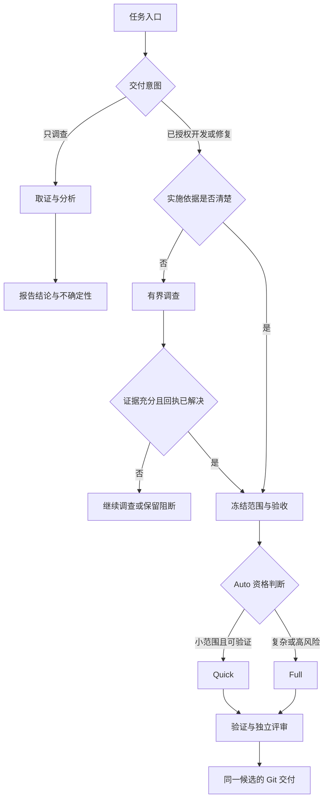

# 订阅优先的模型配置、CLI 插件与开发工作流方案

简体中文 · [English](2026-11-19-subscription-cli-workflows.en.md) · [方案目录](README.md) · [当前架构](../design.md)

**创建：2026-11-19；修订：2026-11-20。状态：Proposed，文档 PR，尚未实现。** 本文规定后续改动的目标、接口、迁移与验收，不改变当前运行代码、发行版本、用户配置或账号设置。文中的新预设、字段、包和命令均为拟议接口；当前版本不能据此直接加载。实现时应同步当前架构、schema、协议和双语用户指南，再分别记录源码、安装包和真实账号验收。

**设计前提：先完成 Antigravity DSH 插件，再交付包含 Gemini 的统一默认配置。** §4–5 结合原分享与 Google 官方模型选择指南，直接规定四家订阅的最终分工和思考等级。

## 1. 已确定的目标与范围

用户已确定以下约束，本方案据此收敛，不再重新选择接入路线：

1. 使用现有 Kimi、ChatGPT、Claude、Google 订阅；停止在这套默认配置中使用 DeepSeek 充值余额或任何额外付费 API。
2. **Antigravity 直接调用官方 `agy` CLI，不使用 ACP。** 先完成独立的 `dsh-subagent-antigravity` 插件，使其能在 DSH Desktop 中使用，再通过公开机器接口接入 Flywheel，交付统一模型配置。
3. Claude 只走个人订阅。保留已有的官方 Agent SDK → 本机原版 Claude Code 路线；SDK 是控制 CLI 的库，不因为“只用 CLI”而重写已有执行器。
4. Kimi 继续使用原生 CLI；Codex 继续使用现有插件控制的官方 Codex CLI/app-server。这里不要求退回文本抓取，也不移除已有会话、恢复和原生能力。
5. 模型、访问渠道、思考等级、权限和会话分别配置。普通任务使用经济的初始组合，困难任务在显式允许集内升级，不默认全部 `max`。
6. 保留 Task、New、Plan、Run 和 Auto／Quick／Full。排障、修复 Issue、复杂开发共用验证与交付规则，避免复制三套状态机。
7. 本轮交付完整方案 PR。创建插件仓库、实现、合并、发布和本机配置迁移属于后续交付阶段。

### 1.1 参考订阅组合与成本口径

这是用户提供的规划条件，不是厂商永久价格或账号额度承诺：Kimi 为已年付的高档订阅（月付标价约 ¥699）；ChatGPT 当前 Pro $200，计划下月降到 $100；Claude Pro $20；Google AI Ultra 5x 约 $99.99。价格、税费、地区和权益以实际账号为准。

Kimi 年付已经支出，不能再把月付标价当成每月新增现金支出；也不能因其已预付就认为没有配额。其他三项按用户报价约为当前 $319.99／月、降档后 $219.99／月，均未含 Kimi 年费摊销。实际年付金额未知，不把综合月成本算成一个精确美元值。优化目标是现有订阅内的交付效率，而不是增加充值、自动购买 credits 或追求用满所有套餐。

## 2. 核验基线与现状差异

### 2.1 源码快照

| 组件 | 本次核验的源码 | 说明 |
| --- | --- | --- |
| Flywheel | [`f016015a`](https://github.com/ckanner/flywheel/tree/f016015a884351d081e066a4031a6814299f25e5)，源码版本 0.37.3 | 当前模板、配置发现、工作流、DSH 控制面 |
| Claude 插件 | [`98818edb`](https://github.com/ckanner/dsh-subagent-claude-code-pro/tree/98818edbee75614718dc445f2abcf15c529fc2cb)，源码版本 0.6.1 | Agent SDK 控制配置的本机 `claude` |
| Codex 插件 | [`69e180ad`](https://github.com/ckanner/dsh-subagent-codex-pro/tree/69e180ad74adff80a270c7f1ca44030ca6f33246)，源码版本 0.10.2 | 官方 CLI/app-server、DSH 工具和公开 machine API |
| Binary 参考 | [`7991fdce`](https://github.com/deadblue22/binary/tree/7991fdce737347d161c1162356f9c75ae4ab640a) | GUI → 官方 Agent SDK → 官方 Claude Code；默认用 SDK 附带二进制，也可指定本机路径 |
| Web Pro 工作 | [Flywheel #57](https://github.com/ckanner/flywheel/pull/57)、[ChatGPT 插件 #9](https://github.com/ckanner/dsh-plugin-chatgpt/pull/9) | 独立未合并候选，不能当作 main 已具备的默认后端 |

源码版本不证明 npm 已发布、Desktop 已安装或账号已验收。#57 的核验 head 为 `30c1edae16bd5bef4648c8937a9ca6075e917e3c`；PR 正文中的历史 SHA 不替代当前 ref。本文从 main 独立提交，不改其实现、vendor、宿主补丁或恢复协议。

### 2.2 已有能力与待做事项

| 事项 | 当前事实 | 本方案的工作 |
| --- | --- | --- |
| 默认执行与 Intake | 仍为 DSH `deepseek-account` / DeepSeek Flash | 从目标预设及所有可达后备中移除 |
| Plan / Review / Judge | Kimi K3.1 Pro / DSH GPT-6.1 Sol / DSH GPT-6 Astra | 按四家订阅的最终阶段表配置，验证实际模型目录 |
| 设计角色 | `design-plan` 继承 Plan；两类规划 Review 继承 Review | 显式覆盖完整角色，保持历史独立 |
| Claude 执行器 | 已支持 Agent SDK 启动本机 CLI | 保留；修订原生登录通道、模型匹配和 doctor |
| Claude UI 预设 | `claude-api` 自动声明 `ANTHROPIC_API_KEY` | 新增清楚的个人订阅入口，避免启动前错误拦截 |
| Kimi 参数 | 已正确使用模型、print 和 stream-json 参数 | 保留，不把已修复参数问题再列为缺陷 |
| Antigravity | main 尚无该 harness / DSH 插件 | 新包、machine API、worker、Go driver、配置与 UI |
| 调查分析 | 宿主提交报告；没有 `loops.investigate` | 增加可配置分析角色，保留现有调查与证据状态机 |
| JEV | 总开关默认关闭，决策后端仍是外部 endpoint/key | 基线关闭；另实现订阅 harness 决策后端 |
| 迁移 | 现有 `subscriptions` 仍复制含 DeepSeek 的模板 | 新增有版本的 `subscription-cli` 迁移语义 |

当前事实依据：[默认模板](../../templates/flywheel.config.example.json)、[模型指南](../zh-CN/model-policy.md)、[调查指南](../zh-CN/investigation.md)、[配置迁移实现](https://github.com/ckanner/flywheel/blob/f016015a884351d081e066a4031a6814299f25e5/internal/config/migrate.go)。

## 3. 只用订阅的完整契约

### 3.1 访问、权益和费用分别记录

“没有 API Key”“OAuth 登录成功”“能选到模型”“调用成功”均不足以证明只消耗月费内额度。目标配置必须分别表示：

- **执行路径**：使用哪个官方 CLI、插件、工作目录及运行时配置。
- **认证路径**：原生个人账号登录；不复制、刷新或代理订阅令牌。
- **模型资格**：账号可访问的模型和支持的参数。
- **计费资格**：该次选择是否可消耗计划包含额度，是否存在额外 credits/充值后备。

实现时新增版本化的订阅策略元数据；以上是待设计进 schema 的概念，不是当前已有配置字段。证据区分 `verified`、`user-declared`、`unknown`，包含来源、时间、CLI/config 指纹；用户声明不能改写为厂商确认。预检不得读取或输出原始密钥、token 或账户隐私。

### 3.2 全部可达调用都要审计

目标预设的准入检查覆盖 loops、routes、具名 profiles、fallback、execution-policy、judge-panel、JEV、原生子 Agent 的模型覆盖和 DSH 主对话。`env-key:null` 不是订阅证明：当前 DeepSeek 账号通道也是 null，但使用充值余额。

订阅模式不自动切 API、云 ADC、第三方网关、充值账号或额外 credits。遇到额度耗尽，可以等待重置，或选择已声明且仍满足订阅策略的其他绑定；不得暗中换账号、模型或费用渠道。模型变化必须可见并生成新绑定快照，不能复用旧 Provider 的会话身份。

DSH 的父 Agent 也会消耗自身模型额度。使用 Antigravity/Claude 子工具不会自动把父 Agent 变成订阅模型。应提供两种明确入口：

1. 现有 DSH ChatGPT 订阅 Provider 驱动普通对话，再调用原生工具；检查 Desktop/SDK 实际 profile 和认证。
2. 用户直接从插件面板或命令启动 CLI 任务，不额外创建 DSH 父模型调用。

保留 DSH 作为宿主和确定性控制面，不因为停用 DeepSeek 付费推理而删除 DSH 集成。

### 3.3 零额外付费的保证边界

CLI 本地配置可确认的冲突应在派发前阻止。账户侧额外用量或已购 credits 若无法由官方接口可靠读取，显示未验证，不伪造“费用为零”。严格自动执行的准入需要有效的账号侧禁止额外消费证据或厂商提供的等价约束；一次成功调用、模型目录或估算美元金额都不能替代该证据。

设置检查和账号配置由用户的原生流程完成；安装器、doctor 和迁移都不自动开关账号收费选项。需要重新登录时返回可操作诊断，不索要凭据内容。证据过期或配置改变后重新检查，不能把一次检查当成永久消费保证。

套餐附赠 credits 与额外购买的 credits 也不能混为一类。仅当官方接口能区分来源并可靠阻止转入付费余额时，才可把附赠用量纳入明确允许项；首版基线关闭额度耗尽后的 credits 后备，不自动消费来源不明的余额。Google 的 `useG1Credits` 是要检查的实际开关之一，见[CLI credits 说明](https://antigravity.google/docs/cli/credits/)。

## 4. 原调研对照、模型能力与证据

### 4.1 原调研是讨论起点，偏离必须说明

用户提供的 [Gemini 分享正文](https://share.gemini.google/lbGhBwv80PEP)已在浏览器中完整读取；本次又核对了 [Google 官方模型选择指南](https://aistudio.google.com/docs/choosing-a-model)。原分享给出跨厂商分工起点，官方指南补充 Gemini 的模型层次和思考等级。以下直接定义插件完成后的最终方案，所有职责选择都给出依据，不宣称已通过同任务实测证明最优。

下表为原文分工的简要转述；右栏是按本次订阅约束的处理，不代表原文或本方案已得到 Flywheel 实测验证。

| 原分享的建议 | 本方案处理及理由 |
| --- | --- |
| 需求发散用 Carbon medium；需求收敛/原型用 Opus high 或 Fable medium | 保留 Gemini 与 Claude 的主角色；明确需求的机械收集可用轻量绑定，不强制每次两轮 |
| RFC/架构以 Carbon high 或 Fable high 起草，Astra high/xhigh 审查 | 恢复 Carbon 为顶层设计主候选；复杂规范可用 Claude。初稿默认 Astra 起草缺少优于此组合的证据 |
| 里程碑由 Fable/Opus high 拆解，Kimi high 可替代 | 保留 Claude 规划主候选；Kimi 的替代依据是年付容量和任务适配假设，不是已证明规划更强 |
| 微型方案用 Hydrogen high 或 Sonnet medium；Sol medium 做前审 | 保留，映射到 Plan/packet 内的职责；不默认增加一条每次必跑的新推理阶段 |
| 商业 UI 用 Opus medium/high；后端用 Sol high 或 Hydrogen high/xhigh；难算法升 Astra | 按任务类型分流；撤回前端一律交给 Kimi 的泛化。Kimi 保留重工具、仓库批量改造及明确指定的前端任务 |
| 常规实施/测试用 DeepSeek 或 Hydrogen，Sol 补边界测试 | 按用户约束移除 DeepSeek；Hydrogen 成为实施与测试主候选，Kimi 作为明确选择的容量分担 |
| 高风险终审用 Astra xhigh 与 Fable high；发布文案用 Sonnet 或 Hydrogen | 保留角色差异，按风险启用第二意见，不让每个小改动固定双审。文案模型不拥有发布授权 |

原文是一次模型生成的调研，包含厂商资料与二手社区材料。它提出的分工可以作为比较基线；其中“某模型一定不适合开放规划”的绝对判断、未经逐项核验的排名/因果解释、API 价格、全系统一上下文及固定速度/配额比例，不直接作为订阅配置事实。也不把 X 上的个别评论改写成社区共识。本轮没有完成对这些排名、帖子样本或工作流组合的对照实测。

### 4.2 可核实的能力与接入事实

| 模型候选 | 目标职责与依据 | 证据边界 |
| --- | --- | --- |
| Gemini 4 Carbon | 顶层架构、跨子系统根因与高风险分析；Google 明确将其定位于架构、协调和对抗验证 | 支持角色适配，不证明比 Claude/Astra 在所有项目都好；[官方说明](https://antigravity.google/blog/gemini-4-carbon-in-google-antigravity) |
| Gemini 4 Hydrogen | 日常代码、微型方案、测试与参考设计驱动的 UI 迭代；官方强调快速执行和交互应用开发 | 实际速度与配额收益须在本任务集验证；[官方说明](https://blog.google/innovation-and-ai/models-and-research/gemini-models/introducing-gemini-4-hydrogen/) |
| Gemini 4 Neon | 高频复杂工程、多文件修改、调试、重构和常规跨模块调查 | 官方将其置于 Hydrogen 与 Carbon 之间，按该任务定位安排明确职责；[模型说明](https://aistudio.google.com/docs/models/gemini-4-neon)、[Antigravity 说明](https://antigravity.google/blog/gemini-4-neon-in-google-antigravity) |
| Gemini 4 Argon | 模型目录中的手动可选项 | 统一默认采用 Hydrogen/Neon/Carbon 三层，不额外增加一个默认阶段来分配 Argon |
| Claude Opus / Sonnet / Fable | 需求收敛、规范统稿、里程碑、商业 UI 与业务完整性审查 | 采用原调研的角色假设；具体模型依账号目录和订阅权益，Fable 条件见 §6，不把 Claude 降为只有第二意见 |
| GPT-6.2 Sol / Astra | Sol 做明确后端实现与日常审查；Astra 做困难推理、架构挑刺和高风险裁决 | 官方定位支持候选资格；不能据此断言应接管所有规划或所有审查；[发布说明](https://learn.chatgpt.com/docs/whats-new/gpt-62-astra-sol) |
| Kimi Code K3.1 Pro | 重工具长任务、明确 Spec 的批量实施、计划容量分担与整理 | 年付和现有集成是容量/工程依据，前端审美与规划优劣仍需比较；年付不等于无限额度 |
| ChatGPT Web Pro | 特别困难的分析/裁决备选 | 依赖 #57/#9 及实际验收；不作为基本目标完成的前提，Pro 模式不等于最高 effort |

[Antigravity 模型目录](https://antigravity.google/docs/models)列出 Ultra 可用的 Carbon、Neon、Argon、Hydrogen；账号实际目录仍以原生 `agy models` 验证。Carbon/Argon 的 effort 不臆造 xhigh/max；Neon/Hydrogen 支持 low/medium/high/xhigh。Neon 在 Antigravity 中的上下文上限为 512K，不能套用底层/API 的 1M 宣传。精确 slug、窗口、附加工具和子模型均按实际 harness 记录。

官方 Orchestrator 已采用 Carbon/Neon/Argon 规划并交给 Hydrogen 实施，这支持“按职责选模型”的设计方向，但其厂商测试不能证明跨厂商 Flywheel 组合的收益。需要独立角色回执时优先固定单模型；原生 Orchestrator 仅作为可选完整任务策略，其内部自审不替代 Flywheel 的独立 Review。

### 4.3 决策依据与未验证事项

每个推荐至少区分：原分享建议、官方能力事实、工程/容量选择和 Flywheel 实测结果。当前拥有前三类，尚无第四类。表中的 effort 是待比较的起点，不是已证明最优档位；同名 effort 也不是跨厂商统一量尺。

模型分工以四家订阅路径均完成为设计前提，实施顺序见 §15。Claude Pro 额度和 Kimi 年付影响任务分配与调用频率；每个阶段仍有一个明确主模型和初始档位，日常使用不需要选择另一套接入状态配置。

GPT-6.2 使用前仍需原生账号目录确认。旧 6.1/6 系列只作为显式兼容候选，不能静默替代。目标使用 Standard；套餐降档后重新核验模型/速度权益，不假设 API 标价能换算订阅配额，也不把 Fast/Ultrafast 当成默认省配额手段。

## 5. 统一默认分工与 Gemini 档位

### 5.1 完整能力目标：保留原建议，再做订阅适配

以下是四家订阅的统一默认分工。Gemini 内部由 Hydrogen 负责日常执行、Neon 负责复杂日常工程、Carbon 负责架构与最难问题；Claude 负责规划和商业 UI，Kimi 负责重工具及批量任务，Codex 负责后端、独立审查与难题。每次派发解析为一个明确模型和 effort，不固定同时调用所有模型。这是实施采用的初始策略，实际任务评估用于后续调优。

| 阶段 / 工作类型 | 目标主选 | 初始 effort | 选择条件或明确替代 |
| --- | --- | --- | --- |
| `intake` 开放需求分析 | Gemini 4 Carbon | medium | 明确字段收集可选 Kimi low；需求收敛/规范统稿可显式选 Claude Opus high |
| `design-plan` 顶层设计 | Gemini 4 Carbon | high | 业务规范密集时显式选 Claude Opus high，或具备订阅资格的 Fable high |
| `design-review` 架构审查 | Codex / GPT-6.2 Astra，独立会话 | high | 高风险问题才升 xhigh |
| `plan` 里程碑与依赖拆解 | Claude Opus 5.5 | high | Kimi high 为明确的容量替代；复杂规划可选具备资格的 Fable high |
| Micro-Spec（Plan/packet 内职责） | Gemini 4 Hydrogen | high | 涉及复杂跨文件约束时用 Neon high；只在细化有必要时使用，不制造每个 packet 必跑的新阶段 |
| `plan-review` | Codex / GPT-6.2 Sol，独立会话 | medium | 重要接口、迁移、并发约束采用 high |
| Execute `default`：常规实施 | Gemini 4 Hydrogen | high | 局部小改动、简单转换用 medium |
| 多文件工程 / 复杂重构（任务类别） | Gemini 4 Neon | high | 多步约束仍无法满足时可升 xhigh；架构级难题交 Carbon high |
| Execute `frontend`：商业 UI | Claude Opus 5.5 | medium | 复杂约束用 high；已有设计系统的局部快速迭代可显式选 Hydrogen medium |
| 后端、算法、数据管道（任务类别） | Codex / GPT-6.2 Sol | high | 困难数学/底层问题进入 hard |
| 重工具 / 批量仓库改造（任务类别） | Kimi K3.1 Pro | high | 以明确 Spec、工具结果和回归验证约束任务范围 |
| Execute `hard` | Codex / GPT-6.2 Astra | high | 有证据的难例 xhigh；max 只作有界选择或评估候选 |
| 常规测试补充 / 缺陷复现（任务职责） | Gemini 4 Hydrogen | medium | Sol high 补异常/并发边界；先使用现有确定性验证，不额外固定启动测试 Agent |
| `review` | Codex / GPT-6.2 Sol | high | 安全/复杂并发风险显式采用 Astra high/xhigh；保持独立历史 |
| `judge`（Full） | Codex / GPT-6.2 Astra | high | 争议复杂时 xhigh；业务完整性第二意见按下方 judge-panel 选择 |
| 调查分析（拟议角色） | Gemini 4 Neon | high | 简单局部问题用 Hydrogen high；跨仓难根因/架构问题用 Carbon high；只分析获准证据 |
| `garden` / 交付文案职责 | Gemini 4 Hydrogen | low | 涉及实质性跨任务推理时用 high；合并、发布权限仍由现有交付规则控制 |
| JEV 决策（拟议后端） | Codex / GPT-6.2 Sol | medium | 总开关默认关闭；后续仅用于有界决策 |
| `judge-panel` | 默认关闭；高风险第二意见主选 Fable 5.2 | high（启用时） | 仅在订阅资格满足时使用；否则显式选 Opus high 并记录替代。只针对明确问题启用一次，不固定双审 |

“微型方案、多文件工程、后端、批量改造、测试、文案”表示任务职责，不宣称当前已经存在同名 loop/route。实施时扩展现有执行路由策略以表达这些类别，并一起更新 schema、配置界面、迁移和测试；在派发前显示任务类别、所选模型和原因，冻结实际绑定。用户可以显式覆盖任务类别；模型不能自行选择隐藏的供应商。这张设计表不能直接贴进当前 schema。

每个任务只指定一个主类别，显式任务绑定优先。自动分类按主要验收目标选择，不只按文件数量：重复且 Spec 明确的批量操作归 Kimi，需要跨文件推理协调的重构归 Neon，核心算法与后端逻辑归 Sol，已判定的困难任务走 hard。类别仍有歧义时由规划阶段收敛；派发后不隐式切换。

不把 `loops.investigate` 当成现有字段。新增调查分析角色的命名、schema、作用域与权限应在实现 PR 中一起落地；此前由已配置订阅模型的宿主提交报告。JEV 新后端同样不是当前默认已具备的功能。正常测试由 Executor 与确定性验证完成；需要补充分析时才创建明确任务。

### 5.2 Gemini 三层选择与思考等级

依据 [Google 选择指南](https://aistudio.google.com/docs/choosing-a-model)，按任务复杂度直接选择模型，不要求每个任务依次经过三档：

| 模型 | 可用 effort | 指南中的默认值 | 本方案采用方式 |
| --- | --- | --- | --- |
| Hydrogen | low / medium / high / xhigh | high | 日常执行 high；局部交互、UI 迭代和常规测试 medium；整理摘要 low |
| Neon | low / medium / high / xhigh | high | 高频复杂工程、多文件重构和常规跨模块排障 high；明确难例才升 xhigh |
| Carbon | low / medium / high | medium | 开放需求探索 medium；顶层架构、跨仓根因和深入验证 high |

档位定义另见 [Hydrogen](https://aistudio.google.com/docs/models/gemini-4-hydrogen)、[Neon](https://aistudio.google.com/docs/models/gemini-4-neon)、[Carbon](https://aistudio.google.com/docs/models/gemini-4-carbon)。Flywheel 显式设定每次调用的 effort，不依赖 CLI 记住的上次选择；Carbon 不配置 xhigh/max，Gemini 4 不配置 minimal。Argon 保留在可选目录，不为它再造一个默认阶段。

采用能通过质量要求的最低档位：局部、交互任务先用 medium，多步工程用 high，Neon/Hydrogen 的 xhigh 只处理有明确收益的难例。任务一开始就已知是架构级问题时直接选 Carbon，不先让其他模型各失败一次。模型和档位带来的耗时、返修及配额变化通过 §16 的真实任务评估调整。

AI Studio 指南描述 API；本方案借鉴模型职责与档位，执行仍走官方 `agy`。不把 API 的 `thinking_level`、`previous_interaction_id`、输出上限、价格、缓存折扣或 Batch/Flex 参数直接移植到 CLI。插件使用原生 model slug、`--effort` 和 conversation ID；实际窗口按 Antigravity 记录，不能把 API 的 1M 宣传当成 CLI 保证。

### 5.3 一套默认配置与任务选择

实现时交付一份完整、可预览的 `subscription-cli` 默认配置，包含 §5.1 的阶段绑定和任务类别选择规则。具体模型 ID 与配置版本在实施中冻结；保存配置只调整用户选择的范围。

Auto/Quick/Full 继续只决定工作流，任务类别和风险决定上述模型选择与升级；不凭流程模式名字暗中改供应商。Quick 省略不需要的阶段并复用有效设计，Full 按现有规则规划、集成和裁决。两者使用同一套模型策略。

Kimi 年付容量用于已明确的批量/重工具任务；Claude Pro 的计划调用复用有效检查点，第二意见按风险启用。额度不足时按已有明确选择和等待规则处理，不自动转付费 API；用户需要调整容量分工时，修改这份配置即可，不增加另一套产品模式。没有真实测量时不承诺固定工作占比或节省比例。

### 5.4 effort、升级与跨模型切换

Kimi 使用其支持的 low/high/max；Codex 和 Claude 以具体模型为准；Antigravity 按模型目录验证，原生 Orchestrator 的固定配置不强塞 effort。不能给所有模型一律显示 max，不能把 `ultra` 写进当前 execution-policy schema，也不能把网页 Pro 模式映射成 xhigh/max。

升级顺序是：补齐缺失证据 → 收紧任务范围 → 解决上下文质量问题 → 在允许集中提高 effort 或换模型。没有跑测试或漏看文件时，先查工具、权限、上下文与流程缺口，不承诺单纯升档即可修复。只有已确认终态/清理的失败才能开始新实验；AUTH、QUOTA、配置错误和结果未知不通过“多想一点”解决。升级保留总尝试/时间/用量预算，最多使用冻结策略允许的切换次数。

## 6. Claude 订阅路径的具体调整

### 6.1 保留执行器，修正通道

当前 [SDK runner](https://github.com/ckanner/dsh-subagent-claude-code-pro/blob/98818edbee75614718dc445f2abcf15c529fc2cb/lib/sdk-run.js) 明确传入 `pathToClaudeCodeExecutable`。保留它及已有 guardian、会话、权限、恢复和多模态契约。SDK 附带程序与本机程序的选择不能静默变化。

新增 `claude-native` 通道，`env-key:null`；以用户原生 CLI 登录为来源。Flywheel UI、profiles 示例和 doctor 同时更新，使订阅选择不再自动生成 API Key 要求。原有显式 API 配置作为其他用户的兼容能力保留，但不能从本订阅预设触达。

官方文档区分第三方收集/代理账号凭据与用户在未修改 Claude Code 中自行登录；本方案采用后者。原生登录不通过插件实现 OAuth，不导出令牌，不自动调用登录流程。参考 [Claude Code 认证与使用说明](https://code.claude.com/docs/en/legal-and-compliance)、[Agent SDK 概览](https://code.claude.com/docs/en/agent-sdk/overview)、[Binary](https://github.com/deadblue22/binary/blob/7991fdce737347d161c1162356f9c75ae4ab640a/README.md)。

### 6.2 认证和计费预检

doctor 与真实执行共用同一 command、cwd、HOME、CLAUDE_CONFIG_DIR 和过滤后的子进程环境。仅 `loggedIn:true` 不够：报告实际可观察的认证来源、配置冲突及订阅状态，未知字段保留未知。敏感环境变量只按明确配置传递，不从父 DSH 会话意外继承；订阅预设拒绝显式 API/cloud/gateway 路径。

原生 settings、模型 fallback、子 Agent 配置也可能改变实际请求，不能只检查环境变量。不要使用绕过原生订阅登录的 `--bare`。用原版 CLI 的账号侧设置关闭额外 usage credits，并核验该状态；不会通过拦截“付费确认弹窗”来实现零额外消费，因为非交互调用不一定出现确认。

### 6.3 Fable 与别名修正

官方公开标准 Pro 允许访问 Fable，但常规费用是 usage credits；11 月 9–16 日的发布优惠临时包含部分周额度。用户认为自己的账户包含 Fable 5.2，这作为账户待核验信息保留，不把用户模型候选删除，也不写成所有 Pro 的永久免费权益。参考 [权益说明](https://support.claude.com/en/articles/15424964-claude-fable-models-on-your-plan)、[发布优惠](https://support.claude.com/en/articles/17506494-claude-fable-5-2-launch-offers)。

现有 `modelMatches` 只识别 sonnet/opus/haiku 别名；应建立经过核验的 alias→canonical ID 解析并冻结目标，避免 `fable` 与原生完整 ID 被误判为不同模型。暂时使用实际目录中的完整 ID，不猜测日期后缀。记录请求、解析后目标和原生回报；原生自行换到其他模型不能冒充原请求成功。

同时检查 `CLAUDE_CODE_EFFORT_LEVEL`、原生 settings 和子 Agent 的 effort 覆盖；原生环境变量可高于启动参数，不能仅凭已传参数声称实际生效。整轮模型证据除初始化外，还应消费实际结果中的 `modelUsage` 等可用观测，暴露中途 fallback；没有观测时保留 unknown，不把启动时模型匹配扩展成整轮保证。

Fable 的非交互调用可能直接使用 credits；这是 [model-config](https://code.claude.com/docs/en/model-config) 明示的情况。`/usage` 或结果里的美元值是计算口径，不证明新增账单；`--max-budget-usd` 也不能冒充“额外扣费零美元”控制。参考 [usage credits 设置](https://support.claude.com/en/articles/12429409-manage-usage-credits-for-paid-claude-plans)、[成本说明](https://code.claude.com/docs/en/costs)。

## 7. Antigravity 的确定接入路线

**先完成官方 `agy` CLI 的 DSH 插件，再把它用于 Flywheel 的 Gemini 阶段；不使用 ACP。** 插件复用官方 CLI 的认证、Agent 执行和原生会话，负责进程管理、结构化事件、任务状态、取消与结果封装。

DSH 面板直接任务、`subagent_antigravity` 工具和 Flywheel machine 调用共用同一 runner。三种入口在插件实施中一起定义，分别验收；DSH 中既可以直接使用 Gemini，也可以由 Agent 委派任务。具体接口见 §8–11。

实现依据是官方 [headless](https://antigravity.google/docs/cli/headless/)与 [CLI 参考](https://antigravity.google/docs/cli/reference/)。原版 CLI 保持官方登录与账号设置；插件不复制或代理 token，不模拟私有后端，不以付费 API 或 credits 回退。这里规定工程集成目标，不声称本提案替代厂商的账号条款或认证权限。

Flywheel 的模型配置直接包含 Carbon、Neon、Hydrogen。插件与 DSH 使用完成后，再交付 Flywheel driver、任务路由和统一默认配置。

## 8. 新 DSH 插件的产品与包结构

### 8.1 单一 runner，三个入口

拟新建仓库 `ckanner/dsh-subagent-antigravity`、npm 包 `dsh-subagent-antigravity`。名称是提案，不表示仓库或 npm 包已创建。

| 入口 | 职责 |
| --- | --- |
| DSH Desktop 插件面板 / 直接命令 | 用户选择工作目录、模型、effort、权限和任务，直接启动 CLI，不隐式调用父模型 |
| `subagent_antigravity` 工具 | 正式接入 DSH Agent/PTC 与 jobs，并在对应 preset 中注册 |
| `dsh-subagent-antigravity/machine` | Flywheel 等确定性调用方的公开 ESM API，不创建 DSH parent Agent |

新包的目标出口为根插件、`./machine`、`./client`，并提供独立 `antigravity-machine` 包装命令。`--capabilities`、`--doctor`、`--json` 是该包装命令的拟议参数，不是声称 `agy` 已有这些参数。

沿用现有插件的 `dsh.bundle.patch`、`cordis.patch.yml`、client/settings 集成、显式 preset 工具注册和 DSH jobs。普通模型选择器选择的是 DSH 父模型；Antigravity 模型选择器位于工具/原生任务设置。不能注册一个传统 LLM provider 再让 DSH 重复执行 `agy` 已拥有的 Agent 工具循环。

DSH 手工入口和 Agent 工具复用同一执行服务。若当前 Desktop 不具备面板动作接口，实施应新增受版本检查的公开插件 action，而不是让按钮暗中请父 Agent 发起工具调用。DSH 内可用的验收包括这个无父模型入口。

手工任务绑定发起它的 Desktop 工作区/用户会话和 invocation ID；查询、取消和恢复核验同一所有权。先检查 DSH jobs 是否支持非 Agent owner；不支持时提供明确版本化的 start/status/cancel/result 插件 action，不伪造 parent Agent。面板直接查看结果和取消，不依赖模型调用工具。Agent 发起的任务继续使用真实 Agent/session owner。

### 8.2 设置与界面

设置包含：官方 `agy` 的 command/绝对路径、默认项目目录、账号路由状态、模型、effort、原生执行权限、超时、允许的 presets、会话策略和订阅策略。保存后仅作用于下一次调用；运行中任务使用冻结快照。

界面展示当前任务名、原生 conversation ID、项目/worktree、请求和观测模型、effort、进度、审批阻塞、取消、最终结果与未知状态。模型设置不散落在多个无关页面；缺少 CLI、未登录、模型不支持、额度耗尽给出明确原因。沿用 DSH 的设置、任务和日志组件，不覆盖内置面板。

后台执行复用 DSH job id 与 `job_output` / `job_kill`。工具返回保持宿主允许的形状，完整机器证据独立保存，不把无限长事件流塞进父对话。正常返回阶段摘要、产物路径和证据引用；原生 CLI 继续负责其自己的上下文压缩。

### 8.3 安装与依赖

目标是一条明确的 npm/DSH bundle 安装流程，包中包含公开入口、类型、runner、guardian、Desktop client 与 bundle patch。发布前用当前宿主实际安装命令验证，再写用户指南；本文不捏造已可执行的安装命令。

官方 CLI 是用户先行安装和登录的前提。插件不私下下载、替换、更新 CLI，不把账号登录放进 postinstall。Flywheel 通过精确版本与公开 machine API 接入，插件本身不依赖 Flywheel，避免依赖环。Node、Desktop/SDK peer 范围按真实版本和能力探测确定，源码版本不能替代兼容测试。

## 9. CLI runner 与机器接口

### 9.1 首版进程模型

首版采用 **一次 invocation、一个 CLI 进程、一个用户 turn**；正常返修用精确 conversation ID 恢复，不要求常驻 CLI 池。这样保留会话连续性，同时减少并发写 stdin、累计计数和清理所有权的复杂度。

使用参数数组、`shell:false` 和明确 `cwd`。优先通过官方 stream-json stdin 发送一条文本 user message，然后关闭 stdin；不将大 prompt 拼接进 shell，不将任意字符串当命令。关闭 stdin 只表示不再输入，本轮仍须等待真实终态。

根据 [CLI 参考](https://antigravity.google/docs/cli/reference/)和版本探测构造模型、effort、schema、会话与 timeout 参数。不要复制 Claude 的控制消息或 Codex app-server 协议。stdout 逐行解析官方事件，stderr 保存脱敏诊断；包装命令的单份 JSON receipt 与事件通道分开，禁止日志混入正式结果。

### 9.2 拟议 machine 契约

公开出口至少包含协议/生命周期版本、能力描述、请求校验、执行和只读恢复。以下是**待实现字段表**，不是当前 schema：

| 请求信息 | 要求 |
| --- | --- |
| identity | protocol、requestId、调用方 run/task/stage/role 标识 |
| input | prompt、明确 cwd、可选结构化输出 schema |
| binding | 原生 model、effort、execution mode、订阅策略、配置指纹 |
| session | `new` 或 `resume` 加精确 ID；不用全局“最近会话” |
| lifecycle | 总 deadline、取消 signal、事件 callback、恢复日志位置 |
| label | 人类可读任务名；与原生标题确认状态分开 |

结果至少分别表示：requested/observed binding、native conversation ID、dispatch 状态、terminal 状态、正文/结构化结果、产物、用量、错误、local cleanup、provider work 状态和只读恢复引用。请求回显不能冒充实际观测；没有原生 effort 证据时 observed effort 为 unknown。配置验收区分已观测一致、已观测冲突和不可观测：协议中可观察且被阶段声明为必须的身份/目录/模型证据不能缺失；不回显的 effort 记录请求和 CLI 接受事实，不因此伪造 effective 值或一律判失败。特定阶段要求更强证据时，应在准入时明确拒绝能力不足的组合。

阶段成功至少要求完整 native terminal、成功状态、配置/身份一致、结构化结果有效及清理符合契约。CLI exit 0 不替代阶段验收；测试、候选、审查和 Git 交付仍由 Flywheel 负责。`WAITING`、`RUNNING`、部分正文、缺失终态和截断不标成功。

### 9.3 模型、权限与输入边界

从实际 `agy models` 和 CLI 能力构建带来源的目录；模型列表不代表剩余额度。按模型暴露 effort，固定配置的原生 Orchestrator 不强塞独立 effort。UI label 与 CLI slug 分开，冲突/不支持明确失败。[模型文档](https://antigravity.google/docs/models)

Headless 不能接收交互式审批控制消息。采用用户预先批准的原生权限配置，不因工具被拒绝而自行扩大权限。分别记录原生 execution mode、工具审批策略和 sandbox 状态；Flywheel 的 full-access 是归一化策略，必须依据已验证能力构造对应组合。`--dangerously-skip-permissions` 只按官方定义表示跳过工具审批，不能由此声称 sandbox 已关闭或任意路径可写。无法精确表达的权限组合在派发前拒绝。无法执行获批动作时返回可观察阻塞/部分执行证据；不修改全局 settings 来临时放权。cwd、plan mode 和提示词都不冒充 OS 隔离。

首版文本 stream 输入不承诺原生图片/PDF 附件。传入可读文件路径与原生多模态附件是不同能力；无法消费的输入在派发前拒绝。图片/截图产物回传只有取得真实 artifact 元数据并通过路径检查后才能宣称支持。

这不等于 CLI 不支持视觉任务。[官方浏览器能力](https://antigravity.google/docs/browser/)包括页面交互、截图、console/network 检查与视觉修复验证；CLI 通过 Chrome DevTools MCP 操作本机浏览器，要求相应 Node/npx、Chrome 144+ 与原生授权。首版应分别验收文本输入、附件传输、浏览器工具和产物回传；选择 Gemini 做前端时需验收实际使用的链路。浏览器子 Agent 默认模型可能是 Gemini Flash，不把主模型选择当成所有子模型的保证，其模型与用量也纳入审计。

## 10. 会话、命名、活性与取消

### 10.1 身份和历史

会话按任务、角色、packet、绑定、执行目录和原生配置作用域隔离。Executor 的正常返修可以复用；Design、子 Plan、Review、Judge 分别拥有身份。Review 不继承 Executor 私有历史，原生 Team/Swarm 自评不能替代独立 Review。

对 Antigravity 保存 CLI 返回的 `conversation_id` 并精确 resume；不使用 `--continue` 猜测最近会话。new 表示新上下文，不承诺“不写原生历史”。无效 ID 不静默新建；同一会话不能并发续跑。切模型、effort、权限或目录需要新绑定/新角色会话，保留原证据。

本地 label 使用可读任务/角色名。原生 `/title` 涉及终端窗口标题，不能假装是会话命名；原生 rename 需按版本与真实 CLI 验证。没有命名 API 时只确认本地显示名，原生标题状态保留未知，不直接改写历史数据库，也不改已有用户标题。

### 10.2 真实活性与超时

启动超时约束启动/握手，不把等待首个正文 token 当作唯一启动成功标准。真实文本、工具、状态事件构成活性证据；没有输出时不伪造 heartbeat。模型安静推理不能仅因短时间无 stdout 被杀掉。

总 deadline 覆盖启动、执行和退出；原生 timeout 与外层监督分别记录。长流分别限制单个 NDJSON 帧、未完成帧缓冲、保留结果和落盘诊断；已消费的进度事件不累加到最终结果容量，不能因事件总量大误杀有效任务。某项限制实际突破时明确记录错误/截断，不能把截断结果标成功。后续是否支持长驻进程和预热由单独能力测试决定，不把会话 resume 当预热。

### 10.3 取消与恢复

只终止本 invocation 拥有的进程组；依次中断、等待有限宽限期、必要时升级终止，并排空管道和确认本地进程消失。禁用按名称全局杀 `agy` 的做法。Desktop 关闭、job kill、Flywheel SIGTERM、父进程死亡均进入同一监督契约。

本地进程已退出不证明共享 daemon、远程任务或原生子工作已经停止。结果分别记录本地清理与 provider work 状态；缺少原生终态时保留 unknown。可能已派发但结果未知的调用禁止自动重放；新建会话、切模型、重启或换 preset 都不能绕过阻断。

只读 recover 读取已持久化 journal/receipt，不启动模型、自动 resume 或再发 prompt。跨进程持久化先记录调用与派发事实，再接收终态；任何无法可靠区分“未发送”和“可能已发送”的窗口按后者处理。不能据本地网络断开推断远端未执行。

## 11. 订阅预检、错误和计量

Antigravity 原生登录使用已有官方凭据。检查生效的 provider、过滤后的子进程环境、ADC 开关、custom endpoint 与 credits 配置；实际选中的 API/ADC/额外消费路径与本模式冲突时不派发，也不改写用户全局配置。仅存在但不会被当前 CLI 使用的 `GEMINI_API_KEY` 等变量可过滤或提示，不能据其存在声称已发生 API 消费。官方认证与配置依据：[Authenticate](https://antigravity.google/docs/install/)、[CLI reference](https://antigravity.google/docs/cli/reference/)。

插件可有详细错误类别，但映射到 Flywheel 时保持现有 wire contract：

| 插件事实 | Flywheel 处理原则 |
| --- | --- |
| 登录失效/未登录 | AUTH；不转 API |
| 已确认额度耗尽 | QUOTA；等待或允许集内其他订阅 |
| 已确认速率限制 | RATE_LIMIT；遵循重试预算与重置提示 |
| 不支持的模型/effort、费用模式冲突、权限配置不满足 | INVALID_REQUEST；修配置，不盲重试 |
| 传输/服务器错误 | 按可证实的 TRANSPORT/SERVER 分类；先判断派发与终态 |
| deadline | TIMEOUT；取消和清理证据独立保存 |
| 未知终态/清理未确认 | 持久化阻断，不靠通用重试消除 |

若需要新全局错误码，在实现 PR 中先更新设计 §6、协议和测试，不能直接在 driver 内私加代码。服务端 403 等模糊响应不得无依据地硬分类成配额耗尽。

用量按可观测输入/输出/思考/缓存 token、耗时与重试记录；缺失保持 unknown。标明 turn/conversation/unknown 统计范围；只有计数来源和生命周期一致时才对累计计数取差值，计数重置或来源不明不猜测。恢复不能重复求和。订阅的计划包含消耗、按标价估算金额和真实额外账单分别表示；`costUSD:null` 不写成 0，token 数不换算为精确套餐剩余额度。

## 12. 开发链路与排障链路

### 12.1 入口与授权

| 入口 | 保留的行为 |
| --- | --- |
| Task | 从任务目标进入；保留已给的范围与实施授权，在原范围内继续 |
| New | 登记 brief，执行真实设计与独立 Design Review，等待精确版本批准 |
| Plan | 仅规划；完成后停下，不因历史实施授权自动开始执行 |
| Run | 继续原任务/原预算/原证据，不绕过 unknown 阻断 |

Auto 决定 Quick/Full 资格；模型只提供边界建议，Go 保持确定性状态所有者。规划批准绑定具体设计版本；复用已有效的批准和检查点，不重复要求用户批准同一范围。新风险或实质范围改变按现有契约处理。

### 12.2 调查是前置阶段

`investigate` 取证、分析、报告后结束；`investigate-and-fix` 在证据充分、原范围已授权、所有调用状态解决后进入 Auto。未知根因不能立即反复修改代码。生产止损、删除、数据修复等动作只有原任务明确授权才执行；方案不从“排障”推导新的外部操作权限。

沿用 preparation 的 read/search/list/command/http 证据与结构化假设，不另建一条与测试/Review脱节的 Issue 状态机。新增分析角色只消费批准的证据、提出可验证假设与下一步候选；Go 决定合法取证并校验证据引用。结构化报告有效不等于根因已经证明。

### 12.3 Quick 与 Full

**Quick**：紧凑设计与 Design Review → Execute → L1 和适用 L2/L3 → 独立 task-final Review → Git 交付。实施阶段正常首次成功是 Execute、Review 两次 Agent 调用；新任务还有前置设计，不宣传整单只需两次模型调用。Plan/Judge 标为 N/A；新风险或验证缺口使 Quick 持久化单向升级 Full，保留累计预算和产物。

**Full**：整体设计与独立审查 → 当前里程碑子计划与 Plan Review → packet Execute/L1/Review → 集成 → L2/L3 → Judge → 交付。已有有效 Plan 检查点可复用，契约变化或证据缺口才重新规划；不能让每个小任务都重复全套设计。

共同规则：确定性验证先于 LLM Review；修复必须含能捕捉原缺陷的适用回归；审查针对同一候选，独立指出问题并回到原 Executor 返修。验证配置缺口先修订并复验，不能用 Judge 的文字结论放行。最终检查实际提交/合并身份，不把 CLI 说“完成”直接等同交付成功。

## 13. JEV、原生能力与调度

### 13.1 JEV 只保留一个总开关

基线 `jev.enabled=false`，不调用当前外部付费决策 endpoint。后续增加与阶段绑定一致的订阅 harness 后端，采用已有完整允许候选集、结构化输出、时间/调用/用量预算与原子采用规则。不能用关闭 JEV 的方式删掉已实现功能，也不恢复影子读取或增加第二套启用开关。

启用后检查决策后端符合订阅策略；若旧配置只剩外部 key endpoint，应在运行前报清楚的配置问题。决策失败使用已有确定性合法动作基线或保留阻断，不悄悄调用付费 API。结果未知的决策请求同样需要生命周期对账。当前 5 秒外部请求 timeout 不能原样当作 CLI 推理截止时间，须按新后端启动/执行契约配置并验证。

### 13.2 原生能力按角色有界使用

DSH Team/PTC/LCU、Kimi Swarm/Tower、Claude/Codex 原生子 Agent 继续沿用已实施的 native-profile 契约。复杂计划可使用原生并行分析；常规小修复优先单 Agent。禁止每个 Flywheel worker 再无限展开原生团队。

当前 scheduler 控制根调用并发，不等于硬限制整个原生 Agent 树。子 Agent、Advisor、压缩或 Tower 用量只有真实 receipt 能归属时才计入，缺少时整树总量保持 unknown；现有 Claude observed guard 和 Kimi 能力不能写成整树硬预算。若某任务要求整树硬上限，而后端不能证明执行该限制，应禁用该任务的相应原生展开或拒绝组合。账号配额通常不是按插件实例独立分配，所有原生模型覆盖、外部工具和费用路径仍纳入订阅审计。原生任务完成、GUI lease 归还、子工作清理与父进程退出分别验证，保留已有 unknown 约束。现状参见[原生能力指南](../zh-CN/native-capabilities.md)。

Antigravity 原生 Orchestrator、Swarm 和 browser 子 Agent 也适用这些边界。它们可以作为明确的原生任务策略，但不能隐去内部模型切换、把内部 verifier 算作 Flywheel 的外部独立审查，或让多个外层 worker 无界展开原生团队。

### 13.3 调度保持可解释

基线保留 `max-parallel=2`、`dispatch=batch`、`prewarm=false`。独立 packet 在隔离 worktree 中并行；冲突范围、集成、评审和最终交付保留依赖屏障。ready-queue 和预热是现有可选能力，不借模型迁移顺手开启，也不声称已经测得提速。

同一个官方 CLI conversation 不并发续跑。CLI 预热必须有实际 ready/无业务派发证明，不能把进程存在、历史恢复或付费探针称为预热。任务较小、Claude Pro 接近额度或某供应商受限时，优先减少并发与重复上下文，而不是增加重试风暴。

## 14. 配置迁移与 UI

### 14.1 新预设，显式迁移

新增版本化 `subscription-cli` 预设及 preview/apply 行为；具体 CLI 参数在实现时纳入 parser/schema/tests。**当前 `config migrate --preset subscriptions` 不是本方案的完成命令**：它仍包含 DeepSeek，还会迁移权限并清空 judge-panel。

迁移应先定位实际生效文件。当前 task → project → global → embedded 只选择第一个完整文件，不跨文件合并；不能写一个只有两行覆盖的任务配置假装继承全局。

预览显示：有效路径、原摘要、新预设版本、全部角色变化、可达付费路径、模型不支持项、保留项及被阻止原因。apply 前核对原摘要并保留可恢复备份；并发改动拒绝覆盖。迁移不扩大权限，不无故清空第二意见、验证、调度和用户自定义渠道。未引用的 API profile 可保留供其他使用方式，但本订阅图不可触达它。

显式 `design-plan/design-review/plan-review`、route fallback、execution-policy、native 子模型和 JEV 都要处理；从 Kimi resident Plan 改到其他 harness 时移除不支持的 `resident-session:true`，用角色 scoped session 表达历史复用。运行中任务保持旧快照，新启动才使用新配置；未解决调用先对账。

### 14.2 配置界面

Provider/模型选项从独立能力目录生成，不再依赖“当前哪个阶段恰好绑定它”来显示供应商。否则删除 DeepSeek 默认或改 Review 会意外影响资源选择器。

每阶段显示 harness、实际 Provider（适用时）、channel、model、effort、配置来源和订阅检查结果；继承行与显式覆盖清楚区分。新建或修改只改变当前选择范围。Claude 用“本机订阅登录”入口；Antigravity 用“官方 CLI”入口，不出现 ACP 选项。

界面只维护这一套阶段和任务类别配置，显示实际选中的模型与档位。CLI 缺失、登录失效、模型不支持、额度耗尽和取消未确认沿用普通运行诊断；不为它们复制配置页面或静默改成其他供应商。

检查环境和调用模型分别操作：无推理 doctor 不消耗模型 token，不能证明任务质量或可用余额；真实冒烟是明确独立操作，记录模型与消耗事实。默认不在安装、打开设置或枚举模型时偷偷发送推理请求。

## 15. 实施拆分与文档归属

| 阶段 | 仓库 / 范围 | 完成条件 |
| --- | --- | --- |
| P0 | 本 Flywheel 文档 PR | 中英方案、索引、来源与自审；不改运行行为 |
| P1 | 新 Antigravity 插件 | CLI runner、公开 machine、guardian、只读 recovery、目录/模型/权限/计费检查及独立包测试 |
| P2 | 新插件 Desktop 集成 | 原生任务面板、直接启动、DSH 工具/PTC/jobs、版本检查、安装包和宿主验收；Gemini 在 DSH 内可用 |
| P3 | Claude 插件 + Flywheel | 原生订阅 channel、Fable ID/alias、同环境 doctor、无付费回退；公开 API 保持兼容 |
| P4 | Flywheel 集成 | Go driver、Node bridge、schema/协议、任务类别路由、四家统一默认配置、迁移和 UI |
| P5 | 调查分析与 JEV | 可配订阅分析角色、JEV 订阅后端、唯一总开关和合法动作基线 |
| P6 | 实际评估与发布 | 真实 Mac/账号任务、对比基线、候选 tarball 安装、CI、精确发布与最后显式迁移 |

交付顺序为 P1 → P2 → P4：先把插件做好并在 DSH 中使用，再接入 Flywheel 和统一配置。P3 的 Claude 修正可以与插件开发并行，随 P4 一起完成订阅路径；P5 的调查分析和 JEV 在同一目标内实施。P6 验收整个方案后发布并迁移。#57/#9 维持独立实现与验收，当前方案不以它们合并为基本可用前提。

实施时更新 owning docs：`docs/design.md` 对应执行、错误、模型、用量、权限、配置章节；`templates` schema；DSH `PROTOCOL.md`；成对 configuration/model-policy/Claude/native/recovery/workflow/investigation/JEV 指南；新插件 README 中英文、machine 文档、安装与发布流程。只有真正实现的行为进入 CHANGELOG；日期方案不替代当前使用指南。

不修改无关 LCU/preset/ChatGPT 代码。若新工具需要 preset 显式注册，仅对 `dsh-preset-generator` 提最小兼容变更并独立验收；不把完整兼容测试简化为版本字符串替换。

## 16. 验收与评估矩阵

| 层次 | 必须验证的行为 | 不能由此宣称 |
| --- | --- | --- |
| 文档 | 链接/锚点、代码围栏、语言一致、现状与提案区分、最终 diff | 已实现或已发布 |
| 模型策略 | 原分享与官方指南依据、四家职责、Hydrogen/Neon/Carbon 分层、明确档位和任务路由 | 已证明优于原建议或厂商间固定排名 |
| 离线协议 | init/事件/result、半截 JSON、重复/缺失终态、错误配置、soft denial、schema、长流 | 账号可用、模型质量或实际账单 |
| 会话 | 精确 resume、两个并行任务不串线、无效 ID、绑定变化、恢复不重放 | 原生历史必定不持久化 |
| 生命周期 | 取消、外层 timeout、CLI timeout、父死亡、进程组、后代残留、未知 provider work | 本地退出等同远端完成 |
| 订阅策略 | 所有可达付费路径被排除、无 API/credits 自动回退、配置漂移、unknown 处理 | 仅凭 OAuth/目录就保证零额外支出 |
| 安装包 | 真实 tarball 的公开出口/类型/client/patch/guardian，源码目录外安装 | 包名/源码版本等同 npm 发行 |
| DSH Desktop | 无父模型直接调用、工具注册与 preset 切换、PTC、jobs、设置、取消 | 离线 host fixture 等同用户 Mac |
| Flywheel | Go→真实 Node→fake CLI；全部角色、worktree、Quick/Full/调查、迁移、JEV开关 | 纯参数测试等同端到端交付 |
| 真实账号 | 订阅认证、计费设置、模型/effort、一次正常任务、返修、取消、额度边界 | 一次成功等同长期配额保证 |

未来 Go 改动执行仓库 quality-gate（现有每函数 100% statement coverage 要求保持）；DSH/插件运行构建、离线宿主、跨进程和安装候选检查。测试断言可观察结果与失败边界，不为纯文档 PR运行无关完整工程套件。

模型评估固定真实任务、验收 oracle、代码基线、权限、上下文和工作区，比较首轮通过、包含返修的总耗时、遗漏/误报、人工介入、额度和已知/未知用量。样本包含：小 Issue、前端状态、跨模块故障、回归测试、并发/数据一致性审查和复杂计划。比较 medium/high/xhigh/max 的实际收益，不把单次 benchmark 或社区好评写成默认最优依据。

评估这份统一默认配置，并对 Carbon/Neon、Hydrogen/Kimi/Sol 和 medium/high/xhigh 做针对性替换比较。不同 CLI/原生编排路径分别记录，不能把纯模型或原生 Orchestrator 的成绩移植成 Flywheel 全链路结论。重点回答哪些任务需要升级、哪些 effort 能减少返修，以及各订阅的实际容量分配；本轮尚未进行这组实验。评估只调整同一套模型策略，不增加额外产品模式。

## 17. 实施验收确认项

- 各账号实际模型目录、套餐降档后的权益及额外消费设置；Fable 5.2 的具体账户计费资格。
- 官方 `agy` 的最低支持版本、机器可读目录/认证能力、原生标题与关闭后任务状态；只按验证过的行为承诺。
- DSH 当前 Desktop 的面板直接 action、PTC/jobs 和插件 peer 能力；父模型不得被隐式触发。
- DSH 中的 Gemini 直接任务与工具委派、Flywheel 中的 Carbon/Neon/Hydrogen 角色调用和独立审查闭环。
- ChatGPT Web Pro 的独立宿主、插件、页面及真实账号验收；继续由 #57/#9 负责。

这些事项纳入对应实施阶段并记录实际证据。最终交付为插件、DSH 使用、Flywheel 集成和同一份订阅配置的完整闭环；本轮文档不冒充已完成的软件或账号验收。
