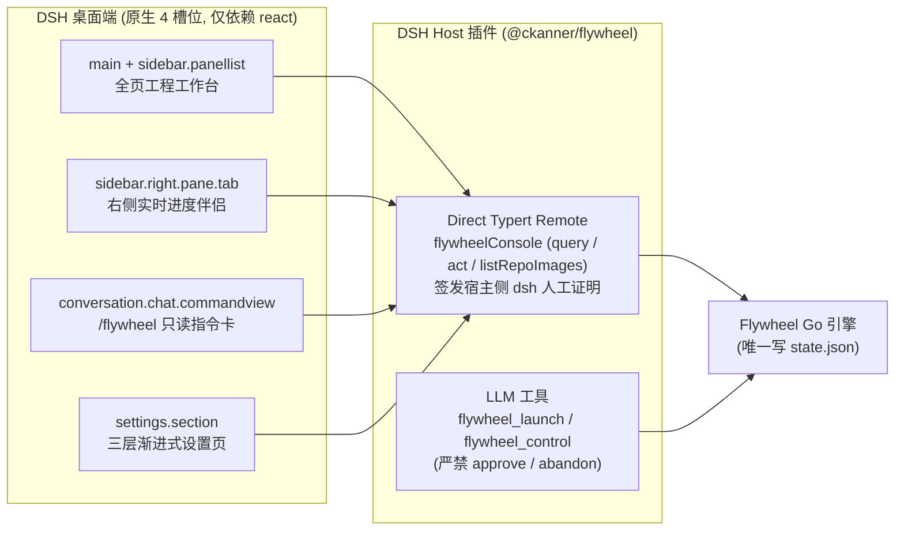

# 流程控制台

[文档首页](../README.zh-CN.md) · [English](../en/flow-console.md) · 简体中文

DSH Flywheel v2 插件采用零债务原生 4 槽位架构，通过 Direct Typert Remote（`flywheelConsole`：
`query`、`act`、`listRepoImages`）直连 Go 引擎，已彻底移除旧版 `conversation.view`、
`:has([data-composer-seat])` 布局 hack 及经由聊天框透传 `/flywheel {...}` JSON 的机制。
CLI、内置引擎和 DSH 插件应保持同一版本。安装步骤见[快速开始](getting-started.md)。

## 原生 4 槽位工程工作台（v2）



| DSH 槽位 | 承载视图 | 核心能力 |
| --- | --- | --- |
| `main` + `sidebar.panellist` | 全页工程工作台 | 可折叠 240px 任务栏、52px 单行顶栏与生命周期主按钮（Primary CTA）、**双模型设计评审室**（`统稿方案 \| 双稿并排对比 \| 原始独立草稿`、Markdown 来源对照表、Astra 独立审查与悬浮拍板条）、**波次泳道（默认）+ 交互式 DAG 画布**（全量节点无 6 节点分页、244×96 语义卡片、贝塞尔流动连线、悬停血缘高亮、缩放平移与缩略图）、**520px 四标签节点详情抽屉**（概览 / 证据与 UX / 时间线与协作 / 契约）、**30 秒建单弹窗**（三意图卡片、可视化图片选择、一句话只读调查）、**根因调查板**与**交付追踪页** |
| `sidebar.right.pane.tab` | 右侧边栏实时进度 | 当前运行任务进度条、活跃节点预览、一键跳转工作台与停止控制 |
| `conversation.chat.commandview` | `/flywheel` 指令卡 | 对话内只读控制摘要卡片，一键跳转主工作台 |
| `settings.section` | 三层渐进式设置页 | 配置优先级栏（任务 > 项目 > 全局 > 默认）、4 订阅健康条与无推理自检、Tier 1 预设与运行护栏、Tier 2 带只读锁定徽章的角色路由表、Tier 3 可折叠美元预算开关与原始 JSON 预览 |

人类专属操作（`planning.approve` 与 `session.abandon`）由宿主 `flywheelConsole.act`
直接签发宿主侧 `dsh` 人工证明；模型工具（`flywheel_launch` / `flywheel_control`）始终严禁调用。

## 找到任务，不必填写路径

视图自动跟随当前会话，不要求填写路径。关联多个任务时显示“本会话任务”导航；只有一个任务时直接展示画布。当前会话的显式工具关联优先；没有投影时，打开精确匹配会话 ID 的最新运行。其他会话与无归属记录不显示。索引仅提供身份，进度以 Go 状态为准；未确认操作仍锁定原目标。


列表使用保留的会话关联和最近运行索引，不扫描本机目录，也不是无限历史归档。同一任务的多次运行合并为一个导航项。点击任务会只读它的真实状态，不启动或停止任务；普通刷新不会抢回手动选择，新的明确任务关联仍会自动跟随。其他任务的标签是“最近记录”，并不表示此刻仍在运行；仅有准备记录时显示“点击读取状态”。读取失败保留错误与选中身份，不展示上一任务的画布。

操作或读取尚未完成、任务结果未知或配置保存未确认时，暂时禁用任务切换。已确认的准备任务无需先启动，也可从本会话历史重新打开。设置页不显示任务切换控件，原有草稿保护继续生效。“记录”仍是当前选中任务的运行历史，不是整个 Session 的所有运行。

项目工作区、任务记录、实际执行目录和分支有值后直接显示。准备中任务或独立终端任务需要在目标会话通过 `flywheel_control status` 显式关联。旧版 UI 自动生成的 status 命令记录不能建立新的关联。

### 在当前会话创建另一个任务

已有任务时，点击 **创建另一个任务**，即可在原流程旁展开目标表单。展开表单不会发起模型请求，当前任务仍保持选中。尚未关联任务时也使用同一表单。可以选择工程任务、修复问题或只生成报告的排查；工程与修复默认采用 Auto，并在独立方案审查通过后等待人工批准。审查后继续实施需要单独明确授权。

入口会等待当前会话的项目目录确认，不能用已选任务的 Worktree 代替。读取失败时显示原因及 **重试**。打开草稿时固定本次目录，并显示实际任务记录位置；后续后台刷新不会改目录或清空草稿。成功创建或明确放弃后，下一份草稿才重新选择当前会话目录。

提交后，由现有引擎入口在独立目录创建任务。只有 Go 确认新任务状态或调查记录后，视图才切换过去。创建回执丢失时保留原请求目标与草稿，状态核对不会重放创建。如果核对发现目录仍为空，继续选中旧任务，明确重试仍使用同一个新目标。控制请求在途、变更结果未知或配置保存未确认时，新建入口以及活动请求的收起、放弃操作均被锁定。

**收起并保留草稿** 会保留本会话的文本及本次授权选择；**放弃新任务草稿** 会同时清除两者。其他会话不继承这些内容。创建成功后旧草稿退役，下一个新任务重新默认等待方案批准。重新打开保留的草稿后，需要再次检查图片预览。

### 任务位置与会话命令

DSH Session 的原始项目目录保留为原仓库，运行时通过公开接口切换当前执行目录。桌面 Host 定期把 Flywheel SDK 会话登记到已有的匹配项目；读取实际任务状态时也会确保原项目已登记。不会把每个 packet Worktree 创建成新的桌面工作区，不修改旧 Session 的历史头部；旧会话只能按其真实目录归属。探测会话写入临时存储，退出后清理，不再污染用户会话列表。原生 Provider 在项目目录开会话，任务提示词明确列出实际执行目录；每次 shell／文件操作必须显式使用它。当前后端不能分离 `workspace-write` 沙箱根时，在派发前明确拒绝该组合，不自动扩大权限；完全权限及支持的只读模式保持其真实含义。

Skill 已加载不代表引擎已经启动。`flywheel-task` 登记薄 brief，调用 planning prepare 进入设计、独立审查和已授权实施；调查目标继续用有界调查控制。已有完整契约任务保留 launch/start。只准备材料或方案时，助手应明确说明尚未开始执行。单阶段技能执行后通过 `flywheel_control status` 关联当前画布；没有该工具时明确给出路径，不能声称已关联。

| 对话入口 | 引擎是否启动 | UI 如何找到任务 |
|---|---|---|
| `/flywheel-new <需求>` | 启动设计与独立审查；实施停在人工批准前 | planning 工具关联确切任务，显示设计阶段 |
| `/flywheel-run <任务目录>` | 启动或恢复已有任务 | 使用原任务路径启动并查询状态，关联当前会话；画布自动跟随显式关联 |
| `/flywheel-task <需求>` | 启动规划，按原授权继续 | 调查用 investigation；新实现用 planning prepare，随后查询原任务状态 |

`new → run` 与 `task` 使用同一个引擎，画布不专属于某个 Skill。仅写任务文件不会
登记视图；关联查询失败也不能改用 launch 来“补出”画布。工具不可用时报告关联未确认；
无会话 ID 的独立终端任务需要在目标会话显式关联。

画布可见时，每五秒刷新已登记任务；已观察为运行中的任务每两秒刷新状态，失败后
延长到十秒。页面隐藏时跳过这些请求。刷新使用只读 Remote，不执行对话命令，也不新增聊天事件或 JSON。显式修改与未知结果核对仍保留持久命令回执；既有聊天历史保持原样。会话身份与读取请求使用严格 Remote codec；读取不可用或格式不合法时保留可见错误，不回退到对话命令。

任务标题与 DSH 会话名分开显示：标题来自有效 Spec 的 `title`；没有标题时显示“当前关联任务”，任务标识单独标为“任务 ID”。项目目录、任务记录与分支在顶部自动显示，执行 Worktree 在节点详情中显示。设置页隐藏任务标题，五个栏目在左侧连续排列；表单与操作使用统一边距，保存栏避开 DSH 输入区域。

导航使用紧凑圆角悬停区域和独立的选中下划线；悬停或选中不会撑高控件，键盘焦点保持可见，触控使用更大的点击区域。

## 模型选择与实际协作

节点配置分别展示**本次运行初始配置**、**下一次执行已选配置**和**最近登记的调用**。
切换模型时，在下一次调用启动前保存所选模型、思考等级、权限、会话策略和原生选项。
修改设置不会重写这些事实。旧记录没有完整快照时仍显示未知；展示过大而省略的内容
会明确标注，完整任务账本保持不变。

模型决策卡还直接展示**对应执行的状态**：已选择尚未派发、确认未启动、已启动但结果
待确认、完成、失败、取消或未知。新调用在准确 packet、尝试和冻结绑定匹配后明确
关联决策编号；后来调用替换当前 session 时，卡片仍保留原调用编号和已确认结果。
持久化的原生接受事件可以在终态回执到达前证明调用已经启动；完成必须有确认的终态
回执与收尾证据。旧决策缺少关联时保持未知。这里表示模型调用结果，packet 验收与
实际 Swarm 子成员各自保留独立结果。

Antigravity 的已选配置会直接显示已记录的 **native**、**subagents** 或 **Swarm**
请求方式，不能仅凭 profile 名称推测。请求某种方式不证明子智能体已经执行：已审分工
及写入范围，与匹配实际 invocation 的观察分开展示。读取观察时区分请求中、读取失败、
成功查询但无匹配记录；这些状态都不能证明未观察到的子智能体已经完成。

### 检查当前 packet 的执行资格

打开 packet 节点，点击“检查执行资格”。Go 读取确切 packet，并使用与实际派发相同的
输入和原生协作检查评估执行候选。每项候选展示模型、思考等级、渠道、native profile，
以及各条件通过或失败的原因。界面同时说明检查依据是本次运行已冻结的配置，还是当前
生效配置。读取报告不调用模型，也不证明当前账号具有该模型的调用资格。

Antigravity Swarm 的报告会具体指出执行深度不是 Full、尚未声明独立分工、写入范围
不合法，或原图输入与所选传输通道不兼容。没有图片的普通代码 packet 可以使用
Antigravity；Full 且有已审独立分工的 packet 也可以不带图片使用 Swarm。仓库中存在
PNG、图标等资源不会自动声明模型图片输入。明确要求看原图的 packet 必须使用已验证的
图片通道，不能通过删除图片声明来满足输入要求。

请求中、读取失败、契约身份未知，以及已确认报告中没有候选分别显示。任务 revision
变化后，旧检查会标为过期；保存配置或修改规划也会清除旧节点检查，避免把先前的可用
结果当成新决策。更新后需要再次读取节点。执行资格不表示模型已经被选择、派发或完成。

### 编辑分工草案并审查新计划

“编辑分工草案”在已审分工旁读取绑定版本的快照。表单支持 **2–8** 个子任务，每项填写
目标和逐行写入范围；目标最多 512 个 Unicode 字符，每项允许 1–64 条写入范围，完整
编辑内容不超过 32 KiB。父任务
已批准的 `schedule.writes` 始终可见。Go 校验子路径规范、位于父范围内，且不与其他
子任务重叠；表单不会扩大父任务的范围。

“保存草案并重新审查”把打开草案时的 state revision、契约指纹和准确的计划
revision/digest 连同分工提交。引擎生成新的不可变计划版本并请求独立计划审查；这个
操作不启动实施，也不就地修改正在生效的契约。原计划的审查不适用于新版本。只有设计
和已批准范围不变时，原根方案批准才能继续使用；目标或范围变化应提交“方案反馈”。
新计划通过审查并满足正常激活条件后，才能用于执行。

任务正在运行、调用结果未解开、人工接管中、契约已过期或规划阶段不可编辑时，表单会
禁用保存并说明原因。分工没有变化时也不会再次启动审查。读取失败、编辑被拒或保存结果
未知会保留本地文字；关闭节点、切换页签或任务，以及重新打开视图，也会在同一个仍被
宿主保留的会话绑定中保留草案和待核对请求。重新加载插件或重建宿主会话绑定会使用新的
内存缓存。“刷新版本并保留草案”只在契约指纹、准确计划、父范围和原分工均不变时，更新
已保存审计记录带来的新 revision。“重新读取并替换草案”明确用新快照替换未保存的修改。保存结果
未知时，用“刷新任务并核对结果”读取这一请求的准确回执，表单不会重复提交写操作。
已确认未派发的失败允许继续修正草案，无须核对一个不存在的回执。排队回执在真正采用前
仍是未确认。已审分工与实际观察到的原生子智能体继续分别展示。


### 编辑已有 packet 的图片输入

打开 packet 或 Execute 节点，点击“编辑图片输入”。当前计划的路径、MIME 和 SHA-256
引用，与实际 invocation 的图片 manifest 分开展示；读取声明不会加载原图，也不把
待审计划当成已激活的契约。
读取失败的声明保留“尚未确认”状态和原因，不显示成无图；没有计划的旧 packet
只显示“已读取的图片声明”并保持只读。

填写、替换或移除仓库相对图片路径，再明确点击“检查并预览图片草案”。预览显示原始
格式、尺寸、字节数和摘要，路径变动会使它失效。最后一张图通过“明确清空全部图片
声明”及单独确认移除，确认内容为此步骤已不再需要这些原图。字段为空不会静默删除
声明，也不会绕过执行通道的原图要求。

“保存图片草案并重新审查”提交准确的 state revision、packet 指纹和计划引用。Go
重新核验原始字节，记录新的不可变计划并请求独立审查；正常激活前保留原活动契约，
保存本身不授予实施启动权限。已审修订激活后，再读取 packet 的执行资格；原图执行
仍需使用支持图片的 Claude SDK 通道。

在同一仍存活的会话绑定内切换页面，会保留路径、引用摘要和未决请求编号。预览只在
已挂载的编辑器中保留，重新打开后需要明确读取；被拒草案可在契约、计划和原引用
都未变化时刷新审计 revision。未知或排队结果只核对准确 action 和请求编号，不重复
提交写操作。完整操作和恢复行为见[图片输入](image-inputs.md#在已有-packet-中编辑图片)。

## 在同一视图讨论和批准方案

planning v1 任务先显示“方案与审查”，实施激活后再展示执行画布。可以读取当前正文、
完整 revision/digest、需求、设计决定与独立审查 findings，并展开上一版本对照。
已批准根方案与当前子计划分别显示，包含各自审查、契约文件和激活状态。
快照未包含的历史正文会明确提示，不编造内容，也不当作没有证据。

“批准此版本”仅记录批准；“批准此版本并开始”在同一次用户动作里增加实施授权。
仅批准之后，按钮变为“开始已批准方案”。请求绑定看到的 state revision 与设计摘要；
过期、未审查、输入已变、激活未完成或仍在运行时不能批准。刷新或重新打开不会批准
或启动。普通“继续流程”也保留审批与启动的独立边界。

提交反馈会保留方案引用。请求回执区分排队、应用和未采用；只有真正采用的反馈才进入
已应用列表。“运行 Plan”可选择整体设计、重新规划、里程碑或 packet，使用任务中的
真实 scope ID。显式 Plan 只做规划/审查，完成后停下。详见
[方案设计与审查](reviewed-planning.md)。

规划角色出现 `blocked` 的未知调用时，面板显示“未解开的规划调用”、准确
invocation 和原因，并提供退役表单：必须填写原因并勾选“不应用结果、不重放、
不复用旧线程”。这是真实用户命令，需重新读取状态后才能提交；模型工具不暴露
该动作。退役只结束这次副作用范围，之后仍需显式“运行 Plan”生成新版本。
“核对”只刷新插件自己的未确认控制动作，不能把引擎 session 的 unknown 变成
已知，也不能替代退役。


## 本次阶段与完整流程

默认展示任务全貌，让后续步骤可见。`run.kind` 与 `control.kind` 一致时，工具栏同时说明单阶段结果与整体交付状态；切换“本次运行”显示紧凑的结果列表。仅 Review 的结果包含 **L1 → Review**，可点击查看结论和评分；通过不代表整个任务完成。

“继续整个流程”在适用时直接显示；新任务启动选项只在尚无引擎状态时显示。阶段通过不会自动启动后续阶段或标记整个任务完成。失败、取消和结果未知不会沿用旧绿色裁决。Run ID、HEAD 和配置摘要在节点详情的“运行记录与文件位置”直接显示。

## 实施前的调查

任务只有准备记录时显示调查面板，包含预算、观察、片段、动作实际结果、分析/决策回执
及报告。Run 提交观测 revision，pending 调用只核对原回执。控制结果未知先查状态，
停止等待运行者收束，不能把缺失回执变成确认取消。

取证后由 `loops.investigate` 分析冻结证据；`awaiting-report` 的“生成调查报告”继续
该阶段，`analysis-pending` 核对原调用。旧配置没有分析角色时保留手工报告。报告不代表
代码完成；已授权且有支持结论的修复，在同任务登记薄 brief，将证据、范围和用量带入规划。

报告已 settled、所有调用及清理均结算后，可补充证据并继续下一轮。完整契约草稿带剩余
额度，填写真实新增 known-evidence，动作仍在原 goal/intent/修复范围内。提交绑定打开
草稿时的 revision；刷新发现新版本会禁用过期提交，非法 JSON 不发请求。旧轮次及不可变
digest 继续展示，不新建任务、重置预算或暗中重试。见[有界调查](investigation.md)。

## 配置

在已进入对话视图的 DSH 会话中，Flywheel 排在“统计”之后；新会话的空白首页尚未显示这排会话视图。主导航为“流程”“记录”，“设置”独立进入。全局配置可在没有任务目录时编辑；项目配置写入所选 Git 项目根。任务配置仍具有最高优先级，取首个完整文件，不做字段深度合并。

打开“设置”后自动读取所选范围。分类为运行方式、模型与会话、预算与重试、JEV、诊断与配置文件；保存、撤销和恢复默认固定在底部，没有修改时禁用保存。保存一次点击，包括 JEV 唯一总开关；表单直接说明支持的决策能力与配置的数据范围。串行模式不显示并发数量；超时以分钟或秒编辑，并精确换算成引擎毫秒字段。

重新读取、完整 JSON 编辑和环境检查位于“诊断与配置文件”。设置导航与内容分别约束高度，窄窗口导航 54px、按钮 36px（触控指针为 44px），内容变短也不会拉伸。离开设置、切换范围或重新读取会先提示未保存草稿；重置先载入默认配置草稿，保存时才替换文件。阶段模型在设置页内直接编辑，与其他配置共享一份草稿。返回模型列表不会丢弃修改；只需在底部点击一次“保存修改”。“撤销”放弃当前作用域的全部未保存修改。保存失败保留草稿，结果未知时先重新读取核对。Go 核对文件 revision、备份旧文件并原子写入。实现运行保留原配置快照，新模型配置在后续启动时加载；JEV 另在决策边界重核当前启用值和更严格权限，见 [JEV 恢复规则](jev.md#数据预算与恢复)。配置页显示真实文件与来源：文件按任务 → 项目 → 全局 → 安装默认选择，不逐字段叠加；尚未存在的配置文件以安装模板创建。

切到“对话”或其他会话，再返回仍被宿主保留的同一视图时，会恢复“流程”“记录”或
“设置”的位置、设置栏目和未保存草稿。草稿只保存在该视图的内存中；重新加载插件
或由宿主重建会话视图后，即使 Session ID 相同也从新状态开始，需要保留的修改应
先保存。

隐藏视图不会取消进行中的配置读取或保存。返回后显示实际结果：已确认的保存成为
当前配置，结果未知的保存仍需核对。已明确确认的范围切换或重新读取继续加载所选
文件，不恢复已经放弃的草稿；文件 revision 冲突仍阻止过期保存。

严格订阅配置提供 Antigravity、Claude Code Pro、Codex Pro 与 Kimi native 资源。
无该策略的旧配置仍可选择 DSH ChatGPT/DeepSeek。Gemini 模型后缀与 effort 同步，
选择 Kimi 仅在缺少时补最小 native profile。紧凑准备有独立的两个 profile 选择器，
订阅 JEV 使用 profile 而非 HTTP endpoint/key 表单。所有修改共用同一草稿、revision
和保存边界；选择资源不代登录或改变账号。

高级 JSON 草稿中的非对象 native profile（例如 `null`）会禁用保存，并保留原值供修正。切回模型表单
不会因此崩溃，也不会静默替换草稿中的无效内容。

`permissions.bindings` 可以覆盖 `loops.<role>`、`routes.<route>` 和 `judge-panel`；未覆盖项使用全局策略。会话策略按角色覆盖：执行 routes 共用 execute 的策略，各 packet 的历史仍隔离。scoped 只续接相同任务、角色、目标和绑定下可恢复的历史；fresh 也保留调用安全账本。

[JEV 决策](jev.md) 只有一个默认关闭的总开关，开启后自动参与已支持的调查、首轮执行与失败后决策，包括批准的执行模型选择。
配置检查只读展示配置状态，不再提供第二个开关。调查视图展示最近观察到的 JEV
状态、已采用／基线动作，以及引用证据的跳过或提前报告记录；历史状态标签不冒充
实时读取配置。这些取证效果不代表根因已被证明或代码已经完成。

### 开关与调度策略

JEV 使用唯一总开关；“运行方式”中，自动管理任务 Worktree 和提前准备 DSH 评审
运行环境各有独立开关。每个开关都有对应标签、可见的开启／关闭文字，以及原生
checkbox 的键盘行为。切换先修改草稿，点击“保存修改”后才写入所选范围；不再有
第二个 JEV 确认或逐任务启用入口。

并行派发仍是两项策略选择：“整批处理”等当前批次完成，“就绪队列”在 Execute／L1
空位出现时补入另一个满足条件的独立任务。表单保留所选策略，并解释尚未满足的配置
条件；不会声称未来任务一定是 Full 或已有独立工作。就绪队列要求 Full、并行、
并发上限大于 1 且自动管理 Worktree。提前准备独立于 JEV，只初始化支持的 DSH
Review SDK，正式准入前不创建 Session、不发送模型 prompt。默认仍为整批处理、
预热关闭，详见[调度与 Worktree](configuration.md#调度与-worktree)。

自动管理 Worktree 表示引擎管理任务目录；关闭不会删除已有目录，也不禁止外部
管理的 Worktree。JEV 数据边界及关闭对当前任务的影响放在字段旁说明。关闭 JEV 或切为串行
会放弃因此隐藏的无效输入草稿，保留最后有效值；其他分组的错误仍须修正。高级
JSON 中检测到的非法字段保留在原编辑器中，需要修正后才能保存；完整配置仍由
Go 最终校验。合法连接、
Provider 并发额度、显式空数据许可、角色策略和预算不会随无关开关一起重置。
草稿、过期 revision 和保存结果未知继续受原有保护。

### 会话默认与阶段覆盖

运行方式设置默认 fresh/scoped；模型与会话表允许各角色继承或独立覆盖。Execute 路由共用角色策略，每个子任务仍有独立会话。Kimi Plan 的旧历史开关在显式选择时同步，继承时保留原值。节点显示真实 Session ID、动作与原因，不用配置值推测是否实际续接。

### 可选用量预算

预算分关闭、仅提醒、达到后停止三档。关闭后不显示 Token 门限，继续记录用量；仅提醒不会因此停机，严格预算在达到额度或用量无法确认时阻止新调用。额度按单个任务、UTC 日期统计，留空不设限。运行保护独立设置超时与传输重试，Provider 自身额度不受该开关改变。界面展示实际配置，不自动把既有 soft 改为 off。

## 横向画布与节点操作

主线从左到右展示 Plan／拆分、调度、任务分支、汇总与终验、PR 与 Merge。点击节点打开视图内详情，结果、处理按钮、配置快照和角色会话直接显示，不挤到画布下方。原始证据与人工会话交互各有明确入口。点击“查看任务流程”进入 Execute、L1、Review、Git 交付子图；汇总可进入阶段流程，PR 与 Merge 分开显示。状态配合颜色和文字，运行与节点详情使用真实项目／worktree、分支、HEAD、run ID、调用绑定和失败证据。

画布占满插件可用宽度，支持双向拖动、缩放、适合宽度、定位当前步骤、分页与列表切换。新快照保留视角与选择；定位可跳到当前执行任务所在分页。大任务使用有界诊断摘要；“读取完整节点证据”按需加载选中节点，revision 与同一时刻的画布状态一起刷新。摘要不会改写原始账本。

“专注画布”在插件拥有的原生对话框中扩大画布，退出或按 Escape 回到原视图，不启动或停止任务。它不修改 DSH 的全局布局或宿主输入区；操作结果未知时退出专注视图，显示原调用的核对入口。

普通节点操作一次点击提交当前状态版本。失败任务的“修复并重试”记录控制台手动请求，仅追加一次执行与 L1；不生成虚构的失败原因。已完成任务的“重新执行”仍要求填写原因并确认下游证据失效范围；确认期间状态变化后旧确认不可提交。独立 Review 在当前 L1 未通过时不可运行。PR 尚未查询、已关闭、已合并分别显示，不把关闭的 PR 当作合并成功。

| 操作 | 含义 |
|---|---|
| 运行此阶段 | 提交已观察的 revision；Go 在任务租约内重新检查前置条件 |
| 修复并重试 | 记录显式点击来源，追加一次 Execute／L1 尝试；保留累计失败和预算 |
| 已完成单元重跑 | 归档旧证据和提交回执，使当前与后续单元的候选证据失效 |
| Git 交付 | 只在当前 L1 与独立 Review 通过后持久化当前单元 |
| 终验 | 已集成单元的 L2／L3 与独立 Judge；不重新调用 Plan 或启动未完成单元 |
| 继续整个流程 | 由 Go 继续已保存的 Full 或 ultraWork／Quick 策略 |
| 停止 | 请求 Go 收束在飞子进程；关闭页面不代表停止 |

有显式调度声明且依赖已交付的独立 packet 可在其已登记执行目录中提前执行，具体位置服从所选 worktree 策略。合并后的候选变化会使旧验收失效，必须重新验证和 Review。每个异步节点操作保存 running／passed／failed／cancelled 回执，失败原因不会仅留在后台日志。

Quick 在 UI 中显示为 ultraWork／Quick；它仍要求确定性验证和独立最终 Review。Plan／Judge 按持久化策略标为不适用，不伪造完成状态。

## 串行与并行

### 资格与并发限制

配置入口为 `scheduler`，字段和边界以 `flywheel template scheduler-policy.schema.json` 为准。例如：

```json
{"scheduler":{"mode":"parallel","max-parallel":2,"providers":{"deepseek-account":1},"dispatch":"batch","prewarm":false}}
```

`providers` 的键是实际配置渠道名。示例使用内联模板的 `deepseek-account`；绑定使用 `deepseek-account-sdk` 时应改用后者。并行资格来自冻结 packet 的声明，而不是模型临时口头建议：

```yaml
schedule:
  after: [M01-T01]
  writes: [src/search/, tests/search/]
```

依赖必须指向较早编号的已知 packet；写入范围是规范相对路径／目录前缀，不支持通配符或越出项目的路径。声明要覆盖实现、普通测试和必要配置，并考虑共享测试服务等真实依赖。未声明独立性、写入范围冲突或需要 live 凭证的单元保留串行。

### 派发策略与运行时准备

配置编辑器还提供 `scheduler.dispatch` 和 `scheduler.prewarm`，默认分别为
`batch` 与 false。选择 `ready-queue` 后，自动管理 Worktree、并行上限大于 1 的
Full 任务会在 Execute／L1 槽位释放时补入剩余独立 packet。Review、重规划和集成
仍等待全部已派发 worker 停稳；共享 checkout 保持 batch 派发。

预热会在串行 packet 的 Execute 后确定性检查期间，初始化一个 DSH Review
runtime；正常 Review 准入前不发送模型 prompt。并行 Execute／L1 lane 和共享
候选不预热，独立并行组停稳后的串行 Review 路径才可开始准备。其他 harness
保持冷启动，未使用 runtime 也须完成有界清理。这两个设置不改变 JEV 总开关、
任务资格或完成门禁，
保存后在下次启动生效。适用条件、恢复约束和独立的真实性能验收见
[配置指南](configuration.md#就绪队列与运行时准备)。

### 执行目录

“配置 → 工作方式 → 自动管理任务 Worktree”默认开启，对应 `worktree.enabled`。它只控制引擎自动创建／管理目录，不是“允许使用 Worktree”开关，也不控制能否并行。新安装默认配置为 `scheduler.mode=parallel`、最大并发 2；已有完整配置缺少 `scheduler` 时仍串行，显式 serial 也保留。并行且自动管理时要求独立 worktree，创建失败即停止；旧串行路径可以记录原地执行回退。关闭自动管理后，可以在任务 checkout 并行，也可以由模型或用户自行选择 Worktree。共享目录没有文件隔离保证，写入范围冲突、候选变化和验收失败仍如实停止，不能把并发操作当作隔离证据。

自行选择其他 Worktree 时，执行者先创建或选好同仓库、相同任务基线、干净且未被本流程其他任务单元登记的目录（分支也不能被多个 Worktree 共享），在实现前仅返回 `{"flywheelExecutionDirectory":{"cwd":"/absolute/worktree","branch":"actual-branch"}}`。Go 校验后登记到本任务，下一次执行、测试、Review、提交均使用该目录；登记本身不算完成任务，费用仍计入预算。外部 Worktree 不自动删除。不能只在 prompt 中声明目录、修改状态文件，或在未登记的目录实现后让引擎猜测位置。

独立 Worktree 中 Execute／L1 可以并发；共享目录只并发 Execute，随后统一、串行验收与评审。一个 Go 协调器串行 CAS 保存状态和用量。hard 预算只允许一个模型调用在飞，并在下一调用前确认前一笔计费。其他模式按最大并发与渠道限制接纳。停止会等待整批已启动工作收尾。

Review、集成与里程碑 gate 保持串行。后续分支吸收已完成成果后，在合成候选上重新验收。执行重试耗尽仍走原有升级策略；集成冲突或门禁失败保留 worktree 和失败证据。`writes` 是调度／验收契约，完全权限本身不提供 OS 沙箱。

### 共享 checkout 批次

关闭自动 Worktree 管理而直接共享同一 checkout 的批次，会先等所有执行调用收尾，再对完整共同候选运行各任务的 L1 和独立 Review。变更按声明范围投影，批次范围外与禁止路径仍拒绝；这不证明具体进程的文件归属。任一返修改变共同候选，旧证据须重验。全部通过后统一提交，并在一次状态 CAS 中完成整组；保存失败不乐观报告部分完成。混合批次先交付共享目录，再重新验证并集成外部 Worktree。手动集成／终验不能绕过批次屏障，需“继续完整流程”。画布显示批次成员和上次错误。

## 在同一 Provider Session 中接管

任务节点显示准确的 Provider session。读取最近回复只读取摘要校验过的原回执，不宣称它是后端的完整历史。

已确认收尾、已消费结果、绑定匹配的 packet session 可“暂停并接管”。接管标记持久化后，普通 run／单阶段操作不能绕过它。桌面输入的人工 Prompt 和 `flywheel session` 都通过原适配器恢复那个准确 thread，并继续预算与计费；恢复失败或需要重建时不冷启动替代。

```sh
cd -- '/absolute/task-worktree'
flywheel session '/absolute/task-worktree/docs/task-slug' --key 'execute/M01-T01'
```

终端每行是一条 Prompt；`/history` 查看最近回复，`/reconcile` 核对原调用，`/return` 验证交回，`/release` 退出接管并保持暂停，`/quit` 保留接管退出。多行 Prompt 可用桌面文本框。

“验证并交回”重新运行 L1、适用的 Quick gate 和独立 Review；人工回复本身不是通过证据。Go 保存绑定当前候选的 `human-takeover` 来源，后续正常交付仍由引擎完成。“退出接管”不声称验收成功；结果或清理未知时也不能借此解除阻断。里程碑会话目前提供只读回复，交互接管以 packet 为单位。

这个交回入口要求已有符合条件的受管 Session，不导入任务开始前任意写好的一版
补丁；依次运行 Verify 和 Review 也不会补造来源证据。通用的已有候选接纳入口仍是
独立工作。

引擎支持会话账本存储版本 1、2、3。人工接管至少需要 v2；首次运行时预热记录 v3，
让旧引擎拒绝无法理解的清理责任，后续接管不会降回 v2。配置的
`sessions.policy-version` 仍是 1，worker／lifecycle 协议独立。
[恢复指南](session-recovery.md#dsh-预热运行时的重启核对)说明中断准备后所需的原始清理回执。

## 发现运行与比较

CLI 和桌面启动自动登记 run ID；会话投影保留多个已确认任务。登记位于全局配置旁的 `runs/`，可用绝对 `FLYWHEEL_RUNS_DIR` 覆盖。列表只读取明确登记，显示最近 100 项，不扫描整个磁盘；当前存活状态始终重新查询 Go。

“运行记录”仅列出当前关联任务的运行，以列表选择具体运行，在相邻详情中查看操作种类、分支、HEAD、契约／配置条件、运行时长、新增尝试、失败尝试和交付。选择记录不启动任务，打开画布会重新读取当前状态。指标范围可选“仅此运行”或当前任务全部调用（包括早期记录）；对照运行仅用于比较条件，不会悄悄改变指标查询目标。指标先按 invocation／receipt 对账再汇总，迟到回执归属原调用，不重复计费。整组费用均缺失时显示“未报告”，不显示 $0。

用量、费用和时延只表示已知量，缺失／部分数据单列，费用也可能来自配置单价估算。调用失败率不等于代码质量；条件不同的运行只并列展示，不伪称配对收益。完整的质量结论需要任务验收和独立 oracle。

## 远端 PR 与 Merge

在 PR 节点先查询项目与远端状态。远端操作需要 GitHub CLI 的正常登录，以及当前本地任务完成、候选仍有有效验收、明确的仓库／HEAD／目标分支授权。已记录的项目远端发生变化会拒绝交付；fetch 与 push URL 必须指向同一仓库。

推送使用已批准的 commit 和明确任务分支，不强推，不隐式跟随 tags 或推送 submodules。可选择独立的远端任务分支，不必切换本地 checkout。推送后重新查询已有 PR，避免把预先创建的 Draft PR 误当成需要重复创建。

合并再次核对 PR、源 HEAD、base 和检查状态，并使用 GitHub CLI 的 `--match-head-commit`。不使用 admin 绕过，也不擅自开启 auto-merge。仓库要求 merge queue 时，“请求已接收”和“已合并”分别记录，以远端回执为准。接口语义见 [GitHub CLI 文档](https://cli.github.com/manual/gh_pr_merge)。

已确认的创建／合并操作重跑时先核对已有结果。命令失败或回执丢失保留 unknown，不猜测远端成功。PR／Merge 状态与引擎的本地完成分开；发布应绑定实际 merge commit 和发布产物重新验收，不因点击 Merge 自动发布 npm 或部署。

## 相关指南

- [配置](configuration.md)：完整文件、模型绑定、权限与调度。
- [工作流](workflow.md)：准备、执行与 PR 审阅检查点。
- [调查](investigation.md)：有界取证、报告与可选 JEV 决策。
- [恢复](session-recovery.md)：持久化回执与未解决调用。
